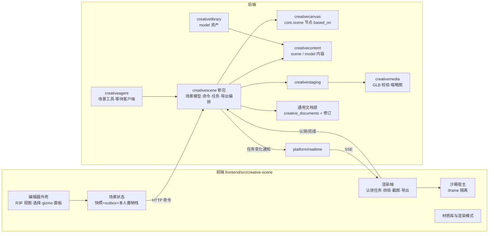
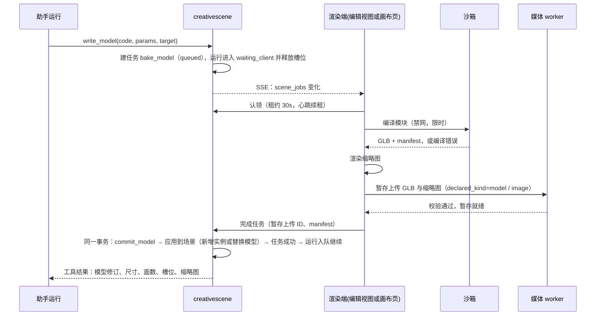
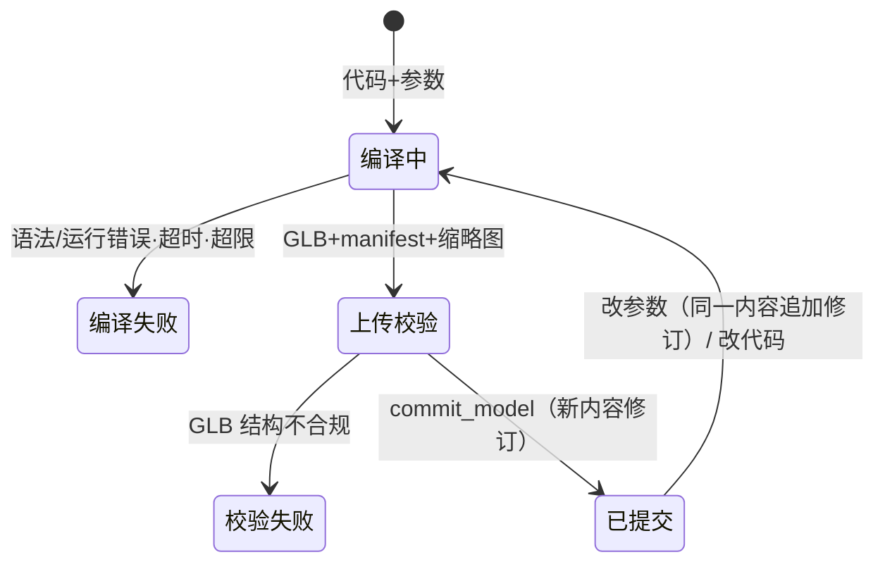
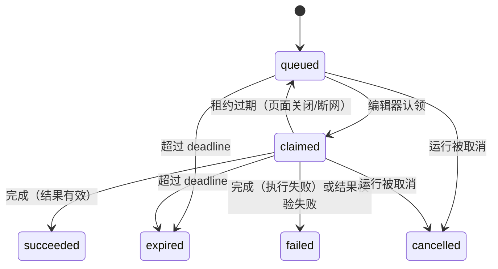

# Epic 技术方案：CG 合成用 3D 场景编辑器

## 设计上下文

需求与边界见 `proposal.md`，取舍过程见 `discovery/brainstorm.md`，选型证据见 `discovery/research/editor-and-geometry-options.md`。采用方案一句话概括：

> 场景是一份**编排 JSON 文档**，按单元做版本控制。物件几何由**几何模块代码**在浏览器沙箱里烘焙成 **GLB**，存为不可变的 `model` 内容。渲染、烘焙和导出都在**编辑器页面**里完成，服务端经**客户端任务**把这些工作派给页面，再把结果交回助手。

方案沿用现有模式：
- **通用文档底座**（独立 change `creative-document-foundation`，本 Epic C1 的前置依赖，owner 2026-10-16）：文档行、修订、引用、回收站、文档类型端口、通用读取与命令入口。场景注册为其中一种类型。
- 策划文档（V6-079 design，`.codestable/features/2026-10-15-shoot-plan-document/shoot-plan-document-design.md` §3–§4）：`creative_documents` + 修订表，单元 `rev`，`restore_unit`，修订记录写入者和本轮改动。
- 画布：outbox 静默保存、SSE 失效通知。
- 媒体：暂存上传 + worker 校验 + `fill_from_upload` 式消费。
- Agent：工具注册表、运行等待状态。

本文区分三类内容：**采用方案**（正文）、**待验证假设**（标「假设」）、**后续增强**（标「后续」）。

## 领域模型与业务规则

### 术语

| 术语 | 定义 | 不是 | 代码 / API 写法 |
|---|---|---|---|
| 场景 | 一份 3D 编排文档：对象树、环境、渲染设置。画布上用场景节点表示 | 不是 GLB 文件，也不是画布本身 | `scene`；文档 `type_key = "scene"`；节点 `core.scene` |
| 场景对象 | 场景里有稳定 ID 的一项：模型实例、内置基础体、灯光、摄像机、分组 | 不是 three.js 的 Object3D（那是渲染时的投影） | `object`，ID 形如 `sobj_<21位nanoid>` |
| 模型 | 一个可复用的几何物件：GLB + manifest + 生成代码 + 参数 schema + 当前参数，是不可变的内容修订 | 不是场景对象；一个模型可以被多个实例引用 | 内容类型 `model` |
| 几何模块 | 生成模型的 JS 代码，遵守 `patterns: 几何模块契约` | 不是场景脚本，不能操作场景 | `module` |
| 内置基础体 | 前端自带的可信几何模块（地面、方块、圆柱、球、平面、楼梯等），渲染时直接生成，不烘焙也不存内容 | 不是 `model` 内容 | `builtin: "box@1"` |
| 材质槽 | 模型里命名为 `slot:<id>` 的材质位置，实例给它分配材质预设 | 不是贴图 | `material_slots` |
| 材质预设 | 前端自带、带版本的参数化程序化材质（石砖、木、金属……） | 不存数据库 | `"stone_brick@1"` |
| 导出图 | 某台摄像机在某种渲染方式下的一张图：`clay`、`line`、`lit` | 不是场景的一部分；导出后是独立的图片内容 | `pass` |
| 客户端任务 | 服务端派给创意空间页面（渲染端）执行的一项工作：烘焙、截图、导出 | 不是服务端后台任务 | `client job`，ID 形如 `csjob_<uuid>` |
| 渲染端 | 当前认领客户端任务的创意空间标签页：打开的场景编辑视图，或在有任务时按需加载渲染模块的画布页 | 不等于账号的全部会话 | `render host` |

术语加入 glossary 的时机：C1 归档时随 `architecture: 场景模块` 一起合入项目契约。

### 不变量

- **I1 只引用不可变内容**：场景快照只通过 `content_revision_id` 引用模型。每个场景修订引用的模型修订都登记为 GC 持有方，历史修订仍可读也可恢复。
- **I2 GLB 是几何事实源**：代码和参数只是重建依据。服务端**从不执行**几何代码，只校验 GLB 结构。同一模型修订在任何地方加载都是同一个 GLB。
- **I3 单元版本**：每个单元的 `rev` 等于它最后一次被改动时的文档修订号，单调递增、永不复用（沿用 V6-079 §4.2）。
- **I4 写时分叉**：修改一个实例的模型时，如果同一场景里还有其他实例引用同一个模型修订，默认分叉出新模型内容，只改这一个实例；请求明确写 `scope: "all_instances"` 时才一起改。
- **I5 单一渲染端**：一个客户端任务同一时刻最多被一个编辑器会话认领；结果提交时必须持有有效租约。
- **I6 导出图独立**：导出图是普通图片内容，由画布节点持有，场景修改不会改变它。它只记录 `based_on`，用于提示过时。
- **I7 内容归属**：资产库和场景之间只复制，不保持引用（owner 2026-10-07）。资产库不记录模型被哪个场景用过。
- **I8 账号隔离**：所有新表都带 `account_id`，查询由 repository 基座限定账号范围（ADR-001）。沙箱拿不到任何凭证。

### 聚合与一致性边界

| 聚合 | 一致性边界 | 写入者 |
|---|---|---|
| 场景文档 | 一行 `creative_documents` 的行锁内完成：版本检查 → 应用 → 写新快照修订、修订行、引用行 | 摄影师（编辑器命令）、助手（工具经同一命令层） |
| 模型内容 | 内容修订不可变；新修订只追加 | 场景命令 `commit_model`（消费暂存上传）、资产库存入（复制） |
| 客户端任务 | 一行任务记录的状态机；和关联的 Agent 运行的恢复在同一事务里推进 | 服务端创建；编辑器认领和完成；过期由服务端判定 |

场景和画布是两个聚合。创建场景节点时，文档和节点在同一个画布命令事务里一起创建（沿用 V6-079「新建走 `add_node`」）。导出时，画布节点通过画布命令层写入；场景只读不写。

## 架构设计

### 模块职责与依赖方向

- **`creativescene`（新）**：
  - 场景快照的 schema 校验、单元版本、命令应用、撤销恢复。
  - 模型提交（消费暂存上传，写 `model` 内容）。
  - 客户端任务的生命周期、导出编排（调用画布命令层建图片节点）。
  - 给助手工具用的领域入口。
  - 不 import gin（ADR-003）；不执行几何代码。
- **通用文档底座**（`creative-document-foundation` 交付）：`creative_documents`、修订表、引用表、工作会话指针、回收站、文档类型端口，以及通用入口 `GET /creative/documents/{id}` 和 `POST /creative/documents/{id}/commands`。场景只是它的一种 `type_key`，由 `creativescene` 实现类型端口（空白载荷、摘要、读取分支、命令应用）。
- **`creativecontent`**：内容类型加 `scene`、`model`，校验载荷外形和大小上限；具体结构由 `creativescene` 在写入前校验（同 V6-079 的 `plan`）。
- **`creativemedia`**：校验白名单加 `model/gltf-binary`（`.glb`），Go 实现 GLB 结构校验（见 `data: 模型内容`）；缩略图作为图片 rendition 一起上传。
- **`creativecanvas`**：
  - 节点类型 `core.scene`，以文档为背书，`maximize` 打开编辑视图。
  - 图片节点的 `config.based_on` 记录导出来源。
  - 节点视图计算「场景已更新」。
- **`creativeagent`**：注册工具 `read_scene@1`、`edit_scene@1`、`write_model@1`、`render_view@1`、`export_shots@1`。需要页面执行的工具创建客户端任务后，运行进入 `waiting_client`，并释放运行槽位。`creativescene` 在任务到达终态时经它定义的端口通知 `creativeagent`（进程启动时注册），不反向 import。
- **`creativelibrary`**：资产类型加 `model`；新增「模型存入资产库」；从资产库放进场景时复制。
- **前端 `creative-scene/`**：
  - 编辑器外壳。
  - 场景状态：权威快照 + 本机 outbox 投影，沿用画布 outbox 的思路，代码独立实现。
  - 本人撤销栈、历史版本列表、沙箱宿主、渲染端（任务执行器）、材质库与渲染模式、导出器。
  - 渲染端不依赖编辑器外壳：画布页在认领到任务时按需加载它（沙箱宿主、模型缓存、离屏渲染），没有任务时不加载 3D 引擎。
  - 编辑视图嵌入画布的同一个助手面板（沿用 V6-079 §7.6）。

### 关键链路

**手动编辑（C1）**：编辑器把操作写进 outbox 并立即投影，静默期过后发出 `POST /creative/documents/{id}/commands`，请求带上涉及单元的 `rev`。服务端在文档行锁内完成写入，产生修订 N+1，通知账号失效。其他标签页收到通知后重读快照。冲突走共享冲突确认框，与画布一致。

**助手写模型（C2 + C3）**：

编译错误时，任务以 `failed` 完成，错误信息作为工具结果返回给助手，由助手修代码重试。这不算运行失败。

**回看截图（C3）**：`render_view(camera | viewpoint | preset, mode)` 建 `render_view` 任务；渲染端出一张 1024 长边的 JPEG，暂存上传后完成任务，并报告实际渲染的场景修订。工具结果把这张图作为图片输入交给模型（要求模型具备 `image_input` 能力）。截图永不放置；它由工具消息的内容引用持有，随对话保留，对话删除后按媒体 GC 回收。

**导出（C4）**：摄影师点导出，或助手调用 `export_shots` 建任务。渲染端按摄像机和导出方式出图并暂存上传，然后调用 `POST /creative/documents/{id}/scene-exports`。服务端校验场景修订，通过画布命令层在场景节点旁建图片节点，写入 `based_on`。

## 技术选型

| 选择 | 采用 | 理由与边界 |
|---|---|---|
| 渲染底座 | `three`（r18x，C1 锁定精确版本）、`@react-three/fiber@9`、`@react-three/drei@10` | 前端已是 React 19（`frontend/package.json`）。drei 提供 TransformControls、CameraControls、Bounds、Grid 等编辑器构件。自研外壳，不 fork 现有编辑器（research §4） |
| 渲染后端 | WebGL2 `WebGLRenderer` | 兼容性优先；Pascal 只支持 WebGPU，这正是不采用它的原因之一。WebGPU 列为后续 |
| 拾取与贴地 | `three-mesh-bvh` | 大量三角形下的射线拾取、贴地、碰撞检查 |
| 布尔运算 | 几何标准库默认用 `three-bvh-csg` | 速度快，保留属性。稳健性不足时再引入 `manifold-3d`（后续，C2 实测决定） |
| GLB 读写 | three addons `GLTFExporter` / `GLTFLoader` | 不新增依赖 |
| 后处理 | AO、描边或边缘检测在 C4/C5 选型（候选 `postprocessing` 或 three addons 自带 pass） | 局部选择，留给子项 |
| 编辑器状态 | zustand（已有） | 不引入 Zundo：撤销是命令式的，要落到服务端 |
| 视图导航 | drei `CameraControls`（`camera-controls`） | 按键、滚轮、修饰键都可重新映射，能配出 Blender 的鼠标与触控板两套导航；G / R / S 模态变换自行实现，gizmo 用 drei `TransformControls`，框选用 three addons 的 `SelectionBox` |
| 代码沙箱 | opaque origin 的 `iframe sandbox="allow-scripts"` + 写明确站点源的 CSP + 每次编译新建的 classic Worker | 见 `patterns: 客户端代码沙箱`。C2 实施前已在 Chromium 和 WebKit 上穿刺验证（子项 C2 `discovery/research/sandbox-spike.md`）。将来某个目标浏览器不满足时改用 QuickJS-wasm（几何代码在 wasm 解释器里执行，three.js 以纯计算子集注入） |
| GLB 校验 | Go 手写容器解析（12 字节头 + JSON chunk + BIN chunk），不新增依赖 | GLB 格式简单；只需结构、外部 URI、计数和包围盒 |
| 实时 | 复用 `platform/realtime` 和账号失效通道 | 客户端任务表装账号级失效触发器，不新增 SSE 端点。C3 核实：场景编辑器挂在画布页内，共用画布页的一条流；唤醒可能丢失，正确性靠打开、重连、回到前台时认领 |
| 服务端渲染 | **不做** | owner 2026-10-15；后续加 headless 渲染时只需加载 GLB |
| 重绘模型 | gpt-image-2.5，走现有生成链路 | 不引入 ComfyUI（owner 2026-10-15）；导出方式按参考图类模型设计 |

## 关键机制

### 单元版本、写入与撤销

- **单元**：`meta`（标题）、`environment`、`render`（渲染设置）、`objects`（对象集合与层级），以及每个对象的两个单元：摆放 `object:<id>`（名称、变换、显示、锁定）和内容 `object:<id>:content`（基础体参数、模型、材质、灯光与摄像机参数）。拆成两个单元是为了让「助手换模型、摄影师同时摆位置」这类最常见的并发两边都成功，只有改到同一类属性才冲突（owner 2026-10-16）。版本规则同 V6-079 §4.2：一次请求里每个单元最多一个操作；所有检查都对照请求前的状态；成功后被改的单元 `rev` 设为 N+1。
- **写入频率**：拖动 gizmo 时只在松手时提交；滑块类连续改动合并 300ms 再入队；只有同一次连续编辑（同一合并键）在队尾合并，复制后紧接的移动并入同一个新增，不同操作各为一步撤销（C1 实测修订）。这样一次拖动只产生一个修订。快照（不含 GLB 和代码）预计几十 KB，每次保存存全文快照可以接受；历史清理是后续工作。
- **协同原则**（owner 2026-10-16，参照 Figma、Liveblocks 的「只撤销自己的操作」，以及 Cursor、Claude Code 用检查点回退 Agent 改动的做法）：**Cmd+Z 只管自己的操作；历史列表和本轮清单可以明确地回退任何人的改动；助手总会被告知。**
- **耗时编辑的基线**（C2 方案评审）：烘焙、上传这类要几秒才能入队的编辑，在开始时冻结涉及单元的预期版本，远端修改不更新它；入队时沿用冻结值，期间别人改过就照常冲突，绝不带着新版本号覆盖对方。本机前序意图的回执照常改写其中的 `{after}`。
- **摄影师的撤销（Cmd+Z）**：编辑器维护本次打开期间、只含摄影师自己操作的撤销栈。撤销时以 `restore_units` 把这一步涉及的单元恢复到这一步之前的修订（重做则恢复到这一步之后的修订），作为**新命令**提交，带当前单元的 `rev`；删除后撤销因此能按原 ID 和原位置加回。如果某一步之后同一对象被助手（或其他标签页）改过，就跳过这一步并提示「这一步之后物件已被修改，无法撤销」，绝不覆盖别人的改动；重做同理。撤销栈不持久化，刷新后由历史列表兜底。
- **本轮改动清单**：沿用「先写入、后审核」（owner 2026-10-15，V6-079 §7.7）。每轮结束后对话里列出本轮改了哪些对象，可以逐处对照，并保留「恢复这一处」按钮（owner 2026-10-16）：用 `restore_units`，单元的旧值取它在本轮第一次被写之前那一版。也可以「撤销本轮」，即对本轮改过的全部单元做一次 `restore_units`，产生一个修订。
- **历史版本列表**（C1）：
  - 列出场景的修订并分组显示：同一写入者、同一次助手运行、时间相近（如 2 分钟内）的连续修订合并成一条，例如「你 · 14:02–14:05 · 移动了 6 个物件」「助手（对话：教堂中殿）· 改了 12 处」。
  - 点开某个版本，在 3D 视图里只读预览（读旧修订快照）；确认后用整份 `restore` 恢复。
  - 恢复本身是新的修订，恢复错了还能从列表里再回去。
- **助手工作中的物件**（C3，owner 2026-10-16：高亮加软提示，不做硬锁）：
  - **高亮**：编辑器给两类物件加醒目描边并标注「助手正在修改」：①进行中的 `bake_model` 任务的目标物件（任务结束即取消）；②本次运行最近 60 秒内写过的物件。数据来自 `api: 列出场景客户端任务`（失效通知后节流重读）和修订列表（`run_id` + `since_revision`）。通知本身不带内容，所以需要这个只读接口（C3 修订 v6）。助手纯思考期间的意图无法得知，不做猜测。
  - **软提示**：摄影师选中或编辑高亮物件时，显示不打断操作的提示「助手正在修改此物件，你的修改可能让它重做」；摄影师的修改照常生效（用户操作最高优先，owner 2026-10-08）。
  - **不做硬锁**：意图难以准确声明，锁可能在运行卡住时泄漏，也违背用户优先原则；成熟协同产品（Figma、Google Docs）也只显示他人位置，不锁对象。
  - **助手侧冲突处理**：助手写入带「最后看到的修订号」作为基线；基线之后别人改过的单元，助手再改就冲突。基线只推进到模型已经被告知的位置（读场景，或附带变更摘要的冲突结果），写入成功不推进基线（C3 方案评审）。冲突时工具结果写明冲突的物件、改动它的是谁、该物件当前的状态。助手据此在新状态上重做，或询问摄影师；已经烘焙好的 GLB 仍在暂存上传里，重试不需要重新编译。
- **助手回退自己的改动**（C3）：摄影师在对话里要求撤回时，助手按 `run_id` 列出自己写过的修订，用 `restore_units` 把这些单元恢复到运行开始前的版本。工具复用 `edit_scene` 的恢复操作，不新增权限。
- **助手的变更知晓**（C3）：助手每轮开始时，以及调用 `read_scene` 时，服务端用底座修订列表的 `since_revision`（取该会话最后一次写入的修订号）汇总「自你上次写入后，摄影师改了哪些对象 / 恢复到了第几版 / 用清单恢复了哪几处」，作为工具结果或上下文提示交给模型。这样，摄影师的手动修改、历史恢复、清单恢复都不会让助手误以为场景仍是它离开时的样子。
- **整份恢复**：`restore` 恢复到旧修订 k，请求带 `expected_revision`，按文档修订号检查；所有单元 `rev` 设为 N+1，旧令牌全部失效（底座规则）。`restore_units` 单独成批，当前不存在的对象单元预期值写 null，并同时检查 `objects`。

### 编辑器交互约定

调研见 `discovery/research/editor-interaction.md`，owner 2026-10-16 拍板。各子项新增的操作都按这套约定分配按键。

- **唯一键位：Blender 2.80 之后的默认键位（左键选择）**，不做键位切换。macOS 上用 Cmd 代替 Ctrl。快捷键按 `event.code` 判断；焦点在输入框或输入法组字时一律不处理。
- **视图导航**：
  - **鼠标**：中键拖动环绕，Shift + 中键平移，Ctrl + 中键拖动或滚轮缩放。
  - **没有中键时**：Alt + 左键（加 Shift、Ctrl 组合）代替中键，与中键并存、始终可用。
  - **触控板**：双指环绕，Shift + 双指平移，捏合或 Cmd + 双指缩放。浏览器分不清触控板双指滑动和鼠标滚轮，因此提供「鼠标 / 触控板」设置，先自动推测，可手动切换，本机记住。
  - **键盘**：数字行与小键盘都能切换视图，1 / 3 / 7 为前 / 右 / 顶视，加 Ctrl 看反方向，5 切换正交与透视；`.` 框选中物件，Home 框全部，反引号键弹出视图菜单。另有可点击的视图方向小部件。
- **选择**：
  - 默认工具是「框选」：左键单击选择，左键拖动拉出选框，Shift 加选，Ctrl 减选；单击空白处取消选择。
  - Shift + 单击加选或取消；A 全选，Alt + A 取消全选。最后选中的是活动物件。
  - 锁定的物件在视口里点不中，也框不进来，只能从物件列表选中。
- **变换**：
  - G / R / S 进入模态移动、旋转、缩放，作用于全部选中物件，以它们的中点为枢轴。
  - 模态中：X / Y / Z 锁轴，再按一次切换为物件自身的坐标轴，第三次解除；Shift + 轴锁平面；按住 Ctrl 吸附（1 m / 5° / 0.1），按住 Shift 精细，Ctrl + Shift 细吸附（0.1 m / 1° / 0.01）。
  - 可以直接键入数字，Tab 切到下一个轴。左键、回车或空格确认，右键或 Esc 取消并复原。
  - Alt + G / R / S 清除位置、旋转、缩放。
  - 工具栏可切换到「调整」（拖动物件即移动），以及移动、旋转、缩放（显示 gizmo）。W 在框选与调整之间切换。
  - 每次确认只产生一次提交。
- **编辑**：
  - Shift + A 在鼠标处弹出添加菜单，新物件落在鼠标所指的地面位置；不做 3D 游标。
  - Shift + D 复制后立即进入移动；X 删除（带确认），Delete 直接删除。
  - H 隐藏（写入物件的 `visible`，会保存，也影响导出），Shift + H 隐藏未选，Alt + H 全部显示。
  - F2 重命名，右键弹出上下文菜单，N 切换属性栏，T 切换工具栏。
  - Ctrl + Z / Ctrl + Shift + Z 撤销与重做（规则见上一节）。
- **与 Blender 的偏差**：
  - Esc 不关闭编辑视图，只取消操作和选择；
  - Ctrl + S 拦下浏览器的保存网页，提示「场景会自动保存」；
  - 浏览器占用的 Ctrl + N / T / W 和 F3 不使用，菜单搜索与「调整上一步」以后另定快捷键；
  - 变换时光标不绕屏（不用 Pointer Lock）。
- **上手辅助**：
  - 视口底部状态栏随时提示可用按键，模态中显示当前轴向和数值；
  - 顶部「添加 / 物件 / 视图」菜单标注快捷键；
  - 左侧工具栏；
  - `?` 打开快捷键速查；
  - 首次打开时给一条提示。
- **按键归属**：
  - C1 实现以上全部；
  - C2：Alt + D 关联复制（共享模型）、代码面板；
  - C4：Numpad 0 / 数字行 0 进入相机视图，Ctrl + Alt + 0 让相机对齐当前视图；
  - C5：Ctrl + G 编组、Ctrl + P / Alt + P 设置与清除父级；
  - 后续子项的新操作不得占用上述按键和浏览器保留键。

### 几何模块与模型生命周期

- **改参数**：用同一份代码重新编译，产生同一模型内容的新修订；引用旧修订的实例按 I4 决定是否随之切换。
- **改代码**：同样产生新修订；代码 diff 不在服务端解析。
- **手动缩放**只改实例的 transform，不重建模型。尺寸要真实变化（例如门洞宽度）时改参数。
- 内置基础体走同一份契约，但作为可信代码打包在前端：渲染时直接生成，不烘焙、不存内容，场景里写 `builtin: "<name>@<ver>"` 和参数。

### 客户端任务

- **租约**：30 秒，渲染端每 10 秒续租。租约过期后任务回到 `queued`，`attempt` 加 1，旧认领令牌失效；迟到的完成请求会被拒绝。第 3 次租约过期时任务直接失败（`host_error`），不再回队，避免会让页面崩溃的任务轮流打崩同账号的标签页。
- **deadline**：默认创建后 30 分钟。期间运行停在 `waiting_client`，不占槽位；运行自身的期限照旧从创建算起（默认 6 小时）。过期后，工具结果返回「页面未打开，任务已过期」，由助手告诉摄影师。
- **认领范围**：同账号的任何创意空间标签页（owner 2026-10-18：不打开场景也能搭建）。每个标签页只有一个认领循环：开着场景编辑视图时先认领该场景的任务，再认领账号里最早的任务；画布页认领到时才按需加载渲染模块。认领前探测页面能力（WebGL2、Worker、精确指针、足够宽的视口），不满足的页面（例如平板上开着的画布页）不认领。请求带 `editor_session_id`（每个标签页随机生成），用来区分标签页。
- **后台标签页**：执行任务期间，标签页切到后台也要继续认领和执行（画布页的实时流现在隐藏时断开，需要在运行期间保持连接或改为短轮询）。
- **事务**：完成任务时，结果落库（如 `commit_model`、写场景）、任务转为 `succeeded`、关联运行入队继续，三者在同一事务里提交；任何一步失败整体回滚，任务保持 `claimed`，编辑器可以重试完成。重试时用相同的 operation id，按幂等回执处理。
- **页面关闭提醒**（owner 2026-10-15）：
  - 本标签页正在执行助手的任务时（编辑视图或画布页），常驻提示「助手正在使用此页面，关闭会中断」。
  - 本标签页持有认领，并且通过 BroadcastChannel 发现同浏览器没有其他创意空间标签页时，才注册 `beforeunload`。
  - 重新打开后自动认领 `queued` 任务，提示「已继续助手的任务」。
- **和运行的关系**（C3 定，owner 2026-10-18）：运行新增状态 `waiting_client`。不复用 `waiting_input`，因为摄影师发一句话就会唤醒它；`waiting_apply` 的语义属于提案采纳。约束：
  - 等待期间释放槽位；只有任务到达终态才继续，完成任务的事务里写入工具结果并让运行入队，槽位被占时保持等待、由清扫恢复；运行被取消时任务在同一事务里转为 `cancelled`；
  - 完成和过期时，按助手写工具的同一套准入复查运行（能力、deadline、Skill、consent），不通过就结束运行；
  - `waiting_client` 计入项目进行中的工作，阻止归档。
- **替换目标的基线**：`bake_model` 替换已有实例的模型时，建任务那一刻冻结目标实例内容单元的版本，完成时原样作为预期版本；期间摄影师改过就冲突，不覆盖（同「耗时编辑的基线」）。新增物件不冻结，完成时按当时的版本写入。冲突失败的任务保留烘焙产物，助手重试时直接复用，不重新编译和上传。

### 渲染模式与导出

- **`clay`**：所有表面用统一的浅灰哑光材质，配简单主光和 AO，突出几何与空间。
- **`line`**：白底黑线，基于深度和法线的边缘检测。描边方法由 C4 选型。
- **`lit`**：材质库 + 场景灯光 + 环境 + 阴影（C5）。C5 之前，导出只有 `clay` 和 `line`。
- **导出规格**：每台摄像机按画幅比例出图，长边默认 2048px，PNG。摄像机属性有焦距（mm）、传感器（默认全画幅 36×24）和画幅比例。
- **`based_on`**：`{scene_document_id, scene_revision, camera_object_id, pass}`。节点视图读取时判断过时：场景当前修订大于 `scene_revision`，且这期间的 `changed_units` 里有除 `meta` 和其他摄像机以外的单元，就提示「场景已更新」。过时只是提示，不改导出图。

### 材质与光照（C5）

- 实例记录 `material_slots: {<slot_id>: {preset, params}}`；缺省值来自模型 manifest 的槽位提示（例如 `slot:wall` 带语义 `stone`）。
- 材质预设由前端拥有并带版本（`stone_brick@1`）。实现是在 MeshStandardMaterial 上注入三平面投影的程序化着色（`onBeforeCompile`），所以照常参与光照和阴影，也不依赖模型 UV。
- 服务端只校验预设 ID 格式（`^[a-z0-9_]+@[1-9][0-9]*$`）和参数外形（平铺对象，最多 32 个键，值为 number / string / boolean）。前端遇到未知预设时，显示中性灰并提示。
- 环境默认是程序化天空（太阳高度角、方位角、浊度），可选少量内置 HDRI（来源与许可在 C5 确定）。灯光是场景对象：方向光、点光、聚光。
- 灯光字段与 three.js 灯光类同名同义（修订 v7，见 `data: 场景文档`），渲染时原样赋给 `DirectionalLight` / `PointLight` / `SpotLight`，`target` 取物件位置沿局部 −Z 的一点。理由：助手最熟悉 three.js，`write_model` 和渲染器也都用 three.js，同一轮对话里只用一套思路；格式若只是大体像 three.js，助手会按像的部分去补其余字段，含义不同的字段（整锥角与半角、度与弧度）不会报错，只会悄悄出错。

### 账号隔离与安全

- 新表全部带 `account_id`，主键或唯一约束包含账号；客户端从不传 `account_id`。
- 沙箱规则见 `patterns: 客户端代码沙箱`。编辑器宿主只接收沙箱回传的 GLB 字节，用 `GLTFLoader` 解析并自己计算 manifest；解析失败或超限按编译失败处理。沙箱回传的数字不可信。
- 服务端校验 GLB 时拒绝外部 URI 和 data URI 以外的引用，并检查大小和计数上限，防止客户端伪造超大或畸形文件。
- 网页内容可能经助手注入恶意代码，所以沙箱是**必需**的。这和代码在谁的浏览器里执行无关。

## 接口设计

共享契约在 `contracts.md` 定义，各子项按 roadmap 交付。

- **扩展方式**：场景对象 schema 在 C1 一次定全（含灯光、摄像机、材质槽字段），C4 / C5 只补前端能力，不改接口。模型相关操作是同一端点上的独立条目 `api: 场景模型命令`，由 C2 交付，在 `提交场景命令` 上做兼容扩展。
- **新建场景**：不设独立接口，走画布命令 `add_node`（`type_key = "core.scene"`），由画布命令层同事务创建文档。画布命令的请求外形不变，只是放开节点类型，所以作为 C1 的局部设计交付。
- **OpenAPI**：变更后运行 `make generate`，提交 Go 和 TS 两份生成物；前端类型一律引用生成的 `schema.d.ts`。

## 数据与存储设计

数据契约见 `contracts.md` 的 `data: 场景文档`、`data: 模型内容`、`data: 场景客户端任务`。共享要点：

- **迁移编号**：接在通用文档底座的迁移之后，按项目约定新建回滚链头，并更新各迁移测试的标签列表。
- **GC**：媒体 GC 的类型范围要加 `model`（目前只含 image / video / audio，由 C2 负责），上线时先升级 creative-worker 再开放模型写入。场景快照本身是非媒体类型，文档彻底删除后不被物理回收（底座规则）。场景修订引用表和模型内容对象都登记进 `creativereference.LiveOwnerCondition` 和守卫测试。模型修订只要被任一场景修订、资产或画布引用就不回收。
- **大小上限（初始值，假设，子项实测后调整）**：
  - 场景快照 ≤ 512 KiB；对象 ≤ 2000 个；摄像机 ≤ 32 台。
  - 几何代码 ≤ 64 KiB；GLB ≤ 16 MiB；单模型三角形 ≤ 300k；单场景引用模型修订 ≤ 300 个。
  - 编译时限 5 秒。
- **配额**：GLB 和缩略图走现有媒体配额。

## 验证与交付

- **各子项局部验证**：`make check-frontend`、`make check-go PKG=...`；纯 mock 的浏览器 e2e，沿用创意空间 e2e 的做法；契约变更运行 `make generate-check`。合回 `develop` 前跑 `make check`。
- **共享不变量的组合验证**：
  - I1 / I8：store 测试，跨账号读写返回不存在；GC 守卫测试。
  - I3：并发命令冲突测试（摄影师与助手同时改同一对象）。
  - I4：分叉测试。
  - I5：双标签页认领、租约过期后迟到完成被拒绝。
  - 沙箱安全样例集（C2）：网络、cookie、存储、父页面 DOM、顶层导航、死循环、超大输出。
- **质量验证**：C3 的助手搭景样例（真实模型、固定任务集、每例至少两次，记录完整对话，质量结论由 owner 给出）；C4 / C5 的重绘一致性样例（同一场景 3 个机位，保留原图与重绘图）。
- **Agent 升级**：新增工具会改变检查点指纹，按 `docs/dev/agent-skills-tools.md`「排空后升级」执行。
- **上线**：项目尚未对外上线，不设功能开关；画布创建菜单从 C1 起显示「3D 场景」。部署配置问题（例如沙箱资源缺失）不在前端暴露原始错误，靠测试和日志拦截（owner 偏好）。

## 未决事项

| # | 问题 / 假设 | 影响 | 解决方式 | 最晚解决时点 |
|---|---|---|---|---|
| 1 | ~~通用文档层由谁先实现~~ **已决（owner 2026-10-16）**：抽成独立 change `creative-document-foundation` 先做，策划（V6-079）和本 Epic 都复用；场景接口走 `/creative/documents/{id}` 通用路径 | C1 依赖底座归档 | — | — |
| 2 | ~~沙箱用 iframe + Worker 还是 QuickJS-wasm~~ **已决（C2 穿刺，2026-10-17）**：iframe + classic Worker，CSP 写明确站点源；见 `patterns: 客户端代码沙箱` | C2 | — | — |
| 3 | 各项大小与时间上限的初始值 | C1、C2、C3 | 子项实测后修订本文件 | 各子项实施前 |
| 4 | ~~现有账号级失效通道能否把客户端任务事件及时送到编辑器~~ **已决（C3 调研，2026-10-18）**：能，任务表装账号级失效触发器，不新增事件 | — | — | — |
| 5 | ~~运行等待客户端任务的状态~~ **已决（owner 2026-10-18）**：新增 `waiting_client` | — | — | — |
| 6 | 描边方法、导出分辨率，以及喂给 gpt-image 的导出组合 | C4、C5 | 实测对照 | C4 / C5 验收 |
| 7 | 首批材质预设、HDRI 来源与许可 | C5 | 列清单请 owner 过目 | C5 design |
| 8 | 资产库浏览器和查看浮窗里的 3D 预览形态（静态缩略图 / 可旋转预览） | C6 | 原型 | C6 design |
