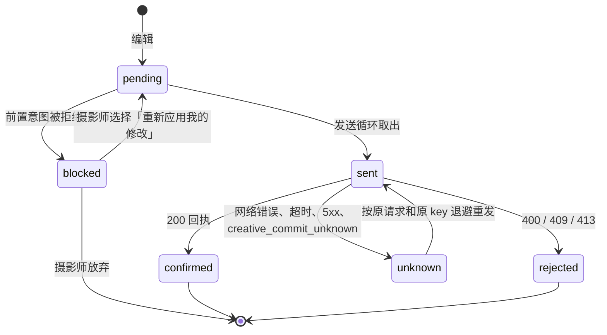
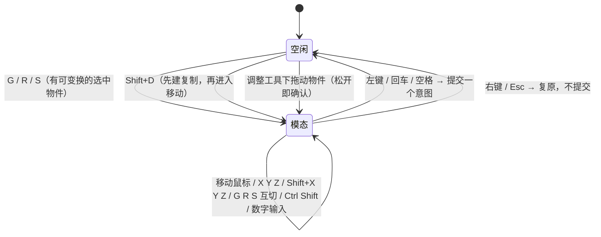

# Change 详细设计：场景文档与编辑器外壳

## 继承的设计

- **Epic**：`scene-editor-3d` 批准基线 v1。
  - 本次使用：`design:` 全部章节；`architecture: 场景模块`、`data: 场景文档`、`api: 读取场景`、`api: 提交场景命令`。
  - 本次交付后四条。
  - 前提：epic 修订 v2（见本文「接口与数据契约」）获批并重新 bind。
- **通用文档底座**（已集成，项目契约 `.lti/contracts/api.md`「读取文档」至「画布新建与放回文档节点」，`data.md` 对应条目）。
  - 本次直接使用：
    - 类型端口 `creativedocument.Type`（`backend/internal/creativedocument/registry.go`）；
    - 通用读取、命令、修订列表、读旧修订和回收站接口；
    - 冲突错误、回执外形和 `reset_required`；
    - 画布 `add_node` 新建文档节点。
  - 底座只改一处：`restore_units` 的单元上限从 200 提高到 4096（见「按单元恢复」），对应项目契约 `api: 提交文档命令` 的 MODIFY delta。其余底座代码不动。
- **画布**：
  - 节点定义由注册表派生（`backend/internal/creativecanvas/definitions.go:documentDefinition`）。
  - 账号级失效通知已经覆盖 `creative_documents`：迁移 0042 的 `creative_documents_notify` 触发器。账号级通知会唤醒该账号的每条画布 SSE（`backend/internal/platform/store/realtime_events.go:invalidate`）。
- **本次承担的用例**：新建场景、打开编辑视图、手动摆放与编辑内置基础体、静默保存、本人撤销和重做、单元并发与冲突、历史版本预览与恢复、多标签页同步。

## 领域模型与业务规则

### 快照与单元

快照的结构见 `data: 场景文档`。Go 侧类型在 `creativescene/model.go`：

```go
type Scene struct {
    Environment Environment `json:"environment"`
    Render      Render      `json:"render"`
    Objects     []Object    `json:"objects"`
}
type Object struct {
    ID            string                  `json:"id"`
    Kind          string                  `json:"kind"`      // primitive | light | camera | group（model_instance 自 C2）
    Name          string                  `json:"name"`
    ParentID      *string                 `json:"parent_id"`
    Order         int                     `json:"order"`
    Transform     Transform               `json:"transform"`
    Visible       bool                    `json:"visible"`
    Locked        bool                    `json:"locked"`
    Primitive     *Primitive              `json:"primitive,omitempty"`
    MaterialSlots map[string]MaterialSlot `json:"material_slots"`
    Light         *Light                  `json:"light,omitempty"`
    Camera        *Camera                 `json:"camera,omitempty"`
}
```

载荷存放在 `creativecontent.Payload.Scene`（`json.RawMessage`，`json:"scene,omitempty"`），沿用 V6-079 给 `plan` 定的做法。外层只检查「只有 `scene` 字段」和 512 KiB 上限，结构由 `creativescene` 在写入前完整校验。

| 单元 | 管什么 | 谁改 |
|---|---|---|
| `meta` | 标题 | 底座 `rename` |
| `environment` | `scene.environment` | `set_environment` |
| `render` | `scene.render` | `set_render` |
| `objects` | 对象集合的存在性，以及层级与兄弟顺序（`parent_id`、`order`） | `add_objects`、`remove_objects`、`reparent_objects` |
| `object:<id>` | 摆放：`name`、`transform`、`visible`、`locked` | `update_objects` 中的摆放字段 |
| `object:<id>:content` | 内容：`primitive`、`material_slots`、`light`、`camera`（C2 起加 `model`） | `update_objects` 中的内容字段 |

单元数上限：3 + 2 × 2000 + `meta` = 4004，在底座的 4096 以内。

### 不变量（服务端每次写入后整体校验）

| # | 规则 | 违反时 |
|---|---|---|
| S1 | 对象 ID 匹配 `^sobj_[A-Za-z0-9_-]{21}$`，快照内唯一 | 400 |
| S2 | `parent_id` 为 null 或指向 `group`；不能成环 | 400 |
| S3 | 同一父对象下 `order` ≥ 0 且互不重复 | 400 |
| S4 | 按 `kind` 必须有、也只能有对应的内容字段（`primitive` 只在 `kind=primitive` 时出现，以此类推）；`group` 没有内容字段 | 400 |
| S5 | `primitive.builtin` 在内置清单里；`params` 的键属于该基础体，类型和范围符合清单；缺省的键在应用时补成默认值，快照里的参数总是完整的 | 400 |
| S6 | 数值都是有限数：位置每轴在 ±100000 以内；缩放每项在 0.001…1000 之间；四元数模长与 1 的差不超过 1e-3；灯光、摄像机、环境的取值范围按 `data: 场景文档` | 400 |
| S7 | 名称不超过 80 个字符；材质槽的 `preset` 格式和 `params` 外形按契约 | 400 |
| S8 | 快照 ≤ 512 KiB；对象 ≤ 2000；`kind=camera` ≤ 32 | 413 `creative_size_limit` |

对象 ID 不复用由客户端用 nanoid 生成来保证。服务端只拒绝与**当前**快照重复的 ID，不查历史（epic 修订 v2 写明）。

### 内置基础体清单

清单只有一份，是 `backend/internal/creativescene/builtins.json`，Go 用 `embed` 读入并据此校验 S5。`make generate` 把它原样复制到 `frontend/src/creative-scene/builtins.gen.json`，前端的几何生成和参数面板读这份副本；`generate-check` 负责发现漂移。参数格式沿用 `patterns: 几何模块契约`，单位为米，Y 轴向上，正面朝 +Z。

| builtin | mount | 参数（默认值，范围） | 说明 |
|---|---|---|---|
| `ground@1` | floor | `size`（40，1…1000） | 正方形地面，新场景自带 |
| `box@1` | floor | `width`、`height`、`depth`（各 1，0.01…1000） | 方块 |
| `cylinder@1` | floor | `radius_top`（0.5，0…500）、`radius_bottom`（0.5，0.001…500）、`height`（1，0.01…1000）、`radial_segments`（integer 32，3…128） | 顶半径为 0 即圆锥 |
| `sphere@1` | floor | `radius`（0.5，0.01…500）、`segments`（integer 32，8…128） | 原点在底部 |
| `plane@1` | wall | `width`、`height`（各 2，0.01…1000） | 竖板，正面朝 +Z，可当背景板 |
| `stairs@1` | floor | `width`（1.2，0.1…100）、`step_count`（integer 8，1…100）、`step_height`（0.18，0.01…2）、`step_depth`（0.28，0.01…5） | 直跑楼梯 |
| `arch@1` | floor | `width`（2，0.2…100）、`height`（3，0.2…100）、`depth`（0.5，0.05…20）、`opening_width`（1.2，0.1…100）、`opening_height`（2.2，0.1…100） | 带半圆拱的门洞墙；开口超过外框时由几何代码收缩，服务端只校验单项范围 |

几何代码在前端 `creative-scene/builtins/`，属于可信代码，直接生成 `BufferGeometry`，不走沙箱，也不烘焙。材质统一使用 `MeshStandardMaterial`，槽位命名为 `slot:main`，供 C5 分配材质预设。

## 模块职责与协作

### 后端

| 文件 / 符号 | 职责 |
|---|---|
| `creativescene/type.go:sceneType` | 实现 `creativedocument.Type`：`Key`=`scene`，`NodeTypeKey`=`core.scene`，`ContentKind`=`scene`，`Creatable`=true。`init()` 注册 |
| `creativescene/model.go` | 快照类型、解码和编码（拒绝未知字段）、`Validate(Scene)` 校验 S1–S8 |
| `creativescene/builtins.go` + `builtins.json` | 内置清单与参数校验、默认值补齐 |
| `creativescene/ops.go` | 场景操作的解码、`touched`（只读）和 `apply` |
| `creativescene/restore.go` | `RestoreTouched` / `RestoreUnits` |
| `creativescene/view.go` | `View`（含按单元裁剪）和 `Summary` |
| `creativecontent/content.go:Payload`、`Validate` | 新增 `Scene` 字段和 `scene` 分支；`scene` 只能经 `WriteDocumentAndRetain` 由文档层写入 |
| 迁移 `0073_creative_scene_document` | 内容类型 CHECK 加 `scene`；回滚时如有 `scene` 内容则拒绝 |
| `cmd/server/main.go`、`cmd/creative-worker/main.go` | 空导入 `creativescene` 完成注册（两个进程都会执行画布命令和助手工具） |

依赖方向：`creativescene` → `creativedocument`、`creativecontent`、`creativeops`、`platform/store`。不 import gin，也不 import `creativecanvas`。画布通过注册表认识它。

### 前端

| 模块 | 职责 |
|---|---|
| `creative-scene/SceneEditor.tsx` | 编辑视图入口，由 `React.lazy` 按需加载。负责布局、快捷键作用域和 WebGL2 检测 |
| `creative-scene/Viewport.tsx` | R3F `<Canvas>`：`CameraControls`（由 `input/navigation.ts` 配置）、`Grid`、天空、clay 光照、物件渲染、点选与框选、模态变换预览、gizmo 工具用的 `TransformControls`、视图方向小部件 |
| `creative-scene/objects/*` | 按 `kind` 渲染：基础体、灯光图标、摄像机视锥、分组 |
| `creative-scene/builtins/*` | 7 个基础体的几何函数，参数来自 `builtins.gen.json` |
| `creative-scene/panels/*` | 工具栏、菜单栏、物件列表、属性栏、状态栏、快捷键速查、右键菜单、首次提示、历史版本、冲突提示 |
| `creative-scene/input/*`、`creative-scene/transform/*` | 键位表与分发、导航与设备推测、选择、模态变换计算（纯函数为主） |
| `creative-scene/state/sceneStore.ts` | zustand 状态：权威快照、待发队列、投影、选择、撤销栈 |
| `creative-scene/state/apply.ts` | 前端的操作应用，用于投影，镜像服务端语义 |
| `creative-scene/state/sync.ts` | 发送循环、意图终态、回执处理、失效后重读、离开提示 |
| `creative-scene/state/undo.ts` | 本人撤销栈与过期判断（纯函数） |
| `creative-scene/history.ts` | 修订分组与描述（纯函数） |
| `creative-canvas/editor/*` | 创建菜单、卡片、最大化入口、乐观投影默认值认识 `core.scene` |

主流程：画布最大化 → `SceneEditor` 读 `GET /creative/documents/{id}` → 编辑产生意图 → 投影立即显示 → 发送循环逐个提交 `POST /commands` → 回执推进权威快照 → 画布 SSE 失效 → 节流后重读文档（内容与回收站状态）→ 换 base 并重放剩余意图。

## 关键机制

### 场景操作的单元与应用（服务端）

以下操作是 epic 修订 v2 后的形式。`touched` 只读，按底座约定每个单元每涉及一次就返回一条（重复由底座判 400），并在单元出现或消失时加上 `objects`。

| op | touched | apply | 主要校验 |
|---|---|---|---|
| `add_objects{objects[1..2000]}` | `objects`（一次） | 追加对象，补齐参数默认值 | ID 不与当前快照或同批重复；`kind ≠ model_instance`；S1–S8 |
| `update_objects{updates[1..2000]}`，每项 `{object_id, …}` | 每项：改摆放字段时涉及 `object:<id>`，改内容字段时涉及 `object:<id>:content`，可同时涉及两者 | 摆放字段逐项覆盖；`primitive.params` 按键合并；`material_slots`、`light`、`camera` 整体替换 | 对象存在，否则 400「物件不存在」；字段与 `kind` 相符；至少改一个字段 |
| `remove_objects{object_ids[1..2000]}` | `objects` 加上每个被删对象（含分组的全部后代）的两个单元 | 删除 | 对象存在 |
| `reparent_objects{moves[1..2000]}` | `objects`（一次） | 改 `parent_id`、`order` | 父对象是分组，不能移到自己或后代下；结果满足 S3 |
| `set_environment{environment}` | `environment` | 整体替换 | 契约范围 |
| `set_render{render}` | `render` | 整体替换 | `mode ∈ {clay, lit}` |

`Apply` 返回 `Changes`：
- `Changed`：被改的单元，以及新对象的两个单元和 `objects`；
- `Removed`：被删对象的两个单元。

两者都按单元名排序，保证回执稳定。之后对新快照整体执行 `Validate`，任何违反都让整批 400（S8 为 413），不产生修订。

### 按单元恢复（服务端）

`restore_units{from_revision, units}` 由底座调度，场景实现两个钩子。

**单元上限（底座小幅扩展）**：底座现在一次最多恢复 200 个单元（`backend/internal/creativedocument/command.go:maxRestoreUnits`）。删除一个含 101 个对象的分组要恢复 202 个单元，撤销必然 400。所以把上限提高到 4096，与底座的单元容量一致。请求体 1 MiB 的限制不变：4000 个单元名约 180 KB，`expected` 约 220 KB，都在限制内。撤销始终是一个请求，不拆成多个，避免只恢复了一部分。

```
RestoreTouched(old, cur, units):
  units 含 objects → 400「层级结构不能单独恢复」
  units 中的对象单元按 id 分组：
    对象在 old 与 cur 中都存在 → touched 加上列出的单元
    存在性会改变（old 有 cur 无，或 old 无 cur 有）→ 两个单元都必须列出，否则 400；touched 加上两个单元和 objects
  environment / render / meta → 原样加入

RestoreUnits(old, cur, units):
  1. 先算出最终的对象集合 F：
       cur 中的对象，去掉「old 无 cur 有」的（删除）
       加上「old 有 cur 无」的（加回，取 old 中的对象）
     两边都存在的对象：把列出的单元字段换成 old 中的值
  2. 再统一确定每个对象的父对象：
       来源快照 src = 加回的对象用 old，保留的对象用 cur
       沿 src 中的祖先链向上，取第一个在 F 中、且在 F 中是分组的祖先作父对象；找不到就放到根
       （父对象同在本次加回的集合里时，它在 F 中，所以层级保持不变）
  3. 最后确定顺序，按父对象逐个处理：
       父对象没变的保留对象：order 不变
       其余对象（加回的、因祖先被删而上移的）：
         按 (src 中的深度, src 中的父对象, src 中的 order, id) 排序后依次放入
         原 order 在新父对象下没有被占用就用原值，否则排到当前最大值 + 1
  4. Validate；返回 Changed / Removed
```

- **与 `units` 的排列顺序无关**：前三步只依赖集合 F 和两个快照，测试会打乱 `units` 的顺序断言结果相同。
- **不会成环**：保留的对象不可能以加回的对象为父（加回的对象在 cur 中不存在）。加回对象之间的父子关系取自 old，而 old 本身无环。
- **删除分组时后代上移，不连带删除**：后代的单元不在 `units` 里，不能越权删除它们。

### 读取分支与摘要

- `View(cur, nil)` → `{"scene": <快照>, "models": {}}`。`View(cur, units)` → `{"scene": {…}}`，只包含列出的单元：`environment`、`render` 各自原样返回；对象单元返回该对象的对应字段（摆放或内容），同时带上 `id` 和 `kind`。
- `Summary` → `{"objects": n, "primitives": n, "lights": n, "cameras": n}`，地面也计入物件数。卡片显示「12 个物件」，有摄像机时追加「· 2 台摄像机」。
- 场景的新建标题由 `add_node` 决定；前端缺省传「未命名场景」。

### 前端：快照、待发队列与投影

```ts
type Intent = {
  id: string                      // 也是 operation_id / Idempotency-Key
  ops: SceneOp[]
  expected: Record<string, ExpectedRev>   // 编辑发生时看到的单元修订号
  state: 'pending' | 'sent' | 'unknown' | 'blocked'
  blockedBy?: string              // blocked 时：被拒绝的那个前置意图
  inverse?: StepRef               // 撤销或重做产生的意图指回原步骤
}
type ExpectedRev = string | null | { after: string }   // { after: 意图 id }：等该意图的回执
```

已确认和被拒绝的意图会离开队列（见下文「意图的终态」），所以不需要单独的状态值。

- **投影**：`view = intents.reduce(apply, base)`，`apply.ts` 镜像服务端的操作语义（`restore_units` 意图的投影由撤销步骤记下的前值或后值代替，不需要读旧修订）。
- **记录预期修订号**：编辑时，对每个涉及单元记录当前看到的修订号。如果这个单元在投影里来自本机一个尚未确认的意图，就记为 `{after: 该意图}`，等它的回执到达后换成回执里的 `revision`。这样编辑基于什么状态，就用什么状态做并发检查，不会因为发送时快照已刷新而悄悄覆盖别人。
- **合并**：
  - 拖动 gizmo 只在松手时产生意图；
  - 滑块和数值输入防抖 300ms：停止输入 300ms 后提交，回车或失焦立即提交，Esc 还原；只提交改动过的文本（聚焦再离开不写回舍入后的显示值）；属性栏按物件重建，待提交的值不会落到新选中的物件上；
  - 每个意图就是一个撤销步骤，只有对摄影师来说是同一个操作时才合并（owner 2026-10-17）：
    - 同一次连续编辑（属性栏同一字段的多次提交，意图带相同的合并键 `merge`）在队尾还没发出时合并成一个：字段取新值，预期修订号保留最早记录的那个；
    - 复制后立即移动：移动写进 Shift + D 暂扣的那个 `add_objects`，只有一个修订。
  - 不同的操作（G / R / S、gizmo 拖动、显隐切换等）不合并，保存再慢也一样。原规则把「待发的新增」和「同一组对象的连续修改」都合并，保存慢时新增后紧接的缩放会并进新增，Cmd+Z 把方块一起撤掉（owner 测试发现）。
- **发送循环**：
  - 同一时间只有一个请求在发送中，`Idempotency-Key` 等于意图 ID。
  - 按队列顺序取第一个可发送的意图：`pending` 且没有未解析的 `{after}`。`blocked` 的意图跳过，不挡住后面的独立意图。
  - 页面隐藏（`pagehide` / `visibilitychange`）时立即发出待发意图，请求带 `keepalive`。
- **回执处理**：
  - `revision` 等于 base 修订号 + 1：把本意图应用到 base 并推进修订号。单元修订号取回执的 `changed_units` / `removed_units`；`reset_required` 时回执不列单元，改用本意图涉及的单元（与服务端 `Touched` 同规则）和它删除的对象单元。
  - 其中 `reset_required` 的回执和撤销、重做（投影来自步骤记录，服务端可能另行安排层级和顺序）再补一次重读校正。base 先推进，紧接着的编辑才会带上新修订号；等重读回来再推进的话，这段时间里的编辑会和自己的回执冲突（浏览器验证时发现）。
  - 中间夹了别人的修订：重读快照，再以新 base 重放剩余意图。
- **失效后重读**：
  - 编辑视图沿用画布页已有的 SSE 连接，在 `onInvalidate` 里加一个订阅，节流到每 500ms 最多一次。
  - 每次直接 `GET /creative/documents/{id}`。不能只看修订号：进出回收站只改 `trashed_at`、`updated_at`，不推进修订号（`backend/internal/creativedocument/trash.go:setTrashed`）。
  - 读到的 `trashed_at` 变化时切换只读或可编辑；修订号变化时换 base 并重放剩余意图。
  - 正在拖动时，把重读推迟到松手之后。
  - 读取成本实测过高时，再加一个包含生命周期变化的轻量版本标识，S0 不做。

### 前端：意图的终态

每个已发出的意图最终落到下面三种结果之一：



| 终态 | 本意图 | 依赖它的意图（`expected` 里有 `{after: 它}`，含间接依赖） | 独立意图 |
|---|---|---|---|
| 确认 | 推进 base，进入撤销栈 | `{after}` 换成回执的 `revision`，变为可发送 | 继续 |
| 拒绝 | 移出队列和投影，进入冲突提示 | 转为 `blocked`，移出投影。不能换成最新修订号直接发，那样会绕过冲突保护 | 继续 |
| 结果未知 | 保持原请求和原 key，退避重发（1s、2s、4s… 最多 30s）；离线时等恢复网络。服务端按幂等回放原回执 | 继续等待 | 继续（同一时间仍只有一个请求在发送中，未知的意图排在最前） |

冲突提示把被拒绝的意图和被它挡住的意图作为一组展示：
- 「重新应用我的修改」：按最新快照，用这组意图对各单元的最终字段值合并成一个新意图，记录当前的修订号后重新入队；对象已被删除的那部分不再提交。
- 「放弃」：整组丢弃。

### 前端：离开页面和关闭视图

owner 已确认（2026-10-16）：本批不把未发出的修改存到本机，但关闭页面时必须提示。

- 场景会话按文档 ID 存在模块级注册表里，关闭编辑视图或切换画布后，发送循环在后台继续，直到队列清空。
- 只要任何场景会话中还有 `pending`、`sent`、`unknown` 或 `blocked` 的意图，就注册 `beforeunload`：刷新、关闭标签页或离开站点时，浏览器拦截并提示「场景还有未保存的修改，离开会丢失」。这和画布 `WorkspacePage` 现有的 `beforeunload` 是同一做法。
- 关闭编辑视图时，如果有 `blocked` 的意图（等摄影师处理冲突），先弹确认「有 n 处修改因冲突没有保存，关闭后会丢失」，选项为「返回处理」和「仍然关闭」。选择仍然关闭时丢弃这些意图。只有正常待发的意图时直接关闭，后台继续保存。
- 状态栏显示：保存中、已保存、离线（修改尚未保存）、有冲突待处理。

### 前端：冲突

只冲突在 `objects` 上，并不能说明改动互不相干。例如另一方把 A 移进别的分组，这只推进 `objects`；如果此时自动重发对 A 的删除，就会删掉对方刚调整过的物件。所以自动变基只用于能证明不影响原意图的**新增**：

| 情况 | 处理 |
|---|---|
| 409 冲突明细只有 `objects`；意图只新增物件（`add_objects`，或只加回物件的撤销、重做）；最新快照里每个目标父对象（`add_objects` 写的 `parent_id`；加回时步骤记下的原父对象）都存在且是分组 | 自动变基一次：重读，把新物件的 `order` 重新排到父对象下的末尾，`objects` 换成最新修订号后重发。再次冲突就转下一行 |
| 其他 409，包括所有删除、只删除物件的撤销或重做、改层级 | 意图被拒绝（见「意图的终态」），重读并丢弃它的投影。提示「物件「X」刚被其他人修改，这一步没有保存」；删除类的按钮写作「仍然删除」，其余写作「重新应用我的修改」，都按最新修订号重新入队。对象已被删除时不提供重新应用 |
| 400 / 413 | 意图被拒绝，重读，提示服务端给出的消息 |
| 409 `creative_state_conflict` | 场景进了回收站：编辑视图切换为只读，提示先恢复。待发意图保留为 `blocked`，场景恢复后可以重新应用 |
| 404 | 场景已不存在：关闭编辑视图，回到画布，提示未保存的修改已丢失 |

以后需要自动重试删除时，再比较删除目标的集合和层级是否变化。

### 前端：本人撤销栈

每个已确认的步骤记录：本次涉及的非集合单元、步骤前后的修订号 `before = revision - 1`、`after = revision`，以及用于投影的前后字段值。

**过期规则**：步骤有效，当且仅当它之后，它的每个单元的每一次修订都出自本编辑会话。

实现：
- 为每个单元维护 `foreignSeq`，即最近一次观察到外来修订时的步骤序号。观察时机有两个：读到的快照里该单元的修订号不在本会话产生的集合里；或者发送时预期修订号不是本会话产生的。
- 步骤 `s` 有效等价于 `s.seq > foreignSeq[unit]` 对它的所有单元都成立。

| 动作 | 提交 | 投影 |
|---|---|---|
| 撤销步骤 s | `restore_units{from_revision: s.before, units: s.units}`；预期修订号取各单元当前值（集合单元 `objects` 由服务端检查，取当前值） | 立即显示前值 |
| 重做步骤 s | `restore_units{from_revision: s.after, units: s.units}` | 立即显示后值 |
| s 已过期 | 不提交，跳过并提示「这一步之后物件已被修改，无法撤销」，继续检查下一步 | — |
| 撤销时 s 还没发出 | 直接从待发队列删掉，不发请求 | 回到前值 |
| 撤销时本人上一个修改还在发送中或结果未知 | 记下这次撤销，提示「正在保存，保存后撤销」；回执到达、没有本人修改在途时依次执行。期间有新的编辑入队，或这个修改被拒绝（含进回收站），就取消等待 | 回执后显示前值 |
| 整份恢复成功 | 清空撤销栈和重做栈 | — |

示例（AC-4）：
- 摄影师移动 A（修订 5）。另一方改 A（修订 6），快照刷新时 A 的修订号 6 不在本会话集合里，记 `foreignSeq[A]`。摄影师又移动 B（修订 7）。
- 第一次 Cmd+Z 撤销 B：有效。第二次撤销 A：已过期，跳过并提示。
- 之后摄影师再移动 A 并撤销，也不会让最早那一步重新生效，因为 `foreignSeq[A]` 只会增大。

撤销和重做本身也是本会话的写入，它们产生的修订号会加入本会话集合。

提示（过期、保存后撤销）由撤销栈逐条推送给状态栏（`onNotice`）。原实现每次渲染都把 `undo.notice` 写进界面状态，写入又触发渲染，出现任何提示时编辑器都会无限重渲染并崩溃（排查本次问题时在真实后端上复现）。

过期规则只看物件自己的两个单元，不看 `objects`：别人改层级只推进 `objects`，不会让撤销移动、改参数的步骤过期；按单元恢复也保持当前的 `parent_id` 和 `order`，所以不会把别人的层级调整撤回去。会改变物件存在性的撤销或重做（撤销新增就是删除），要对 `objects` 做并发检查，冲突时按上面的冲突规则处理：删除类必须确认，只加回的才自动变基。

删除含大分组的步骤，撤销时一次恢复全部单元（上限 4096），整体成功或整体失败。

### 前端：历史版本列表

- 分页读 `GET /revisions`（每页 50 条），在前端分组。新建（`changed_units = ["*"]` 且不是恢复）单独成组，标为「新建场景」，保证能回到刚建好时的样子。其余相邻修订满足以下任一条件就并入同一组：
  - 两条都是摄影师写入，且相隔 ≤ 2 分钟；
  - 两条都是助手写入，且 `run_id` 相同。
- `restored_from` 不为 null 的修订单独成组：`changed_units = ["*"]` 标为「恢复到第 k 版」，其余标为「恢复了 n 处」。
- 每组显示写入者（你 / 助手 / 系统）、时间段，以及改动物件数，即 `changed_units` 与 `removed_units` 中 `object:<id>` 去重后的数量。
- **预览**：点某一组，读 `GET /revisions/{该组最新修订}`，视口切换到只读快照，编辑、gizmo 和快捷键都停用。顶部提示「正在预览第 N 版」，提供「恢复到此版本」和「退出预览」。
- **恢复**：`restore{revision}`，`expected_revision` 取当前 base 修订号。409 时提示「场景刚被修改，请重新选择版本」并刷新列表；成功（`reset_required`）后重读快照并清空撤销栈。

### 布局与按需加载

- `WorkspacePage` 的最大化入口按节点类型分派：`internal.document` 使用现有 `DocumentView`，`core.scene` 使用 `lazy(() => import('../../creative-scene/SceneEditor.tsx'))`，加载期间显示骨架。
- three、R3F 和 drei 只被 `creative-scene/` 引用，Vite 会把它们拆成独立代码块。AC-10 用构建产物检查：画布入口块不含 three。
- 编辑视图沿用 `.cc-maximized-document` 的覆盖层定位：
  - **顶栏**：标题（可改名）、「添加 / 物件 / 视图」菜单、保存状态、历史、快捷键速查（`?`）、「还原节点」。
  - **左侧**：工具栏（T 切换），以及 280px 的侧栏（N 切换），侧栏上半是物件列表，下半是属性栏。Blender 的属性栏和大纲都在右侧，这里放左侧，因为右侧是画布的助手面板。
  - **中间**：视口。右上角是视图方向小部件（drei `GizmoHelper` + `GizmoViewport`，可点击对齐视图），底部是状态栏。
  - **右侧**：助手面板（`position: fixed; z-index: 40`）。面板打开时，用 `.cc-workspace:has(.cc-agent-panel) .cc-scene-editor { right: … }` 让视口让出右侧，不需要读取助手面板的内部状态。
- 不支持 WebGL2 时，显示「当前浏览器无法显示 3D 场景，请使用最新版 Chrome、Edge 或 Safari」。

### 交互：输入分发与键位表

交互约定见 epic `design.md`「编辑器交互约定」，调研见 `discovery/research/editor-interaction.md`。

- 编辑视图根元素可聚焦，打开时获得焦点，只在根元素上挂一个 `keydown` 监听。以下情况不处理：
  - 事件目标是输入框、文本域或可编辑元素；
  - `event.isComposing` 为真（输入法组字中）。
- 按 `event.code` 判断按键，不受键盘布局和 macOS Option 字符的影响。`mod` 在 macOS 上取 `metaKey`，其他平台取 `ctrlKey`。macOS 上 `Backspace` 也视作 Delete，因为 Mac 笔记本没有独立的 Delete 键。
- 命中的按键先 `preventDefault`，再 `stopPropagation`，避免画布同时响应撤销、删除等快捷键。实施时要核对画布键盘监听挂在哪个阶段：如果在捕获阶段，改为编辑视图打开时由画布停用自身快捷键。
- **键位表**（`input/keymap.ts`）是一份数据：`{code, mods, context, action, label}`。分发器、状态栏提示、菜单上的快捷键标注和速查都读这份表，保证显示的按键和实际行为一致。
- **上下文**：
  - 空闲；
  - 模态变换；
  - 框选中；
  - 菜单打开；
  - 历史预览（只读：只允许导航、视图和 `?`）。
- **Esc 依次处理**：取消模态 → 关闭菜单 → 退出预览 → 取消选择。永远不关闭编辑视图。
- **Ctrl/Cmd + S**：拦下浏览器的保存网页，提示「场景会自动保存」。

### 交互：导航

- 使用 drei `CameraControls`，`mouseButtons.wheel` 设为不处理，滚轮由自己的 `wheel` 监听处理（`passive: false`，一律 `preventDefault`，防止页面滚动或缩放）。

| 输入 | 鼠标模式 | 触控板模式 |
|---|---|---|
| 中键拖动 / + Shift / + Ctrl | 环绕 / 平移 / 推拉 | 同左 |
| Alt + 左键拖动 / + Shift / + Ctrl | 环绕 / 平移 / 推拉（与中键并存） | 同左 |
| `wheel`，无修饰键 | 推拉 | 环绕（`deltaX` 和 `deltaY` 都参与；画面跟着手指走，见下） |
| `wheel` + Shift | 纵向平移 | 平移 |
| `wheel` + `ctrlKey`（捏合，或 Ctrl/Cmd + 滚动） | 推拉 | 推拉 |
| Safari `gesturechange` | 推拉 | 推拉 |

- Alt 和中键的组合由按键状态动态改写 `mouseButtons.left` / `middle`，做法与 `camera-controls` 官方示例相同。右键不给相机，留给上下文菜单和模态取消。
- **设备推测**（`input/navigation.ts:classifyWheel`，纯函数）：
  - 看最近一小段 `wheel` 事件，以下特征判为触控板：`deltaMode = 0`，并且出现横向分量、非整数增量，或连续的小增量；
  - `deltaMode = 1`，或稳定的整格大增量，判为鼠标。
  - 只在用户没有手动选择时生效；手动选择存 `localStorage`，读写都包 try/catch。
  - 规则是待验证假设，先做真机穿刺（见「未决事项」）。
- **视图**：
  - `Digit1`/`Numpad1` 前视，`Digit3`/`Numpad3` 右视，`Digit7`/`Numpad7` 顶视，加 `mod` 看反方向，`Digit5`/`Numpad5` 切换正交与透视；
  - `Period`/`NumpadDecimal` 框选中物件，Home 框全部可见物件，反引号键弹出视图菜单。
  - 编辑器坐标与 Blender 一致：Z 向上、正面朝 -Y；前视（1）从 -Y 看向原点，右视（3）从 +X 看，顶视（7）从 +Z 看、屏幕上方为 +Y。文档数据仍按契约 Y 向上，换算见「局部设计与偏差」。
  - 右上角坐标轴部件只做显示；点击轴头由控制器按屏幕位置命中（`navigation.ts:axisHeadAt`），走与数字键相同的视图切换，不算选择点击。drei 自带的点击动画会改写相机 up 向量、顶视转歪，不用。
  - 滚轮、捏合等不带过渡的相机移动后显式触发重绘：视口按需渲染，camera-controls 不带过渡时不发事件。
- 环绕中心是相机目标点；框选操作会移动目标点。
- **触控板环绕方向**（owner 2026-10-17）：画面跟着手指走，与 Shift 平移一致，也与 Blender 跟随系统自然滚动时一致。自然滚动下手指右移报 `deltaX < 0`，对应中键向右拖，即 camera-controls 的负方位角（`navigation.ts:orbitAngles`，单测直接用 camera-controls 断言）。原实现方向相反。关闭了自然滚动的系统整体反过来，和它的页面滚动一致。
- **正交切换**：新相机取 camera-controls 的目标终点，正在过渡的视图切换（如 7 之后立刻 5）不会丢；正交相机设好 zoom 后立即更新投影矩阵。原实现漏了这一步，正交视图按 zoom = 1 投影，场景缩小几十倍（本次验证视窗恢复时发现）。
- **视窗状态**（owner 2026-10-17）：离开编辑器或刷新页面后，回来看到的和离开时一样。
  - 内容：相机（视图空间的位置、目标点、正交与否、正交缩放）、选择、当前工具、工具栏 / 侧栏 / 历史面板的开合。预览中的旧版本、菜单和提示不保留。
  - 存放：按账号和场景存本机 `localStorage`，键 `creative-scene-view:<账号>:<场景>`，与画布视口 `creative-viewport:<账号>:<画布>` 相同做法（`viewState.ts`）。不进文档、不产生修订；换设备不带过去，跨设备需要服务端存储，另议。
  - 写入：第一次变化后 300ms 内写一次（节流，不是防抖：视图切换过渡期间相机每帧上报），关闭视图和 `pagehide` 时立即写；读写都包 try/catch，读到的内容先校验，坏数据回到默认视图。
  - 恢复：界面状态作为编辑器状态的初值；相机在正交切换完成、控制器已绑定当前相机后恢复，此前不上报，默认视图不会覆盖保存的视图。选择在第一次读到场景后才按现有物件裁剪。

### 交互：选择

- **状态**：`selected: string[]`（有序）和 `active: string | null`。只是本机界面状态，不保存；快照刷新后去掉已经不存在的 ID。
- **可选范围**：视口里只能点中或框进可见、未锁定的物件。锁定物件只能从物件列表选中，属性栏照常显示，但变换字段禁用，直到解锁。
- **默认「框选」工具**：

| 输入 | 结果 |
|---|---|
| 左键单击物件 | 只选中它，设为活动物件 |
| Shift + 单击 | 未选中则加选并设为活动；已选但不是活动则设为活动；已是活动则取消选中（Blender 语义） |
| 单击空白 | 取消全部选择 |
| 左键拖动（物件上或空白处） | 拉出选框，松开时选中框内物件：无修饰键替换，Shift 加选，`mod` 减选。用 three addons 的 `SelectionBox`（视锥与网格求交） |
| A / Alt + A | 全选未锁定的可见物件 / 取消全选 |
| W | 在框选和调整两个工具之间切换 |

- 单击和拖动用 4px 阈值区分。
- 点中的是被点击的那个物件本身，分组不会抢先被选中（Blender 语义）。
- 物件列表：单击选中，`mod` + 单击加选或取消，Shift + 单击按列表顺序连续选择（Blender 大纲的语义）。
- **变换对象**：只对「选中集合里最上层的物件」做变换，即排除祖先也被选中的物件，避免父子重复移动。

### 交互：模态变换



- **进入时记录**：每个变换对象的起始世界变换、枢轴（这些对象世界位置的中点）、起始指针位置和视图矩阵。模态期间只更新本机预览，不产生意图。
- **计算**（`transform/modal.ts`，纯函数）：
  - **移动**：
    - 无约束时，在过枢轴、平行于屏幕的平面（法线为相机朝向，同 Blender）上取指针射线交点；透视下横向拖动不会带出竖直漂移；
    - 锁轴时，取指针射线到该轴直线的最近点；
    - 锁平面时，与该平面求交。
  - **旋转**：
    - 角度为枢轴屏幕位置到起始指针、到当前指针两条线的有向夹角；
    - 旋转轴无约束时是视线方向，锁轴时是该轴；
    - 物件位置也绕枢轴转（Blender 的「中点」枢轴）。
  - **缩放**：
    - 系数为当前指针到枢轴的屏幕距离除以起始距离；
    - 物件位置相对枢轴同比缩放；
    - 锁轴时只缩放该轴，并且始终取物件自身的轴：物件模式下按全局轴缩放旋转过的物件会产生错切，Blender 也是按局部轴处理；
    - 每项结果夹在 0.001…1000。
  - **轴向循环**：同一个轴键第一次锁全局轴，第二次锁物件自身的轴（多选时各自用自己的轴），第三次解除。
  - **吸附与精细**：
    - 按住 `mod` 吸附：移动 1 m，旋转 5°，缩放 0.1；
    - 按住 `mod` + Shift 细吸附：0.1 m、1°、0.01；
    - 按住 Shift 时，从按下那一刻起的增量按 1/10 计。
  - **数字输入**：只做简单模式。
    - 支持数字、`.`、`-`、Backspace，Tab 切到下一个轴；
    - 未锁轴时按 X → Y → Z 依次输入，锁轴时作用于该轴；
    - 单位为米、度、倍数；
    - 有数字输入时，它覆盖鼠标在对应轴上的值。
  - **层级**：先在世界空间计算，再用父对象世界矩阵的逆换回局部变换。
- **状态栏**：模态中显示「移动 · Z 轴 · 2.000 m」和可用按键。
- **确认**：所有变换对象的新变换合成**一个**意图，即一个 `update_objects`，只含摆放字段。它产生一个修订，也是一个撤销步骤。
- **gizmo 工具**（移动、旋转、缩放）：
  - drei `TransformControls` 挂在位于枢轴的辅助对象上，拖动时把增量应用到全部变换对象，松手（`dragging-changed` 变为 false）时提交一个意图；
  - 按住 `mod` 时动态设置 `translationSnap` / `rotationSnap` / `scaleSnap`；
  - gizmo 不支持 Shift 精细调整，这是已知差异。
- **复制（Shift + D）**：
  - 生成新 ID（nanoid），复制最上层选中物件；分组连同后代一起复制。
  - 建一个 `add_objects` 意图并**暂扣不发**，选中这些副本后进入移动。
  - 确认时把副本的新位置直接写进这个暂扣的意图；取消时副本留在原位（Blender 语义）。
  - 两种情况最后都放行这个意图，所以只有一个修订。
- **其他编辑**：
  - X 在鼠标处弹出「删除 n 个物件？」，回车确认；Delete 直接删除；
  - H / Shift + H / Alt + H 改 `visible`；
  - Alt + G / R / S 把位置、旋转、缩放清零；
  - F2 在鼠标处弹出改名框。
  - 以上每次都只产生一个意图。

### 交互：菜单、状态栏与速查

- **菜单**：
  - 「添加」：6 种基础体，分隔线后是地面（场景已自带一块，放在末尾，避免回车误加）。新物件放在打开菜单时指针所指的地面点（Shift + A 时的指针、右键的位置），从菜单栏打开时放在视图中心；新加的地面与新建场景时一样锁定并放在原点；
  - 「物件」：复制、删除、隐藏、隐藏未选、全部显示、清除位置 / 旋转 / 缩放、重命名；
  - 「视图」：前 / 右 / 顶 / 正交透视切换、框选中、框全部；导航设备（自动 / 鼠标 / 触控板）；显示工具栏、显示属性栏。
  - 每项右侧显示键位表里的快捷键。
- **右键单击**（非模态时）：点在物件上，弹出「物件」菜单中适用的项；点在空白处，弹出「添加」。
- **状态栏**：

| 上下文 | 内容 |
|---|---|
| 空闲，无选中 | 左键选择 · 拖动框选 · 中键环绕（Alt+左键） · Shift+A 添加 |
| 空闲，有选中 | G 移动 · R 旋转 · S 缩放 · Shift+D 复制 · X 删除 |
| 模态 | 当前操作、轴向和数值 · X/Y/Z 锁轴 · Ctrl 吸附 · Shift 精细 · 输入数字 · 左键确认 · 右键取消 |
| 历史预览 | 正在预览第 N 版 · 只读 |

- **速查**：`?` 或顶栏按钮打开，按「导航 / 选择 / 变换 / 编辑 / 视图」分组，内容来自键位表。
- **焦点**：输入框回车或弹层关闭后焦点会落到页面 `body`，快捷键随之失效；焦点从编辑器内部离开且没有新目标时交还根元素，点击视口也会把焦点取回根元素。
- **首次打开提示**：一张可关闭的卡片，介绍导航设备设置、G / R / S 和 Shift + A。是否已显示过记在 `localStorage`，读写包 try/catch，失败时每次都显示也无妨。

## 局部设计与偏差

| 决定 | 依据与取舍 |
|---|---|
| 撤销和重做都用 `restore_units`，不自己构造反向操作 | 服务端负责找回前值，删除后加回能保留原 ID 和位置；反向操作要逐操作写，还要处理父对象和顺序已被占用的情况。代价是历史列表把撤销显示为「恢复了 n 处」 |
| 内置清单只在 Go 侧有一份，`make generate` 复制给前端 | 服务端必须校验参数，所以 Go 是事实源；前端用生成的副本，靠 generate-check 发现漂移，不手写两份 |
| 不做 IndexedDB 草稿（owner 2026-10-16 确认） | 内存队列，页面隐藏时 `keepalive` 发出；有未保存修改时离开页面一律拦截提示。owner 接受断网期间强行关闭标签页会丢失修改 |
| 失效后直接读文档，不做修订号探测 | 只看修订号会漏掉进出回收站（它不推进修订号）。按评审定档（约 2 写 QPS），节流 500ms 后读一次快照的成本可以接受；实测过高再加包含生命周期的轻量版本标识 |
| 底座 `restore_units` 上限 200 → 4096 | 一次删除的单元数可以超过 200（大分组），撤销必须一个请求原子完成；拆成多个请求会只恢复一部分。4096 与底座单元容量一致，请求体 1 MiB 限制不变 |
| 视口固定 clay 显示；灯光和摄像机只显示图标与视锥 | 渲染模式归 C5，放置 UI 归 C4、C5；但这些字段已经可以写入（助手、后续子项），所以必须能显示并选中 |
| 采用 Blender 2.80+ 默认键位，不做键位切换（owner 2026-10-16） | owner 倾向 Blender；新手门槛靠状态栏、菜单标注和速查缓解。键位表是唯一来源，显示和行为不会不一致 |
| 中键与 Alt + 左键并存，触控板按 Blender 式，另设「鼠标 / 触控板」（owner 2026-10-16） | 浏览器分不清触控板双指和鼠标滚轮，只能靠推测加手动切换 |
| 多选在 C1 完成（owner 2026-10-16） | Blender 的操作离不开多选。多物件变换以中点为枢轴，一次确认一个修订，因此需要批量的 `update_objects`（R9） |
| 不做 3D 游标、Esc 不关视图、H 写入 `visible`、属性栏放左侧、不用 Pointer Lock | 理由见 epic「编辑器交互约定」与调研文档 §6 |
| gizmo 不支持 Shift 精细；缩放锁轴只用物件自身的轴 | drei `TransformControls` 只支持吸附；物件模式下按全局轴缩放旋转过的物件会错切 |
| 场景卡片不做缩略图 | 缩略图需要客户端渲染并上传；建议与 C4 的导出一起做 |
| 编辑器坐标与 Blender 一致（Z 向上、正面朝 -Y），文档数据保持契约的 Y 向上（owner 2026-10-16） | 摄影师按 Blender 习惯操作，`G Z` 必须是上下。数据仍是 three.js / glTF 的 Y 向上，C2 导入的模型和其他读者都不受影响，契约不改。换基是绕 X 轴 90°（`space.ts`），只在视图边界做：物件节点用换算后的变换，绘制内容内部再转一次；提交变换、属性栏、地面取点时换算回文档。模态变换、gizmo、框选都在世界坐标里，天然是 Blender 语义。已知差别：摄像机和灯光的朝向沿用数据约定（看向数据 -Z，即视图 +Y），无旋转时显示为 0°，而 Blender 的摄像机无旋转时朝下；摄像机放置 UI 归 C4，届时再定 |
| 选中描边：实体用外轮廓（drei `Outlines`），地面和平板用加粗边线（`Edges`），颜色取 Blender 的选中橙 / 活动浅橙 | 只描折角边时球体、圆柱选中后几乎看不出；扁平体没有外壳可描 |
| 回执连续时先推进 base，撤销、重做和 `reset_required` 再补重读 | 原设计让撤销回执等重读，期间的编辑带旧修订号与自己冲突（见「回执处理」） |
| 合并只发生在同一次连续编辑内（合并键），以及复制后移动（owner 2026-10-17） | epic 原文「同一对象未发出的连续 `update_objects` 在 outbox 队尾合并」按字面会把两个独立操作并成一步；保存慢时（例如开发环境连远程库）一次 Cmd+Z 撤掉两步。「一次拖动一个修订」由松手提交保证，不受影响。代价是保存慢或离线时修订数略多。epic 的这句话建议在下次修订时同步改为「同一次连续编辑」 |
| 保存中按 Cmd+Z 等回执后执行 | 原实现提示「稍后再撤销」后什么都不做，保存慢时撤销像失灵。等待期间有新编辑或修改被拒绝就取消，避免撤销掉不是摄影师想撤的那一步 |
| 场景内容只能经文档层写入（代码审计 2026-10-17） | 共享内容层加了 `scene` 分支后，资产创建、画布 `replace_content` 等直接写内容的入口也跟着接受场景：资产入口进写事务后撞上资产表的类型约束（500），画布入口把未经场景 schema 校验的内容挂到文档节点上。在共享层把 `scene` 列为文档专用类型，比在每个入口各加一道限制更不容易漏 |
| 输入里的 `null` 只允许出现在契约标为可空的字段（代码审计 2026-10-17） | 可空字段是 Go 里不带 `omitempty` 的指针（`parent_id`、`fog`、灯光的 `range_m` 等），与 OpenAPI 的 `nullable` 一一对应。其余位置的 `null` 会被解码成零值，例如 `position: [null, 0, 0]` 被当成原点保存；数组元素同样检查。基础体参数是自由键值，由内置清单检查类型 |
| 视窗状态存本机浏览器（owner 2026-10-17） | 与画布视口一致，不给文档增加和编辑无关的修订；跨设备同步留待有需要时做服务端存储 |

**待验证假设**（AC-11 已实测，本机，`CREATIVE_SCENE_BASELINE=1`）：
- 300 个物件的快照约 100 KB，单次命令服务端耗时 p95 < 150ms。实测快照约 94 KB，命令 p50 26 ms / p95 34 ms，每修订存储约 5.2 KB，达标。
- 10 个场景节点的画布读快照 < 500ms。实测 p50 约 50 ms，达标，不提前做摘要缓存。

## 接口与数据契约

**契约状态：扩展**。交付 epic 的 `architecture: 场景模块`、`data: 场景文档`、`api: 读取场景`、`api: 提交场景命令`。以 **epic 修订 v2** 为准，修订稿已写入 epic 的 `contracts.md` 和 `design.md`，待 owner 批准：

| # | 修订 | 原因 |
|---|---|---|
| R1 | `add_object` → `add_objects`；`reparent_object` → `reparent_objects`（上限见 R9） | 底座规定同一批里每个单元最多被一个操作涉及；这两个操作都涉及 `objects`，单数形式下一批只能加一个物件 |
| R2 | `parent_id`、`order` 只归 `objects`；摆放单元 = `name`、`transform`、`visible`、`locked` | `data` 和 `api` 两条契约原来互相矛盾 |
| R3 | `restore_units` 的场景规则：不能单独列 `objects`；存在性会变化的对象两个单元都要列出；加回时父对象不在就放到根、顺序被占就排到最后；删除分组时后代上移 | 原契约没有定义这些情况 |
| R4 | 新场景只有一块内置地面 | `data` 和 `api` 两条契约原来不一致；摄像机随 C4 的放置 UI 出现 |
| R5 | `update_objects` 每项的字段语义：`primitive.params` 按键合并，`light`、`camera`、`material_slots` 整体替换 | 原契约只写了 `material_slots` |
| R6 | 引用不存在的物件返回 400 `validation_failed`（原为 404） | 404 在读取契约里意味着「关闭编辑视图」，物件不存在不应让编辑器退出；正常情况下物件被别人删掉会表现为 409 冲突 |
| R7 | 对象 ID 不复用由客户端保证，服务端只查当前快照；读取失败示例的文案改为「文档不存在」 | 澄清 |
| R8 | `restore_units` 的 `units` 上限随底座提高到 4096 | 删除大分组后要能原子撤销（评审阻塞项 1） |
| R9 | `update_object` 改为批量的 `update_objects{updates[1..2000]}`；`add_objects`、`remove_objects`、`reparent_objects` 的条目上限也从 200 提高到 2000（与物件上限一致） | 多选放进 C1 后，全选再移动会产生上千个更新。底座一批最多 200 个操作，单数形式会超限；拆成多个请求又会让一次操作变成多个修订、多个撤销步骤 |

**OpenAPI**：
- `CreativeDocument` 的 `oneOf` 加 `CreativeSceneDocument`（`type_key: scene`，字段 `scene`、`models`）。
- 新增 `CreativeScene`、`CreativeSceneObject` 等 schema，以及按 `op` 判别的 `CreativeSceneOperation`，供前端引用生成类型。通用的 `CreativeDocumentOperation` 保持 `additionalProperties: true` 不变。
- 画布 `add_node` 的 `type_key` 枚举加 `core.scene`。
- 运行 `make generate`，提交 Go 和 TS 两份生成物，以及 `tool_schemas.gen.go`。

**本 Feature `contracts.md` 的局部增量**：
- `data: ADD 场景内置基础体`：即上文清单，epic 只写了「C1 交付清单」。
- `api: MODIFY 提交文档命令`：`restore_units` 的 `units` 上限 200 → 4096，其余不变。这是对已交付项目契约的兼容放宽，旧客户端不受影响。

## 挂载点

| 位置 | 动作 | 说明 |
|---|---|---|
| `backend/internal/creativescene/type.go` | 新增 | `sceneType` 实现 `creativedocument.Type`，`init()` 注册 |
| `backend/internal/creativescene/model.go` | 新增 | 快照类型、编解码、`Validate` |
| `backend/internal/creativescene/builtins.go`、`builtins.json` | 新增 | 内置清单与参数校验 |
| `backend/internal/creativescene/ops.go` | 新增 | 场景操作 |
| `backend/internal/creativescene/restore.go` | 新增 | 按单元恢复 |
| `backend/internal/creativescene/view.go` | 新增 | 读取分支、摘要 |
| `backend/internal/creativescene/*_test.go` | 新增 | 单元、集成、并发、基线测试 |
| `backend/internal/creativecontent/content.go:Payload`、`Validate` | 修改 | `Scene` 字段与 `scene` 分支；`scene` 属于文档专用类型，`Validate` 和 `WriteAndRetain` 拒绝，只有新增的 `WriteDocumentAndRetain` 能写（代码审计 2026-10-17） |
| `backend/internal/creativedocument/command.go`、`document.go` | 修改 | 文档快照改经 `WriteDocumentAndRetain` 写入（代码审计 2026-10-17） |
| `backend/internal/platform/store/migrations/0073_creative_scene_document.up.sql` / `.down.sql` | 新增 | 内容类型 CHECK |
| `backend/internal/platform/store/creative_scene_document_migration_test.go` | 新增 | 新回滚链头 `rollbackSceneDocument`、拒绝回滚测试 |
| `backend/internal/platform/store/creative_document_foundation_migration_test.go:rollbackDocumentFoundation` | 修改 | 先调用 `rollbackSceneDocument` |
| `backend/internal/platform/store/*_migration_test.go` 的回滚标签列表 | 修改 | 最前面加 `creative-scene-document`；同样带标签列表的 `auth_legacy_cutover_harness_test.go`、`auth_limiter_test.go`、`store_test.go` 一并修改 |
| `backend/cmd/server/main.go`、`backend/cmd/creative-worker/main.go` | 修改 | 空导入 `creativescene` |
| `backend/internal/platform/httpapi/creative_documents_test.go` | 修改 | 场景读取、命令、冲突和回收站的 HTTP 用例 |
| `backend/internal/creativedocument/command.go:maxRestoreUnits` | 修改 | 200 → 4096 |
| `backend/internal/creativedocument/document_test.go` | 修改 | 上限边界：4096 个单元可以恢复，4097 返回 400 |
| `api/openapi.yaml` | 修改 | 见上 |
| `backend/internal/platform/httpapi/api.gen.go`、`frontend/src/api/schema.d.ts` | 生成 | `make generate`。`shootplanning/httpcontract/api.gen.go`、`creativecanvas/tool_schemas.gen.go` 实际未变：前者不含这些 schema；后者只生成读取类输出，助手 `edit_canvas` 的节点类型是手写枚举（`creativeagent/canvas_tools.go:nodeTypes`），不含文档节点，所以工具 schema 不变，无需排空升级，助手到 C3 才能新建或编辑场景 |
| `Makefile:generate`、`Makefile:generate-check` | 修改 | 复制并比对 `builtins.gen.json` |
| `frontend/package.json`、`package-lock.json` | 修改 | `three@0.186.1`、`@types/three@0.186.0`、`@react-three/fiber@9.8.1`、`@react-three/drei@10.7.9` |
| `frontend/src/creative-scene/**` | 新增 | 见「模块职责」 |
| `frontend/src/creative-scene/input/keymap.ts` | 新增 | 键位表与分发器 |
| `frontend/src/creative-scene/input/navigation.ts` | 新增 | `CameraControls` 配置、滚轮处理、`classifyWheel` |
| `frontend/src/creative-scene/input/selection.ts` | 新增 | 选择状态与框选 |
| `frontend/src/creative-scene/viewState.ts` | 新增 | 视窗状态的读写与校验（owner 2026-10-17） |
| `frontend/src/creative-scene/transform/modal.ts`、`numeric.ts` | 新增 | 模态变换计算与数字输入（纯函数） |
| `frontend/src/creative-scene/panels/Toolbar.tsx`、`MenuBar.tsx`、`StatusBar.tsx`、`ShortcutSheet.tsx`、`ContextMenu.tsx`、`FirstRunHint.tsx` | 新增 | 工具栏、菜单、状态栏、速查、右键菜单、首次提示 |
| `frontend/src/creative-scene/builtins.gen.json` | 生成 | 内置清单副本 |
| `frontend/src/creative-canvas/editor/WorkspacePage.tsx` | 修改 | 最大化按类型分派，懒加载 `SceneEditor` |
| `frontend/src/creative-canvas/editor/CanvasView.tsx` | 修改 | 创建菜单「3D 场景」、`KindIcon`、`known`、未命名标签、卡片摘要、最大化按钮 |
| `frontend/src/creative-canvas/editor/outbox.ts:defaultActions`、`defaultNodeSize` | 修改 | `core.scene` 的乐观投影默认值 |
| `frontend/src/creative-canvas/editor/canvasEvents.ts`、`useCanvasSnapshot.ts` | 修改 | 画布 SSE 失效时广播 `notifyCanvasInvalidate`，编辑视图订阅后重读（「失效后重读」） |
| `frontend/tsconfig.app.json` | 修改 | `resolveJsonModule`，读取 `builtins.gen.json` |
| `frontend/src/creative-canvas/editor/workspace.css` 或 `frontend/src/creative-scene/scene.css` | 修改 / 新增 | 编辑视图样式 |
| `frontend/scripts/creative-scene.test.ts` | 新增 | 纯逻辑测试：投影、合并、预期修订号、撤销过期、历史分组、清单一致性 |
| `frontend/scripts/creative-scene-interaction.test.ts` | 新增 | 交互纯逻辑测试：键位分发、模态变换计算、数字输入、选择、滚轮分类 |
| `frontend/scripts/creative-scene.e2e.mjs` | 新增 | mock 接口的浏览器用例 |
| `.lti/specs/creative/scene`（经 specs.md delta） | 新增 | 行为规格 |

## 验证与交付

| 验收 / 不变量 | 验证 |
|---|---|
| AC-1 新建 | `creativescene` 集成测试：`add_node core.scene` 同事务产生文档、修订 1 和节点，快照只有地面；`definitions` 列出 `core.scene` 且可新建 |
| AC-2 写入合并 | 前端单测：一次拖动产生 1 个意图；300ms 防抖；同一字段的连续提交合并并保留最早的预期修订号，不同操作不合并；新增排队时紧接缩放，Cmd+Z 只去掉缩放（e2e 用慢保存复现） |
| AC-3 重开一致 | e2e：改动后重新打开，对比物件列表与属性；后端读取测试对比快照。视窗状态：单测覆盖读写校验与节流写入；e2e 关闭再打开、刷新页面后对比工具、选择和视口截图（正交顶视与任意透视角度） |
| AC-4 撤销 | 前端单测覆盖过期规则的各个场景（含「重新移动后也不复活」，以及别人改层级不让移动步骤过期）；保存中撤销等回执后执行，新编辑或被拒绝时取消；e2e 覆盖保存中连按 Cmd+Z 编辑器不崩溃。后端测试覆盖：撤销用的 `restore_units` 能把删除的对象按原 ID 和位置加回、能删除新加的对象；删除含 150 个对象的分组后一次撤销（300 个单元）整体成功，人为制造其中一个单元冲突时整体失败、快照不变；嵌套分组 G ⊃ H ⊃ A 一起删除后撤销，层级和顺序完全复原，打乱 `units` 顺序结果相同；只恢复 A 而 G 不在时挂到最近的祖先或根 |
| AC-5 单元并发 | 后端屏障并发测试（每组 20 轮）：摆放与内容并发两边都成功；同一单元并发恰好一方成功，冲突明细正确。前端单测覆盖：只冲突在 `objects` 的新增自动变基；删除遇到只在 `objects` 的冲突时不自动重发，进入确认；目标父对象已不存在的新增不自动变基 |
| 意图终态 | 前端状态机单测：A 发送中、B 依赖 A，A 被拒绝时 B 转为 `blocked` 且不发送，独立的 C 照常发送；「重新应用」把 A、B 合并后用最新修订号重发；A 结果未知时用原 key 重发，B 继续等待；A 确认后 B 的 `{after}` 换成回执修订号 |
| 离开提示 | 前端单测：存在 pending/sent/unknown/blocked 意图时 `beforeunload` 拦截，队列清空后解除；关闭视图时只有 blocked 意图才弹确认 |
| AC-6 历史 | 前端单测：分组与描述；后端测试：整份恢复后旧单元修订号失效 |
| AC-7 同步 | 前端单测：失效节流到 500ms，拖动中推迟重读，`trashed_at` 变化切换只读和可编辑；e2e 用两个页面验证修改同步和进出回收站 |
| AC-8 校验 | 后端表驱动测试覆盖 S1–S8 以及每种操作的非法输入（含灯光、摄像机、分组、材质槽），断言不产生修订 |
| AC-9 隔离与回收站 | HTTP 测试：跨账号 404、回收站 409；前端在回收站状态下只读 |
| AC-10 按需加载 | 构建后检查：画布入口块不含 three；e2e 断言打开画布时没有请求 three 代码块 |
| AC-11 基线 | `creativescene` 基线测试（`-run Baseline`，不进默认测试集），记录 p50/p95 和每修订新增字节；画布快照计时，结果写入 verification |
| 迁移 | 回滚链测试；有 `scene` 内容时拒绝回滚 |
| AC-2 模态变换 | 前端单测：无约束、锁轴、锁平面三种移动投影；全局轴和物件自身轴的循环；旋转角与吸附（5° / 1°）；缩放夹取与锁轴；Shift 精细从按下时起算；数字输入（小数、负号、Backspace、Tab 换轴）覆盖鼠标值；取消后变换完全复原；父对象下的物件换算回局部变换 |
| AC-2a 导航 | 前端单测：两种模式下滚轮加修饰键的映射；`ctrlKey` 一律推拉；触控板环绕方向用 camera-controls 断言画面跟手指走；e2e：7 之后立刻 5 是正交顶视，构图与透视顶视一致；`classifyWheel` 用穿刺时录下的真机事件序列做夹具；手动选择优先于推测。真机穿刺矩阵结论写入 verification |
| AC-2b 多选 | 前端单测：Shift + 单击的三态语义、A / Alt + A、锁定和隐藏物件排除、只变换最上层选中物件、多物件绕中点旋转后位置正确、一次确认只产生一个 `update_objects` 意图；复制后移动合并进同一个 `add_objects`。后端测试：一个 `update_objects` 更新 2000 个物件成功并产生一个修订；同一物件出现两次返回 400 |
| AC-2c 按键边界 | 前端单测：按 `event.code` 分发；macOS 认 `metaKey`、`Backspace` 视作 Delete；输入框内或组字中不分发；命中后 `preventDefault` 和 `stopPropagation`；Esc 的处理顺序，以及永不关闭视图；Ctrl/Cmd + S 被拦下。e2e：键盘流程 `Shift+A` → `G Z 2 Enter` → `R` 右键取消 → `A` `G` 确认，断言请求次数和最终快照 |

- 日常检查：`make check-go PKG=./internal/creativescene/... ./internal/creativecontent/... ./internal/platform/store/... ./internal/platform/httpapi/...`、`make check-frontend`、`make generate-check`。合回 develop 前跑一次 `make check`。
- e2e（`frontend/scripts/creative-scene.e2e.mjs`）用内存场景服务端和 mock 路由，不需要真实账号；依赖本机 Playwright Chromium（SwiftShader 下的 WebGL）和运行中的 Vite（`CREATIVE_SCENE_URL`，默认 :5179），手动运行。
- 上线：项目尚未对外，不设开关。助手工具 schema 变化，按「排空后升级」部署，先升级 creative-worker。

## 未决事项

| # | 问题 | 影响 | 解决方式 | 最晚时点 |
|---|---|---|---|---|
| 1 | ~~epic 修订 v2（R1–R9、编辑器交互约定、编组并入 C5）和底座恢复上限扩展待批准~~ | 后端操作集合、OpenAPI、撤销实现、交互 | **已解决**：owner 2026-10-16 与本设计一并批准 | 实施前 |
| 2 | 浏览器输入穿刺：`classifyWheel` 规则、Safari 捏合事件、Cmd + D / Cmd + S 等能否拦下、画布键盘监听的阶段 | 导航与键位分发 | 在 macOS Chrome / Safari / Edge（触控板和鼠标）和 Windows Chrome（鼠标）上实测，录下事件序列作测试夹具 | 导航任务开始前 |
| 3 | ~~基线是否达标~~ | 底座摘要缓存是否需要提前做 | **已解决**：达标，数据见「待验证假设」 | 本次 verify |
