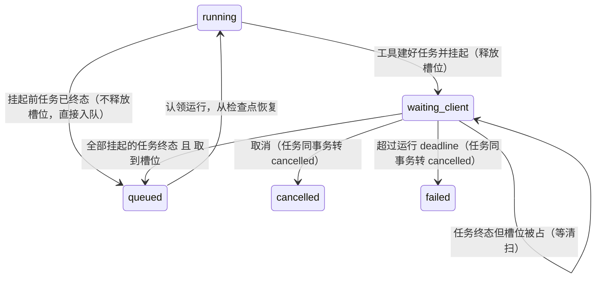
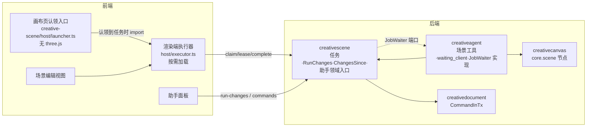
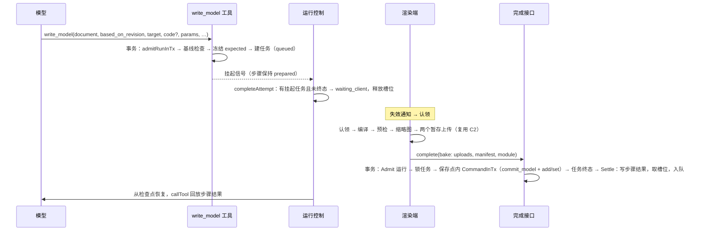

# 详细设计：助手场景工具（C3）

## 继承的设计

- **Epic**：`scene-editor-3d` 修订 v6（本次草稿，与本设计一起审）。沿用：
  - 术语「客户端任务」「渲染端」；
  - 不变量 I1（只引用不可变内容）、I3（单元版本）、I4（写时分叉）、I5（单一渲染端）、I8（账号隔离）；
  - 关键机制「客户端任务」（状态图、租约、deadline、页面关闭提醒、和运行的关系、替换目标的基线），以及「单元版本、写入与撤销」里的协同原则、本轮改动清单、助手工作中的物件、助手回退与变更知晓；
  - 契约 `data: 场景客户端任务`、`api: 认领 / 续租 / 完成 / 列出场景客户端任务`、`api: 读取运行的场景改动`、`architecture: 场景模块`（MODIFY）。
- **C2 已交付**：沙箱宿主 `SandboxHost`、GLB 预检 `inspect`、缩略图、模型缓存 `ModelCache`、`commit_model` / `set_instance_model`、编辑基线。C3 的烘焙直接复用。
- **调研**：`discovery/research/agent-runtime-and-bridge.md`，结论是：
  - 运行等待改用新状态 `waiting_client`；
  - 实时通道可以复用；
  - 完成任务需要事务内的文档命令入口；
  - 截图走 `read_asset` 的图片输入路径。

本次承担的用例：
- 助手搭景和改景（含不打开场景）；
- 编译失败自修，以及回看截图；
- 页面关闭与重开、单一渲染端；
- 助手与摄影师并发写入，助手按过时视图写入时冲突；
- 高亮与软提示；
- 变更知晓、本轮清单、恢复这一处、撤销本轮、助手撤回；
- 点选物件让助手改。

## 领域模型与业务规则

### 客户端任务

一行 `creative_scene_jobs` 是一个聚合：状态机、认领令牌和结果都在这一行上，所有推进都先锁这一行。状态图见 epic「客户端任务」。

| 转换 | 触发者 | 条件 | 副作用 |
|---|---|---|---|
| 新建 → `queued` | 工具（`write_model` / `render_view`）在运行的写事务里 | 运行被准入（`admitRunInTx`） | 同 `(run_id, tool_call_id)` 已有任务时直接返回它，不新建 |
| `queued` → `claimed` | 渲染端认领 | 行锁 + `SKIP LOCKED` | 新令牌、会话、租约 = 现在 + 30 秒 |
| `claimed` → `claimed` | 续租 | 令牌匹配、租约未过期 | 租约 = min(现在 + 30 秒, deadline)；不通知 |
| `claimed` → `queued` | 清扫 | 租约已过期 | `attempt` + 1，清空令牌 |
| `claimed` → `succeeded` / `failed` | 完成 | 令牌匹配、租约未过期 | 落结果、经端口让运行继续，同一事务 |
| 非终态 → `expired` | 清扫 | 超过 deadline | 经端口让运行继续（结果为过期） |
| 非终态 → `cancelled` | 运行结束（取消、超期、失败） | 在结束运行的同一事务里 | 清空令牌；迟到的续租、完成返回 409 |

不变量：
- **J1 单一认领**：同一时刻最多一个有效令牌；令牌只在 `claimed` 时非空。
- **J2 终态只写一次**：终态之后结果不变；完成接口按幂等回执重放。
- **J3 任务与工具步骤同步**：助手创建的任务进入终态时，在同一事务里写入对应工具步骤的结果。不存在任务已终态但步骤仍是 `prepared` 的已提交状态，反之亦然。
- **J4 替换不覆盖**：`bake_model` 替换目标时，用建任务时冻结的 `expected` 写入；新增物件按完成时的 `objects` 版本写入。
- **J5 产物不被任务延寿**：任务行只记录暂存上传 ID 和内容修订 ID（在 `result` jsonb 里），不持有它们。截图由暂存候选（7 天）和工具消息的内容引用持有。表上没有 `%revision_id` 列，不需要登记 `creativereference`。

### 运行的 `waiting_client`



- 一次模型回复里可以并行调用多个 `write_model` / `render_view`。每个调用各建一个任务、各自挂起。运行只有在**没有 `prepared` 工具步骤**时才继续：现有 `prepareModelStep` 本来就拒绝在有 `prepared` 步骤时开始下一步。
- 摄影师在对话里发消息只作用于 `waiting_input`，不会唤醒 `waiting_client`：`SupplementRun` 按状态拒绝。
- 运行期限照旧从创建算起（默认 6 小时）。任务 deadline 30 分钟，在运行期限之内。

### 助手写入的基线

助手的写入针对它最后一次看到的场景。写入类工具都带 `based_on_revision`，取自 `read_scene` 的结果，或上一次写入结果里的 `revision`。

```
others = 修订号 > based_on_revision、且写入者不是本次运行的修订所改的单元
         （其中有整份恢复时 = 全部单元）
touched = 本次写入涉及的单元
if touched ∩ others ≠ ∅ → 冲突（不写入），结果列出冲突的物件、改动者、当前状态
else expected[u] = 当前 unit_revs[u]（不存在为 null）→ 提交场景命令
```

`write_model` 的替换目标在建任务时按同一规则检查，再冻结 `expected`；完成时原样使用（J4）。这条规则让「助手读场景 → 摄影师改 → 助手按旧视图写」冲突。冲突结果给出当前状态和最新修订号，助手重读或直接在新状态上重做。

### 本轮改动与撤回

`creativescene.RunChanges(document, run)` 是唯一的计算，供 `api: 读取运行的场景改动` 和 `edit_scene` 的撤回操作使用。

```
R = 该运行写出的修订（升序，≤ 500）
for 每个被 R 改过的单元 u:
  first(u) = R 中第一次改 u 的修订；pre(u) = first(u) - 1
  blocked(u) = first(u) 之后有非 R 的修订改过 u（或整份恢复）
按物件归并单元（摆放 + 内容）；环境、渲染、标题各成一条
条目 restore：
  单元的 pre 相同 → 一批 {from_revision: pre, units}
  pre 不同 → 取 k = min(pre)，若 (k, pre(u)] 内没有非 R 的修订改过 u 就合成一批，否则按 pre 分批
  物件在 k 时不存在（运行新增的）→ 两个单元都列出，恢复即删除；expected 写当前版本，不存在的写 null，并含 objects
  任一单元 blocked → 整条 restore = null，blocked 写原因
undo_all：所有可恢复条目按同样规则合批，通常一批、产生一个修订
```

「恢复这一处」提交一条的 `restore`；「撤销本轮」依次提交 `undo_all` 的各批；助手撤回时，`edit_scene` 调用同一函数后提交。被别人改过的条目一律跳过并说明，绝不覆盖（epic 协同原则）。

### 变更知晓

`creativescene.ChangesSince(document, conversationRuns)`：取该会话中各次运行在此场景最后一次写入的修订号 b，列出 b 之后、不是这些运行写的修订，归纳成文字：
- 谁改了哪些物件（按当前名称，摆放 / 内容）；
- 删除和新增；
- 整份恢复到第几版；
- 按单元恢复了哪几处。

最多 30 条，超出写「另有 N 处」。会话从未写过该场景时为空。

- **每轮开始**：运行创建时计算并冻结进运行输入。范围是编辑器上下文里的场景，加上本会话最近写过的至多 3 个场景。冻结是因为模型请求的哈希要能在恢复时复现，摘要不能每次现读（调研 §5）。
- **`read_scene`**：当场计算，随工具结果一起记入日志。

### 编辑器上下文（点选物件让助手改）

在场景编辑视图里发起对话时，创建运行的请求带 `scene_context: {document_id, selected_object_ids}`（最多 50 个），冻结为运行输入。上下文里写：「摄影师正在编辑场景「标题」，选中了：柱 A（`sobj_…`）……」。画布视图里发起的运行不带它。

### 关键内部类型

```go
// creativescene
type JobKind string // bake_model | render_view | export_shots
type JobState string
type Job struct {
    ID, DocumentID string; Kind JobKind; State JobState
    Request json.RawMessage; Attempt int
    RunID, ToolCallID *string; Deadline time.Time
}
type JobResult struct { // 写入 result jsonb，也是交给端口的内容
    Bake   *BakeResult   `json:"bake,omitempty"`
    Render *RenderResult `json:"render,omitempty"`
    Error  *JobError     `json:"error,omitempty"` // code: compile_error|compile_timeout|limit_exceeded|render_error|conflict|invalid_result|expired|cancelled
}
// JobWaiter 由 creativeagent 实现、进程启动时注册；creativescene 不 import creativeagent。
type JobWaiter interface {
    Admit(ctx context.Context, tx store.TxAccountScope, runID string) (RunGate, error) // 按运行锁序锁住运行（项目 → 槽位 → 网关 → 运行）
    Settle(ctx context.Context, tx store.TxAccountScope, gate RunGate, job Job, res JobResult) error // 写工具步骤结果；运行在 waiting_client 且无 prepared 步骤时取槽位入队
}
```

## 模块职责与协作



| 模块 | 职责 | 不负责 |
|---|---|---|
| `creativescene` 任务 | 建任务、认领、续租、完成（组装场景命令）、列出、取消、清扫；`JobWaiter` 端口定义 | 运行状态、工具步骤 |
| `creativescene` 助手入口 | `AgentRead`、`AgentEdit`（基线检查 + 撤回）、`CreateBakeJob`、`CreateRenderJob`、`RetryBake`、`RunChanges`、`ChangesSince` | 模型调用、提示词 |
| `creativeagent` | 4 个工具、挂起与恢复、`JobWaiter` 实现、图片输入、编辑器上下文与变更摘要的冻结 | 场景规则 |
| `creativedocument` | 导出 `CommandInTx`，供完成任务在已有事务里写场景 | — |
| `creativecanvas` | 助手新建 `core.scene` 节点时，文档写入者记为助手 | — |
| 前端 `host/` | 认领循环、续租、执行（烘焙、截图）、完成、后台计时、关闭拦截 | 编辑器界面 |
| 前端编辑视图 | 高亮与软提示、烘焙占位、认领本场景任务、编辑器上下文 | — |
| 前端助手面板 | `waiting_client` 状态、截图、本轮改动与恢复 | — |

## 关键机制

### 一次 `write_model` 的端到端



### 挂起：从工具到 `waiting_client`

- 工具在事务里建好任务后，返回包装错误 `errParked{jobID}`。
- `callTool`（`creativeagent/runtime.go:callTool`）在 `default` 分支之前识别它，转成 `tool.StatefulInterrupt(ctx, "client_job", jobID)`；步骤保持 `prepared`，不记为失败。
- 同一批的并行调用：挂起不触发 `batch.stop`，每个调用各自返回自己的 interrupt（`creativeagent/batch.go:dispatch`）。否则未开始的兄弟调用会拿到同一个错误，整个工具节点失败。
- `drainAgent` 照旧把 interrupt 变成 `errRunInterrupted`。`completeAttempt`（`creativeagent/control.go:completeAttempt`）在原 `waitForInput` 分支前判断：本运行有 `prepared` 步骤且对应任务存在时，按任务状态分两路：
  - 全部已终态：说明是竞态，挂起前任务就完成了。此时直接 `enqueueControlledRun`，保留槽位。
  - 否则：调用 `waitForClient`（新，`creativeagent/waiting.go`），同一事务里换 `waiting_token`、`wait_reason = "client_job"`、转 `waiting_client`、`releaseSlotInTx`。
- 崩溃恢复：建任务后、挂起前进程崩溃时，运行租约过期后会被重新认领，从检查点重跑；`callTool` 再次调用工具，工具按 `(run_id, tool_call_id)` 找到已建的任务，再次挂起，不会重复建。

### 完成任务的事务与锁序

锁序：项目 → 槽位 → 网关组 → 运行 → 任务 → 场景文档。与 `SupplementRun`、写工具（`admitRunInTx` 先于领域锁）一致。

```
Executor.Run(complete, op):
  job = 读任务（不加锁，限定账号）           → 不存在 404
  gate = job.run_id ? waiter.Admit(tx, run_id) : nil
  锁任务行；state≠claimed 或令牌不符或租约过期 → ErrJobLeaseLost（409 creative_state_conflict）
  switch kind:
    bake_model:
      generator = {language, contract_version:1, lib_version, code: request.code,
                   code_sha256: sha256(code), params_schema/params/mount: payload.module}
      ops = commit_model(ref, uploads, generator, manifest, name_hint) + (add_objects | set_instance_model)
      在保存点内 CommandInTx(tx, Actor{agent, run_id}, {document_id, expected, ops})
        暂存上传不可用 → 整个事务回滚，409 creative_upload_unavailable（任务仍 claimed，渲染端重传）
        单元冲突       → 回滚到保存点，结果 conflict + conflicts + bake 产物
        校验失败       → 回滚到保存点，结果 invalid_result（manifest 不符、参数不合定义、超上限、父级不存在）
        成功           → 结果 {content_id, content_revision_id, object_ids, revision}
    render_view:
      creativestaging 读暂存上传（pending、声明为 image、属于本账号）→ 内容修订 ID；不消费
      结果 {image_upload_id, content_revision_id}
  任务转 succeeded / failed，写 result
  if gate: waiter.Settle(tx, gate, job, result)
  回执 200 {job_id, state, result}
```

- `creativeops` 只提交 2xx 回执，所以冲突和结果不合规都以「任务失败、返回 200」提交。
- 保存点由新增的 `store.TxAccountScope.Savepoint` 提供；现有先例是 `platform/store/auth_readiness.go`。
- `Settle`（`creativeagent/scene_waiter.go`）按 `runtime.go:callTool` 成功分支的顺序写工具结果：`persistContextInTx` → 步骤 `WHERE state='prepared'` 改为 succeeded → `persistToolMessage` → `writeToolBlockInTx`。工具结果由任务结果转换而来，见下节「工具结果」。写完后：
  - 运行在 `waiting_client` 且已没有 `prepared` 步骤：`LockProjectForWorkInTx` → `acquireSlotInTx`。取到就清令牌、`enqueueControlledRun`；`BusyError` 时保持等待，由清扫恢复。
  - 运行仍在 `running`（竞态）：只写结果，`completeAttempt` 会看到步骤已终态而直接入队。
  - 运行已结束：任务早已被取消，到不了这里。

### 恢复与清扫

- **运行清扫**（`creativeagent/control.go:SweepRuns`，creative-worker 每 15 秒一次）：
  - 筛选条件加上 `state='waiting_client'`；
  - `sweepRun` 对 `waiting_client` 判断：没有 `prepared` 步骤时取槽位入队，`BusyError` 时等下一轮；
  - 运行超过 deadline 照旧结束，任务在 `endControlledRun` 里一起转 `cancelled`。
- **任务清扫**（`creativescene.SweepJobs`，creative-worker 新增 goroutine，每 15 秒；分页方式同 `SweepAllAccounts`）：
  1. 租约过期的 `claimed` → `queued`，`attempt` + 1；
  2. 超过 deadline 的非终态 → `expired`，经 `Admit` / `Settle` 让运行继续；工具结果为「页面未打开，任务已过期」；
  3. 终态满 30 天的删除。
- **取消**：放在 `endControlledRun`（`creativeagent/control.go:endControlledRun`），紧挨着把 `prepared` 步骤改为失败的那条更新。取消、运行超期、认领超期、`completeAttempt` 失败都经过这里，统一调用 `creativescene.CancelRunJobs(tx, runID)`。锁序：运行已锁，再锁任务。

### 认领与渲染端（前端）

两种形态共用 `host/executor.ts`：

| 形态 | 入口 | 认领范围 | 加载 |
|---|---|---|---|
| 场景编辑视图 | `SceneEditor` 挂载时注册 | 带 `document_id`，只认领本场景 | 编辑器已加载 three |
| 画布页后台渲染端 | `WorkspacePage` 挂 `useSceneHostLauncher`（`host/launcher.ts`，不含 three） | 不带 `document_id`，认领账号里最早的 | 第一次认领到任务时 `import('./executor.ts')` |

- **认领时机**：
  - 挂载时、每次画布页失效通知（`onCanvasInvalidate`，节流 500 ms）、回到前台、上线时；
  - 完成一个任务后立即再认领；
  - 有认领在手时每 10 秒续租。
- **优先级**：同一标签页里开着场景编辑视图时，launcher 把 `kinds` 交给编辑视图的执行器。认领到的若是该场景的任务，就交给编辑视图执行，以便显示占位和高亮。跨标签页不做协调，谁先认领谁执行；烘焙结果对代码是确定的。
- **执行**：
  - `bake_model`：调用从 `modelEdits.ts` 抽出的 `bake()`：`SandboxHost.compile` → `renderThumbnail` → 两次 `uploadGenerated`。失败时分别映射：编译失败 → `compile_error`，超时 → `compile_timeout`，超限 → `limit_exceeded`，GLB 预检不合规 → `compile_error`（错误信息说明原因）。
  - `render_view`：见下节。
- **完成失败的处理**：
  - 409 `creative_upload_unavailable`：租约仍有效时重传一次；
  - 409 `creative_state_conflict`：丢弃产物，调用 `discardCandidate`。
- **后台标签页**：
  - **实时流**：`useCanvasSnapshot` 增加 `keepAlive`；本标签页持有认领、或助手面板里有进行中或 `waiting_client` 的运行时，隐藏也不断开。
  - **计时**：执行器的计时（续租、上传轮询、沙箱超时）在隐藏时改用 Worker 发出的节拍（`host/ticker.ts`）。Chrome 对隐藏超过 5 分钟的页面会把主线程定时器压到每分钟一次，Worker 里的定时器不受影响。为此 `uploadGenerated` 增加可注入的等待函数。
  - **渲染**：截图用 `frameloop: 'never'` 手动渲染，不依赖 rAF。
- **关闭拦截**（`host/leaveGuard.ts`）：
  - 持有认领时显示常驻提示；
  - 用 `BroadcastChannel('creative-workspace')` 统计同浏览器的创意空间标签页，只有本页是唯一一个时才注册 `beforeunload`；
  - 重开后第一次认领成功时提示「已继续助手的任务」：任务的 `attempt` > 0 时才提示。

### `render_view`：离屏截图与交给模型

- **渲染端**（`host/render.ts`）：
  1. `readScene(document)` 取已确认的快照和模型摘要；
  2. 对所有 `model_instance` 的修订先 `await modelCache.load`；
  3. 用 R3F `createRoot(detachedCanvas).configure({gl: {preserveDrawingBuffer: true}, shadows: true, frameloop: 'never', dpr: 1, size, camera})`；
  4. 渲染 `<Environment/>`（从 `Viewport.tsx` 导出）与 `<SceneObjects selected={∅}/>`；
  5. 等一次提交后 `gl.render`，`canvas.toBlob('image/png')`；
  6. 暂存上传（`declared: image`）；
  7. 卸载 root，释放 WebGL 上下文。

  `ModelMesh` 增加同步读取缓存（`modelCache.peek`），已加载的模型首帧就是几何，不先画包围盒。
- **取景**：
  - 摄像机：用它的焦距、传感器与画幅比例，长边 1024；
  - `viewpoint`：给定位置、目标和焦距，4:3；
  - 预设：按全部可见物件的世界包围盒（模型取 manifest 范围乘实例变换，基础体取其参数）计算。总览为斜上方 45° 方位角、30° 俯角；俯视、正视、侧视沿坐标轴。都留 10% 边距、焦距 35 mm、4:3。
- **交给模型**：
  - 工具结果写 `image_revision_id` 和 `content_revision_id`。
  - `toolContentRevisions`（`creativeagent/tool_content.go`）登记 `render_view`，`persistToolMessage` 才会写内容引用，截图在本运行里才可读。
  - `bindMessages`（`creativeagent/context.go:bindMessages`）的图片来源从只认 `read_asset` 扩到 `render_view`，标签「(render_view 截图)」，沿用 `ImageInput`、`image_preview` 授权和数量、字节上限。
  - `admitDispatchInTx` 的图片复查名单加上 `render_view`。
  - 工具的 `allowed` 写成 `h.held.Model.Capability.ImageInput`：模型没有看图能力时不提供这个工具。

### 工具输入与结果

| 工具 | 输入 | 结果 | 资源 |
|---|---|---|---|
| `read_scene@1` | `document_id`；可选 `object_ids`（≤ 200）、`include_code`（≤ 3 个模型修订） | `{document_id, title, revision, environment, render, objects:[{id, name, kind, parent_id, transform, builtin/params 或 model:{content_revision_id, name_hint, params, params_schema, bounds_m, triangles, slots}}], code?: {rev: code}, changes_since_last_write}`。物件超过 300 个且未给 `object_ids` 时只返回名称、类型和位置 | `scene:<doc>` 共享 |
| `edit_scene@1` | `document_id`、`based_on_revision`、`operations`（场景命令的操作，不含 `commit_model` 与整份 `restore`）；或单独一条 `{op:"revert_run", run_id \| "previous", object_ids?}` | 成功 `{revision, changed_objects}`；冲突 `{status:"conflict", conflicts:[{object_id, name, part:"摆放"\|"内容", changed_by, current}], revision}`；撤回 `{revision, restored, skipped}` | `scene:<doc>` 独占 |
| `write_model@1` | `document_id`、`based_on_revision`、`target`（`{add:{name, transform, parent_id?}}` 或 `{replace:{object_id, scope:"this"\|"all_instances"}}`）、`params`、`code?`、`base_content_revision_id?`、`name_hint?`、`retry_job_id?` | 成功 `{status:"succeeded", content_revision_id, object_ids, revision, size_m, triangles, slots, parts, anchors}`；`{status:"failed", error:{code, message, line?}}`；`{status:"conflict", conflicts, retry_job_id, revision}`；`{status:"expired"}` | `scene:<doc>` 共享 |
| `render_view@1` | `document_id`；`camera_object_id` \| `viewpoint` \| `preset`；`mode:"clay"` | `{image_revision_id, content_revision_id, width, height, revision}`，并附图片 | `scene:<doc>` 共享 |

- `write_model` 不带 `code` 时必须带 `base_content_revision_id`，代码取自该模型修订（只改参数）。
- `retry_job_id` 指向一个以 `conflict` 失败、且暂存上传仍有效的任务时，直接在工具事务里按新基线写入，不建任务、不挂起（`creativescene.RetryBake`）。
- 替换时的共用与分叉沿用 C2 的 R4 规则：`scope:"this"` 遇到共用就分叉，`all_instances` 在建任务时列出全部共用实例（`object_ids`）。
- 写入类工具的步骤种子沿用 `RunID + "/" + step`，命令的 `operation_id` 由它派生，可以重放。

### 画布上新建场景

- `canvas_tools.go:nodeTypes` 加 `scene`，对应 `core.scene`。
- `editCanvas` 不再丢弃 `applyOnce` 返回的画布，按 `created[key]` 找到节点的 `document_id`，放进结果 `created`：`{key: {node_id, document_id}}`。
- `creativecanvas` 的 `attachDocument` 现在把写入者写死为摄影师，改为取画布命令的执行者：助手创建时为 `Actor{agent, run_id}`。

### 高亮、软提示与占位（编辑视图）

- `SceneEditor` 在打开时和失效通知后（节流 1 秒）调用 `api: 列出场景客户端任务`，并读最近一页修订（`readRevisions`，C3 起支持 `run_id` / `since_revision`）。
- 高亮集合 = 进行中 `bake_model` 的替换目标 ∪ 60 秒内助手修订改过的物件。经 `Viewport` 传给 `SceneObjects` 的 `highlighted`，描边用 `look.ts` 新增的第三种颜色，标签「助手正在修改」。
- `add` 目标在 `target.object.transform` 处显示半透明占位，沿用 C2 的 `GhostModel`，用默认尺寸方块。
- 状态栏 `activity`：「助手正在生成「名称」…」。
- 摄影师选中或编辑高亮物件时，`notice` 显示「助手正在修改此物件，你的修改可能让它重做」，不阻止操作。

### 助手面板

- **状态**：`agentState.ts` 加 `waiting_client: '等待页面执行'`，计入「进行中」（显示停止按钮，不显示补充输入框）。
- **截图**：`AgentBlocks.tsx:ToolRow` 对 `render_view` 读工具结果里的 `content_revision_id`，用 `mediaTicket(rev, 'display', 'display')` 显示缩略图，点开看大图。
- **本轮改动**：
  - 运行结束后，`RunTurn` 末尾渲染 `SceneRunChanges`：从本轮工具块的参数里取 `document_id` 集合，逐个调用 `api: 读取运行的场景改动`。
  - 每处显示名称和新增 / 删除 / 修改，按钮「恢复这一处」提交该条 `restore`；不可恢复的置灰并写原因。
  - 「撤销本轮」依次提交 `undo_all`，经通用命令接口，写入者为摄影师。
  - 提交后重读一次清单。
- **编辑器上下文**：编辑视图打开时，`AgentPanel` 创建运行带上 `scene_context`。选中集合由编辑器写进不含 three 的小模块 `creative-scene/context.ts`，面板读取。

## 局部设计与偏差

| 决定 | 依据与取舍 |
|---|---|
| 工具步骤结果在完成事务里直接写入，恢复时回放，不用 Eino 的 resume data | `compatibleJournal` 已允许 `prepared` 步骤在恢复时终态；resume data 不进日志，也不抗崩溃（调研 §1） |
| `JobWaiter` 端口在 `creativescene` 定义、`creativeagent` 实现 | 维持 `creativeagent → creativescene` 单向依赖；摄影师发起的任务（C4 导出）没有运行，不调端口 |
| 冲突和结果不合规返回 200 + 任务失败 | `creativeops` 只提交 2xx 回执；渲染端的交付本身成功，失败的是任务结果 |
| 场景写入放在保存点里 | 冲突检查在写入前，但物件上限、父级等校验在 `commit_model` 写入后才发生；整笔回滚会让任务停在 `claimed`、反复重试 |
| 写入类工具显式带 `based_on_revision` | 服务端不记录「助手看到了什么」；显式参数随步骤入日志、可重放。代价是模型多填一个字段，结果里总给出最新修订号 |
| `write_model` 可只改参数、可复用冲突前的产物 | 「改成断裂的」只是参数变化，不该让模型重写几 KB 代码；epic 要求冲突重试不重新编译 |
| 撤回、恢复这一处、撤销本轮共用 `RunChanges`，经接口给前端 | 「被别人改过就跳过」的判断只写一份；前端只提交返回的命令 |
| 截图不消费暂存候选 | 截图永不放置（epic），由候选 7 天后过期回收；对话里的旧截图过期后不再显示 |
| 隐藏标签页用 Worker 节拍 | 主线程定时器在隐藏 5 分钟后被压到每分钟一次，会让烘焙变成几分钟（**待验证假设**，见验证） |
| 画布页认领不做跨标签页协调 | 结果确定、租约兜底；协调需要额外的广播协议，收益小 |
| `read_scene` 超过 300 个物件时返回概要 | 工具结果有大小上限；全量对象在 2000 个时远超上下文预算 |

**后续增强**：
- 一个任务烘焙多个模型：AC-12 时延超标时再做；
- 编辑器上下文跟随运行中的选中变化；
- 截图转存为正式图片节点；
- 渲染端跨标签页按场景优先分配。

## 接口与数据契约

- **契约状态：扩展**。交付 epic 修订 v6 的：
  - `data: 场景客户端任务`；
  - `api: 认领场景客户端任务`、`api: 续租场景客户端任务`、`api: 完成场景客户端任务`、`api: 列出场景客户端任务`；
  - `api: 读取运行的场景改动`；
  - `architecture: 场景模块`（MODIFY）。
- **助手运行接口**（不在 lti 契约里，`api/openapi.yaml` 为准）：
  - 运行状态枚举加 `waiting_client`；
  - 创建运行请求加可选 `scene_context {document_id, selected_object_ids}`。

  对已有调用方兼容；前端未识别的状态按「进行中」显示。
- **修订列表**：前端 `readRevisions` 开始使用已有的 `run_id` / `since_revision` 查询参数，接口不变。
- **OpenAPI**：5 个接口、运行状态枚举、`scene_context`，之后 `make generate` 并提交两份生成物。
- **数据**：迁移 `0075_creative_scene_jobs`：
  - 新表 `creative_scene_jobs`，索引见契约，另加唯一 `(run_id, tool_call_id)`；
  - 触发器 `creative_scene_jobs_notify`；
  - `notify_creative_canvas_changed()` 增加分支：本表只改 `lease_until` / `updated_at` 时不通知；
  - `creative_agent_runs.state` 的 CHECK 加 `waiting_client`，重建活跃索引 `creative_agent_run_live`。

  down 迁移：存在 `waiting_client` 运行时拒绝；删表与触发器；函数体恢复为 0060 的版本。

## 挂载点

| 位置 | 动作 | 说明 |
|---|---|---|
| `backend/internal/platform/store/migrations/0075_creative_scene_jobs.up.sql` / `.down.sql` | 新增 | 见上 |
| `backend/internal/platform/store/creative_scene_jobs_migration_test.go` | 新增 | 回滚链头 `rollbackSceneJobs`；up / down / 有 `waiting_client` 时拒绝回滚 |
| `backend/internal/platform/store/creative_model_content_migration_test.go:rollbackModelContent` | 修改 | 先调用 `rollbackSceneJobs` |
| `backend/internal/platform/store/*_migration_test.go`、`store_test.go`、`auth_legacy_cutover_harness_test.go`、`auth_limiter_test.go` | 修改 | 回滚标签列表最前面加新标签 |
| `backend/internal/platform/store/scope.go:TxAccountScope` | 修改 | 新增 `Savepoint(ctx, name, fn)` |
| `backend/internal/platform/store/creative_scene_jobs.go` | 新增 | `ClaimCreativeSceneJob`（`FOR UPDATE SKIP LOCKED`，账号级 / 按场景）；先例 `assignment_quarantine_claim.go` |
| `backend/internal/creativedocument/command.go:CommandInTx` | 新增 | 包装 `decodeCommand` + `commandInTx`，沿用 `CommandAs` 的写入者检查 |
| `backend/internal/creativescene/jobs.go` | 新增 | `Job`、`JobResult`、`JobWaiter`、`SetJobWaiter`、`CreateBakeJob`、`CreateRenderJob`、`Claim`、`Lease`、`Complete`、`ListActive`、`CancelRunJobs`、错误 `ErrJobLeaseLost` |
| `backend/internal/creativescene/jobs_sweep.go` | 新增 | `SweepJobs`、`SweepAllAccounts` |
| `backend/internal/creativescene/run_changes.go` | 新增 | `RunChanges` |
| `backend/internal/creativescene/agent.go` | 新增 | `AgentRead`、`AgentEdit`（基线检查、撤回）、`RetryBake`、`ChangesSince` |
| `backend/internal/creativescene/*_test.go` | 新增 / 修改 | 见验证 |
| `backend/internal/creativeagent/runs.go` | 修改 | `RunWaitingClient`；`createRun` 接收 `scene_context` |
| `backend/internal/creativeagent/inputs.go` | 修改 | 冻结 `scene_context` 与变更摘要 |
| `backend/internal/creativeagent/execute.go:assemble`、`admitDispatchInTx` | 修改 | 渲染编辑器上下文与变更摘要；图片复查名单加 `render_view` |
| `backend/internal/creativeagent/runtime.go:callTool` | 修改 | 识别 `errParked`，转成 interrupt，步骤保持 `prepared` |
| `backend/internal/creativeagent/batch.go:dispatch` | 修改 | 挂起不停止整批 |
| `backend/internal/creativeagent/control.go:completeAttempt`、`sweepRun`、`SweepRuns`、`endControlledRun` | 修改 | `waiting_client` 的挂起、竞态直接入队、清扫恢复、结束时取消任务 |
| `backend/internal/creativeagent/waiting.go:waitForClient` | 新增 | 同 `waitForInput` 的事务步骤，状态与原因不同 |
| `backend/internal/creativeagent/scene_tools.go` | 新增 | 4 个工具的 `Info`、输入校验、调用 `creativescene` 助手入口 |
| `backend/internal/creativeagent/scene_waiter.go` | 新增 | `JobWaiter` 实现（`Admit`、`Settle`） |
| `backend/internal/creativeagent/tool_registry.go:agentToolDefinitions` | 修改 | 登记 4 个工具、资源键 `scene:<doc>`、`render_view` 的 `allowed` |
| `backend/internal/creativeagent/context.go:bindMessages` | 修改 | 图片来源加 `render_view` |
| `backend/internal/creativeagent/tool_content.go:toolContentRevisions` | 修改 | 登记 `render_view` |
| `backend/internal/creativeagent/canvas_tools.go:nodeTypes`、`editCanvas` | 修改 | 节点类型 `scene`；结果带 `document_id` |
| `backend/internal/creativeagent/service.go` | 修改 | 启动时 `creativescene.SetJobWaiter` |
| `backend/internal/creativecanvas/graph_commands.go:attachDocument` | 修改 | 写入者取画布命令的执行者 |
| `backend/internal/creativecanvas/projects.go:waitingRunStates` | 修改 | 加 `waiting_client` |
| `backend/internal/platform/httpapi/creative_scene_jobs.go` | 新增 | 认领、续租、完成、列出、运行改动 5 个处理函数 |
| `backend/internal/platform/httpapi/creative_canvas.go:creativeError` | 修改 | `ErrJobLeaseLost` → 409 `creative_state_conflict` |
| `backend/internal/platform/httpapi/*_test.go` | 新增 / 修改 | 5 个接口、跨账号 404、错误码 |
| `backend/cmd/creative-worker/main.go` | 修改 | 任务清扫 goroutine；注册 `JobWaiter` |
| `backend/cmd/server/main.go` | 修改 | 注册 `JobWaiter` |
| `api/openapi.yaml`，`backend/internal/platform/httpapi/api.gen.go`，`frontend/src/api/schema.d.ts` | 修改 / 生成 | 见「接口与数据契约」 |
| `frontend/src/creative-scene/host/launcher.ts` | 新增 | 画布页认领入口（无 three），按需加载执行器 |
| `frontend/src/creative-scene/host/executor.ts` | 新增 | 认领、续租、执行、完成、重试 |
| `frontend/src/creative-scene/host/bake.ts` | 新增 | 从 `modelEdits.ts` 抽出的烘焙流水线 |
| `frontend/src/creative-scene/host/render.ts` | 新增 | 离屏截图与取景 |
| `frontend/src/creative-scene/host/ticker.ts` | 新增 | Worker 节拍 |
| `frontend/src/creative-scene/host/leaveGuard.ts` | 新增 | 常驻提示、BroadcastChannel、`beforeunload` |
| `frontend/src/creative-scene/host/jobs.ts` | 新增 | 任务相关接口调用 |
| `frontend/src/creative-scene/context.ts` | 新增 | 编辑器上下文（场景与选中）的轻量共享 |
| `frontend/src/creative-scene/modelEdits.ts` | 修改 | 改用 `host/bake.ts` |
| `frontend/src/creative-scene/api.ts` | 修改 | `readRevisions` 的 `run_id` / `since_revision`；`readRunChanges` |
| `frontend/src/creative-scene/Viewport.tsx` | 修改 | 导出 `Environment`；传 `highlighted` |
| `frontend/src/creative-scene/objects/SceneObjects.tsx`、`objects/ModelMesh.tsx`、`objects/look.ts` | 修改 | 高亮描边；同步读缓存 |
| `frontend/src/creative-scene/models/cache.ts` | 修改 | `peek` |
| `frontend/src/creative-scene/SceneEditor.tsx` | 修改 | 注册执行器（本场景）、任务列表与高亮、占位、软提示、写编辑器上下文 |
| `frontend/src/creative-scene/panels/StatusBar.tsx` | 修改 | 助手进度 |
| `frontend/src/creative-canvas/editor/WorkspacePage.tsx` | 修改 | 挂 launcher；`keepAlive`；向面板提供编辑器上下文 |
| `frontend/src/creative-canvas/editor/useCanvasSnapshot.ts` | 修改 | `keepAlive` |
| `frontend/src/creative-canvas/editor/media.ts:uploadGenerated` | 修改 | 可注入等待函数 |
| `frontend/src/creative-canvas/editor/AgentPanel.tsx` | 修改 | `waiting_client`；创建运行带 `scene_context` |
| `frontend/src/creative-canvas/editor/AgentBlocks.tsx` | 修改 | 截图；`SceneRunChanges` |
| `frontend/src/creative-canvas/editor/agentState.ts`、`agentRuns.ts` | 修改 | 状态文案；面板上下文增加恢复动作 |
| `frontend/scripts/creative-scene.e2e.mjs` | 修改 | 渲染端（mock 任务）、高亮、占位、关闭提醒 |
| `frontend/scripts/creative-scene-agent.e2e.mjs` | 新增 | 画布页后台执行、截图显示、本轮清单与恢复（mock 接口） |
| `frontend/scripts/creative-scene-agent-latency.e2e.mjs` | 新增 | AC-12 真实服务时延 |
| `frontend/scripts/creative-scene.test.ts` 等 | 修改 | 执行器、取景、清单的单测 |
| `docs/dev/agent-skills-tools.md` | 修改 | 排空清单加 `waiting_client`；4 个工具 |
| `docs/dev/creative-scene-agent.md` | 新增 | 客户端任务、渲染端与调试方法 |

## 验证与交付

| 验收 | 验证方式 |
|---|---|
| AC-1 助手搭景 | 后端用脚本化的假模型跑完整运行：`write_model` → 挂起 → 测试渲染端完成 → 恢复 → `edit_scene` → `render_view`；e2e（mock）编辑视图里物件陆续出现、运行后出现本轮清单 |
| AC-1a 不打开场景 | e2e：只开画布页，mock 派任务后执行器被按需加载并完成；加载前页面没有 three（沿用 C1 的「canvas page loads no three.js」断言）；面板显示截图 |
| AC-1b 点选修改 | 后端：`scene_context` 冻结并出现在上下文；`write_model` 只改参数时代码取自原修订、共用时分叉；e2e：编辑视图里创建运行的请求带选中物件 |
| AC-2 编译失败 | 测试渲染端以 `compile_error` 完成 → 工具结果带信息与行号、运行继续、场景无新修订 |
| AC-3 回看 | 后端：截图修订进入下一步模型请求的图片输入；无看图能力的模型拿不到 `render_view`；前端单测：四种取景的相机参数；e2e：截图 1024 长边、`toBlob` 成功 |
| AC-4 关闭与重开 | 后端：租约过期回 `queued`，`attempt` + 1，新会话认领后完成，运行只恢复一次；过期 → 工具结果「页面未打开」；e2e：持有认领时有提示，唯一标签页时 `beforeunload` 生效；后台标签页见下方待验证假设 |
| AC-5 等待不占槽位 | 后端：挂起后槽位为空；`SupplementRun` 对 `waiting_client` 返回状态错误；取消时任务同事务 `cancelled`，迟到完成 409；等待期间别的运行占槽位 → 完成后保持等待 → 释放后清扫恢复 |
| AC-6 单一渲染端 | 屏障测试 20 轮：两个会话同时认领只有一个拿到；租约过期后另一个接手；旧令牌续租 / 完成 409 |
| AC-7 并发与冲突 | 屏障测试：烘焙期间移动目标 → 两边成功；烘焙期间改目标内容 → 任务 `conflict`、结果带产物，`retry_job_id` 重试不建任务即写入；读后改 → `edit_scene` 冲突结果列出改动者 |
| AC-8 高亮与软提示 | e2e（mock 任务列表与修订）：描边、标签、软提示不阻止编辑、占位出现与消失 |
| AC-9 变更知晓 | `ChangesSince` 表驱动测试：手动修改、整份恢复、按单元恢复、无写入；运行输入冻结后恢复时请求哈希一致 |
| AC-10 本轮清单与撤回 | `RunChanges` 表驱动测试：新增、删除、修改、别人改过、整份恢复过、需要分批；e2e：恢复这一处、撤销本轮各 1 个修订；`edit_scene` 撤回返回 restored / skipped |
| AC-11 账号隔离 | `httpapi` 测试：跨账号认领 / 续租 / 完成 / 列出 / 运行改动 404；令牌不符 409 |
| AC-12 时延 | `creative-scene-agent-latency.e2e.mjs` 经 `TestCreativeEditorBrowser`：测试端点建 `bake_model` 任务（关联测试运行），测从建任务到步骤结果写入的各段 p50 / p95；模型生成代码的耗时取自 AC-13 的真实运行日志 |
| AC-13 质量 | owner 判断：3 个任务各跑两次，保留对话、截图和最终场景 |

- **待验证假设：后台标签页**。用真实 Chrome 手动验证：标签页隐藏 6 分钟以上时，助手照常完成烘焙和截图，各段耗时与前台相差不超过 2 倍。不满足时改用 Service Worker 定时或提示摄影师保持前台，并交 owner 决定。
- **回归**：
  - `creativeagent` 全部现有测试（运行状态机、检查点、补充输入、清扫）；
  - 画布工具测试（新增 `scene` 节点）；
  - `creativedocument` 命令测试（导出入口不改语义）；
  - 前端助手面板与画布页现有 e2e。
- **门禁**：
  - 日常：`make check-go PKG="./internal/creativescene/... ./internal/creativeagent/... ./internal/creativedocument/... ./internal/creativecanvas/... ./internal/platform/httpapi/... ./internal/platform/store/..."` 和 `make check-frontend`；
  - 合并点跑一次 `make check`。
- **上线**：新工具改变检查点指纹，按 `docs/dev/agent-skills-tools.md`「排空后升级」：先排空运行（含 `waiting_client`），再迁移 0075，再升级 server 与 creative-worker。

## 未决事项

| # | 问题 / 假设 | 影响 | 解决方式 | 最晚时点 |
|---|---|---|---|---|
| 1 | 后台标签页的计时是否足够（Worker 节拍） | AC-4、时延 | 实施渲染端后用真实 Chrome 手动测 | verify 前 |
| 2 | R3F 9.8 的 `createRoot` 离屏渲染与当前 `SceneObjects` 的组合是否顺利（本地未装依赖，未核实 API） | `render_view` 实现方式 | 渲染端任务开始时先做最小样例；不行就为截图写独立的 three 场景构建 | 渲染端任务开始前 |
| 3 | 暂存截图能否签发展示票据（`RequireUsable(display)` 只检查权利声明，预计可以） | 面板显示截图 | 面板任务时验证；不行就由工具结果附带缩略 data URL | 面板任务开始前 |
| 4 | 画布命令层能否拿到执行者，以便新建场景时记为助手 | 新建场景的修订写入者 | 读 `creativecanvas` 命令上下文；拿不到就在画布工具里传入 | 画布工具任务开始前 |
