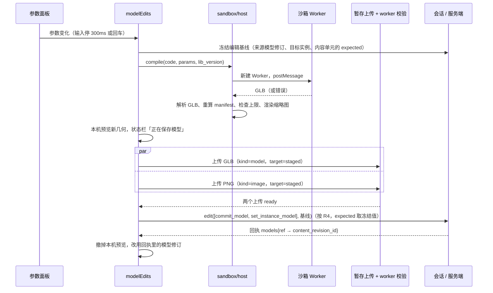

# 详细设计：程序化几何（C2）

## 继承的设计

- **Epic 批准基线 v2**（本次连同 epic 修订 v3 一起审，见「局部设计与偏差」）。本次承接：
  - 术语：模型、几何模块、内置基础体、材质槽；
  - 不变量：I1 只引用不可变内容、I2 GLB 是几何事实源、I4 写时分叉、I8 账号隔离；
  - 聚合：「模型内容」；
  - 关键链路：「助手写模型」中编辑器侧的那一半。C2 由摄影师在编辑器里触发，不经客户端任务；
  - 关键机制：「几何模块与模型生命周期」、「账号隔离与安全」；
  - 选型：`three-bvh-csg`、`GLTFExporter` / `GLTFLoader`、代码沙箱、Go 手写 GLB 校验；
  - 数据与存储：GC、大小上限。
- **交付的 epic 目标契约**：`patterns: 几何模块契约`、`patterns: 客户端代码沙箱`、`data: 模型内容`、`api: 场景模型命令`。正文在 epic `contracts.md`，本文只写实现细节。
- **C1 的实现**（已归档）：
  - 后端 `backend/internal/creativescene`：快照、单元、操作、按单元恢复、读取分支；
  - 前端 `frontend/src/creative-scene`：意图队列、本人撤销栈、历史预览、键位表。

  模型实例沿用这些机制。撤销仍是对内容单元做 `restore_units`，不新增撤销逻辑。
- **调研**：`discovery/research/sandbox-spike.md`（2026-10-17 沙箱穿刺）。
- **经验**：`shared-content-kind-write-entries`（共享内容层新增类型时，要检查所有直接写入口）。`model` 按这条处理。

## 领域模型与业务规则

### 模型内容的两种形态

| 形态 | 谁写 | 载荷 `payload.model` | 对象 | 用途 |
|---|---|---|---|---|
| 暂存形态 | 媒体 worker 校验 GLB 上传后写入，由暂存候选持有 | `{format:"glb", manifest}`，manifest 由服务端从 GLB 算出 | `original` = GLB | 只供 `commit_model` 消费，不能被场景引用；候选消费后失去持有方，按 GC 回收 |
| 完整形态 | `commit_model` 写入 | `{format, generator, manifest, name_hint}`，即 `data: 模型内容` 的结构 | `original` = GLB，`thumbnail` = PNG | 场景实例引用的对象；不可变 |

- 两种形态都是 `kind = 'model'`。场景只接受完整形态（有 `generator`）。
- 完整修订的 GLB 和缩略图对象复用暂存修订的 blob，不复制字节。
- 完整修订的权利声明沿用 GLB 上传会话的声明。缺省为摄影师自有，可以展示。

### 规则

- **R1 引用**：
  - `model_instance` 的 `model.content_revision_id` 必须是本账号、完整形态、可展示的 `model` 修订。
  - 同一场景引用的不同模型修订 ≤ 300 个。
  - 快照的 `Refs` 等于全部实例引用的模型修订集合。
- **R2 写入口**：`model` 和 `scene` 一样不能从通用写入口写入。`creativecontent.Validate` 和 `WriteAndRetain` 拒绝它，资产、画布 `replace_content`、生成输出都写不进来。只有两个入口：
  - `WriteMediaAndRetain`：暂存形态，由 worker 调用。它目前用 `Validate` 检查，改为内部的 `validate`，否则会把暂存形态也拒掉；
  - 新增的 `WriteModelAndRetain`：完整形态，由 `commit_model` 调用。

  暂存候选的另一个出口也要堵上：`creativemedia/candidates.go:AdoptCandidate` 拒绝 `declared_kind = 'model'` 的候选，模型不能被采用到资产或画布节点。
- **R3 manifest 以服务端为准**：
  - `commit_model` 带的 manifest 必须与暂存修订里服务端算出的一致。比对规则：`slots`、`parts`、`anchors` 先按 `id` 排序；`id`、`hint`、`triangles` 精确相等；包围盒和挂点坐标容差 1e-4 m。
  - 名称一律取 GLB JSON 里的原始名称。three.js 的 `GLTFLoader` 会用 `sanitizeNodeName` 删掉 `:`，所以宿主不能从加载后的 `Object3D.name` 取值。
  - 写入完整修订时使用服务端的值。
  - 编辑器宿主用与服务端相同的算法直接解析 GLB（见「接受的 GLB 子集与 manifest」），只为提前报错，不作依据。两边用同一组 GLB 夹具测试。
- **R4 分叉**（I4 在编辑器侧的落实）：改参数或改代码时，编辑器按下表组织命令。

| 当前模型修订被本场景其他实例引用？ | 摄影师选择 | `commit_model.base_content_id` | `set_instance_model.scope` | 结果 |
|---|---|---|---|---|
| 否 | — | 当前模型内容 | `this` | 同一模型内容追加一个修订 |
| 是 | 只改这一个（默认） | 不带（新建内容） | `this` | 分叉出新模型，其他实例不变 |
| 是 | 应用到全部 N 个实例 | 当前模型内容 | `all_instances` | 同一内容追加修订，引用旧修订的实例一起切换 |

  资产（C6）引用的是修订而不是内容的最新版，不受影响，不参与这张表。
- **R5 一次编辑一个修订**：一次调参或重新生成，只产生一个场景命令（`commit_model` 加 `add_objects` 或 `set_instance_model`），也就是一个修订、一个撤销步骤。
- **R6 撤销**：撤销调参就是对内容单元 `object:<id>:content` 做 `restore_units`，实例改回旧模型修订。旧修订仍被历史修订的引用行持有（I1），始终可读；通用层只要求带回的引用出现在旧修订的引用里，不再做可用性检查。
- **R7 确定性**：
  - 同一代码、参数和 `lib_version` 在同一版沙箱里产出相同的 GLB：`Math.random` 每次编译从固定种子开始，`Date` 不可用。
  - GLB 是事实源，所以 three.js 或 `lib` 升级后重新烘焙的细微差异可以接受，不需要迁移已存的模型。

### 关键内部类型

- 后端 `backend/internal/creativeglb`（新，叶子包，不依赖项目其他包）：
  - `Inspect(glb []byte, limits Limits) (Manifest, error)`：做结构校验，并算出 manifest。
  - `Manifest`：`{Bounds{Min,Max [3]float64}, Triangles int, Slots []Slot{ID,Hint}, Parts []string, Anchors []Anchor{ID, Position [3]float64}}`。
  - `Limits`：`{MaxBytes: 16 MiB, MaxTriangles: 300000, MaxNodes: 10000, MaxPrimitiveInstances: 10000, MaxSlots: 32, MaxParts: 200, MaxAnchors: 200}`。
  - 错误带原因码：`container`、`json`、`buffer`、`scene_graph`、`accessor`、`index_range`、`bounds_mismatch`、`unsupported_feature`（形变、骨骼、动画、纹理、稀疏、扩展等，附具体项）、`limit`。
- 后端 `creativescene`：
  - `ModelRef{ContentRevisionID string}`；
  - `Generator`；
  - `ModelPayload{Format, Generator *Generator, Manifest creativeglb.Manifest, NameHint string}`。
  - 参数定义复用内置基础体的 `paramSpec`（`builtins.go`），类型、默认值和范围检查只有一份实现。
- `creativecontent.Payload` 加 `Model json.RawMessage`（与 `Scene` 同样只做外形和大小检查，结构由 `creativescene` 校验）。
- 前端 `frontend/src/creative-scene/sandbox/inspect.ts`：`creativeglb.Inspect` 的 TypeScript 版本，同一算法、同一组夹具（`backend/internal/creativeglb/testdata/*.glb` 及期望的 manifest）。
- 前端 `frontend/src/creative-scene/sandbox/`：
  - `CompileResult = {ok:true, glb:ArrayBuffer, manifest, module:{contract_version, lib_version, mount, params_schema, params}, codeSHA256} | {ok:false, error:{kind:'syntax'|'runtime'|'invalid'|'timeout'|'limit', message, line?, column?}}`。`manifest` 和 `codeSHA256` 由宿主算出，`module` 经宿主校验；
  - `ModelEdit` 状态：`baking → uploading → committing → done | failed`。

## 模块职责与协作

```mermaid
flowchart LR
  subgraph FE[前端 creative-scene]
    CP[代码面板 / 参数面板]
    ME[modelEdits<br/>烘焙→上传→提交]
    SH[sandbox/host<br/>iframe 生命周期·校验]
    MC[models/cache<br/>GLB 加载与缓存]
    SS[会话 sync / undo]
  end
  subgraph SB[沙箱页面 /scene-sandbox/]
    HA[harness<br/>每次编译新建 Worker]
    WK[worker<br/>three·lib@1·导出器]
  end
  subgraph BE[后端]
    CS[creativescene<br/>commit_model·set_instance_model·读取 models]
    CC[creativecontent<br/>model 类型·写入口]
    CM[creativemedia<br/>GLB 上传校验·thumbnail 票据·GC]
    GLB[creativeglb<br/>Inspect]
    STG[creativestaging<br/>Lock·Consume]
  end
  CP-->ME-->SH-->|postMessage|HA-->WK
  ME-->|暂存上传|CM-->GLB
  ME-->|场景命令|SS-->CS
  CS-->STG & CC
  MC-->|媒体票据|CM
```

- **沙箱页面**（不可信区）：只负责编译，拿不到凭证，不能发出网络请求。
  - `harness` 收到宿主的编译请求后，从内嵌源码新建 classic Worker，结束后立即销毁。
  - `worker` 里有 three.js、`GLTFExporter`、`three-bvh-csg`、`acorn`（语法检查与行号）和 `lib@1`。
- **宿主 `sandbox/host.ts`**（可信区）：
  - 管理 iframe：同一时间只编译一个；每次编译硬超时 5 秒，超时就移除 iframe 再重建。
  - 逐字段校验回传消息。
  - 用 `sandbox/inspect.ts` 直接解析 GLB：按「接受的 GLB 子集」做与服务端相同的预检，从顶点数据重新计算 manifest、检查上限。
  - 校验沙箱回传的 `module`，并自己计算代码哈希。
  - **预检通过之后**才交给 `GLTFLoader` 渲染和出缩略图，并用 `LoadingManager.setURLModifier` 拒绝 `blob:`、`data:` 以外的地址。否则 GLB 里的 `buffers[].uri` / `images[].uri` 会让可信的编辑器页面带着 cookie 发出同源请求，绕过沙箱的禁网。从服务端加载的 GLB 同样走这个 URL 限制。
- **`modelEdits.ts`**（用例编排）：
  - 流程：编译 → 宿主校验 → 缩略图 → 两个暂存上传并行 → 都就绪后组织命令（R4）→ 交给会话的 `edit`。
  - 进入队列以后，保存、冲突、撤销都走 C1 的意图机制。
  - 进入队列之前失败（编译、上限、上传），只提示，不产生意图。
- **`models/cache.ts`**：
  - 按 `content_revision_id` 缓存加载好的 GLB（`Promise<THREE.Group>`）。实例用 `clone()` 共享几何。
  - GLB 地址通过 `media.ts:mediaTicket` 取票据（角色 `original`）。
- **后端 `creativescene`**：
  - 场景操作新增 `commit_model`、`set_instance_model`；`add_objects` 放开 `model_instance`。
  - 读取分支 `view` 批量返回 `models`。
  - `unitView` 和按单元恢复把 `model` 归入内容单元。
- **`creativemedia`**：
  - 上传类型 `model`，只允许暂存目标，上限 16 MiB；
  - 校验分支 `verifyModel` 调用 `creativeglb.Inspect`，暂存形态的载荷写入服务端 manifest；
  - 票据角色加 `thumbnail`；
  - GC 类型范围加 `model`。
- **`creativestaging`**：新增 `Consume`，把候选标为已用于文档（`adopted_target_kind = 'document'`）。
- **Go 静态服务**：`/scene-sandbox/` 下的页面使用专用 CSP（见「沙箱页面的提供与 CSP」）。

依赖方向：
- `creativescene` → `creativecontent`、`creativestaging`、`creativeglb`（只用类型）；
- `creativemedia` → `creativeglb`；
- `creativeglb` 不依赖任何项目包。

## 关键机制

### 一次调参的端到端流程



- **更新的输入取代旧的**：同一实例在进入队列前又有新的参数变化时，放弃旧的编辑并取消它的上传，只保留最新的。旧编辑的上传如果已经就绪，调用现有的丢弃候选接口（`POST /creative/upload-candidates/{id}/discard`）释放它，不让候选挂满有效期。已经进入队列的编辑照常保存，新的编辑排在它后面（见「跨意图的模型引用」）。
- **失败**：

| 阶段 | 失败 | 结果 |
|---|---|---|
| 编译 | 语法 / 运行错误、返回值不是 `Object3D`、超时 | 代码面板显示错误和行号；属性栏回到原值；场景不变 |
| 宿主校验 | GLB 解析失败、超上限、包含非三角网格 | 提示原因；不上传 |
| 上传 | 上传失败、worker 判定 GLB 不合规 | 提示「模型保存失败」，可以重试；不产生意图 |
| 提交 | 409 `creative_upload_unavailable`（暂存上传失效） | 意图以「模型上传已失效，请重新生成」被拒绝；不进入回收站分支 |
| 提交 | 400 `validation_failed` / `creative_model_unavailable` | 意图以无效修改被拒绝，提示原因 |
| 提交 | 409 `creative_document_conflict` | 走 C1 的冲突提示 |

C1 的 `state/sync.ts:failed` 先按状态码分支：409 `creative_state_conflict` 一律当作场景进了回收站，命令返回的 404 当作文档不存在。所以模型相关的失败不能复用这两个错误码，改用专用错误码；`failed` 只把 `creative_state_conflict` 和 404 留给文档级语义，其余 4xx 照 C1 的规则拒绝意图。

- **本机预览**：进入队列前，视口里这个实例显示本机刚烘焙的 GLB（临时覆盖，按物件 ID 记录），不进投影。进入队列后见下一节。新建模型时，进入队列前在落点显示半透明的临时物件。

### 跨意图的模型引用

`ref` 只在一批命令里有效，但回执到达之前，摄影师可能已经基于这个新模型继续操作：复制它（Shift + D），或者再调一次参数（这时 R4 第 1 行需要的 `base_content_id` 还没生成）。C1 的队列只会解析预期修订号里的 `{after}`，所以要把同样的做法扩展到模型引用：

- **占位 ID**：意图进入队列时，投影把本批的 `{ref}` 写成本机占位：
  - 模型修订：`local:<意图 ID>:<ref>`；
  - 模型内容：`local-content:<意图 ID>:<ref>`。

  渲染时，占位 ID 映射到这次编辑在本机烘焙的 GLB；复制物件时占位 ID 跟着复制；分叉表（R4）按占位 ID 判断是否共用。
- **发送前解析**：一个意图的操作里只要还含有某个未确认意图的占位 ID，就不可发送，和 `{after}` 一样排在后面（`state/sync.ts` 的可发送判断）。
- **回执改写**：意图 X 的回执到达时，先用回执的 `models` 把所有 `local:X:*`、`local-content:X:*` 换成真实 ID，范围包括：
  - X 自己的操作；
  - 队列里依赖它的意图；
  - 撤销栈和重做栈里记下的补丁。

  然后才执行 C1 的 `applyIntent` 推进 base、通知观察者。这样 base、撤销和重做都不会留下占位 ID。
- **失败**：X 被拒绝时，依赖它的意图转为 `blocked`，与 C1 的「依赖被拒意图的后续意图转 blocked」一致，冲突提示里一起列出。

### 编辑基线

一次模型编辑从开始到入队要经过编译和上传，可能要几秒。C1 的 `edit()` 在入队那一刻才用当时的 `base.unit_revs` 算 expected。如果这期间另一个标签页或助手改了同一个实例，本机收到通知重读后，旧几何会带着新版本号提交，悄悄覆盖对方的修改，不触发冲突提示（设计评审用 C1 会话代码复现：准备时版本 3，重读后提交带的是 expected = 4）。

规则：**编辑开始时冻结基线，入队时沿用，不随重读更新。**
- **开始**：参数提交或点「生成」时，`modelEdits` 向会话取一个基线 `session.baseline(units)`，同时记下：
  - 来源模型修订：实例当时的 `model.content_revision_id`，可能是占位 ID；
  - 目标实例集合：`all_instances` 时的 `object_ids`；
  - 分叉表（R4）的判定结果；
  - 涉及单元的 expected：取当时的值，可能是指向本机未确认意图的 `{after}`。
- **本机回执照常解析**：基线由会话登记。本机前序意图的回执到达时，基线里的 `{after}` 和占位 ID 跟队列里的意图一样被改写；前序意图被拒绝时，这次编辑随之放弃并提示。
- **远端修改不更新基线**：重读只改 base 和视图，不改已冻结的 expected。提交时服务端发现单元已被推进，返回 409 `creative_document_conflict`，走 C1 的冲突提示「重新应用我的修改 / 放弃」。
- **入队**：`edit(ops, label, {baseline})` 对基线覆盖的单元使用冻结值，其余单元照常计算。新建模型的 `objects` 也冻结；如果只在 `objects` 上冲突，照 C1 规则自动变基重发。重发时上传还没被消费，因为前一次的事务已经回滚。
- **实例已被删除**：入队前发现目标实例在视图里已经不存在，就放弃这次编辑、丢弃上传，并提示「物件已被删除，修改未保存」。

### 编译沙箱

- **消息协议**（`sandbox/protocol.ts`，宿主对回传逐字段校验，结构不符一律丢弃）：
  - 宿主 → iframe：`{type:'compile', id, code, params, lib_version}`；
  - iframe → 宿主：
    - `{type:'ready'}`；
    - 成功：`{type:'result', id, ok:true, glb, module:{contract_version, lib_version, mount, params_schema, params}}`。`glb` ≤ 16 MiB；`params_schema` 是 Worker 读到的参数定义，`params` 是补齐默认值后实际用于这次编译的值；
    - 失败：`{type:'result', id, ok:false, error:{kind, message ≤ 2000 字符, line?, column?}}`。
  - 宿主只接受 `event.source === iframe.contentWindow` 的消息。
  - **`module` 是不可信 JSON**：宿主按服务端同一套规则校验（`paramSpec` 的类型、范围与项数，`mount` 枚举，版本号），不合规按编译失败处理。宿主用这份 `module` 组装 `generator`、刷新参数面板。`code_sha256` 由宿主对自己发出的代码文本计算（`crypto.subtle.digest`），不取沙箱的值。
  - 参数定义来自代码自己声明，服务端无法核对它和代码是否对应。这可以接受：GLB 才是几何事实源，参数定义只影响以后在沙箱里的重新生成。
- **Worker 内的步骤**：
  1. `acorn` 解析模块文本。语法错误直接返回行列号。模块里出现 `import` 语句或动态 `import()` 时返回 `invalid`（契约：依赖全部由宿主注入）。
  2. 把 `Math.random` 换成固定种子的序列，删除 `Date`。
  3. 用 Blob URL 加 `import()` 加载模块，读取 `params`、`mount`、`lib_version` 和默认导出。
  4. 把参数定义规范化为纯 JSON（只保留契约定义的键），按定义补齐参数值；宿主传入的值不在定义里的丢弃，越界的夹到范围内。
  5. 调用 `build({params, THREE, lib, rng})`，返回值必须是 `Object3D`。
  6. `GLTFExporter.parseAsync(root, {binary:true})`，连同第 4 步的 `module` 一起回传。

  运行错误的行号取自错误堆栈中指向模块 Blob URL 的那一帧，Chromium 和 WebKit 的堆栈格式都能解析。
- **为什么每次新建 Worker**：用户代码和 three.js、`lib`、导出器在同一个 Worker 全局里，可以改写原型，污染下一次编译。新建 Worker 只要 20–47 ms（穿刺实测）。
- **`lib@1`**（`sandbox/lib.ts`，发布后行为不再改变）：

| 函数 | 说明 |
|---|---|
| `lib.material(slot, hint?)` | 名为 `slot:<slot>` 的 `MeshStandardMaterial`，`userData.hint = hint`；同一次编译里同名槽返回同一个材质 |
| `lib.subtract(a, b)`、`lib.union(a, b)`、`lib.intersect(a, b)` | 两个 `Mesh` 按各自的世界变换做布尔运算（`three-bvh-csg`，保留材质分组），返回位于原点的新 `Mesh` |
| `lib.extrude(shape, depth, {bevel?})` | `shape` 是 `THREE.Shape` 或二维点数组，返回 `BufferGeometry` |
| `lib.lathe(points, segments = 32)` | 二维轮廓绕 Y 轴旋转，返回 `BufferGeometry` |
| `lib.array(object, count, step:[x,y,z])` | 线性阵列，返回 `Group` |
| `lib.radial(object, count, radius, axis = 'y')` | 环形阵列，返回 `Group` |

  C3 发现不够用时发布 `lib@2`。沙箱同时内置所有已发布版本，模块用 `export const lib_version` 选择。

### 沙箱页面的提供与 CSP

- **构建**：`frontend/scripts/build-scene-sandbox.mjs` 用 Vite 的构建接口打两次 IIFE：
  1. 先打 Worker；
  2. 再打 harness，把 Worker 源码作为字符串常量注入。

  输出到 `frontend/public/scene-sandbox/`，整个目录都是构建产物，加入 `.gitignore`：
  - `sandbox.<内容哈希>.js`；
  - 构建脚本生成的 `sandbox.html`，引用上面的文件；
  - `csp.txt`，从源码 `frontend/src/creative-scene/sandbox/csp.txt` 复制。

  `npm run build` 和 `npm run dev` 先执行它。Vite 把 `public/` 原样复制到 `dist/`，开发和生产用的是同一份文件。
- **页面路径**：iframe 指向具体文件 `/scene-sandbox/sandbox.html`，不用目录路径。原因：
  - Go 的 `staticHandler` 用 `fs.Stat` 判断文件，`scene-sandbox/` 这种带尾斜杠的路径不合法，会回退到应用的 `index.html`；
  - `http.FileServer` 会把 `…/index.html` 301 跳转到目录。
- **CSP 模板只有一份**：
  ```
  default-src 'none'; script-src {origin}/scene-sandbox/ blob:; worker-src blob:; connect-src 'none'; img-src blob: data:; style-src 'none'; base-uri 'none'; form-action 'none'; frame-ancestors {origin}
  ```
  三处使用它，各自把 `{origin}` 换成站点源：
  - Go 静态服务从嵌入的 `dist` 读取模板，`{origin}` 取 `PUBLIC_BASE_URL`；
  - Vite 开发服务器插件用请求的源；
  - 安全测试用测试服务器的源。

  `script-src` 和 `frame-ancestors` 都写明确的源，因为 WebKit 在 opaque origin 里不把 `'self'` 匹配到站点源。`script-src` 限定到 `/scene-sandbox/`，是为了不让用户代码对其他路径发起带 cookie 的脚本请求。
- **Go**：`httpapi/router.go:staticHandler` 对 `scene-sandbox/` 前缀单独处理：
  - `scene-sandbox/sandbox.html`：用 `fs.ReadFile` 读出，`c.Data` 返回，带上 CSP 和 `Cache-Control: no-cache`；
  - CSP 模板读不到时返回 404，宁可不提供，也不提供没有 CSP 的沙箱页面；
  - 前缀下的其他文件按现有方式提供；不存在时返回 404，不回退到应用首页。
- **Vite 开发服务器**：插件拦截 `/scene-sandbox/sandbox.html`，自己读文件、设置 CSP 后返回，不交给 SPA 回退。
- **iframe**：`<iframe sandbox="allow-scripts" src="/scene-sandbox/sandbox.html">`，不加 `allow-same-origin`，隐藏，挂在编辑器根节点下。编辑器关闭时移除。

### 接受的 GLB 子集与 manifest（服务端与宿主同一算法）

`creativeglb.Inspect`（Go）和 `sandbox/inspect.ts`（宿主）实现同一套规则，只读字节，不执行代码。GLB 来自不可信的代码，文件里的任何声明（包括 accessor 的 `min` / `max`）都不能直接采信：两端算法一致只能证明两端一致，不能证明输入正确。所以 C2 只接受一个**静态 GLB 子集**，manifest 从实际数据算出。这条写进长期契约 `data: 模型内容`。

**子集**（不在子集内的一律拒绝，不做部分接受）：

| 方面 | 接受 | 拒绝 |
|---|---|---|
| 容器 | magic `glTF`、version 2、总长度等于实际长度；JSON 块 + 至多一个 BIN 块，4 字节对齐 | 其他块、长度不符 |
| 缓冲 | 至多一个 `buffer`，没有 `uri`，长度不超过 BIN 块 | 外部或 `data:` URI |
| 场景与节点 | 恰好一个 `scene`；节点下标全部有效；每个节点至多一个父节点、无环；只能用 TRS 或 `matrix` 之一，数值有限 | 多个场景、悬空下标、环、共享子节点 |
| 网格 | primitive 的 `mode` 为 4（三角形）；属性只允许 `POSITION`（`FLOAT VEC3`，必有）、`NORMAL`（`FLOAT VEC3`）、`TANGENT`（`FLOAT VEC4`）、`TEXCOORD_0/1`（`FLOAT VEC2`）、`COLOR_0`；`indices` 为无符号整数标量 | 线、点；`targets`（形变）；`JOINTS_*`、`WEIGHTS_*` 及其他属性 |
| 访问器 | 不用 `sparse`；`byteOffset` 按组件对齐；`byteStride` ≥ 元素大小；`count × 步长` 落在 `bufferView` 内，`bufferView` 落在 BIN 内 | 越界、未对齐、稀疏访问器 |
| 材质 | 只有 PBR 金属度粗糙度的常量参数，无纹理 | `images`、`textures`、`samplers` |
| 其他 | `extensionsRequired` 为空；`extensionsUsed` 只允许 `KHR_materials_emissive_strength`（导出器在自发光强度不为 1 时写入） | `skins`、`animations`、`cameras`、`KHR_lights_punctual` 及其他扩展 |
| 预算 | 节点 ≤ 10000；遍历到的 primitive 实例 ≤ 10000；三角形 ≤ 30 万；槽位 ≤ 32、部件 ≤ 200、挂点 ≤ 200；字节 ≤ 16 MiB | 任何一项超出 |

**manifest 的计算**：
1. **三角形**：按场景树遍历累加每个 primitive 实例。有索引时，索引数必须是 3 的倍数，且每个索引值小于该 primitive 的顶点数，三角形数 = 索引数 / 3；没有索引时，顶点数必须是 3 的倍数，三角形数 = 顶点数 / 3。
2. **局部范围**：逐个读取 POSITION 的实际数值（必须有限），算出局部最小值和最大值，并与访问器声明的 `min` / `max` 核对：必须存在且逐分量相等（同为 float32，不设容差）。不一致就拒绝，因为 glTF 规范要求两者一致，不一致说明文件被篡改或损坏。
3. **包围盒**：每个 primitive 实例的局部范围取 8 个角点，经节点世界矩阵变换后合并。这与 three.js `Box3.setFromObject` 非精确模式的结果一致。
4. **命名**：槽位取材质名 `slot:<id>`，提示取材质的 `extras.hint`；部件取节点名 `part:<id>`；挂点取节点名 `anchor:<id>` 及其世界坐标。名称一律取 JSON 原文。

**夹具**：`backend/internal/creativeglb/testdata/` 放 Go 与前端共用的 GLB 夹具和期望结果，两端都要跑过。夹具分两类：
- 合规的：普通、带层级变换、多材质、部件与挂点；
- 不合规的：声明的 `min` / `max` 与顶点不符、索引越界、节点成环、共享子节点、形变目标、骨骼、动画、纹理、未知扩展、稀疏访问器、超预算。

**失败结果**：worker 的 `verifyModel` 不合规时，上传以现有的 `media_unsupported` 失败码结束；宿主预检不合规时按编译失败处理，提示具体原因。通过后，暂存形态载荷写入服务端算出的 manifest。

### `commit_model` 与相关操作（服务端）

场景操作接口改为可访问事务：`sceneOp.apply(ctx, env, s, c)`，`env` 带 `tx`、`retain` 和本批的 `refs` 表。`touched` 不变，仍然只读。

```
commit_model(op):
  ref 符合 ^[a-z0-9_]{1,32}$，本批未用过，且被本批后面的某个操作引用（否则 400）
  本批的 commit_model ≤ 16 个（回执的 models 计入 creativeops 回执 64 KiB 预算）
  generator：language = three-module，contract_version = 1，lib_version = 1，
             code ≤ 64 KiB，sha256(code) = code_sha256，
             params_schema 按 paramSpec 校验（≤ 32 项），params 补默认值后逐项校验，mount 合法
  glb   := creativestaging.Lock(op.glb_upload_id)；Kind 必须是 model
  thumb := creativestaging.Lock(op.thumbnail_upload_id)；Kind 必须是 image，原图为 PNG
  server := 暂存 GLB 修订的 payload.model.manifest
  op.manifest 与 server 按 R3 比对，不一致 → validation_failed
  base_content_id 有值时：必须是本账号的 model 内容
  rev := creativecontent.WriteModelAndRetain(Draft{model 完整形态，manifest = server}, base_content_id,
         objects = [{original, glb 的 blob}, {thumbnail, thumb 原图的 blob}], retain)
  creativestaging.Consume(glb, 文档 ID, N+1)；Consume(thumb, 文档 ID, N+1)
  env.refs[ref] = rev；响应 models[ref] = {content_id, content_revision_id}
```

- **错误码**：
  - 暂存上传不可用（不存在、他人的、过期、已消费）：`Lock` 返回 `creativestaging.ErrUnavailable`，映射为 409 `creative_upload_unavailable`。这是新错误码，`httpapi` 的错误映射里补上；
  - 上传类型不符、`ref` 问题、manifest 或哈希不符、参数越界：400 `validation_failed`；
  - 引用的模型修订不存在、不是完整形态或不可展示：400 `creative_model_unavailable`（新错误码）。

  两个新错误码都不能用 404 或 409 `creative_state_conflict`，原因见「一次调参的端到端流程」的失败表。
- **`Consume`**：和 `Place` 一样把候选标为 `applied`，并清空 `content_id`、`content_revision_id`，否则违反 0041 的 CHECK。`adopted_target_kind = 'document'`，`adopted_target_id` 为场景文档 ID，`adopted_target_revision` 为 N+1。
- `add_objects` 的 `model_instance`：
  - `model` 为 `{ref}` 时换成本批 `commit_model` 的修订；
  - 为 `{content_revision_id}` 时在事务内读取，确认是完整形态。
  - 只允许 `model` 和 `material_slots` 两个内容字段。
- `set_instance_model{object_id, model, scope, object_ids?}`：
  - 目标必须是 `model_instance`。
  - `scope = this`：只改 `object_id`。
  - `scope = all_instances`：必须带 `object_ids`（包含 `object_id`），列出编辑器当时看到的全部共用实例。服务端检查每个都是批前引用同一旧修订的 `model_instance`，只改这些。如果服务端由自己的状态展开实例，别处刚复制出的共用实例会让请求的 `expected` 缺少单元，返回 400 而不是冲突；显式列出就没有这个问题，新出现的共用实例保持原样。
  - `touched`：列出的每个实例的内容单元 `object:<id>:content`。
- 批次顺序：`commit_model` 必须出现在引用它的操作之前，否则 `ref` 未定义，返回 400。
- `Validate` 加 R1 的上限检查；`encodeScene` 填写 `Snapshot.Refs`。
- 通用层的引用校验（`creativedocument/command.go:persist`）照常进行：
  - 预登记的新修订必须出现在 `Refs` 里。scene 层已保证每个 `ref` 都被引用，不会走到通用层的类型契约错误（500）。
  - 新出现的其他引用要通过可用性检查；按单元恢复带回的引用只要求出现在旧修订的引用里。
- **回执扩展**：底座的 `Changes` 加 `Response map[string]json.RawMessage`，通用层把它并入 `CommandResult` 顶层（不得覆盖通用字段），随幂等回执一起重放。场景用它返回 `models`。这需要修改 `patterns: 文档类型端口`，见本 change 的 `contracts.md`。

### 读取 `models`

- `view` 在读快照事务里，按 `Refs` 调用现有的 `creativecontent.ReadDisplayBatch` 批量读取模型修订与可用性，查询次数不随模型数增长（按经验 `query-count-guard-pg-stat-xact` 用 `pg_stat_xact` 断言）。
- 每项返回 `{content_id, usable, manifest, generator}`，`generator` 去掉 `code`。不可用时只返回 `usable: false`。
- 旧修订的只读预览走同一个 `view`，所以历史预览也能显示模型。
- 代码由代码面板按需读取：`GET /creative/content-revisions/{id}`，OpenAPI 的内容载荷加 `model` 变体。按修订缓存，修订不可变，取一次即可。

### 编辑器：代码面板与参数面板

- **入口**：
  - 添加菜单（Shift + A）末尾加「代码模型…」，落点规则同 C1，记下打开菜单时指针所指的地面点；
  - 属性栏里模型实例有「编辑代码」按钮；
  - 菜单栏「物件」菜单里也有「编辑代码」。
  - 不占用新的单键快捷键（epic「编辑器交互约定」）。
- **代码面板**：右侧抽屉，与历史面板互斥。
  - 包含 CodeMirror 6 编辑器（打开面板时才加载）、「生成 / 重新生成」按钮、错误区和状态。
  - 新建时载入模板。模板就是契约里的示例：一根带槽位的柱子。
  - 焦点在面板内时，键位表不分发，Cmd+Z 撤销的是文字编辑。C1 的 `input/keymap.ts` 已经跳过 `isContentEditable`，不用改；e2e 覆盖一次。
- **参数面板**：放在属性栏的模型实例部分，按 `params_schema` 生成：
  - `number` / `integer`：输入框加滑块，限定在 `min`…`max`，步长取 `step`；
  - `boolean`：勾选框；
  - `enum`：下拉；
  - `color`：取色器。

  提交时机同 C1：输入停 300 ms、回车或失焦。模型被本场景其他实例共用时，面板顶部显示「与 N 个实例共用」，并提供「应用到全部」开关（R4），默认关闭。
- **渲染**：`objects/SceneObjects.tsx` 加 `model_instance` 分支：
  - 渲染 `ModelMesh`：缓存模板的 `clone()`，统一用 clay 材质，选中描边沿用 C1；
  - 加载中显示按 manifest 包围盒画出的线框；
  - `usable = false` 或加载失败时显示灰色方块，并在属性栏标出「模型不可用」。
- **前端操作镜像**（`state/apply.ts`）：
  - `contentKeys` 加 `model`；
  - 加 `commit_model`（不改场景，只记录 `ref`）和 `set_instance_model` 的投影；
  - `withoutNoops` 不会丢弃这两个操作。

## 局部设计与偏差

| 决定 | 依据与取舍 |
|---|---|
| 暂存候选持有「暂存形态」的模型修订，`commit_model` 另写完整修订 | 现有暂存链路在 worker 校验后就写内容修订并由候选持有（`creativemedia/worker.go:bindOrCandidate`）。服务端 manifest 在 worker 拿着字节时算好，提交时不必再读 16 MiB 的 blob。代价是多一条短命的修订，由 GC 回收 |
| 缩略图走普通图片暂存上传，绑定为模型修订的 `thumbnail` 对象 | 复用图片校验，不为 PNG 另写校验；`thumbnail` 角色在对象表的约束里早已存在 |
| 宿主重新计算 manifest，每次编译新建 Worker | 穿刺证明沙箱回传的数字可以被用户代码伪造，Worker 全局可以被污染 |
| 用 `acorn` 做语法检查 | 动态 `import()` 的语法错误在 Chromium 里没有行号。`acorn` 打进沙箱包，只解析、不执行 |
| `lib@1` 只放 6 类函数 | 先覆盖柱、拱、台阶、栏杆这类常见建筑构件，C3 实测助手的需要后再扩展 |
| 安全样例集在 `make check-frontend` 只跑 Chromium | 门禁里现在没有浏览器。Chromium 已随 e2e 安装，WebKit 要额外下载；WebKit 用环境变量手动运行，结果记入 verification |
| 不引入 `three-mesh-bvh` 加速拾取 | 单个模型 ≤ 30 万三角形，点击拾取一次射线足够；框选按物件包围盒判断。C2 实测发现卡顿再加 |
| `mount` 在 C2 只决定原点约定 | 贴墙、吸附天花板属于摆放交互，以后再做；C2 统一落在地面点 |
| 宿主先按服务端算法预检 GLB，再交给 `GLTFLoader`，并限制加载地址 | 设计评审发现：`GLTFLoader` 会对 GLB 里的 `uri` 发同源请求并带 cookie，主应用又没有 CSP，等于在沙箱之外替不可信代码发请求 |
| manifest 按 `id` 排序后比对，名称取 GLB JSON 原文，坐标带容差 | 设计评审发现：`GLTFLoader` 删掉节点名里的 `:`；JS 与 Go 各自算出的世界坐标末位可能不同；顺序没有约定 |
| 模型相关失败用专用错误码 `creative_upload_unavailable`、`creative_model_unavailable` | C1 前端把 409 `creative_state_conflict` 当作进了回收站、把 404 当作文档不存在，复用它们会让整个队列停下 |
| 回执前的模型引用用占位 ID，发送前解析、回执时改写 | 复制和连续调参会在回执前引用新模型；做法与 C1 的 `{after}` 一致，不另造机制 |
| `all_instances` 显式列出实例 | 服务端自行展开时，并发出现的共用实例会让请求返回 400 而不是冲突 |
| 沙箱页面用具体文件路径 `/scene-sandbox/sandbox.html`，前缀下不回退到应用首页 | 目录路径在 Go 静态服务里会回退到 `index.html` 或被 301 |
| 沙箱成功结果带回规范化的 `module`，宿主当作不可信 JSON 校验，代码哈希由宿主计算 | 方案评审（第二轮）：原协议只回传 GLB，粘贴新代码或修改参数定义后，宿主拿不到组装 `generator` 和刷新参数面板所需的信息 |
| 编辑开始时冻结基线，远端重读不更新它 | 方案评审（第二轮）复现：烘焙上传期间重读，提交会带新版本号覆盖别人的修改而不冲突 |
| 代码面板用 CodeMirror 6，按需加载 | owner 2026-10-17。编译错误能直接定位到行；不打开代码面板时不增加编辑器首屏体积 |
| 模型地址走媒体票据，按修订缓存 | owner 2026-10-17。读取快照不必逐个检查可用性并签名，保存后的重读不随模型数变慢；与画布图片一致 |
| 只接受受限的静态 GLB 子集 | owner 2026-10-17，方案评审（第二轮）推荐。服务端以顶点数据为准，不信任文件自述；被排除的特性程序化建模用不到 |
| 只接受静态 GLB 子集，范围从顶点数据算出并核对声明 | 方案评审（第二轮）：直接采用访问器声明的 `min` / `max`，等于信任不可信文件的自述；两端算法一致不能证明输入正确。子集写进长期契约，形变、骨骼、动画、纹理和扩展明确拒绝 |

**需要 epic 修订（v3）的部分**（草稿已改在 epic 的 `contracts.md`、`design.md`、`roadmap.md`、`proposal.md`，与本设计一起审）：
1. `patterns: 客户端代码沙箱`：页面路径 `/scene-sandbox/sandbox.html`；CSP 写明确源并限定路径（含 `frame-ancestors`）；用 classic Worker；每次编译新建 Worker；宿主先预检 GLB 再交给 `GLTFLoader`，限制加载地址，并重算 manifest；样例集加「GLB 内含外链」，在 `make check-frontend` 只跑 Chromium。
2. `patterns: 几何模块契约`：`Math.random` 改为固定种子的确定性序列；写明 `lib@1` 的函数清单。
3. `data: 模型内容`：接受的静态 GLB 子集与 manifest 算法（长期契约）；暂存形态；上传类型 `model` 只允许暂存目标，且不能被采用到资产或节点；缩略图可读；写入口限定为两个；候选消费后的去向；manifest 比对规则；GLB 不合规时上传以 `media_unsupported` 失败。
4. epic design「单元版本、写入与撤销」：耗时的编辑（烘焙、上传）在开始时冻结预期版本，远端修改不更新它，冲突照常提示。
5. `api: 场景模型命令`：manifest 以暂存修订中服务端算出的为准；`ref` 必须被本批引用、每批 ≤ 16 个 `commit_model`；`all_instances` 显式列出实例；失败码改为 409 `creative_upload_unavailable` 和 400 `creative_model_unavailable`；回执的 `models` 经底座回执扩展返回。
6. `api: 读取场景`：去掉模型地址，改走媒体票据（owner 2026-10-17）。它已由 C1 交付，epic 正文保持 v2，修改由本 change 的局部 delta 承载。
7. 顺带处理：roadmap 补上子项 `scene-history-cleanup`；design「写入频率」改为「同一次连续编辑」。

## 接口与数据契约

- **契约状态：扩展**，对已有调用方兼容。
  - 交付 4 条 epic 目标契约（以修订 v3 为准）。
  - 本 change 的 `contracts.md` 修改三条已交付的项目契约（C1 已交付的条目不能在 epic 里改，由本 change 的局部 delta 承载）：
    - `patterns: 文档类型端口`：类型专属回执字段；模型的写入口。
    - `api: 读取场景`：模型地址改走媒体票据，去掉 `glb_url`、`thumbnail_url` 和 503。
    - `data: 场景文档`：「读当前」的模型摘要不再含票据。
- **OpenAPI**（`api/openapi.yaml`，之后运行 `make generate`）：
  - 场景对象 `kind` 加 `model_instance`，加 `model` 字段；
  - 场景操作加 `commit_model`、`set_instance_model`；命令回执加 `models`；
  - 上传 `kind` 加 `model`；
  - 媒体票据 `role` 加 `thumbnail`（两处枚举）；
  - 内容载荷加 `model` 变体（`CreativeContentPayload`）。
- **数据**：迁移 `0074_creative_model_content`：
  - `creative_contents.kind` 加 `model`；
  - `creative_uploads.declared_kind` 和 `creative_upload_candidates.declared_kind` 加 `model`；
  - `creative_upload_candidates.adopted_target_kind` 加 `document`。

  存在 `model` 内容、`model` 上传或被文档采用的候选时，拒绝回滚。

## 挂载点

| 位置 | 动作 | 说明 |
|---|---|---|
| `backend/internal/creativeglb/glb.go`、`glb_test.go` | 新增 | `Inspect`、`Manifest`、`Limits`：静态 GLB 子集、从顶点数据算范围并核对声明、索引与场景树检查、遍历预算；测试覆盖每个原因码 |
| `backend/internal/creativecontent/content.go:Payload`、`validate`、`documentKinds`、`IsMediaKind` 调用处、`write`、`loadMedia` | 修改 | 加 `Model` 字段与 `model` 分支；`model` 列为受限类型，`Validate` / `WriteAndRetain` 拒绝；带对象的判断从 `IsMediaKind` 改为「媒体或模型」，不改变现有调用方对 `IsMediaKind` 的语义 |
| `backend/internal/creativecontent/content.go:WriteModelAndRetain` | 新增 | 完整形态的唯一写入口：可信的对象绑定，可选 `base_content_id`（追加修订） |
| `backend/internal/creativecontent/content.go:WriteMediaAndRetain` | 修改 | 改用内部的 `validate`，暂存形态才能写入 |
| `backend/internal/creativecontent/content_test.go` | 修改 | 受限类型、两个入口、追加修订 |
| `backend/internal/creativeglb/testdata/*.glb`、`*.manifest.json` | 新增 | Go 与前端共用的夹具（清单见「接受的 GLB 子集与 manifest」） |
| `backend/internal/creativemedia/verify.go:Verify`、`modelFormats`、`Formats`、`MaxBytes` | 修改 | `model/gltf-binary`（`.glb`）；`verifyModel` 调用 `creativeglb.Inspect`；上限 16 MiB |
| `backend/internal/creativemedia/service.go:validateCreate` | 修改 | `model` 只允许 `staged` 目标 |
| `backend/internal/creativemedia/worker.go:workVerify`、`publish` | 修改 | 暂存形态载荷写入服务端 manifest |
| `backend/internal/creativemedia/read.go:IssueTicket`、`Open` | 修改 | 角色加 `thumbnail` |
| `backend/internal/creativemedia/gc.go:unheldMediaRevision` | 修改 | 类型范围加 `model` |
| `backend/internal/creativemedia/*_test.go` | 修改 | GLB 上传成功 / 失败、`model` 只能暂存、`thumbnail` 票据、GC 持有与回收 |
| `backend/internal/creativestaging/staging.go:Consume` | 新增 | 候选标为 `applied`，清空内容 ID，`adopted_target_kind='document'`，记录文档 ID 与修订号 |
| `backend/internal/creativemedia/candidates.go:AdoptCandidate` | 修改 | 拒绝 `declared_kind='model'` |
| `backend/internal/platform/httpapi/creative_documents.go:creativeDocumentError` | 修改 | `creativestaging.ErrUnavailable` → 409 `creative_upload_unavailable`；模型不可用 → 400 `creative_model_unavailable` |
| `backend/internal/creativedocument/registry.go:Changes`、`command.go:CommandResult`、`persist` | 修改 | 回执扩展 `Response`，并入回执顶层，不覆盖通用字段 |
| `backend/internal/creativedocument/document_test.go` | 修改 | 回执扩展、幂等重放 |
| `backend/internal/creativescene/model.go:Object`、`validateObject`、`Validate`、`encodeScene`、`KindModelInstance` | 修改 | `model` 字段、`model_instance` 种类、引用上限、`Refs` |
| `backend/internal/creativescene/models.go` | 新增 | `ModelPayload`、`Generator` 校验（复用 `paramSpec`）、manifest 比对、批量读取模型摘要 |
| `backend/internal/creativescene/ops.go:sceneOp`、`decodeOp`，`ops_model.go` | 修改 / 新增 | 操作接口带 `env`；`commit_model`、`set_instance_model`；`add_objects` 解析 `{ref}` |
| `backend/internal/creativescene/type.go:Apply`、`RestoreUnits` | 修改 | 传入 `tx` / `retain`，返回 `models` 回执 |
| `backend/internal/creativescene/view.go:view`、`unitView` | 修改 | 批量返回 `models`；内容单元加 `model` |
| `backend/internal/creativescene/restore.go:restoreUnits` | 修改 | 内容单元的字段加 `Model` |
| `backend/internal/creativescene/*_test.go` | 修改 / 新增 | `commit_model` 各失败路径、分叉三种组合、并发（移动与换模型）、撤销换回旧模型、查询次数、跨账号 |
| `backend/internal/platform/store/migrations/0074_creative_model_content.up.sql` / `.down.sql` | 新增 | 见上 |
| `backend/internal/platform/store/creative_model_content_migration_test.go` | 新增 | 新回滚链头 `rollbackModelContent`；`rollbackSceneDocument` 先调用它；各迁移测试的回滚标签列表最前面加 `creative-model-content` |
| `backend/internal/platform/store/*_migration_test.go`、`auth_legacy_cutover_harness_test.go`、`auth_limiter_test.go`、`store_test.go` | 修改 | 回滚标签列表 |
| `backend/internal/creativereference/*_test.go` | 视情况修改 | 新列若触发守卫测试则登记；预计无新列 |
| `backend/internal/platform/httpapi/router.go:staticHandler` | 修改 | `scene-sandbox/` 前缀：`sandbox.html` 带 CSP 返回，模板缺失返回 404，前缀下不回退到首页 |
| `backend/internal/platform/httpapi/*_test.go` | 修改 | 沙箱页面的响应体与 CSP 头、前缀下 404；场景读取 `models`；上传 `model` 类型；两个新错误码 |
| `api/openapi.yaml`，`backend/internal/platform/httpapi/api.gen.go`，`frontend/src/api/schema.d.ts` | 修改 / 生成 | 见「接口与数据契约」 |
| `frontend/scripts/build-scene-sandbox.mjs` | 新增 | 沙箱构建 |
| `frontend/src/creative-scene/sandbox/csp.txt` | 新增 | CSP 模板 |
| `frontend/.gitignore` | 修改 | 忽略构建产物 `public/scene-sandbox/` |
| `frontend/package.json` | 修改 | `three-bvh-csg`、`three-mesh-bvh`（CSG 的 peer 依赖）、`acorn`、CodeMirror 6（`@codemirror/*`，按需加载）；`build` / `dev` 前置沙箱构建；锁定精确版本 |
| `frontend/vite.config.ts` | 修改 | 开发服务器插件：自己提供 `/scene-sandbox/sandbox.html` 并设置 CSP |
| `frontend/src/creative-scene/sandbox/harness.ts`、`worker.ts`、`lib.ts`、`protocol.ts`、`host.ts`、`inspect.ts`、`thumbnail.ts` | 新增 | 见「模块职责与协作」 |
| `frontend/src/creative-scene/modelEdits.ts` | 新增 | 烘焙 → 上传 → 提交的编排与分叉表 |
| `frontend/src/creative-scene/models/cache.ts`、`objects/ModelMesh.tsx` | 新增 | GLB 加载、缓存与渲染 |
| `frontend/src/creative-scene/objects/SceneObjects.tsx:ObjectNode` | 修改 | `model_instance` 分支 |
| `frontend/src/creative-scene/panels/CodePanel.tsx`、`ModelParams.tsx` | 新增 | 代码面板、参数面板 |
| `frontend/src/creative-scene/panels/Properties.tsx`、`Outliner.tsx`、`MenuBar.tsx` | 修改 | 模型实例的属性与「编辑代码」、列表图标、菜单项 |
| `frontend/src/creative-scene/SceneEditor.tsx` | 修改 | 添加菜单「代码模型…」、面板互斥、本机预览覆盖、`models` 传给视口与历史预览 |
| `frontend/src/creative-scene/state/apply.ts`、`api.ts` | 修改 | 新操作的投影（`{ref}` → 占位 ID）；读取 `models` |
| `frontend/src/creative-scene/state/sync.ts:failed`、可发送判断、回执处理 | 修改 | 新错误码分支；含未确认占位 ID 的意图不可发送；回执先改写占位 ID 再推进 base |
| `frontend/src/creative-scene/state/sync.ts:edit`、`baseline` | 修改 / 新增 | 编辑基线：开始时冻结 expected，会话登记并随本机回执改写，入队时沿用 |
| `frontend/src/creative-scene/state/intents.ts`、`state/undo.ts` | 修改 | 占位 ID 的改写覆盖队列、撤销栈和重做栈 |
| `frontend/src/creative-canvas/editor/media.ts:uploadFile`、`classifyFile`、`mediaTicket` | 修改 | 程序内上传 `model`（不开放给文件选择）；票据角色 `thumbnail` |
| `frontend/scripts/scene-sandbox.test.mjs` | 新增 | 安全样例集（Playwright Chromium；`SCENE_SANDBOX_BROWSERS=webkit` 手动跑 WebKit），含「GLB 内含外链 URI」 |
| `frontend/scripts/creative-scene-model.test.ts` | 新增 | 协议校验、宿主预检与 manifest（共用 `creativeglb/testdata` 夹具）、分叉表、`lib@1`、编辑编排、占位 ID 的解析与改写 |
| `frontend/scripts/creative-scene.e2e.mjs` | 修改 | 真实沙箱 + mock 接口：新建代码模型、调参、分叉 / 全部、编译错误、撤销重做、模型不可用占位 |
| `Makefile:test-frontend` | 视情况修改 | 文件名匹配 `scripts/*.test.mjs` 时不用改 |
| `docs/dev/creative-media.md` | 修改 | 上传类型 `model`、`thumbnail` 票据、升级顺序 |

## 验证与交付

| 验收 | 验证方式 |
|---|---|
| AC-1 新建代码模型 | e2e：添加菜单 → 生成 → 一个命令里有 `commit_model` 和 `add_objects`，落点与菜单打开处一致；重开后 `models` 里有它；后端 `scene` 测试覆盖 `{ref}` 解析 |
| AC-2 调参数 | e2e：改参数 → `commit_model`（带 `base_content_id`）和 `set_instance_model`；Cmd+Z 发 `restore_units` 换回旧修订；单测覆盖参数输入的范围限制 |
| AC-3 分叉 | 单测覆盖分叉表三行与占位 ID（回执前复制、回执前再调参）；e2e 复制后改一个 → 不带 `base_content_id`、`scope: this`；勾选全部 → `all_instances`；后端测试 `all_instances` 一次改多个实例、单元冲突 |
| AC-4 修改代码 | e2e：语法错误显示行号、场景不变；修改参数定义（增删参数、改范围）后重新生成，参数面板随之更新，命令里的 `generator` 带新定义；单测覆盖运行错误的行号解析、超时，以及宿主拒绝不合规的 `module` |
| AC-5 上限 | 单测覆盖宿主的大小和三角形检查；后端测试代码超长、三角形超限 |
| AC-6 沙箱安全 | `scene-sandbox.test.mjs` 在 Chromium 上纳入 `make check-frontend`，包括「GLB 内含外链 URI 时宿主不发请求」；WebKit 手动运行，结果写入 verification |
| AC-7 服务端把关 | `creativeglb` 表驱动测试，与前端共用夹具，两边对每个夹具的接受 / 拒绝和 manifest 一致（含声明范围与顶点不符、索引越界、成环、形变、骨骼、动画、纹理、扩展、超预算）；`scene` 测试覆盖 manifest 不符、哈希不符、参数越界、`ref` 未定义 / 重复 / 未被引用、他人的上传、已消费的上传，断言错误码正确且不产生修订；候选不能被采用到资产 |
| AC-8 并发 | 会话单测与 e2e：烘焙上传期间收到远端对同一实例的修改，提交带冻结的 expected，收到冲突提示，不覆盖对方；`concurrency` 新增：移动与换模型并发都成功；两边换模型恰好一方成功（各 20 轮）；`all_instances` 期间别处复制出共用实例，请求照常成功、新实例不变 |
| AC-9 读取与可用性 | `view` 测试覆盖 `models` 内容、不含代码、不可用项，以及查询次数不随模型数增长；e2e 覆盖不可用占位 |
| AC-10 GC | `creativemedia` GC 测试：被场景修订引用的模型不回收；文档彻底删除后回收；暂存形态在候选消费后回收 |
| AC-11 时延 | 本机真实服务（server + creative-worker + 本地库）测 20 次调参，记录各阶段 p50 / p95；同时记录连远程开发库时的数据，仅供参考 |

- **迁移**：迁移测试覆盖 up、down，以及存在 `model` 数据时拒绝回滚。
- **上线顺序**：先升级 creative-worker，再升级 server。旧 worker 不认识 `model`，会把上传判为不支持的格式；新 worker 配旧 server 不会收到 `model` 上传。按 `docs/dev/agent-skills-tools.md` 停旧、迁移、启新，不混跑版本。
- **门禁**：
  - 日常：`make check-go PKG="./internal/creativeglb/... ./internal/creativecontent/... ./internal/creativemedia/... ./internal/creativescene/... ./internal/creativedocument/..."` 和 `make check-frontend`；
  - 合并点跑一次 `make check`。

## 未决事项

| # | 问题 | 影响 | 解决方式 | 最晚时点 |
|---|---|---|---|---|
| 1 | ~~代码面板的编辑器：CodeMirror 6 还是文本框~~ **已决（owner 2026-10-17）**：CodeMirror 6 | — | — | — |
| 2 | ~~模型地址走媒体票据，还是保留在读取响应里~~ **已决（owner 2026-10-17）**：走媒体票据 | — | — | — |
| 3 | 调参到保存完成的时延能否接受（假设本机 p50 ≤ 3 秒） | 是否改为随命令直接提交小模型 | AC-11 实测 | 编辑器联调完成后、verify 前 |
| 4 | 真实 Safari、Edge 下的沙箱表现 | 兼容性 | owner 日常使用时体验；WebKit 用自动化跑一遍 | verify |
