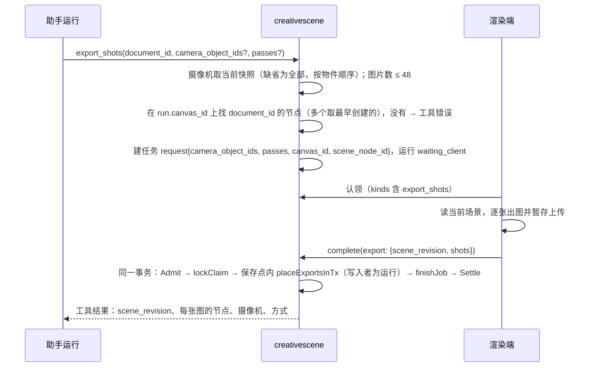

# Change 详细设计

## 继承的设计

- Epic `scene-editor-3d` 修订 v8（本子项起草时提出，待 owner 批准），在 v7 基础上改以下几处，对应 proposal「需要确认的新增决定」1、2、4、5、6：
  - design「渲染模式与导出」：过时判断改用渲染指纹，按导出方式区分；`clay` 导出的 AO 与线稿描边的选型；
  - design「客户端任务」的导出段落：助手导出随完成任务提交，在完成事务里放置节点；
  - `data: 导出图来源`：`based_on` 加 `content_revision_id` 和 `fingerprint`，节点快照返回 `based_on_state`；
  - `api: 导出分镜`：错误码对齐现有实现、48 张上限、只服务手动导出；
  - `data: MODIFY 场景客户端任务`、`api: MODIFY 完成场景客户端任务`：`export_shots` 的请求与结果，完成时的 `export` 改为图片清单；`render_view` 的请求加 `depth_of_field`；
  - `data: MODIFY 场景文档`：摄像机视场角按画面长边对应传感器长边；摄像机新增景深字段（`depth_of_field`、`f_stop`、`focus`、`focus_object_id`）。
- 沿用的 epic 定义：
  - 「客户端任务」的租约、认领、完成事务与运行等待；
  - 「编辑器交互约定」里分给 C4 的 `0`、`Ctrl + Alt + 0`；
  - `data: 场景文档` 的摄像机字段（C3a 已交付）：朝局部 −Z。
- 现状证据（2026-10-19 核对 develop）：
  - 摄像机线框 `objects/SceneObjects.tsx:CameraFrustum`；
  - 离屏出图 `host/render.ts:shoot`、取景 `host/framing.ts:cameraFraming`；垂直视场角固定按传感器高度：`framing.ts:fovFor`、`CameraFrustum`；
  - `export_shots` 占位：`creativescene/jobs.go:executableKinds`；`jobs_complete.go:ExportOutput{ExportOperationID}`，`complete` 对 export 结果直接拒绝；
  - 完成事务：`jobs_complete.go:complete` 在一个事务里 `Admit` → `lockClaim` → 写入 → `finishJob` → `Settle`；烘焙的场景写入在保存点内（`writeBake`）；
  - 渲染端完成流程：`host/executor.ts:deliver`（暂存不可用时重传一次）、`report`（固定 operation id 重试）；
  - 画布读取已为文档节点读出完整当前快照：`creativedocument.SummaryBatch`（`NodeSummary.Content`）；
  - 层级只记在 `objects` 单元里：`creativescene/ops.go` 的 `reparentObjectsOp.apply`；
  - 画布 `add_node` 拒绝 `config`：`creativecanvas/graph_model.go` 的字段白名单；结构性动作校验 `ExpectedTopologyRevision`：`graph_commands.go:applyBatchAs`。
  - 摄像机只有 `focal_mm`、`sensor_mm`、`aspect`、`near`、`far`、`label`（`creativescene/model.go:Camera`）；写入时 `completeCamera` 补齐，局部更新 `mergeCamera` 只改写到的键，`null` 与缺省无法区分；`decodeScene` 读取时不补齐，`view.go:view` 原样输出存储的快照。
  - 分组可以没有子物件，编辑器只在选中或高亮时画 `GroupMarker`（`axesHelper`），没有子物件的分组在视口里点不到。
  - three 0.186 自带 `BokehPass`，模糊量与「深度差 × aperture」成线性，不是按光圈值算的弥散圆。

## 领域模型与业务规则

### 不变量

- **E1 导出图对应确定的场景修订**：每张导出图记录的 `scene_revision`，就是渲染端实际渲染的那份权威快照的修订。编辑器有未保存的修改时先保存，再按会话的 `base`（服务端快照）出图，不用本机投影出图。
- **E2 一次导出原子落地**：一次导出的全部节点在同一个画布修改里创建，共用一个 `change_id`，一次撤销全部移除；任一张图不可用时一个节点也不建。
- **E3 来源只由服务端写**：`config.based_on` 只由放置流程写入，入口只有导出接口和 `export_shots` 的完成事务。画布命令的 `add_node` 白名单里没有 `config`，客户端写不进来。
- **E4 助手导出与任务一起提交**：`export_shots` 的节点只在完成任务的事务里创建，和任务成功、运行继续一起提交；创建前复查运行（`Admit`），并校验认领令牌和租约。任务没有成功，画布上就没有节点；同一任务最多一组节点。
- **E5 过时只是提示**：过时状态在读取时计算，不落库，不改节点和图片。
- **E6 长边视场角与画幅无关**：焦距和传感器相同时，画面长边方向的视场角不随画幅变化。
- **E7 对焦有确定的距离**：对焦物件存在时，对焦距离取它的原点沿摄像机视线方向的深度；不存在（没设、已删除）时取 `focus`。任何时候都能算出对焦距离，悬空的对焦引用不会让读写失败。

### 过时判断

节点视图的 `based_on_state`：

| 条件（按顺序） | 结果 |
|---|---|
| 节点没有 `based_on`，或当前内容修订 ≠ `based_on.content_revision_id` | 不返回字段 |
| 来源场景不存在、在回收站或快照不可展示 | `unavailable` |
| 当前快照里没有这台摄像机 | `stale` |
| 当前快照的指纹 = `based_on.fingerprint` | `current` |
| 其余 | `stale` |

渲染指纹：

```
fingerprint(scene, c, p) = "v1:" + sha256(规范 JSON(projection(scene, c, p)))

projection(scene, c, p):
  从整份场景出发（Go 的 Scene 结构，摄像机已补齐默认值），清空以下内容后整体序列化：
    render                                  // 编辑器显示模式
    objects 中满足 drop(o) 的物件
    每个保留物件的 name、locked、order，摄像机的 camera.label
    p ≠ lit 时：每个保留物件的 material_slots
    p = line 时：environment
    p = line，或这台摄像机 depth_of_field = false 时：它的 f_stop、focus、focus_object_id
  drop(o) := o.kind = camera && o.id ≠ c
          or o.kind = light && p ≠ lit
  保留的物件按 id 排序；再加上 {v: 1, pass: p, camera_id: c}
```

- 用清空字段的方式定义投影：以后新增的字段默认计入，宁可多提示。标题不在场景快照里，本来就不计入。
- 只有分组能当父级，分组总被保留，所以层级和世界变换都在投影里。
- 对焦物件只能是基础体、模型实例或分组，这些都在投影里：景深打开时移动对焦物件会改变指纹；对焦物件被删除后改按 `focus` 对焦，它也从投影里消失，指纹同样改变。
- 算指纹前先对摄像机补齐默认值，旧快照里没有景深字段的摄像机，第一次被编辑后不会因为补齐而误报过时。
- 改动后又改回原样，指纹相同，判 `current`。整份恢复同理，不需要特殊处理。
- 版本：投影规则变化时升版本号。`based_on.fingerprint` 的版本与当前不同时，读 `scene_revision` 的快照按当前版本重算再比较；这个修订已不存在时判 `stale`。
- 不按修订单元判断，原因见「局部设计与偏差」。

### 视场角

```
L = max(sensor_mm[0], sensor_mm[1])           // 传感器长边，默认 36
a = 画幅宽 / 画幅高
tan(v / 2) = L / (2 · focal_mm) / max(a, 1)     // v 为 three.js PerspectiveCamera 的垂直 fov
```

- 横幅（`a ≥ 1`）的水平方向、竖幅的垂直方向占满传感器长边。
- 默认传感器下 3:2 横幅与现在相同；2:3 竖幅 35 mm 从约 52 mm 等效改回 35 mm。
- 编辑器线框、相机视图、`render_view`（摄像机与 `viewpoint`）、导出共用 `host/framing.ts` 里的同一个函数。`preset` 按包围盒反推距离，取景结果不受影响。

### 景深

摄像机新增字段（`objects[].camera`，都可省略，存储时补齐）：

| 字段 | 取值 | 默认 | 说明 |
|---|---|---|---|
| `depth_of_field` | bool | `false` | 打开后白模导出和景深预览按光圈虚化 |
| `f_stop` | 0.5–64 | 2.8 | 光圈值 N |
| `focus` | > 0，米 | 10 | 对焦距离，与 three.js `PerspectiveCamera.focus` 同名同义 |
| `focus_object_id` | 物件 ID 或空字符串 | `""` | 非空时按这个物件对焦；写空字符串取消 |

- **写入校验**：在 `add_objects`、`update_objects` 的应用阶段，只检查本次写到 `focus_object_id` 的条目。目标必须在本次修改后的场景里，`kind` 为 `primitive`、`model_instance` 或 `group`，并且不是摄像机自己，否则 400。整份场景的 `Validate` 不检查这个引用，所以目标之后被删除，不影响任何写入、撤销或恢复。
- **旧快照**：不迁移。`decodeScene` 对每台摄像机调用 `completeCamera`；`view` 在有摄像机缺字段时输出补齐后的场景，保持 OpenAPI「响应里总是带齐」。
- **对焦距离**（渲染端）：
  ```
  s = focus_object_id 指向的物件存在 ? −(V · 目标的世界原点).z : focus    // V 为摄像机的视图矩阵
  s = clamp(s, near, far)
  ```
- **弥散圆**（导出与预览共用；f 为焦距，d 为像素深度，长度统一换成 mm）：
  ```
  c(d) = f² / (N · (s − f)) · |d − s| / d       // 传感器上的弥散圆直径
  c_px = c(d) / L · 画面长边像素                  // L 为传感器长边，与视场角规则一致
  ```
  `c_px` 上限为画面长边的 4%（2048 时约 80 像素）。
- **清晰范围**（属性栏显示）：容许弥散圆 `c₀ = 传感器对角线 / 1500`（全画幅约 0.029 mm），`H = f² / (N · c₀) + f`；近点 `s(H − f) / (H + s − 2f)`；远点在 `s < H` 时为 `s(H − f) / (H − s)`，否则为无穷远。例：50 mm、f/2.8、对焦 3 m、全画幅，约 2.74–3.32 m。
- **空物体**：没有子物件的分组，名称「空物体 N」。编辑器给没有子物件的分组画常显、可点选的十字标记；挂上子物件后就是普通分组，与 Blender 一致。

### 传感器预设

| 预设 | 尺寸（mm） | 长边换算系数 |
|---|---|---|
| 全画幅 | 36 × 24 | 1 |
| APS-C | 23.5 × 15.6 | 1.53 |
| APS-C（佳能） | 22.3 × 14.9 | 1.61 |
| M43 | 17.3 × 13 | 2.08 |
| 中画幅 | 43.8 × 32.9 | 0.82 |

- 等效焦距 = 焦距 × 36 / 传感器长边，与视场角规则一致。M43 按长边换算为 2.08，比常说的对角线系数 2 略大。
- 预设只填 `sensor_mm`，不新增字段。尺寸与某个预设相同时，属性栏显示预设名，否则显示「自定义」。

### 内部类型

| 位置 | 类型 | 说明 |
|---|---|---|
| `creativescene/model.go` | `Camera` 加 `DepthOfField *bool`、`FStop *float64`、`Focus *float64`、`FocusObjectID *string` | `completeCamera`、`mergeCamera` 同步；`decodeScene` 补齐默认值 |
| `creativescene/exports.go` | `ExportInput{CanvasID, SceneNodeID, SceneRevision, Shots[]{CameraObjectID, Images[]{Pass, UploadID}}}` | 导出接口的 payload，`DocumentID` 来自路径 |
| 同上 | `ExportResult{ChangeID, SceneRevision, Nodes[]{CameraObjectID, Pass, NodeID, ContentRevisionID}}` | 接口响应，也是 `export_shots` 任务的 `result` |
| 同上 | `placeExportsInTx(ctx, tx, documentID, ExportInput, actor) (ExportResult, error)` | 手动导出与任务完成共用的放置流程 |
| `creativescene/fingerprint.go` | `Fingerprint(scene, cameraID, pass) (string, bool)`；`Freshness`（端口实现） | 渲染指纹与过时判断 |
| `creativescene/jobs.go` | `ExportRequest{CameraObjectIDs, Passes, CanvasID, SceneNodeID}` | `export_shots` 的 `request`；`JobResult` 增加 `Export *ExportResult` |
| 同上 | `RenderRequest` 加 `DepthOfField bool`（`json:"depth_of_field,omitempty"`）；`RenderInput` 同步 | `render_view` 的景深回看；缺省为 `false`，旧任务的请求不变 |
| `creativescene/jobs_complete.go` | `ExportOutput{SceneRevision, Shots}` | 完成任务的 `export`，替换现有占位的 `{export_operation_id}`；`Shots` 与 `ExportInput.Shots` 同类型 |
| `creativecanvas` | `SceneExportPlacement{CanvasID, SceneNodeID, DocumentID, Rows[][]{UploadID, Title, Aspect, BasedOn}, Actor}` → `SceneExportPlaced{ChangeID, Nodes[]}` | 画布侧放置入口的输入与输出 |
| `creativecanvas` | `Action.Config map[string]any` 加 `json:"-"` | 只有 Go 调用方能设置，HTTP 解码不到 |
| `creativecanvas` | `ExportSource{NodeID, DocumentID, SceneRevision, CameraObjectID, Pass, Fingerprint}`；端口 `ExportFreshness.Check(ctx, tx, sources, current map[documentID]creativecontent.Revision) map[nodeID]string` | 读画布时问场景是否过时。当前快照由画布传入，只有指纹版本不符时端口才查库 |

## 模块职责与协作

```
摄影师「导出」（编辑视图）                  助手 export_shots
  │                                         │ creativeagent: exportShots 工具
  │                                         │  → creativescene.CreateExportJobInTx（找场景节点、定摄像机）
  │                                         │  → 运行 waiting_client
  ▼                                         ▼
host/exportShots.ts：按快照逐张出图 → 暂存上传（两条路径共用）
  │                                         │
  ▼                                         ▼
POST scene-exports（同一 operation id 重试）  SceneExecutor.deliver → complete(export: {scene_revision, shots})
  │ creativescene.Export                    │ creativescene.complete：Admit → lockClaim → 保存点内放置 → finishJob → Settle
  └──────────── placeExportsInTx → creativecanvas.PlaceSceneExportsInTx ────────────┘

读画布：creativecanvas.fillNodeViews → SummaryBatch（含 based_on 的来源场景）→ ExportFreshness.Check（creativescene 实现）→ based_on_state
```

- **creativescene**：放置流程（校验、算指纹、调画布）、导出接口、`export_shots` 任务的建立与完成、`look_at` 换算、渲染指纹与过时判断。依赖方向不变：只调用 `creativecanvas` 和 `creativedocument`。
- **creativecanvas**：
  - 放置导出图节点：位置计算、`add_node` + `fill_from_upload`、写 `config.based_on`；
  - 节点视图的 `based_on_state` 字段；读画布时把生效 `based_on` 的来源场景并入 `SummaryBatch` 的 id 列表；
  - 定义端口 `ExportFreshness`（`SetExportFreshness`，同 `creativescene.SetJobWaiter` 的做法），由 `cmd/server/main.go` 在启动时注册 creativescene 的实现。画布包不 import 场景包。
- **creativeagent**：`export_shots@1` 工具，`edit_scene` 的说明，`look_at` 由 creativescene 换算。
- **前端**：
  - `creative-scene/host/exportShots.ts`：两条路径共用的出图和上传；手动导出的提交与重试；
  - `creative-scene/host/executor.ts`：执行 `export_shots`，结果经现有的 `deliver` 提交；
  - `creative-scene/render/`：`clay` 与线稿两种导出渲染；
  - 编辑器：摄像机的添加、属性、相机视图和导出对话框；
  - 画布：把画布 ID 和场景节点 ID 传给编辑器，图片节点显示过时标记。

## 关键机制

### 放置流程（手动导出与任务完成共用）

```
placeExportsInTx(documentID, in, actor)
  1 校验外形：shots 1–32、摄像机不重复、每镜 images 1–3 且 pass 不重复、总数 ≤ 48（否则 413）
  2 读场景头：不存在或不是场景 → 404；回收站 → 409 creative_state_conflict
  3 scene_revision ≤ 当前修订；ReadAtInTx(scene_revision) → 每个 camera_object_id 存在且 kind=camera，否则 400
  4 按这份快照为每个（摄像机, pass）算指纹
  5 creativecanvas.PlaceSceneExportsInTx：
       lockCanvas(write)，已归档 → 409 archived_read_only
       场景节点在该画布上且 document_id 一致，否则 404
       锁内读出拓扑修订填入 BatchInput.ExpectedTopologyRevision；锁内计算位置
       每张图：add_node(core.image, 位置, 标题, Config{based_on}) + fill_from_upload(upload_id)
       暂存不可用或不是图片 → 409 creative_upload_unavailable
       一个 BatchInput，一个 change_id，写入者为 actor
```

- `based_on` 的值：`{scene_document_id, scene_revision, camera_object_id, pass, content_revision_id, fingerprint}`。其中 `content_revision_id` 取 `fill_from_upload` 写入的那份内容修订。
- 节点标题：摄像机 `label` 非空时用它，否则用物件名，再接「 · clay」或「 · 线稿」。
- 场景文档只读不锁。

### 导出接口（手动导出）

`creative.scene_export`（capability `manual_write`，幂等沿用 creativeops）：调 `placeExportsInTx(id, payload, 摄影师)`；Outcome 200 `ExportResult`，`ResultKind` 为 `canvas_change`，`ResultID` 为 `change_id`。

前端提交的重试规则（与 `executor.report` 相同）：

- `operation_id` 和 `client_created_at` 在提交前生成一次，重试时不变（回执的请求 hash 含 `client_created_at`）。
- 网络错误、超时、5xx：退避重试，回执重放得到同一组节点。
- 服务端明确拒绝（4xx）：丢弃已上传的暂存图片，显示原因。
- 重试用尽仍没有结果：丢弃暂存图片（已被消费的丢弃会被拒绝，没有副作用），提示「没能确认导出结果，请先看画布上是否已有这组图」，不自动重导。

### 节点位置

```
锚点 = 场景节点在其父级里的矩形 (x, y, w, h)；新节点与场景节点同一父级
单元宽 W = 300，高 h_i = 300 / 摄像机画幅（宽 / 高），列间距 40，行间距 40
块 = 每台摄像机一行（按 shots 顺序），每种方式一列（clay、line、lit 的顺序）
起点 = (x + w + 80, y)
while 块的矩形与同一父级下任一现有节点相交（最多 50 次）:
    起点.y = 相交节点中最低的下边 + 40
```

- 在画布锁内计算，并发的两次导出不会排到同一位置。
- 已经导出过的一组图就在场景右侧，第二次导出会排到它们下方，不重叠。
- 位置计算只在 creativecanvas 里做（architecture「不职责：画布节点的布局规则」）。

### `export_shots` 任务



- 完成时的 `shots` 必须正好覆盖任务请求的摄像机和方式，不多不少；节点按任务请求的摄像机顺序排行。
- 完成时各种情况的处理：

  | 情况 | 处理 |
  |---|---|
  | 运行不能再写入（`Admit` 不通过） | 沿用现有：运行结束、任务取消，不建节点；渲染端丢弃暂存图片 |
  | 令牌不符或租约已失效 | 沿用现有：409，渲染端丢弃暂存图片；任务回队后由接手的页面重新出图 |
  | 暂存图片不可用 | 整个完成回滚，409 `creative_upload_unavailable`；渲染端按 `deliver` 重传一次 |
  | `export` 外形不对，或与任务请求的摄像机和方式不一致 | 400，任务不变；渲染端按现有规则以 `host_error` 报失败 |
  | 画布已归档、场景节点已不在画布或不指向该场景、场景在回收站或已删除、摄像机不在所报修订、`scene_revision` 晚于当前、画布节点超出上限 | 回滚到保存点，任务记为 `failed`（`invalid_result`，带原因），返回 200，运行继续 |

- 渲染端读到的场景里某台摄像机已被删除时，任务以 `render_error` 失败（消息指出摄像机），由助手重读场景后重试。
- 页面在完成之前关闭：画布上没有节点；接手的页面重新出图，前一个页面的暂存图片到期回收。
- 工具结果不带图片（决定 3）。失败时按 `render_view` 的方式返回错误码和消息。
- 加锁顺序：creativeops 操作锁 → 运行（`Admit`）→ 任务 → 场景文档（只读）→ 画布 → 暂存，与烘焙完成、助手写画布一致。手动导出没有运行和任务两步。

### 助手的相机参数与景深回看

- **写参数**：助手经 `edit_scene` 的 `add_objects`、`update_objects` 写摄像机的全部字段（焦距、传感器、画幅、`near`/`far`、标签、景深四个字段），与属性栏写的是同一组字段，校验相同（「景深」一节）。`update_objects` 的 `camera` 按键合并，助手只写要改的键。
- **`render_view` 的 `depth_of_field`**：
  ```
  render_view(camera_object_id | viewpoint | preset, depth_of_field?: bool = false)
    depth_of_field = true 时（建任务时校验，不通过返回工具错误、不建任务）：
      必须给 camera_object_id                       // 临时视点和预设没有光圈和对焦
      这台摄像机在当前快照里 depth_of_field = true    // 与编辑器「预览景深」的出现条件一致
    渲染端：
      false → 现有截图流程，全清晰、不加 AO（不变）
      true  → 白模导出同一套流程（clay + AO + 景深），长边 1024，JPEG；
              按渲染时快照里这台摄像机的光圈和对焦，不再检查它的景深开关
  ```
- 弥散圆按画面长边像素换算，1024 的截图与 2048 的导出虚化程度成比例，缩小后一致。
- 工具结果不变：截图作为下一步的图片输入，附 `scene_revision`。工具说明写明：默认回看看结构；检查焦点和虚化时带 `depth_of_field: true`；导出前若要确认虚化，按摄像机回看一次即可。
- `render_view@1` 的参数新增一个可选字段，沿用 C3a 修改 `edit_scene@1` 的做法：版本号不变，随本次工具变化排空后升级。

### 导出渲染

在 `host/render.ts` 的离屏 R3F 根上进行：隐藏画布、`frameloop: 'never'`。一次导出共用一个根和 WebGL 上下文：模型只加载、上传一次，逐个镜头切换摄像机和导出方式，全部画完后卸载并调用 `forceContextLoss`。取景沿用 `cameraFraming`，`longSide` 改为参数，导出时为 2048。物件、隐藏状态、天空和雾与 `ShotScene` 一致，不画辅助线框。

- **`clay`**：`EffectComposer`（渲染目标 4 倍 MSAA，带 `DepthTexture`）→ `RenderPass` → `GTAOPass`（three 自带，参数用默认值，按样例微调）→ 景深（仅 `depth_of_field = true`）→ `OutputPass`。材质、天空、太阳光与编辑器相同。
- **景深**（`render/dofPass.ts`，自写着色器）：
  1. 按「景深」一节的公式，由深度算出每个像素的弥散圆 `c_px`（带符号：焦前为负、焦后为正）；
  2. 在半分辨率上用 Vogel 圆盘采样做聚合（gather），采样半径为 `|c_px|`，导出 128 个采样点；只接受自身弥散圆覆盖到中心像素的采样，避免清晰的前景被背景渗进去；
  3. 按 `|c_px|` 把虚化结果与全分辨率清晰图混合，`|c_px| < 1` 的像素保持清晰。
  AO 在虚化之前，焦外的接触阴影随之变柔。
- **线稿**：
  1. 用 `MeshNormalMaterial` 覆盖材质，把视空间法线和深度（`DepthTexture`）渲染到一个渲染目标，分辨率为导出尺寸的 2 倍。GPU 的 `MAX_TEXTURE_SIZE` 不够时退回 1 倍。
  2. 全屏着色器对每个像素看 3×3 邻域（半径按分辨率缩放），算两种边缘：
     - 法线差：`1 − dot(n_c, n_i)` 的最大值超过阈值；
     - 相对深度差：`|z_i − z_c| / z_c` 的最大值超过阈值，`z` 为线性深度，没有物体的像素按远平面处理。
  3. 边缘处输出黑色，其余白色，用 `smoothstep` 柔化；缩小到导出尺寸时线宽约 2 像素。
  4. 阈值起始为法线 0.15、深度 0.03，用样例场景定稿，写成常量。
- **编码**：`canvas.toBlob('image/png')`。异步编码，不阻塞页面；不用现有 `canvasBlob` 的同步 `toDataURL`。
- **流程**（`host/exportShots.ts`）：
  - 逐张渲染，上传并发 2；
  - 手动导出：全部就绪后提交导出接口，重试规则见上；
  - 助手导出：交给 `executor.deliver` 完成任务；
  - 渲染或上传失败时，丢弃已上传的暂存图片（`discardCandidate`）；
  - 进度回调分三段：渲染 i/n、上传、放到画布。
- **超时与上下文丢失**：单张渲染加编码超过 30 秒、或收到 `webglcontextlost`，按 `host_error` 失败（助手导出）或提示重试（手动导出）。

### 摄像机与相机视图（编辑器）

- **新增**：`editing.ts:newCamera(viewPose)` 生成 `add_objects` 条目：
  - `kind: camera`，名称「摄像机 N」（N 取现有摄像机数 + 1）；
  - `transform` 取视口摄像机的位置和朝向，换算成文档坐标；
  - `camera: {}`：服务端补默认值，本机投影用 `state/apply.ts` 里已有的默认值。
- **属性栏**（`panels/Properties.tsx`）：
  - 标签、焦距、画幅、高度（文档坐标的 `position[1]`）；
  - 景深：开关；光圈（滑块按 1/3 档，附 f/1.4、2、2.8、4、5.6、8、11、16 快捷值）；对焦分「距离」和「物件」两种，物件可以从列表选（只列基础体、模型实例和分组），也可以点「拾取」后在视口里点选；下方显示清晰范围。对焦物件已不存在时显示「对焦物件已删除，按 x m 对焦」；
  - 「更多」里是传感器预设、传感器宽高（附等效焦距）和 `near`/`far`；
  - 每次确认产生一个 `update_objects`，焦距、光圈和对焦距离的滑块沿用 300ms 合并。
- **视场角**：线框（`CameraFrustum`）和取景按「视场角」一节的公式，与导出、`render_view` 用同一个函数。线框在对焦距离处画一个小十字，景深打开时另画清晰范围的近、远两条短线。
- **空物体**：「添加」菜单的「空物体」生成 `add_objects` 的 `{kind: group}` 条目，位置取视口中心的拾取点（没拾到物体时取视线前方 3 m），名称「空物体 N」。`SceneObjects` 给没有子物件的分组常显十字标记，并给标记一个可点选的包围体。
- **相机视图**：
  - 编辑器状态记录 `cameraView: objectID | null` 和 `lastCamera`，`lastCamera` 存在本机视窗状态里（`viewState.ts`）。
  - 进入相机视图时，视口摄像机取该摄像机的世界位姿和 `near`/`far`。视场角按下式放大，使摄像机的画面恰好落在视口 90% 的取景框里（`v_cam` 按「视场角」一节算出）：
    - 视口比摄像机宽时：`tan(v_view/2) = tan(v_cam/2) / 0.9`；
    - 否则：`h_cam = 2·atan(tan(v_cam/2)·a_cam)`，`tan(h_view/2) = tan(h_cam/2) / 0.9`，`v_view = 2·atan(tan(h_view/2) / a_view)`。
  - 取景框用 DOM 叠加层画，框外压暗，框上写摄像机名、焦距和光圈（景深打开时）。
  - 构图辅助线：叠加层的菜单可切换三分线、黄金分割、对角线、中心十字，可以多选，只画在取景框内。选择记在本机视窗状态里（`viewState.ts`），不进场景，也不进导出图。
  - 预览景深：这台摄像机打开景深时，叠加层显示「预览景深」。点击后按导出同一套流程（`clay` + 景深，视口尺寸）渲染一帧，覆盖在取景框上；视角、场景或摄像机一变就撤掉。视口本身不做实时虚化。
  - `CameraControls` 的 `controlstart`、按 `5`、按 `1`/`3`/`7` 都会退出相机视图，从当前位姿继续自由导航。
  - 在相机视图里改这台摄像机（属性栏、`G`、`Ctrl + Alt + 0`）时，视图跟着更新。
- **按键**（`input/keymap.ts`）：
  - `Digit0`/`Numpad0` → `camera-view`；
  - `Digit0`/`Numpad0` 加 `mod + alt` → `camera-to-view`。
  - 只在非模态上下文生效；模态变换里的数字输入保持不变。
  - 没有摄像机或没有选中摄像机时，状态栏提示原因。
- **导出对话框**（`panels/ExportDialog.tsx`）：
  - 摄像机列表（默认全选）、导出方式（`clay`、线稿）、张数；
  - 0 张或超过 48 张时按钮不可用并说明原因；
  - 编辑器拿到 `canvasID`、`sceneNodeID` 后才显示「导出」。编辑器总是从画布节点打开，两者都在。

### `look_at` 换算

在 `AgentEditInTx` 里、`Touched` 之前，把 `add_objects` 和 `update_objects` 条目里的 `look_at` 换成 `transform`，再去掉 `look_at`。严格解码因此不变。

```
resolveLookAt(item, 当前快照, 同一命令的其他操作):
  不能同时写 look_at 和 transform.rotation → 400
  同一命令里，物件或它的任一祖先出现在 reparent_objects 里，
    或任一祖先的 transform / look_at 出现在 update_objects 里 → 400「父级在同一次修改里也被移动，请分两次提交」
  pos  = item.transform.position ?? 当前物件的 position（add 时必须写 position）
  par  = 父级的世界矩阵（父级取 item.parent_id ?? 当前父级；可在当前快照或同一个 add_objects 里）
  eye  = par × pos
  eye == target → 400「目标点与物件位置重合」
  m    = kind ∈ {camera, light} ? lookAt(eye, target, up=+Y) : lookAt(target, eye, up=+Y)   // three.js Matrix4.lookAt
  q    = quat(m)；有父级时 q = inverse(quat(rotation(par))) × q                           // three.js Object3D.lookAt
  item.transform = {position: pos, rotation: q, scale: item.transform.scale ?? 当前 scale ?? [1,1,1]}
```

- `Matrix4.lookAt` 的退化处理照搬 three.js：up 与视线平行时，按 three.js 的方式微调 z 分量 0.0001。
- `update_objects` 允许 `transform` 只写 `position` 或 `scale`，但仅限同时写了 `look_at` 时。没有 `look_at` 时 `transform` 仍要写完整。
- 父级在同一命令里被移动时直接拒绝，不按操作顺序逐步换算：后者要在换算前先应用前面的操作，复杂度不值得。
- 数学放在 `creativescene/lookat.go`（向量、四元数、3×3 旋转），不引入依赖。

## 局部设计与偏差

- **过时判断用渲染指纹，不按修订单元。**
  - 层级（`parent_id`、`order`）只记在 `objects` 单元里：同一条修订里既改挂几何物件又新增摄像机或改灯光时，单元规则会判 `current`，实际几何已经变了；
  - 已删除的物件在当前快照里查不到类别，按单元判断时删一台别的摄像机也会让全部导出图过时；
  - 材质槽和基础体参数同在内容单元里，C5 改材质会让白模图误报；
  - 指纹只比对快照，不读修订历史：读画布不增加查询，也不需要 2000 条的上限和整份恢复的特例。
- **助手导出在完成事务里放置，不调导出接口。** 与烘焙模型同构：任务成功和节点落地一起提交，创建节点前复查运行。这样不需要任务指定的 operation id、接手页面先查回执、把 `idempotency_conflict` 当成功、完成时读回执等补救步骤。代价是完成接口多一个写画布的分支（`creativescene` → `creativecanvas` 的依赖本来就允许）。
- **线稿用自写的法线 + 深度边缘检测，不用 `EdgesGeometry` 或后处理库。**
  - `EdgesGeometry` 只有折痕线，曲面的轮廓线（圆柱两侧）画不出来，WebGL 线宽也固定为 1 像素；
  - three 自带的 `SobelOperatorShader` 基于颜色亮度，白模上效果差；
  - 着色器约 80 行，不新增依赖。
- **AO 只在导出的 `clay` 里**：决定 2。
- **景深用自写的弥散圆着色器，不用 three 的 `BokehPass`**：`BokehPass` 的模糊量与深度差成线性，参数不是光圈值，焦后虚化会无限增大；摄影师按光圈值判断虚化，必须按物理弥散圆算。着色器约 120 行，不新增依赖。
- **景深只进白模导出和按需预览，不进线稿和实时视口；`render_view` 默认不虚化，助手显式要求时才虚化**：决定 6。实时虚化会拖慢编辑；助手回看默认要看清结构，需要时再看虚化。`render_view` 带景深时直接复用白模导出的流程，不另写一套截图景深。
- **对焦物件是软引用**：只在写入时校验，之后悬空按 `focus` 对焦。整份场景的 `Validate` 若检查它，删除对焦物件、按单元恢复摄像机时都会被这条引用卡住。
- **空物体复用分组**：没有子物件的分组已经只有变换，也能当父级。新增物件类型要改场景格式、校验、恢复和助手说明，换来的只是一个名字。
- **视场角按长边**：决定 5，与 Blender 的 Auto 传感器适配一致。传感器只用长边，短边保留为记录。
- **放置时只避开同一父级里的节点**：不追求全局最优布局，只保证不叠在已有节点上。
- **后续增强**：
  - 「重新导出」按钮；
  - 编辑器里的「对准选中物件」；
  - `write_model` 的 `look_at`；
  - 导出 WebP 以减小上传体积。

### 实施中的偏差（verify 时补记）

- **指纹版本不符时判过时，不重算**：重算要按 `scene_revision` 读旧快照，画布读取就多了查询，与「读画布不增加查询」冲突。指纹版本只在渲染规则变化时升级，届时旧导出图本来就该重新导出。测试：`TestBasedOnStateFollowsTheScene`。
- **相机视图不跟随摄像机的滚转**：视口控制器（`CameraControls`）固定 Z 轴朝上。用 `look_at`、`Ctrl + Alt + 0` 和添加菜单摆出的摄像机都没有滚转，不受影响；助手直接写带滚转的 `rotation` 时，相机视图与导出图的取景范围相同，但画面没有倾斜。导出图按真实朝向渲染。
- **编码仍用 `canvasBlob`（`toDataURL`），不用 `toBlob`**：隐藏标签页里 `toBlob` 要等节流后的空闲回调才开始编码，助手的导出多在后台标签页执行。导出一张 2048 PNG 的编码在出图耗时内（e2e：4 张约 3.9 s，含渲染）。
- **景深按块取最大弥散圆后半分辨率采样**：避免前景虚化边缘被清晰背景切断。常量（采样数、弥散圆上限 4%、线稿阈值、GTAO 参数）写在 `render/dofPass.ts`、`render/linePass.ts`、`render/clayExport.ts`（未决 #1）。
- **`checkFocusTargets` 在 `type.go:Apply` 调用**，不在 `ops.go`：要在整批命令应用后对照最终场景检查，`ops.go` 只记录写到了哪些对焦字段。
- **导出接口的处理函数放在 `creative_scene_jobs.go`**，与场景任务的处理函数放在一起；路由仍在 `creative_documents.go`。
- **`creative_upload_unavailable` 的提示改为通用文案**「上传已失效或已被使用，请重新上传」：原文案只讲模型，导出图共用这个错误码。错误码不变，前端按错误码映射提示。
- **`export_shots` 工具拒绝 `lit`**：C5 之前没有这种导出，直接返回工具错误，不建任务。
- **手动导出先等保存（最多 15 s）**：AC-4，`SceneEditor.tsx:startExport` 调 `whenSaved`。
- **修了 `parkOnJob` 读任务结果的方式**：原先按渲染结果解码，导出任务的结果会丢失。改为 `creativescene.ResultOf` 按任务类型解码。
- **`instructions/base.md` 加了 `export_shots` 和「先回看再导出」**：已有测试要求说明里提到每个工具。
- **新增辅助函数**：`creativecanvas.DocumentNodeInTx`（建任务时找场景节点）、前端 `exportCount`（对话框的张数与上限，放在 `exportShots.ts`，便于 Node 测试引用）。
- **AC-9 样例场景**：用基础体搭的棚拍布景，没有用助手搭的教堂中殿，以排除模型质量的影响。owner 若要用指定场景，可用同一脚本重新生成。

## 接口与数据契约

扩展为主。共享定义见 Epic 修订 v8 的 `api: 导出分镜`、`data: 导出图来源`、`data: MODIFY 场景客户端任务`、`api: MODIFY 完成场景客户端任务`、`data: MODIFY 场景文档`（`--deliver`），本 Change 不另写 contracts.md。

- **OpenAPI**：
  - 新增 `POST /creative/documents/{id}/scene-exports`（`CreativeSceneExportPayload` / `CreativeSceneExportResult`），payload 不含 `job_id`；
  - `CreativeSceneJobRequest` 的 `export_shots` 分支 `{camera_object_ids, passes, canvas_id, scene_node_id}`；`CreativeSceneJobResult` 的 `export` 分支；
  - 完成任务 payload 的 `export` 由 `{export_operation_id}` 改为 `{scene_revision, shots}`，`shots` 与导出接口共用 schema。C3 只做了占位，没有调用方，不需要兼容；
  - `CreativeCanvasNode` 新增可选只读的 `based_on_state`（`current` | `stale` | `unavailable`）。
- **场景快照 schema**：摄像机新增可选的 `depth_of_field`、`f_stop`、`focus`、`focus_object_id`，响应里总是带齐（旧快照在读取时补齐）。
- **语义变化**：摄像机视场角改按长边计算（`data: 场景文档` 的说明），字段外形不变。
- **不变**：
  - 画布命令接口：`add_node` 仍不接受 `config`；
  - 场景命令接口：`look_at` 只在助手工具里换算；
  - 认领、续租接口的外形。
- **无迁移**：
  - `creative_scene_jobs.kind` 的 CHECK 已含 `export_shots`（0075）；
  - `request`、`result` 是 jsonb；
  - `based_on` 在 `creative_nodes.config` 里。

## 挂载点

| 位置 | 动作 | 说明 |
|---|---|---|
| `backend/internal/creativescene/model.go` | 修改 | `Camera` 景深字段、取值校验、`completeCamera`/`mergeCamera`、`decodeScene` 补齐 |
| `backend/internal/creativescene/ops.go` | 修改 | `add_objects`/`update_objects` 写到 `focus_object_id` 时校验目标 |
| `backend/internal/creativescene/view.go:view` | 修改 | 有摄像机缺字段时输出补齐后的场景 |
| `backend/internal/creativescene/exports.go` | 新增 | `Export` 操作、`placeExportsInTx`、`ExportInput`/`ExportResult` |
| `backend/internal/creativescene/fingerprint.go` | 新增 | 渲染指纹、`Freshness`（`ExportFreshness` 端口实现） |
| `backend/internal/creativescene/lookat.go` | 新增 | `resolveLookAt` 与数学 |
| `backend/internal/creativescene/agent.go:AgentEditInTx` | 修改 | 换算 `look_at` |
| `backend/internal/creativescene/jobs.go` | 修改 | `executableKinds` 加 `export_shots`；`ExportRequest`；`JobResult.Export`；`CreateExportJobInTx`；`RenderRequest.DepthOfField` 与 `CreateRenderJobInTx` 的校验 |
| `backend/internal/creativescene/jobs_complete.go` | 修改 | `ExportOutput` 改为图片清单；`validate` 与 `complete` 的 export 分支；`completeExport`（保存点内放置，放置失败转 `invalid_result`） |
| `backend/internal/creativecanvas/scene_exports.go` | 新增 | `PlaceSceneExportsInTx`、位置计算、`DocumentNodeInTx`、端口 `ExportFreshness`/`SetExportFreshness` |
| `backend/internal/creativecanvas/graph_model.go:Action` | 修改 | `Config`（`json:"-"`） |
| `backend/internal/creativecanvas/graph_commands.go` | 修改 | `add_node` 应用 `Action.Config`；导出放置复用 `applyBatchAs` |
| `backend/internal/creativecanvas/node_snapshot.go:fillNodeViews` | 修改 | 收集生效的 `based_on`、来源场景并入 `SummaryBatch`、调用端口、填 `based_on_state` |
| `backend/internal/creativecanvas/service.go:Node`、`node_view.go:MarshalJSON` | 修改 | `BasedOnState` 只读字段 |
| `backend/internal/creativeagent/scene_tools.go` | 修改 | `export_shots` 工具、结果；`edit_scene` 说明（摄像机全部参数、`look_at`、视场角规则、景深与对焦、空物体、先回看再导出）；`render_view` 的 `depth_of_field` 参数与说明 |
| `backend/internal/creativeagent/tool_registry.go` | 修改 | 注册 `export_shots@1` |
| `backend/internal/platform/httpapi/creative_documents.go` | 修改 | 路由与错误映射（`archived_read_only`、`creative_upload_unavailable`） |
| `backend/cmd/server/main.go` | 修改 | `creativecanvas.SetExportFreshness(...)` |
| `api/openapi.yaml`、`backend/internal/platform/httpapi/api.gen.go`、`frontend/src/api/schema.d.ts` | 修改 | 契约与生成物（含摄像机的景深字段） |
| `frontend/src/creative-scene/host/exportShots.ts` | 新增 | 出图、上传；手动导出的提交与重试 |
| `frontend/src/creative-scene/render/clayExport.ts`、`render/dofPass.ts`、`render/linePass.ts` | 新增 | AO、景深与线稿 |
| `frontend/src/creative-scene/cameraOptics.ts` | 新增 | 视场角、对焦距离、弥散圆、清晰范围、等效焦距、传感器预设（纯函数，导出、预览、属性栏共用） |
| `frontend/src/creative-scene/state/apply.ts` | 修改 | `cameraDefaults` 加景深字段 |
| `frontend/src/creative-scene/host/render.ts`、`host/framing.ts` | 修改 | `longSide` 参数、一次导出共用的离屏根；`render_view` 带景深时走白模导出流程；视场角改按长边 |
| `frontend/src/creative-scene/objects/SceneObjects.tsx` | 修改 | `CameraFrustum` 按长边规则、对焦十字与清晰范围；没有子物件的分组常显十字标记 |
| `frontend/src/creative-scene/host/executor.ts`、`host/jobs.ts` | 修改 | `export_shots` 的认领与执行，经 `deliver` 完成；`render_view` 把 `depth_of_field` 交给渲染 |
| `frontend/src/creative-scene/api.ts` | 修改 | `exportScene` |
| `frontend/src/creative-scene/SceneEditor.tsx` | 修改 | 添加菜单（摄像机、空物体）、导出入口、相机视图动作、`canvasID`/`sceneNodeID` 属性 |
| `frontend/src/creative-scene/Viewport.tsx` | 修改 | 相机视图、取景框、构图辅助线、景深预览、对焦物件拾取、退出条件 |
| `frontend/src/creative-scene/editing.ts` | 修改 | `newCamera`、`newEmpty` |
| `frontend/src/creative-scene/input/keymap.ts` | 修改 | `camera-view`、`camera-to-view` |
| `frontend/src/creative-scene/panels/Properties.tsx` | 修改 | 摄像机属性（含景深、对焦、传感器预设、清晰范围） |
| `frontend/src/creative-scene/panels/ExportDialog.tsx` | 新增 | 导出对话框 |
| `frontend/src/creative-scene/state/sceneStore.ts`、`viewState.ts` | 修改 | `cameraView`、`lastCamera`、构图辅助线的选择 |
| `frontend/src/creative-canvas/editor/WorkspacePage.tsx` | 修改 | 传 `canvasID`、`sceneNodeID` |
| `frontend/src/creative-canvas/editor/CanvasView.tsx` | 修改 | 「场景已更新」标记 |
| `docs/dev/agent-skills-tools.md` | 修改 | 工具变化与排空后升级 |
| `docs/dev/creative-scene-agent.md` | 修改 | 取景一节的视场角规则 |
| `backend/internal/creativescene/type.go:Apply` | 修改（实施补记） | 调用 `checkFocusTargets` |
| `backend/internal/platform/httpapi/creative_scene_jobs.go` | 修改（实施补记） | `ExportCreativeSceneShots` 处理函数 |
| `backend/internal/creativecanvas/tool_schemas.gen.go` | 修改（实施补记） | 生成物（`based_on_state`） |
| `backend/internal/creativeagent/instructions/base.md` | 修改（实施补记） | 提到 `export_shots` 与回看后导出 |
| `frontend/src/creative-scene/host/pageExecutor.ts` | 修改（实施补记） | 接上 `renderShots` |
| `frontend/src/creative-scene/scene.css`、`frontend/src/creative-canvas/editor/workspace.css` | 修改（实施补记） | 取景框、导出对话框、摄像机属性、「场景已更新」标记的样式 |

## 验证与交付

- **后端**（`make check-go PKG="./internal/creativescene/... ./internal/creativecanvas/... ./internal/creativeagent/... ./internal/platform/httpapi/..."`）：
  - 导出接口：6 张图一个 `change_id`、位置 3 行 2 列且第二次导出排在下方；摄像机不在修订里 400；归档 409 `archived_read_only`；暂存已消费 409 `creative_upload_unavailable`；49 张 413；跨账号 404；同一 operation id 和 `client_created_at` 回放得到同一组节点（AC-3、AC-4、AC-8）。
  - `based_on` 写不进：画布命令的 `add_node` 带 `config` 仍是 400（E3）。
  - 渲染指纹，表驱动（AC-5）：
    - 过时：移动几何物件；改挂分组；同一条修订里既改挂几何物件又新增摄像机；改环境（`clay`）；这台摄像机被删除；
    - 不过时：改环境（线稿）；增删改其他摄像机；改灯光和材质槽（`clay`、线稿）；改名称、锁定、排序；改显示模式；移动后又移回；
    - 不返回：换图、切版本；`unavailable`：场景进回收站；
    - 指纹版本不符时按 `scene_revision` 的快照重算。
  - 景深字段（AC-13）：缺省时补默认值；按键合并只改写到的键，`focus_object_id` 写空字符串取消；光圈超出 0.5–64、`focus ≤ 0` 返回 400；`focus_object_id` 指向不存在的物件、摄像机自己、灯光或另一台摄像机返回 400；对焦物件之后被删除，删除、撤销和按单元恢复都照常成功；旧快照读取时补齐，响应带齐字段。
  - `render_view` 的景深（AC-14）：不带参数时任务请求与现在相同；`depth_of_field: true` 与 `viewpoint`、`preset` 一起用，或摄像机没有打开景深，返回工具错误且不建任务；合法时任务请求带上 `depth_of_field`。
  - 渲染指纹的景深行：景深打开时改光圈、对焦、移动对焦物件、删除对焦物件，`clay` 过时、线稿不过时；景深关闭时改光圈和对焦都不过时；旧快照里没有景深字段的摄像机，补齐默认值前后指纹相同。
  - `look_at`：与 three.js 的结果逐项比对，金样例由 `frontend/node_modules/three` 生成后固定在测试里，覆盖根级、旋转且缩放过的分组、目标在正上方或正下方、摄像机、灯光和普通物件；`look_at` 与 `rotation` 同时出现、目标重合、同一命令里父级被移动或改挂，都返回 400（AC-6）。
  - `export_shots`（AC-7、E4）：
    - 建任务时找画布上的场景节点，不在画布上时报工具错误；
    - 完成时一个事务里放置节点、任务成功、运行继续；
    - `Admit` 不通过时不建节点；令牌失效时 409、不建节点；
    - 暂存不可用时整体回滚；
    - 场景节点被移除或画布归档时任务以 `invalid_result` 失败，画布不变；
    - `shots` 与任务请求不符 400；
    - 页面在完成前换手，最终只有一组节点。
  - 完成任务接口回归：烘焙、截图的完成测试不变。
- **前端**：
  - `make check-frontend`，在 `scripts/creative-scene-*.test.ts` 补单元测试：
    - 长边视场角（3:2 与现在相同，2:3 竖幅的长边视场等于 3:2 横幅）、相机视图视场角公式；
    - `cameraOptics`：清晰范围（50 mm、f/2.8、3 m 全画幅约 2.74–3.32 m）、对焦距离（按物件、物件不存在时按 `focus`、夹在 near/far 之间）、弥散圆像素与上限、等效焦距（APS-C 35 mm 约 53.6 mm）、预设识别；
    - `newCamera`、`newEmpty`、导出对话框的张数与 48 上限、`exportShots` 的失败丢弃、手动提交重试复用 `operation_id` 与 `client_created_at`。
  - `scripts/creative-scene.e2e.mjs` 补浏览器流程：
    - 添加摄像机 → `0` 进入相机视图 → 导出 → 校验 PNG 尺寸与比例、画布出现节点（AC-1 至 AC-4）；
    - 添加空物体 → 摄像机对焦到它 → 打开景深 → 预览景深 → 导出：白模图焦外像素的局部方差明显低于景深关闭时，焦点处差别很小，线稿不变（AC-10、AC-11）；
    - 切换传感器预设与构图辅助线，导出图里没有辅助线（AC-12）。
  - `scripts/creative-scene-agent.e2e.mjs` 补渲染端执行 `export_shots`（AC-7）；助手写摄像机的光圈和对焦物件，`render_view` 不带参数时截图全清晰，带 `depth_of_field: true` 时焦外虚化，并与同一摄像机的白模导出缩小后一致（AC-13、AC-14）。
- **性能（perf-sensitive）**：
  - 基线：画布读取 `GetCanvas`。条件：一张画布、1 个场景（200 个物件）、6 张导出图，本地测试库。
  - 阈值：与没有导出图的同一画布查询次数相同，耗时增加不超过 10 ms。结果写进验收记录。
  - 浏览器里记录 3 台摄像机 × 2 种方式的出图、编码、上传耗时；另记一组景深打开（f/1.4）时白模单张多花的时间和一次景深预览的耗时。
- **广影响（broad-impact）**：画布读取的调用方是画布页和 `read_canvas` 工具，回归已有的画布测试和 httpapi 画布测试，新字段只在 `based_on` 生效的节点上出现。完成任务接口回归见上。
- **质量（AC-9）**：
  - 场景：助手搭的哥特教堂中殿，或 owner 指定的场景；3 台摄像机，用 `look_at` 和相机视图摆。
  - 导出 `clay` 和线稿，由 owner 在画布上用 gpt-image-2.5 分别重绘。
  - 记录导出组合（只用 `clay`、只用线稿、两张一起）与提示词，景深关闭、打开各一组；原图和重绘图存在本 feature 的 `discovery/research/repaint-consistency.md`，结论由 owner 给出。
- **上线**：Agent 工具变化，按「排空后升级」执行，无迁移。视场角规则变化后，助手已建的非 3:2 摄像机和临时视点的截图取景会变，工具说明同步更新。

## 未决事项

| # | 问题 / 假设 | 影响 | 解决方式 | 最晚解决时点 |
|---|---|---|---|---|
| 1 | 线稿阈值、GTAO 参数、景深的采样数与弥散圆上限 | 导出图质量 | 用 3 个样例场景调参，截图对比后写成常量 | 导出渲染任务完成时。**已解决**：常量写在 `render/*.ts` |
| 2 | 哪种导出组合喂给 gpt-image-2.5 最好（Epic 未决 #6），景深虚化是帮助还是拉低一致性 | 重绘一致性 | AC-9 实测，三种组合 × 景深开关对照 | C4 验收。**待 owner**：原图与提示词见 `discovery/research/repaint-consistency.md` |
| 3 | 2048 PNG 的上传体积是否可接受 | 导出耗时 | 记录实测体积和耗时；明显过大时提出改 WebP，交 owner 决定 | C4 验收。**实测**：白模 330–490 KB、线稿 80–110 KB；交 owner 判断 |
