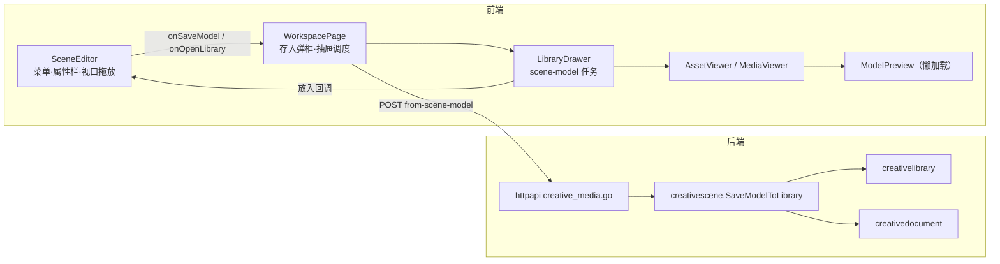
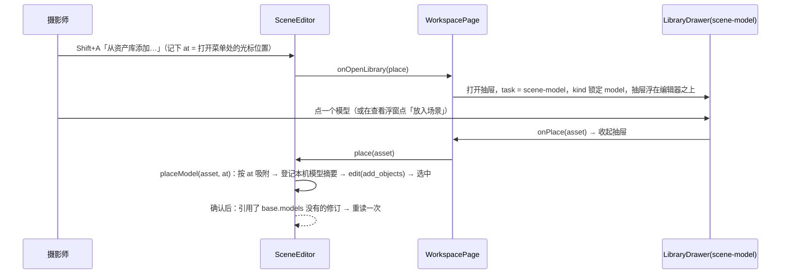

# Change 详细设计

## 继承的设计

- **继承的设计**：Epic `scene-editor-3d` 修订 v11，见 proposal 决定 1。
  - v11 与本 change 的设计一同交 owner 审批（`lti epic revise`），审批后用 `lti epic bind` 把本 change 绑定到 v11。
  - 起草时 `designBinding` 仍指向 v10。v10 按 GLB 的 sha256 查重、模型不可用时返回 409，与本设计不一致，不得按 v10 实施。
- **本次引用的 Epic 条目**：
  - 不变量：I1 只引用不可变内容、I4 写时分叉、I7 内容归属、I8 账号隔离；
  - 「模块职责与依赖方向」中 `creativelibrary` 一条；
  - `data: 模型内容`，以及其中的媒体票据和 GC 持有方。
- **本次交付**：`data: 模型资产`、`api: 模型存入资产库`。
- **复用的已交付能力**：
  - 场景的 `add_objects`（`api: 提交场景命令`、`api: 场景模型命令` 的引用校验）；
  - C5 的材质解析规则（槽位提示到预设）。
- **项目约定**：
  - 资产库的「存入资产库」：`creativecanvas.SaveNodeToLibrary` 与 `creativelibrary.SaveRevisionInTx`，锁序是先资产库根，再画布或文档，最后内容（`docs/product/creative-canvas-system/data-model.md`「锁顺序」）。
  - 资产库的抽屉和页面共用组件（`LibraryDrawer` / `AssetBrowser` / `AssetViewer`）。
  - 场景编辑器按需加载 three.js 的边界。
- **调研**：没有单独的 discovery，起草时的代码核对结论写进本文和 proposal 的「现状」。

## 领域模型与业务规则

不新增领域对象。模型资产就是一行 `creative_assets`（`kind = 'model'`），引用一个完整形态的模型修订。

- **身份与关系**：
  - 资产 → 模型修订是多对一：同一修订在库里至多一份不在回收站的资产，按修订查重。
  - 场景实例 → 模型修订也是多对一。资产和实例之间没有任何记录（I7）。
- **复制语义如何成立**：入库和放入都只引用同一个不可变修订，不复制字节。
  - 放入后调参数：编辑器按 I4 新建模型内容，即分叉（`modelEdits.ts`），不带 `base_content_id`。
  - 修订不可变，所以资产和原场景都不受影响。
  - 不需要为入库或放入复制内容。
- **存入时的不变量**：存进库的永远是摄影师看到的那一版模型，由 `expected_object_rev` 对内容单元 `object:<id>:content` 做检查（Epic v11）。编辑器在本机还有未确认的、涉及该内容单元的改动时，不允许存入（见「编辑器侧的可存入判断」）。
- **存什么**：只存模型修订，也就是几何、代码和参数。实例上的材质、缩放和位置属于场景，不随资产保存。弹框和查看浮窗都会说明这一点（见「存入弹框」「3D 预览」）。
- **放置限制**：模型资产只进场景，不进画布（没有 `core.model` 节点）。

## 模块职责与协作



- **`creativescene.SaveModelToLibrary`**（新，`library.go`）：存入的用例编排。
  - 读场景，核对对象和单元 `rev`，确认模型修订完整可用，再交给 `creativelibrary.SaveRevisionInTx`。
  - 放在 `creativescene` 是因为对象、单元和完整形态的判断都是场景模块的内部知识（`decodeScene`、`indexObjects`、`requireModel` 均未导出）。`creativelibrary` 不 import 场景，依赖方向与画布的「存入资产库」相同。
- **`creativelibrary`**：
  - 类型白名单加 `model`；
  - 新增导出的 `AssetKinds()`，供助手工具枚举使用；
  - 单个资产读取（`service.go:GetAsset`）对内容调用 `creativecontent.WithoutModelCode`。列表经 `Preview` 已去掉代码，`list.go` 不改。
- **`creativecontent`**：
  - 新增 `WithoutModelCode(r Revision) Revision`，只对 `kind = 'model'` 去掉 `generator.code`，其他类型原样返回。
  - `Preview` 在截断正文之外也调用它，所以资产列表和画布节点快照都不带代码。画布没有模型节点，节点快照实际不受影响。
  - 不让 `GetAsset` 直接改用 `Preview`：文字资产的读取要返回完整正文，供编辑前读取，截断会弄坏编辑。去代码和截断正文是两件事，分成两个函数。
- **`httpapi`**：`creative_media.go` 注册 `POST /creative/assets/from-scene-model`，一行 `h.creativeWrite(c, "", "", creativescene.SaveModelToLibrary)`。错误映射走现有的 `creativeDocumentError`，它已处理 `ConflictError`、`ErrTrashed` 和 `ErrModelUnavailable`，不新增映射。
- **`creativeagent`**：`search_assets` 的 `kind` 枚举改用 `creativelibrary.AssetKinds()`；`edit_scene` 说明加放入方法；`read_asset` 支持模型（见「助手看模型资产」）。
- **`creativecontent.ModelFacts`**（新）：从模型载荷解码出给助手看的模型信息，资产库搜索和 `read_asset` 共用。
- **`creativemedia.AgentImage`**：对 `kind = model` 取 `thumbnail` 角色的 PNG，不取 GLB。
- **`creativecanvas`**：
  - 助手能搜到模型之后，可能会用画布的 `add_node` / `fill_node` 把模型放到画布上。后端本来就会拒绝（节点类型必须是 `core.<kind>`，没有 `core.model`），但现在的提示是通用的「model 内容不能放进 image 节点」。
  - `graph_commands.go:kindMismatch` 在 `kind = model` 时改为提示「模型只能放进 3D 场景，请用 edit_scene 的 add_objects 放入」，让助手能自己改正。
- **前端 `creative-scene/`**：
  - `SceneEditor` 新增三个可选 prop。单独挂载编辑器的 e2e 不传它们，入口隐藏。
    - `onSaveModel(request)`：打开存入弹框。
    - `onOpenLibrary(place)`：打开抽屉，放入时回调 `place(asset)`。
    - `libraryDrag`：抽屉里正在拖动的模型（修订、标题、`mount`、`manifest`），没有拖动时为 `null`。
  - 视口接收拖放，显示虚影，按参考点吸附表面。吸附计算放在纯函数 `placement/snap.ts`，不依赖 React。
  - 放入流程 `placeModel(asset, at)`。
- **前端 `creative-canvas/`**：
  - `WorkspacePage` 持有存入弹框和抽屉调度；
  - `LibraryDrawer` 新增 `scene-model` 任务；
  - 资产库各处的 `model` 分支和画布放置拦截；
  - 查看浮窗按需加载 `ModelPreview`。

## 关键机制

### 存入（后端）

```
SaveModelToLibrary(cmd)            // operation key "library.create_asset_from_scene_model"
  Validate（锁外）:
    document_id / object_id 格式，expected_object_rev 为 CreativeRevision → 否则 ErrValidation
    creativelibrary.ValidateImportTarget(target)
  Apply(tx):
    1. creativelibrary.ValidateImportTargetInTx(tx, target)   // 锁资产库根；分组、标签不存在 → ErrNotFound(404)
    2. head := creativedocument.ReadHeadInTx(tx, document_id)  // 不锁场景行（同 exports.placeExportsInTx）
         不存在 / type_key ≠ scene → ErrNotFound；在回收站 → ErrTrashed(409 creative_state_conflict)
    3. cur := ReadAtInTx(head.revision)；scene := decodeScene；obj := indexObjects(scene)[object_id]
         对象不存在 → ErrNotFound；kind ≠ model_instance → ErrValidation
    4. unit := "object:"+id+":content"；cur.UnitRevs[unit] ≠ expected → ConflictError{unit, expected, current}
    5. rev := requireModel(tx, obj.Model.ContentRevisionID)    // 完整形态 + 可展示，否则 ErrModelUnavailable(400)
    6. res := creativelibrary.SaveRevisionInTx(tx, rev, target)
       status = 201；res.Reused → 200
```

- **锁序**：资产库根 → 场景（只读快照）→ 内容（`requireModel` 内的 `RequireUsable` 对内容加锁），与画布的「存入资产库」一致。
- **不锁场景行的原因**：存入不改场景。第 4 步检查的是同一事务里读到的头修订；即使提交前场景又变了，存入的仍是摄影师看到的那一版。这正是要的语义。
- **幂等**：沿用 `creativeops` 执行器（同 `creativecanvas.SaveNodeToLibrary` 的 `run`），回执保存 201 或 200 的响应体，同 key 重放。
- **查重**：`SaveRevisionInTx` 已按 `content_revision_id` 找不在回收站的资产。命中时只追加分组和标签，返回已有的标题和描述。不改。

### 编辑器侧的可存入判断

「存入资产库」可点的条件，按顺序判断，第一个不满足的条件作为提示：

| 条件 | 不满足时的提示 |
|---|---|
| 选中恰好一个物件 | 「选一个模型」 |
| `kind = model_instance` | 「只有代码模型能存入资产库」 |
| 模型修订不是本机占位（`local:<intent>:model`） | 「模型还在生成」 |
| 实例不在 `modelEdits` 的预览中（在预览中表示改参数后正在重新生成） | 「参数修改还在生成，稍后再存」 |
| 场景读到的模型摘要 `usable` | 「模型不可用」 |
| outbox 里没有涉及 `object:<id>:content` 的未确认改动 | 「正在保存，稍后再试」 |

### 存入弹框

弹框沿用 `WorkspacePage` 的 `StudioDialog` 和 `GroupField`：

- 标题默认取模型名（`name_hint`），没有时取物件名；
- 标题下方一行说明：「保存模型和参数；场景里换的材质和缩放不随资产保存」；
- 结果提示沿用 `copyNotice`（「已存入…」/「这份内容已在资产库中，已归入…」）。

**存哪一版，打开时就冻结**：

- 弹框打开时记下 `{object_id, content_revision_id, unit_rev}`。其中 `unit_rev` 取 `base.unit_revs["object:<id>:content"]`，请求的 `expected_object_rev` 用的就是它，而不是点「存入」时的最新值。
- 原因：弹框打开期间，场景可能已经因失效通知重读到新版。如果点「存入」时才取最新值，请求会直接成功，存进摄影师没确认过的版本，AC-2 不成立。

**收到 409 `creative_document_conflict` 后**：

1. 弹框保持打开，「存入」暂不可点，提示「模型刚被修改，正在读取最新版本…」。
2. 等场景会话读到的 `unit_revs[unit]` ≥ `details.conflicts[0].current_rev`。此时编辑器里显示的已是新版，属性栏同步更新。
3. 按新版重新执行可存入判断：
   - 不能存时（比如实例被删除，或换成了不可用的模型），提示原因，「存入」保持不可点；
   - 能存时，用新版刷新冻结的三项。如果摄影师没改过标题，标题默认值也换成新模型名。提示改为「模型已更新为最新版本，确认后再存」，「存入」恢复可点。
4. 再点「存入」时用新的 `operation_id`，因为请求内容已经变了，不能沿用原来的幂等键。

收到其他错误时，按现有 `copyNotice` 的错误提示处理，不暴露错误原文（项目偏好）。

### 放入场景



- **位置**：按「吸附」一节计算。
  - 菜单从视口里打开（Shift + A、空白处右键）时，在 `at` 处吸附；
  - 从菜单栏打开时没有光标位置，直接用兜底：`groundPoint()` 取视图中心在地面上的投影，与 `addPrimitive` 一致；
  - 拖放在松手处吸附，结果就是虚影最后的位置。
- **对象**：
  - `{kind: 'model_instance', name: asset.title（截到对象名上限）, parent_id: null, order: nextOrder, transform: {position, rotation, scale: [1,1,1]}, visible: true, locked: false, model: {content_revision_id}, material_slots: {}}`，`position` 和 `rotation` 取吸附结果；
  - 标签「添加「<标题>」」，一次 `edit` 即一次修订、一次撤销，与 `addPrimitive` 相同。
- **放入后马上有摘要**：资产内容里已有 `manifest`、去掉代码的 `generator`、`name_hint` 和 `content_id`。
  - 放入时用 `modelCache.remember(revision, summary)` 登记为已知摘要，属性栏、选中框和参数面板因此立即正确。
  - 已知摘要放在 `ModelCache` 新增的独立存储 `known` 里，**不写进 `local`**：`LocalModel` 要求带 GLB 字节，`load()` 一看到 `local` 里有这个修订就直接用 `local.glb`，只有摘要的条目会让它拿空字节去校验而出错。
  - `modelSummaries` 按「服务端 > 本机烘焙（`local`）> 已知摘要（`known`）」合并。服务端摘要一到就以它为准；收到服务端摘要的修订从 `known` 里删掉。
  - `SceneSession.confirmed` 增加一条重读条件：本批 `add_objects` 或 `set_instance_model` 引用了 `base.models` 里没有的修订。这样之后用的是服务端摘要。
  - 这条重读条件对复制粘贴同样成立。
- **拖放**（与 Blender 资产库一致，proposal 决定 4）：
  - **一次拖一个模型**。抽屉在 `scene-model` 任务下允许拖动（`LibraryDrawer.dragCard` 现在有任务时一律 `preventDefault`，本次放开 `scene-model`），只带被拖的那张卡片，不带多选。
  - **拖动的是哪个模型，靠页面内状态传递**：浏览器在 `dragover` 期间读不到拖动的数据，只能读类型，虚影却必须知道是哪个模型。
    - 抽屉在 `dragstart` 时照常写入 `application/creative-asset+json`，同时回调 `WorkspacePage`，后者把这个模型作为 `libraryDrag` 传给 `SceneEditor`；`dragend` 时清空。
    - 视口只在类型匹配且 `libraryDrag` 不为空时接收（`dropEffect = copy`），否则为 `none`。
    - `drop` 时以 `libraryDrag` 为准，类型里的数据只用来核对是同一个资产。
  - **虚影**：
    - `libraryDrag` 一出现就开始 `modelCache.load(revision)` 预取。
    - 加载完成前，按 `manifest.bounds` 画包围盒线框；加载完成后，换成 `ModelMesh` 的 `ghost` 形态（半透明白模，已有）。
    - 虚影只画在视口里，不进场景状态和 outbox，不参与求交。
  - **跟手**：`dragover` 只记下光标位置，每个动画帧至多求交一次，算完调用 `invalidate()`（视口是按需渲染）。
  - **结束**：
    - 离开视口时隐藏虚影；
    - 按 Esc 或在别处松手，浏览器会结束拖动，`dragend` 清空 `libraryDrag`，虚影消失，场景不变；
    - 在视口里松手时 `placeModel`：一次 `edit`，即一次修订、一次撤销。
- **抽屉在场景视图里**：
  - `WorkspacePage` 进入场景时收起抽屉的逻辑不变，只有 `scene-model` 任务能在场景视图里打开抽屉。
  - 抽屉加 `is-scene-model` 类，`z-index` 高于编辑器（编辑器为 31）、低于弹框（40）。
  - 底部提示「点一个模型放进场景，或拖到想放的位置」。
  - **点击放入后收起，拖入后不收起**：点击只有一个落点（打开菜单处），连续点击会把模型叠在一起，所以放一个就收起；拖入每次都由摄影师选位置，抽屉保持打开，可以连续拖入多个。
  - Esc 或关闭按钮收起抽屉，场景编辑器的按键在抽屉打开时不响应，与弹框一致。
  - 查看浮窗的「放入场景」按钮只在这个任务下出现。

### 吸附（`creative-scene/placement/snap.ts`）

输入：光标处的射线、场景中可见物体的网格、模型的 `mount` 和 `manifest.bounds`。输出：`{position, rotation}`。纯函数，按表格做单测。

- **参考点**：本次就是几何模块契约按 `mount` 约定的原点。资产内容里已有 `generator.mount` 和 `manifest.bounds`，不用等 GLB 下载完。C8 让参考点可调之后，这里改读模型修订里的有效参考点，下面的规则不变。
- **求交对象**：可见的 `primitive` 和 `model_instance` 的网格（锁定的也算），其中包括新场景自带的地面。不含灯光、摄像机、空物体的辅助图形，也不含虚影。项目已依赖 `three-mesh-bvh`，拖动开始时按需给模型网格建 BVH。
- **选面**：沿射线取第一个朝向符合下表的命中面。法线用世界空间法线，方向按 z 轴向上判断，阈值 45°。

| `mount` | 参考点（本次） | 可吸附的面 | 落点与朝向 |
|---|---|---|---|
| `floor` | 底面中心 | 朝上的面 | 参考点放在命中点，保持直立，不旋转 |
| `wall` | 背面底边中心 | 竖直的面 | 参考点放在命中点；只绕竖直轴旋转，让模型正面朝向法线的水平方向（背面贴墙） |
| `ceiling` | 顶面中心 | 朝下的面 | 参考点放在命中点，保持直立，不旋转 |
| `free` | 几何中心 | 朝上的面 | 包围盒底面中心放在命中点，保持直立，不旋转 |

- **兜底**：没有符合的面时（比如场景里没有顶面），按 `free` 的规则落到射线与地面（z = 0）的交点上，也就是包围盒底面贴地，所以不会埋进地下。射线连地面也碰不到时（比如朝天拖），用 `groundPoint()` 的视图中心投影。
- **不做**：按法线倾斜模型（斜面上的家具仍然保持直立）；拖动时按修饰键关闭吸附。真实使用中需要时再加。

### 资产库对 `model` 的分支

决策表（不在表中的位置没有按类型的分支，不改）：

| 位置 | `model` 的处理 |
|---|---|
| `assets/query.ts:KINDS`、`editor/libraryState.ts:kindLabel` | 加 `model`，标签「模型」 |
| `editor/libraryState.ts:tileRatio` | 1:1（缩略图是 256 × 256） |
| `editor/media.ts`（`MediaKind`、`pickRendition`、`useMediaURL`） | 角色加 `thumbnail`；`model` 只取 `thumbnail`，不退回 `original` |
| `editor/MediaView.tsx:MediaFigure`、`editor/LibraryTiles.tsx:TileFace` | 新增模型卡面：缩略图放在中性底上，角标「3D」；和图片卡一样经 `useNearViewport`，卡片接近可视区才请求缩略图 |
| `assets/AssetBrowser.tsx` 的 `visual` 判断 | 模型按有画面的卡片处理（显示标题说明） |
| `viewer/MediaViewer.tsx` | 新增模型舞台：`lazy(() => import('../../creative-scene/preview/ModelPreview.tsx'))`；加载中显示缩略图 |
| `viewer/AssetInfoPanel.tsx`、`assets/AssetInspector.tsx` | 类型「模型」；尺寸（`manifest.bounds`，米，保留两位）、面数、材质槽（id 与提示）、参数（只读，按 `params_schema` 的标签和单位）；不显示画幅。格式化放在 `viewer/modelInfo.ts`（见「3D 预览」的加载边界） |
| `assets/useOrganization.tsx` 下载、`editor/MediaView.tsx` 扩展名表 | 走 `downloadMedia`，取 `original`，扩展名 `.glb` |
| `editor/assetPlacement.ts`、`assets/placement.ts`、`WorkspacePage.addAssets` | 过滤掉模型；全是模型时提示「模型只能放进 3D 场景」 |
| `editor/CanvasView.tsx` 拖放 | 同上；`fillable` 对模型为假 |
| `viewer/AssetInfoPanel.tsx`「放入画布」、`assetMenu` 的放入项、`LibraryDrawer` 的「填充」「选参考」 | 模型不显示（`scene-model` 任务下改为「放入场景」） |

### 3D 预览（`creative-scene/preview/ModelPreview.tsx`）

- **加载边界**：
  - 只由 `MediaViewer` 懒加载。资产库页、画布页在打开模型查看浮窗前都不请求 three.js 和 `@react-three/*`，e2e 断言覆盖两页。
  - 信息面板的格式化（尺寸、参数标签与单位、槽位提示）放在 `viewer/modelInfo.ts`，只依赖 `schema.d.ts` 的类型和不含 three 的数据。它不能 import `creative-scene` 里引用 three 的模块，否则 three 会被拉进主包。e2e 断言能兜底，但发现得晚，所以在模块边界上就隔开。
- **组成**：
  - R3F `Canvas`，加 drei `OrbitControls`：拖动旋转，滚轮缩放，双击回到初始视角。初始视角与缩略图相同（`sandbox/thumbnail.ts` 的三分之四前视角，按包围盒取景）。
  - 网格经 `ModelCache.load` 读取，复用 GLB 校验和槽位拆分；材质经 `resolveSlot(slot, {}, hint, constants)` 和 `materialFor`。
  - 切换按钮叫「白模 / 默认材质」。「白模」沿用编辑器白模的材质与灯光；「默认材质」按槽位提示套用预设，沿用材质预览的 `RoomEnvironment`。不复用 `Lighting.tsx` 里依赖场景状态的部分，只抽出无状态的灯光构件。
  - 「默认材质」下方一行说明：「放进场景后可以换材质」。叫「默认材质」，是为了不让摄影师以为这是存入时场景里配的材质（见「存什么」）。
- **失败**：GLB 读不到或校验失败时，舞台显示缩略图和「无法预览」，不暴露错误原文（项目偏好）。
- **资源**：
  - 浮窗关闭时卸载 `Canvas`，释放渲染器。
  - 预览用**单独的** `ModelCache` 实例（`preview/cache.ts`），不用编辑器的单例 `modelCache`。
    - 编辑器的单例在生产代码里从不清理（`clear()` 只在测试里调用）。如果在资产库页一个个打开预览都存进它，解析出的几何体会一直累积。
    - 预览缓存最多保留 8 个模型，超出时淘汰最久没打开的那个，并释放它的几何体。同一时间只开一个浮窗，被淘汰的不会正在显示。
    - 代价：在场景视图里先预览再放入，同一个 GLB 会下载两次，可以接受。

### 列表和读取不下发代码

- **后端**：
  - `creativecontent.WithoutModelCode`：`kind = 'model'` 且载荷有 `generator` 时，解码 `Payload.Model`（`json.RawMessage`），删除 `generator.code` 后重新编码；`Truncated` 不设，因为代码不是被截断，而是这些接口不提供。
  - 调用方：
    - `Preview`：资产列表、画布节点快照；
    - `creativelibrary.GetAsset`：`GET /creative/assets/{id}`。
  - 按内容修订读取（`GET /creative/content-revisions/{id}`）不调用它，仍返回代码。
- **OpenAPI 只改响应侧**：
  - `CreativeModelPayload` 经 `CreativeContentPayload` 的 oneOf，同时被三个**请求体**引用：`CreativeContentDraft`、`CreativeReplaceContentPayload`、`CreativeActionReplaceContent`。直接把它的 `code` 改成可选，请求侧也会跟着放宽，所以不动它。
  - 新增只用于响应的 `CreativeModelPreviewPayload`：`{model: {format, manifest, generator, name_hint}}`。
    - `generator` 必填，引用已有的 `CreativeModelGenerator`（场景读取用的那份，不含代码，`additionalProperties: false`）。
    - 资产只持有完整形态，完整形态一定有 `generator`。
  - 新增只用于响应的联合类型 `CreativeContentRevisionPayload`：现有四种载荷，加上 `CreativeModelPreviewPayload`。三种模型载荷各只匹配一个变体，所以 `oneOf` 成立：
    - 带代码的完整形态只匹配 `CreativeModelPayload`，因为 `CreativeModelGenerator` 不允许出现 `code`；
    - 暂存形态没有 `generator`，只匹配 `CreativeModelPayload`；
    - 去掉代码的完整形态只匹配 `CreativeModelPreviewPayload`，因为 `CreativeModelGeneratorInput` 要求必须有 `code`。
  - `CreativeContentRevision.payload` 改为引用 `CreativeContentRevisionPayload`。`CreativeContentRevision` 只出现在响应里（内容修订读取、`CreativeLibraryAsset`、`CreativeCanvasNode`、`CreativeInternalDocument`），起草时已逐一核对。
  - 三个请求体继续引用 `CreativeContentPayload`，不变。
- **前端**：`CodePanel` 读内容修订时用类型守卫收窄到带 `code` 的载荷；生成的类型里，响应的 payload 多了一个变体。

### 助手看模型资产

owner 2026-10-20 补充：助手查找资产时要能看缩略图，也要拿到模型的关键信息。现状是 `search_assets` 只返回标题、描述和归类，`read_asset` 遇到模型会报「不支持」（`resolveReference` 落进默认分支），`AgentImage` 也只接受图片。

- **`creativecontent.ModelFacts(p Payload) (ModelFacts, bool)`**：
  - 只解码完整形态；暂存形态返回 `false`。
  - 完整信息的字段：`name`（取 `name_hint`）、`mount`、`size_m`（包围盒三边长，米，四舍五入到毫米）、`triangles`、`slots`（id 与提示）、`parts`、`anchors`、`params_schema`、`params`。
  - 字段名和 `size_m` 的算法与 `write_model` 回报的 `creativescene.BakedModel` 一致，助手看到的是同一套说法；测试对同一修订断言两者的公共字段相同。
  - `Brief()` 是给搜索结果用的要点：`name`、`size_m`、`mount`、`triangles`、`slots`、`params`（只列参数名）。不含部件和挂点，因为它们最多各 200 项，会挤占搜索的分页字节。
  - 放在 `creativecontent` 的原因：
    - `creativelibrary` 和 `creativeagent` 都要用，而 `creativelibrary` 不能 import `creativescene`；
    - `creativecontent` 本来就持有 `Payload.Model`，`WithoutModelCode` 也要解码它；
    - 槽位和挂点的类型取自叶子包 `creativeglb`，不会形成循环依赖。
- **搜索结果**（`creativelibrary/discovery.go`）：
  - 模型项**不输出** `width` / `height`。现在的逻辑会取第一个带宽高的媒体对象，模型的就是 256 × 256 的缩略图，会被误读成模型尺寸。
  - 模型项改为输出 `model: Brief()`，沿用图片项附宽高的先例。单项多出约 300 字节，按字节分页的逻辑不变。
- **`read_asset`**（`creativeagent/context.go`）：
  - `resolveReference` 新增 `model` 分支：
    - 需要 `media_metadata` 同意，与资产库工具一致；没有同意时按现有规则返回 `ErrEgressRequired`。
    - 模型信息以 JSON 写进消息正文。
    - 模型能看图（`ImageInput`）且有 `image_preview` 同意时，附缩略图：`Extra[imageRefsKey]` 设为这个修订的 ID。
    - 不满足时不报错，只记下 `thumbnail_omitted`：`model_cannot_see_images` 或 `image_preview_not_allowed`。和图片类资产不同，模型光有尺寸和参数也有用。
  - `readAsset` 对模型返回 `{reference, content_revision_id, model, image_revision_id?, thumbnail_omitted?}`，其中 `model` 是完整信息。
    - 不走文字分页：完整信息最长约 25 KB（各 200 项部件和挂点，加 32 个参数定义），在 64 KiB 的工具结果上限之内。
    - 现在的写法遇到图片引用就直接返回、不带正文，模型要正文和图片一起返回，所以单独一个分支。
  - 缩略图经现有的 `bindMessages` → `AgentImage` 交给模型；256 px PNG 远小于图片预览上限，不用缩小。
  - 不返回代码。助手要改模型时，按已有流程放进场景后再改。
  - 附带效果：摄影师在对话里用 `<<<…>>>` 引用模型资产时，走的也是 `resolveReference`，助手同样能看到信息和缩略图，不再报「不支持」。
- **工具说明**：
  - `search_assets`：「结果不含图片」改为「模型项附尺寸、挂载方式等要点；要看缩略图和完整信息，用 read_asset」。
  - `read_asset`：加一句「模型返回尺寸、挂载方式、面数、材质槽、部件、挂点、参数定义与当前值，并附缩略图」。
  - 说明变化按「排空后升级」。

### 迁移 0079

- **up**：`creative_assets_kind_check` 改为 `('text','link','image','video','audio','model')`。
- **down**：先检查 `EXISTS (SELECT 1 FROM creative_assets WHERE kind='model')`，有则 `RAISE EXCEPTION`（同 0074），再恢复原约束。
- **测试**：`store/creative_asset_model_migration_test.go` 覆盖升级、回滚、有模型资产时拒绝回滚。`rollbackCreativeAssetModel` 成为回滚链头，9 处标签列表前置 `"creative-asset-model"`。

## 局部设计与偏差

- **放置入口复用资产抽屉**（proposal 决定 2）。代价是抽屉要能浮在编辑器之上，并新增一种任务；收益是分组、标签、搜索、评分、查看浮窗全部复用。
- **单击即放入**：与「填充」任务的交互一致，放一个就收起；先看再放走查看浮窗的「放入场景」；要连续放好几个，用拖入（抽屉不收起）。
- **本机已知摘要**：只是显示上的过渡，服务端摘要到达后以服务端为准。即使登记的摘要与服务端不一致（理论上不会，两者来自同一修订），也只影响短暂的显示。
- **3D 预览的灯光**：抽出无状态的灯光构件，而不是把场景状态伪造给 `Lighting.tsx`。如果抽取过程中发现白模分支与场景状态耦合较深，退回只做「材质」模式加一盏固定的主光，在 tasks 里记录取舍。
- **拖入只按 `mount` 原点吸附**：参考点可调和快捷轮盘是 Epic 新增的非主线子项 C8（owner 2026-10-20，proposal 决定 6）。本次的吸附函数以参考点为输入，C8 只需改变参考点的来源。
- **不在本次范围**（proposal「What Changes」第 6 条）：
  - 把编组（多个物件）存成一个资产；
  - 材质和缩放随资产保存。先看试用中摄影师是否常常需要，再决定是否给模型资产加「实例模板」。
- **实施中的挂载点调整**（不改语义）：
  - `creativescene/models.go`：`requireModel` 只回报错误，存入需要拿到它检查过的修订，所以拆出 `usableModel` 返回修订，`requireModel` 改为调用它。
  - 模型资产的库测试放在新文件 `creativelibrary/model_asset_test.go`，不塞进 `asset_library_test.go`；画布拒绝模型的测试在 `creativecanvas/graph_test.go`（tasks 1.3 已写明）。
  - 迁移标签列表另有两处带编号的写法：`creative_graph_migration_test.go`、`creative_library_migration_test.go`。
  - 生成物还包括 `httpapi/api.gen.go` 与 `creativecanvas/tool_schemas.gen.go`（`read_canvas` 的输出 schema 引用了内容修订载荷）。
  - Go 里类型和函数不能同名，`ModelFacts(p)` 落为 `creativecontent.ModelFactsOf(p)`，类型仍叫 `ModelFacts`，要点类型为 `ModelBrief`。
  - `creativeagent/context.go` 把 `resolveReference` 拆成 `readReference`（按同意和能力读出文字、图片或模型信息）与 `referenceMessage`（写成消息）；`readAsset` 直接用 `readReference` 的结构化结果，不从消息正文里解析模型信息。
  - `AgentImage` 交出模型缩略图的测试放在 `creativemedia/agent_test.go`：助手包的测试用的是假的图片读取器，验证不了真实字节。
  - 3.1 的可存入判断和「等编辑器显示出新版」放在不依赖 three 的 `creative-scene/saveModel.ts`（`saveTarget`、`whenShown`），供单测和画布页的类型引用；存入弹框是独立组件 `creative-canvas/editor/SaveModelDialog.tsx`，`WorkspacePage` 只负责挂载。409 后的刷新经 `SaveModelRequest.refresh` 回到编辑器，场景会话不离开编辑器。
  - 场景菜单项加可选的 `hint`（`panels/ContextMenu.tsx`），不可点时在下方说明原因；右键菜单保留带说明的禁用项，「存入资产库」因此也能说明原因。
  - 3.2 的实例对象由 `editing.ts:newModelInstance` 生成（与 `newPrimitive` 并列）；重读条件是 `state/sync.ts:namesUnknownModel`。查看浮窗的放入按钮改由调用方给文字和适用范围（`AssetViewer` 的 `placeLabel`、`placeable`），场景任务下显示「放入场景」且只对模型。点抽屉卡片放入后，编辑器取回焦点，Cmd+Z 立即可用。
  - 3.3 的吸附在文档空间（Y 向上）里算，视口把命中点和法线换算过去再调用，表中「按 z 轴向上判断」对应文档空间的 y 轴；求交与按需建 BVH 在 `placement/raycast.ts`；拖入虚影复用 `GhostModel`（加旋转与「加载前画包围盒」）。
  - **兜底的细化**（实施中发现，按设计「按 free 的规则」的本意落实）：没有合适的面时先按 free 找第一个朝上的面，找不到才落到射线与地面的交点。原写法直接落地，吊顶模型拖到桌面上方时会埋进桌子里。spec「没有合适的表面」的结果（包围盒底面着地、不埋进地下）不变。
  - e2e 用「拖到抽屉上松手」覆盖取消拖入：Playwright 的原生拖放模拟里按不出 Esc 取消；两者都由浏览器以 `dragend` 结束、不触发 `drop`，走的是同一条清空路径。
  - **3.4 发现的缺口**：设计的「复制语义如何成立」假定放入后改参数会分叉，但 `forkPlan` 对场景里只有一个实例的模型会带上 `base_content_id`，在资产所属的内容上追加修订。资产仍钉在旧修订上，看到的不变，但场景和资产会共用一条内容历史，不符合 I7。改为：`ModelCache` 记下从资产库放入的内容（`copied`），这类内容第一次修改时不带 `base_content_id`，分叉出场景自己的模型；之后的修改照 R4 续在新内容上。已知限制：这份记录只在页面存活期间有效，刷新后再改会照 R4 续在原内容上（资产不受影响）。要彻底解决需要服务端回报内容的归属，留作后续。
  - 1.2 生成新的 `kind` 枚举后，前端类型要求画布放置先排除模型；`assetPlacement.ts` 加 `CanvasAsset` 类型守卫，`assets/placement.ts` 遇到模型抛「模型只能放进 3D 场景」，`WorkspacePage` 的 `addAssets`、`pickReferences` 先过滤。2.2 在此基础上补齐提示与其余入口。
- **后续**：
  - 参考点设置与快捷轮盘（C8）；
  - 助手把场景模型存入资产库；
  - 模型资产的「替换场景里的实例」（`set_instance_model` 指向资产修订）；
  - 外部 GLB 导入（Epic 非目标）。

## 接口与数据契约

- **交付**：`api: 模型存入资产库`、`data: 模型资产`，按 Epic v11 绑定，不复制到本 Change 的 contracts.md。
- **兼容扩展**：
  - 资产相关的 `kind` 枚举加 `model`，涉及资产列表 `kind` 查询参数、`CreativeLibraryAsset.kind`、`CreativeAssetFacets.kinds`（必填键加 `model`）。
  - `CreativeContentRevision.payload` 改为只用于响应的联合类型 `CreativeContentRevisionPayload`，新增不含代码的模型载荷变体，用于资产列表和资产读取；请求体引用的 `CreativeContentPayload` 不变（见「列表和读取不下发代码」）。
  - 助手 `search_assets` 的 `kind` 枚举改为资产库实际支持的类型：去掉从来不可用的 `scene`，加 `model`；模型项附 `model` 要点，不再附缩略图宽高。
  - 助手 `read_asset` 支持模型，返回 `model` 完整信息，以及缩略图或 `thumbnail_omitted`（Epic v11 `data: 模型资产`）。
  - 工具说明变化按 `docs/dev/agent-skills-tools.md`「排空后升级」。
- **不变**：场景的读取、命令接口和已交付的场景契约。

## 挂载点

| 位置 | 动作 | 说明 |
|---|---|---|
| `backend/internal/platform/store/migrations/0079_creative_asset_model.up.sql` | 新增 | 放宽 kind 约束 |
| `backend/internal/platform/store/migrations/0079_creative_asset_model.down.sql` | 新增 | 有模型资产时拒绝 |
| `backend/internal/platform/store/creative_asset_model_migration_test.go` | 新增 | 升级、回滚、拒绝；新回滚链头 |
| `backend/internal/platform/store/agent_conversation_slots_migration_test.go:rollbackAgentConversationSlots` | 修改 | 先调新链头 |
| `backend/internal/platform/store/auth_legacy_cutover_harness_test.go` | 修改 | 标签列表 |
| `backend/internal/platform/store/auth_limiter_test.go` | 修改 | 标签列表（2 处） |
| `backend/internal/platform/store/auth_migration_test.go` | 修改 | 标签列表（2 处） |
| `backend/internal/platform/store/planning_migration_test.go` | 修改 | 标签列表 |
| `backend/internal/platform/store/settings_availability_migration_test.go` | 修改 | 标签列表 |
| `backend/internal/platform/store/store_test.go` | 修改 | 标签列表 |
| `backend/internal/platform/store/telegram_digest_migration_test.go` | 修改 | 标签列表 |
| `backend/internal/creativescene/library.go` | 新增 | `SaveModelToLibrary` |
| `backend/internal/creativescene/library_test.go` | 新增 | 存入的成功、复用、各失败与跨账号 |
| `backend/internal/creativelibrary/list.go:assetKinds` | 修改 | 加 `model`；导出 `AssetKinds()` |
| `backend/internal/creativelibrary/asset_library_test.go` | 修改 | 模型资产的列表、筛选、分面、回收站 |
| `backend/internal/creativecontent/content.go:WithoutModelCode` | 新增 | 模型去掉代码；`Preview` 调用它 |
| `backend/internal/creativecontent/content_test.go` | 修改 | 模型去掉代码、其他类型原样返回、暂存形态原样返回 |
| `backend/internal/creativelibrary/service.go:GetAsset` | 修改 | 内容经 `WithoutModelCode` |
| `backend/internal/creativecanvas/graph_commands.go:kindMismatch` | 修改 | 模型给出「只能放进 3D 场景」的提示 |
| `backend/internal/platform/httpapi/creative_media.go:registerCreativeMedia` | 修改 | 新路由与处理函数 |
| `backend/internal/platform/httpapi/creative_scene_library_test.go` | 新增 | 端点、幂等重放、错误码 |
| `backend/internal/creativeagent/asset_tool_info.go:assetToolInfo` | 修改 | `search_assets` 的 kind 枚举与说明 |
| `backend/internal/creativecontent/model_facts.go` | 新增 | `ModelFacts` 与 `Brief()` |
| `backend/internal/creativecontent/model_facts_test.go` | 新增 | 完整形态、暂存形态、尺寸取整、要点不含部件与挂点 |
| `backend/internal/creativelibrary/discovery.go` | 修改 | 模型项附 `model` 要点，不附宽高 |
| `backend/internal/creativemedia/agent.go:AgentImage` | 修改 | 模型取 `thumbnail` 角色 |
| `backend/internal/creativeagent/context.go` | 修改 | `resolveReference` 的模型分支、`readAsset` 的模型结果、`read_asset` 说明 |
| `backend/internal/creativeagent/asset_lookup_test.go` | 修改 | 搜索的模型要点、`read_asset` 的信息与缩略图、两种 `thumbnail_omitted` |
| `backend/internal/creativeagent/scene_tools.go` | 修改 | `edit_scene` 说明加放入方法（`model{content_revision_id}` 可来自 `search_assets kind=model`） |
| `api/openapi.yaml` | 修改 | 新端点、kind 枚举、`CreativeModelPreviewPayload` 与 `CreativeContentRevisionPayload`（只用于响应）；`make generate` 生成物 |
| `frontend/src/creative-scene/SceneEditor.tsx` | 修改 | 三个可选 prop、菜单项、可存入判断、`placeModel` |
| `frontend/src/creative-scene/panels/Properties.tsx` | 修改 | 模型区的「存入资产库」 |
| `frontend/src/creative-scene/Viewport.tsx` | 修改 | 拖放接收、逐帧求交、虚影 |
| `frontend/src/creative-scene/placement/snap.ts` | 新增 | 按参考点与 `mount` 吸附表面的纯函数 |
| `frontend/src/creative-scene/placement/snap.test.ts` | 新增 | 吸附表格的每一行与兜底 |
| `frontend/src/creative-scene/models/cache.ts` | 修改 | 独立的 `known` 摘要存储与 `remember`；`modelSummaries` 三层合并 |
| `frontend/src/creative-scene/state/sync.ts:confirmed` | 修改 | 引用未知修订时重读 |
| `frontend/src/creative-scene/preview/ModelPreview.tsx` | 新增 | 懒加载的 3D 预览 |
| `frontend/src/creative-scene/preview/cache.ts` | 新增 | 预览专用的 `ModelCache` 实例，最多 8 个，淘汰时释放几何体 |
| `frontend/src/creative-scene/objects/Lighting.tsx` | 修改 | 抽出无状态的白模、材质预览灯光构件 |
| `frontend/src/creative-scene/panels/CodePanel.tsx` | 修改 | 收窄到带 `code` 的模型载荷 |
| `frontend/src/creative-canvas/editor/WorkspacePage.tsx` | 修改 | 存入弹框、抽屉调度、`libraryDrag` 状态、`addAssets` 过滤 |
| `frontend/src/creative-canvas/editor/LibraryDrawer.tsx` | 修改 | `scene-model` 任务、单张卡片拖动与拖动回调 |
| `frontend/src/creative-canvas/editor/workspace.css` | 修改 | 抽屉浮在编辑器上方、模型卡面 |
| `frontend/src/creative-canvas/editor/libraryState.ts` | 修改 | `kindLabel`、`tileRatio` |
| `frontend/src/creative-canvas/editor/LibraryTiles.tsx` | 修改 | 模型卡面 |
| `frontend/src/creative-canvas/editor/MediaView.tsx` | 修改 | `MediaFigure` 模型分支、扩展名 |
| `frontend/src/creative-canvas/editor/media.ts` | 修改 | `thumbnail` 角色 |
| `frontend/src/creative-canvas/editor/assetPlacement.ts` | 修改 | 过滤模型 |
| `frontend/src/creative-canvas/editor/CanvasView.tsx` | 修改 | 画布拖放拦截 |
| `frontend/src/creative-canvas/assets/query.ts` | 修改 | `KINDS` |
| `frontend/src/creative-canvas/assets/AssetBrowser.tsx` | 修改 | 卡片 `visual` 判断 |
| `frontend/src/creative-canvas/assets/AssetInspector.tsx` | 修改 | 模型信息 |
| `frontend/src/creative-canvas/assets/placement.ts` | 修改 | 「放入项目」过滤模型 |
| `frontend/src/creative-canvas/assets/useOrganization.tsx` | 修改 | 下载 `.glb` |
| `frontend/src/creative-canvas/viewer/MediaViewer.tsx` | 修改 | 模型舞台 |
| `frontend/src/creative-canvas/viewer/AssetInfoPanel.tsx` | 修改 | 模型信息、「放入场景」 |
| `frontend/src/creative-canvas/viewer/modelInfo.ts` | 新增 | 模型信息的格式化，不依赖 three |
| `frontend/src/api/schema.d.ts` | 生成 | `make generate` |
| `frontend/scripts/creative-scene.e2e.mjs` | 修改 | 存入、放入、拖入吸附、复制语义 |
| `frontend/scripts/creative-assets.e2e.mjs` | 修改 | 模型卡片、查看浮窗、下载、不加载 three |
| `frontend/scripts/creative-library.e2e.mjs` | 修改 | 画布抽屉的模型限制、场景视图中的抽屉 |

## 验证与交付

| 验收 | 验证 |
|---|---|
| AC-1 存入、复用 | Go `library_test.go`：201 新建、同修订 200 复用并追加分组、回执重放；e2e：物件菜单存入、提示文案 |
| AC-2 不能存 | 单测：可存入判断表的每一行；Go：409 冲突带 `object:<id>:content`、400 `creative_model_unavailable`（暂存形态修订）、400 非模型实例、404 对象不存在、409 场景在回收站、跨账号 404；e2e：弹框打开后服务端改了内容单元，点存入得到冲突提示，「存入」暂不可点，场景读到新版后弹框显示「已更新为最新版本」，再点存入的是新版修订；弹框打开期间场景已经重读到新版时，存入仍按打开时的版本检查并得到冲突 |
| AC-3 放入 | e2e：Shift + A 打开抽屉，点模型后物件出现在菜单点、名称与属性栏正确、一次 Cmd+Z 撤销，抽屉收起；连续拖入两个模型，抽屉保持打开；单测：`confirmed` 的重读条件、`modelSummaries` 三层合并、`known` 条目不影响 `load()` |
| AC-3b 拖入吸附 | 单测：`snap.ts` 四种 `mount` 各自命中合适与不合适的面、`wall` 的朝向、兜底时包围盒贴地、朝天拖时的视图中心投影；e2e：落地模型拖到方块顶面，虚影出现，松手后物件底面高度等于方块顶面、一次修订；吊顶模型在没有顶面的场景里底面贴地；拖动中按 Esc，场景修订不变 |
| AC-4 复制语义 | e2e：放入后改参数，命令为不带 `base_content_id` 的 `commit_model` 加 `set_instance_model`，资产的修订不变；Go：资产持有的修订在场景分叉后仍可读（GC 持有） |
| AC-5 预览 | e2e（真实 GLB 夹具）：查看浮窗出现画布，拖动后像素变化，「白模 / 默认材质」切换后像素变化，信息面板数值与 manifest 一致，下载文件名以 `.glb` 结尾；单测：预览缓存超过 8 个时淘汰最久没打开的并释放几何体 |
| AC-6 不多加载 | e2e：资产库页与画布页打开、浏览模型卡片时没有 three 请求；打开模型查看浮窗后才有 |
| AC-7 不进画布 | e2e：抽屉卡片菜单没有「放入画布」，拖到画布后节点数不变并出现提示；单测：`validatePlacementAssets` 过滤；Go：`add_node` / `fill_node` 用模型资产时，错误说明为「模型只能放进 3D 场景」 |
| AC-8 不下发代码 | Go：资产列表与 `GET /creative/assets/{id}` 中模型的 `generator` 没有 `code`，内容修订读取有；文字资产的 `GET /creative/assets/{id}` 仍返回完整正文、不截断；`make generate-check`，并检查生成的 Go/TS 类型中三个请求体的 `code` 仍为必填 |
| AC-9 助手放入 | Go：`search_assets` 接受 `kind=model` 并返回 `content_revision_id`；`edit_scene` 用该修订 `add_objects` 两个实例成功。不跑真实模型对话，真实模型是否这样用由 owner 试用判断 |
| AC-10 迁移 | Go 迁移测试三种情形 |
| AC-11 助手理解模型 | Go：`search_assets kind=model` 每项有 `model` 要点，没有 `width` / `height`，也没有部件、挂点和代码；`read_asset` 读模型返回完整信息，其公共字段与 `write_model` 对同一修订回报的一致，不含代码；能看图且允许图片预览时带 `image_revision_id`，`AgentImage` 交出的是 `thumbnail` 角色的 PNG，不是 GLB；模型不能看图、没有 `image_preview` 同意时，分别返回对应的 `thumbnail_omitted`，不报错；没有 `media_metadata` 同意时按现有规则拒绝。不跑真实模型对话，看图后是否挑得更准由 owner 试用判断 |

- **门禁**：日常 `make check-go PKG=./internal/creativescene/... ./internal/creativelibrary/... ./internal/creativecontent/... ./internal/creativecanvas/... ./internal/creativemedia/... ./internal/creativeagent/... ./internal/platform/...`、`make check-frontend`、`make generate-check`；e2e 只跑相关脚本，用 ONLY 过滤，换端口；合回 develop 用 `make check-merge`。
- **上线顺序**：迁移随后端发布；项目尚未对外上线，不设开关。助手工具说明变化按「排空后升级」。

## 未决事项

| 问题 / 假设 | 影响 | 解决方式 | 最晚解决时点 |
|---|---|---|---|
| 白模灯光能否从 `Lighting.tsx` 干净抽出 | 3D 预览的「白模」模式 | 实施预览任务时先抽；不行就按「局部设计与偏差」退回，记入 tasks | 预览任务开始时 |
