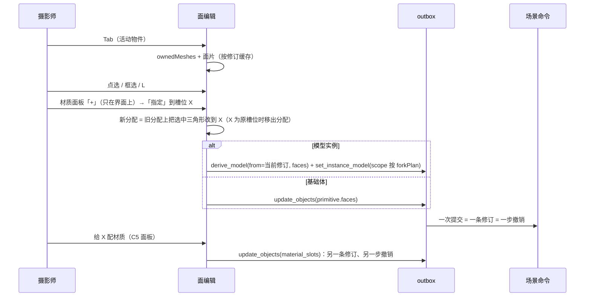

# Change 详细设计

## 继承的设计

- Epic `scene-editor-3d` 修订 v13：design「面级材质（C5b）」「材质与光照（C5）」「编辑器交互约定」「几何模块与模型生命周期」「客户端任务」，不变量 I2、I4；契约见 proposal What Changes 列出的八条。本子项创建时自动绑定 v12，Epic 修订 v13 批准后重新绑定到 v13（`lti epic bind`），再记录方案批准。
- 本次承担：面编辑模式、加载时套用、重新生成时带过来、助手读取、资产库带分配。助手写入（`assign_faces`）由 C5b2 承担：它要改的 `data: 场景客户端任务` 正由活动 Epic `creative-mcp-server` 规划修改（owner 2026-10-28 决定拆分）。共享的数据结构、命令和任务外形以 Epic 为准，本文只写实现层面的决定。
- 项目约定：`patterns: 场景渲染批次`（模型部件按槽位合并）、`patterns: 场景着色写法`、ADR-001、ADR-003。
- 修订记录：2026-10-28 方案评审提出 4 项阻塞、2 项重要问题（网格身份、顶点数据所有权、基础体两端规则分歧、面片连成曲面、资产预览的数据来源、缩略图范围），以及绑定版本和 AC-3 的事务边界，本版逐项修正。

## 领域模型与业务规则

- **面分配**（`Faces`）：`{meshes: [{path, primitive, topology, assign}], hints}`，结构和约束见 Epic `data: 模型内容`。它是值对象：模型的随模型修订不可变，基础体的随物件内容单元版本化。服务端只校验外形；身份和指纹由前端核对。
- **网格身份**：节点路径（每段为 GLB JSON 原文的节点名，以及它在同级同名节点里的序号）加 primitive 下标。前端用 `GLTFLoader` 的 `parser.associations` 把每个加载出的 `Mesh` 对回 `{nodes}` 和 `{meshes, primitives}`，节点名从 GLB JSON 读原文（three 会删掉名字里的 `:`）。被多个节点引用的网格，每个引用各有一条路径。基础体只有一个网格，路径固定为 `[["", 0]]`。
- **拓扑指纹 `t1`**：只描述三角形怎样连接。有索引时连接编号就是索引；没有索引时按 float32 坐标逐位相等焊接，编号按首次出现分配。对 `[顶点数, 三角形数, 连接编号序列]`（uint32 小端）算 SHA-256，取前 16 位十六进制。在变换烘进几何、`flipWinding` 之前计算。实测（three 0.186.1 的基础体生成器）：拱门在默认参数、`depth`、`width`、`opening_width`、`height` + `opening_height` 下顶点都是 648、没有索引。旧算法（顶点数 + 索引）的指纹在这些参数下全部相同，新算法只有 `depth` 不变；方块、楼梯改尺寸不变；圆柱 `radius_top` 从 0.5 改到 0 时改变。
- **有效槽位**：GLB 槽位（基础体为 `main`）加分配里出现的槽位，先 GLB、后分配（按首次出现），合计不超过 32。
- **平面面片**（只在编辑器里，不存储）：把网格的三角形分成互不相交的面片。按三角形顺序取第一个未归属的三角形作起点，沿共享边（焊接后的边）扩展，只接纳同时满足下面两条的三角形：
  - 法线与**起点**法线的夹角 ≤ 0.05°；
  - 三个顶点到起点平面的距离 ≤ max(1e-5 m, 1e-6 × 模型包围盒对角线)。

  因为每个三角形都只和起点比较，曲面不能靠一串小夹角连成一片：512 段圆柱相邻夹角约 0.7°，每一格（两个三角形）各成一个面片。容差远大于 float32 共面误差，远小于常见的建模夹角。

## 模块职责与协作

前端（`frontend/src/creative-scene`）：

- `sandbox/gltf.ts:parseGLB`：除场景外，再返回每个 `Mesh` 的身份（路径、primitive 下标）。路径由 `parser.associations` 和 GLB JSON 的节点名、`children` 顺序算出。
- `models/faces.ts`（新）：纯函数，不依赖 React 和场景状态。
  - `topologyOf(geometry)`：拓扑指纹。
  - `ownedMeshes(root, identities)`：按 `partsOf` 现有的顺序收集网格，先算指纹，再为每个网格得到一份**独立**的几何，烘入变换（必要时 `flipWinding`）。返回 `{identity, topology, geometry(模型空间), slot, hint, constants}`；输入的几何不被修改。
  - `splitBySlot(mesh, assign)`：按区间把三角形分组，每组压缩成只含用到顶点的新几何（索引重映射），各自持有属性数组。
  - `carryFaces(old, next, {codeChanged})`：重新生成时的决策表。
  - 区间与三角形集合互转、`effectiveSlots`。
- `models/faceTopology.ts`（新）：平面面片、连通部分和邻接，在 `ownedMeshes` 的结果上构建，按「修订 + 身份」缓存，供选择使用（C5b2 的条件求值也用它）。
- `models/cache.ts`：`ModelCache.load(revision, faces)` 由调用方传入分配（同一修订的分配不可变，缓存仍按修订为键）。`partsOf` 改为 `ownedMeshes` → 有分配时 `splitBySlot` → `mergeParts`。追踪缓存的键加上分配的哈希。
- `preview/cache.ts:PreviewModels.load`、`preview/ModelPreview.tsx`：增加 `faces` 参数，由资产的模型载荷传入（与 `materials` 同源，C6 的资产读取已返回库副本载荷）；资产查看浮窗的调用方随之传入。
- `library/thumbnail.ts:renderMaterialThumbnail`：输入是 `ModelParts`，来自编辑器的 `ModelCache`，套用后自然带分配，不用改，加测试覆盖。
- `sandbox/thumbnail.ts:renderThumbnail`：模型修订的白模缩略图，统一换成白模材质，与槽位无关，不改；`derive_model` 复用它。
- `objects/SceneObjects.tsx:PrimitiveMesh`：基础体几何生成后，有分配时按 `splitBySlot` 分成多个 `SlotMesh`，描边仍用整体几何。
- `faceEdit/`（新）：面编辑状态（活动物件、按身份的三角形选区）、拾取（射线命中三角形 → 所在面片）、框选（面片重心投影在框内，且从相机看不被遮挡，用 `three-mesh-bvh` 求交）、高亮叠加层和面片边线。几何取自 `ownedMeshes`，不用渲染缓存里拆分、合并后的几何。
- `input/keymap.ts`：Tab 进出；面编辑模式内的 L、Ctrl + L、Ctrl + I、Ctrl + 小键盘 + / −；G / R / S 在面编辑时不响应。
- `panels/MaterialSlots.tsx`：面编辑时显示有效槽位和「指定 / 选择 / 取消选择 / +」。
- `modelEdits.ts`：烘焙完成后调用 `carryFaces`，`codeChanged` 由新旧 `code_sha256` 与 `lib_version` 判断，把 `faces` 写进 `commit_model`，提示作废的部分；新增只改分配的提交路径（`derive_model` + `set_instance_model`，分叉沿用 `forkPlan`）；基础体改参数时按 `topology` 声明决定是否写 `primitive.faces: null`。
- `host/bake.ts`：烘焙结果带 `faces`（旧分配取自替换目标的模型摘要，`codeChanged` 比较任务代码与摘要的 `code_sha256`）。

后端（`backend/internal`）：

- `creativescene/models.go:ModelPayload` 加 `Faces`；`faces.go`（新）放外形校验与有效槽位。
- `creativescene/ops_model.go`：`commitModelOp` 接受 `faces`；新增 `deriveModelOp`，读来源修订、复用 blob，写完整形态。
- `creativescene/builtins.json`、`builtins.go`：`topology` 声明与 `topologyChanged(old, new)`。
- `creativescene/model.go`、`ops.go`：`primitive.faces` 的校验，`update_objects` 改了声明里的参数而没写 `faces` 时清空。
- `creativescene/jobs_complete.go`：烘焙完成时把 `bake.faces` 写进 `commit_model.faces`。
- `creativescene/agent.go`：`ObjectView` / `ModelView` 的槽位按有效槽位列出，附来源和面分配的三角形数。
- `creativescene/library.go:assignedSlots`：按有效槽位过滤。
- `creativecontent/model_facts.go`：模型要点的材质槽按有效槽位。
- `creativeagent/scene_tools.go`：`write_model` 结果比较替换前后两个模型修订的分配，说明保留和作废了多少（在 `creativescene` 里算，工具层只出文本，任务结果格式不变）；`edit_scene` 结果说明被清空的分配。`instructions/base.md` 补用法：面分配由摄影师在面编辑模式里做；要跨代码修改保留，给物件起唯一的名字（如 `part:<id>`）。

依赖方向不变：领域逻辑在 `creativescene`，工具层只做参数解析和结果文本（ADR-003）。

## 关键机制

### 加载时套用：数据所有权与顺序

```text
partsOf(root, identities, faces):
  for each mesh m（现有收集顺序）:
    topo  = topologyOf(m.geometry)                  # 1. 只读原几何
    own   = m.geometry 的独立副本                    # 2. 共享或不共享都复制，不改 GLTFLoader 的几何
    own.applyMatrix4(m.matrixWorld); 镜像时 flipWinding(own)   # 3. 每个网格只烘一次
    entry = faces 中 identity(m) 对应的一项
    if entry && entry.topology == topo:
      pieces = splitBySlot(own, entry.assign)        # 4. 每片压缩、各自持有属性
    else:
      pieces = [own]；entry 存在则记 stale
  return mergeParts(全部 pieces)                    # 5. mergeGeometries 再复制一次
```

- 评审复现的问题：拆出的片共享同一个 `BufferAttribute`，再逐片 `applyMatrix4`，会把同一份顶点平移两次（x=0.5 加两次 +10 得 20.5），原几何也被改掉。按上面的顺序，变换只作用在每个网格自己的副本上一次；拆分只读这份副本、写新数组；`GLTFLoader` 产出的几何不被修改，指纹、选面和求值都可以再读它。
- 拆分要压缩顶点：片之间共享整份属性的话，`mergeGeometries` 会把整份顶点给每一片各拷一遍，分成 k 个槽位的网格内存就翻 k 倍。
- 现在 `partsOf` 对不共享的几何就地 `applyMatrix4`。改为一律复制，没有分配的模型也多一次拷贝；性能测量里一并比较（见「验证与交付」），超出预算时，没有分配的网格保留原有的就地路径。
- 新槽位的 `hint` 取 `faces.hints`，`constants` 沿用原材质的常量，所以槽位还没配材质时外观与原槽位相同。
- 渲染批次：拆分在合并之前，合并照旧按 `groupKey` 分组，不提升 `BUILDER_VERSION`；追踪缓存的键加上分配的哈希。

### 重新生成时带过来

模型按 Epic `data: 模型内容`「重新生成时」的决策表判断，`carryFaces` 的输入是新 GLB 的 `ownedMeshes`（身份、指纹）和 `codeChanged`。「同级有同名、同拓扑的网格」在新 GLB 上判断：与目标路径的父路径、节点名、primitive 下标、指纹都相同的网格多于一个。

基础体只有一条规则：编辑器和服务端都按 `topology` 声明判断，改了声明里的参数就清空。编辑器在同一项 `update_objects` 里写 `primitive.faces: null` 并提示，服务端在请求没写 `faces` 时自己清空，两边按同一份声明判断，不会分歧。加载时仍核对指纹，不符就不套用：这种情况说明声明漏了参数，由下面的测试拦截。

- 测试：每个基础体、`topology` 以外的每个参数，在最小值、默认值、最大值和 5 个随机值上，断言指纹与默认参数时相同。声明可以保守，不要求「改了声明里的参数指纹就变」。按实测，`arch@1` 的声明改为 `width`、`height`、`opening_width`、`opening_height`，`depth` 不在其中（已写进 Epic v13）。

### 面编辑与指定



- 事务边界：「+」新建槽位不写入；「指定」一条修订；配材质一条修订。撤销逐条回退，与 C5 相同。
- 选区按「身份 → 三角形集合」存在内存里，指定后不清空，方便连续给几块配材质。物件内容被别人改了（新修订或基础体参数变化）时清空选区并提示。
- 「选择 / 取消选择」按槽位把三角形加进或移出选区，与 Blender 一致。
- 指定的结果按区间编码，相邻区间合并；超出上限（区间 8192、`faces` 128 KiB）时不提交，提示「面分配太碎，请在模型代码里划分槽位」。
- 撤销：C1 的撤销栈按内容单元恢复。模型实例恢复到旧的 `model.content_revision_id`，分叉出的新内容随之不再被引用，按 GC 回收。

### 服务端外形校验（`faces.go`）

按顺序检查，第一处不符就返回 `validation_failed`，`message` 指出路径：
1. 每项的 `path` 为 1–64 段、名字 ≤ 64 字符、序号 ≥ 0；`primitive` 在 0…255；同一 `path` + `primitive` 不重复。
2. `topology` 格式正确。
3. `assign` 非空，槽位 ID 合法，区间满足 `0 ≤ start < end ≤ 300000`；同一网格内全部区间按 `start` 排序后互不重叠。
4. 区间合计、`meshes` 项数、序列化大小不超上限；有效槽位不超过 32。

基础体另要求至多一项、`path` 为 `[["", 0]]`、`primitive` 为 0，区间不超过 256 个。

## 局部设计与偏差

- **新槽位命名** `face_<n>`：取不与有效槽位冲突的最小 n。不支持改名：改名要同时改分配和 `material_slots`，收益小。
- **面片容差**（0.05°；max(1e-5 m, 1e-6 × 包围盒对角线)）是初始值，验收样例点选不对时再调，不进契约。
- **框选只选可见面**：与 Blender 实体模式一致；X 光（穿透框选）留作后续。
- **残余风险**：同级同名同拓扑的网格只改参数时仍保留，owner 2026-10-28 接受，见 proposal Risk Notes。

## 接口与数据契约

扩展，兼容：全部为新增字段、新增操作和新增任务种类，旧客户端不受影响。共享定义见 Epic v13 的十条契约，本 Feature 没有局部契约增量。

- OpenAPI：`CreativeModelPayload`、`CreativeModelPreviewPayload`、`CreativeSceneModel` 加 `faces`；基础体对象加 `faces`；场景操作加 `derive_model`，`commit_model` 加 `faces`；完成请求的 `bake` 加 `faces`。改完运行 `make generate` 并提交两份生成物。
- 迁移：没有。`faces` 在 jsonb 载荷里，任务表不变。

## 挂载点

| 位置 | 动作 | 说明 |
|---|---|---|
| `frontend/src/creative-scene/sandbox/gltf.ts:parseGLB` | 修改 | 返回每个网格的身份（`parser.associations` + GLB JSON 节点名） |
| `frontend/src/creative-scene/models/faces.ts` | 新增 | 指纹、独立几何、拆分压缩、带过来、区间编码、有效槽位 |
| `frontend/src/creative-scene/models/faceTopology.ts` | 新增 | 平面面片、连通部分、邻接 |
| `frontend/src/creative-scene/models/cache.ts:partsOf` | 修改 | 按「加载时套用」的顺序；`ModelCache.load` 接收 `faces`，追踪缓存键加分配哈希 |
| `frontend/src/creative-scene/preview/cache.ts:PreviewModels.load` | 修改 | 接收 `faces` |
| `frontend/src/creative-scene/preview/ModelPreview.tsx` | 修改 | `faces` 属性，随资产的模型载荷传入 |
| `frontend/src/creative-scene/objects/SceneObjects.tsx:PrimitiveMesh` | 修改 | 基础体按分配拆槽位渲染 |
| `frontend/src/creative-scene/faceEdit/` | 新增 | 面编辑状态、拾取、框选、高亮、面片边线 |
| `frontend/src/creative-scene/input/keymap.ts` | 修改 | Tab 与面编辑键位，速查表条目 |
| `frontend/src/creative-scene/Viewport.tsx` | 修改 | 面编辑时的拾取与框选分流 |
| `frontend/src/creative-scene/panels/MaterialSlots.tsx` | 修改 | 面编辑的槽位操作，有效槽位与失效提示 |
| `frontend/src/creative-scene/panels/StatusBar.tsx` | 修改 | 面编辑状态与按键提示 |
| `frontend/src/creative-scene/modelEdits.ts` | 修改 | 烘焙后带过来；只改分配的提交路径；基础体按声明清空 |
| `frontend/src/creative-scene/host/bake.ts` | 修改 | 烘焙结果带 `faces` |
| `backend/internal/creativescene/faces.go` | 新增 | 外形校验、有效槽位 |
| `backend/internal/creativescene/models.go:ModelPayload` | 修改 | 加 `Faces` |
| `backend/internal/creativescene/ops_model.go` | 修改 | `commitModelOp.faces`、新增 `deriveModelOp` |
| `backend/internal/creativescene/builtins.json` | 修改 | 每项加 `topology` |
| `backend/internal/creativescene/builtins.go` | 修改 | 解析 `topology`，`topologyChanged(old, new)` |
| `backend/internal/creativescene/model.go` | 修改 | `primitive.faces` 校验 |
| `backend/internal/creativescene/ops.go` | 修改 | `update_objects` 的 `primitive.faces` 与清空规则 |
| `backend/internal/creativescene/jobs_complete.go` | 修改 | `bake.faces` 写进 `commit_model` |
| `backend/internal/creativescene/agent.go` | 修改 | 有效槽位视图 |
| `backend/internal/creativescene/library.go:assignedSlots` | 修改 | 按有效槽位 |
| `backend/internal/creativecontent/model_facts.go` | 修改 | 模型要点的材质槽按有效槽位 |
| `backend/internal/creativeagent/scene_tools.go` | 修改 | `write_model` 结果说明保留与作废，`edit_scene` 结果说明清空 |
| `backend/internal/creativeagent/instructions/base.md` | 修改 | 面分配的用法、取舍与命名建议 |
| `api/openapi.yaml` | 修改 | 见上节 |
| `docs/dev/creative-scene-agent.md` | 修改 | 有效槽位与工具结果说明 |

资产查看浮窗渲染 `ModelPreview` 的调用方（传入 `faces`）在第一项前端任务里定位后补进本表。

## 验证与交付

- **第一项任务（验证假设）**：沙箱烘焙几类样例（多 primitive 网格、多层节点、同名兄弟节点、被多个节点引用的网格、镜像部件），断言 `parseGLB` 给出的身份与 GLB JSON 一一对应，每个身份的三角形数与 Go 端逐 primitive 计数相同。不成立时停下，回报 owner（Epic 未决 9）。
- **单元测试**：
  - 前端 `faces.ts`：
    - 指纹：有索引；无索引三角形重排后改变；只改坐标不变。
    - 所有权：套用后顶点只被变换一次，`GLTFLoader` 的原几何逐字节不变（复现评审的 0.5 → 20.5 用例）；拆分后各片属性互不共享，且只含用到的顶点。
    - 套用：有索引、无索引、全部分走、指纹不符、身份不存在。
    - 带过来：决策表每一行，包括「两个同名同拓扑网格交换创建顺序 + 改代码 → 作废」「同样的网格只改参数 → 保留」。
    - 区间编码。
  - 基础体：`topology` 声明的不变性测试（见上）；拱门改 `depth` 保留、改 `opening_width` 清空，编辑器与服务端结果相同。
  - `faceTopology.ts`：方块 6 个面片；地面 1 个；512 段圆柱侧面 512 个（每格两个三角形）；缓慢弯曲的带状网格（相邻夹角 0.01°，200 段）的每个面片内法线偏差不超过 0.05°，不会整条连成一片；拱门、楼梯的面片数。
  - 后端：`faces.go` 每条校验规则；`deriveModelOp`（复用 blob、库副本来源时新建内容、跨账号不可用）；`update_objects` 的清空规则；烘焙完成带 `faces` 写入；`write_model` 结果的保留与作废计数；有效槽位视图。
- **组合验证**：
  - AC-4：一份 e2e 夹具（有面分配的方块和模型），比较材质预览视口、`render_view` 的 `lit`、`lit` 导出、资产材质缩略图里的槽位颜色。
  - 另一个 e2e：不打开场景，直接在资产库打开这个模型资产的查看浮窗，断言显示面分配。
  - e2e 一次跑一个用例，用 ONLY 过滤并换端口。
- **性能**：在 30 万三角形的样例模型上，测量 `partsOf` 在三种情况下的耗时：改动前、改动后没有分配、改动后有分配。有分配时的增量应在 50 ms 以内，否则把指纹和拆分移到 Worker；没有分配时比改动前慢超过 10% 的话，没有分配的网格保留就地变换的旧路径。
- **门禁**：日常用 `make check-frontend`、`make check-go PKG=./internal/creativescene/... ./internal/creativeagent/...`、`make generate-check`；合回 `develop` 用 `make check-merge`。
- **上线**：先部署后端（新字段、新操作），再上线前端。不新增工具；系统说明有改动，上线前按 `docs/dev/agent-skills-tools.md` 核对是否需要「排空后升级」。

## 未决事项

| 问题 / 假设 | 影响 | 解决方式 | 最晚解决时点 |
|---|---|---|---|
| 网格身份映射（Epic 未决 9） | 全部 | 第一项任务验证 | 其余任务开始前 |
| 面片容差 | 点选手感 | 验收样例调整 | 验收 |
