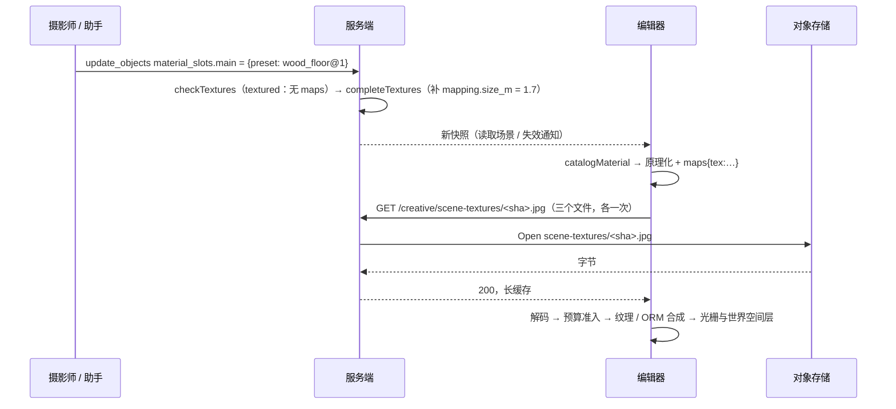

# C5c2 内置贴图库：详细设计

## 继承的设计

- Epic `scene-editor-3d` 批准版本 v20（待批准；本设计按 v20 草稿起草）。
  - design「材质与光照（C5）」：目录与预设规则。
  - design「贴图与 HDRI」：修订 v16、v17，以及 v20 的内置贴图材质。
  - 契约 `data: 内置贴图库`、`api: 读取内置贴图`，以及 `data: 场景文档`「材质贴图」、`api: 提交场景命令` 的 v20 部分。
- C5c1（`scene-pbr-textures`，已归档）建好的贴图通路全部复用，本次不改：
  - 材质构建（`materials/instances.ts`、`materials/maps.ts`）。
  - 图片缓存与显存预算（`materials/images.ts`）。
  - 世界空间层（`render/trace/maps.ts`）。
  - 等图片就绪（`host/render.ts`）。
  - 材质资产。
- 项目约定：
  - 对象存储驱动与凭证见 `docs/dev/object-storage.md`。
  - `creativectl` 的输出与退出码沿用 `skill import`（`backend/cmd/creativectl/main.go`）。
  - 前端遵守 shading 守卫，绘制只走 WebGPU 和 TSL。

## 领域模型与业务规则

### 内置贴图材质是目录条目

- 内置贴图材质就是材质目录里 `kind = textured` 的一项，与程序化预设一样：靠 ID 引用，发布后不变。场景、材质资产和助手都只写 `{preset, params, mapping?, alpha_mode?, alpha_cutoff?}`。
- 渲染时，展开为原理化 BSDF：
  - 参数：`principled@1` 的缺省值 ← 条目的 `defaults` ← 槽位的 `params`，逐个覆盖，再按范围夹紧（`completeParams`）。
  - 贴图：条目的 `maps`，图片来源是内置文件。
  - 映射：槽位的 `mapping`。服务端写入时已补齐；手写或旧数据缺失时，用条目的 `size_m` 三平面投影。
  - 透明方式：槽位的 `alpha_mode`、`alpha_cutoff`，缺省 `opaque`。
- 不变量：
  - 条目引用的文件都在它的 `files` 里，文件名是内容的 sha256。目录加载时校验，不合法就启动失败，与现有 `loadMaterials` 相同。
  - 内置贴图材质的槽位没有 `maps`。命令接口和工具层都拒绝。
  - 内置文件不属于任何账号，不进引用表，也不进 GC。

### 图片来源扩展为两种

C5c1 的图片缓存以「源」为单位取图、解码，源目前只有图片修订 `ccrv_…`。本次增加内置文件源，键为 `tex:<sha256>.jpg`。

- **取图方式不同**：
  - 修订：按媒体票据。
  - 内置文件：`GET /api/v1/creative/scene-textures/{file}`，带 Bearer。
- **其余共用**：解码长边上限（2048）、并发、超时、预算准入、失败重试、占位和「等图片就绪」都与修订相同。纹理键的格式不变，只是 `<revision>` 部分可以是 `tex:…`。所以 ORM 合成、世界空间层的层号分配和去重都自动覆盖内置文件。

## 模块职责与协作

### 服务端

- **`creativescene` 目录**：
  - `materials.json` 加入 `textured` 条目。
  - `loadMaterials` 认识新类：校验 `category`、`size_m`、`maps`、`defaults`、`files`、`source`。`textured` 条目没有 `params`，参数表取 `principled@1`。
  - `MaterialCatalog()` 只列原理化和程序化，`textured` 不逐条列出，改为一句说明：内置材质用 `search_assets` 的 `source: "builtin"` 查，参数表同原理化，可带 `mapping`，不能写 `maps`。
  - 新函数 `BuiltinMaterials(query)` 按名称、品类、来源资产名做子串匹配（不区分大小写），按目录顺序返回；`BuiltinThumbnail(id)` 返回嵌入的缩略图。
  - 新函数 `BuiltinTextureFiles()` 返回目录里的全部文件（名称、地址、大小），供导入命令、读取接口和启动检查共用。
- **`creativescene` 校验**：
  - `checkTextures` 按「这个预设能不能带贴图字段」分三种：
    - `principled@1`：同 C5c1。
    - `textured`：允许 `mapping`、`alpha_mode`、`alpha_cutoff`，拒绝 `maps`。
    - 其他（含目录里没有的 ID）：四个字段都拒绝。
  - `completeTextures` 对 `textured` 补齐 `mapping`，`size_m` 取条目的真实尺寸。
  - `checkMaterial`（助手）对 `textured` 用 `principled@1` 的参数表校验。
- **内置贴图存储**：新文件 `backend/internal/creativescene/builtin_textures.go`。
  - 依赖 `immutablefs.ObjectStore`。对象键为 `scene-textures/<name>`，驱动随 `AVATAR_STORAGE_DRIVER` 切换。
  - `Open(name)`：先查名称在不在目录里，再打开对象。
  - `Missing(ctx)`：逐个 `Stat`，返回缺失的文件。
  - `Import(ctx, fetch)`：已存在的跳过；缺失的下载、核对大小和 sha256，再 `PutImmutable`。
  - 下载器作为参数传入，测试换成本地桩。
  - 装配：`server`、`creativectl` 各自按配置构造，本地根目录为 `SCENE_TEXTURE_LOCAL_ROOT`，缺省是 `AVATAR_LOCAL_ROOT` 的同级目录 `scene-textures`。
- **`creativeagent` 资产工具**：
  - `search_assets` 解析 `source`。`builtin` 在 `requireLibrary` 之前分流：不检查 consent，不写资产库读取记录，结果调 `BuiltinMaterials`，外形见 `data: 内置贴图库`「助手」。
  - `read_asset` 有 `builtin_id` 时同样在授权检查之前分流：返回要点、`slot`、参数缺省值和缩略图附件。附图条件沿用材质资产，模型不能看图时给 `thumbnail_omitted`。
  - 工具说明（`asset_tool_info.go`、`context.go` 的 `read_asset` 说明）各加一句内置来源的用法。工具 schema 变化会改变检查点指纹，按 `docs/dev/agent-skills-tools.md`「排空后升级」上线。
- **HTTP**：`GET`/`HEAD /api/v1/creative/scene-textures/:file`，挂在 Bearer 分组、创意空间读取权限下。
  - handler 只做三件事：检查格式、调 `Open`、写响应头。
  - 返回 304 时不打开对象。
  - `Open` 报「不存在」或出错时，返回 503 `creative_texture_unavailable` 并记错误日志。
- **启动检查**：`backend/cmd/server/main.go` 装配完成后，起一个后台 goroutine 调 `Missing`，有缺失就记一条 `error` 日志，列出条目 ID 和文件名。不阻止启动，也不重试。
- **`creativectl`**：
  - 新增 `textures import` 和 `textures check`，不需要数据库连接。
  - `import` 用带超时的 `http.Client` 下载，单个文件 10 分钟。
  - 输出一行 JSON：`{"imported": n, "skipped": n, "failed": [{"file", "material", "reason"}]}`。
  - 退出码：0 全部就绪；1 有失败；2 参数错误。
  - `check` 输出缺失项，有缺失时退出码为 3（沿用 `skill import` 的「not ready」）。

### 前端

- **`materials/catalog.ts`**：`MaterialEntry` 加 `textured` 分支，带 `category`、`size_m`、`maps`（`file` 引用）、`defaults` 字段。`materialEntry(id)` 对 `textured` 返回的 `params` 是 `principled@1` 的参数表，缺省值按 `defaults` 覆盖。这样参数面板、`completeParams` 和撤销都不用区分。
- **`materials/resolve.ts`**：`catalogMaterial` 遇到 `textured`，返回 `kind: 'principled'`，`texturing` 合并条目的贴图和槽位的映射与透明方式。
  - 贴图引用写成内部的 `MapRef`（`{source, channel}`）。
  - 现有的 `content_revision_id` 在入口处转成 `source`。
  - 下游（实例缓存、shading、trace）只看到原理化材质，不区分它来自哪里。
- **`materials/images.ts`**：
  - `MapRef` 和纹理键里的部件改为 `source`。
  - `imagePlatform.fetch(source)` 遇到 `tex:` 走内置读取接口（用项目的 API 客户端带 Bearer），其余走媒体票据。
  - `textureRevisions` 改名为 `textureSources`，内置源不计入「场景引用的图片」。
  - 浏览器 HTTP 缓存负责跨会话复用，代码里不另做持久缓存。
- **内置来源（新模块 `frontend/src/creative-canvas/assets/builtin.ts`）**：
  - 把目录里的 `textured` 条目转成只读的展示项 `BuiltinMaterial`：ID、名称、品类、尺寸、缩略图 URL、`slot`。
  - 本地过滤：按名称或品类子串匹配，再按品类分组。
  - 它不是 `LibraryAsset`，不进 `useAssetList` 和分页。使用方按来源分支渲染，共用卡片外观。
- **资产库页面（`AssetsPage.tsx`、`LibraryTree.tsx`、`AssetBrowser.tsx`）**：
  - 左侧树增加「内置材质」节点。选中时网格只显示内置项，工具栏的整理操作、批量栏和拖到分组都不可用。
  - 双击打开查看浮窗。
- **查看浮窗（`viewer/AssetViewer.tsx`、`AssetInfoPanel.tsx`）**：接受内置项，3D 材质球沿用材质资产的预览，信息栏显示名称、品类、尺寸，以及来源（站点、作者、CC0）。
- **场景资产面板（`panels/AssetPanel.tsx`）**：材质页加「我的 / 内置」切换。
  - 内置项可以拖到物件或槽位上，拖放数据带 `builtin_id`。
  - 落下时写 `{preset: id, params: {}}`，与用材质资产同一个撤销步骤。
- **「从资产库选」材质（`panels/LibraryPicker.tsx` 的 `MaterialPicker`）**：加同样的来源切换，选中内置项时写 `{preset: id, params: {}}`。
- **槽位属性栏（`panels/MaterialSlots.tsx`）**：
  - 预设下拉框保持原样，只列原理化和程序化。
  - 槽位是 `textured` 时，下拉框上方显示内置材质的名称和缩略图。
  - 下面显示参数和映射字段（复用 `TextureFields.tsx` 里映射与透明方式的部分），不显示贴图输入。
- **缩略图**：
  - 源文件在 `backend/internal/creativescene/builtin_thumbnails/<id>.webp`（`@` 换成 `_`），256 × 256。`make generate` 复制到 `frontend/src/creative-canvas/assets/builtin/`，前端经 `import.meta.glob` 打包，`generate-check` 检查两边一致。
  - 由脚本 `frontend/scripts/render-texture-thumbnails.mjs` 生成：启动 Vite 和无头浏览器，用 `library/thumbnail.ts` 的 `renderMaterialBall` 渲染每个条目，再存成 WebP。
  - 贴图来自本机对象存储，需先运行导入。脚本可重复运行，结果提交进仓库。
- **场景读取与助手的 `images`**：不变。内置贴图材质的槽位没有 `maps`，自然不出现在 `images` 里。

### 主流程



## 关键机制

### 导入的幂等与校验

```text
for f in BuiltinTextureFiles():          # 按目录顺序，重复文件名只处理一次
  if Stat(key(f)) ok: skipped++; continue
  body = download(f.url)                 # 超时、HTTP 非 200 → failed(f, 原因)
  if len(body) != f.bytes or sha256(body) != f.name 的前 64 位十六进制: failed(f, "校验不符"); continue
  PutImmutable(key(f), body, {ContentType: image/jpeg})   # 已被并发写入 → 视为 skipped
  imported++
```

- 写入只在校验通过后进行，对象存储里不会出现内容与文件名不符的对象。
- 中途失败不回滚已写入的文件。它们本身都是正确的，下次运行时跳过。
- 文件全部读进内存再校验：单个上限 32 MiB，2K JPG 实际约 3–4 MB。

### 读取接口与缓存

| 条件 | 结果 |
|---|---|
| `file` 不匹配 `^[0-9a-f]{64}\.jpg$`，或不在目录里 | 404 `not_found` |
| `If-None-Match` 等于 `"<sha256>"` | 304，不读对象存储 |
| 对象不存在或打开失败 | 503 `creative_texture_unavailable`，记错误日志 |
| 其他 | 200，流式返回，`Content-Length` 取对象大小 |

- 用 `private` 而不是 `public`：请求带 Authorization，不该被共享缓存保存。浏览器自己的缓存照样命中。

### 失败在编辑器里的表现

- 内置读取返回非 200 时，图片缓存把这个源标记为失败，与修订取图失败相同：
  - 视口显示占位，提示「贴图加载失败」，并列出用到它的材质名称。
  - 离屏出图抛出 `SCENE_IMAGES_FAILED`。
  - 下次需要时再试。
- 提示里不出现 HTTP 状态和错误码，依据是 owner 偏好「部署错误不暴露给用户」。

## 局部设计与偏差

- **JPG 原样存放、不转码**（v20 已定）。
  - 依据：sha256 可复现，画质与来源一致，导入命令不用带图像库。
  - 代价：比 WebP 大约三成，法线图带 JPG 压缩痕迹。Poly Haven 本身就提供 JPG 版本，Blender 用户常用它。
- **`textured` 条目不重复写参数表**。参数表取 `principled@1`，只写 `defaults`，避免 24 份参数表与原理化 BSDF 出现漂移。
- **缩略图离线渲染并提交进仓库**，不在打开面板时实时渲染（那样要下载全部贴图）。代价是改了材质构建要重新生成，记进开发说明。
- **内置来源不复用资产列表的数据流**：`useAssetList` 绑定分页、游标和服务端过滤，内置项只有几十个、没有可排序的元数据，硬塞进去要在每一处区分来源。所以内置来源单独成一个本地列表，只共用卡片外观和查看浮窗（owner 2026-11-04 同意不混排）。
- **助手的内置来源绕开资产库授权**：内置材质是平台的公开目录，不是账号数据。如果走 consent，没有资产库授权的对话就用不了内置材质，与「不依赖用户素材」的目标矛盾。

## 接口与数据契约

- **扩展**，非破坏。定义见 Epic v20：
  - `data: 内置贴图库`（ADD）
  - `api: 读取内置贴图`（ADD）
  - `data: 场景文档`（MODIFY，材质贴图的 v20 部分）
  - `api: 提交场景命令`（MODIFY，v20 部分）
- 本 Change 的 contracts.md 没有局部增量。
- OpenAPI 加 `GET /creative/scene-textures/{file}`，响应为 `image/jpeg` 二进制，错误码枚举加 `creative_texture_unavailable`。前端不用生成的客户端取字节，只引用路径常量。
- 兼容：前后端同一版本上线。旧编辑器把 `textured` 当未知预设显示中性灰；旧后端加载新目录会失败，回滚须连同目录一起回滚（见 `data: 内置贴图库`）。

## 挂载点

| 位置 | 动作 | 说明 |
|---|---|---|
| `backend/internal/creativescene/materials.json` | 修改 | 加入约 24 个 `textured` 条目 |
| `backend/internal/creativescene/materials.go:loadMaterials` | 修改 | 认识 `textured`，校验新字段 |
| `backend/internal/creativescene/materials.go:checkMaterial` | 修改 | `textured` 用原理化的参数表 |
| `backend/internal/creativescene/materials.go:MaterialCatalog` | 修改 | 按品类列出内置贴图材质 |
| `backend/internal/creativescene/textures.go:checkTextures` | 修改 | 分三种预设判断 |
| `backend/internal/creativescene/textures.go:completeTextures` | 修改 | `textured` 的映射用条目尺寸补齐 |
| `backend/internal/creativescene/builtin_textures.go` | 新增 | 文件清单、`Open`、`Missing`、`Import` |
| `backend/internal/platform/config/config.go` | 修改 | `SCENE_TEXTURE_LOCAL_ROOT` |
| `backend/internal/platform/httpapi/creative_scene_textures.go` | 新增 | 读取路由与 handler |
| `backend/internal/platform/httpapi/router.go` | 修改 | 注册路由 |
| `backend/cmd/server/main.go` | 修改 | 装配存储，启动检查 |
| `backend/cmd/creativectl/main.go` | 修改 | `textures import`、`textures check` |
| `backend/internal/creativescene/builtin_thumbnails/` | 新增 | 缩略图 WebP，嵌入 |
| `backend/internal/creativeagent/library_tools.go` | 修改 | `search_assets` 的 `source: builtin` 分流 |
| `backend/internal/creativeagent/context.go`（`read_asset` 的处理） | 修改 | `builtin_id` 分流 |
| `backend/internal/creativeagent/asset_tool_info.go` | 修改 | `search_assets` 说明 |
| `backend/internal/creativeagent/context.go` | 修改 | `read_asset` 说明 |
| `backend/internal/creativeagent/scene_tools.go` | 修改 | `edit_scene` 说明指向内置来源 |
| `Makefile` | 修改 | `generate`、`generate-check` 复制并检查缩略图 |
| `api/openapi.yaml` | 修改 | 新路由与错误码，`make generate` |
| `frontend/src/creative-scene/materials.gen.json` | 生成 | `make generate` 复制 |
| `frontend/src/creative-scene/materials/catalog.ts` | 修改 | `textured` 条目与参数表 |
| `frontend/src/creative-scene/materials/resolve.ts:catalogMaterial` | 修改 | 展开成原理化 + 内置贴图 |
| `frontend/src/creative-scene/materials/images.ts` | 修改 | 源扩展为 `tex:`，`imagePlatform.fetch` 分流 |
| `frontend/src/creative-canvas/assets/builtin.ts` | 新增 | 内置来源的展示项与本地过滤 |
| `frontend/src/creative-canvas/assets/builtin/` | 生成 | 缩略图副本 |
| `frontend/src/creative-canvas/assets/AssetsPage.tsx`、`LibraryTree.tsx`、`AssetBrowser.tsx` | 修改 | 「内置材质」节点与只读网格 |
| `frontend/src/creative-canvas/viewer/AssetViewer.tsx`、`AssetInfoPanel.tsx` | 修改 | 查看内置材质 |
| `frontend/src/creative-scene/panels/AssetPanel.tsx` | 修改 | 材质页的「我的 / 内置」切换与拖放 |
| `frontend/src/creative-scene/panels/LibraryPicker.tsx:MaterialPicker` | 修改 | 来源切换 |
| `frontend/src/creative-scene/panels/MaterialSlots.tsx` | 修改 | 落下内置材质，`textured` 的属性栏 |
| `frontend/src/creative-scene/panels/TextureFields.tsx` | 修改 | 映射与透明方式的字段可单独使用 |
| `frontend/scripts/render-texture-thumbnails.mjs` | 新增 | 缩略图离线渲染 |
| `scripts/production-preflight.sh` | 修改 | 调 `creativectl textures check` |
| `docker-compose.yml` | 修改 | 本地驱动的 `scene-textures` 卷 |
| `docs/dev/scene-texture-library.md` | 新增 | 导入、检查、更新条目、许可 |

## 验证与交付

- **后端单测**：
  - 目录：`loadMaterials` 的坏样例（缺文件、文件名不是 sha256、`defaults` 越界），以及正式目录能加载。
  - `checkTextures` 和 `completeTextures` 的决策表。
  - 命令接口：`textured` 带 `maps` 返回 400 并指出字段；不带 `mapping` 时存储补齐 `size_m`。
  - 导入：桩下载器覆盖成功、跳过、大小不符、哈希不符、下载失败，以及重复运行。
  - 读取接口：401、404、503、200 的响应头、304。
  - 助手：`checkMaterial` 对 `textured` 的参数校验；`search_assets source:builtin` 在没有 consent 时可用、按文字和品类过滤、`kind` 不是材质时为空；不写 `source` 时结果不变；`read_asset builtin_id` 返回 `slot` 和缩略图，未知 ID 报错；目录里每个条目都有缩略图。
  - 用 `make check-go PKG=./internal/creativescene/... ./internal/platform/httpapi/... ./cmd/creativectl/...` 跑。
- **前端单测**：
  - `resolve.ts` 展开：参数逐层覆盖、映射补齐。
  - `images.ts` 的 `tex:` 源：去重、失败、预算，以及与修订源混用。
  - 目录类型与 `materials.gen.json` 一致。
  - 门禁：`npm run lint`、`npx tsc -b`、定向测试。
- **e2e**：在 mock 服务里提供读取接口（用小图代替），一次跑一个用例，端口 5189：
  - 资产库页面切到「内置材质」→ 筛选「木」→ 打开查看浮窗。
  - 场景资产面板切到「内置」→ 拖到物件上 → 视口显示贴图，属性栏调尺寸，Cmd+Z 撤销。
  - 「从资产库选」里选内置材质。
  - 读取返回 503 → 显示占位与提示，导出失败。
  - 存成材质资产 → 用到另一个物件。
- **实测**：在本机导入全部条目。
  - 记录首批总大小，以及一个 5 套材质的场景首次打开时的下载时长和显存占用。
  - 在材质预览和最终渲染下逐个目视检查 24 套（真实尺寸、法线方向、ARM 通道），截图给 owner。
- **部署**：上线前在目标环境运行 `creativectl textures import`，预检通过后再发布。写进开发说明和生产预检。
- **合并**：主检出 `git merge --no-commit` 后跑 `make check-merge`。

## 未决事项

| 问题 / 假设 | 影响 | 解决方式 | 最晚解决时点 |
|---|---|---|---|
| 候选清单里个别资产可能缺 2K 的 ARM 或 GL 法线，真实尺寸标注也可能不合理 | 首批条目 | 第一项任务用 Poly Haven API 逐个核对，缺的换同品类的其他资产，替换项写回 proposal | 写目录条目前 |
| 首次加载 2K 贴图的时延是否可接受 | 是否需要转码或分级加载 | 实测后报 owner；超出预期时另立 change | C5c2 验收 |

**未决 2 实测（2026-11-04，任务 5.2，本机导入、本地磁盘供图）**：

- 首批 72 个文件、177,262,063 字节（169.1 MiB）；本机 `textures import` 四路并发 32 秒导完，`check` 为 ready。
- 用了 5 套材质（木地板、红砖、大理石、草地、锈蚀金属）的场景首次打开：读 15 个文件、36.1 MiB，从打开到 5 个物件在材质预览下画完 7.0 秒；显存预算占 320 MiB（每套三张 2K 贴图约 64 MiB），2 GiB 预算下约 32 套同时在场。网络下载时长取决于部署带宽，本次未测（共享 OSS 未导入）。
- 24 套在材质预览和最终渲染下逐个放在 2 m 立方体上截图（`creative-scene.e2e.mjs` 的 `C5c2 evidence` 两项，需 `SCENE_E2E_BUILTIN_DIR`），全部加载成功；真实尺寸与名义一致，材质球缩略图上法线凹凸方向和 ARM 的粗糙度、金属度表现正常。最终渲染偏冷偏暗来自天空光与 AgX 色调映射，不是贴图问题（场景调色已留给后处理器）。
- 共享 OSS 导入（2026-11-05，owner 批准）：`textures import` 写入 72 个文件，`check` 为 ready。
- 是否需要转码或分级加载：owner 2026-11-05 在本机（共享 OSS 供图）实测后同意收尾，没有要求转码或分级加载，首批按 2K 原图交付；以后需要时另开 Change。
