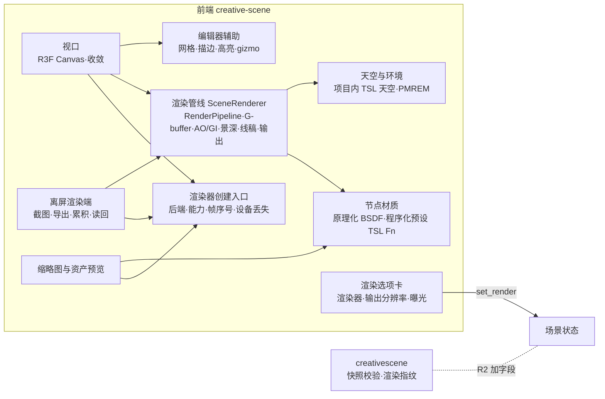
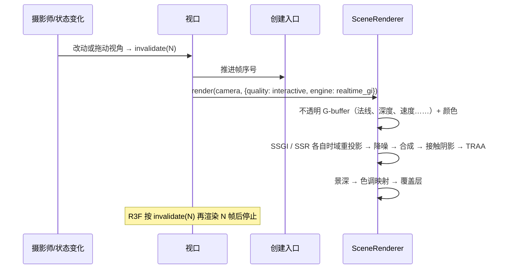
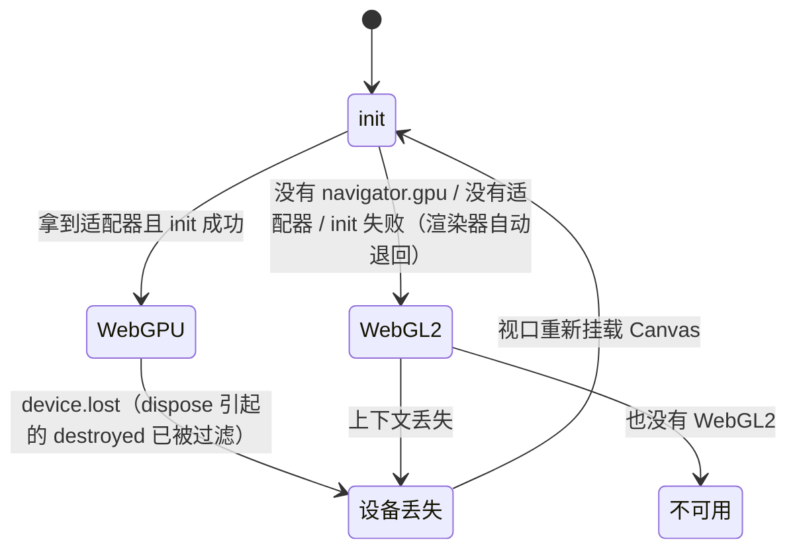

# Epic 技术方案：3D 场景的 WebGPU 渲染器与实时全局光照

## 设计上下文

需求与边界见 `proposal.md`。本 Epic 在 `scene-editor-3d` 已交付的编辑器上替换渲染底座，沿用它的原则：编辑器视口、`render_view` 和导出共用一套渲染，看到的就是导出的（`scene-editor-3d` design「渲染模式与导出」）。采用方案一句话概括：

> 全部渲染改用 three.js r186 的 `WebGPURenderer`，着色全部用 TSL 编写，后处理改用 `RenderPipeline`。场景的渲染设置新增「渲染器」和「输出分辨率」：「工作台」是现在的光栅化渲染；「实时 GI」在工作台之上加入 three 自带的 SSGI、SSR、接触阴影、时域重投影与降噪；「路径追踪」留给后续 Epic。WebGPU 不可用时，由同一渲染器的 WebGL2 后端运行同一份 TSL。

取舍过程见本会话的讨论记录（2026-10-20 至 21，owner 拍板，结论写入 proposal 决策记录）。设计评审一轮（2026-10-21），结论已并入正文。本文区分三类内容：**采用方案**（正文）、**待验证假设**（标「假设」，R0 验证）、**后续增强**（标「后续」）。

现状（迁移起点，2026-10-21 盘点 `frontend/src/creative-scene/` 及相关代码）：

| 现有实现 | 依赖 WebGL 的地方 |
|---|---|
| `render/sceneRenderer.ts`：`EffectComposer` → `RenderPass` → `GTAOPass` → 自写 `DofPass` → `OutputPass`，视口、截图和导出共用；MSAA 4×；正交视图靠字符串改写 GTAO 的视线方向修正 AO（`lookAlongZ`） | `EffectComposer` 系列只支持 `WebGLRenderer`；GLSL 字符串改写 |
| `render/dofPass.ts`、`render/linePass.ts`：物理弥散圆景深、2 倍分辨率的法线 + 深度边缘检测 | 手写 `ShaderMaterial` |
| `materials/patterns.ts`、`inject.ts`、`instances.ts`：14 种程序化预设以 GLSL 注入 `MeshPhysicalMaterial` | `onBeforeCompile`、`ShaderLib` |
| `render/sky.ts`、`objects/Lighting.tsx`：`lit` 用改写过着色器的 `Sky.js`，`clay` 用 drei `Sky` | `Sky.js` 是 `ShaderMaterial` |
| `Viewport.tsx`、`objects/*`：drei `Grid`、`Outlines`、带线宽的 `Edges` | 这几个 drei 组件内部是 GLSL 着色器 |
| `host/render.ts`（离屏截图与导出，主要跑在隐藏标签页，`host/ticker.ts` 为此而写）、`host/exportShots.ts`（一个任务里同步连拍多台摄像机、多种导出方式） | `WebGLRenderer`、`preserveDrawingBuffer` + `toDataURL`、`webglcontextlost` |
| `sandbox/thumbnail.ts` 的 `sharedRenderer()`：模型缩略图和 `library/thumbnail.ts`（资产卡片缩略图）共用 | `WebGLRenderer` |
| `preview/ModelPreview.tsx`：资产查看浮窗的 3D 预览，由 `creative-canvas/viewer/MediaViewer.tsx` 懒加载的屏上 `<Canvas>` | R3F 默认的 `WebGLRenderer` |
| `SceneEditor.tsx`、`host/launcher.ts` 的设备探测 | 检查 `getContext('webgl2')` |

`WebGPURenderer` 的节点材质库只映射 three 内置材质（`MeshPhysicalMaterial` → `MeshPhysicalNodeMaterial` 等），不支持 `ShaderMaterial` 和 `onBeforeCompile`（`three/src/renderers/webgpu/nodes/StandardNodeLibrary.js`）。所以上表右列都要改写，不是换个渲染器就能运行。

## 领域模型与业务规则

### 术语

| 术语 | 定义 | 不是 | 代码 / 界面写法 |
|---|---|---|---|
| 渲染器 | 场景的一项渲染设置，决定白模和最终渲染怎么出图。本 Epic 交付「工作台」和「实时 GI」，「路径追踪」由后续 Epic 交付 | 不是显示模式（线框、白模……），也不是导出方式（`clay`、`line`、`lit`） | 场景字段 `render.engine`：`workbench`、`realtime_gi`；界面「渲染器」：工作台、实时 GI、路径追踪 |
| 工作台 | 迁移后的光栅化渲染：材质、灯光、阴影贴图、天空环境光照与反射、AO，也就是现在的画面 | 不是 Blender Workbench 的平涂着色 | `workbench` |
| 实时 GI | 在工作台之上，用屏幕上可见的表面算间接光反弹、物体之间的反射和接触阴影，经时域累积降噪。效果对标 UE5 Lumen 的屏幕空间层 | 不是路径追踪，不处理屏幕外的物体 | `realtime_gi` |
| 输出分辨率 | 导出图的长边像素档位，短边按摄像机的画幅比例 | 不影响视口、`render_view` 和缩略图 | `render.resolution`：`1k`、`2k`、`4k`、`8k`（1024 / 2048 / 4096 / 8192 px） |
| 渲染后端 | 渲染器底下的图形接口：WebGPU，或 `WebGPURenderer` 的 WebGL2 后端 | 不是另一个渲染器，两个后端运行同一份 TSL | 界面显示「WebGPU」或「兼容模式」 |
| 帧序号 | 渲染器创建入口给每次出图分配的序号，驱动 TRAA 抖动和时域噪声 | 不是墙钟时间，也不是浏览器 rAF 计数 | 见「帧推进与确定性」 |
| 收敛 | 画面不再变化时继续渲染若干帧，让时域累积的噪点消退，然后停止重绘 | 不是持续渲染循环 | 视口「收敛帧」、导出「累积帧」 |

### 不变量

- **G1 一套渲染**（沿用）：编辑器视口、`render_view` 和导出共用同一条渲染管线和同一组场景渲染设置。渲染器是场景设置，不是本机偏好；摄影师、其他标签页和助手看到同样的画面。
- **G2 单一着色源**：所有着色用 TSL 编写，不再有 GLSL 字符串、`ShaderMaterial`、`onBeforeCompile`。程序化预设的 TSL 函数是它外观的唯一定义，将来路径追踪器复用同一函数。
- **G3 预设外观不变**：已发布的预设（`@1`）迁到 TSL 后外观与迁移前一致，不升版本。允许的差异只有抗锯齿和 AO 实现带来的细微差别，由 AC-1 的对照判定；超出这个范围就是迁移缺陷，不是新外观。
- **G4 后端不改场景**：退回 WebGL2 后端或渲染器能力不足，只影响本机怎么画，不改写场景设置。
- **G5 导出确定**：同一场景修订、同一后端、同一设备上，重复导出的结果逐像素相同，与墙钟时间、帧率、渲染器已运行多久、标签页是否隐藏都无关。

本 Epic 不新增聚合，也不改场景文档的单元划分：`engine`、`resolution` 属于已有的 `render` 单元，并发、撤销和历史沿用 `scene-editor-3d` 的规则。

## 架构设计

### 模块职责与依赖方向

后端没有新的模块和职责，只在 R2 给场景快照的校验和渲染指纹加字段。改动集中在前端：

- **渲染器创建入口**（新）：前端唯一创建 `WebGPURenderer` 的地方。`init()` 失败时渲染器自己退回 WebGL2 后端，入口读 `backend.isWebGPUBackend` 报告能力 `{backend, realtimeGI, maxTextureSize}`；接管帧序号（「帧推进与确定性」）；订阅设备丢失。视口和资产预览经 R3F 的异步 `gl` 工厂调用它，离屏渲染端和缩略图直接调用。其他代码不直接创建渲染器。
- **渲染管线 `SceneRenderer`**（改写）：保留现有的对外形状，即 `render(camera, frame)` 加覆盖层约定（`aside` 出现在画面里但不进 G-buffer，`top` 在全部后处理之后绘制）。内部从 `EffectComposer` 改为 `RenderPipeline`，按显示模式、渲染器、相机类型组装节点（「渲染管线组成」）。视口、`render_view` 和导出仍然只经过它。
- **节点材质**（改写）：原理化 BSDF 直接映射到 `MeshPhysicalNodeMaterial`；程序化预设改写为 TSL 函数，接到节点材质的 `colorNode`、`roughnessNode`、`metalnessNode`、`normalNode`、`emissiveNode` 上。共享材质实例的缓存规则不变（同一预设共用一个着色程序，参数走 uniform）。
- **天空与环境**（改写）：three 的 `SkyMesh` 写死了 Y 轴向上，默认开着随时间漂移的云。所以把它的 TSL 代码 fork 进项目：改成 Z 轴向上，删掉云和时间，保留「不画太阳盘」和 `skyGain` 白平衡。两种天空合成这一份实现。环境贴图仍用 `PMREMGenerator`。
- **编辑器辅助**（替换）：drei `Grid`、`Outlines`、带线宽的 `Edges` 换成 TSL 实现或 three 的 WebGPU 版组件（「编辑器辅助显示」）。
- **渲染选项卡**（新，R2）：参照 Blender 属性编辑器的「渲染属性」，在属性区新增「渲染」选项卡，放渲染器、输出分辨率、曝光补偿（从环境面板移过来），以及当前渲染后端的提示。改动经 `set_render` 写入场景，可以撤销。选项卡在属性区里的具体布局由 R2 设计。
- **视口**：R3F `Canvas` 改用异步 `gl` 工厂，`frameloop="demand"` 不变，增加收敛。
- **离屏渲染端**（`host/render.ts`、`host/exportShots.ts`）：改用 WebGPU 渲染器，显式推进帧序号，按帧数累积，按输出分辨率出图，读回改走异步接口。
- **缩略图与资产预览**：模型缩略图和资产卡片缩略图共用一个离屏渲染器（替代 `sharedRenderer()` 的 `WebGLRenderer`）；资产预览是屏上 `<Canvas>`，各自经创建入口获得渲染器。
- **后端 `creativescene`**（R2）：快照校验接受 `render.engine`、`render.resolution`，读取时补缺省值；渲染指纹按导出方式计入 `engine`。**`creativeagent`**（R2）：`edit_scene` 和 `render_view` 的工具说明加上这两个设置。
- 依赖方向沿用 `architecture: 场景模块`，不新增跨模块依赖。

### 关键链路

**视口一帧（渲染器为实时 GI，透视视图）**：

**导出一张图**：离屏渲染端挂载场景 → `compileAsync` 预编译材质 → 为本次导出新建管线，帧序号从 0 开始 → 按输出分辨率设定尺寸，连续渲染 K 帧，每帧显式推进帧序号 → 读回最后一帧 → 编码 → 暂存上传。之后的客户端任务链路不变（`scene-editor-3d` design「客户端任务」）。同一个任务里的下一张图重复这一过程。

## 技术选型

| 选择 | 采用 | 理由与边界 |
|---|---|---|
| 渲染器 | three 0.186.1 的 `WebGPURenderer`（`three/webgpu`）；`init()` 失败时自动改用它的 WebGL2 后端（`WebGPURenderer.js` 的 `getFallback`） | 同一份 TSL 编译到 WGSL 或 GLSL，两个后端不需要两套代码；路径追踪后续也走 WebGPU。three 保持锁定，Epic 内升级要重跑 AC-1 对照（TSL 的接口仍在变：r183 把 `PostProcessing` 改名为 `RenderPipeline`） |
| R3F 接入 | `@react-three/fiber` 9.8.1 的异步 `gl` 工厂：`new WebGPURenderer(props)` 后 `await renderer.init()` | R3F 文档给出的方式；9.8.1 已处理 r186 起异步的 `dispose()` |
| 着色 | TSL（`three/tsl`），见 `patterns: 场景着色写法` | `WebGPURenderer` 只接受节点材质；TSL 函数可以在 compute 着色器里调用，是将来路径追踪复用材质的前提 |
| 后处理 | `RenderPipeline` + `pass()`；AO 用 GTAO；实时 GI 用 `SSGINode`、`SSRNode`、`SSSNode`（接触阴影）、`TemporalReprojectNode`、`RecurrentDenoiseNode`、`TRAANode` | 全部在 three r186 的 `examples/jsm/tsl/display/` 里，不新增依赖。SSGI 是 SSILVB 算法，同时给出间接光和 AO；SSR 支持随机 GGX 光线 |
| GTAO | 透视相机用 `GTAONode`；正交相机用 fork 进项目的 TSL 版本，视线方向取 (0, 0, 1) | `GTAONode` 的视线方向按透视相机写（`normalize(viewPosition.negate())`），现在靠字符串改写修正正交视图，TSL 不能这样改 |
| 景深、线稿 | 现有算法改写为 TSL 节点 | three 的 `DepthOfFieldNode` 参数不是光圈值（同 C4 不用 `BokehPass` 的理由）；`SobelOperatorNode` 按亮度找边，白模上效果差 |
| 抗锯齿 | 工作台用 MSAA 4×；实时 GI 用 TRAA（要求关闭 MSAA）；兼容模式设备（WebGPU 后端以 `featureLevel: 'compatibility'` 申请适配器时会强制 `samples = 0`）的工作台改用 `SMAANode` | 见「渲染管线组成」 |
| 天空 | `SkyMesh` 的 TSL 代码 fork 进项目 | 见「天空与环境」 |
| 编辑器辅助 | 网格：自写 TSL 无限网格；选中与助手高亮的描边：`OutlineNode`，或用节点材质重写反向外壳（R0 选定）；粗线：`three/addons/lines/webgpu` 的 `LineSegments2` + `Line2NodeMaterial` | drei `Grid`、`Outlines`、带线宽的 `Edges` 内部是 GLSL。drei 的 `CameraControls`、`TransformControls`、`GizmoHelper`、`OrbitControls` 只用内置材质，预期可以直接使用（假设，R0 验证） |
| 拾取、框选、GLB 读写 | 不变：`three-mesh-bvh`、`SelectionBox`、`GLTFLoader` / `GLTFExporter` | 都在 CPU 上运行，与渲染器无关 |
| 不采用 | WebGL 与 WebGPU 双管线；pmndrs `postprocessing`、`realism-effects`（只支持 WebGL）；`three-gpu-pathtracer`（只支持 WebGL2，见 proposal 决策记录） | — |
| 后续 | 路径追踪渲染器：WebGPU compute + `three-mesh-bvh` 0.9.15 的 WebGPU 模块（`src/webgpu/`：WGSL / TSL 的 BVH 求交，部分导出仍标为临时）。另立 Epic | — |

## 关键机制

### 渲染器与显示模式

渲染器只决定白模和最终渲染（以及对应的 `clay`、`lit` 导出和 `render_view`）怎么出图。白模就是把全部材质换成统一的哑光材质，再用同一个渲染器出图，与 Blender 用材质覆盖渲染白模的做法相同：

| | 工作台 | 实时 GI |
|---|---|---|
| 线框、材质预览 | 固定的编辑用画面，不受渲染器影响 | 同左 |
| 白模（`clay`） | 太阳、天空、环境光、雾、AO | 加 SSGI（间接光与 AO）和接触阴影；白模统一是哑光（糙度 0.92），不加 SSR |
| 最终渲染（`lit`） | 材质、灯光、阴影、天空环境光照与反射、AO（迁移前的 `lit`） | 加 SSGI、SSR 和接触阴影 |
| 线稿（`line`） | 不受渲染器影响 | 同左 |
| 正交视图 | 按工作台出图（AO 用项目内的正交 GTAO） | 回落到工作台，视口角标提示「正交视图按工作台显示」。导出总是用透视的摄像机，不受影响 |

- 渲染器下拉列出三项：工作台、实时 GI、路径追踪。路径追踪在本 Epic 里禁用，标注「规划中」，场景格式也不接受这个值；后续 Epic 交付时再放开（owner 2026-10-21 要求界面上列出三种渲染器）。
- 新场景默认工作台（未决事项 2 决定以后是否改为实时 GI）。

### 渲染器创建、退回与设备丢失

- 设备探测改为「WebGPU 或 WebGL2 二者有其一」。`host/launcher.ts` 的 `probeDevice` 同样放宽，其余条件（Worker、精确指针、宽窗口）不变。
- 能力 `realtimeGI`：WebGPU 后端为真；WebGL2 后端按 R0 的结论（未决事项 1）。
- 退回不提示错误细节，渲染选项卡显示当前后端（「WebGPU」或「兼容模式」）。
- **设备丢失**：
  - 视口：现在没有任何上下文丢失处理。迁移后重新挂载 `Canvas`，重建渲染器并重新加载场景。
  - 离屏渲染端：不完成当前任务，停止续租。租约过期（30 秒）后任务回队，由任一渲染端重新认领（最多 3 次，沿用）。不用 `host_error` 完成任务，因为那是终态，任务不会回队。

### 帧推进与确定性

**问题**（设计评审 B1）：
- 管线里画场景、算 AO / GI 的节点（`PassNode`、`GTAONode`、`SSGINode`、`SSRNode`、`TRAANode`、`OutlineNode`）都是按帧更新的，同一个 `nodeFrame.frameId` 内只执行一次（`three/src/nodes/core/NodeFrame.js`）。
- `frameId` 只在渲染器 `init()` 启动的内部 rAF 循环（`Animation.js`）和 `compileAsync` 里递增，`render()` 不推进它。
- 由此带来三个后果：
  - 离屏端在一个任务里同步连拍多张，从第二张起会复用第一张的场景 pass，与是否打开 GI 无关；
  - 隐藏标签页里 rAF 停止，帧号冻结；
  - SSGI 的时域旋转取 `frameId % 6` 和 `% 4`，降噪的噪声序号也取 `frameId`，导出开始时的相位取决于渲染器已经运行了多久。

**规则**：
- 帧序号由渲染器创建入口独占。它停用渲染器的内部循环，在每次 `SceneRenderer.render` 之前显式推进一帧。three 没有公开的接口做这件事，入口把对私有接口（`renderer._nodes.nodeFrame`）的依赖封装在一处，并配一个单元测试盯住它；three 升级时这个测试先失败。
- 视口每画一帧推进一次；离屏端每画一帧推进一次，同步连拍的每张图都有自己的帧。
- 每张导出图新建管线，帧序号从 0 开始；累积帧数 K 取 12 的倍数（SSGI 时域旋转的完整周期），保证每张图的相位相同。
- 这条规则在 R1 就要实现（连拍问题与 GI 无关）；G5 的逐像素一致和隐藏标签页下的连拍是 R0 必验项，也写进 AC-2。

### 渲染管线组成

| 模式与渲染器 | G-buffer 来源 | 光照后处理 | 抗锯齿 | 之后 |
|---|---|---|---|---|
| 线框、材质预览 | 无 | 无（材质预览的光照来自 `RoomEnvironment`） | MSAA 4× | 输出 |
| 白模 / 最终渲染，工作台 | 只含不透明几何的法线和深度 | GTAO | MSAA 4× | 景深 → 输出 |
| 白模 / 最终渲染，实时 GI | 只含不透明几何的法线、深度、速度；最终渲染再加金属度 / 糙度、漫反射色，以及直接光与间接光分开的输出 | 见「实时 GI」 | TRAA（`samples = 0`） | 景深 → 输出 |
| 线稿 | 2 倍分辨率的视空间法线和深度 | 边缘检测（改写自 `linePass`） | 靠 2 倍渲染后缩小 | 输出 |

- **G-buffer 只含不透明几何**：半透明与透射表面、网格（`aside`）都不进 AO / GI 用的法线和深度，景深按它们后面的物体虚化。现在靠 GTAOPass 另画一遍场景时把它们隐藏。新管线有两种做法：
  - 单独的不透明预通道（`PassNode` 的 `transparent = false` 加 `setLayers()`），代价是多画一次场景；
  - 单 pass MRT，按材质设置 `mrtNode`。

  R0 记录两者的帧时间后选定（未决事项 8）。
- **抗锯齿切换**：渲染器在工作台和实时 GI 之间切换时，重建渲染目标和管线。TRAA 下，覆盖层的 `top`（gizmo）在 TRAA 之后绘制，不受抖动影响；`aside`（网格）随画面一起抖动和累积。
- 景深、色调映射、曝光的算法和参数与迁移前相同。

### 实时 GI

- **组成**：
  - SSGI 负责间接漫反射（渗色）和 AO；
  - SSR 负责物体之间的反射；
  - `SSSNode` 为程序天空的太阳加接触阴影。它只支持一个平行光，其他灯光的近距离遮挡由 SSGI 的 AO 体现；阴影贴图保留，接触阴影只补近处细节。
- **降噪链路**（按 r186 节点的设计用法）：SSGI 和 SSR 的信号各自先经 `TemporalReprojectNode` 时域重投影，再经 `RecurrentDenoiseNode`（漫反射核 / 镜面核）降噪，然后与直接光合成，最后由 TRAA 做抗锯齿和整体时域稳定。
- **合成**：
  - 间接光按漫反射色调制后叠加；
  - AO 只作用于环境光部分；
  - SSR 按菲涅尔和糙度，与材质自己的反射混合。

  这要求场景 pass 把直接光、环境光照分开输出（额外的 MRT 输出或自定义光照模型）。MRT 布局和合成公式由 R0 在参考场景上给出可行方案，R2 定稿。
- **屏幕外的处理**：光线没有命中屏幕上的表面时，保留场景 pass 里材质自己的天空环境光照和反射，不另外采样环境贴图，避免重复计光（同 C5「太阳只计一次」的原则）。屏幕外和被遮挡的物体既不贡献反弹光，也不出现在反射里，这是屏幕空间方法的固有局限，写进渲染选项卡的说明。
- **质量档**：渲染器内部有两档，不对外暴露。
  - `interactive`（视口）：GI 管线整体按 CSS 像素（1× 像素比）计算，在 2× 屏上相当于四分之一的工作量（同现在视口 AO 的做法）。`SSGINode` 没有单独的分辨率比例。采样按 three 文档的「带时域滤波 Medium」（SSGI `sliceCount 2`、`stepCount 8`）。
  - `final`（导出、`render_view`）：全分辨率，按「带时域滤波 High」（`3 / 16`）。
  - 具体值是假设，R0 在参考设备上校准。

### 收敛与累积

- **视口**：保持按需渲染。渲染器为实时 GI 时，每次状态变化调用 R3F 的 `invalidate(N)`，渲染 N 帧后停止，这样收敛请求不会把自己的计数清零。渲染器为工作台时 N = 1，与现在相同，不空转。初始 N = 36（假设，R0 按「画面不再肉眼可见地变化」校准，取 12 的倍数）。
- **导出与 `render_view`**：相机静止，连续渲染 K 帧后读回最后一帧。初始假设导出 K = 36，`render_view` K = 12；工作台 K = 1。
- **时限**：沿用离屏端现有的单张时限（`renderTimeoutMs`）和整个导出任务的时限（`exportTimeoutMs`），超时仍按 `host_error` 报告。实时 GI 和高分辨率会让单张变慢，R0 实测后按张数、分辨率和渲染器放宽这两个时限（未决事项 3）。

### 输出分辨率

- `render.resolution` 决定导出图的长边：`1k` 1024、`2k` 2048、`4k` 4096、`8k` 8192 px，短边按摄像机的画幅比例。缺省 `2k`，等于现在固定的 2048。
- 不受它影响的：视口（按屏幕尺寸）、`render_view`（JPEG 长边 1024，给助手看）、模型和资产缩略图。导出对话框的说明文字改为显示当前档位。
- **设备上限**：
  - WebGPU 的 `maxTextureDimension2D` 默认上限就是 8192，8K 正好用满；
  - 线稿现在要在 2 倍分辨率上渲染，4K 以上会超过上限；
  - 8K 的半精度 G-buffer 每张约 360 MB（8192 × 5461 × 8 B），加上实时 GI 的历史缓冲，显存需要以 GB 计。

  所以 4K 和 8K 需要分档的出图策略（例如线稿改在 1 倍分辨率上用更宽的核、分块渲染、GI 在较低内部分辨率上计算后上采样），由 R0 实测后确定（未决事项 9）。设备确实画不了的档位，导出明确失败并说明原因，不悄悄降分辨率。
- **媒体上限**：
  - 暂存图片现在限制 25 MiB、长边 12000、总像素 6000 万（`backend/internal/creativemedia/config.go`）。1:1 画幅的 8K 是 6710 万像素，超过总像素上限；4K / 8K 的 PNG 也可能超过 25 MiB。
  - 可选方案：放宽媒体上限（影响全部图片，以及 worker 解码时的内存）、高分辨率改用其他编码（WebP 已在校验白名单里，但浏览器的 WebP 编码支持不一）、限制 8K 可用的画幅。
  - 由 R0 测量参考场景的文件大小后，owner 选定（未决事项 9）。如果需要改媒体契约，经 Epic 修订加入。

### 材质与程序化预设

- **原理化 BSDF**：`principledProps` 的映射规则不变，目标从 `MeshPhysicalMaterial` 换成 `MeshPhysicalNodeMaterial`，参数名都相同。
- **程序化预设**：每个预设是一个 TSL `Fn`。
  - 输入：对象空间位置（米）、对象空间法线、参数 uniform 和像素尺度（用于抗锯齿）。
  - 输出：`{albedo, roughness, metalness, height, emission}`。
  - 三平面投影、fbm 降阶、按像素宽度的 smoothstep 等抗锯齿规则原样移植（见 `materials/patterns.ts` 的文件头）。
  - 函数不读取渲染器状态，所以同一个函数将来可以在路径追踪的 compute 着色器里运行。
- **凹凸**：`height` 经节点材质的 bump 节点转成法线扰动，和现在的做法等价。
- **对照**：R1 为 14 个预设各渲染一张材质球的迁移前后对照，计入 AC-1。
- **找不到预设**：沿用中性灰加提示。原来「注入锚点缺失就退化成普通材质」的分支删除，TSL 没有锚点问题。

### 编辑器辅助显示

| 现有 | 替换 | 说明 |
|---|---|---|
| drei `Grid`（无限网格） | 自写 TSL 无限网格 | 外观参数沿用（`cellSize 1`、`sectionSize 5`、颜色、淡出） |
| drei `Outlines`（选中描边，反向外壳） | `OutlineNode` 屏幕空间描边，或用节点材质重写反向外壳 | R0 比较两者在细小物件和分组上的效果后选定（未决事项 4） |
| 带 `lineWidth` 的 drei `Edges`（平面物件选中、助手高亮） | `LineSegments2` + `Line2NodeMaterial` | 线宽保持 2 像素 |
| 线框模式的 `EdgesGeometry` + 线材质 | 不变 | 内置材质会自动映射成节点材质 |
| drei `Sky` / `Sky.js` | 项目内 fork 的 TSL 天空 | 见「天空与环境」 |

### 读回

- 现在的截图和导出依赖 `preserveDrawingBuffer` 加同步的 `toDataURL`。WebGPU 画布在呈现之后不保留内容，所以改为把输出渲染到渲染目标，再用 `readRenderTargetPixelsAsync` 读回并编码。
- 约定读回格式：输出目标为 RGBA8、sRGB 编码；读回后按需上下翻转；alpha 不预乘（缩略图的透明背景按直通 alpha 编码）。否则 AC-1 的对照会出现与迁移无关的色差。
- 隐藏标签页里，现有的编码对策沿用（`host/render.ts` 注释：`toBlob` 会被节流，所以用 `toDataURL`）。R0 核实异步读回在隐藏标签页里不被节流。

### 导出与过时判断

- `engine` 计入 `clay` 和 `lit` 的渲染指纹，不计入 `line`。值为 `workbench` 时不写入投影，所以从未改过渲染器的场景，指纹与本 Epic 之前完全相同，不升指纹版本（与修订 v10 加入 `exposure_ev` 的做法相同）。`fingerprint.go` 的 render 投影是白名单式的（`fingerprintRender` 现在只有 `mode`、`exposure_ev`），R2 必须显式加入 `engine` 字段，并且只在 `clay`、`lit` 赋值。
- `resolution` 不计入指纹：分辨率变了，已有导出图的内容并没有过时。
- 指纹规则的出处有两处：本 Epic 扩展的这两条写在 `data: 场景文档` 的字段说明里，其余沿用 `scene-editor-3d` design「渲染模式与导出」的指纹表。
- 渲染底座从 WebGL 换成 WebGPU 不算场景内容变化，已有的导出图不因此过时（G4）。迁移前后的细微差别由 AC-1 把关。
- 导出结果和 `based_on` 的外形不变。

### 为路径追踪预留

本 Epic 只做对路径追踪有直接用处、本身也需要的部分，不提前实现它：

- 着色定义统一为 TSL，程序化预设是不依赖渲染器的纯函数（G2）。
- `SceneRenderer` 的对外形状（`render(camera, frame)` 与覆盖层约定）保持与渲染器无关，路径追踪渲染器将来实现同一形状。
- 渲染器是场景设置 `render.engine`。路径追踪 Epic 为它加入 `path_tracing`，并放开界面上禁用的那一项；它的视口策略（渐进渲染）、采样数等设置由那个 Epic 设计。

## 接口设计

- 不新增也不修改 HTTP 接口。`set_render` 已经按键合并，新字段的校验由 `data: 场景文档` 定义。
- OpenAPI：`CreativeSceneRender`（只用在响应里，`engine`、`resolution` 加为必返）和 `CreativeSceneRenderPatch`（请求，可选）。运行 `make generate`，提交 Go 和 TS 两份生成物。`set_render` 在请求为空时「至少写一项」的提示（`creativescene/ops.go`）同步列出新字段。
- 客户端任务的 `host_error` 语义不变。`api: 完成场景客户端任务` 举例写的「WebGL 上下文丢失」随该契约下次修订改成「渲染设备丢失」，本 Epic 不为一处措辞单独修订它。
- 助手工具：
  - `edit_scene` 的 `set_render` 说明加上 `engine` 和 `resolution`；
  - `render_view` 的渲染方式说明加上实时 GI 的效果与代价（回看更慢）。

  工具说明变化会改变检查点指纹，按 `docs/dev/agent-skills-tools.md`「排空后升级」执行。

## 数据与存储设计

- 场景快照的 `render` 新增 `engine`（`"workbench"` | `"realtime_gi"`，缺省 `workbench`）和 `resolution`（`"1k"` | `"2k"` | `"4k"` | `"8k"`，缺省 `2k`），见 `contracts.md` 的 `data: MODIFY 场景文档`。两者都属于已有的 `render` 单元。
- 不迁移：读取时补缺省值，读取场景的响应里也带齐（同 `exposure_ev`）。
- 回滚：R2 上线后如果有场景写入了这两个字段，回滚到不认识它们的后端会读取失败，因此只做前向修复（同内容类型 CHECK 的约定）。

## 验证与交付

- **参考场景集与参考设备**：
  - 场景：室外正午、黄昏、只有灯光的室内、14 种预设和透射材质的材质板、带景深的机位，再加一个用于 AC-4 的盒子间（红墙、白地面、金属球、光滑地板）。
  - 设备：取 owner 的日常设备，记录型号。
  - R0 把参考场景提交为 e2e 固定数据，用现有 WebGL 管线导出的基线图提交到 R0 的 evidence。R0 只提交测试数据和证据，不提交产品代码。
- **迁移等价**（R1）：迁移前后的对照图和差异图由 e2e 生成，存进 evidence，由 owner 判断，计入 AC-1。另设自动化阈值防止回退，阈值由 R0 定。兼容模式设备上的抗锯齿不同，对照只在完整 WebGPU 设备上做。
- **确定性**（R1 起）：e2e 在隐藏标签页里连续导出两次，多台摄像机、多种导出方式，逐像素比较，计入 AC-2。
- **静态检查**（R1 起）：`check-frontend` 增加一项检查，`frontend/src` 里出现以下写法时失败，保证 AC-2 和 `patterns: 场景着色写法`：
  - `WebGLRenderer`、`WebGLRenderTarget`、`ShaderMaterial`、`RawShaderMaterial`、`onBeforeCompile`、`ShaderLib`、`ShaderChunk`、GLSL 模板字符串；
  - `three/examples/jsm/postprocessing/*`、`three/addons/objects/Sky.js`，以及非 WebGPU 版的 `lines/*`；
  - 白名单以外的 drei 组件。
- **e2e 的 WebGPU 环境**：现在的场景 e2e 用 headless Chromium 加 SwiftShader（`--use-angle=swiftshader`），校准用例用 Metal（`--use-angle=metal`）。R0 核实 headless Chromium 的 WebGPU 启动参数（SwiftShader 的 Vulkan 后端、macOS 的 Metal）。拿不到 WebGPU 的用例跑 WebGL2 后端，正好覆盖 AC-3。按项目约定只跑定向用例。
- **性能**（R0 定基线，R1、R2 验收）：在参考设备上记录迁移前的视口帧时间和导出耗时，以及实时 GI 的帧率、收敛时间和各档分辨率的导出耗时，计入 AC-7。
- **设备丢失**（R1）：用测试钩子触发设备丢失，验证视口能恢复、离屏任务能回队，计入 AC-3。
- **重绘价值**（R2）：同机位分别用工作台和实时 GI 各导出一组，用 gpt-image-2.5 重绘，样例记录在 R2 的 evidence，owner 给出 AC-8 结论。
- **上线**：项目尚未对外上线，不设功能开关。R1 合入 `develop` 时整体切到 WebGPU；回滚方式是撤销 R1 的合并，场景数据不受影响（R1 不改数据）。R2 的数据回滚规则见上节。
- **局部验证**：
  - 前端：`make check-frontend`；
  - 后端：`make check-go PKG=./internal/creativescene/...`、`./internal/creativeagent/...`；
  - 契约变更：`make generate-check`；
  - 合回 `develop`：`make check-merge`。

## 未决事项

| # | 问题 / 假设 | 影响 | 解决方式 | 最晚解决时点 |
|---|---|---|---|---|
| 1 | WebGL2 后端能否正确运行 SSGI、SSR、时域重投影、接触阴影。不能的话，选了实时 GI 的场景在这类渲染端上有两种处理，各有代价：① 照常按工作台渲染并提示：指纹按 `engine = realtime_gi` 算，图却没有 GI，会被误判为最新；② 不让它认领这类任务：要改认领接口（请求带渲染能力），需要经 Epic 修订加 api 契约 | R2；AC-3 | R0 实测；不支持时由 owner 选择，选定后修订契约 | R2 实施前 |
| 2 | 新场景是否默认用实时 GI | R2 之后的默认值 | AC-8 的重绘对照和 AC-7 的性能数据，由 owner 决定 | Epic 验收 |
| 3 | 质量档、收敛帧数 N、累积帧数 K、离屏端时限的取值 | R2；AC-7 | R0 在参考设备上校准，R2 再按真实场景调整 | R2 实施前 |
| 4 | 选中描边用 `OutlineNode` 还是节点材质的反向外壳 | R1 | R0 对比细小物件、分组和性能后选定 | R1 实施前 |
| 5 | R3F 9.8.1 + `WebGPURenderer` 的离屏根（`createRoot` + `configure`）、按需渲染、`GizmoHelper` 的二次渲染能否正常工作；停用内部循环、显式推进帧序号的做法是否可行；`sunShadow.ts` 改写 `shadow.updateMatrices` 的做法在节点阴影里是否仍然生效 | R1 | R0 穿刺 | R1 实施前 |
| 6 | 迁移后视口帧率与迁移前持平的假设（WebGPU 的 draw call 开销更低，但节点材质的首次编译更慢，不透明预通道也可能多一次绘制） | R1；AC-7 | R0 记录基线，R1 对比 | R1 验收 |
| 7 | 本 Epic 与 `scene-editor-3d` 剩余子项的先后：C5c（PBR 贴图与 HDRI）建议排在 R1 之后，直接在节点材质上实现；C5b、C7、C8 与渲染无关，可以穿插 | 排期 | owner 决定 | R1 实施前 |
| 8 | G-buffer 只含不透明几何的做法：单独预通道还是单 pass MRT 加按材质的 `mrtNode`；实时 GI 所需的 MRT 布局（直接光、间接光分开输出） | R1、R2；AC-7 | R0 记录帧时间并给出可行方案 | R1 实施前 |
| 9 | 4K / 8K 的出图策略（线稿、分块、GI 内部分辨率），以及媒体上限的处理（放宽上限、改编码、限制 8K 画幅） | R2；AC-9 | R0 实测显存、耗时和文件大小，owner 选定；需要改媒体契约时经 Epic 修订加入 | R2 实施前 |
