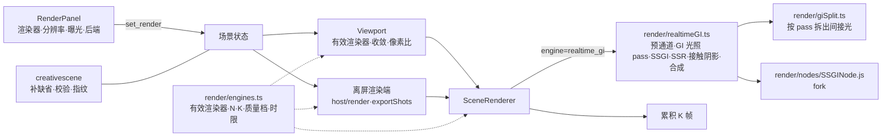
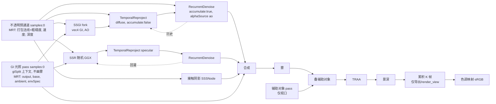

# Change 详细设计

## 继承的设计

- Epic `scene-webgpu-renderer` 批准版本 v3。本次直接用到的章节：
  - 「领域模型与业务规则」：术语（渲染器、工作台、实时 GI、输出分辨率、渲染后端、收敛），不变量 G1、G4、G5；
  - 「架构设计」：渲染选项卡、视口、离屏渲染端、后端 `creativescene` 与 `creativeagent` 的 R2 部分；
  - 「技术选型」：后处理节点、抗锯齿（实时 GI 用 TRAA）；
  - 「关键机制」：「渲染器与显示模式」「渲染管线组成」（实时 GI 一行）「实时 GI」「收敛与累积」「输出分辨率」「导出与过时判断」「渲染器创建、退回与设备丢失」（4K、8K 丢设备的例外）；
  - 「接口设计」「数据与存储设计」「验证与交付」。
- 交付契约：`data: 场景文档`（`render.engine`、`render.resolution`），正文以 Epic 批准基线为准，本子项不复制。
- R1（`scene-webgpu-pipeline`，已合入 develop）交付了渲染器创建入口 `render/gpu.ts`、工作台管线 `render/sceneRenderer.ts`、每张图新建管线、帧推进与设备丢失处理。R2 在这些之上加实时 GI 分支，不改工作台的画面。
- R0 的实测与原型：`scene-webgpu-spike` 的 `discovery/research/realtime-gi.md`（组合、帧时间、收敛、WebGL2）、`high-resolution.md`（各档耗时、显存、编码）、`prototype/webgpu/giCase.ts`、`SSGINodeFrame.js`。
- 起草时的源码调研（three r186，2026-10-21）结清了 Epic 未决事项 10，结论写在「SSGI 降噪」和「合成」两节；官方示例原文取自 GitHub tag r186（npm 包不含示例 HTML）。

## 领域模型与业务规则

不新增领域对象。`engine`、`resolution` 属于已有的 `render` 单元，并发、撤销、历史、恢复沿用 `scene-editor-3d` 的规则（Epic「领域模型与业务规则」）。本次落实的规则：

- **R-1 读取补齐**：服务端解码快照时，`render` 缺字段就补缺省值（`engine: workbench`、`resolution: 2k`、`exposure_ev: 0`）。这一处同时覆盖按单元读取、`read_scene`、写入时的校验、指纹和恢复。完整读取（`view.go` 的 `completedScene`）在 `render` 不完整时也解码再编码，响应里带齐三项。
  - 现状的缺口：完整读取直接返回存储的 JSON，老场景的 `render` 只有 `mode`；`exposure_ev` 是浮点，零值恰好等于缺省值，所以写入没出问题。新字段是字符串，零值 `""` 不合法，不补的话老场景的任何写入都会被 `Validate` 拒绝。
- **R-2 有效渲染器**：画面用哪个渲染器由三项决定，场景设置只是其中之一：

  | 显示 / 出图 | 透视 | 正交 |
  |---|---|---|
  | 最终渲染、`lit` 导出、`render_view` 的 `lit` | `render.engine` | 工作台（视口角标提示） |
  | 白模、线框、材质预览、`clay`、`line` 导出、`render_view` 的 `clay` | 工作台 | 工作台 |

  导出和 `render_view` 总是透视摄像机。这张表只在一处实现（`render/engines.ts` 的 `effectiveEngine`），视口和离屏渲染端都调用它。
- **R-3 指纹**：`fingerprintRender` 新增 `engine`（`omitempty`），只在 `lit` 且值不是 `workbench` 时赋值；`resolution` 不进指纹。现有的 v1 指纹因此不变，不升指纹版本。
- **R-4 写入**：`set_render` 按键合并，「至少写一项」的判断与提示加上 `engine`、`resolution`；`path_tracing` 和未知档位返回 400 并指出字段。
- **R-5 设备画不了的档位**：导出前所选档位的长边超过设备的纹理上限，或输出分辨率为 4K、8K 时出图丢失设备，都是「当前设备画不了这个档位」：明确失败，不回队、不降分辨率。2K 及以下丢设备沿用 R1：任务回队，手动导出提示重试。

## 模块职责与协作



- **`render/engines.ts`**（新）：渲染器相关的常量和纯函数，没有 GPU 依赖：`effectiveEngine`（R-2）、收敛帧数 `N`、累积帧数 `K`（导出、`render_view`）、质量档参数、`longSideOf(resolution)`、`imageTypeOf(pass, resolution)`、时限估算。单测直接测它。
- **`SceneRenderer`**：`Frame` 新增 `engine` 和 `quality`（`interactive` | `final`）；管线的键从「线框 × 景深」扩为「线框 × 景深 × 渲染器」，渲染器变化时重建管线（Epic「抗锯齿切换」）。实时 GI 分支的节点图交给 `realtimeGI.ts` 组装，`SceneRenderer` 只负责接在景深之前、把新 pass 加进 `passes`（灯光预编译要用）和释放。新增 `accumulate` 选项：导出和 `render_view` 打开，视口不开。
- **`render/realtimeGI.ts`**（新）：组装实时 GI 的节点图（「实时 GI 管线」），返回最终 HDR 颜色节点、要预编译的 pass 和要释放的节点。
- **`render/giSplit.ts`**（新）：按 pass 把材质的间接光拆到单独的 MRT 输出（「合成」）。对 three 私有行为的依赖封装在这一个文件里，配单测盯住（同 R1 的帧推进）。
- **`render/nodes/SSGINode.js`**（fork）：采样旋转和偏移按帧序号取黄金比例数列（R0 已验证），另外直接输出 `vec4(GI, AO)` 一张纹理。文件头注明上游版本和改动块，守护单测同 R1 的 GTAO fork。
- **`render/gpu.ts`**：新增 `settle()`，等 GPU 做完已提交的工作（WebGPU：`device.queue.onSubmittedWorkDone()`；WebGL2：`fenceSync` 加 `backgroundTicker` 轮询 `clientWaitSync`，不用 rAF）。r186 已移除 `renderer.waitForGPU()`。
- **视口**（`Viewport.tsx`）：算有效渲染器，实时 GI 时整条管线按 1× 像素比渲染，停止操作后收敛 N 帧；正交视图的角标。
- **离屏渲染端**（`host/render.ts`、`host/exportShots.ts`、`host/executor.ts`、`host/framing.ts`）：`shoot` 改为异步，按 K 累积，逐帧 `settle()` 让出主线程；长边和编码按档位；时限按估算；高档位丢设备按 R-5。
- **渲染选项卡**（`panels/RenderPanel.tsx` 新增，`SceneEditor.tsx` 组装）：见「属性区选项卡」。
- **后端**：`creativescene` 补缺省、校验、指纹、提示文字；`creativemedia` 放宽总像素；`creativeagent` 改工具说明。依赖方向不变。

## 关键机制

### 属性区选项卡

现在侧栏上半是「大纲 / 资产」，下半在没有选中物件时显示环境面板，选中时显示物件属性。R2 把下半改成 Blender 属性编辑器式的三个选项卡，顺序与 Blender 相同：

```
┌ 大纲 │ 资产 ───────────────┐
│ …物件列表…                 │
├ 渲染 │ 环境 │ 物件 ─────────┤
│ 渲染器   [实时 GI      ▾] │
│          工作台             │
│          实时 GI            │
│          路径追踪 · 规划中  │  ← 禁用
│ 输出分辨率 1K 2K 4K 8K     │  （长边 4096 px）
│ 曝光补偿（EV） ──●── 0.0   │  只在最终渲染生效
│ 渲染后端  WebGPU           │
│ ⓘ 实时 GI 只计算画面里可见  │
│   的表面……                 │
└───────────────────────────┘
```

- **「渲染」**：渲染器下拉、输出分辨率分段按钮（下方注明长边像素）、曝光补偿（从环境面板移来，滑块和合并键 `render.exposure_ev` 不变）、渲染后端（只读：「WebGPU」或「兼容模式」，取自 `SceneGPU.backend` / `compatibility`）。说明文字：
  - 实时 GI：「只计算画面里可见的表面：画面外和被遮挡的物体不产生反弹光，也不出现在反射里。正交视图按工作台显示。」
  - 选 8K 且渲染器为实时 GI 时：「8K 实时 GI 每张约需一分钟以上，需要较大显存，设备画不了时导出会失败。」
- **「环境」**：现在的环境面板，去掉曝光。
- **「物件」**：现在的物件属性；没有选中时显示「未选中物件」。
- **自动切换**：选中从无到有时切到「物件」；取消选中时，如果当前在「物件」，回到之前停留的「渲染」或「环境」（缺省「环境」）。手动点的选项卡保持到下一次选中变化。这样现有的「选中就看属性、取消就看环境」不变，只是多了一个可以停留的「渲染」。选项卡状态放在 `sceneStore` 的 UI 状态里，不写进视图保存。
- 只读预览（历史版本）时三个选项卡照常可看，字段禁用。

### 场景格式与读写（后端）

- `model.go`：`Render` 加 `Engine string`、`Resolution string`；`renderPatch` 加两个指针字段；`decodeScene` 调 `completeRender`（R-1）；`Validate` 校验两个枚举。`newScene` 写全三项。
- `view.go`：`completedScene` 在 `renderComplete` 为假时走解码再编码的路径（与 `cameraComplete` 并列）。
- `ops.go`：`set_render` 的空 patch 判断和提示：「render 至少写一项：mode、exposure_ev、engine 或 resolution」。
- `fingerprint.go`：R-3。
- OpenAPI：`CreativeSceneRender` 的 `required` 加 `engine`、`resolution`；`CreativeSceneRenderPatch` 加可选字段；`make generate`。
- `creativemedia/config.go`：`MaxImagePixels` 改为 67,108,864（8192²，Epic「媒体上限」）。

### 实时 GI 管线



- **不透明预通道**：`pass(scene, camera, { samples: 0 })`，`transparent = false`，只画图层 0。与工作台的预通道不同，这里**不用**覆盖材质：要拿到材质（含程序化预设）的粗糙度和凹凸后的法线。MRT 输出 `vec4(packNormalToRGB(normalView), roughness)` 和 `velocity`，共 16 字节。法线有两种格式：`TemporalReprojectNode`、`RecurrentDenoiseNode` 内部会解包，要打包的；SSGI、SSR、`DenoiseNode` 直接 `normalize`，要解包后的（用一个 `unpackRGBToNormal` 采样节点）。
- **GI 光照 pass**：`pass(scene, camera, { samples: 0 })`，画图层 0 的全部物件（含透明和透射，three 照常排序、透射照常取背景），不画雾（tasks 7.5）。`contextNode` 带 `giSplit` 标记，MRT 输出 `output`、`base = vec4(diffuseColor, metalness)`、`ambient`、`envSpec`，正好 32 字节（WebGPU 默认的 `maxColorAttachmentBytesPerSample`；`rgba8unorm` 也按 8 字节计）。
- **SSGI**：fork 输入 GI 光照 pass 的 `output`、预通道的深度和解包法线；输出 `vec4(GI, AO)`。质量档：`interactive` 为 `sliceCount 2 / stepCount 8`，`final` 从同档起步，高档 `3 / 16` 是否采用由标定决定（Epic「质量档」）。`giIntensity`、`radius` 从 R0 的 10、12 起步，在参考场景上调。
- **SSR**：照官方 `webgpu_postprocessing_ssr_denoise` 的链路（随机 GGX → specular 重投影 → 递归降噪 → 回灌），随实时 GI 常开。
- **接触阴影**：`SSSNode`，主光源取太阳（程序化天空且太阳在地平线以上）；没有时取场景里照度最大的投影灯（聚光按世界坐标下到目标的距离算）；都没有就不加。主光每帧现查，不进管线的键：太阳落山、换天空、两盏灯强弱交替都不重建管线；没有主光时这一帧不追踪，合成里权重为 0（tasks 7.5）。
- **TRAA** 必须是最外层的时域节点：它和 `TemporalReprojectNode` 都会去占视口偏移（`viewOffsetOwner`），只有 TRAA 做抖动。
- **雾**：场景的雾是线性雾（`objects/Lighting.tsx`）。光照 pass 不画雾，合成之后按预通道深度统一叠雾，算法与 three 的 `rangeFogFactor` 相同（视空间深度上的 smoothstep），所以 GI、反射和接触阴影一起被雾衰减；背景不加雾（three 里天空盒离摄像机太近，也不受雾影响）；玻璃取它后面不透明表面的雾（tasks 7.5）。
- **覆盖层**：视口的 `aside`（网格、描边外壳、灯光图标、摄像机视锥、空物体）单独一个 pass 画（不进光照 pass，也就不在 SSGI、SSR 采样的那张图里），雾之后、TRAA 之前按深度叠上：它的深度不大于预通道深度处可见，与同一 pass 里的深度测试相同；玻璃前后都画在玻璃上面。导出没有辅助对象，不建这个 pass。`top`（gizmo）在 TRAA 之后合成（Epic「抗锯齿切换」）。
- **帧序号**：SSGI fork 和 `RecurrentDenoiseNode` 取渲染器的帧序号；SSR 和 TRAA 用各自私有的计数，所以导出每张图新建管线（R1 已如此）。GI 链里的节点都不用 `Math.random`（已核实），不需要像 R1 的 `DenoiseNode` 那样换固定种子的噪声。
- **释放**：每张导出图新建、释放一整条 GI 管线。R0 发现 GI 管线每重建一次残留 12–24 字节/像素；R2 必须找到并释放，验证同 R1（连续导出 48 张纹理数不增长）。

### SSGI 降噪（结清 Epic 未决事项 10）

R0 两种接法失败，都是因为接错了信号，不是降噪器不能用：

- r186 的 `SSGINode` 把结果分成 GI 和 AO 两张纹理，节点本身（`setup()` 的返回值）是 AO。原型把节点本身交给重投影和降噪，处理的其实是灰度的 AO，于是「接在重投影之后」时合成变成 `颜色 × AO + 漫反射色 × 1`：房间被均匀提亮、渗色消失。
- 「接在 TRAA 之后」时，降噪器把输入的 alpha 当作「1 / 已累积帧数」，只有 `TemporalReprojectNode` 会输出这样的 alpha；TRAA 输出的 alpha 约为 1，历史权重变成 0，输出就是空间滤波后的灰度 AO，画面发白。
- 金属球变白还有一个原因：MRT 的 `diffuseColor` 是基础色本身，没有乘 `(1 − metalness)`。

采用的接法：

```ts
const giAO = ssgi.output                                   // vec4(GI, AO)，fork 直接输出一张
const rep = temporalReproject(giAO, depth, normalPacked, velocity, camera, { mode: 'diffuse', accumulate: false })
const dn = recurrentDenoise(rep, camera, { depth, normal: normalPacked, raw: giAO, mode: 'diffuse', accumulate: true })
dn.alphaSource = 'ao'                                      // raw.a 是 AO，用来定核半径和 AO 边缘
rep.setHistoryTexture(dn)                                  // 历史是上一帧的降噪结果
const GI = dn.rgb
const AO = denoise(vec4(vec3(giAO.a), 1), depth, normalView, camera).r   // 降噪器不输出降噪后的 AO
```

- 整条链只有一个累积器：重投影只输出裁剪后的历史，当前帧在降噪器里按权重混入。重投影如果也设 `accumulate: true`，画面会冻在第一帧。
- 不除以反照率：SSGI 的 GI 本来就不含受光面的反照率，合成时再乘 `kd`。降噪器的 `diffuse` 参数只用于颜色边缘停止，不传 `metalRoughness` 时不起作用，不传。
- `raw` 必须传（源码没有判空）。
- **导出的偏差**：降噪器和重投影的 `flickerSuppression`、TRAA 的 `flickerReduction` 都按亮度反向加权，会压暗亮部。`final` 质量档把 `flickerSuppression` 设为 0；TRAA 的 `flickerReduction` 是否保留，由标定时对照工作台的亮部决定。
- **退路**（实施第一个任务验证不成立时）：不用递归降噪，GI 和 AO 各过一次按深度、法线引导的空间滤波（复用工作台 AO 用的 `DenoiseNode`），视口靠 TRAA，导出靠 K 帧平均。代价低、没有反馈环，视口噪点更多。仍不达标时交 owner。

### 合成

目标（Epic「实时 GI」）：间接光按漫反射色调制后叠加，AO 只作用于间接光，SSR 替换材质自己的环境反射而不是叠加。three 的官方示例都做不到：SSGI 示例把 AO 乘在整张画面上；SSR 示例全局改写 `PhysicalLightingModel.prototype.indirectSpecular`，所有材质、所有 pass 都失去环境镜面，工作台和缩略图也受影响；SSR 没有可用的环境回退（只接受带 CPU 数据的等距柱状 HDR，我们是程序化天空），未命中处会变黑。

采用**按 pass 拆出间接光**：

- `giSplit.ts` 包一层 `PhysicalLightingModel.prototype.indirect`：先执行原方法，然后只在构建上下文带 `giSplit` 标记时，把这一刻的 `indirectDiffuse`、`indirectSpecular` 复制到两个 property（`GIAmbient`、`GIEnvSpec`），供 MRT 输出。**不清零**，`output` 仍是完整的工作台光照。
- 标记经 `PassNode.contextNode` 只在 GI 光照 pass 里生效；渲染对象的缓存键包含上下文，同一个材质在 GI pass 和其他 pass 里编译成两套管线。工作台、缩略图、资产预览编译出的代码与 R1 完全相同。
- 透明材质跳过拆分（property 保持 0），与 three 自带的 `builtinAOContext` 一致。
- 合成（线性 HDR，透视、实时 GI）：

  ```
  kd     = base.rgb × (1 − base.a)                // 乘过 (1 − 金属度) 的漫反射色
  direct = output − ambient − envSpec             // 直接光加自发光
  final  = direct × contact                       // 接触阴影只压直接光
         + ambient × AO                           // AO 只遮间接光
         + envSpec × AO × (1 − cover) + ssr       // SSR 命中处替换环境反射（白模没有 SSR：cover = 0、ssr = 0）
         + kd × GI                                // 屏幕空间的间接漫反射
  ```

  GI 光照 pass 里不清零、合成时再拆，是为了透明物体：透射取的背景就是这个 pass 的 `output`，不清零它才带着完整的环境光；透明表面不拆分，它的三个间接光通道按透明度混合，背后物体的间接光随之削弱，`direct` 自然包含透明表面自己的全部光照。近似之处是透明物体背后没有 GI 和 AO，可以接受。单测用常量纹理核对这几行代数。
- `cover` 是 SSR 的命中覆盖率：SSR 原始输出的 alpha 是有限的光线长度时为命中，未命中为 0 或环境哨兵值。命中标记要和 SSR 一样做时域平滑，具体做法在 GI 管线任务里定（局部未决 L2）；做不到时接受命中处的重复计算（R0 现状），交 owner 看图。
- 有了真实的 GI，`AMBIENT_FILL`（现在 0.5，用来模拟间接光）在实时 GI 下单独取值，以 `room` 和 `cornell` 参考场景标定：实时 GI 的平均亮度与工作台相差不超过 10%（Epic「间接光的旧补偿」）。曝光补偿的语义不变。
- **待验证假设**（实施第一个任务验证）：MRT 能读出在光照模型里赋值的自定义 property；三个附件加 `output` 在 Metal 和 WebGL2 后端都能建管线。不成立时的退路是 three 自带的 `builtinGIContext` / `builtinAOContext`：GI 和 AO 直接进入材质的光照模型（AO 只遮间接光，透明材质跳过），SSGI 的输入改用上一帧的画面。代价是视口移动时 GI 滞后一帧，导出前几帧没有 GI，要先预热若干帧再累积。

### 收敛

- 视口在有效渲染器为实时 GI 时，每帧画完检查「自上次外部变化以来已画的帧数」：小于 N 就再请求一帧，到 N 停止。外部变化（场景状态、视角、窗口尺寸、选中）触发的帧把计数清零；自己续的帧只递增。工作台 N = 1，与现在相同。
- 实现放在 `Viewport.tsx` 的 `LookView`，用一个 ref 区分「自己请求的帧」和外部触发的帧，不改 R3F 的 `frameloop="demand"`。
- 实时 GI 的视口整条管线按 1× 像素比渲染（R0：2× 约为 5 倍耗时，不可用）；工作台仍按设备像素比，AO 按 1×（R1）。
- N 从 16 起步，标定方法：在 1600 × 1000 的视口里，盒子间和 `room` 停止操作后相邻两帧的平均变化（0–255）小于 0.2 时的最小帧数，从 {8, 12, 16, 24, 32} 中取。

### 累积与出图

- `SceneRenderer` 的累积节点放在景深之后、色调映射之前：线性空间 `acc = mix(acc, 当前帧, 1 / n)`，`n` 是这张图里的帧序号加一。累积目标用半精度；标定时与单精度对照，有可见差异就改单精度（8K 多约 360 MB）。
- `shoot` 改为异步：

  ```ts
  async shoot(framing, options) {
    resetFrames(); const picture = new SceneRenderer(…)            // 每张图新建管线（R1）
    const K = framesFor(engine, use)                               // 工作台 1；实时 GI 导出 K、render_view K_view
    for (let i = 0; i < K - 1; i++) {
      advanceFrame(); picture.render(camera, frame)
      await gpu.settle()                                           // 让出主线程：续租、进度、取消照常执行
      if (gpu.isLost()) throw new DeviceLostError()
      if (overBudget()) throw new ShotTimeout()                   // 在帧之间检查，不必等整张画完
    }
    return gpu.capture(() => { advanceFrame(); picture.render(camera, frame) }, type, quality)   // 最后一帧画到画布后立刻编码（R1）
  }
  ```

  只有最后一帧要和编码在同一个任务里；前 K − 1 帧之间等待 GPU 不影响「画完立刻 `toDataURL`」的约束，也不影响确定性（帧序号只由循环决定）。
- K 的标定：盒子间 2048 × 1365 的导出，后墙上部的残余噪点（画面减去其高斯模糊后的平均绝对值，R0 的度量）不超过 K = 256 时的 1.2 倍，从 {16, 32, 64, 128} 中取最小值；`render_view`（长边 1024）不超过 K = 256 时的 2 倍，从 {8, 16, 32} 中取。**K 对所有场景固定**，不按场景自适应。标定结果和曲线写进 evidence，常量写进 `engines.ts`。
- `exportShots.ts` 逐张 `await shoot`；`render_view` 同样。

### 输出分辨率、编码与时限

- `framing.ts` 的 `exportLongSide` 改为 `longSideOf(scene.render.resolution)`（1024 / 2048 / 4096 / 8192）；`render_view` 仍是 1024。导出对话框的说明改为「长边 4096（4K）」这样的当前档位。
- 编码：`imageTypeOf(pass, resolution)`，4K、8K 的 `clay`、`lit` 为 `image/jpeg`（质量 0.95），其余 `image/png`；上传的文件名和声明的 MIME 跟随（`.jpg`）。后端的导出放置不检查格式（Epic）。
- 出图前检查：长边超过 `gpu.maxTextureSize` 时直接失败（R-5），提示「当前设备最大只能导出长边 N px 的图，请选更低的输出分辨率」。线稿的 2 倍分辨率规则不变（不够时 1 倍）。
- **时限**按估算算，常量来自参考设备的 R0 实测并向上取整：

  ```
  估算(引擎, w, h, K, 编码) = w·h·(K·每像素帧耗时[引擎] + 每像素编码耗时[编码])
    每像素帧耗时：工作台 15 ns，实时 GI 30 ns；编码：PNG 40 ns，JPEG 15 ns
  单张时限 = max(30 s, 8 × 估算)            // 慢设备留 8 倍
  render_view 时限 = max(60 s, 8 × 估算(1024 长边, K_view))
  整批导出时限 = 切换光照的 60 s + Σ 单张时限；助手导出再以任务期限（30 分钟）减 5 分钟为上限
  ```

  例：8K 实时 GI、K = 64、3:2 的单张估算约 87 秒，时限约 11.6 分钟；2K 工作台的单张时限仍是 30 秒。超过任务期限的大批量 8K 实时 GI 导出按超时失败，不为此改任务期限。
- **高档位丢设备**（R-5）：执行器捕获 `DeviceLostError` 时看这批导出的档位：4K、8K 以 `host_error` 完成任务，消息「渲染设备在按 8K 出图时丢失，当前设备可能画不了这个分辨率，可以换低一档再导出」；手动导出给同样的提示。2K 及以下沿用 R1。

### 助手

- `scene_tools.go`：
  - `edit_scene` 的 `set_render` 写法改为 `set_render{render:{mode?:clay|lit, exposure_ev?:-10…10, engine?:workbench|realtime_gi, resolution?:1k|2k|4k|8k}}（按键合并）`，并说明：渲染器只作用于材质光照（`lit` 导出与回看，白模和线稿总按工作台），实时 GI 加入屏幕空间的间接光、反射和接触阴影，出图更慢；输出分辨率只决定导出图的长边；`path_tracing` 还不能用。
  - `render_view`：说明实时 GI 的回看更慢（多帧累积）。
  - `export_shots`：「长边 2048」改为「长边按 `render.resolution`（缺省 2K，即 2048）；4K、8K 的白模和材质光照是 JPEG」。
- `instructions/base.md` 的场景段落补一句渲染器与输出分辨率的用法。
- 工具说明变化会改变检查点指纹，按 `docs/dev/agent-skills-tools.md`「排空后升级」加一条记录（同 C4、C5）。

## 局部设计与偏差

- **属性区三个选项卡与自动切换**（Epic 只规定新增「渲染」选项卡，布局由 R2 定）：保留「选中看属性、取消看环境」的现有习惯，同时给渲染设置一个能停留的位置；顺序与 Blender 相同。取舍：也考虑过把渲染设置放进环境面板的一个分组，但 owner 明确要求参照 Blender 做成选项卡。
- **SSGI 降噪接法**：结清未决事项 10（见「SSGI 降噪」），并有退路。
- **按 pass 拆出间接光**：不用官方 SSR 示例的全局改写；改用只在 GI 光照 pass 生效的上下文标记，工作台的着色代码不变。它依赖 three 的私有行为（`PhysicalLightingModel.prototype.indirect` 的调用时机和 `reflectedLight`），封装在 `giSplit.ts` 并配单测；有官方机制的退路（`builtinGIContext`）。
- **光照 pass 不清零、合成时再拆**：为透明和透射物体背后的画面保留环境光。
- **两个 pass**：不透明预通道（法线、粗糙度、速度）加 GI 光照 pass（颜色和三个间接光通道），而不是 R0 的单 pass 四附件：单 pass 加上间接光通道会超过 32 字节，透明物体也会写坏法线。代价是预通道要做完整的材质求值（工作台的预通道用覆盖材质，代价更低）。
- **K 固定**：不按场景自适应，标定取保守值；暗部多的场景如果噪点明显，再考虑按场景加帧（后续）。
- **标定后的调整（tasks 5.1，记录见 `discovery/research/calibration.md`）**：
  - 累积先预热 N 帧，之后的 K 帧才平均。时域节点的第一帧在 HDR 里偏差极大，原先从第 1 帧平均时，K16 的材质光照亮了一半。
  - 出图（`final` 档）的 GI 只做空间滤波，也就是「SSGI 降噪」的退路，视口仍用递归降噪。递归降噪的输出在帧间高度相关，K 帧平均几乎压不下它的噪点：1K 和 `render_view` 下颗粒明显。代价是暗处偏亮（盒子间后墙上部 +25%，递归降噪是 +10%），owner 2026-10-21 选定。
  - K 的选取规则（不超过 K = 256 的 1.2 倍）因为噪点没有平台而达不到，owner 改为按耗时定：K = 64、K_view = 16；N = 12。
- **接触阴影只压朝向主光的表面**（tasks 7.3）：合成里接触阴影乘在全部直接光上（上面的 `direct × contact`），背对主光的表面会被它连同其他灯光一起压暗，还带颗粒；改为按法线与主光方向的点积淡入，N·L ≤ 0 时不压。代价是主光以外的灯光在朝向主光的面上仍会被主光方向的接触阴影压一点（无法逐灯拆开直接光），与原设计相同。
- **渲染器只作用于最终渲染和材质光照**（tasks 7.4，owner 2026-10-21 验收前修订，偏离 Epic「渲染器同时作用于白模和最终渲染」，Epic 修订待批）：白模与 Blender 视口里 Rendered 以外的着色一样，总按工作台画，`clay` 导出和 `render_view` 的 `clay` 随之不变；R-2 的表、R-3 的指纹和助手说明一并改。白模 GI 那一支（`Frame.reflections`、`realtimeGI` 的 `reflections` 选项）没有调用方，删去，SSR 随实时 GI 常开。
- **辅助对象不进预通道**（tasks 7.4）：灯光图标、摄像机视锥、空物体十字和分组坐标轴放进 aside 层（与网格、选中描边同层）：画进图里，但不进 AO 和实时 GI 的预通道，不遮挡、不投接触阴影、不进 SSGI；视口点选的射线也看 aside 层，点选不变（aside 层上的描边、线稿禁用射线，网格没有物件 ID）。之前它们在 layer 0，实时 GI 在它们周围的地面画出大片颗粒状黑斑，工作台的 AO 也算上它们。导出没有辅助对象，不受影响。
- **雾、辅助对象与主光**（tasks 7.5，代码审计）：见上面「实时 GI 管线」的雾、覆盖层和接触阴影三条。之前光照 pass 带雾、合成从带雾的 `output` 里减去不带雾的间接光，再加回不带雾的 GI 和反射，全雾里物体照样透出来；辅助对象画在光照 pass 里，会作为背后表面的光被 SSGI、SSR 采到；主光的 uuid 在管线键里，主光一换就重建整条管线和时域历史。
- **时限公式**与**逐帧让出主线程**（Epic 只说「公式由 R2 定」）。
- **实时 GI 的环境光补偿**单独取值。
- **后续**：Epic 的「实时 GI 的质量档位、采样数开放给摄影师」仍等 AC-8 结论；正交视图的 SSGI 不做（回落工作台）。

## 接口与数据契约

- **扩展**：`data: 场景文档` 的 `render.engine`、`render.resolution`，按 Epic 批准基线交付（本子项不复制正文）。
- HTTP 接口不变；OpenAPI 的 `CreativeSceneRender`（响应，两项必返）与 `CreativeSceneRenderPatch`（请求，可选）随数据契约加字段，提交 Go、TS 两份生成物。`api: 完成场景客户端任务` 的措辞不在本次修改（Epic「接口设计」）。
- 兼容：老场景读取补缺省值，指纹不变；回滚到不认识新字段的后端会读取失败，只做前向修复（Epic「数据与存储设计」）。

## 挂载点

| 位置 | 动作 | 说明 |
|---|---|---|
| `backend/internal/creativescene/model.go` | 修改 | `Render`、`renderPatch`、`decodeScene`、`Validate`，新增 `completeRender` / `renderComplete` |
| `backend/internal/creativescene/view.go` | 修改 | `completedScene` 补齐 `render` |
| `backend/internal/creativescene/type.go` | 修改 | `newScene` 写全 `render` |
| `backend/internal/creativescene/ops.go` | 修改 | `set_render` 空 patch 的判断与提示 |
| `backend/internal/creativescene/fingerprint.go` | 修改 | `fingerprintRender.Engine` |
| `backend/internal/creativescene/*_test.go` | 修改 | `scene_test.go`、`model_test.go`、`fingerprint_internal_test.go`，新增老场景补齐测试 |
| `backend/internal/creativemedia/config.go` | 修改 | `MaxImagePixels` |
| `backend/internal/creativeagent/scene_tools.go` | 修改 | `edit_scene`、`render_view`、`export_shots` 的说明 |
| `backend/internal/creativeagent/instructions/base.md` | 修改 | 场景段落 |
| `backend/internal/creativeagent/scene_tools_test.go` | 修改 | 固定新写法 |
| `api/openapi.yaml` | 修改 | `CreativeSceneRender`、`CreativeSceneRenderPatch` |
| `backend/internal/platform/httpapi/api.gen.go` | 生成 | `make generate` |
| `frontend/src/api/schema.d.ts` | 生成 | `make generate` |
| `frontend/src/creative-scene/render/engines.ts` | 新增 | 有效渲染器、N、K、质量档、档位、编码、时限估算 |
| `frontend/src/creative-scene/render/realtimeGI.ts` | 新增 | 实时 GI 节点图 |
| `frontend/src/creative-scene/render/giSplit.ts` | 新增 | 按 pass 拆出间接光 |
| `frontend/src/creative-scene/render/nodes/SSGINode.js` | 新增 | SSGI fork（含 `.d.ts`） |
| `frontend/src/creative-scene/render/sceneRenderer.ts` | 修改 | `Frame.engine`、`quality`、`accumulate`，`keyOf`，`build` 接入实时 GI 与累积 |
| `frontend/src/creative-scene/render/gpu.ts` | 修改 | `settle()` |
| `frontend/src/creative-scene/render/litLook.ts` | 修改 | 实时 GI 的环境光补偿 |
| `frontend/src/creative-scene/objects/Lighting.tsx` | 修改 | 按渲染器取补偿 |
| `frontend/src/creative-scene/Viewport.tsx` | 修改 | 有效渲染器、收敛、像素比、正交角标 |
| `frontend/src/creative-scene/SceneEditor.tsx` | 修改 | 属性区选项卡、`RenderPanel` |
| `frontend/src/creative-scene/panels/RenderPanel.tsx` | 新增 | 渲染选项卡 |
| `frontend/src/creative-scene/objects/SceneObjects.tsx` | 修改 | 灯光图标、摄像机视锥、空物体和分组坐标轴放进 aside 层（tasks 7.4） |
| `frontend/src/creative-scene/panels/EnvironmentPanel.tsx` | 修改 | 去掉曝光 |
| `frontend/src/creative-scene/panels/ExportDialog.tsx` | 修改 | 显示当前档位 |
| `frontend/src/creative-scene/state/sceneStore.ts` | 修改 | 属性区选项卡的 UI 状态 |
| `frontend/src/creative-scene/scene.css` | 修改 | 属性区选项卡样式 |
| `frontend/src/creative-scene/host/framing.ts` | 修改 | 长边按档位 |
| `frontend/src/creative-scene/host/render.ts` | 修改 | 异步 `shoot`、K 帧累积、`settle`、有效渲染器 |
| `frontend/src/creative-scene/host/exportShots.ts` | 修改 | 逐张 await、编码与文件名、时限 |
| `frontend/src/creative-scene/host/executor.ts` | 修改 | 时限、高档位丢设备 |
| `frontend/scripts/creative-scene-*.test.ts` | 修改 | 引擎函数、时限、拆分守护、SSGI fork 守护、导出尺寸 |
| `frontend/scripts/creative-scene.e2e.mjs` | 修改 | AC-R2-1 至 AC-R2-6、AC-R2-8、AC-R2-9 用例 |
| `frontend/scripts/creative-scene-agent.e2e.mjs` | 修改 | AC-R2-7 |
| `docs/dev/agent-skills-tools.md` | 修改 | 工具表与排空后升级记录 |
| `docs/dev/creative-scene-agent.md` | 修改 | 导出尺寸与格式 |

## 验证与交付

- **后端**：`make check-go PKG=./internal/creativescene/...`、`./internal/creativeagent/...`、`./internal/creativemedia/...`；`make generate-check`。重点用例：老场景（用 SQL 剥掉字段）读取补齐、写入成功、指纹等于固定的 v1 值；`engine` 只影响 `clay`、`lit` 的指纹，`resolution` 都不影响；`path_tracing`、未知档位、`null` 被拒绝。
- **前端单测**：`engines.ts` 的决策表与时限；`giSplit` 守护（没有标记时构建出的着色代码与不包装时逐字相同；有标记时 MRT 能读出两个通道）；SSGI fork 守护（换回上游块后与上游逐字相同）；合成代数（常量纹理）；导出尺寸与编码。
- **e2e**（定向，端口与环境沿用 R1）：
  - AC-R2-1、AC-R2-2：选项卡内容、自动切换、撤销、两个标签页同步、过时提示的三种情况；
  - AC-R2-3：盒子间的区域测量（红墙旁地面的红绿比、金属球区域与工作台的差、接触处亮度），图存 evidence；切回工作台对 R1 冻结参考图；
  - AC-R2-4：线框、材质预览、`line` 与工作台逐像素相同，正交角标；
  - AC-R2-5：视口帧计数停在 N，残余噪点阈值；隐藏标签页实时 GI 连拍两次、与前台在容差内（每通道差 ≤ 1，差 > 8 的像素 ≤ 0.01%），用例在 `creative-scene.e2e.mjs` 的 `SCENE_E2E_HIDDEN`（与 R1 的工作台确定性同一用例）；
  - AC-R2-6：四档 × 三种画幅的尺寸与格式，8K 1:1 能上传；纹理上限不够的失败（测试钩子把上限压低）；4K 丢设备的 `host_error`（R1 的丢设备钩子）；
  - AC-R2-7：助手脚本化回合；
  - AC-R2-8：`forceWebGL` 对照；SwiftShader 下出图不报错。
- **Metal 实测**（参考设备）：AC-R2-9 的帧时间、收敛时间、四档导出耗时、48 张纹理数；N、K、环境光补偿、质量档、`flickerReduction` 的标定，数据和图存进 `discovery/research/`。测着色器编译相关的数字时区分冷热缓存（lesson `webgpu-perf-warm-shader-cache`）。
- **AC-R2-10**：同机位工作台与实时 GI 各导出一组，用开发环境画布的 gpt-image-2.5 重绘（凭证只经环境变量）；拿不到时交 owner 在自己的环境里跑。样例存 evidence。
- **AC-R2-11**：Safari 人工检查，验收前由 owner 或我在本机做一次并记录。
- **上线与回滚**：不设开关。数据回滚只做前向修复；前端回滚可以撤销 R2 的合并，但已写入新字段的场景需要后端仍认识它们。

## 未决事项

| # | 问题 / 假设 | 影响 | 解决方式 | 最晚解决时点 |
|---|---|---|---|---|
| L1 | MRT 能否读出光照模型里赋值的 property；GI 光照 pass 的三个附件在 Metal 和 WebGL2 后端能否建管线 | 「合成」的采用方案 | 实施的第一个 GI 任务在盒子间上验证；不成立改用 `builtinGIContext` 退路，并在 tasks 里记录 | GI 管线任务开始时 |
| L2 | SSR 命中覆盖率 `cover` 的取法与时域平滑 | SSR 与环境反射是否重复 | 同一任务里先用 SSR 原始 alpha 的命中标记经重投影平滑；不行时最小 fork `SSRNode` 导出命中率（文件头注明改动）；仍不行接受重复，交 owner 看图 | GI 管线任务结束时 |
| L3 | 递归降噪接法在盒子间上是否达标（渗色保留、残余噪点下降） | 「SSGI 降噪」 | 同上任务验证，不成立用空间滤波退路 | GI 管线任务结束时 |
| L4 | 8K 实时 GI 在参考设备上能否稳定导出 | AC-R2-6 | Metal 实测；不行按 Epic AC-9 先只支持到 4K，验收时由 owner 确认 | R2 验收 |
| — | Epic 未决事项 2（新场景默认渲染器） | Epic 验收 | AC-R2-10 的重绘对照与 AC-R2-9 的性能数据交 owner | Epic 验收 |
