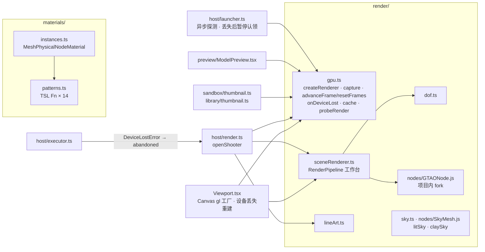
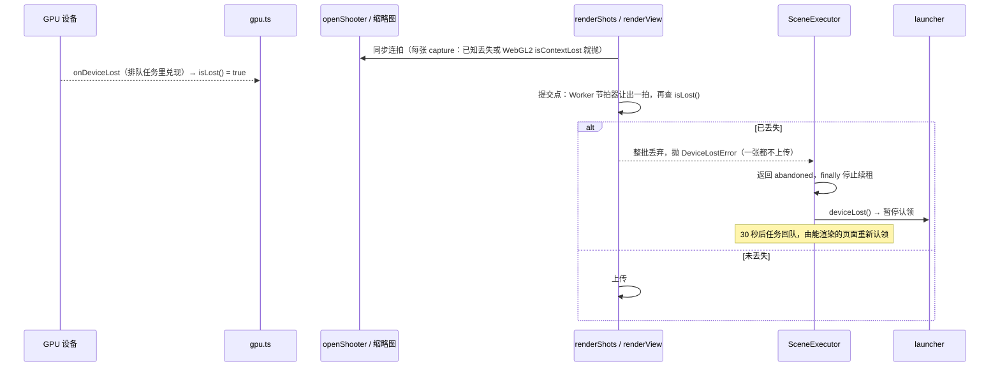

# Change 详细设计

## 继承的设计

- Epic `scene-webgpu-renderer` 批准版本（v2；本方案连同修订 v3 一起呈批，批准后重新绑定到 v3）。本次直接用到的章节：「架构设计」（渲染器创建入口、`SceneRenderer`、节点材质、天空、编辑器辅助、视口、离屏渲染端、缩略图）、「技术选型」、「关键机制」中的「渲染器创建、退回与设备丢失」「帧推进与确定性」「渲染管线组成」（工作台各行）「材质与程序化预设」「编辑器辅助显示」「读回」，以及「验证与交付」的迁移等价阈值、确定性、静态检查和 e2e 环境。
- 本次只交付工作台。实时 GI、收敛与累积、输出分辨率、渲染选项卡和 `render.engine` / `render.resolution` 都是 R2 的事，R1 不预留代码路径，只保证管线按「模式 × 相机类型」组装的结构能接上 R2 的「× 渲染器」。
- R0 的实测和原型在 `scene-webgpu-spike` 的 `discovery/research/`：`integration.md`（R3F 接入、帧推进、Gizmo 叠加）、`materials.md`（预设、景深、正交 GTAO）、`sky-shadow-outline.md`、`gbuffer-aa.md`、`environment.md`（读回、headless 环境）、`baseline.md` 与 `baseline/`（对照基线）、`summary.md`（阈值）。原型代码在 `prototype/webgpu/`，实施时可以作为起点，但按产品代码标准重写。
- 交付契约：`architecture: 场景模块`、`patterns: 场景着色写法`，正文以 Epic 批准基线为准，本子项不复制。
- 方案评审一轮（owner，2026-10-21），结论已并入正文：探测改为异步的准确探测（B1）、设备丢失加提交点检查（B2）、帧序号重置时清空节点的更新记录（B3），以及 R3F 输出约定、旧设备缓存、烘焙缩略图、叠层验收条件、退回对照拆分、`capture`、AST 静态检查和持续丢失。

## 领域模型与业务规则

R1 不新增领域对象，也不改场景文档。本次落地的是 Epic 不变量里与工作台有关的部分：

- **G1 一套渲染**：视口、`render_view`、两种导出都经同一个 `SceneRenderer`；缩略图和资产预览不经它（没有 AO 和景深，现在也不经），但同样从创建入口拿渲染器。
- **G2 单一着色源**：R1 结束时 `frontend/src` 里没有 GLSL；静态检查是这条的执行者。
- **G3 预设外观不变**：14 个预设迁到 TSL 后版本号不变，外观差异由 AC-R1-1 判定。
- **G4 后端不改场景**：退回 WebGL2 只影响本机怎么画。
- **G5 导出确定**：帧序号由创建入口独占，每张图从 0 开始，节点的更新记录随之清空。

新增的一个内部概念是**设备丢失**，作为一种独立的错误 `DeviceLostError`。它的来源只有一个：three 的 `renderer.onDeviceLost`（WebGPU 的 `device.lost` 与 WebGL2 的 `webglcontextlost` 都汇到这里，`dispose()` 引起的 `destroyed` 已被 three 过滤）。各处的处理：

| 发生在 | 处理 |
|---|---|
| 视口 | 重建 Canvas；10 秒内第 3 次丢失后停止自动重建，提示刷新页面 |
| 离屏任务（`render_view`、`export_shots`） | 整批图丢弃，任务放弃：不完成、停止续租，租约到期后回队（`JobOutcome.abandoned`）；本页暂停认领，直到重新创建设备成功 |
| 缩略图（`bake_model` 和编辑器自己的模型烘焙、资产卡片） | 重建设备后重试一次；仍失败按现有缩略图失败处理（`host_error` / 编辑器提示） |
| 手动导出 | 整批图丢弃，提示「渲染设备暂时不可用，请重试」，画布上不出现图片 |
| 其他渲染异常（着色器编译失败等） | 不变：错误边界、`host_error`、现有提示 |

不回队、直接失败的例外（4K / 8K 导出丢设备）随输出分辨率在 R2 实现；R1 只有 2048。

## 模块职责与协作



- **`render/gpu.ts`（新，渲染器创建入口）**：
  - `createRenderer({ canvas, alpha, output, forceWebGL? }): Promise<SceneGPU>`：读适配器限制，按 `requiredLimits` 申请 `maxTextureDimension2D`（不超过 16384）和 `maxBufferSize`；`new WebGPURenderer({ canvas, alpha, antialias: false, requiredLimits, forceWebGL })` 后 `await init()`；失败时渲染器自己退回 WebGL2。随后停用内部循环（`renderer._animation.stop()`），给 drei `GizmoViewport` 补 `capabilities.getMaxAnisotropy` 垫片，按 `output` 设置输出约定（见「输出与叠层」），并接管 `renderer.onDeviceLost`（先调 three 原来的处理，让它置 `_isDeviceLost`，再兑现 `lost`）。`forceWebGL` 只由测试参数打开（AC-R1-4 的画面对照）。
  - `SceneGPU = { renderer, backend: 'webgpu' | 'webgl2', compatibility, maxTextureSize, isLost(), lost: Promise<DeviceLostError>, capture(draw, type, quality?), advanceFrame(), resetFrames(), cache(key, create), dispose() }`。
  - `capture(draw, type, quality)`：同步完成「绘制 → 丢失检查 → `toDataURL` → Blob」，截图、导出和缩略图都只经它出图，绘制和编码之间写不进 `await`。丢失检查：已知丢失时抛 `DeviceLostError`；WebGL2 后端另外在编码前同步查 `gl.isContextLost()`。
  - `advanceFrame()` / `resetFrames()`：唯一碰 `renderer._nodes.nodeFrame` 的地方（见「帧推进」）。
  - `cache(key, create)`：挂在这个设备上的 GPU 资源（PMREM 环境贴图等），随 `dispose()` 或丢失一起释放，重建的设备重新创建。模块级缓存 GPU 资源是禁止的写法。
  - `probeRender(): Promise<boolean>`：`webgl2Available() || (await navigator.gpu?.requestAdapter()) != null`。不加载 three。Chrome 在没有可用适配器时照样暴露 `navigator.gpu`（R0 的 headless 环境 `{"gpu": true, "adapter": null}`），所以只看 `navigator.gpu` 在不在是错的。
  - 测试钩子（只在测试模式挂到 `window.__sceneGPU`）：`loseDevice({ afterCaptures? })`，见「设备丢失」。
- **`render/sceneRenderer.ts`（改写）**：构造参数从 `WebGLRenderer` 改为 `SceneGPU`；内部按显示模式和相机类型组装 `RenderPipeline`（见「工作台管线」）。`Frame` 类型不变；`Overlays` 约定不变。新增 `mode: 'shaded' | 'wireframe'`：线框也经管线输出（画布是线性输出，直接 `gl.render` 颜色会错）。
- **`render/lineArt.ts`（由 `linePass.ts` 改写）**：`LineRenderer` 改为节点版：2 倍分辨率的视空间法线（`MeshBasicNodeMaterial({ colorNode: directionToColor(normalView) })`）和深度，边缘检测节点沿用 `normalThreshold`、`depthThreshold`。设备纹理上限不够 2 倍时退到 1 倍（沿用规则）。可以跨张复用，前提是「帧推进」的重置规则。
- **`render/dof.ts`（由 `dofPass.ts` 改写）**：三步算法（tile 最大弥散圆 → 半分辨率 Vogel 盘采集 → 合成）改写为 TSL 节点，参数与 `cameraOptics.ts` 相同。R0 的移植误差平均约 0.5。
- **`render/nodes/GTAONode.js`（新，fork）**：three r186 `GTAONode.js` 原样复制，加 `_orthographic` uniform，正交时视线方向取 `(0, 0, 1)`，共改两行；旁边放从 `@types/three` 复制的 `GTAONode.d.ts`。透视与正交共用（透视下与上游逐像素相同，R0）。
- **`render/sky.ts` + `render/nodes/SkyMesh.js`（改写 / fork）**：`litSky`：fork 上游 `SkyMesh` 的 TSL，Z 轴向上，删掉云和时间，保留「不画太阳盘」开关和 `skyGain`；`claySky`：drei `Sky`（three-stdlib 旧版天空）逐行移植为 TSL 函数。`skyEnvironment`、`roomEnvironment` 改用 WebGPU 的 `PMREMGenerator`，结果经 `gpu.cache` 持有。`atmosphere.ts`（CPU 端的天空模型）不变。
- **`materials/patterns.ts`（改写）**：14 个预设各一个 TSL `Fn`，签名按 `patterns: 场景着色写法`；三平面投影、fbm 降阶、按像素宽度的 smoothstep 原样移植。`commonGLSL` / `patternGLSL` / `uniformDeclarations` 删除。
- **`materials/instances.ts`（改写）**：`makeMaterial` 产出 `MeshPhysicalNodeMaterial`；预设的输出接到 `colorNode`、`roughnessNode`、`metalnessNode`、`normalNode`（`height` 经 bump）、`emissiveNode`。共享规则不变：同一预设一个程序，参数走 uniform。透视材质（`opacity < 1` 或 `transmission > 0`）设 `transparent = true`，供预通道排除。`inject.ts` 删除，`patternsSupported` 与「锚点缺失退化」分支一起删除。材质实例不持有设备资源，跨设备共用。
- **`render/transparent.ts`（删除）**：预通道按 `material.transparent` 排除透视物件，不再需要手动维护集合。
- **`objects/`**：`Lighting.tsx` 改用两个 TSL 天空；`SceneObjects.tsx`、`ModelMesh.tsx` 的 `Outlines` 换成 `objects/Outline.tsx`（反向外壳，TSL `vertexNode` 在裁剪空间沿法线外推 3 px，只画背面），`Edges` 换成 `objects/EdgeLines.tsx`（`EdgesGeometry` + 1 px 时 `LineSegments`，2 px 时 `LineSegments2` + `Line2NodeMaterial`）。
- **`Viewport.tsx`**：
  - `<Canvas gl={(props) => createRenderer({ ...props, output: 'pipeline' }).then((g) => g.renderer)} linear flat shadows="percentage">`。`linear`、`flat` 不能省：`gl` 是工厂时 R3F 会在工厂返回后把输出改回 sRGB + ACES、阴影改回 `PCFSoftShadowMap`（R3F 9.8.1 `events-*.esm.js` 的 `changed('linear')`、`changed('flat')`）。`frameloop="demand"`、`dpr={[1, 2]}` 不变。
  - `LookView` 的 `useFrame` 在每次 `SceneRenderer.render` 前 `advanceFrame()`。线框也走 `SceneRenderer`。
  - drei `Grid` 换成 `objects/InfiniteGrid.tsx`（TSL 无限网格，参数沿用）。
  - 设备丢失：外层组件持有 `canvasEpoch`，`lost` 兑现后加一，`<Canvas key={canvasEpoch}>` 重新挂载（见「设备丢失」的边界）。
- **`SceneEditor.tsx`**：`webgl2Available` 换成 `await probeRender()`，探测期间显示加载态；模型存入资产库时的卡片缩略图改为 `await renderMaterialThumbnail(...)`；手动导出遇到 `DeviceLostError` 显示重试提示。
- **`host/render.ts`**：`openShooter` 的 `root.configure({ gl: 工厂, linear: true, flat: true, shadows: 'percentage' })`，工厂用 `createRenderer({ canvas, alpha: false, output: 'pipeline' })`。`shoot()` 保持同步：`resetFrames()` → 新建 `SceneRenderer`（见「每张图新建管线」）→ `gpu.capture(() => { advanceFrame(); render() }, type, quality)`。`close()` 释放管线后 `dispose()` 渲染器（WebGL2 后端另外 `loseContext()`，沿用「立即归还上下文」）。
- **`host/exportShots.ts`、`host/executor.ts`**：`renderShots` 和 `renderView` 在全部图画完、上传之前经过提交点（见「设备丢失」），丢失时整批丢弃并抛 `DeviceLostError`；`SceneExecutor` 在 `renderView`、`exportShots` 里捕获它，返回 `{ state: 'abandoned', reason: '渲染设备丢失' }`，不调 `fail`，并通知 launcher 暂停认领。`run()` 的 `finally` 已经停止续租。
- **`host/launcher.ts`**：`SceneJobLauncherDeps.probe` 改为 `() => Promise<boolean>`，首次认领前问一次（现在就是只问一次），`probeDevice` 用 `probeRender`。新增 `deviceLost()`：暂停认领；之后每次被唤醒（通知、聚焦、重连）时，距上次尝试不少于 10 秒就重新 `probeRender()` 并试建一次设备（`requestAdapter` + `requestDevice` 后立即销毁），成功则恢复认领。
- **`sandbox/thumbnail.ts`、`library/thumbnail.ts`**：`sharedRenderer()` 改为 `sharedGPU(): Promise<SceneGPU>`，懒创建一个 256 × 256、`alpha: true`、`output: 'direct'` 的离屏渲染器，丢失后清空。两个缩略图函数改为 async：`compileAsync` 后经 `capture` 出图；遇到 `DeviceLostError` 重建设备重试一次。`library/thumbnail.ts` 的模块级 `room` 改为 `gpu.cache('room', ...)`。
- **`preview/ModelPreview.tsx`**：`<Canvas gl={工厂 output: 'direct'}>`；它只用内置材质、`RoomEnvironment` 和 `OrbitControls`，不经 `SceneRenderer`，直接画到画布，沿用 R3F 默认的 sRGB + ACES。

依赖方向不变：`render/gpu.ts` 只依赖 `three/webgpu`；`host/` 依赖 `render/`，`render/` 不依赖 `host/`。

## 关键机制

### 帧推进

```ts
// render/gpu.ts（示意）
advanceFrame() {
  const f = renderer._nodes.nodeFrame
  f.frameId += 1
  f.time += FIXED_STEP      // 1/60 s，不读墙钟
  f.deltaTime = FIXED_STEP
}
resetFrames() {
  const f = renderer._nodes.nodeFrame
  f.frameId = 0; f.time = 0; f.deltaTime = 0
  // three 按「上次执行时的 frameId 是否等于当前 frameId」判断本帧已执行（NodeFrame.js）。
  // 只归零帧号，第二张图起 frameId 又是 1，跨张复用的 FRAME 级节点（PassNode、DenoiseNode、
  // AnalyticLightNode 等）会被跳过：第二台摄像机复用第一台的画面。所以一并换掉更新记录。
  f.updateMap = new WeakMap(); f.updateBeforeMap = new WeakMap(); f.updateAfterMap = new WeakMap()
}
```

- 视口：`useFrame` 每画一帧推进一次，不重置。离屏：`shoot()` 每张图先 `resetFrames()`，每画一帧推进一次；R1 的工作台每张图一帧（K = 1）。缩略图同样每张重置。
- 单测（`creative-scene-gpu.test.ts`）用 three 的 `NodeFrame` 和一个假渲染器断言：私有字段存在；推进后 `frameId` 加一；重置后帧号归零，且同一个节点在重置后的第一帧会再次执行 `updateBefore`；`WebGPURenderer` 实例上仍有 `_animation.stop`。three 升级改了这些字段时这个测试先失败。

### 工作台管线

| 模式 | 组成 |
|---|---|
| 线框 | `pass(scene, camera, { samples: 4 })` → 输出 |
| 白模 / 材质预览 / 最终渲染，透视或正交 | 预通道 `pass(scene, camera, { samples: 0 })`（只画不透明物件，输出视空间法线和深度）→ GTAO（fork，`resolutionScale` = `aoPixelRatio / pixelRatio`）→ `denoise()` → 主画面 `pass(scene, camera, { samples: 4 })` × AO → 景深（透视且开启时）→ 输出 |

- **预通道排除**：透视材质由 `transparent = true` 排除（`PassNode` 的 `transparent = false`）；网格（`aside`）放在单独的图层，预通道的相机不画这个图层。阴影贴图在预通道里是否重画见未决 L2。
- **AO 降噪**：迁移前的 `GTAOPass` 自带泊松降噪，`GTAONode` 不带（它的文档建议不用时域滤波时配 `DenoiseNode`）。采用 three 的 `DenoiseNode`，半径和采样数先取与 `GTAOPass` 相同的值，再按 AC-R1-1 的差异图微调。不自写。
- **材质预览也有 AO**：迁移前材质预览经 `SceneRenderer`、AO 默认开启；R1 保持（Epic 修订 v3 更正了 Epic 表格）。
- **曝光**：输出节点 `renderOutput(color, ACESFilmicToneMapping, SRGBColorSpace)`，曝光作为 uniform 每帧写入，算法与 `OutputPass` 相同。
- **景深**读预通道的深度（迁移前读 GTAO 自己画的深度，都是不含透视物件的深度）。
- **相机类型**变化时（正交 ↔ 透视）重建管线；尺寸和像素比变化只调 `setSize`。

### 输出与叠层

R0 的结论：画布不开 MSAA、渲染器不做色调映射和 sRGB（`toneMapping = NoToneMapping`、`outputColorSpace = LinearSRGBColorSpace`）、管线 `outputColorTransform = false` 并在输出节点里显式做 `renderOutput`，后续直接画到画布上的东西才不会把主画面冲掉。代价是直接画到画布上的叠层不经 sRGB 编码，颜色偏深。

- **两种输出约定**，由 `createRenderer` 的 `output` 选择：
  - `pipeline`（视口、离屏出图）：上面的线性约定；R3F 一侧必须同时传 `linear`、`flat`、`shadows="percentage"`，否则 R3F 会在工厂返回后改回去。
  - `direct`（缩略图、资产预览）：直接画到画布，用渲染器自己的色调映射和 sRGB 输出，与迁移前相同。
- **`top`（变换 gizmo）**：在管线里合成，不再在管线之后直接画。`top` 物件放在叠层图层，单独一个 `pass()` 画（自己的深度，不与场景比较），输出节点里用 `renderOutput(overlay, NoToneMapping, SRGBColorSpace)` 编码后按 alpha 盖在主画面上。这样颜色正确、不受 AO 和景深影响，也和 R2 的「`top` 在 TRAA 之后」一致。
- **视图 gizmo（drei `GizmoHelper` 的 Hud）**：仍在优先级 2 直接画到画布。它的颜色经 `overlayColor()` 预先换算（对 sRGB 颜色再做一次 sRGB 编码，抵消缺失的输出编码），轴标签的贴图同理。
- **叠层合成的退出条件**（未决 L1）：实施第一步先做叠层，以下全部满足才采用，否则退回到与视图 gizmo 相同的「预换算颜色」做法，在 tasks 里记录：
  1. 叠层 pass 不画 `scene.background`：线框模式的纯色背景会盖住整张主画面；
  2. 叠层 pass `samples: 4`，与迁移前 gizmo 画在 MSAA 画布上的外观一致；
  3. `TransformControls` 能拖：它的 raycaster（模块级共用，`getRaycaster()`）默认只认图层 0，要 `layers.enable(叠层图层)`；
  4. 与迁移前截图对照外观一致，视口帧时间增加不超过 0.5 ms。
- **离屏出图**没有叠层，用同一条管线和 `pipeline` 约定，保证与视口一致。

### 每张图新建管线

- Epic 规定每张导出图新建管线（TRAA 的抖动序号不随帧序号重置）。R1 的工作台没有时域节点，但照样执行，R2 不必再改离屏端的结构。线稿的 `LineRenderer` 可以跨张复用，因为 `resetFrames()` 清空了更新记录。
- 代价是残留纹理：R0 在实时 GI 管线上测到每次重建残留约 12–24 字节/像素。R1 先在工作台管线上用 `renderer.info.memory.textures` 测量，连续 48 张导出后纹理数必须回到基线（AC-R1-7）。有残留就找到对应节点逐个 `dispose`（R0 的线索是 `PassNode` 的 MRT 纹理和节点内部的渲染目标）；R1 的修复也直接服务 R2 的实时 GI 管线。
- 管线重建只发生在离屏端；视口只在模式、相机类型变化时重建，频率低，但同样不能残留。

### 设备丢失

**时序问题**（评审 B2）：three 收到丢失后置 `_isDeviceLost`，此后 `render()` 直接返回，但 `toDataURL` 照样成功，拿到的是空白或旧内容的图；而 `device.lost` 和 `onDeviceLost` 都在排队的任务里兑现，`renderShots` 的同步连拍循环中途丢设备时，标志要等循环结束才会变。所以「每张图画完检查一次」不够，要在交出结果之前让出一拍再检查。



- **提交点**：`renderView`、`renderShots`、缩略图在全部图画完、上传之前，用 `backgroundTicker()` 让出一拍（Worker 计时器，后台标签页不被节流；页面自己的 `setTimeout` 会被节流）再查 `isLost()`。丢失就整批丢弃。
- **残余窗口**：提交点之后、上传之前仍有毫秒级的窗口可能漏掉丢失，结果是一批空白图被交出。设备丢失本身少见，接受这个窗口，作为已知限制写进验收记录（呈 owner 拍板）。
- **视口**：`lost` 兑现后 `canvasEpoch` 加一，Canvas 重新挂载，新渲染器重新加载场景。已进 outbox 的编辑、选中、视角都在 Canvas 外（zustand store、`ViewKeeper` 的 `onCamera`），不受影响；正在拖、还没提交的变换随旧 Canvas 取消，等同按了 Esc。10 秒内第 3 次丢失后不再自动重建，显示「渲染设备不可用，请刷新页面」。
- **持续丢失**：离屏丢失后 launcher 暂停认领，直到重新建设备成功（见 `host/launcher.ts`）。偶发丢失（驱动重置）时本页很快恢复，任务回队后由本页或其他页面完成；设备一直建不起来时本页不再认领，任务交给其他页面，没有其他页面就按现有的「没有页面时任务过期」处理。暂停认领避免同一页面反复认领、反复放弃，3 次后以「页面多次未能完成任务」结束（`backend/internal/creativescene/jobs_sweep.go` 的 `reclaim`）。
- **测试钩子** `loseDevice({ afterCaptures? })`：调用与 `onDeviceLost` 相同的处理函数，再销毁设备（WebGPU `device.destroy()`；WebGL2 `WEBGL_lose_context`）。不能只调 `device.destroy()`：three 对 `reason === 'destroyed'` 直接 return，走不到 `onDeviceLost`。`afterCaptures: N` 表示第 N 次 `capture` 之后触发，用来覆盖「连拍中途丢失」。只在测试模式挂载。

### 退回与兼容模式

- `probeRender()` 是是否显示编辑器、是否认领渲染任务的唯一判断：WebGL2 能拿到，或 WebGPU 能拿到适配器。两者都没有时编辑器显示「设备不支持」，launcher 不认领。
- `init()` 失败时渲染器自动退回 WebGL2（`getFallback`），入口读 `backend.isWebGPUBackend` 报告后端；R1 没有界面显示后端（渲染选项卡在 R2），后端写进 `console.info` 一次，供 e2e 断言。
- 兼容模式（设备没有 `core-features-and-limits`，three 强制 `samples = 0`）：入口报告 `compatibility = true`，工作台主画面不开 MSAA，输出前加 `SMAANode`。本机拿不到这种设备，按未决事项 11 处理。
- 读回：截图、导出、缩略图都经 `capture`（`toDataURL`），两个后端相同；不用 `readRenderTargetPixelsAsync`（WebGL2 后端在后台标签页里挂起）。

### 静态检查

`frontend/scripts/creative-scene-shading.test.ts`，随 `test-frontend` 进入 `check-frontend`。用 TypeScript 编译器 API（`ts.createSourceFile`，项目已有 `typescript` 依赖）解析 `frontend/src` 下所有 `.ts`、`.tsx`、`.js`，不按纯文本扫，注释里提到这些名字不会误报：

- **标识符**（AST 里的标识符节点）：`WebGLRenderer`、`WebGLRenderTarget`、`ShaderMaterial`、`RawShaderMaterial`、`onBeforeCompile`、`ShaderLib`、`ShaderChunk`、`glslFn`、`wgslFn`。
- **导入路径**：`three/examples/jsm/postprocessing/`、`three/addons/postprocessing/`、`three/addons/objects/Sky.js`、`three/examples/jsm/objects/Sky.js`、`three-stdlib`，以及 `lines/` 下除 `lines/webgpu/` 以外的模块。
- **drei 白名单**：从 `@react-three/drei` 导入的名字只能是 `CameraControls`、`CameraControlsImpl`、`OrbitControls`、`GizmoHelper`、`GizmoViewport`、`TransformControls`。
- **GLSL 特征**只在字符串和模板字符串字面量里查：`gl_FragColor`、`gl_Position`、`#include <`、`precision highp`、`precision mediump`、`void main(`。
- **豁免**：测试里写死的路径清单，只有项目内 fork 的 three 节点（`render/nodes/GTAONode.js`、`render/nodes/SkyMesh.js`）；不认文件头的自我声明，否则任何文件都能给自己豁免。
- 失败时报告文件、行号和命中的规则。测试同时对一组内置的违规样例（含「注释里提到 `ShaderMaterial`」这种不该报的样例）断言结果，证明检查本身有效（AC-R1-2）。

## 局部设计与偏差

1. **材质预览保留 AO**。Epic「渲染管线组成」原表格把材质预览与线框归为一类，记错了现状；Epic 修订 v3 更正，随本方案一起呈 owner。
2. **透视和正交共用 fork 的 GTAO**：不分两条路径；透视下与上游逐像素相同（R0）。
3. **AO 降噪用 three 的 `DenoiseNode`**，不自写。
4. **两种输出约定**：视口和离屏用 `pipeline`（线性画布 + 管线内编码），缩略图和资产预览用 `direct`。`top` 在管线里合成，视图 gizmo 预换算颜色；合成有退出条件和退路。
5. **设备丢失**：只订阅 `renderer.onDeviceLost`；出图统一经 `capture`；交出结果前过提交点，丢失则整批丢弃；离屏任务放弃（`abandoned`）并暂停本页认领；缩略图重建设备重试一次；视口 10 秒内 3 次丢失后停止自动重建。提交点之后的毫秒级窗口作为已知限制。
6. **探测改为异步**：`probeRender()` 请求一次适配器，launcher 的 `probe` 改为 async。
7. **帧序号重置连同节点的更新记录一起清空**，跨张复用的节点（线稿等）才不会被跳过。
8. **设备资源挂在 `SceneGPU` 上**（`cache`），不放模块级变量，设备重建后不会用到旧设备的贴图。
9. **fork 保持上游 JS 原样 + `.d.ts`**：便于升级 three 时与上游 diff；不翻译成 TS。
10. **`Edges` 全部替换**：drei `Edges` 基于 `Line`（three-stdlib 的 `LineMaterial`，GLSL），1 px 的也要换。
11. **静态检查用 AST**，豁免用写死的路径清单。

## 接口与数据契约

- 契约状态：**扩展**。交付 `architecture: MODIFY 场景模块`（渲染端技术基线一段）和 `patterns: ADD 场景着色写法`，正文由 Epic 批准基线提取，归档时并入 `.lti/contracts/`。
- 不改 HTTP 接口、OpenAPI、数据契约和场景格式；客户端任务的 `host_error` 语义不变（设备丢失走「不完成、回队」，这是 `api: 完成场景客户端任务` 已经允许的租约过期路径）。
- 本子项没有局部契约增量，`contracts.md` 不创建。

## 挂载点

| 位置 | 动作 | 说明 |
|---|---|---|
| `frontend/src/creative-scene/render/gpu.ts` | 新增 | 渲染器创建入口：输出约定、`capture`、帧推进、设备丢失、`cache`、`probeRender`、测试钩子 |
| `frontend/src/creative-scene/render/sceneRenderer.ts` | 修改 | `SceneRenderer` 改用 `RenderPipeline`；删除 `lookAlongZ`、`perspectiveViewDirection`、`Hook` |
| `frontend/src/creative-scene/render/linePass.ts` | 删除 | 由 `lineArt.ts` 取代 |
| `frontend/src/creative-scene/render/lineArt.ts` | 新增 | 节点版 `LineRenderer` |
| `frontend/src/creative-scene/render/dofPass.ts` | 删除 | 由 `dof.ts` 取代 |
| `frontend/src/creative-scene/render/dof.ts` | 新增 | TSL 景深节点 |
| `frontend/src/creative-scene/render/nodes/GTAONode.js`、`GTAONode.d.ts` | 新增 | fork，正交视线方向 |
| `frontend/src/creative-scene/render/nodes/SkyMesh.js`、`SkyMesh.d.ts` | 新增 | fork，Z 轴向上、无云、可不画太阳盘 |
| `frontend/src/creative-scene/render/sky.ts` | 修改 | `litSky`、`claySky`；`skyEnvironment`、`roomEnvironment` 改用 WebGPU 的 PMREM 并经 `gpu.cache` |
| `frontend/src/creative-scene/render/sunShadow.ts` | 修改 | 类型从 WebGL 换掉，`fitSunShadow` 逻辑不变 |
| `frontend/src/creative-scene/render/transparent.ts` | 删除 | 预通道按 `material.transparent` 排除 |
| `frontend/src/creative-scene/materials/patterns.ts` | 修改 | 14 个预设改写为 TSL `Fn` |
| `frontend/src/creative-scene/materials/instances.ts` | 修改 | `makeMaterial` 产出节点材质；透视材质设 `transparent` |
| `frontend/src/creative-scene/materials/principled.ts` | 修改 | 映射目标换成 `MeshPhysicalNodeMaterial`（参数名不变） |
| `frontend/src/creative-scene/materials/inject.ts` | 删除 | GLSL 注入 |
| `frontend/src/creative-scene/objects/Lighting.tsx` | 修改 | 两个 TSL 天空；阴影参数 |
| `frontend/src/creative-scene/objects/SceneObjects.tsx`、`objects/ModelMesh.tsx` | 修改 | `Outlines`、`Edges` 换成项目组件；删除 `transparentMeshes` 登记 |
| `frontend/src/creative-scene/objects/Outline.tsx`、`objects/EdgeLines.tsx`、`objects/InfiniteGrid.tsx` | 新增 | 反向外壳描边、粗线、无限网格 |
| `frontend/src/creative-scene/Viewport.tsx` | 修改 | `Canvas` 的 `gl` 工厂、`linear` / `flat` / `shadows` 与 `canvasEpoch`；`LookView` 帧推进、线框走管线；网格；`AxisGizmo` 颜色；`TransformControls` 的 raycaster 图层 |
| `frontend/src/creative-scene/SceneEditor.tsx` | 修改 | `probeRender`；`renderMaterialThumbnail` 改为 await；手动导出的设备丢失提示 |
| `frontend/src/creative-scene/host/render.ts` | 修改 | `openShooter` 用创建入口、每张图重置帧与新建管线、`capture` |
| `frontend/src/creative-scene/host/exportShots.ts` | 修改 | `renderShots` 的提交点 |
| `frontend/src/creative-scene/host/executor.ts` | 修改 | `SceneExecutor` 遇 `DeviceLostError` 返回 `abandoned` 并通知 launcher |
| `frontend/src/creative-scene/host/launcher.ts` | 修改 | `probe` 改为 async、`probeDevice` 用 `probeRender`；`deviceLost()` 暂停认领与恢复 |
| `frontend/src/creative-scene/host/pageExecutor.ts` | 修改 | 把 launcher 的 `deviceLost` 接给执行器 |
| `frontend/src/creative-scene/sandbox/thumbnail.ts` | 修改 | `sharedGPU`；`renderThumbnail` 改为 async、经 `capture`、丢失重试一次 |
| `frontend/src/creative-scene/library/thumbnail.ts` | 修改 | `renderMaterialThumbnail` 改为 async；`room` 改为 `gpu.cache` |
| `frontend/src/creative-scene/preview/ModelPreview.tsx` | 修改 | `Canvas` 的 `gl` 工厂（`direct`） |
| `frontend/scripts/creative-scene-shading.test.ts` | 新增 | 静态检查（AST） |
| `frontend/scripts/creative-scene-gpu.test.ts` | 新增 | 帧推进与重置、设备丢失分类、提交点、执行器放弃任务、launcher 暂停与恢复 |
| `frontend/scripts/creative-scene-materials.test.ts` | 修改 | 删除 GLSL 锚点测试，改为每个预设都有 TSL 函数且输出五项 |
| `frontend/scripts/creative-scene-camera.test.ts`、`creative-scene-lighting.test.ts`、`creative-scene-agent.test.ts` | 修改 | 跟随被删除或改名的导出（`lookAlongZ`、`linePass`、`transparentMeshes`、同步的 `probe` 等） |
| `frontend/scripts/creative-scene.e2e.mjs` | 修改 | 迁移对照、确定性、退回、设备丢失用例；性能用例与 R0 基线对比 |

## 验证与交付

| 验收 | 怎么验 |
|---|---|
| AC-R1-1 迁移等价 | 新增 GPU 用例（设 `SCENE_E2E_GPU` 时运行，Metal 参数），加载 R0 的六组参考场景，导出 `clay`、`line`、`lit` 并截正交白模，与 `baseline/` 逐张算平均差和差 > 8 的像素比例，按阈值断言；并排图和差异图写进 R1 的 `discovery/research/parity/`，owner 看图 |
| AC-R1-2 全部走新渲染器 | 静态检查测试（含违规样例和注释误报样例）；e2e 断言视口、离屏、缩略图、资产预览的后端日志都来自创建入口 |
| AC-R1-3 确定性 | 照 `creative-scene-agent-background.e2e.mjs` 的做法自己启动 Chrome，后台标签页里连续两次导出（3 台摄像机 × 3 种方式），逐像素比较两次结果，并与前台同一张图比较 |
| AC-R1-4 退回 | 拆成两条，避免同时变两个量：**画面**——同一台 Metal 设备上用测试参数让入口传 `forceWebGL: true`，导出图与 WebGPU 的同一张图在 AC-R1-1 阈值内；**功能**——`--use-angle=swiftshader`（无 WebGPU 适配器）下自动退回 WebGL2，打开、编辑、导出都正常，页面没有原始错误，不比画面。两种都拿不到（headless 默认参数，`navigator.gpu` 存在但没有适配器）时断言「设备不支持」提示，且画布页不认领任务 |
| AC-R1-5 设备丢失 | 测试钩子：视口丢失后重新出图，选中、视角和已进 outbox 的编辑保留；离屏 `render_view` 与 `export_shots` 丢失后任务不完成、租约到期回队并最终完成（e2e 的模拟后端缩短租约）；**`export_shots` 在第 2 张之后丢失，断言一张图都没有上传**；手动导出丢失后提示、画布上没有图片、重试成功；资产卡片缩略图丢失后重试成功。执行器、提交点和 launcher 暂停另有单测 |
| AC-R1-6 编辑器辅助 | 四种显示模式 × 选中 / 平面物件 / 助手高亮 / gizmo（含拖动）/ 网格 / 视图 gizmo 的截图对照迁移前（R0 分支的同一用例截图），存进 evidence；定向回归现有场景 e2e：交互、C4 导出、C5 校准、C5 AC-6、参考场景 |
| AC-R1-7 性能 | 重跑 AC-9 性能用例（`SCENE_E2E_PERF`），与 `baseline/perf.json` 逐项对比并写进 evidence；连续 48 张导出前后读 `renderer.info.memory.textures` |
| AC-R1-8 兼容模式与 Safari | 尝试拿兼容模式设备（启动参数或 `featureLevel: 'compatibility'`），拿不到时记为已知限制；Safari 26.5 人工打开、导出一次，截图进 evidence |

- **局部检查**：`make check-frontend`；只跑定向 e2e，端口 5291，经 `CREATIVE_SCENE_URL`。
- **合回**：`make check-merge`。R1 合入即整体切换，无功能开关；回滚是撤销合并，不涉及数据。
- **工作量顺序**（细化在 tasks）：创建入口、`capture` 与帧推进 → 管线骨架与输出约定（含叠层，L1、L2 在这里结清）→ 材质与天空 → 景深、线稿 → 编辑器辅助 → 离屏与缩略图 → 设备丢失、探测与退回 → 删除旧代码与静态检查 → 对照、性能与验收证据。

## 未决事项

| # | 问题 / 假设 | 影响 | 解决方式 | 最晚解决时点 |
|---|---|---|---|---|
| L1 | `top` 叠层在管线内合成是否可行 | 「输出与叠层」 | 按四条退出条件验证；不满足则退回预换算颜色 | 管线骨架任务完成时 |
| L2 | 预通道里阴影贴图是否会重画，r186 有没有等价于 `shadowMap.autoUpdate = false` 的开关 | 工作台帧时间 | 读 r186 的阴影更新路径并用 `renderer.info` 计数验证 | 管线骨架任务完成时 |
| L3 | 工作台管线重建是否残留纹理 | AC-R1-7 | 按「每张图新建管线」测量并修复 | 离屏任务完成时 |
| 11（Epic） | 兼容模式设备上的 SMAA 无法在本机验证 | AC-R1-8 | 尝试模拟；不行就作为已知限制写进验收记录 | R1 验收 |
| 6（Epic） | 视口帧率不低于迁移前 | AC-R1-7 | 性能用例对比 | R1 验收 |
