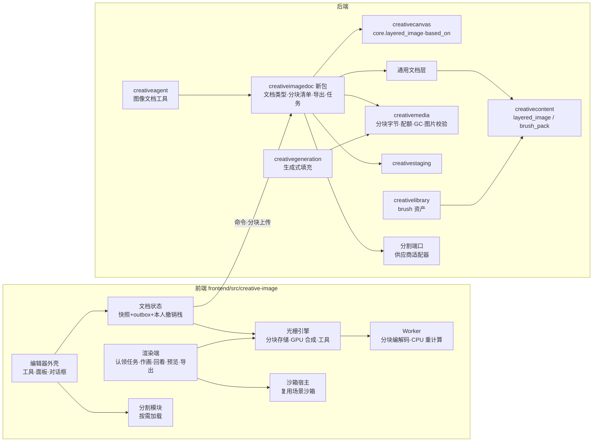

# Epic 技术方案：创意空间的分层图像编辑器

## 设计上下文

需求与边界见 `proposal.md`，取舍过程见 `discovery/brainstorm.md`，选型证据见 `discovery/research/editor-and-ai-options.md`。采用方案一句话概括：

> 图像文档是一份**图层树 JSON**，按单元做版本控制；图层像素切成**按内容寻址的不可变分块**，文档只引用分块清单。合成、编辑、预览和导出都在**浏览器**里经同一条 GPU 合成管线完成；服务端只校验结构、保存分块，并经**客户端任务**把需要像素的助手工作派给页面。

方案沿用现有模式：
- **通用文档底座**（`architecture: 通用文档底座`、`patterns: 文档类型端口`）：修订、单元并发、恢复、回收站、画布接入。图像文档注册为其中一种类型。
- **3D 场景**（`architecture: 场景模块`）：全屏编辑视图、outbox 静默保存、本人撤销栈、客户端任务与渲染端、导出落成画布图片节点并记录 `based_on`、画布页按需加载引擎。
- **客户端代码沙箱**（`patterns: 客户端代码沙箱`）：助手的绘画代码在其中执行。
- **资产库加类型**（`data: 模型资产`）：画笔包照此加入。
- **生成链路与积分**：生成式填充沿用。

本文区分三类内容：**采用方案**（正文）、**待验证假设**（标「假设」，多数由 I0 验证）、**后续增强**（标「后续」）。I0 的结论经 Epic 修订回填本文和 `contracts.md`，I1 开工前批准。

## 领域模型与业务规则

### 术语

| 术语 | 定义 | 不是 | 代码 / API 写法 |
|---|---|---|---|
| 图像文档 | 一份分层图像工程：画布尺寸、图层树、路径。画布上用图像文档节点表示 | 不是图片内容，也不是 PSD 文件 | 文档 `type_key = "layered_image"`；节点 `core.layered_image`；内容类型 `layered_image` |
| 图层 | 图层树里有稳定 ID 的一项：像素图层、图层组、调整图层、文字图层 | 不是 GPU 纹理 | `layer`，ID 形如 `lyr_<21位nanoid>` |
| 像素分块 | 一个图层（或蒙版）在固定网格上的一块像素，按内容哈希寻址，写入后不变 | 不是整张图片，也不是图片内容修订 | `tile` |
| 分块清单 | 一个图层的像素或蒙版由哪些分块组成：偏移、范围、分块坐标到哈希的映射 | 不含像素本身 | `tile manifest` |
| 选区 | 编辑器会话里的当前选择范围（8 位灰度覆盖度） | 不存进文档；存储选区是后续 | — |
| 预览图 | 文档当前合成结果的缩小图，用于画布节点显示和助手读取 | 不是导出图，不进单元版本 | `preview` |
| 导出图 | 文档在某个修订按某组参数合成出的整图，落成画布图片节点 | 导出后是独立的图片内容 | `export` |
| 画笔 | 笔尖 + 间距 + 动态的定义 | 不存进文档 | `brush` |
| 画笔包 | 资产库里的一份画笔集合，通常由一个 `.abr` 导入 | 不是单支画笔 | 资产类型 `brush`；内容类型 `brush_pack` |
| 绘画代码 | 助手写的 JS，在沙箱里执行，输出绘制指令 | 不直接产出像素 | `paint program` |
| 绘制指令 | 笔触、填充、渐变、路径等结构化描述，由编辑器的画笔引擎渲染 | 不是像素 | `draw ops` |
| 渲染端 | 当前认领客户端任务的创意空间标签页（打开的编辑器，或按需加载光栅引擎的画布页） | 同场景的渲染端 | `render host` |

术语加入 glossary 的时机：I1 归档时随 `architecture: 图像文档模块` 一起合入项目契约。

### 不变量

- **I1 只引用不可变像素**：
  - 分块按「账号 + 内容哈希」寻址，写入后不变。
  - 文档快照只通过分块清单引用分块。
  - 每个文档修订引用的分块都登记为 GC 持有方，历史修订可读、可恢复。
- **I2 浏览器是唯一的合成执行者**：服务端不合成图层、不执行绘画代码、不解析 ABR。服务端只校验结构：快照 schema、分块清单、分块编码，以及导出图、预览图、画笔笔尖作为普通图片的校验。
- **I3 显示即导出**：
  - 视口、预览图、助手回看和导出走同一条合成管线。
  - 同一快照、同一参数，两次导出逐像素相同。
  - 随机量（溶解、添加杂色）按文档坐标哈希生成，不用时间或帧号。
- **I4 单元版本，只撤销自己的**：
  - 沿用通用文档底座的单元并发；像素按单元控制并发，每个图层的像素和蒙版各是一个单元。
  - Cmd+Z 只撤销摄影师本人的操作（owner 2026-10-16 的协同撤销原则）。
- **I5 内容归属**：资产库与文档之间只复制（owner 2026-10-07）。
  - 置入资产库图片：把像素复制进分块。
  - 画笔资产不被文档引用：选用画笔只是读进工具设置；助手作画的图层记录所用画笔定义的副本。
  - 资产库不记录资产被哪个文档用过。
- **I6 导出图独立**：导出图是普通图片内容，由画布节点持有；文档修改不会改变它，只记录来源，用于提示过时。
- **I7 账号隔离**：新表都带 `account_id`，查询由 repository 基座限定账号范围（ADR-001）。哈希相同的分块在不同账号下是不同对象，不跨账号去重。沙箱拿不到任何凭证。
- **I8 尺寸上限**：文档长边 ≤ 12000，总像素 ≤ 8192²（约 67MP），与媒体上限一致（`backend/internal/creativemedia/config.go`）。图层数上限由 I0 定。

### 聚合与一致性边界

| 聚合 | 一致性边界 | 写入者 |
|---|---|---|
| 图像文档 | 一行 `creative_documents` 的行锁内完成：版本检查 → 应用 → 写新快照修订、修订行、引用行（通用文档底座） | 摄影师（编辑器命令）、助手（工具经同一命令层） |
| 像素分块 | 不可变，只追加；按（账号, 哈希）唯一。提交引用它的命令前必须已存在且校验通过 | 编辑器上传；服务端校验 |
| 客户端任务 | 一行任务记录的状态机，沿用场景的设计；I5 推广到图像文档 | 服务端创建；渲染端认领和完成 |
| 画笔包资产 | 资产行 + 不可变的画笔包内容修订 | 导入；存入时复制 |

图像文档和画布是两个聚合：新建时文档和节点在同一个画布命令事务里创建（`api: 画布新建与放回文档节点`），之后节点只持有 `document_id`。导出时，画布节点经画布命令层写入，文档只读不写。

### 图层模型（与 PSD 对齐）

以下是共享语义。字段级定义在 I0 之后写进 `data: 图像文档`。

- **文档**：
  - 宽、高（像素）；分辨率（ppi，只作元数据）；工作空间固定为 8 位 sRGB。
  - 不设 Photoshop 那种特殊的「背景图层」（不能透明、不能移动）。从图片打开时，底层是普通像素图层，带位置锁定。理由：背景图层的限制是历史包袱，以后做 PSD 导入时可以映射成「位置锁定的像素图层」。
- **图层通用属性**（取值与 PSD 一致）：
  - 名称、显示、颜色标记。
  - 不透明度与填充不透明度（填充只影响像素内容，不影响图层样式）。
  - 混合模式：组有「穿透」，另有 Photoshop 的 27 种：正常、溶解、变暗、正片叠底、颜色加深、线性加深、深色、变亮、滤色、颜色减淡、线性减淡（添加）、浅色、叠加、柔光、强光、亮光、线性光、点光、实色混合、差值、排除、减去、划分、色相、饱和度、颜色、明度。
  - 剪贴：剪贴到下方最近的非剪贴图层（基底）。
  - 锁定：透明度、像素、位置、全部。
  - 图层蒙版：像素蒙版，带启用、浓度、羽化、默认色。
  - 图层样式（I13）。
  - 混合颜色带（I13）：
    - 结构：「本图层」和「下一图层」两组范围，每组分灰色、红、绿、蓝四个通道。每个通道有黑、白两端，每端可以拆成两个值，形成平滑过渡。
    - 结果：按本图层像素值与下方合成结果的值算出一个保留比例，乘进本图层的有效不透明度。
    - PSD 的图层记录里原生就有这组数据（blending ranges），以后可以直接映射。
- **像素图层**：偏移 + 像素（分块清单）。像素可以超出画布范围，与 PS 一致；裁切画布时由「删除裁剪的像素」决定是否丢弃。
- **图层组**：子图层；默认穿透；有不透明度和蒙版。
- **调整图层**：类型 + 参数，作用于它下方的合成结果（剪贴时只作用于基底）。各类型的参数在 I4 定义。
- **文字图层**：文字内容与排版属性，渲染结果参与合成，可以栅格化（I12）。
- **路径**：文档级的命名路径列表（I6）。
- **单元**（假设，I0 后定稿）：`meta`（标题）、`canvas`（尺寸与分辨率）、`layers`（集合单元：图层树结构与顺序）、`layer:<id>`（属性与参数）、`layer:<id>:pixels`、`layer:<id>:mask`、`paths`。理由：助手调曲线和摄影师在另一个图层上画画互不冲突。

## 架构设计

### 模块职责与依赖方向

**后端 `backend/internal/creativeimagedoc`（新包）**：
- 职责：
  - 图像文档类型：经文档类型端口注册 `layered_image` ↔ `core.layered_image`；快照 schema 校验、单元、命令应用、恢复。
  - 分块清单校验：引用的分块存在、属于本账号、已通过校验，清单不越界。
  - 导出编排：新节点或写回原节点。
  - 预览图。
  - 客户端任务（I5 起）。
  - 助手工具的领域入口。
- 不职责：合成、渲染、执行绘画代码、解析 ABR、画布布局规则（调画布命令层完成）。
- 依赖方向：
  - `creativeagent` → `creativeimagedoc` → 通用文档层 / `creativecontent` / `creativemedia` / `creativestaging` / `creativecanvas`（命令层）/ `platform/store` / `platform/realtime`。
  - 不 import gin，`gin.Context` 不下穿（ADR-003）。
  - 画布读取导出图节点的过时状态时，`creativecanvas` 经自己定义的端口询问（推广场景已有的端口，进程启动时注册实现），不反向 import。
  - 和已有的 `creativeimageedit`（图片节点的裁切、压缩，服务端 libvips）互不依赖，两者服务不同对象。
- **分块的字节、配额和 GC 归 `creativemedia`**，与 `creativeimageedit` 的分工相同；`creativeimagedoc` 只管清单和引用。
- **选择主体**（I10）：领域端口在 `creativeimagedoc` 里定义（「图 → 全尺寸蒙版」），供应商适配器放在 `platform/` 下，凭证只经环境变量注入（硬规则 4）。
- **画笔包**（I3）：资产归 `creativelibrary`，内容归 `creativecontent`，笔尖图片由 `creativemedia` 校验。

**前端 `frontend/src/creative-image/`（新目录）**：
- **编辑器外壳**（React）：工具栏、选项栏，图层、调整、路径、历史、画笔面板，各种对话框；嵌入画布的同一个助手面板。交互按 Photoshop 惯例（键位、工具行为、修饰键）。
- **文档状态**：快照 + outbox + 本人撤销栈，写法沿用场景。
- **光栅引擎**：
  - 组成：分块存储（内存与本地缓存）、GPU 合成器、各种工具。
  - 与 React 解耦：界面只经命令和视图状态访问引擎（参照 PhotoCraft「引擎优先、界面可换」的分层）。这样渲染端在没有界面的画布页上也能运行。
- **Worker**：分块编解码、导出编码，以及 CPU 上的重计算（修复、液化重采样等）。
- **渲染端**（I5）：认领客户端任务；画布页在认领到任务时按需加载，没有任务的画布页不加载光栅引擎（同场景）。
- **沙箱宿主**：复用 `patterns: 客户端代码沙箱` 的沙箱页面，新增绘画编译入口（I5）。
- **分割模块**（I10）：打开智能选区时才加载模型；模型文件放在自己的对象存储或 CDN 上，因为中国大陆访问不了 Hugging Face。

### 关键数据流

- **像素编辑**：
  1. 工具在本地分块上应用改动，记录脏分块。
  2. Worker 编码脏分块、算哈希，上传服务端没有的分块。
  3. outbox 提交「设置图层像素」命令（新清单），产生文档新修订。
  4. 账号失效通知，其他标签页按单元重读，按哈希拉取缺少的分块。
- **参数编辑**（属性、调整、文字、路径）：outbox 直接提交命令，不涉及分块。
- **预览图**：保存后空闲时，编辑器渲染预览图，暂存上传后写入文档（不推进单元修订号）。画布节点显示它。
- **导出**：
  1. 编辑器按导出参数分块渲染整图、编码、暂存上传。
  2. 导出接口经画布命令层新建图片节点，或给原节点加版本，写入来源记录。
- **助手**：
  - 参数化操作直接走命令层。
  - 需要像素的操作（作画、回看、按智能选区建蒙版、刷新预览）经客户端任务派给渲染端，结果经暂存上传和命令写回。
- **从图片节点打开**：
  1. 画布命令新建文档节点（放在原节点旁），记下来源节点和内容修订。
  2. 编辑器解码原图（方向校正、转 sRGB，规则同 `creativeimageedit` 的 `image-edit-v1`）、切块上传。
  3. 提交命令建底层图层。

## 技术选型

| 方面 | 采用 | 理由 | 边界与备选 |
|---|---|---|---|
| 编辑器整体 | 自研外壳 + 自研光栅引擎 + 构件库 | 现成编辑器不能嵌入：Photopea 闭源；PhotoCraft 太新、alpha、界面是 egui、自带文档模型；photobaer 是 AGPL（research §2、§5） | I0 对照组（PhotoCraft 引擎编译成 WASM + 我们的界面）明显更好时重议 |
| 界面 | React 19 + v6 的 token 与组件 | 与创意空间一致：暗房风格、白色主操作色 | — |
| GPU | WebGPU。着色写法二选一，由 I0 定：TSL（含 compute），或直接写 WGSL compute | 场景已用 WebGPU；分块合成、大半径模糊、液化位移场都适合 compute | 选 TSL 就与场景共用渲染器创建入口和 `patterns: 场景着色写法`；选 WGSL 就新增图像编辑器自己的着色模式契约，并调整静态检查范围。WebGL2 兜底见未决事项 3 |
| CPU 重计算 | Web Worker；纯 TS 或 Rust 编译成 WASM，按算法由 I0 / 对应子项定 | 修复、编码等不适合放主线程 | 引入 Rust 工具链要先经 owner 同意 |
| 算法来源 | PhotoCraft（Apache-2.0）的 clean-room 实现与论文：ARAP（Igarashi 2005）、PatchMatch、泊松融合、导向滤波 | 许可宽松，覆盖液化、操控变形、修复、混合模式、图层样式 | 移植的文件在文件头注明上游、版本和许可，NOTICE 汇总 |
| ABR 解析 | `ag-psd` 31.x（MIT）的 `readAbr` | 维护活跃（2026-10-07 更新）；以后做 PSD 读写也用它 | ABR 没有公开规范，靠逆向；不支持的属性在导入时列出 |
| 浏览器端分割 | onnxruntime-web（MIT）或 transformers.js（Apache-2.0）+ SAM 2.1 / SlimSAM（Apache-2.0） | 许可可商用，有 WebGPU 示例 | 模型文件自托管；具体模型和量化在 I10 定 |
| 选择主体 | 服务端供应商端口；首个适配器是阿里云视觉智能「通用高清分割」 | 全尺寸（边长 < 10000）四通道输出，通用分割约 ¥0.002/次 | 平台文档已停止维护，所以端口要能换供应商。备选：fal.ai 上的 BiRefNet / SAM，或以后自托管 BiRefNet / BEN2（MIT） |
| 生成式填充 | 现有生成链路（gpt-image-2.5）与积分规则 | 不新增供应商和计费 | 带蒙版编辑的支持待验证（未决事项 8） |
| 绘画代码 | 现有客户端代码沙箱 | 已有安全样例集 | 新增编译入口和绘制指令校验 |
| 存储 | PostgreSQL + 现有对象存储驱动（OSS） | 沿用 | — |
| 明确排除 | Photopea、photobaer（AGPL）、RMBG-2.0（CC BY-NC）、@imgly/background-removal（AGPL）、Canvas2D 合成 | 许可或能力不满足（research §2、§4） | SAM 3 是 Meta 自定义许可，用之前需要法务确认 |

## 关键机制

### 像素分块与保存

**采用**：
- 每个图层的像素和蒙版切成固定网格的分块；全透明（蒙版为默认色）的分块不存。
- 分块按「账号 + 内容哈希」寻址，写入后不变。同一内容在同一账号下只存一份，历史修订之间、复制的图层之间自动去重。
- 像素单元的值是分块清单。画一笔只会替换受影响分块的哈希，历史的成本只和改动面积成正比。
- 填满 50% 灰的中性色图层，所有分块内容相同，按哈希去重后只存一份。新建中性色图层几乎不占存储，也不用上传整层。
- 本地先改，结束一步操作（一笔、一次滤镜或变形）后批量提交；连续快速的笔触合并成一次提交。先上传分块，分块齐了再提交命令。
- 编码必须精确无损，不经过 Canvas2D。原因：Canvas2D 存的是预乘 alpha，低透明度像素的颜色会丢精度。
- 服务端在提交时确认清单里每个分块都存在、属于本账号、已通过校验；校验是对解码后尺寸和格式的结构检查。

**假设（I0 定）**：
- 分块尺寸：256 或 512。
- 编码：例如原始 RGBA 加 deflate，或自编码的无损 PNG / WebP。
- 上传途径：经服务端，还是直传对象存储。
- 批量协议，以及「查询缺失分块」的形式。
- 提交节奏。
- 是否需要本地工作副本（OPFS），防止崩溃丢掉未提交的改动。
- 分块校验是同步做还是由 worker 异步做。
- 分块计入账号存储额度的方式。

### 合成管线

- 一条管线服务视口、预览、助手回看和导出（I3）。按图层树求值：
  - 穿透组与隔离组；
  - 剪贴组；
  - 图层蒙版；
  - 调整图层作用于下方的合成结果；
  - 混合颜色带：它要同时读本图层的值和下方合成结果的值，所以要在与下方结果混合之前算出保留比例；
  - 图层样式。
- 混合在 sRGB 编码值上计算，与 Photoshop 8 位 RGB 的默认一致。中间结果用浮点，写回 8 位时统一取整。和参考图的误差阈值由 I0 定。
- 只把视口内的分块按缩放级别（mip）放进显存，不把整层放成一张纹理（WebGPU 默认纹理边长上限是 8192，60MP 一层 RGBA8 约 241 MB）。
- 编辑某个图层时，缓存它下方和上方的合成结果，画笔只重算受影响的分块（假设，I0 验证）。
- 导出整图同样按分块渲染再拼接。

### 撤销与协同

- **本人撤销栈**：记录每一步的「单元 → 前后值」。
  - 像素单元的前后值是两份分块清单，撤销只是把清单换回去，分块本身不变。
  - 要撤销的单元已被助手推进时，跳过这一步并提示（协同撤销原则）。
- **冲突**：
  - 命令带期望的单元修订号（通用文档底座）。参数单元冲突时，重读该单元，再重放本地还没提交的改动。
  - 像素单元不做像素级合并。冲突时以服务端为准，本地还没提交的笔触另存为一个新图层「未合并的改动」，不静默丢掉任何一方的改动（假设，I1 定稿）。
  - 助手正在处理的图层加高亮和软提示，减少冲突（同场景 C3）。
- **历史版本列表**（分组、只读预览、恢复为新版本）和「本轮改了 N 处」清单的「恢复这一处」可以明确回退任何人的改动（同场景）。

### 预览图与画布节点

- 画布节点显示文档的预览图（长边约 2048，I1 定），由编辑器在保存后空闲时渲染、暂存上传。预览图不推进单元修订号。
- 文档在编辑器没打开时被助手修改，预览图由渲染端经客户端任务刷新（I5）。刷新完成前，节点显示旧预览，并标明「预览更新中」。
- 节点没有输出端口；要作为生成输入，先导出（owner 选定的产物形态）。
- 助手读文档时可以拿到预览图（模型能看图、摄影师允许图片预览时），规则与 `read_asset` 相同。

### 导出与过时

- **参数**：格式（PNG / JPEG / WebP）、质量；尺寸等于文档尺寸（缩放导出是后续）。
- **目标**：
  - 新图片节点，放在文档节点旁。
  - 写回来源图片节点作为新版本：只在文档是从该节点打开、且节点还在时可选。写回可以撤销，沿用图片节点的版本机制。
- **来源记录**：推广 `data: 导出图来源`，`based_on` 增加图像文档来源：文档 ID、修订、导出参数、内容修订、指纹。
  - 指纹对快照里影响合成的内容计算：图层树、属性、清单哈希、导出参数。改回原样不算过时。
  - 写回原节点时，来源记录指向图像文档；节点切回旧版本时，来源不生效（沿用「当前内容不是 `content_revision_id` 时不生效」）。
- **上限**：导出图仍是普通图片内容，受媒体上限约束（单张 25 MB，像素 ≤ 8192²）。60MP 的 PNG 很可能超过 25 MB，方案见未决事项 6。超限时明确失败，不悄悄降低分辨率或质量。

### 画笔与画笔包

- **内置画笔**：前端自带、带版本的预设。已发布的预设效果不变，要改就发布新版本（同材质预设的规则）。
- **画笔定义**：
  - 笔尖：计算笔尖（直径、硬度、圆度、角度），或采样笔尖（灰度图）。
  - 间距。
  - 动态：压感控制大小和不透明度；抖动、散布等支持到哪一步在 I3 定。
- **`.abr` 导入**：
  1. 浏览器用 ag-psd 解析，规范化成我们的画笔定义。
  2. 上传原文件、笔尖图和清单。
  3. 服务端把清单按不可信 JSON 校验，把笔尖按图片校验。
  4. 新建 `brush` 类型资产，主体是画笔包内容。

  服务端不解析 ABR（同场景的 GLB：前端产出、服务端校验结构）。不支持的属性在导入结果里列出。
- **选用**：编辑器画笔面板列出内置画笔和资产库里的画笔包。选用就是把画笔定义读进工具设置，文档不引用资产（I5）。
- **资产库**：画笔包和其他资产一样可以分组、打标签、评分、进回收站；不能放到画布上（同模型）。卡片显示前端渲染的笔触样例。

### 智能选区

- **交互分割（点 / 框）**：浏览器端。编码器在缩小图上跑一次，解码器随每次点击实时出蒙版，再放大到全尺寸。
- **选择主体**：
  1. 编辑器上传当前合成或当前图层。
  2. 服务端经供应商端口请求分割，拿到全尺寸蒙版，交回编辑器变成选区。
  3. 供应商适配器只负责「图 → 蒙版」。
- **边缘细化**：在全分辨率上，对蒙版的边缘带做导向滤波（GPU）；半径、平滑、羽化、移动边缘可调。
- **计费**：不扣积分。按账号限频，防止滥用（只做低成本校验）。
- **结果**：智能选区只产出选区，由摄影师决定建蒙版、复制图层还是填充。

### 生成式填充

- **输入**：选区（羽化后的蒙版）、提示词、参考范围（选区外扩一圈的合成图）。
- **计费**：走现有生成链路和积分规则（提交即扣、失败退回、成功不退）；生成结果照常进入「生成记录」。
- **结果**：新像素图层，蒙版是选区；多张候选可以切换（同 PS 的变体）。
- **蒙版支持**：现有供应商（aicodewith 上的 gpt-image-2.5）能否带蒙版编辑，I11 开工前验证。不支持时退回到「整图参考 + 生成后按蒙版合成」，接缝质量由 owner 判断（未决事项 8）。

### 助手与代码作画

- **工具**（I5 起，名称在 I5 定）：读取文档（图层树、属性、预览图）、编辑文档（参数化命令，与编辑器同一命令层）、作画（提交绘画代码）、回看（渲染指定范围）、导出。后续子项各自扩展。
- **需要像素的操作**（作画、回看、按智能选区建蒙版、刷新预览）经客户端任务派给渲染端：
  - 编辑器打开时由编辑器执行；
  - 否则由画布页按需加载光栅引擎执行；
  - 页面全部关闭时这类工具不能执行，运行停在当前步骤，重开后继续（同场景）。
- **绘画代码**：
  - **执行**：在客户端代码沙箱里执行（隔离 iframe、禁网、硬超时、每次新建 Worker），新增「绘画」编译入口。
  - **输入**：画布尺寸、参数、可用画笔的描述、一套绘制 API。
  - **输出**：绘制指令列表：
    - 笔触：点序列与每点的压力 / 倾斜，以及画笔、颜色、大小、不透明度、流量；
    - 填充与渐变；
    - 钢笔路径（I6 起）。
  - **宿主校验**：逐条检查结构、数量、坐标范围、总量上限，通过后再交给画笔引擎，画在新图层或指定图层上。
  - **结果**：图层记录代码、参数和所用画笔定义的副本，可以「调参数重画」。重画产生新像素，旧像素留在历史里。
  - **理由**：助手的笔触与手绘效果一致，能用画笔资产；回传的数据小，好校验；可以重放；与场景模型「代码 + 参数」对称。逐像素生成的内容（程序化纹理）是后续。
- **协同**：本轮改动清单、「恢复这一处」、变化摘要、按 `run_id` 撤回自己的修订，都沿用场景 C3 的做法。

### 编辑器交互约定

- **基准**：Photoshop 2026 的默认键位、工具行为、修饰键和对话框结构；macOS 上 Ctrl 对应 Cmd。不为新手另加兜底（受众含专业创作者）。
- **对照表**：I1 建立「快捷键与交互对照表」，列出已交付工具的键位、修饰键行为和对话框。后续每个子项把自己的工具和对话框补进去。偏离 Photoshop 的地方逐条写明理由。表放在子项 design 中，I1 归档时随架构契约一起沉淀到项目文档。
- **示例**（I1 起）：
  - 新建图层对话框：`Ctrl+Shift+N`，或按住 Alt 点新建图层按钮。
  - 直接新建图层：`Ctrl+Alt+Shift+N`。
  - 复制图层 `Ctrl+J`；创建剪贴蒙版 `Ctrl+Alt+G`；画笔大小 `[` `]`；默认前景/背景色 `D`，交换 `X`；抓手 `Space`；吸管 `Alt`；工具字母键沿用 Photoshop。
- **新建图层对话框**：
  - 字段：名称、使用前一图层创建剪贴蒙版（I2 起）、颜色标记、模式、不透明度。
  - 所选模式有中性色时，出现「填充 <模式> 中性色」复选框：
    - 叠加、柔光、强光、亮光、线性光、点光：50% 灰；
    - 正片叠底一类：白；
    - 滤色一类：黑。
  - 各模式的中性色和复选框的显示规则，在 I1 design 里逐一对照 Photoshop 核实。
  - 勾选后，新图层填满中性色，画面不变。
- **浏览器保留的组合键**：
  - 问题：`Ctrl/Cmd+N`、`Ctrl/Cmd+Shift+N`（无痕窗口）、`Ctrl/Cmd+T`、`Ctrl/Cmd+W` 等组合在 Chrome 和 Safari 的普通标签页里由浏览器处理，页面拿不到。
  - Photopea 的做法：把自由变换改成 `Alt+Ctrl+T`，并建议「安装为应用」来消除冲突（research 来源见未决事项 13）。
  - 采用：
    1. 键位表按 Photoshop 原样定义。
    2. 能拿到原组合键的环境里直接生效：安装成应用后的窗口；浏览器全屏 + Keyboard Lock API（Chromium）。
    3. 普通标签页里，为每个被保留的组合提供替代：Photoshop 自身的替代操作（如 Alt 点新建图层按钮），或加 Alt 的组合，并在菜单和提示里同时显示。
  - 具体哪些组合在哪些环境里能拿到，由 I0 实测（未决事项 13）。

### 设备与浏览器

- 桌面 Chrome / Edge / Safari 最新版，同场景。不做手机端。
- 画笔的压感和倾斜用 Pointer Events。
- 编辑器是否必须 WebGPU，由 I0 定（未决事项 3）。如果必须，不支持的浏览器上打不开编辑器，但预览图和导出图照常可以看。

## 接口设计

- **沿用**通用文档底座的端点：读取、提交命令、修订列表、旧修订、回收站、画布新建。
- **I0 之后修订补齐**：分块上传与缺失查询、图像文档命令（类型操作）、导出、预览图。
- **后续子项开工前各自加入**：画笔包导入、选择主体、生成式填充、助手工具、客户端任务通用化。
- OpenAPI 变更后运行 `make generate`，提交 Go 和 TS 两份生成物。

## 数据与存储设计

- **新增内容类型**：`layered_image`（文档快照）；`brush_pack`（I3）。扩展 `creative_contents` 的 kind CHECK。
- **新增像素分块存储**：对象存储里的分块字节，加一张登记表（账号、哈希、尺寸、编码、校验状态）。
  - 持有：文档修订 → 快照 → 清单 → 分块，经 `creativereference` 判定，没有持有方的分块由媒体 GC 回收。
  - 归属：字节、配额、GC 归 `creativemedia`。
- **资产**：`creative_assets.kind` 加 `brush`（I3）。
- **导出图来源**：`data: 导出图来源` 从场景专用推广到图像文档（I1）。
- **回滚**：已有图像文档或画笔包数据时拒绝回滚，前向修复（沿用场景）。
- **后续**：修订和分块只增不减，保留与清理规则参照场景 C7，到做的时候再定。

## 验证与交付

- **I0 建立基准**，存进 evidence：
  - 参考设备；
  - 基准文档：60MP 人像原片 + 场景导出图，10–20 层；
  - Photoshop 参考图集：27 种混合模式、混合颜色带、首批调整、加深 / 减淡的三种范围，需要 owner 用 Photoshop 出图。

  性能目标经修订写入本节。
- **一致性**：在参考图集上逐像素比较，阈值由 I0 定；对应子项定向运行。
- **确定性**：同一快照两次导出逐像素相同。
- **安全**：绘画代码沿用沙箱安全样例集，新增几类样例：绘制指令超量、坐标越界、结构畸形。
- **许可**：
  - 移植代码在文件头注明来源和许可，NOTICE 汇总。
  - 新依赖要确认许可，不引入 GPL / AGPL / 非商用许可。
- **门禁**：按影响面选择（AGENTS.md「验证范式」），只跑定向测试。

## 未决事项

| # | 问题 / 假设 | 影响 | 解决方式 | 最晚解决时点 |
|---|---|---|---|---|
| 1 | 像素分块与保存的参数：分块尺寸、编码、上传途径、批量协议、提交节奏、本地工作副本、校验时机；以及据此写成的契约：`data: 图像文档`、`data: 像素分块`、`api: 图像文档命令`、`api: 上传像素分块`、`api: 导出图像文档`、`data: 导出图来源` 的推广 | I1 及之后全部子项 | I0 实测后经 Epic 修订补齐 | I1 开工前 |
| 2 | 着色写法：TSL（含 compute）还是 WGSL compute；是否与场景共用渲染器创建入口 | I1 的合成器，以及 `patterns` 的适用范围 | I0 比较可行性与性能 | I1 开工前 |
| 3 | 编辑器是否必须 WebGPU，WebGL2 兜底能否支撑 | 能打开编辑器的设备范围 | I0 实测；如果必须 WebGPU，告知 owner 后写入设计 | I1 开工前 |
| 4 | 参考设备、基准文档、性能目标、图层数上限、一致性阈值 | AC-3、AC-10 | I0 | I1 开工前 |
| 5 | 对照组：PhotoCraft 引擎编译成 WASM + 我们的界面 | 选型 | I0 实测；明显更好时向 owner 提出重议 | I1 开工前 |
| 6 | 大图导出与媒体上限（单张 25 MB）冲突：放宽上限、按大小自动选格式，还是限制规格 | I1 的导出、存储成本 | I0 测量各格式的文件大小，owner 选方案 | I1 开工前 |
| 7 | 客户端任务和过时端口从场景推广到通用文档，契约归属与 `scene-editor-3d` 协调 | I1（过时端口）、I5（任务） | 修订本 Epic，必要时修订 `scene-editor-3d` | I1 / I5 开工前 |
| 8 | gpt-image-2.5 经现有供应商能否带蒙版编辑；不能时的退回效果 | I11 | 开工前做一次调用验证 | I11 开工前 |
| 9 | 文字图层的字体：平台内置一组可商用开源字体，还是允许上传字体作为资产；中文字体的体积与加载 | I12 | owner 决定 | I12 开工前 |
| 10 | 选择主体的供应商：阿里云高清分割的单价与长期可用性；备选供应商；浏览器端模型选型与自托管 | I10 | 开工前询价与试用 | I10 开工前 |
| 11 | ABR 动态属性支持到哪一步（抖动、散布、纹理、双重画笔） | I3、AC-6 | I3 设计时按样本 ABR 定，不支持的列出 | I3 开工前 |
| 12 | 是否用 SAM 3（概念文字分割） | 后续增强 | 需要时请法务确认 SAM License 对 SaaS 的适用性 | 不阻塞本 Epic |
| 13 | 浏览器保留的组合键在普通标签页、浏览器全屏 + Keyboard Lock、安装成应用（PWA）三种环境下能否拿到；要不要把创意空间做成可安装的应用 | I1 的快捷键表，以及之后各子项的键位 | I0 实测。是否做成可安装应用会影响整个创意空间，由 owner 决定。参考：Chrome Keyboard Lock 文档 https://developer.chrome.com/docs/capabilities/web-apis/keyboard-lock ；Photopea 的快捷键冲突与安装为应用 https://www.digitec.ch/en/page/photopea-open-and-edit-photoshop-files-in-the-browser-16227 | I1 开工前 |
