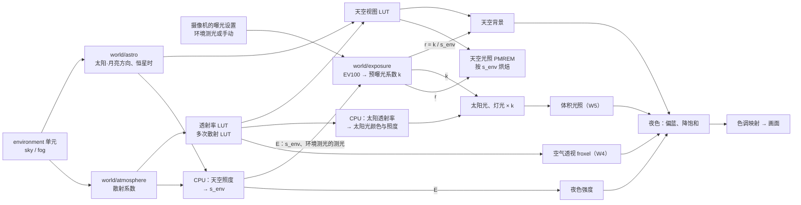

# Epic 技术方案

## 设计上下文

需求、范围和验收见 `proposal.md`，探索过程和取舍依据见 `discovery/brainstorm.md`。

采用方案概要：
- 白模改用固定工作室光，与环境脱钩（W1）。
- 天空新增 `physical` 模式（W2）：
  - 在 CPU 上用天文库算出太阳的方向。
  - 在 GPU 上用 TSL 自写 Hillaire 2020 物理大气，4 张 LUT 都用片元 pass 生成，两个后端共用。
  - 只在物理天空下按真实照度渲染。光源在送进 GPU 之前乘以曝光（预曝光），环境派生数据按环境相对单位存储，让 HDR 缓冲保持在 fp16 的范围内。
  - 曝光由摄像机决定，可选环境测光或手动；新建摄像机和默认摄像机（视口自由视角、临时视点）缺省环境测光：按场景照度测光，叠加夜间压暗曲线，入夜后只比正午暗 2–4 档。手动曝光用 ISO、快门、光圈（修订 v5，取代修订 v2 的「只做手动」）。
  - 物理为底、观感优先（owner 2026-10-23）：光照和天空按物理计算；环境测光的夜间压暗、夜色和夜空增益是观感层，让跨时段的亮度均衡、夜景默认就能看。
  - 太阳的亮度倍率和色温可调，月亮和星空在 W3 同样可调。
- 夜空（W3）、空气透视（W4）、体积物件（W5）都读同一份大气 LUT、天体计算结果和曝光，保证颜色互相一致。

本方案建在已交付的基础上，不复述以下内容：
- `architecture: 场景模块`
- `patterns: 场景着色写法`
- `scene-webgpu-renderer` design：渲染器创建入口、`SceneRenderer`、帧推进与确定性、后端退回规则 G4（后端不改场景）。
- `scene-editor-3d` design：显示模式、导出与过时判断。

区分：
- **采用方案**：正文。
- **待验证假设**：标在「未决事项」，由对应子项开工前的穿刺回答。
- **后续增强**：标在「为远期预留」。

## 领域模型与业务规则

### 概念

| 概念 | 定义 | 边界 |
|---|---|---|
| 世界环境 | 场景的 `environment` 单元：天空、环境光、全局雾，以及物理天空下的夜空与空气透视 | 不含灯光物件和体积物件，它们是对象。不含曝光，曝光属于摄像机 |
| 天空模式 | `sky.kind`：`procedural`（Preetham，现有）、`color`、`hdri`（暂不支持）、`physical`（本 Epic） | 各模式只带自己的字段；切换模式由编辑器整体写入新的 `sky` |
| 物理天空 | `sky.kind = physical`：太阳位置由地点和时间推算或手动指定，天空和光照由物理大气算出，场景按真实照度渲染 | 只影响最终渲染、`lit` 导出和 `render_view` 的 `lit` |
| 太阳模式 | `sky.sun_mode`：`location`（地点、日期、当地时刻、时区和正北方向推算）或 `manual`（直接给高度、方位） | 两套字段在物理天空下都保存，模式只决定用哪一套。从地点切到手动时，编辑器把当前算出的高度和方位写成手动值，画面不跳变；太阳低于 −10° 时高度夹到 −10°，天空会变亮 |
| 场景的正北 | `sky.north_azimuth_deg`：正北方向在文档坐标里的方位，与 `sun_azimuth_deg` 同一约定（0° 指向 +Z，90° 指向 +X） | 缺省 180°，即正北指向 −Z（视图空间 +Y），与 Blender 中「+Y 为北」一致 |
| 大气参数 | 海拔、空气密度、尘埃密度、臭氧密度（与 Blender Nishita 天空同名同义），太阳盘的开关与视直径 | 预设只是参数组合：选预设等于写入这组参数，场景里不存预设名 |
| 太阳的亮度与色温 | 太阳作为光源的亮度倍率和色温：同时作用于太阳光、太阳盘和它照亮的天空 | 缺省（倍率 1、6500 K）即物理计算的结果。只是艺术上的调整，不改大气参数 |
| 物理单位 | 物理天空下的量纲：亮度为 cd/m²；平行光（含太阳）的 `intensity` 为照度 lux，点光和聚光仍为 cd | 程序化天空和纯色天空保持现有标定（`litLook.ts` 的 `SUN_MAX`、`SKY_SHARE`） |
| 曝光 | 把场景亮度换算成画面值的系数。用 EV100 表示，系数 = 1 / (1.2 · 2^EV100) | 只属于观看者：场景摄像机或默认摄像机，各自可选环境测光或手动（修订 v5）。世界环境不做亮度适应，环境测光也不做时间上的渐变 |
| 默认摄像机 | 视口的自由视角和 `render_view` 的临时视点（`viewpoint`）：没有摄像机物件，按 `render` 的曝光设置：缺省环境测光，手动时用默认曝光值 `render.exposure_ev100` | 通过场景摄像机看（相机视图、导出、`render_view` 的 `camera_object_id`）时，用那台摄像机自己的曝光 |
| 夜间压暗 | 环境测光比「测光正常」少补的档数 D，随测光值变暗而增大（0 到 3.5 档，修订 v5） | 只作用于环境测光；手动曝光按真实照度 |
| 夜色 | 入夜后画面整体偏蓝、降饱和的调色（日拍夜的惯例），强度由 `night.night_look` 和场景照度决定（修订 v5） | 属于场景，不属于摄像机：同一场景下各台摄像机一致；只在物理天空的 `lit` 下生效 |
| 夜空 | 月亮、亮星、银河和夜天光 | 只在 `sun_mode = location` 下绘制，需要真实的日期、时刻和地点；手动模式下不画 |
| 空气透视 | 摄像机与表面之间的大气造成的散射与衰减 | 只在物理天空下生效；可开关，距离倍率可调 |
| 全局雾 | 现有的 `environment.fog`（three.js `Fog`） | 长期保留，所有天空模式下都可用 |
| 体积物件 | `kind = volume` 的对象：立方体或球体范围内的均匀介质，有散射和吸收 | 有变换和层级，和其他物件一样能选中、撤销和改挂；在白模和线稿里只显示范围线框 |
| 白模工作室光 | 白模的固定照明 | 不读取 `environment` 的任何字段，也不读灯光物件 |

### 不变量

- **E1 白模与环境无关**（W1）：白模的画面只取决于几何、变换、可见性、摄像机和景深。
- **E2 单一来源**：天空背景、太阳光、天空光照、空气透视和体积光照都取同一组天体方向、同一套大气 LUT 和同一个曝光，不各自近似。夜空同样遵守。
- **E3 文档时间不是墙钟**：天体位置只由文档字段决定，不读当前时间；同一快照的导出结果确定（沿用帧推进与确定性规则）。
- **E4 物理单位只在物理天空下生效**：
  - 切换天空模式不改写灯光、环境光、雾和摄像机的字段，只改变它们的解释方式。
  - 物理天空下，`environment.ambient` 不生效，界面置灰并说明原因。真实世界里没有均匀环境光，天空光已经由大气算出。
  - 摄像机曝光、默认摄像机的曝光设置和夜色只在物理天空下生效；物理天空下 `render.exposure_ev` 不生效。
  - 在其他天空模式下，`render.exposure_ev` 仍是场景曝光补偿，用法与现在相同。
- **E5 三种雾共存**：全局雾、空气透视和体积物件互不替代，按「合成顺序」叠加。
- **E6 一份 TSL**：着色代码同时编译到 WebGPU 和 WebGL2 两个后端。只有经 Epic 修订确认的功能，才能按「只支持 WebGPU 的统一规则」例外。
- **E7 后端不改场景**：沿用 G4。退回 WebGL2 或者能力不足，只影响本机怎么画，不改写场景。
- **E8 物理为底、观感优先**（修订 v5）：光照、天空和照度按物理计算；观感层（环境测光的夜间压暗、夜色、夜空增益）只改变「怎样呈现」，只由场景和摄像机的字段决定，结果确定；需要写实时可以退回物理（手动曝光、`night_look = 0`）。

### 数据所有权与一致性

| 数据 | 单元 | 写入者 | 一致性 |
|---|---|---|---|
| 物理天空、夜空、空气透视 | `environment`（`set_environment` 整体替换） | 环境选项卡、助手 `edit_scene` | 与现有天空相同：单元乐观并发，编辑器的拖动按合并键折叠 |
| 摄像机曝光 | `object:<id>:content`（`update_objects` 的 `camera` 按键合并） | 摄像机属性、助手 | 与现有的摄像机字段相同 |
| 默认摄像机的曝光 | `render`（`set_render` 按键合并），新增 `render.exposure_mode`、`render.exposure_compensation`、`render.exposure_ev100` | 渲染选项卡、助手 | 与现有的渲染字段相同 |
| 体积物件 | `objects` 与 `object:<id>`、`object:<id>:content` | 添加菜单、属性栏、助手 | 与其他对象相同 |

服务端按数据契约校验字段和取值范围（包括时区名有效）。画面上的太阳位置只由渲染端算。服务端另为助手算一份「太阳参考」：当前太阳的高度和方位、日出日落、正午、黄金时刻和蓝调时刻，只出现在助手读写场景的结果里，不存储，不参与渲染和指纹（owner 2026-10-22，修订 v2）。理由：助手要按「傍晚黄金时刻」这类说法选时刻，渲染端的结果它看不到，只能凭经度估再出图试，黄金时刻只有半小时左右，容易错过。W3 起同样给一份「月亮参考」：月亮的高度和方位、月相、月出月落、前后最近的满月和新月（owner 2026-10-22，修订 v4）。理由相同：「满月之夜」「新月看银河」这类说法，助手不知道哪天是满月。

`render_view` 的 `lit` 截图在物理天空下另回报这张图的曝光 `exposure`：由哪台摄像机曝光（场景摄像机或默认摄像机）、环境测光的补偿或手动的 EV100（owner 2026-10-23，修订 v6）。理由：临时视点按默认摄像机曝光，场景摄像机按自己的曝光，手动时两者亮度可能差很多；助手只看截图会误判场景的明暗。只出现在工具结果里，不存储。

## 架构设计

### 模块与职责（增量）

**前端 `frontend/src/creative-scene/`**

| 模块 | 职责 | 不负责 | 子项 |
|---|---|---|---|
| `render/clayLook`（暂名，由现有的 `ClayLighting` 改写） | 白模固定工作室光 | 读取环境 | W1 |
| `render/sceneRenderer.ts` 的输出节点 | 色调映射由 ACES Filmic 改为 AgX；线稿和线框保持原样 | — | W1 |
| `world/astro.ts`（新） | 纯函数：由地点、日期、时刻和时区换算成 UTC，求太阳、月亮的方向（文档坐标，已按正北旋转）、月相和恒星时；手动模式下直接给出太阳方向 | 渲染；读当前时间 | W2（月亮和恒星时在 W3） |
| `world/atmosphere/`（新） | Hillaire 大气：参数转换成散射系数；4 张 LUT 的生成 pass；TSL 采样函数（天空亮度、透射率、空气透视）；在 CPU 上沿单条光线求太阳的透射率（用于光源颜色），以及环境相对单位用的天空照度 | 曝光、天体位置 | W2（空气透视 froxel 在 W4） |
| `world/exposure.ts`（新） | EV100 与预曝光系数：手动按摄像机的 ISO、快门、光圈或默认曝光值；环境测光按场景照度 E 测光，加夜间压暗与补偿（修订 v5）；环境相对单位的系数 s_env | 色调映射本身（沿用渲染管线的输出节点） | W2（环境测光 W3） |
| 夜色（`world/nightLook.ts`，新） | 按场景照度和 `night_look` 求夜色强度；在色调映射之前对画面偏蓝、降饱和的 TSL 节点 | 曝光 | W3（修订 v5） |
| `render/sky.ts` | 现有两种天空加上 `physicalSky`：天空背景网格（沿用跟随摄像机的 `skyMesh`），采样天空视图 LUT 与太阳盘，乘以相对系数 r（见「物理单位与曝光」） | — | W2 |
| `objects/Lighting.tsx` | 新增 `PhysicalLighting`：太阳光（照度 × 透射率 × 预曝光）、天空光照（PMREM 由物理天空生成，节流沿用 200 ms）、全局雾的物理着色 | — | W2 |
| `render/sceneRenderer.ts`（`SceneRenderer`） | 管线里新增两个合成位置：空气透视与体积（见「合成顺序」）；每帧把曝光传给天空、灯光和合成节点 | — | W4、W5 |
| `world/nightSky/`（新） | 月亮的绘制与月光、星表、银河 | — | W3 |
| `objects/Volume.tsx` 与体积渲染（新） | 体积物件的显示（线框）与光照（逐像素光线步进，见「体积物件（W5）」）；`cast_shadow` 的体积在太阳、聚光、点光的阴影节点上乘以透射率（太阳沿用 `render/sunShadow.ts` 的 `SunCascades`，聚光和点光各包一层阴影节点）（修订 v8） | — | W5 |
| `panels/EnvironmentPanel.tsx`、摄像机属性、渲染选项卡 | 物理天空的编辑界面（城市搜索、日期、时刻滑杆、正北、大气参数与预设、太阳的亮度与色温）、摄像机曝光（环境测光或手动、补偿）、默认摄像机的曝光 | — | W2 起，逐项扩展 |
| 城市数据（新，构建时生成的静态 JSON，按需加载） | 城市名（简体中文、英文或拼音，繁体与简体不同时才带）、经纬度、IANA 时区、国家代码（同名城市的消歧显示）；行按人口降序排列，人口不入包 | — | W2 |

**后端 `backend/internal/creativescene`**
- 解码与校验新字段，读取时补齐缺省值（沿用修订 v8 的做法）。
- 渲染指纹：见「渲染指纹」。
- 用 `time.LoadLocation` 校验时区名，并要求写法与时区数据里的名字完全一致（区分大小写）：macOS 的文件系统不区分大小写，`asia/shanghai` 在开发机上能加载，Linux 生产会拒绝。`loc.String()` 只回显传入的名字，比较它拦不住，具体做法见 W2 design「校验」。二进制里嵌入 `time/tzdata`，不依赖服务器上的时区文件。

- 太阳参考：移植 NOAA 的太阳公式（W2 调研的 `noaa-solar.mjs`），纯函数，无外部依赖。月亮参考（W3）：移植 Meeus《天文算法》第 47 章（月亮位置，主要周期项）和第 49 章（月相时刻），同样无外部依赖；与前端 `astronomy-engine` 用同一组日期对照测试。`read_scene` 的结果和写入了环境的 `edit_scene` 结果带上它。前端的 `astronomy-engine` 与 NOAA 相差不到 0.02°、日出日落差约 3 秒，两边用同一组 NOAA 数据点测试，助手看到的时刻与画面一致。

**后端 `backend/internal/creativeagent`**：更新 `edit_scene` / `read_scene` 的工具说明，内容包括新字段、预设参数表、单位约定和太阳参考的用法。

**`api/openapi.yaml`**：随数据契约加字段，运行 `make generate`。

依赖方向不变：
- 新的前端模块都在渲染端内部；`world/*` 不依赖编辑器外壳，画布页按需加载渲染端时同样可用。
- 后端没有新的包依赖。

### 每帧的数据流



### 何时重算

| 内容 | 依赖 | 重算时机 |
|---|---|---|
| 透射率 LUT、多次散射 LUT | 大气参数 | 大气参数改变时 |
| 天空视图 LUT | 大气参数、太阳（和月亮）方向、海拔 | 环境改变时（拖时刻滑杆时每次提交都会触发） |
| 天空光照 PMREM | 天空视图（环境相对单位，与曝光无关） | 环境改变时，最多每 200 ms 一次（沿用现有节流）；导出和 `render_view` 出图前保证是最新的 |
| 空气透视 froxel | 透射率 LUT、天空视图、摄像机 | 摄像机或环境改变时（W4 决定是每帧重算还是按需） |
| 曝光 k | 摄像机或默认摄像机的曝光设置；环境测光另依赖 E | 每次出图前 |
| 夜色强度 | E、`night_look` | 环境改变时，与 s_env 一起 |
| s_env | 环境 | 环境改变时，与天空视图 LUT 一起 |

### 失败与恢复

- **设备丢失**：渲染目标随设备一起丢失。LUT 和 PMREM 由创建它们的组件在渲染端恢复后重建，沿用 R1 的设备恢复流程。离屏任务回队重认领，规则不变。
- **WebGL2 后端**：用同一份 TSL。三张 LUT 都是 RGBA16F，两个后端相同（W2 穿刺，`scene-physical-sky` 的 `discovery/research/atmosphere-luts.md`）。
- **fp16 溢出**：超出 65 504 的写入在 Metal 上被饱和，在 SwiftShader 上成为 Inf，再经 AgX 变成 NaN（W2 穿刺，`exposure.md`）。所以材质的输出统一钳到 60 000（「物理单位与曝光」），不依赖驱动的行为。
- **时区名在本机浏览器中不可用**（极少见）：按经度推出平太阳时，偏移为 round(经度 / 15) 小时，并在环境选项卡里提示，不改场景（E7）。服务端已经校验过时区名，这只会出现在浏览器的时区数据过旧时。

## 技术选型

| 选择 | 采用 | 理由与适用边界 | 不采用 |
|---|---|---|---|
| 物理大气 | Hillaire 2020「A Scalable and Production Ready Sky and Atmosphere Rendering Technique」，用 TSL 自写；LUT 的参数化参照作者公开的 UnrealEngineSkyAtmosphere 示例 | 覆盖多次散射、臭氧、海拔和空气透视，参数改变后 LUT 能在毫秒级重算，适合实时拖动。只要 2D/3D 纹理和片元 pass，两个后端都能运行 | takram `three-atmosphere`：GLSL，不支持 WebGPU 和 TSL，违反着色约定。现有的 WebGPU 移植：WGSL compute，同样违反约定，也不能落到 WebGL2。Bruneton 2008 的 4D 预计算表：改参数要重新预计算，重算慢，体积大。Hosek–Wilkie / Preetham：解析模型，没有晨昏蒙影、海拔和空气透视 |
| LUT 生成 | 全屏片元 pass 写入 `RenderTarget`，透射率、多次散射、天空视图三张都是 RGBA16F；3D 表写入 `RenderTarget3D` 的各层，或拼成 2D 图集（W4 决定） | three 的 WebGL2 后端用 transform feedback 模拟 compute，只能写存储缓冲，不能写存储纹理（three 0.186.1 `WebGLBackend.js:1757`）。多次散射 LUT 原本靠 compute 共享内存归约，改为每个像素自己循环 64 个方向；它只在参数改变时重算。W2 穿刺：fp16 与 fp32 的误差相差不到 0.1%；两个后端出图的平均差不超过 0.47；参考设备上改大气参数 1.2 ms、改时刻 0.3 ms | compute 写存储纹理：只能在 WebGPU 下用 |
| 助手的太阳和月亮参考 | 服务端移植 NOAA 太阳公式和 Meeus 月亮公式，只给助手读 | 太阳与前端同以 NOAA 为准，时刻差在 1 分钟内；月相时刻差在 10 分钟内、月出月落差在 3 分钟内；助手一次选对时刻和日期 | 服务端不算，助手凭经度和季节估计、出图确认：来回几轮，容易错过半小时左右的黄金时刻 |
| 天文计算 | `astronomy-engine` 2.1.19（MIT，无依赖），只在渲染端的代码块里按需加载 | W2 穿刺：太阳与 NOAA 的角距不超过 0.02°，日出日落相差不超过 3 秒；需要的 API 打包后 gzip 24.6 KB；带月亮、月相和恒星时，W3 直接可用 | 自写简化公式：月亮的精度难以保证。`suncalc`：月亮位置的误差较大，也没有恒星时 |
| 时区 | 存 IANA 时区名。浏览器用 `Intl.DateTimeFormat` 换算 UTC，服务端用 Go 的 `time.LoadLocation` 校验并嵌入 `time/tzdata` | 夏令时由时区库处理，助手只需写城市所在的时区名，不用自己算偏移 | 存固定的 UTC 偏移：助手和摄影师容易在夏令时上出错 |
| 城市数据 | GeoNames `cities15000`（CC BY 4.0，需署名）提供坐标、IANA 时区和人口；中文名按 GeoNames ID 取 Wikidata 的简体标签（CC0）；另加一张自维护的补丁表（收入小地方、改名、补缺）。构建时离线生成 JSON，中国全收、海外按人口取前 5000，约 7300 条，gzip 约 160 KB | 离线可用，不调用外部地理编码服务。W2 调研：常用拍摄地 49 项找到 48 项，缺的由补丁表补上；时区 100% 有值且都能加载 | Natural Earth：16% 的城市缺时区，已有的时区有成批错误（澳门被标成巴西的时区），7 个国内拍摄地查不到。在线地理编码 API：外部依赖，还有隐私和配额问题 |
| 曝光 | EV100 和 Frostbite 的写法（Lagarde & de Rousiers 2014「Moving Frostbite to PBR」）；手动 EV100 = log₂(N²/t) − log₂(S/100)；环境测光用场景原点的入射照度测光（与 s_env 同一个 E），叠加夜间压暗曲线和补偿（修订 v5） | 与摄影的曝光三要素直接对应，专业创作者熟悉。入射测光只由场景决定：转视角不跳，导出确定，不需要回读 GPU。压暗曲线与 Unreal 的「曝光补偿曲线」同理，夜景保留「暗」的感觉又不至于看不清 | 只给一个自由的曝光倍数：没有相机含义。按画面的反射式测光（直方图）：会被黑夜空和暗部拖低，转视角时亮度跳，导出要回读 GPU（W2 穿刺 `exposure.md`）。只做手动曝光（修订 v2 的做法）：切到夜晚要调十几档曝光，默认视口近乎全黑（owner 2026-10-23 否决） |
| 夜色 | 色调映射之前的线性颜色变换：按亮度混向偏蓝的单色，强度随场景照度渐进（Purkinje 效应的近似，日拍夜调色的常见做法）（修订 v5） | 一个 TSL 节点，两个后端相同，不新增 pass；只取决于场景，视口与导出一致 | 只调色温：降不了饱和度，月夜仍像暗一点的白天。按像素亮度的中间视觉模拟：更接近人眼，但同一画面里亮处和暗处颜色不一致，难以控制，留作后续增强 |
| 预曝光 | 光源强度乘以曝光系数 k；环境派生数据按环境相对单位存储，再乘以相对系数 r；天空和材质写入缓冲前钳到 60 000 | 正午的太阳盘可达约 10⁹ cd/m²，HDR 缓冲（RGBA16F）的上限是 65 504，不预曝光会溢出；夜空约 10⁻⁴ cd/m²，直接存绝对值又会在 fp16 里下溢 | 在 32 位浮点缓冲里存绝对亮度：显存翻倍，实时 GI 的缓冲也要跟着翻倍 |
| 星表 | Yale 亮星星表（BSC5，CDS V/50），取视星等不超过 6.5 的 8404 颗，按列打包成二进制，gzip 后约 67 KB | 肉眼可见的亮星都在里面，天文软件普遍使用。CDS 与 Harvard 的发布页没有任何许可或版权声明，按 CDS「先看 ReadMe」的规则可以商业打包；署名引用 Hoffleit & Warren 1991 和 CDS/VizieR（W3 调研，owner 2026-10-23 接受这一判断） | Hipparcos、Tycho-2、Gaia：数据许可都是 CC BY-NC 3.0 IGO，商用要向 ESA 申请。HYG：CC BY-SA 4.0，有传染性，上游又含 Hipparcos |
| 银河 | 程序化生成：银道坐标下的解析模型加固定种子的噪声，渲染端第一次需要时烘焙成纹理（owner 2026-10-23） | 没有授权问题，不下载；银心、银道和暗隙的位置真实，足够预演银河的拍摄时刻和方向 | NASA SVS 无亮星的银河图：公有领域，但由 Gaia DR2 星点渲染而来，Gaia 数据是 BY-NC，链条不清。ESO 全景照片（CC BY 4.0）：可商用，但含全部亮星，要醒目署名。Mellinger 全景：商用需付费授权 |
| 月面贴图 | NASA SVS CGI Moon Kit（ID 4720）的反照率图，降到 1024 × 512 灰度，WebP 约 49 KB | 公有领域；底层 LROC 数据在 PDS 公开，也属公有领域；可以降采样、转灰度 | USGS Clementine 750 nm 镶嵌：同为公有领域，但要先下载 4 GB 原图 |
| 体积光照 | 逐像素光线步进（修订 v8，W5 穿刺 `volume-lighting.md`）：按 CSS 像素的一半步进，只在视线穿过体积的区间里走，按各灯的阴影贴图求遮挡；按深度加权模糊后上采样；全部用片元 pass，两个后端同一份 TSL | 窗框和光锥的光束边缘清楚。参考设备视口（1440p、DPR 2、三盏投影灯）下 1 个体积 2.0 ms、8 个 3.0 ms，两个后端相差在 15% 以内，画面一致 | froxel 体积（160 × 90 × 64 约 0.9 ms）：光束边缘成阶梯、物体正面漏光；要达到同样观感需要逐帧抖动加时域重投影，多了历史缓冲，导出还要固定帧序列。只支持 WebGPU 的 compute 写法：没有必要，片元 pass 在两个后端都够快 |

沿用不变的选型：
- three 0.186.1 锁定版本，以及 `WebGPURenderer` 和 `RenderPipeline`；
- 色调映射沿用现有的输出节点；
- 阴影沿用 `fitSunShadow`；
- 实时 GI 沿用 R2 的组合。

## 关键机制

### 地点与时间

1. **换算成 UTC**：
   - 按 `timezone` 把 `date` 加 `local_time` 换算成 UTC。
   - 夏令时切换时会出现两种特殊时刻，按 Temporal 的 `compatible` 处理，与 Java、Python 的 zoneinfo 一致（owner 2026-10-22）：
     - 不存在的本地时刻（时钟向前跳）：把时钟往后推一个跳变量，例如纽约 3 月的 02:30 按 03:30 夏令时计算。
     - 重复的本地时刻（时钟向后拨）：取较早的那一个。
2. **求方向**：`astronomy-engine` 用 UTC 和经纬度，求出太阳（以及 W3 的月亮）在地平坐标系里的高度 h 和方位 A。
   - 方位 A 从正北顺时针计。
   - 加标准大气折射（`Horizon(…, 'normal')`），得到视位置。
   - 日出日落按 NOAA 的口径判定：太阳上缘过地平线，含折射，即中心高度 −0.833°。
3. **换到文档坐标**：

   ```
   φ = north_azimuth_deg − A                // 方位约定同 sun_azimuth_deg
   direction = (sin φ · cos h, sin h, cos φ · cos h)
   ```

   `sun_azimuth_deg` 从上方看是逆时针增大（0° 指向 +Z，90° 指向 +X），罗盘方位是顺时针，所以两者相减。
   - 检查：正北为 180°（−Z）时，正东（A = 90°）得到 φ = 90°，即 +X。这与 Blender「+Y 为北、+X 为东」经视图空间换算后的结果一致。
   - 夜空的星星和月亮用同一个换算。

   手动模式直接用 `sun_elevation_deg` / `sun_azimuth_deg`，与现有的 `sunDirection` 相同。
4. **太阳在地平线以下也照常计算**：天空进入晨昏蒙影，太阳光的照度随透射率趋于 0。高度下限沿用 −10° 只是手动模式的取值范围，地点模式不限。

### 物理大气与 LUT

| LUT | 尺寸（W2 穿刺确认） | 内容 | 依赖 |
|---|---|---|---|
| 透射率 | 256 × 64，RGBA16F | 从某一高度沿某一天顶角到大气顶的透射率 | 大气参数 |
| 多次散射 | 32 × 32，RGBA16F | 各向同性的多次散射贡献（Hillaire 的二阶近似） | 透射率、大气参数 |
| 天空视图 | 384 × 216，RGBA16F，环境相对单位（穿刺用的是 Hillaire 的 192 × 108：方位上约 1.9° 一个纹素，8K 导出时太阳周围的晕会因双线性插值出现分段；翻倍后重算约为原来的 4 倍，参考设备上仍在毫秒级，由 W2 的 AC-W2-11 复测） | 摄像机所在高度的天空亮度，按经纬参数化（地平线附近更密）；打到地面的视线含被照亮的星球地面 | 前两张 LUT、太阳方向、海拔、太阳的亮度与色温 |
| 空气透视（W4） | 32 × 32 × 32，RGBA16F | 沿视线每段深度的入射散射与透射率 | 前两张 LUT、摄像机 |

- **参数换算**：
  - 地球半径 6360 km，大气顶 6460 km。
  - 瑞利散射与臭氧吸收的基准系数取 Hillaire 示例的地球大气值。
  - 米氏散射的基准取 Blender Nishita 的量级：海平面散射 0.02 /km，消光 0.0222 /km（单次散射反照率 0.908，与示例相同），标高 1.2 km，g = 0.8。示例的米氏系数只有它的 1/5，`dust_density` 调到上限也看不出雾霾（W2 穿刺，`atmosphere-luts.md` 第 5 节）。
  - 米氏吸收 = 基准吸收（消光 − 散射 = 0.0022 /km）逐通道乘 (0.6, 1.2, 3.0)，不归一：三个通道的平均吸收是基准的 1.6 倍，单次散射反照率 R/G/B 约 0.94 / 0.88 / 0.75。矿物尘埃在蓝光处吸收更强，尘埃多时天空和光线偏黄。晴天几乎不受影响（平均差 0.45）。W2 穿刺的预设样张就是这组值；若归一成平均 1 倍，沙尘在低太阳时蓝光多透过约 1 档，偏黄明显变弱。
  - `air_density`、`dust_density`、`ozone_density` 分别乘到瑞利、米氏和臭氧的系数上。
  - `altitude_m` 是摄像机所在的海拔：场景的 Y = 0 处于这个海拔，场景内的高度差同样计入（按米）。
  - 星球地面的半径取场景 Y = 0 所在的球面，即周围地形与场景地面同高；摄像机至少比它高 10 m（与海平面时相同）。大气密度仍按距海平面的高度算。否则高原上星球地面仍在海平面，地平线会下沉约 2°，场景地面边缘与地平线之间露出 200 多公里外的海平面地面。天空视图在地平线附近的加密、太阳光和太阳盘被地平线遮挡的判断，都以这个半径为准。
  - 星球地面的反照率取 0.3，用在多次散射和天空视图里。天空视图里打到地面的视线加上被照亮的地面，否则地平线以下是黑的，天空光照没有地面反射，背光面发黑（W2 穿刺，`atmosphere-luts.md` 第 4 节）。
- **太阳的照度**：
  - 大气顶的太阳照度取 128 000 lux（太阳照度常数的常用值），乘以 `sun_strength` 和色温换算出的 RGB 系数（`sun_temperature_k` 的黑体颜色除以 6500 K 的，缺省 6500 K 时为 (1, 1, 1)）。
  - 乘以 CPU 上算出的、场景原点处沿太阳方向的透射率，得到太阳光的颜色和强度。
  - 透射率在 CPU 上沿单条光线积分，与 GPU 上的透射率 LUT 用同一组系数，满足 E2。
  - 天空视图的亮度同样乘以这两个系数，所以调太阳的亮度和色温时，太阳光、太阳盘、天空和天空光照一起变化。
- **太阳盘**：
  - 亮度 = 照度 ÷ 太阳盘立体角 × 透射率，并做临边昏暗。
  - `sun_disc = false` 时不画太阳盘，太阳光仍然有效。
  - 用来生成天空光照的那一份天空总是不画太阳盘，因为太阳的光已经由平行光单独计入（沿用现有做法）。
- **白平衡**：物理天空不做现有的「参考正午白平衡」。场景按物理颜色输出，与相机的日光白平衡一致（D65 线性 sRGB）。想要更暖或更冷的光线时调太阳的色温。相机的白平衡设置不在本 Epic 范围内。

### 物理单位与曝光

**物理天空下的光照解释（E4）**：

| 输入 | 解释 |
|---|---|
| 太阳 | 照度（lux）× 预曝光 k |
| 场景里的平行光 | `intensity` 为照度 lux × k |
| 点光、聚光 | `intensity` 为 cd × k |
| 天空背景、天空光照 | 亮度（cd/m²）× k |
| 材质的自发光 | 亮度（cd/m²）× k：自发光颜色乘强度即亮度，上限 100 cd/m²，白天几乎看不出，夜里才显得亮（修订 v2） |
| `environment.ambient` | 不生效 |
| 全局雾 | 雾色视为介质的反照率：雾的亮度 = 雾色 × E / π × k，E 是场景原点处太阳直射加天空漫射的水平照度（与 s_env 用的是同一个 E），即与同样反照率、受同样光照的地面一样亮，雾随时刻自然变亮变暗；起止距离的含义不变。不随视线与太阳的夹角变化，方向性的散射由 W4 的空气透视负责 |

**环境相对单位**：
- 环境派生的 GPU 数据按「环境相对单位」存储，包括天空视图 LUT、空气透视 froxel 和天空光照 PMREM。
- 换算方法：乘以 s_env = 1 / (1.2 · 2^EV_env)。EV_env 只取决于环境，与摄像机无关：
  - 在 CPU 上求场景原点处水平面的照度 E：太阳直射加天空漫射，天空漫射由 CPU 上的天空亮度积分得到；W3 再加月光、月光照亮的天空和星空的常数项（见「夜空」）。
  - EV_env = log₂(E · 100 / 250)，夹在 −12…20。
  - 它只用于存储时的归一化，不决定画面的曝光。W2 穿刺：按每单位太阳照度存储时，晨昏蒙影的天空落进 fp16 的次正规数，误差到 6–8%；归一化后各时刻都在 O(0.1–1)。
- 这样做的好处：
  - 正午和夜晚的数据都落在 O(1) 量级，fp16 不溢出，也不下溢。
  - 同一环境下切换摄像机、相机视图与自由视角来回切换、`export_shots` 里几台摄像机的曝光不同，都不需要重新生成 LUT 和 PMREM。
- 每个观看者只把相对系数 r = k / s_env 作为 uniform 传进去：天空背景乘以 r，天空光照用 `scene.environmentIntensity = r`。
- 光源（太阳、月亮、灯光）直接乘以 k。
- PMREM 的 200 ms 节流因此只在环境变化时生效，不会出现「用着上一台摄像机的曝光」的情况。

**曝光的确定**（每次出图前，由 `world/exposure.ts` 求出 EV100，再得到 k = 1 / (1.2 · 2^EV100)）：

```
手动，场景摄像机：EV100 = log2(f_stop² / shutter_s) − log2(iso / 100)
手动，默认摄像机：EV100 = render.exposure_ev100
环境测光（两者相同）：EV100 = EV_m + max(D(EV_m), L) − 补偿
  EV_m = EV_env = log2(E · 100 / 250)，夹在 −12…20（E 为场景原点的水平照度）
  补偿 = 摄像机的 exposure_compensation，或 render.exposure_compensation
```

**夜间压暗 D**（修订 v5，修订 v6 改为直线，owner 2026-10-23）：环境测光比「测光正常」少补的档数，随 EV_m 降低按同一速率增大：

```
D(EV_m) = 3.5 · clamp((15 − EV_m) / 26, 0, 1)      // 正午 EV_m 15 起为 0，新月之夜 −11 起为 3.5 档，每档约 0.13
```

修订 v5 的分段折线（12 以上为 0）让下午的画面不变暗、傍晚集中变暗，owner 看过后改为直线：从下午起匀速变暗。

**低太阳压暗 L**（修订 v6，owner 2026-10-23）：水平照度测光时，太阳越低，朝向太阳的立面受光比地面多得越多，按 D 曝光后傍晚朝阳的面会比正午还亮（实测最多 +1.24 档）。L 补上这部分：

```
x(e) = 白光太阳下，正对太阳的面受的直射光 / 地面的水平照度，e 为太阳高度（CPU 大气表求，随大气参数变化）
e_peak = x(e) 最大的高度（晴天约 4°，浓雾霾约 19°；在 0…60° 内按黄金分割搜到 0.25°，每组大气参数缓存一次）
L = max(0, log2(x(max(e, e_peak)) / x(e_noon)))    // e 低于 e_peak 时停在峰值；e ≥ e_noon 或 e_noon ≤ e_peak 时为 0
```

- e_noon 是当天正午的太阳高度（手动模式也取地点和日期的正午），所以朝阳的面在一天里不比正午亮，正午附近画面不变。
- D 与 L 取较大者：日落后夜间压暗接管，两者不叠加。
- 只改曝光；雾和 s_env 仍按水平照度，夜色仍按照度。

- 画面上，场景中灰（与场景原点受同样照度的 18% 灰）比正午暗 D 档：满月之夜约 2.5 档，新月之夜约 3.5 档。入夜是平滑变暗，不需要调曝光。
- 数值由 owner 在 W3 的视口里看过正午、黄昏、满月、新月后认可（未决事项 10，修订 v6）。之后只改数值、不改公式的形式时，不需要修订 Epic。
- D 与 L 都连续，拖动时刻时亮度连续变化。它们只取决于环境，所以同一场景的视口与导出一致，补偿相同的各台环境测光摄像机亮度一致。
- 测光只看场景原点的照度，不看画面：
  - 转动视角、切换摄像机不改变曝光，避开了反射式测光的问题（W2 穿刺 `scene-physical-sky` 的 `discovery/research/exposure.md`）；导出不需要回读 GPU，结果确定（E3）。
  - 局限：室内、浓荫下或远离原点的取景，测到的是原点处的天光，画面会偏暗或偏亮，用补偿调整（±5 档）。
- 手动曝光不受压暗曲线影响，仍按真实照度成像（W2 的行为）。夜色另算（见「夜空」），对两种曝光都生效。
- 环境测光不做时间上的渐变（人眼适应），只由当前快照决定。
- **命名**（修订 v6，owner 2026-10-23）：修订 v5 称「自动曝光」，取值 `auto`。它只测场景的环境光、不看画面，与相机的自动曝光不同，会让摄影师误会，改称「环境测光」，取值 `ambient`；已存的 `auto` 读作 `ambient`。
- 修订 v2 曾决定「首版只做手动曝光」，理由是专业创作者熟悉手动曝光、夜里太暗时调发光天体的亮度。修订 v5 改为加入环境测光：按真实照度，切到夜晚需要调十几档曝光，默认的视口近乎全黑（owner 2026-10-23）。
- 换算按 Lagarde 的系数，不另加标定常数：阳光 16 法则（EV100 ≈ 15）下画面曝光正常，18% 灰落在约 0.12。W2 穿刺中，晴天正午的整幅亮度比程序化天空（W1 在 AgX 下标定后）暗约 0.4 档，由 owner 看图判断。
- fp16 保护：天空、灯光和材质在写入 HDR 缓冲前，把预曝光后的亮度钳到 60 000，低于 RGBA16F 的上限 65 504。
  - 契约允许的手动曝光在 EV100 −16.9…27 之间，场景亮度从 10⁻⁴ 到 10⁹ cd/m²，乘出来的值远超 fp16。
  - 材质的钳制放在渲染器创建入口：覆盖一次 `NodeMaterial.prototype.setupOutput`，在 three 组装输出之前钳 RGB，文件头注明上游版本（`patterns: 场景着色写法`）。这一处覆盖所有节点材质，以及由内置材质自动映射成的节点材质。
  - 被钳到的地方本来就是严重过曝。

**默认摄像机与新建摄像机**（修订 v5）：
- `render.exposure_mode` 缺省 `ambient`，`render.exposure_compensation` 缺省 0（−5…5 档）。`render.exposure_ev100` 缺省 15（晴天），取值 −10…20，只在手动时生效。
- 编辑器在物理天空下添加摄像机时，沿用默认摄像机的曝光设置，新摄像机的画面与视口一样亮：
  - 默认摄像机为环境测光时，新摄像机写环境测光和同样的补偿；
  - 默认摄像机为手动时，新摄像机写手动，按默认曝光值换算：光圈取新摄像机的缺省值，先按 ISO 100 换算成最接近的 1/3 档标准快门；快门超出 1/8000 s…30 s 时取边界的快门，再在 25…102400 内取最接近的 1/3 档 ISO。缺省光圈 f/2.8 下可以达到 EV100 约 −11.9…17.9；默认曝光高于约 17.9 时新摄像机比视口暗，最多约 2 档，记为已知局限。
- 数据契约的缺省值只用于没写曝光字段的写入，例如助手不带曝光地添加摄像机：环境测光，补偿 0；ISO 100、1/4000 s 照旧补齐。
- W2 时期存储的摄像机没有 `exposure_mode`，读取时补为手动，画面和导出不变；`render` 没有模式时补为环境测光，默认摄像机不进导出，没有导出因此过时（`data: 摄像机曝光`）。

**非物理天空**：摄像机和默认摄像机的曝光字段（模式、补偿、ISO、快门、默认曝光值）保存但不生效，`lit` 画面仍按 `toneMappingExposure = 2^exposure_ev`（现有规则）。摄像机属性里的曝光一栏和渲染选项卡的默认曝光值置灰，并说明「只在物理天空下生效」。切换天空模式时不改写任何曝光字段。

### 显示变换：从物理亮度到屏幕

物理单位只用于场景内部的计算（场景参照），屏幕上显示的始终是 SDR 的 sRGB 画面（显示参照）。两者之间是业界通用的链路，与相机成像的过程一一对应：

```
场景线性亮度（cd/m²，物理天空下 10⁻⁴…10⁹）
  → 曝光：× k = 1 / (1.2 · 2^EV100)           ≈ 相机的 ISO、快门、光圈，或环境测光
  → 夜色：偏蓝、降饱和（W3，修订 v5）         ≈ 日拍夜的调色
  → 色调映射：AgX（W1 起），[0, ∞) 压到 [0, 1)  ≈ 胶片或传感器的响应曲线
  → 输出编码：sRGB OETF，8 位                   ≈ 冲印或显示
  → 显示器
```

- **曝光**：决定哪一段物理亮度落在画面的中间调。
  - 正午 100 klux 下 18% 灰的地面约 5 700 cd/m²，乘以 k（EV100 ≈ 15 时约 2.5 × 10⁻⁵）后约为 0.15。
  - 黄昏和夜里，手动曝光不变时画面真实变暗；摄影师按场景调小 EV100（开大光圈、放慢快门或提高 ISO），同样的地面又回到 0.15 附近。
  - 环境测光按场景照度测光，地面回到 0.12 附近，再按夜间压暗曲线暗 D 档（修订 v5）。
- **夜色**：在曝光之后、色调映射之前，只改颜色的色相和饱和度，不改亮度（见「夜空」）。
- **色调映射**：把曝光后仍然超出 1 的高光平滑压回显示范围，例如太阳附近的天空、太阳盘和灯泡，最终表现为白色或接近白色。它不负责整体亮度，整体亮度是曝光的事。
- **现状**：沿用现有管线，不新增环节。
  - `SceneRenderer` 已经按 HalfFloat 缓冲、色调映射、sRGB 输出出图（`sceneRenderer.ts:573`）。色调映射现在是 ACES Filmic，W1 改为 AgX（three 0.186.1 的 `AgXToneMapping`）。
  - 改用 AgX 的理由：ACES Filmic 会让明亮的饱和色偏色、褪色，例如日落的天空和饱和色的灯光；AgX 是 Blender 4 起的默认。它作用于所有现在经 ACES 出图的显示模式和导出，不做成可选项。
  - AgX 的中灰和对比度与 ACES 不同，W1 会重新标定程序化天空（`litLook.ts`）和灯光场景，让现有场景改完后的整体亮度接近原来的，由 owner 前后对照判断。线稿和线框的画面不变。
  - 程序化天空靠 `litLook.ts` 的手工标定（`SUN_MAX = 2.2`），把亮度直接放进这个链路能接受的范围，所以不需要曝光换算。
  - 物理天空把这一步换成真实的曝光，色调映射和输出编码两种模式完全相同。
- **曝光生效的位置**：
  - 现有的 `toneMappingExposure` 在色调映射时才乘上去，这时数据已经写进 HDR 缓冲了。物理亮度如果原样写进 fp16，正午会溢出（上限 65 504），夜里会下溢。
  - 所以物理天空下曝光改为在写入缓冲前生效，也就是「物理单位与曝光」里的预曝光和环境相对单位。`toneMappingExposure` 固定为 1。
  - 这是 UE（4.22 起的 pre-exposure）、Unity HDRP 和 Frostbite 的通用做法，只是为了缓冲精度，不改变上面的映射关系。
- **中间调**：Lagarde 的 1.2 系数让阳光 16 法则下的 18% 灰映射到约 0.12，比 AgX 期望的中灰略暗。环境测光同样按这个系数（C = 250 的入射测光让 18% 灰落在约 0.12），不另加标定常数，与真实相机的曝光读数保持一致（见「物理单位与曝光」）。
- **不在范围内**：HDR 显示输出（PQ / HLG、Rec.2100）。导出图是 PNG / JPEG，视口也按 SDR 显示。

### 合成顺序

一条视线依次经过：

1. 不透明表面的光照（工作台，或实时 GI 的组合）。
2. 全局雾：沿用 three.js 在材质里的雾计算。物理天空下按上表着色。
3. 体积物件（W5）：在摄像机与表面之间的范围内，积分散射并按透射率衰减（见「体积物件（W5）」）。
4. 空气透视（W4）：摄像机与表面之间的大气散射和透射；天空背景本身已经包含整条大气，不再叠加。
5. 透明物件：沿用现有的透明通道。透明物件后面的体积和空气透视怎么处理，由 W4 和 W5 说明，并记入局限。
6. 夜色（W3，修订 v5）：整幅画面的颜色变换，天空也包括在内。
7. 色调映射。

体积和空气透视都是「摄像机到表面」这一段上的介质，严格来说应该一起积分。体积的尺度是米，空气透视是公里，分开合成的误差可以忽略；体积没有采用 froxel，所以不与 W4 的 froxel 合并（修订 v8）。具体位置：

- 工作台路径：画面 × AO 之后、空气透视之前。
- 实时 GI 路径：GI 合成和全局雾之后、空气透视之前，在 TRAA 之前。世界空间 GI（`scene-world-space-gi`）改的是 GI 合成内部，不影响这个位置。
- 两条路径都读同一张不透明深度：工作台读 prepass 的深度，GI 读 GI prepass 的深度。

### 体积物件（W5）

修订 v8，依据 W5 穿刺（`scene-volumes` 的 `discovery/research/volume-lighting.md`）。

- **介质**：
  - 每个体积是单位立方体或单位球，经物件的世界矩阵放进场景。
  - 密度从边界向内按 `edge_falloff` 由 0 升到满值。
  - σs、σa 按 `data: 体积物件` 由颜色和密度求出，都是 RGB，所以透射率带颜色。
  - 重叠处的系数相加。
- **步进**：
  - 从摄像机向不透明表面发射线，先与各体积求交，只在穿过体积的区间里走固定步数（穿刺用 48 步），只看这条线穿过的体积。
  - 积分用 Hillaire 2015 的能量守恒写法，相函数为 Henyey–Greenstein（g = `anisotropy`）。
- **受光**：
  - 太阳、月光、聚光、点光，光强取灯本身的颜色 × `intensity`（已含预曝光，与材质一致，E2）。
  - 遮挡取各灯的阴影贴图：太阳按视深选级联，与材质同一套 `_cascades` 区间。不投影的灯不遮挡。
  - 天空光照：按各向同性的平均亮度照亮体积，与材质的环境光一样不计遮挡（owner 2026-10-23）。世界空间 GI 的辐照度探针落地后可改为采样探针（后续增强）。
- **自遮挡**：每个体积只算自身。光到采样点之前在这个体积里走过的距离用解析式求出，不另行步进；体积之间互相遮挡不计。
- **在表面上投影**（`cast_shadow`，缺省关，owner 2026-10-23）：
  - 打开后，太阳、聚光、点光照到表面时，乘上表面点到灯之间穿过这些体积的透射率（同样用解析弦长，所有打开的体积都计）。
  - 只在灯本身投影、表面接收阴影时生效。
  - 用 uniform 控制，开关不重新编译材质。
  - 穿刺实测（1440p）：2 个体积 +0.7 ms，8 个 +2.5 ms（WebGPU）。
- **分辨率与降噪**：
  - 步进分辨率为 CSS 像素的一半：视口在 DPR 2 时相当于画面的 1/4。导出按输出尺寸的一半，4K 导出约 15 ms 一帧。
  - 起点用固定种子的交错梯度噪声抖动，之后做一次按深度加权的可分离模糊，再按深度相近度上采样。
  - 实时 GI 路径里抖动可以随帧序号变化，交给 TRAA 和导出的帧累积平均；帧序号确定，导出仍然确定（E3）。
- **数量**：每个场景最多 8 个。开销大致随数量线性增长，每多一盏投影的灯约多 0.4 ms。
- **灯光组合改变时**，体积 pass 与材质一样重新编译（穿刺：热缓存下 150–450 ms）。
- **局限**：
  - 体积之间互相遮挡不计；
  - 自遮挡和表面投影都按均匀介质求弦长，忽略边缘柔化；
  - 透明物件后面的体积按不透明表面合成，玻璃后面那段叠在玻璃之上，与空气透视相同；
  - 环境光不计遮挡，室内的雾偏灰。

### 夜空（W3）

- 只在地点模式下绘制（手动模式没有日期，月亮和星空无从计算）。三个开关（月亮、星星、银河）分别可关；`stars` 同时控制夜天光。
- 月亮和星空的亮度倍率、色温可调，与太阳相同（owner 2026-10-22；字段见 `data: 夜空`，修订 v4）。倍率乘在大气顶的照度上，色温 6500 K 为物理计算的颜色。
- **所有天体的照度**都在大气顶按 lux 计，经同一张透射率 LUT 衰减（E2）；视星等换照度统一用 E = 10^((−14.18 − m) / 2.5) lux。
- **月亮**：
  - 方向、视直径和视星等由 `astronomy-engine` 算出。照度由视星等求（修订 v4）：视星等已含真实的相位律和冲日增亮，满月约 0.26 lux，与实测的 0.1–0.3 lux 吻合。原先的朗伯相函数公式在满月时与之一致，偏离满月时高估最多约 3 倍，不再使用。
  - 月盘按视直径绘制。盘内按球面着色（Lommel-Seeliger 律，光源为太阳方向）乘月面反照率贴图，明暗界线和亮边朝向由太阳方向自然得出；盘内亮度的积分等于月亮的照度。不画天平动、地照和月食。
  - 颜色：太阳光谱乘月面反照的色调（月亮的 B−V 约 0.92，比太阳偏红）。
  - **月光**：第二盏平行光，照度和颜色与太阳光走同一条路径（透射率、地平线遮挡）。场景里固定两盏平行光，任何时候只有一盏投影：太阳高于 −6° 或月亮在地平线以下时，投影的那盏取太阳，否则取月亮，另一盏取另一个天体。灯的数量和投影开关从不改变，入夜不会重新编译材质；太阳低于地平线时它的照度本来就是 0，交换没有跳变。
  - **月光照亮的天空**：天空视图 LUT 按光源方位参数化，月亮另用一张同尺寸的天空视图；背景和天空光照都加上它。只在太阳低于 0° 时计算。
- **星星**：
  - 星表按 J2000 赤道坐标存储，每帧用 `astronomy-engine` 的 `Rotation_EQJ_HOR`（含岁差、章动、恒星时和纬度）加正北旋转换到文档坐标；不计自行；地平线附近按标准折射抬高，与太阳、月亮一致。
  - 颜色由 B−V 换算色温，用与太阳色温相同的黑体色调。
  - 绘制成点精灵，大小按画面高度相对 1080 px 缩放（视口与 8K 导出观感一致）；精灵内亮度 = 照度 × 透射率 / 精灵的立体角，能量守恒；亮星的精灵略大，总能量不变。不闪烁（导出要确定）。
- **银河**：程序化生成（未决事项 6 的结论，owner 2026-10-23）。在银道坐标里用解析模型加固定种子的噪声生成：银盘的亮带（随银经向银心增亮、按银纬指数衰减）、银心的核球、沿银道的暗尘带（天鹅座到人马座的大暗隙）、星云的团块，以及大、小麦哲伦云。第一次需要时在 GPU 上烘焙成一张等距柱状的纹理（2048 × 1024，RGBA16F），之后只采样；经 `Rotation_GAL_EQJ` 与 `Rotation_EQJ_HOR` 换到文档坐标。位置和朝向是真实的（银心、银道、暗隙在天上的位置正确，可以按它预演银河拍摄的时刻和方向），细部结构是近似的。亮度按银心方向约 20.5 等/平方角秒标定。
- **夜天光**（修订 v4）：无月晴夜天空本身的辉光（大气辉光），天顶约 21.8 等/平方角秒（约 2 × 10⁻⁴ cd/m²），按 van Rhijn 函数向地平线增亮，不含光污染。不画的话新月之夜的天空纯黑，长曝光下与实拍明显不同（owner 2026-10-22）。
  - **夜空增益**（修订 v5）：颜色改为深蓝，不取真实的偏黄绿；亮度乘以观感增益（按对照样例定，未决事项 10）。让无月之夜在环境测光下是深蓝而不是灰黑。增益计入常数项，天空与它照亮的场景保持一致（E2）。
- 夜空的光计入天空光照和场景原点的水平照度 E（因而计入 s_env、全局雾和环境测光的测光）：月光直射与月光照亮的天空漫射按 CPU 的大气表求；星星、银河和夜天光的贡献预先积分成一个常数项。默认设置下夜景的亮度由环境测光的夜间压暗曲线决定（见「物理单位与曝光」）；手动曝光按真实照度，太暗时调曝光或月亮和星空的亮度。
- **夜色**（修订 v5）：入夜后画面渐进偏蓝、降饱和，近似人眼的夜视（Purkinje 效应）和电影「日拍夜」的调色。没有这一层，环境测光下的满月之夜就像暗一点的白天。
  - 强度 w = `night_look` × ramp(EV_m)：EV_m ≥ 4 时为 0（黄金时刻之前不变），EV_m ≤ −4 时为 1（满月之夜及更暗），之间用 smoothstep 过渡。只取决于场景，与摄像机和曝光模式无关。
  - 变换：在曝光之后、色调映射之前，颜色 c 按 Rec.709 亮度 Y 混向偏蓝的单色，c′ = mix(c, Y · tint, w · s)。tint 的亮度为 1，亮度 Y 不变。tint 的色调和最大降饱和比例 s 由对照样例定（未决事项 10）。
  - 只在物理天空的 `lit` 下生效。地点和手动两种太阳模式都按 E 生效：手动模式下太阳落到地平线以下同样入夜。白模和线稿不受影响。
  - `night.night_look` 缺省 1，取 0 时为纯物理颜色。
- 星表和月面贴图是前端的静态资源，按需加载（星表在太阳落到地平线以下时，月面贴图在月亮升起时）；银河在渲染端生成，不下载。离屏出图在挂载前等资源到位，加载失败则这张图失败并说明原因，不出缺星星的图（E3）。

### 白模工作室光（W1）

- 白模不再读取 `environment` 和灯光物件。背景是中性色，光照固定。
- 景深仍按摄像机生效（已有规则），AO 保留。
- 具体的灯位，以及阴影是否保留，由 W1 设计并经 owner 拍板（未决事项 5）。
- 正交视图、`render_view` 的 `clay` 和白模导出用同一套工作室光。

### 渲染指纹

沿用「整体哈希，清掉这种导出方式画不出的部分」（`fingerprint.go`），新增的清除规则如下：

| 导出方式 | 清除 |
|---|---|
| `clay`（W1 起） | 整个 `environment`，与线稿相同。景深字段仍按现有规则计入 |
| `clay`、`lit`（W1 起） | 不清除，而是新增一个常量键 `view_transform: "agx"`。这样色调映射改变后，旧的 `clay` 和 `lit` 指纹不再匹配，已有的导出各过时一次；`line` 不加这个键，因为线稿不变 |
| `clay`、`line` | 摄像机的曝光字段；体积物件（W5 起） |
| `lit` | 天空不是 `physical` 时，清除摄像机的曝光字段。天空是 `physical` 时，清除 `render.exposure_ev`，因为它在物理天空下不生效 |
| `lit` 且天空为 `physical` | 景深关闭时也保留 `f_stop`，因为光圈决定亮度。现有代码在景深关闭时会清除它（`fingerprint.go:53`） |
| `lit` 且天空为 `physical`，摄像机为环境测光（修订 v5） | 计入 `exposure_mode`、`exposure_compensation`；清除 `iso`、`shutter_s`；`f_stop` 按景深的现有规则（光圈不再决定亮度）。手动曝光时按上一行，`exposure_mode` 为 `manual` 时不计入这个键、`exposure_compensation` 也不计入，W2 时期的摄像机读取时补为手动，哈希输入不变 |
| 所有导出方式 | 不计入 `render` 的曝光字段（`exposure_mode`、`exposure_compensation`、`exposure_ev100`）：导出总是通过场景摄像机，用不到默认摄像机的曝光 |

- 指纹版本不升级：升级会让线稿也过时，而线稿没有变。W1 上线后，已有 `clay` 和 `lit` 导出的指纹不再匹配，各显示一次「场景已更新」，这是预期的行为（proposal AC-1、AC-1b）。
- 其他导出方式的旧指纹不受影响：新字段都只在新天空模式或新对象上出现，旧场景的哈希输入不变。
- `render.exposure_ev` 在物理天空下按上表清除；旧场景不是物理天空，不受影响。
- W3、W4 上线时，已有的物理天空场景在读取时补齐 `night` 和 `aerial_perspective` 的缺省值，画面也会变化，所以它们的 `lit` 导出各显示一次「场景已更新」（`data: 夜空`、`data: 空气透视`）。

### 只支持 WebGPU 的统一规则（按需启用）

只有经 Epic 修订确认的功能才能只支持 WebGPU（E6）。启用时同时交付以下几项，不能各个功能各定一套：
- **界面**：兼容模式下，该功能在视口和导出里都不绘制。渲染选项卡的「渲染后端」旁边列出未绘制的功能，物件属性里也提示。不暴露原始错误（沿用「部署错误不暴露给用户」）。
- **客户端任务**：渲染端在认领时报告能力。含这类功能的 `lit` 截图和导出只派给具备能力的渲染端；没有合适的渲染端时，任务按超时规则失败，并给出明确原因。这需要修改 `data: 场景客户端任务` 和 `api: 认领场景客户端任务`，由启用这条规则的 Epic 修订一并定义。
- **白模和线稿**：不受影响，因为这些功能本来就不画进这两种图。

上面三项适用于「内容层」：缺失时会改变画面内容的功能，例如将来的体积云。W5 穿刺表明体积物件在两个后端都能实现，不启用本规则（修订 v8）。另有一档「质量层」（修订 v7，owner 2026-10-23，`scene-world-space-gi`）：

- **适用范围**：缺失时画面退回已有效果、内容不变、只是质量较低的功能，目前只有实时 GI 的世界空间追踪层。
- **界面**：同上。在视口和导出里都不绘制，渲染选项卡在「渲染后端」旁说明未绘制的部分；不暴露原始错误。它没有对应的物件，所以没有物件属性里的提示。
- **客户端任务**：不按能力路由，各渲染端按本机能力出图，不修改 `data: 场景客户端任务` 和 `api: 认领场景客户端任务`。
- **理由**：
  - 只有兼容模式的机器上，路由会让助手的截图一直等到 30 分钟超时，而降级后的画面仍然可用；
  - G4、E7 已允许后端差异只影响本机怎么画。

新功能启用时，在所属 Epic 修订里写明它属于哪一档。

### 为远期预留

- **云层**：
  - 位置在 `environment.sky` 下的 `clouds`（物理天空专属），本 Epic 不定义字段。
  - 云层用体积光照（W5）和大气 LUT 绘制。云影作为太阳的遮挡贴图，接入太阳光和体积光照。
  - 云对天空光照的遮挡，接入天空光照 PMREM 的生成。
- **天气**：位置在 `environment.weather`，本 Epic 不定义字段。天气联动云量、大气参数和光照时，写入的是这些已有字段的派生值，还是叠加在它们之上的修正，到时再定。
- **地表附加效果**：作为「环境附加着色层」接入材质节点：在原理化 BSDF 的输出之前，按环境参数修改糙度、反照率和法线，不修改 `material_slots`。本 Epic 不建这一层，只要求 W2 至 W5 不把环境参数写死进材质。
- **人眼自适应**（修订 v6，owner 2026-10-23）：按画面亮度测光并随时间平滑（类 Unreal Eye Adaptation），进入暗处后逐渐变亮。按摄像机可选、默认关闭，导出须定义收敛方式；随场景后处理器一起规划。
- **路径追踪**：大气 LUT 的采样函数写成不依赖光栅化状态的 TSL `Fn`（输入：位置、方向、太阳方向），体积物件的数据只描述介质。两者都能被将来的 compute 路径追踪器直接调用。

## 接口设计

共享契约在本 Epic 的 `contracts.md` 中定义一次：

- `data: ADD 物理天空`（W2）
- `data: MODIFY 摄像机曝光`：W2 以 ADD 交付手动曝光；修订 v5 改为 MODIFY，加入环境测光，由 W3 交付
- `data: ADD 夜空`（W3，修订 v5 加 `night_look`）
- `data: ADD 空气透视`（W4）
- `data: ADD 体积物件`（W5）
- `api: MODIFY 提交场景命令`（W5，放开 `volume`）
- `architecture: MODIFY 场景模块`、`patterns: MODIFY 场景着色写法`（W2）

兼容安排：
- 所有新字段都是新天空模式或新对象独有的，或者读取时补齐缺省值。旧快照不迁移，旧客户端不会写出新字段。
- 回滚到不认识新字段的后端会读取失败，只做前向修复（沿用 R2 的做法）。
- 助手工具说明随每个子项更新。命名遵守 data「命名原则」：three.js 没有对应的字段用带单位的名字（`latitude_deg`、`altitude_m`、`shutter_s`），大气参数与 Blender 同名。

## 数据与存储设计

- 新字段全部存在场景快照载荷里（`creative_content_revisions.payload`，`schema_version` 仍为 1），不新增表和列，不改单元划分。
- 读取时补齐缺省值（服务端解码时补齐，读取场景的响应里也带齐），写入按完整字段存储，与修订 v8 的做法相同。
- 体积物件计入现有的对象上限（2000）；另设每个场景最多 8 个体积物件（W5 穿刺确认，修订 v8）。
- 快照大小：新字段只有几十个数值，对 512 KiB 的上限影响可以忽略。
- 城市数据、星表、月面贴图是前端的静态资源，不进数据库，也不进场景；银河由渲染端程序化生成。

## 验证与交付

- **参考场景与参考地点**：由 W2 确定，作为 e2e 固定数据提交（沿用 R0 的做法）：
  - 晴天正午、黄金时刻、日落后 20 分钟、满月之夜、新月之夜（W3 补充）；
  - 有远近排列物体的开阔场景（W4）；
  - 窗口射入光束的室内（W5）；
  - 参考地点：上海、北京、成都，加一个南半球城市，用来检查方位约定。
- **天文精度**（AC-2、AC-5）：用单元测试把 `world/astro.ts` 的结果与 NOAA、JPL Horizons 的数据比对，数据点写进测试（W2 调研已备好 NOAA 算法的移植和数据点，`astronomy.md`）。
  - 太阳的方向按角距比较，不分别比高度和方位：太阳接近天顶时方位不稳定。
  - 只比较视高度 ≥ 0 的点：地平线以下两边的折射模型不同，最大差 0.55°。
- **画面**：
  - e2e 按 `SCENE_E2E_ONLY` 只跑本项的检查，换端口避开 owner 的 Vite，不跑全量（沿用项目约定）。
  - 每项检查都在 WebGPU 和 SwiftShader 的 WebGL2 下各跑一次（AC-8）。
  - 两个后端的差异阈值（W2 穿刺确定）：含场景的 `lit` 沿用 R1 的 `lit` 阈值；只含天空的画面平均差 ≤ 0.5、差 > 8 的像素 ≤ 0.05%。穿刺实测都在阈值的十分之一以内。
- **确定性**（AC-9）：沿用 R1 的「隐藏标签页里连拍两次，逐像素一致」检查，加入物理天空、环境测光、手动曝光和体积物件的场景。
- **过时判断**：`fingerprint_internal_test.go` 为上表的每条规则各加一个用例。
- **旧场景不变**：程序化天空和纯色天空的参考图，在 W2 前后逐像素对照（白模除外，W1 已经改变）。
- **观感**（AC-3、AC-5，修订 v5）：W3 出默认设置下正午、黄昏、满月之夜、新月之夜四张对照图，记录各自的 EV_m、D 和中灰的显示值；压暗曲线、夜色和夜空增益的数值由 owner 看图定稿。夜间压暗曲线和夜色强度的公式用单元测试固定。
- **owner 判断的样例**：存进各子项的 evidence，包括 W1 的重绘对照、W2 的预设观感、W3 的夜景和 W5 的光束。
- **性能**（AC-11）：在参考设备上记录静止和拖动时的帧时间，W2 前后对照。

## 未决事项

| # | 问题 / 假设 | 影响 | 解决方式 | 最晚解决时点 |
|---|---|---|---|---|
| 1 | ~~Hillaire 的 LUT 用 TSL 片元 pass 生成：WebGL2 下 RGBA16F 的精度是否足够；两个后端的一致性和帧时间~~ | W2、W4 | 已定（W2 穿刺，`atmosphere-luts.md`）：三张 LUT 都用 RGBA16F，天空视图按环境相对单位存储；两个后端出图的平均差不超过 0.47；参考设备上改时刻 0.3 ms。空气透视的 3D 表在 W4 再确认 | — |
| 2 | ~~体积光照的做法（逐像素光线步进还是 froxel）、WebGL2 下是否可行、与实时 GI 的合成顺序、是否与空气透视合用一个 froxel 体积；如果只支持 WebGPU，启用统一规则~~ | W5 | 已定（W5 穿刺 `volume-lighting.md`，修订 v8）：逐像素光线步进；两个后端同一份 TSL，画面一致，不启用统一规则，客户端任务契约不改；合成在空气透视之前、TRAA 之前；不与空气透视合用 froxel | — |
| 3 | ~~环境测光是否在入射式测光之上叠加 GPU 反射式测光的残差修正~~ | W2 | 已定（owner 2026-10-22，依据 W2 穿刺 `exposure.md`）：首版不做环境测光，只做手动曝光。修订 v5（owner 2026-10-23）改为加入环境测光：场景原点的入射式测光加夜间压暗曲线，不做反射式测光和残差修正，由 W3 交付 | — |
| 4 | ~~城市数据：Natural Earth 是否有足够的中文名和时区字段、包体积多大~~ | W2 | 已定（W2 调研，`city-data.md`）：Natural Earth 的时区不可用；改用 GeoNames（CC BY 4.0，需署名）加 Wikidata 中文名加补丁表 | — |
| 5 | 白模工作室光的形式：灯光跟随视角（像 Blender 默认的工作室光）还是固定在世界里；阴影和 AO 是否保留 | W1 | W1 设计给出选项，owner 拍板 | W1 设计批准前 |
| 6 | ~~星表（BSC5）和银河全天图的授权与体积；候选图源有共享许可时，改用程序化生成的银河~~ | W3 | 已定（W3 调研 `star-milky-way-assets.md`，owner 2026-10-23）：星表用 BSC5；银河程序化生成；月面贴图用 NASA SVS CGI Moon Kit（见「技术选型」） | — |
| 7 | ~~每个场景的体积物件上限（暂定 8）~~ | W5、`data: ADD 体积物件` | 已定（W5 穿刺，修订 v8）：维持 8 个，视口约 3 ms | — |
| 9 | ~~色调映射是否继续用 ACES Filmic~~ | W1 | 已定（owner 2026-10-22）：改用 AgX，在 W1 交付，不做成可选项（见「显示变换」） | — |
| 8 | ~~物理天空下 `environment.ambient` 不生效；手动太阳模式下不画夜空~~ | W2、W3 | 已定（owner 2026-10-22）：按此执行 | — |
| 10 | ~~夜间压暗曲线、夜色（tint、最大降饱和比例）和夜空增益的具体数值（修订 v5）~~ | W3 | 已定（owner 2026-10-23，修订 v6）：压暗改为直线并加低太阳压暗（见「物理单位与曝光」）；夜色和夜空增益沿用 W3 实现的数值，owner 在视口里看过后认可，不另出对照图 | — |
