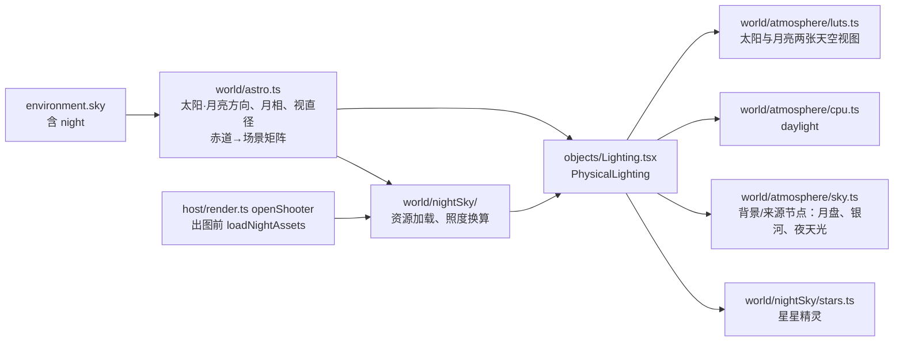

# Change 详细设计

## 继承的设计

- **Epic 基线**：`scene-world-environment` 修订 v4（与本设计一起批准；v4 只补 W3 需要的部分，见「接口与数据契约」）。适用条目：
  - design：「领域模型与业务规则」「每帧的数据流」「何时重算」「物理单位与曝光」「显示变换」「夜空（W3）」「渲染指纹」「验证与交付」；
  - 本次交付 `data: ADD 夜空`。
- **本次承担**：Epic 目标 4；AC-5，以及 AC-8、AC-9、AC-10、AC-11 中与夜空有关的部分（proposal「Acceptance Criteria」）。
- **依据**：
  - 本子项 `discovery/research/star-milky-way-assets.md`：星表、银河图、月面贴图的授权与体积（Epic 未决事项 6）。owner 2026-10-23 定为：星表 BSC5；银河程序化生成；月面贴图 NASA SVS CGI Moon Kit（Epic 修订 v4「技术选型」）；
  - W2 的 `discovery/research/astronomy.md`（`astronomy-engine` 2.1.19 的精度）与 `atmosphere-luts.md`（天空视图 LUT 的参数化）。
- **沿用不复述**（W2 已交付，见 `.lti/contracts/` 的 `data: 物理天空`、`architecture: 场景模块`、`patterns: 场景着色写法`）：
  - 大气 LUT、CPU 上的大气表与 `daylight`（`world/atmosphere/`）；
  - 预曝光、环境相对单位 s_env、`applyExposure`（`world/exposure.ts`）；
  - `PhysicalLighting` 的重算节奏：大气参数变 → 重建 LUT 与 CPU 表；天空任一字段变 → 天空视图、太阳光、雾；天空光照 PMREM 至多每 200 ms 一次，复用同一个渲染目标（`objects/Lighting.tsx`）；
  - 天空盒画在远平面、`ASIDE_LAYER` 不进 AO（`render/sky.ts:skyMesh`）。

## 领域模型与业务规则

字段、取值范围和缺省值以 Epic `contracts.md` 的 `data: 夜空`（修订 v4）为准。本节只写行为规则。

### 夜空何时画

| 条件 | 月亮（月盘、月光、月光照亮的天空） | 星星 | 银河、夜天光 |
|---|---|---|---|
| 不是物理天空，或 `sun_mode = manual` | 不画 | 不画 | 不画 |
| 地点模式，对应开关关闭 | 不画 | 不画 | 不画（银河看 `milky_way`；夜天光随 `stars`，见下） |
| 地点模式，开关打开 | 月亮在地平线以上才有月盘和月光；月光照亮的天空只在太阳低于 0° 时计算 | 始终画，白天被天空盖过 | 同左 |

- 夜天光归在「星空」之下：随 `stars` 开关和 `stars_strength`、`stars_temperature_k` 变化。理由：界面上「星空」就是「夜里天空本身的光」，单独再加一个开关没有拍摄上的用途；它比全部星光还亮，关掉星星却留着它会让人困惑（proposal Risk Notes「新增决定」3，owner 2026-10-22 同意）。
- 白天不另外关闭夜空：天空亮度比星光高 8 个数量级以上，预曝光后对画面的改变低于 1/255。月亮例外，白天的月亮本来就看得见。

### 亮度与颜色的单一来源

所有天体的照度都在大气顶以 lux 计，再经同一张透射率 LUT 衰减（E2）：

| 天体 | 大气顶的照度（lux，每通道） | 颜色 |
|---|---|---|
| 月亮 | E_moon = SUN_LUX × 10^(−0.4 (m + 26.74))，m 为 `astronomy-engine` `Illumination(Body.Moon)` 的视星等（已含相位律、冲日增亮和地月距离） | 太阳光谱 × 月面反照的色调（月亮的 B−V 约 0.92，比太阳红约 0.27），再乘 `moon_temperature_k` 的色调 |
| 星星 | 每颗 E = SUN_LUX × 10^(−0.4 (V + 26.74)) | 由 B−V 换算色温（Ballesteros 2012），黑体色调与太阳相同的函数（`constants.ts:sunTint`）；再乘 `stars_temperature_k` 的色调 |
| 银河 | 程序化模型的相对亮度 × 标定常数，银心方向的面亮度约 20.5 等/平方角秒 | 模型的颜色（核球偏暖、外侧银盘中性，暗尘带偏红）× `stars_temperature_k` 的色调 |
| 夜天光 | 天顶 21.8 等/平方角秒（约 2 × 10⁻⁴ cd/m²），按 van Rhijn 函数向地平线增亮 | 中性偏暖 |

- 视星等换照度相对太阳取：E = SUN_LUX × 10^(−0.4 (m + 26.74))，与渲染端太阳在大气顶的 128 klux 一致（实施时定；文献常用的 10^((−14.18 − m) / 2.5) 对应 106 klux 的太阳，两者差约 21%）。星星的色调以太阳的 B−V 0.65 为白，与太阳光在大气顶为白一致。
- 等/平方角秒换 cd/m²：L = 10.8 × 10⁴ × 10^(−0.4 μ)。
- 亮度倍率乘在大气顶的照度上，所以月盘、月光和月光照亮的天空同时变化（AC-W3-5）。色温 6500 K 时色调为 (1, 1, 1)，与物理计算逐像素相同。
- **与 Epic 公式的关系**：Epic design 写的是 L = E_sun · T · 0.12 · Φ(α) / π。满月时两者一致（星等法约 0.26 lux，公式约 0.31 lux）；偏离满月时星等法更准（朗伯相函数在上弦月处高估约 3 倍）。修订 v4 把 Epic 那一条改成「由星等求照度」。

### 月相与月面

- 月盘按 `astronomy-engine` 的地心距离求视直径（约 0.49°–0.56°）。
- 月面按球面着色：盘内每个像素反推月球表面的法线，按 Lommel-Seeliger 律（μ₀ / (μ₀ + μ)）对太阳方向着色，乘月面反照率贴图。明暗界线、亮边的朝向都由太阳方向自然得出，不用另外算位置角。
- 归一化：盘内亮度对立体角的积分等于 E_moon。由于月相律已在 E_moon 里，着色只决定亮度在盘内怎么分布。
- 贴图朝向：月球北极按 `RotationAxis(Body.Moon)` 摆正；天平动（libration）不算，月面纹理最多偏约 8°，属已知局限。
- 不画地照（新月旁暗面的微光），不画月食。

### 星星

- 星表按 J2000 赤道坐标存储；每帧用一个 3×3 矩阵换到场景坐标：`Rotation_EQJ_HOR`（含岁差、章动、恒星时和纬度），再按 `north_azimuth_deg` 绕 Y 轴旋转。银河的纹理在银道坐标里，前面再乘 `Rotation_GAL_EQJ`。
- 不计自行（两百年内最大约 0.3°）。
- 折射：按 Saemundsson 公式在着色器里抬高地平线附近的星星，与太阳、月亮的视高度一致。
- 精灵：每颗星画成固定像素大小的点精灵（`PointsNodeMaterial`，WebGPU 下为实例化的四边形，两个后端同一份 TSL）。
  - 大小按画面高度相对 1080 px 缩放：视口里看到的星星和 8K 导出的观感一致（所见即所得）。
  - 能量守恒：精灵内的亮度 = E × 透射率 / 精灵的立体角，精灵的立体角由当前像素的立体角算出。亮星会被色调映射压成白色，大小随亮度略增（亮于 1 等的星精灵半径加大，总能量不变），模拟真实镜头下亮星显大。
  - 不闪烁（导出要确定）。
  - 地平线以下、被月盘挡住（与月亮的角距小于月亮半径）时不画。

### 光照

- **月光**：第二盏平行光。照度和颜色由 `CpuAtmosphere.daylight(moonMu, E_moon 每通道)` 求出，与太阳光同一条路径（透射率、地平线遮挡）。
- **投影**：任何时候只有一盏平行光投影。设两盏固定的平行光：
  - **主光**（`castShadow = true`）：太阳高于 −6°，或者月亮在地平线以下时，取太阳的方向、照度和颜色；否则取月亮的。
  - **副光**（不投影）：取另一个天体。
  - 两盏灯的数量和投影开关从不改变，材质不会因为入夜而重新编译。太阳低于地平线时它的照度本来就是 0，交换不会造成画面跳变。
  - 阴影的拟合沿用 `fitSunShadow`。
- **月光照亮的天空**：天空视图 LUT 按太阳的方位参数化，月亮的贡献不能叠进同一张 LUT。新增第二张天空视图（同尺寸 384 × 216），光源换成月亮的方向和 E_moon × s_env，采样时用月亮的方向；背景和天空光照的来源都加上这一项。只在月亮开启、太阳低于 0° 时重算，否则贡献置 0。
- **场景的水平照度 E**（用于 s_env 和全局雾）：太阳直射与天空漫射（W2）+ 月光直射与月光照亮的天空漫射 + 星光、银河和夜天光的常数项。最后一项在 CPU 上按星表和夜天光的模型预先积分成一个数（只取决于开关、倍率和色温），不每帧积分。
- **天空光照（PMREM）**：来源网格的颜色 = 太阳的天空视图 + 月亮的天空视图 + 银河 + 夜天光，不含月盘和星星精灵。月盘对天空光照的贡献已经由月光平行光承担；星星精灵在 PMREM 的低分辨率下会丢失，它们的平均贡献并进夜天光的常数项里。

## 模块职责与协作



| 模块 | 职责 | 不负责 |
|---|---|---|
| `world/astro.ts`（修改） | 月亮的方向（视高度，含折射）、视星等、视直径、自转轴；赤道→场景、银道→场景矩阵；当天的月出月落、月相名称与照亮比例、前后最近的满月和新月 | 渲染；资源 |
| `world/nightSky/assets.ts`（新增） | 星表、月面贴图的按需加载与缓存；`loadNightAssets(scene)`：场景需要的资源都到位后 resolve，加载失败时 reject | 绘制 |
| `world/nightSky/light.ts`（新增） | 星等→照度、B−V→色调、夜天光与银河的标定常数、星空常数项的 CPU 积分 | GPU |
| `world/nightSky/stars.ts`（新增） | 星星精灵的几何与 TSL 材质 | 月亮、银河 |
| `world/nightSky/milkyWay.ts`（新增） | 程序化银河：TSL 模型、烘焙成 2048 × 1024 纹理（每个渲染器一次）、采样 | 资源下载 |
| `world/atmosphere/luts.ts`（修改） | 第二张天空视图：`setMoon`、`renderMoonSkyView`、`sampleMoonSkyView` | — |
| `world/atmosphere/sky.ts`（修改） | `physicalSkyColor` 加入月盘、月光照亮的天空、银河、夜天光 | 星星精灵 |
| `objects/Lighting.tsx:PhysicalLighting`（修改） | 按「何时画」组装上述部分；主光、副光的分配；E 与 s_env 加上夜空；资源到位时 `invalidate` | 资源加载本身 |
| `host/render.ts:openShooter`（修改） | 挂载前 `await loadNightAssets(scene)`：所有离屏出图（`render_view`、导出、客户端任务）都经过这里 | — |
| `panels/PhysicalSkyFields.tsx`（修改） | 「夜空」一组；时间一组的月亮信息；署名 | — |
| 后端 `creativescene` | `night` 的校验与补齐；月亮参考（`moon.go`） | 画面上的天体换算 |

### 主流程（视口，入夜拖动时刻）

1. `PhysicalLighting` 的 `skyKey` 变化 → `physicalSun` 与新的 `physicalMoon` 求方向。
2. 太阳的天空视图照旧重算；月亮开启且太阳低于 0° 时，重算月亮的天空视图。
3. `daylight` 求太阳和月亮的光，按规则分给主光和副光；E 加上月亮和星空常数项，求 s_env。
4. 更新天空节点的 uniform：月亮方向、视直径、月盘亮度、两个场景矩阵、倍率与色调。
5. 资源还没到：第一次需要时启动加载，先不画对应部分；到位后 `invalidate`。导出与 `render_view` 在出图前已经等到资源到位，不会遇到这个分支。
6. PMREM 照旧至多每 200 ms 重做一次。

## 关键机制

### 资源与确定性

- 资源加载的时机：
  - 星表：地点模式、`stars` 打开且太阳低于 0°；
  - 银河纹理：地点模式、`milky_way` 打开且太阳低于 0° 时在 GPU 上烘焙，不下载；设备丢失后随其他 LUT 一起重做；
  - 月面贴图：月亮开启且在地平线以上。
- 离屏出图（`render_view`、导出、客户端任务）都经过 `openShooter`，它在挂载前 `await loadNightAssets(scene)`；场景不需要夜空资源时立即返回。加载失败时这张图失败，原因写「夜空资源加载失败，请稍后重试」，不出一张缺星星的图：导出必须与快照一致（E3）；这类失败属于部署或网络问题，不暴露内部错误（沿用「部署错误不暴露给用户」）。
- 视口里加载失败：不画对应部分，下次天空变化时重试，控制台记一次警告。
- 资源与场景无关，不进指纹；资源版本放进文件名（构建时的内容哈希），换资源不会让已有导出过时，这是有意的：资源只在修订后的 Change 里更换，届时人工判断。

### 星表与月面贴图的构建

- 星表：构建脚本从 BSC5（CDS V/50 的 `catalog`）取出 V ≤ 6.5 的 8404 颗星，按列存放：赤经、赤纬（float32，J2000）、V（uint8，步长 0.05 等）、B−V（uint8，步长 0.02），原始约 82 KB，gzip 后约 67 KB（调研实测）。缺 B−V 的星按 0.6（类太阳）处理。产物入库，运行时不联网。
- 月面贴图：NASA SVS CGI Moon Kit 的反照率图，降到 1024 × 512 灰度 WebP，约 49 KB；均值归一到 1，平均反照率由 E_moon 承担。
- 脚本放在 `frontend/scripts/night-sky/`，与 W2 的城市数据一致；原始文件不入库，脚本里写下载地址和校验和。

### 程序化银河

在银道坐标 (l, b) 上求相对亮度和颜色（TSL 片元 pass，烘焙到等距柱状纹理，固定种子）：

```
银盘   D(l, b) = (0.35 + 0.65 · exp(−(l/60°)²)) · exp(−|b| / h(l))，h 在银心方向约 6°、反银心方向约 3°
核球   B(l, b) = 1.5 · exp(−(l/12°)² − (b/8°)²)
团块   C = 0.55 + 0.9 · fbm(单位向量 × 12, 4 个八度)           // 星云的明暗起伏
暗尘带 τ(l, b) = 1.6 · exp(−((b − b₀(l)) / 1.8°)²) · [|l| < 70°] · (0.4 + 1.2 · fbm(单位向量 × 20))
亮度   L = (D + B) · C · exp(−τ) + 麦哲伦云（两个各向异性高斯，大云 l=280.5°, b=−32.9°，小云 l=302.8°, b=−44.3°）
颜色   核球偏暖（约 4500 K）、外侧银盘中性（约 6000 K），暗尘带处按 τ 偏红
```

- 噪声在三维单位向量上取，没有接缝；只用整数哈希，两个后端结果一致。
- 标定：L 的银心附近峰值对应 20.5 等/平方角秒，换成 cd/m² 后乘 `stars_strength` 与色调。
- 参数（尺度、暗尘带的位置 b₀(l)、强度）实施时对照公开的银河照片调到「位置对、观感像」，由 owner 看图判断（AC-W3-11）；不追求与照片一一对应。
- 烘焙一次约 2048 × 1024 个片元、每个十几次噪声采样，预计在毫秒级；实施时实测并记入 evidence。

### 月亮的天空视图

- `luts.ts` 的天空视图 pass 抽成「给定光源天顶余弦和每通道缩放，渲染到给定目标」，太阳和月亮各一个目标、各一组 uniform，共用透射率和多次散射 LUT。
- 采样：`sampleSkyView(d, light)` 已按光源方向取方位，月亮直接复用，传月亮方向和月亮的目标。
- 耗时：天空视图一次约 1–2 ms（W2 实测 LUT 加 PMREM 共 4.3 ms）；只在太阳低于 0° 时多做一次。

### 星空常数项

- 星星：∑ E_i × 色调_i 在天球上的平均，按星表一次算好（与观察者无关），再乘地平线以上的比例 1/2 和平均透射率的近似值 0.8。
- 银河：烘焙纹理的平均亮度 × π（半球的漫射照度近似），烘焙时在 CPU 上用同一模型按粗网格算一次，不回读 GPU。
- 夜天光：天顶亮度 × π × van Rhijn 平均增亮系数。
- 用途只有两处：s_env 与雾的 E；天空光照里的星空部分来自 PMREM 的来源网格，不靠这个常数。

### 编辑界面

- 「夜空」一组放在「太阳」一组之后，地点模式下可用，手动模式置灰并说明「夜空需要日期和地点，只在地点模式下生效」。
  - 三个开关：月亮、星星（含夜天光）、银河。
  - 月亮：亮度倍率、色温；星空：亮度倍率、色温（作用于星星、银河和夜天光）。滑杆与太阳的同款，拖动按合并键折叠。
  - 底部注明需要署名的图源。
- 时间一组新增一行月亮信息：月相名称（新月、蛾眉月、上弦月、盈凸月、满月、亏凸月、下弦月、残月）与照亮比例、月出月落；前后最近的满月、新月日期，点击日期即把日期改成那一天（一次可撤销的提交）。
- 曝光提示：渲染选项卡默认曝光值旁的参考值加上「满月夜约 −3」「银河约 −7」。

### 服务端

- **校验与补齐**（`sky.go`）：`night` 只在 `kind = physical` 时允许，其他天空返回 400，原因写「night（夜空）只属于物理天空」。补齐时 `night` 缺省为全部开关打开、倍率 1、色温 6500。四个数值的范围按契约，越界返回 400 并写字段名。
- **月亮参考**（`moon.go`，proposal「新增决定」2，owner 2026-10-22 同意）：
  - 移植 Meeus《天文算法》第 47 章（月亮位置，取主要的周期项，精度约 0.1°）与第 49 章（月相时刻）；月出月落按视高度 +0.125°（地平线 −0.833° 加月亮的地平视差）用二分搜索求。
  - 内容：`phase`（月相名称，英文枚举）、`illumination`（0…1）、`elevation_deg`、`compass_deg`、`scene_azimuth_deg`、`moonrise`、`moonset`、`previous_full_moon`、`next_full_moon`、`previous_new_moon`、`next_new_moon`（当地日期）。
  - 出现条件同太阳参考：物理天空的地点模式；随 `read_scene` 和写入了环境的 `edit_scene` 返回。`SceneRead`、`EditResult` 新增 `moon` 字段。
  - 与前端对照：同一组日期，月相时刻相差不超过 10 分钟、月出月落不超过 3 分钟（前端 `astronomy-engine` 的结果写进测试数据）。
- **指纹**：`sky` 已整体计入 `lit`，`night` 随之计入；`clay`、`line` 已清除整个 `environment`。只加用例，不改 `fingerprint.go`。

### 助手说明

`edit_scene` 的物理天空一段加 `night:{moon, stars, milky_way, moon_strength, moon_temperature_k, stars_strength, stars_temperature_k}` 的说明；`read_scene` 说明 `moon` 参考。要点：
- 夜空只在地点模式下画；手动模式没有月亮和星空。
- 满月夜 EV100 约 −3（ISO 3200、4 s、f/2.8 附近），银河约 −7（ISO 6400、20 s、f/2.8 附近）。
- 「满月之夜」「新月看银河」先读月亮参考选日期，再写时刻。

## 局部设计与偏差

| # | 决定 | 依据 | 备选与取舍 |
|---|---|---|---|
| 1 | 月亮照度由 `astronomy-engine` 的视星等求，不用 Epic 的朗伯相函数公式（修订 v4 同步改 Epic） | 真实月相律比朗伯球陡得多，上弦月只有满月的约 1/10；星等法与星星同一套换算 | Epic 原公式：满月一致，偏离满月时高估最多约 3 倍 |
| 2 | 主光、副光两盏固定平行光交换角色 | 入夜不重新编译材质；同一时刻只有一盏投影（Epic 要求） | 太阳、月亮各自开关投影：越过 −6° 时重新编译一次（热缓存约 0.4 s，冷缓存可达数秒） |
| 3 | 第二张天空视图 LUT 给月亮 | LUT 按光源方位参数化，不能叠加 | 只给月光照亮的天空一个常数色：地平线方向的颜色和亮度分布都不对 |
| 4 | 星星精灵按画面高度缩放、能量守恒 | 视口与 8K 导出观感一致；曝光改变时亮度变化与物理一致 | 固定像素：8K 导出里星星只有视口的 1/4 大 |
| 5 | 夜天光随「星星」开关（owner 同意） | 见「夜空何时画」 | 单独开关：没有拍摄用途 |
| 6 | 离屏出图等资源到位，加载失败则这张图失败 | 导出与快照一致（E3） | 失败时照样出图：静默缺星星 |
| 7 | 不计天平动、自行、地照 | 视觉影响小；地照需要地球反照的模型 | — |
| 9 | 视星等换照度以渲染端的太阳为准（SUN_LUX 对应 −26.74 等），不用 Epic「夜空」写的 10^((−14.18 − m) / 2.5)；月亮和星星因此亮约 21% | E2 单一来源：月光本是太阳光的反射，按同一个太阳标定，月光与太阳光的比例才对 | 照抄 Epic 的常数：月光与渲染端太阳的比例偏差 21%。**这条与 Epic 已批准的正文不同，验收时交 owner 决定，随下一次 Epic 修订更正** |
| 8 | 银河程序化生成，烘焙成纹理（owner 2026-10-23） | 没有授权问题，不下载；位置和朝向真实 | 全天图（NASA SVS / ESO）：画质更真，但授权链不清或要醒目署名、含亮星。逐像素实时求模型：8K 导出时每个像素十几次噪声，烘焙一次后采样更省 |

## 接口与数据契约

契约状态：**扩展**。

- **Epic 修订 v4**（与本设计一起呈现，owner 同意后 `lti epic revise`，再 `epic bind`）：
  - `data: ADD 夜空`：补四个字段：

    | 路径 | 类型 | 缺省 | 范围 | 说明 |
    |---|---|---|---|---|
    | `sky.night.moon_strength` | number | 1 | 0…10 | 月亮的亮度倍率：月盘、月光、月光照亮的天空 |
    | `sky.night.moon_temperature_k` | number | 6500 | 2000…12000 | 月亮的色温；6500 为物理计算的颜色 |
    | `sky.night.stars_strength` | number | 1 | 0…10 | 星空的亮度倍率：星星、银河、夜天光 |
    | `sky.night.stars_temperature_k` | number | 6500 | 2000…12000 | 星空的色温 |

    并删去「由 W3 起草时经 Epic 修订补进本节」一句；`night` 补齐时七个字段全部补齐。
  - design「夜空（W3）」：月亮照度改为由视星等求；补主光、副光与第二张天空视图；补夜天光；银河改为程序化生成。
  - design「技术选型」：星表 BSC5 的授权结论；新增「银河」「月面贴图」两行；未决事项 6 划掉。
  - design「数据所有权与一致性」「技术选型」与 contracts `architecture: MODIFY 场景模块`、`data: ADD 夜空`「访问模式」：太阳参考扩展为「太阳和月亮参考」。该节已由 W2 交付，修订时以 `.lti/contracts/architecture.md` 的现状为底改写，由本子项再次交付（lesson `epic-delivered-contract-modify`）；若 lti 不允许同一条目交付两次，改为在 `data: 夜空` 的「访问模式」里写月亮参考，架构契约只在归档后随 follow-up 修正。
  - 未决事项 6 划掉，写结论。
- **OpenAPI**：`CreativeSceneSky` 加 `night`（七个字段）；`SceneRead`、`EditResult` 对应的助手工具结果不在 OpenAPI 里（它们是工具输出，W2 同）。运行 `make generate`，提交两份生成物。
- **本 Change 的 contracts.md**：无局部增量。

## 挂载点

| 位置 | 动作 | 说明 |
|---|---|---|
| `frontend/src/creative-scene/world/astro.ts` | 修改 | `physicalMoon`、`moonTimes`、`equatorToScene`、`galacticToScene` |
| `frontend/src/creative-scene/world/physicalSky.ts:physicalSkyDefaults` | 修改 | `night` 的缺省值 |
| `frontend/src/creative-scene/world/physicalSky.ts:completeSky` | 修改 | 补齐 `night` |
| `frontend/src/creative-scene/world/physicalSky.ts:isPhysical` | 修改 | 要求 `night` 已补齐 |
| `frontend/src/creative-scene/world/nightSky/assets.ts` | 新增 | 资源加载、`loadNightAssets` |
| `frontend/src/creative-scene/world/nightSky/light.ts` | 新增 | 照度、色调、常数项 |
| `frontend/src/creative-scene/world/nightSky/stars.ts` | 新增 | 星星精灵 |
| `frontend/src/creative-scene/world/nightSky/milkyWay.ts` | 新增 | 程序化银河 |
| `frontend/src/creative-scene/world/nightSky/stars.bin`、`moon.webp` | 新增 | 构建产物（文件名带内容哈希） |
| `frontend/src/creative-scene/world/atmosphere/luts.ts:atmosphereLuts` | 修改 | 第二张天空视图 |
| `frontend/src/creative-scene/world/atmosphere/sky.ts:physicalSkyColor` | 修改 | 月盘、月亮天空、银河、夜天光 |
| `frontend/src/creative-scene/world/atmosphere/constants.ts` | 修改 | 月面色调、夜天光常数 |
| `frontend/src/creative-scene/render/sky.ts:physicalSkyMesh` | 修改 | 传入夜空的 uniform |
| `frontend/src/creative-scene/objects/Lighting.tsx:PhysicalLighting` | 修改 | 主光、副光；月亮天空视图；星星；E 与 s_env；资源到位时重画 |
| `frontend/src/creative-scene/host/render.ts:openShooter` | 修改 | 挂载前等夜空资源：`render_view`、导出、客户端任务和编辑器内的出图都经过它 |
| `frontend/src/creative-scene/panels/PhysicalSkyFields.tsx` | 修改 | 夜空一组、月亮信息、署名 |
| `frontend/src/creative-scene/panels/RenderPanel.tsx` | 修改 | 夜景的 EV100 参考值 |
| `frontend/src/creative-scene/editing.ts` | 修改 | 改夜空字段、跳到满月/新月日期的提交 |
| `frontend/scripts/night-sky/` | 新增 | 星表、月面贴图的构建脚本 |
| `frontend/scripts/creative-scene-astro.test.ts` | 修改 | 月亮与亮星对照 JPL Horizons |
| `frontend/scripts/creative-scene-night-sky.test.ts` | 新增 | 照度换算、色调、常数项、资源加载失败 |
| `frontend/scripts/creative-scene.e2e.mjs` | 修改 | W3 的检查 |
| `frontend/scripts/fixtures/scene-reference/` | 修改 | 满月之夜、新月之夜 |
| `backend/internal/creativescene/model.go:Sky` | 修改 | `Night *Night` |
| `backend/internal/creativescene/sky.go:completeSky` | 修改 | 补齐 `night` |
| `backend/internal/creativescene/sky.go:validatePhysicalSky` | 修改 | 校验 `night` |
| `backend/internal/creativescene/sky.go:physicalOnly` | 修改 | 加 `night` |
| `backend/internal/creativescene/moon.go`、`moon_test.go`、`testdata/moon.json` | 新增 | 月亮参考 |
| `backend/internal/creativescene/agent.go:SceneRead`、`agent.go:EditResult`、`agent.go:writtenSun` | 修改 | `moon` 字段 |
| `backend/internal/creativescene/scene_test.go` | 修改 | 删去「night 在 W3 前返回 400」，加 `night` 的校验与补齐用例 |
| `backend/internal/creativescene/fingerprint_internal_test.go` | 修改 | 夜空字段计入 `lit`、不计入 `clay`/`line`；W2 时期快照补齐后指纹变化 |
| `backend/internal/creativescene/agent_tools_test.go` | 修改 | 读写结果带 `moon` 的条件 |
| `backend/internal/creativeagent/scene_tools.go`、`scene_tools_test.go` | 修改 | 工具说明 |
| `api/openapi.yaml` 及 `make generate` 的生成物 | 修改 | `CreativeSceneSky.night` |
| `docs/third-party-notices.md` | 修改 | BSC5（Hoffleit & Warren 1991、CDS/VizieR）、NASA SVS CGI Moon Kit |
| `docs/dev/creative-scene-agent.md`、`docs/dev/agent-skills-tools.md` | 修改 | 夜空与月亮参考 |

## 验证与交付

| 验收 | 怎么验证 |
|---|---|
| AC-W3-1 月亮 | `creative-scene-astro.test.ts`：四个参考地点、满月/上弦/新月各一天的 JPL Horizons 数据点，按角距 ≤ 0.2°（验收线 1°）；照亮比例 ≤ 0.02。e2e：上弦月傍晚的 `lit` 图里月盘亮面朝向太阳一侧（盘内左右半边亮度比） |
| AC-W3-2 月光 | 单测：满月高于 30°、太阳 −18° 时 CPU 的 E 在 0.1–0.4 lux。e2e：EV100 −3 下院子的平均亮度与正午阳光 16 法则的相差在 2 档内；影子方向（像素比较）；太阳 −5° 时主光仍是太阳 |
| AC-W3-3 星空 | 单测：北极星、天狼星、织女星、南十字座 α 的场景方向对照 JPL Horizons（≤ 0.2°）；北京的北极星高度与纬度差 ≤ 1°。e2e：改正北方向后星空图像随之旋转 |
| AC-W3-4 新月 | e2e：新月之夜的 E 中月亮项为 0；EV100 −7 的导出存进 evidence |
| AC-W3-5 亮度与色温 | e2e：月亮倍率 2 时月盘区域的线性亮度约为 2 倍；6500 K 与不写时逐像素相同；色温调高时 B/R 变大 |
| AC-W3-6 开关与模式 | e2e：逐个关开关，对应区域变化、其余区域不变；手动模式与 W3 之前同场景逐像素相同；白天正午（月亮不入画）与 W3 之前逐像素相同（差 > 2 的像素为 0），基线在实施前从 `develop` 导出 |
| AC-W3-7 两个后端 | 沿用 `SCENE_E2E_GPU` 的对照，加满月、新月两个场景；W2 的天空阈值 |
| AC-W3-8 确定性与过时 | 沿用 `SCENE_E2E_HIDDEN`，加满月之夜；`fingerprint_internal_test.go` 每条规则一个用例；资源加载失败时 `render_view` 返回明确原因（单测模拟） |
| AC-W3-9 助手 | 后端单测：`night` 的错误写法；`moon_test.go` 对照前端数据；`agent_tools_test.go` 的出现条件。真实模型对话由 owner 验收时抽查 |
| AC-W3-10 性能 | 沿用 `SCENE_E2E_PERF`：入夜拖动时刻的帧率、静止帧时间；白天打开时网络请求里没有星表；银河烘焙的耗时 |
| AC-W3-11 夜景可用 | 三组样例存进 evidence，owner 判断 |

- 只跑定向测试：单测按文件，e2e 用 `SCENE_E2E_ONLY=W3`，端口 5293（项目约定）。
- **上线与回滚**：W2 之后存的物理天空场景读取时补齐 `night`，`lit` 导出各过时一次（Epic 预期）；回滚到 W2 的后端时，含 `night` 的场景读取失败，只做前向修复（Epic「接口设计」）。没有迁移。

## 未决事项

| 问题 | 影响 | 解决方式 | 最晚解决时点 |
|---|---|---|---|
| 星星精灵的大小与亮星的增大规则 | 观感 | 实施时出样例，owner 看图 | 验收时（不阻塞开工） |
| 银河模型的参数、银河与夜天光的标定常数 | 新月之夜的观感 | 按文献值实施，owner 看图 | 验收时（不阻塞开工） |
