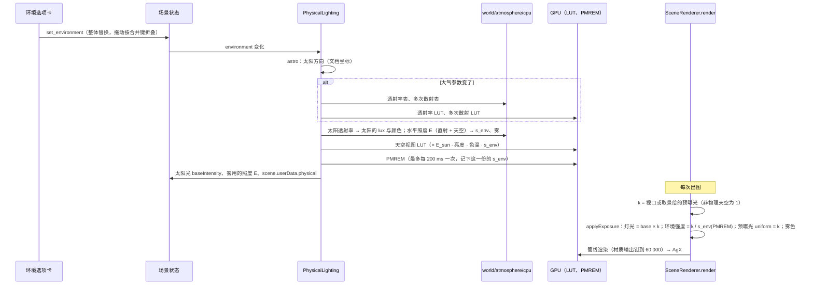

# Change 详细设计

## 继承的设计

- **Epic 基线**：`scene-world-environment` 修订 v2（待与本设计一起批准）。适用全部 design 条目。本次交付以下契约：
  - `data: ADD 物理天空`
  - `data: ADD 摄像机曝光`
  - `architecture: MODIFY 场景模块`
  - `patterns: MODIFY 场景着色写法`
- **本次承担**：Epic 目标 2、3；AC-2、AC-3、AC-4，以及 AC-8、AC-9、AC-10、AC-11 中与天空和曝光有关的部分（proposal「Acceptance Criteria」）。
- **依据**：本子项 `discovery/research/`：
  - `atmosphere-luts.md`：LUT 精度、两个后端、耗时、星球地面、预设；
  - `exposure.md`：预曝光与 fp16、材质钳制，以及 owner 决定只做手动曝光；
  - `astronomy.md`：`astronomy-engine` 2.1.19、NOAA 对照数据、当地时间换算 UTC；
  - `city-data.md`：GeoNames 加 Wikidata 加补丁表。
  - 原型 `prototype/` 的 `atmoGpu.ts`、`atmoCpu.ts` 是本次 `world/atmosphere/` 的起点，改写成项目的 TSL 类型写法。
- **沿用不复述**：
  - `SceneRenderer` 的管线与 AgX 输出（W1）；
  - 渲染器创建入口与帧推进（R1）；
  - 实时 GI（R2）；
  - 「环境」选项卡与 `set_environment` 的整体替换；
  - 摄像机属性的写法（C4）；
  - 渲染指纹的「整体哈希、清掉画不出的部分」（`fingerprint.go`）。

## 领域模型与业务规则

字段、取值范围和缺省值以 Epic `contracts.md` 为准。本节只写编辑器、渲染端和服务端的行为规则。

### 天空模式与太阳

| 操作 | 结果 |
|---|---|
| 天空类型选「物理天空」 | 写入整份物理天空：契约缺省值（上海、12:00、晴朗），`date` 取本机的当天。其他环境字段不变，曝光字段不改 |
| 从物理天空切回程序化或纯色 | 与现在一样写入那种天空的缺省值；物理天空的字段随之丢弃，Cmd+Z 恢复 |
| 太阳模式「地点」→「手动」 | 同一次提交里写 `sun_mode = manual`，并把当前算出的视高度和方位换算成文档约定写入 `sun_elevation_deg`、`sun_azimuth_deg`。高度夹在 −10…90，方位取 0…360。画面不跳变；例外是太阳低于 −10° 时（入夜后），高度夹到 −10°，天空会变亮 |
| 太阳模式「手动」→「地点」 | 只改 `sun_mode`；两套字段都保存，回到地点算出的位置 |
| 选城市 | 一次提交写 `latitude_deg`、`longitude_deg`、`timezone`、`place` |
| 手改经度或纬度 | 同时清空 `place`，因为已不再是那座城市 |
| 选预设 | 一次提交写四个大气参数（下表）；不改太阳的亮度和色温 |

**太阳方向**：地点模式按 Epic design「地点与时间」的三步计算。
- 当地时间换算 UTC 采用 Temporal 的 `compatible` 规则：不存在的时刻往后推，重复的时刻取较早的一个。函数取自 `astronomy.md` 的实现，改成 compatible。
- 浏览器认不出时区名时，偏移按 round(经度 / 15) 小时计算，并在「环境」选项卡里提示（Epic「失败与恢复」）。不改场景。

**大气预设**（`atmosphere-luts.md` 第 5 节）。编辑器按当前四个参数是否与某个预设相同来显示预设名，否则显示「自定义」：

| 预设 | `altitude_m` | `air_density` | `dust_density` | `ozone_density` |
|---|---|---|---|---|
| 晴朗 | 0 | 1 | 1 | 1 |
| 雾霾 | 0 | 1 | 12 | 1 |
| 高原 | 4000 | 1 | 0.2 | 1 |
| 沙尘 | 0 | 1 | 40 | 1 |

### 曝光

```
物理天空：
  观看者是场景摄像机（相机视图、导出、render_view 的 camera_object_id）：
    EV100 = log2(f_stop² / shutter_s) − log2(iso / 100)
  观看者是默认摄像机（视口自由视角、render_view 的 viewpoint 和预设视角）：
    EV100 = render.exposure_ev100
  k = 1 / (1.2 · 2^EV100)，toneMappingExposure = 1
其他天空：k = 1，toneMappingExposure = 2^exposure_ev（不变）
```

- **新建摄像机**（编辑器的「添加摄像机」，天空为物理天空时），EV 取默认曝光值，光圈取缺省 f/2.8：

  ```
  t = f² / 2^EV                         （ISO 100 时的快门）
  若 1/8000 ≤ t ≤ 30：iso = 100，shutter_s = 最接近 t 的 1/3 档
  否则：shutter_s = 1/8000 或 30（取近的一端），
        iso = 25…102400 内最接近 100 · f² / (shutter_s · 2^EV) 的 1/3 档
  ```

  - 快门和 ISO 都按 1/3 档取最近，误差不超过 1/6 档。档位与手动输入用同一张表。
  - f/2.8 下可达 EV100 约 −11.9…17.9。默认曝光取 18…20 时新摄像机比视口暗，最多约 2 档，写进规格的已知局限；不改光圈，因为光圈还决定景深。
- 天空不是物理天空时，新建摄像机不写曝光字段（存储补齐缺省值）。

## 模块职责与协作

| 模块 | 职责 | 不负责 |
|---|---|---|
| `world/astro.ts`（新） | 当地时间换算 UTC；太阳的视高度和方位（`astronomy-engine`，`'normal'` 折射）；罗盘方位换成文档方向（按正北）；手动模式直接给方向 | 渲染；读当前时间 |
| `world/atmosphere/constants.ts`（新） | 大气常量、预设表、参数换成系数（米氏基准、偏蓝吸收）、太阳色温换成 RGB | — |
| `world/atmosphere/cpu.ts`（新） | CPU 上的透射率表、多次散射表、太阳透射率、天空水平照度。用 typed array，无逐步分配 | GPU |
| `world/atmosphere/luts.ts`（新） | 三张 LUT 的 TSL 片元 pass 与 `RenderTarget`（RGBA16F），以及采样函数 | 曝光 |
| `world/atmosphere/sky.ts`（新） | 物理天空的背景节点（天空视图 LUT × r，加上太阳盘 × k）与生成天空光照用的版本（不画太阳盘，环境相对单位） | — |
| `world/exposure.ts`（新） | EV100、k、标准快门档；s_env；全局的预曝光 uniform；`applyExposure(scene, k)` | 色调映射 |
| `world/cities.ts` 与城市数据（新） | 按需加载城市表；中英文和拼音搜索；署名文字 | — |
| `objects/Lighting.tsx` | 新增 `PhysicalLighting`：LUT 的生成与重算、太阳光、天空光照（节流沿用 200 ms）、雾，并把 s_env 记在场景上 | 曝光的取值 |
| `objects/lights.ts` | 灯光的数据强度记在 `userData.baseIntensity`，`intensity` 由 `applyExposure` 写入 | — |
| `materials/instances.ts` | 自发光乘全局预曝光 uniform | — |
| `render/sceneRenderer.ts` | `Frame.preExposure`；每次 `render` 前调用 `applyExposure` | 求 EV100 |
| `render/gpu.ts` | 渲染器创建入口安装材质输出的钳制（一次） | — |
| `render/sky.ts` | `sunDirection` 交给 `world/astro.ts`；`skyEnvironment` 不再处理物理天空（由 `PhysicalLighting` 生成） | — |
| `host/framing.ts` | `Framing.ev100`：摄像机取景带上它的 EV100 | — |
| `host/render.ts`、`Viewport.tsx` | 求本帧的 k，传给 `SceneRenderer` | — |
| `panels/EnvironmentPanel.tsx` | 物理天空的编辑界面 | — |
| `panels/RenderPanel.tsx` | 物理天空下显示默认曝光值，替换曝光补偿 | — |
| `panels/Properties.tsx` | 摄像机的「曝光」：ISO、快门、光圈、EV100 | — |
| `editing.ts`、`SceneEditor.tsx` | 物理天空的缺省值、模式切换的写法、新建摄像机的曝光 | — |

依赖方向：
- `world/*` 只依赖 three、`astronomy-engine` 和类型，不依赖编辑器外壳。
- `objects/`、`render/`、`host/` 依赖 `world/`。
- 面板依赖 `world/astro.ts`（切到手动时求角度）、`world/exposure.ts`（快门档）和 `world/cities.ts`。

### 主流程



## 关键机制

### 预曝光的落点

渲染端把场景挂载一次，再依次拍多台摄像机（`host/render.ts` 的 `shoot`），各台的曝光不同。所以 k 不能放在 React 的 props 里，而是每次出图前写到 three 对象上：

| 对象 | 写入（`applyExposure(scene, k)`） |
|---|---|
| 灯光物件和太阳 | `intensity = userData.baseIntensity × k`。`baseIntensity` 是数据里的强度（物理天空下为 cd 或 lux），非物理天空下 k = 1，与现在相同 |
| 天空光照 | `scene.environmentIntensity = k / s_env`，s_env 取当前 PMREM 生成时的那一份，节流期间天空光照的亮度也一致 |
| 天空背景、太阳盘、自发光 | 全局 uniform `preExposure = k`。天空节点算出 r = k / s_env(LUT)，太阳盘直接乘 k；材质的自发光节点乘 `preExposure` |
| 全局雾 | `fog.color = 雾色 × (E / π) × k`。E 是 s_env 用的那个水平照度（太阳直射加天空漫射），雾与同样反照率的受光地面一样亮。只用天空照度时，晴天正午雾会比它遮住的地面暗 3 档以上 |

- 不采用「在材质输出处统一乘 k」：透射材质会采样已经预曝光的背景，再乘一次就是 k²，玻璃在白天变黑。
- 白模、材质预览和线框不读 `preExposure`：工作室光和预览的室内光没有 `baseIntensity`；`SceneRenderer` 只在 `display = rendered` 和 `lit` 时传入 k，其余为 1。
- 实时 GI 的各个 pass 读的是已经预曝光的缓冲，不需要改。
- **非物理天空**：`applyExposure` 只把灯光写回 `baseIntensity`（k = 1），不写 `scene.environmentIntensity`（`LitLighting` 和材质预览各自设为 1），不改雾。`PhysicalLighting` 卸载时清掉 `scene.userData.physical`，切回程序化天空后不残留物理天空的 s_env 和雾的照度。
- **`preExposure` 是模块级单例**，视口和离屏出图（`host/render.ts`）共用。每次出图在同一个同步调用里先写再画，WebGPU 在编码时读取 uniform，所以安全。源码里注明：不得在写入和 `render` 之间插入 `await`，也不得改成异步渲染。

### 材质输出钳制

`render/gpu.ts` 的 `createRenderer` 第一次被调用时，覆盖一次 `NodeMaterial.prototype.setupOutput`：

```
setupOutput(builder, output) = 原 setupOutput(builder, vec4(min(output.rgb, 60000), output.a))
```

- 覆盖所有节点材质，以及 three 自动映射成的节点材质。后处理的全屏 pass 也经过这里，但那里的数值远小于 60 000。
- 文件头注明 three 0.186.1，升级时与上游比对（`patterns: 场景着色写法`）。
- 依据：SwiftShader 在溢出时写入 Inf，经 AgX 后成为 NaN（`exposure.md` 第 2 节）。

### 大气 LUT 与重算

- 常量、LUT 尺寸和参数化见 Epic design「物理大气与 LUT」（修订 v2）。实现从原型 `atmoGpu.ts` 改写。与原型的差别：
  - 天空视图改为 384 × 216，视口和离屏出图用同一个尺寸。原型的 192 × 108 在方位上约 1.9° 一个纹素，8K 导出时太阳周围的晕会出现分段。
  - 星球地面的半径取场景 Y = 0 所在的球面，摄像机至少高出 10 m；大气密度仍按距海平面的高度算。原型在高原上把地面放在海平面，地平线下沉约 2°。不让摄像机与地面同高，否则地平线下方的视线零距离打到地面，地平线成为没有雾气的硬边。
  - 米氏吸收比例 (0.6, 1.2, 3.0) 直接乘基准吸收，不归一，`constants.ts` 里写明「平均 1.6 倍」；与穿刺样张一致。
- **重算的键**：
  - 大气键 = `altitude_m`、`air_density`、`dust_density`、`ozone_density`：变化时重算透射率和多次散射（GPU 与 CPU 各一份）。
  - 环境键 = 整个 `sky` 加上太阳方向：变化时重算天空视图、s_env、太阳光和雾；PMREM 按 200 ms 节流。
  - 导出和 `render_view` 在出图前保证 PMREM 已是最新：沿用现有的「先生成再出第一帧」。
- **星球地面**：
  - 天空视图里打到地面的视线，加上被太阳照亮的地面（反照率 0.3），与原型相同。
  - 另外加上天空光，用多次散射 LUT 在地面高度的值近似：Ψms × 反照率。目的是消掉晨昏蒙影时地平线处的暗线（`atmosphere-luts.md` 第 4 节）。
- **s_env**：E = 太阳直射的水平照度 + 天空的水平照度。天空照度在 CPU 上按 16 × 32 个方向、每个方向 30 步积分，用 CPU 的多次散射表（16 × 16）。EV_env = log₂(E · 100 / 250)，夹在 −12…20。
- **防漂移**：CPU 的表和 GPU 的 LUT 各实现一份，只共享 `constants.ts`。日常 e2e（SwiftShader）读回透射率和多次散射 LUT 的固定纹素，与 `cpu.ts` 在同一位置的值比较；再取天空视图的几个方向与 CPU 的天空亮度比较。阈值参照穿刺的误差（`atmosphere-luts.md` 第 2 节）放宽到能容下离散方式的差别，常量或公式只改了一边就会超出。
- **CPU 的耗时目标**（参考设备）：换大气参数不超过 30 ms，换时刻不超过 3 ms。原型未优化时分别约 175 ms 和 6 ms，靠 typed array 和去掉逐步分配达到。验收见 AC-W2-11 的性能检查。
- **设备丢失**：LUT 和 PMREM 归 `PhysicalLighting` 所有，随渲染器的重建一起重建（沿用 R1 的恢复流程）。

### 太阳的亮度与色温

- 色温换成 RGB：按 Planck 黑体在 CIE 1931 上的色度换成线性 sRGB，先把各通道钳到不小于 0（2000 K 贴近 sRGB 色域边，蓝通道可能算出微小的负值），再除以 6500 K 的结果，使 6500 K 为 (1, 1, 1)；最后按亮度归一，让色温只改颜色、不改亮度。
- 亮度倍率和色温 RGB 同时乘到大气顶的太阳照度上：太阳光、太阳盘和天空视图一起变化（Epic design「太阳的照度」）。透射率和多次散射 LUT 不受影响，不重算。

### 编辑界面

**「环境」选项卡**，天空类型为物理天空时，自上而下：

| 组 | 控件 |
|---|---|
| 太阳位置 | 分段按钮「地点和时间 / 手动角度」 |
| 地点（地点模式） | 城市搜索框（下拉底部是 GeoNames 署名）；纬度、经度数值框；时区下拉（`Intl.supportedValuesOf('timeZone')`，当前值不在表里时也列出） |
| 时间（地点模式） | 日期；当地时刻滑杆（0:00–23:59，按分钟，合并键 `environment.local_time`）；显示算出的太阳高度、方位、日出日落时刻，以及早晚的黄金时刻和蓝调时刻（只显示，不存；与助手看到的太阳参考口径相同） |
| 方向 | 正北方向滑杆（0–360°） |
| 手动角度（手动模式） | 太阳高度、方位滑杆，与程序化天空相同 |
| 大气 | 预设下拉；海拔、空气密度、尘埃密度、臭氧 |
| 太阳 | 亮度倍率、色温、太阳盘开关、太阳盘大小 |

- 环境光一组置灰，提示「物理天空下天空光由大气算出，环境光不生效」。
- 时区换算退回按经度推算时，在时间组下提示。

**「渲染」选项卡**：物理天空下，「曝光补偿」换成「默认曝光（EV100）」滑杆（−10…20，步长 1/3），下面列出参考值：晴天 15、阴天 12–13、日落 9–12、蓝调时刻 5–8、城市夜景 3–5、月光 −3。说明「只用于视口的自由视角和助手的临时视点，摄像机用自己的曝光」。其他天空下照旧显示曝光补偿。

**摄像机属性**：新增「曝光」一组：
- ISO 下拉，按 1/3 档，25–102400；
- 快门下拉，按 1/3 档，1/8000 s–30 s；
- 光圈：沿用 `fStopThirds`，与景深一组共用 `f_stop`；景深关闭时这里仍可调；
- EV100 只显示。

非物理天空下整组置灰，提示「只在物理天空下生效」。

### 城市数据

- **构建**：`frontend/scripts/cities/`。数据源与处理沿用 `city-data/scripts/` 的做法，整理成一条命令：
  1. 下载 GeoNames `cities15000` 和 `cities5000`；
  2. 用 Wikidata SPARQL 按 GeoNames ID 取 `zh-hans`、`zh-cn`、`zh`、`zh-hant` 标签；
  3. 应用补丁表 `patches.json`：`include` 按 ID 收入小地方，`override` 改名或坐标，`add` 加入缺的地方；
  4. 新疆的条目时区改为 `Asia/Shanghai`；
  5. 输出 `frontend/src/creative-scene/world/cities.json`。

  脚本只在更新数据时由开发者运行，不进 CI；产物入库，并记下取数日期。
- **补丁表的首批内容**（`city-data.md`）：
  - 婺源（`add`）；
  - 稻城、漠河的中文名和坐标（`override`）；
  - 林芝的中文名（`override`）；
  - 人口 10 万以上缺中文名的 57 条中国城市。
- **格式**（`city-data.md` 的形状 C）：
  - 行数组 `[简体名, 英文或拼音名, 纬度×100, 经度×100, 时区下标, 国家代码, 繁体名?]`，繁体名与简体不同时才带；另有按出现频率排序的时区表；
  - 行按人口降序排列，人口不入包；同类搜索结果按行序排；
  - `attribution` 字段写 GeoNames 的署名、许可证链接和「已修改」。
- **加载**：`world/cities.ts` 用 `import()` 按需加载，城市搜索框第一次获得焦点时才加载。
- **搜索**：中英文和拼音按前缀匹配，再按包含匹配；同类按行序（即人口），取前 8 项。每项显示「城市 · 国家」，国家名用 `Intl.DisplayNames('zh-CN', {type: 'region'})` 由国家代码现取，区分「伦敦 · 英国」和「伦敦 · 加拿大」。
- **署名**：
  - 城市下拉底部一行小字；
  - 产物 JSON 的 `attribution` 字段；
  - 新建 `docs/third-party-notices.md`，列出 GeoNames（CC BY 4.0，需署名，原文免责声明）和 `astronomy-engine`（MIT）。

### 服务端

- **解码**：`Sky` 加上物理天空的字段（指针，`omitempty`）。`night`、`aerial_perspective`、`clouds`、`environment.weather` 不在结构里，沿用严格解码返回 400。
- **校验**（`validateEnvironment`）：
  - `procedural`、`hdri`、`color` 三个分支：物理天空独有的字段（`sun_mode`、经纬度、`timezone`、`place`、`date`、`local_time`、`north_azimuth_deg`、四个大气参数、`sun_disc`、`sun_size_deg`、`sun_strength`、`sun_temperature_k`）任何一个出现即 400，错误文字列出字段。现有分支只检查彼此的旧字段，不补这一条的话，程序化天空带着 `date` 也能存进去，进入 `lit` 指纹，已有导出误报过时。判断写成一个列出这些字段的函数，三个分支共用。
  - `physical` 分支不得带 `turbidity`、`hdri`、`color`；
  - `sun_mode` 只能是 `location` 或 `manual`；
  - 经度、纬度、时区要么都写，要么都省略；
  - 时区要能用 `time.LoadLocation` 加载，写法与时区文件完全一致（区分大小写），并且不是 `Local` 或空串。macOS 的文件系统不区分大小写，`asia/shanghai` 在开发机上能加载，Linux 生产会拒绝（`astronomy.md` 第 4.4 节）。`loc.String()` 只回显传入的名字，比较它拦不住（实施时实测）；做法是加载成功后逐级对照系统时区目录里文件的实际写法，只有大小写不同的同名文件时拒绝；系统目录里没有的名字来自 Go 内嵌的时区数据，它本身区分大小写；
  - `place` 不超过 80 个字符；
  - `date` 必填，必须是 1900-01-01…2100-12-31 之间存在的日期；
  - `local_time` 是 `HH:MM`；
  - 数值都按契约的范围。

  错误文字指出字段，助手据此修正。
- **补齐**：`completeSky`（写入和读取时）、`completeCamera` 补 `iso`、`shutter_s`，`completeRenderSettings` 补 `exposure_ev100`。`Render.ExposureEV100` 是数值字段，0 是合法值：`Render.UnmarshalJSON` 先填缺省值 15 再解码，旧快照没有这个字段时读出 15，写了 0 就是 0；`Render` 仍可直接比较。
- **时区数据**：`creativescene` 引入 `time/tzdata`，开发机和生产用同一份数据。
- **渲染指纹**（`fingerprint.go`）：

  | 条件 | 处理 |
  |---|---|
  | `pass != lit`，或天空不是 `physical` | 摄像机的 `iso`、`shutter_s` 清空 |
  | `pass == lit` 且天空是 `physical` | 景深关闭时也保留 `f_stop`（`focus`、`focus_object_id` 照旧清空）；`render.exposure_ev` 不计入 |
  | 任何时候 | `render.exposure_ev100` 不进 `fingerprintRender` |

  旧场景：天空不是 `physical`，补齐的 `iso`、`shutter_s` 被清空，哈希输入不变，指纹不变。用 W1 固定的指纹断言。

### 太阳参考（服务端）

助手看不到渲染端算出的太阳，服务端为它算一份参考（Epic 修订 v2）。只在 `sky.kind = physical` 且 `sun_mode = location` 时给出；手动模式下助手直接读 `sun_elevation_deg`、`sun_azimuth_deg`。

- **出现在哪**：
  - `read_scene` 的结果：`SceneRead.Sun`；
  - `edit_scene` 的结果：本次写了 `set_environment` 时，按写入后的环境算出 `EditResult.Sun`，助手不必再读一次就知道太阳落在哪；
  - 不存储，不进渲染指纹。助手工具走领域层、不经 HTTP，OpenAPI 不变。
- **内容**（数值为示意；时刻都是场景时区的当地时间 `HH:MM`）：

  ```json
  "sun": {
    "elevation_deg": 3.2,
    "compass_deg": 262.4,
    "scene_azimuth_deg": 277.6,
    "solar_noon": "12:33",
    "noon_elevation_deg": 54.1,
    "sunrise": "06:47",
    "sunset": "18:42",
    "morning": {"blue_hour": ["06:16", "06:24"], "golden_hour": ["06:24", "07:12"]},
    "evening": {"golden_hour": ["18:05", "18:55"], "blue_hour": ["18:55", "19:03"]}
  }
  ```

  - `elevation_deg`：当前时刻的视高度，含大气折射。
  - `compass_deg`：地理方位，正北 0°、顺时针。
  - `scene_azimuth_deg`：换成场景的方位，与 `sun_azimuth_deg` 同一约定，已计入 `north_azimuth_deg`（换算同 Epic「地点与时间」）。助手摆逆光、侧光的机位时直接用它。
  - 日出日落按 NOAA 的口径：太阳上缘过地平线，即中心高度 −0.833°。
  - 黄金时刻：太阳高度在 −4°…6° 之间；蓝调时刻：−6°…−4°。这是摄影上常用的口径，写进工具说明。
  - 极昼、极夜，或当天到不了某个高度时，省略对应的项；没有日出日落时给出 `"polar": "day"` 或 `"night"`。
- **计算**（`creativescene/sun.go`，纯函数，无外部依赖）：
  - 太阳位置移植 `astronomy.md` 的 `noaa-solar.mjs`（NOAA 公式）。
  - 各个时刻：把当地这一天（夏令时切换日是 23 或 25 小时）逐分钟求太阳高度，找到穿过 −6°、−4°、−0.833°、6° 的位置，再线性插值。共 1440 次求值，不到 1 ms；极昼、极夜和到不了的高度自然得出，不必为时角公式另作处理。
  - 当地时间换算 UTC 自己实现 compatible 规则，与前端相同：不存在的时刻往后推，重复的时刻取较早的一个。Go 的 `time.Date` 在跳过的时刻上不保证取哪一边，不能直接用。
- **与画面一致**：同一组 NOAA 数据点（`astronomy/compare-results.json`，四个参考地点、三个日期）分别写进前端和后端的测试数据。前端的 `astronomy-engine` 与 NOAA 差不到 0.02°、日出日落差约 3 秒，后端就是 NOAA 公式，所以助手看到的时刻与画面上的太阳相差在 1 分钟以内。
- 环境选项卡用前端的 `astronomy-engine` 显示同样几项，口径相同。

### 助手说明

`backend/internal/creativeagent/scene_tools.go` 的 `edit_scene` 说明：
- `set_environment` 加上物理天空的写法：字段、单位、地点三项成组、时区写 IANA 名、日期必填；
- 预设参数表；
- 太阳的亮度与色温；
- 物理天空下环境光不生效；
- `set_render` 加 `exposure_ev100`；`update_objects` 的 `camera` 加 `iso`、`shutter_s`；
- 建议曝光改为两段：
  - 物理天空：给摄像机设 ISO 和快门（光圈同时影响景深），EV100 参考值同渲染选项卡；
  - 其他天空：沿用现有的 `exposure_ev` 建议。

- 太阳参考：物理天空的地点模式下，`read_scene` 和写了环境的 `edit_scene` 结果里有 `sun`。要黄金时刻、蓝调时刻或某个太阳高度时，按它选 `local_time`；摆逆光、侧光的机位时用 `scene_azimuth_deg`。观感仍用 `render_view` 的 `lit` 确认。字段含义和两个时段的口径写在说明里。

`render_view` 的说明：临时视点和预设视角在物理天空下按 `render.exposure_ev100` 曝光。

## 局部设计与偏差

| 决定 | 依据 | 取舍 |
|---|---|---|
| 预曝光在每次出图前写到 three 对象上（`baseIntensity × k` 等），不放进 React props | 同一次挂载要拍曝光不同的多台摄像机 | 在材质输出处统一乘 k 更简单，但透射材质会被乘两次 |
| 自发光乘全局 uniform，在 `makeMaterial` 里接线 | 自发光是光源，与灯光一样按 cd/m² 预曝光（Epic 修订 v2 补上了这条解释） | — |
| 星球地面加上天空光（多次散射近似） | 消掉晨昏蒙影时地平线的暗线 | 不是物理精确的地面光照；W4 的空气透视会再融合一次 |
| 城市表入库，按需加载，搜索在前端完成 | 离线可用，体积 gzip 约 160 KB，不进首屏 | 全收 cities5000 的海外条目体积约为 5 倍，靠补丁表按需收入 |
| 新疆用北京时间 | 摄影师按北京时间计划拍摄；用 `Asia/Urumqi` 太阳会差 2 小时 | 需要新疆时间的可以手动改时区 |
| 参考地点加悉尼 | 检查南半球的方位约定 | — |
| 新建摄像机先调快门、越界再调 ISO | 默认曝光在 f/2.8、ISO 100 下只有 EV100 −1.9…15.9 能用快门覆盖 | 改光圈也能覆盖，但光圈还决定景深 |
| 雾按太阳直射加天空漫射的水平照度着色 | 只用天空照度时，晴天正午雾比它遮住的地面暗 3 档以上 | 不随视线与太阳的夹角变化，留给 W4 |
| 星球地面取场景 Y = 0 的球面，摄像机至少高出 10 m | 高原上地平线不下沉；海平面时与原型相同 | 与摄像机同高更「准」，但地平线成为硬边 |
| 天空视图 384 × 216 | 8K 导出时太阳周围的晕不分段；重算仍在毫秒级 | 只在导出时翻倍会让视口和导出不一致 |
| 米氏吸收比例不归一（平均 1.6 倍） | 与穿刺样张一致，owner 是看这组图选的方案 | 归一后沙尘在低太阳时偏黄明显变弱 |
| 太阳参考逐分钟求高度再插值，不用时角公式 | 极昼、极夜和任意目标高度用同一套做法；一天 1440 次求值，耗时可以忽略 | 时角公式更省，但每个目标高度都要迭代，高纬度还要另判 |
| 黄金时刻取 −4°…6°，蓝调时刻取 −6°…−4° | 摄影上常用的口径 | 各家口径略有不同，写进工具说明，助手和摄影师看到的是同一套 |

与 Epic 的偏差：无。Epic 修订 v2 已包含本设计用到的全部共享决定。

## 接口与数据契约

- **状态：扩展**。新字段由 Epic 的 `data: ADD 物理天空`、`data: ADD 摄像机曝光` 定义（修订 v2），本子项交付；不新增局部契约，本子项不写 `contracts.md`。
- **接口外形不变**：仍是 `set_environment`、`update_objects`、`set_render`，只是按数据契约校验新字段（`api: 提交场景命令` 不变）。
- **助手工具的结果**：`read_scene` 和 `edit_scene` 的结果加 `sun`（太阳参考）。助手工具走领域层、不经 HTTP，没有对应的 API 契约；字段含义写在工具说明里，由 `scene_tools_test.go` 固定。
- **OpenAPI**：
  - `CreativeSceneSky`：`kind` 加 `physical`，加物理天空的字段；
  - `CreativeSceneCamera`：加 `iso`、`shutter_s`；
  - `CreativeSceneRender`、`CreativeSceneRenderPatch`：加 `exposure_ev100`。

  运行 `make generate`，提交 Go、TS 两份生成物。
- **兼容**：旧快照读取时补齐，旧场景的指纹不变；回滚只做前向修复。

## 挂载点

| 位置 | 动作 | 说明 |
|---|---|---|
| `frontend/src/creative-scene/world/astro.ts` | 新增 | 时间换算、太阳方向 |
| `frontend/src/creative-scene/world/atmosphere/constants.ts` | 新增 | 常量、预设、系数、色温 |
| `frontend/src/creative-scene/world/atmosphere/cpu.ts` | 新增 | CPU 的表、太阳透射率、天空照度 |
| `frontend/src/creative-scene/world/atmosphere/luts.ts` | 新增 | 三张 LUT 的 pass 与采样 |
| `frontend/src/creative-scene/world/atmosphere/sky.ts` | 新增 | 物理天空的背景与天空光照节点 |
| `frontend/src/creative-scene/world/exposure.ts` | 新增 | EV100、k、快门档、s_env、`applyExposure`、`preExposure` |
| `frontend/src/creative-scene/world/cities.ts` | 新增 | 城市表的加载与搜索 |
| `frontend/src/creative-scene/world/cities.json` | 新增 | 构建产物 |
| `frontend/src/creative-scene/objects/Lighting.tsx` | 修改 | `Lighting` 分出 `PhysicalLighting` |
| `frontend/src/creative-scene/objects/lights.ts:applyLight` | 修改 | `baseIntensity` |
| `frontend/src/creative-scene/materials/instances.ts:makeMaterial` | 修改 | 自发光乘 `preExposure` |
| `frontend/src/creative-scene/render/sceneRenderer.ts:Frame` | 修改 | `preExposure` |
| `frontend/src/creative-scene/render/sceneRenderer.ts:SceneRenderer.render` | 修改 | 出图前调用 `applyExposure` |
| `frontend/src/creative-scene/render/gpu.ts:createRenderer` | 修改 | 安装材质输出钳制 |
| `frontend/src/creative-scene/render/sky.ts:sunDirection` | 修改 | 物理天空交给 `world/astro.ts` |
| `frontend/src/creative-scene/render/sky.ts:skyEnvironment` | 修改 | 遇到物理天空时不处理 |
| `frontend/src/creative-scene/host/framing.ts:Framing` | 修改 | `ev100` |
| `frontend/src/creative-scene/host/framing.ts:cameraFraming` | 修改 | 写入摄像机的 EV100 |
| `frontend/src/creative-scene/host/render.ts` | 修改 | `shoot` 求 k |
| `frontend/src/creative-scene/Viewport.tsx:LookView` | 修改 | 视口求 k（相机视图或默认曝光值）。相机视图的 EV100 不能取自现有的 `framing`：它的 memo 只在景深预览打开时才算（`id && preview`，第 1090 行），要单独按摄像机求 |
| `frontend/src/creative-scene/panels/EnvironmentPanel.tsx` | 修改 | 物理天空的编辑界面 |
| `frontend/src/creative-scene/panels/RenderPanel.tsx` | 修改 | 默认曝光值 |
| `frontend/src/creative-scene/panels/Properties.tsx:CameraFields` | 修改 | 曝光一组 |
| `frontend/src/creative-scene/editing.ts:withSkyKind` | 修改 | `physical`；物理天空缺省值 |
| `frontend/src/creative-scene/editing.ts:newCamera` | 修改 | 可选的曝光字段 |
| `frontend/src/creative-scene/SceneEditor.tsx` | 修改 | 添加摄像机时按默认曝光值写入；太阳模式切换的提交 |
| `frontend/src/creative-scene/state/apply.ts:cameraDefaults` | 修改 | `iso`、`shutter_s` |
| `frontend/package.json` | 修改 | `astronomy-engine` 2.1.19 |
| `frontend/scripts/cities/` | 新增 | 城市数据构建脚本与补丁表 |
| `frontend/scripts/creative-scene-shading.test.ts` | 修改 | 墙钟时间的静态规则 |
| `frontend/scripts/creative-scene-astro.test.ts` | 新增 | 天文与时间换算的单测（NOAA 数据点） |
| `frontend/scripts/creative-scene-exposure.test.ts` | 新增 | EV100、快门档、色温、s_env 的单测 |
| `frontend/scripts/creative-scene-cities.test.ts` | 新增 | 城市搜索的单测 |
| `frontend/scripts/creative-scene.e2e.mjs` | 修改 | W2 的检查（见验证） |
| `frontend/scripts/fixtures/scene-reference/` | 修改 | 物理天空的参考场景 |
| `backend/internal/creativescene/model.go:Sky` | 修改 | 物理天空字段 |
| `backend/internal/creativescene/model.go:Camera` | 修改 | `ISO`、`ShutterS` |
| `backend/internal/creativescene/model.go:Render` | 修改 | `ExposureEV100` |
| `backend/internal/creativescene/model.go:renderPatch` | 修改 | `ExposureEV100` |
| `backend/internal/creativescene/model.go:validateEnvironment` | 修改 | `physical` 分支 |
| `backend/internal/creativescene/model.go:completeCamera` | 修改 | 补齐曝光字段 |
| `backend/internal/creativescene/model.go:validateCamera` | 修改 | 校验曝光字段 |
| `backend/internal/creativescene/model.go:mergeCamera` | 修改 | 合并曝光字段 |
| `backend/internal/creativescene/model.go:completeRenderSettings` | 修改 | 补齐默认曝光值 |
| `backend/internal/creativescene/model.go:Validate` | 修改 | 默认曝光值的范围 |
| `backend/internal/creativescene/sky.go` | 新增 | `completeSky`，物理天空的校验函数，引入 `time/tzdata` |
| `backend/internal/creativescene/sun.go` | 新增 | 太阳参考：NOAA 太阳位置、当天各时刻、当地时间换算 UTC |
| `backend/internal/creativescene/sun_test.go`、`testdata/noaa_sun.json` | 新增 | NOAA 数据点、时间换算用例、极昼和极夜 |
| `backend/internal/creativescene/agent.go:SceneRead` | 修改 | `Sun` |
| `backend/internal/creativescene/agent.go:AgentReadInTx` | 修改 | 物理天空的地点模式下填入太阳参考 |
| `backend/internal/creativescene/agent.go:EditResult` | 修改 | `Sun` |
| `backend/internal/creativescene/agent.go:AgentEditInTx` | 修改 | 写了 `set_environment` 时按写入后的环境填入太阳参考 |
| `backend/internal/creativescene/agent_tools_test.go` | 修改 | 读写结果里的 `sun`：地点模式有，手动模式和其他天空没有 |
| `backend/internal/creativescene/ops.go:setEnvironmentOp.apply` | 修改 | 写入时补齐 |
| `backend/internal/creativescene/ops.go` | 修改 | `set_render` 应用 `ExposureEV100` |
| `backend/internal/creativescene/view.go` | 修改 | 渲染设置的视图带 `exposure_ev100` |
| `backend/internal/creativescene/fingerprint.go:Fingerprint` | 修改 | 上表的规则 |
| `backend/internal/creativescene/fingerprint_internal_test.go` | 修改 | 每条规则一个用例；旧指纹不变 |
| `backend/internal/creativescene/scene_test.go` | 修改 | 校验与补齐的用例；程序化、HDRI、纯色天空带物理天空字段时返回 400；大小写不对的时区名返回 400 |
| `backend/internal/creativeagent/scene_tools.go` | 修改 | 工具说明 |
| `backend/internal/creativeagent/scene_tools_test.go` | 修改 | 固定说明里的关键句 |
| `api/openapi.yaml` | 修改 | 四个 schema |
| `backend/internal/platform/httpapi/api.gen.go`、`backend/internal/creativecanvas/tool_schemas.gen.go`、`frontend/src/api/schema.d.ts` | 修改 | `make generate` 的生成物 |
| `docs/dev/creative-scene-agent.md` | 修改 | 物理天空与曝光 |
| `docs/dev/agent-skills-tools.md` | 修改 | 工具说明的变更记录 |
| `docs/third-party-notices.md` | 新增 | GeoNames、`astronomy-engine` |

## 验证与交付

| 验收 | 怎么验证 |
|---|---|
| AC-W2-1 地点与时间 | `creative-scene-astro.test.ts`：四个参考地点、三个日期的 NOAA 数据点（取自 `astronomy/compare-results.json`），按角距比，只比视高度 ≥ 0 的点；日出日落时刻；`localToUtc` 的 20 个用例改成 compatible 规则后的期望值。e2e：上海夏至 05:00–20:00 的时刻序列存进 evidence；改正北方向后影子转动（像素比较）；悉尼正午太阳在北方 |
| AC-W2-2 手动模式 | e2e：从地点切到手动，`render_view` 的 `lit` 逐像素相同；Cmd+Z 回到地点 |
| AC-W2-3 物理亮度与曝光 | 单测：太阳 60°、晴朗时 CPU 水平照度在 100–130 klux。e2e：阳光 16 法则的正午和日落后 20 分钟，比较画面平均亮度和测光值；改光圈时亮度变化约 2 档/2 级光圈；自由视角改默认曝光值，相机视图不变；默认曝光取 12 和 −5 时添加摄像机，前后亮度差不超过 1/3 档（−5 时快门到 30 s，靠 ISO 补足）。单测：新建摄像机的曝光换算覆盖快门两端越界和不可达的 EV100 19 |
| AC-W2-4 太阳的亮度与色温 | e2e：亮度 2 时画面的线性亮度约为 2 倍；6500 K 与不设时逐像素相同；色温调低时 R/B 比变大 |
| AC-W2-5 灯光 | e2e：40 cd 台灯在正午改动的像素不超过 0.01%；入夜后手动曝光下，台灯照亮的区域平均亮度明显高于其余区域 |
| AC-W2-6 其他天空不变 | 实施前先在 `develop` 上导出参考场景（程序化、纯色）的 `lit` 和视口截图作为基线（沿用 W1 `w1Baseline` 的做法），实施后逐像素比较（差 > 2 的像素为 0）。基线里专门放一个程序化天空太阳入画、开景深的摄像机，确认材质输出的钳制不改变它（程序化太阳盘乘 `SKY_GAIN` 后峰值约 1.34 万，在 60 000 以下）；后端用 W1 固定的指纹断言旧场景指纹不变；界面的置灰与提示用 e2e 检查 |
| AC-W2-7 预设 | e2e 导出四个预设在正午和低太阳时的图，存进 evidence，交 owner 判断。另加两张：高原低太阳平视地平线（检查地平线不下沉、场景地面与天空之间没有露出海平面）；晴朗日落时太阳入画的 8K 局部（检查太阳周围的晕没有分段） |
| AC-W2-8 两个后端 | 按需运行的 GPU 检查（沿用 `SCENE_E2E_GPU`）：物理天空的参考场景在 WebGPU 和 `forceWebGL` 下比较；日常 e2e 在 SwiftShader 下跑物理天空的检查，包括 CPU 表与 GPU LUT 的防漂移对照（「大气 LUT 与重算」） |
| AC-W2-9 确定性与过时 | 沿用 `SCENE_E2E_HIDDEN`，加物理天空的场景；`fingerprint_internal_test.go` 每条规则一个用例；e2e 走一遍「改时刻 → lit 过时、clay 不过时」 |
| AC-W2-10 助手 | 后端单测：编辑工具对错误写法（地点三项缺一、无效时区、时区大小写不对、物理天空带 `turbidity`、程序化天空带 `date`、写 `night`）返回的原因；`scene_tools_test.go` 固定说明的关键句。`sun_test.go`：NOAA 数据点（角距 ≤ 0.05°，只比视高度 ≥ 0；日出日落 ≤ 1 分钟）、时间换算的 20 个用例、上海夏至的黄金时刻与前端 `astro` 的结果相差 ≤ 1 分钟（前端算出的值写进测试数据）、北极圈内的极昼和极夜；`agent_tools_test.go`：读写结果带 `sun` 的条件。真实模型的对话（成都黄金时刻）由 owner 验收时抽查，看助手选的时刻是否落在太阳参考给出的黄金时刻里 |
| AC-W2-11 性能 | 沿用 `SCENE_E2E_PERF`：物理天空静止时与程序化天空的视口帧时间对比；拖动时刻滑杆时的帧时间和天空光照跟上的时间；CPU 部分的耗时（目标见「大气 LUT 与重算」） |
| AC-W2-12 城市数据 | `creative-scene-cities.test.ts`：「成都」「Chengdu」「稻城」排第一；e2e：选城市后写入经纬度和时区，下拉底部有署名 |

- 只跑定向测试：单测按文件，e2e 用 `SCENE_E2E_ONLY` 过滤，换端口避开 owner 的 Vite（项目约定）。
- **evidence**：存进本子项的 `discovery/research/`，包括时刻序列、预设、两个后端的对照，以及非物理天空前后对照的结果。
- **上线与回滚**：
  - 上线后，旧场景、旧导出不变（AC-W2-6）。
  - 回滚到旧后端时，含物理天空的场景读取失败，只做前向修复。
  - 没有迁移。

## 未决事项

无阻塞实施的事项。实施中由 owner 看图判断的有四项：
- 正午手动曝光的观感（不加标定常数，比程序化天空暗约 0.4 档）；
- 四个预设的观感，包括高原的地平线；
- 晨昏蒙影偏亮这一已知局限是否可以接受；
- 天空视图 384 × 216 在参考设备上拖动时刻时是否仍满足 AC-W2-11；不满足时视口退回 192 × 108，离屏出图保留 384 × 216。

这四项在验收时判断，不影响任务开工。
