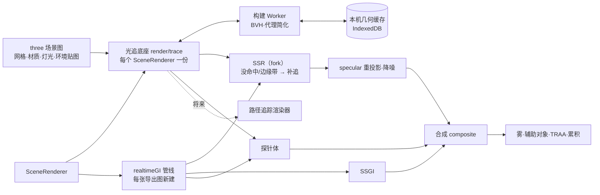

# Epic 技术方案

> 实时 GI 在屏幕追踪之后补一层世界空间追踪：
> - **光追底座**：渲染端把场景打包成两级 BVH 和材质表，跨导出图复用。
> - **反射**：SSR 没命中的采样，以及屏幕边缘淡出带里的采样，沿同一方向改用 BVH 补追，在重投影之前并入 SSR 的原始输出，和 SSR 共用一条降噪链。
> - **漫反射**：以摄像机为中心分级的 DDGI 式辐照度探针，替换合成里材质的环境贴图辐照度那一份。
> - **复杂场景，画质优先**（修订 v2）：
>   - 探针光线追误差受控的简化代理，锐利反射追原始几何；
>   - BVH 和代理在 Worker 里构建，并按模型修订缓存；
>   - 编辑时增量打包，上传量只与改动的几何成正比。
>
> 这一层只在满足上限的 WebGPU 设备上运行，其余情况退回现在的屏幕空间，现有的标定值不变。不新增场景字段。

## 设计上下文

- 需求与验收见 proposal，共识与 owner 决定见 `discovery/brainstorm.md`。研究文档有两份：
  - `discovery/research/world-space-tracing-options.md`：方案比较、Lumen 分层对照、工作量估计；
  - `discovery/research/complex-scene-scaling.md`：复杂场景下的扩展性和精度分档（修订 v2）。

  设计评审一轮（2026-10-23）的结论已并入本文。
- **采用的方案**：BVH 混合追踪，即屏幕追踪优先，没命中的部分交给 BVH 光追。反射接入 SSR 的原始输出，漫反射用级联的 DDGI 探针。场景变复杂时，不靠牺牲画质来换性能，而是靠以下几项（修订 v2，owner 2026-10-23「以尽可能不牺牲渲染质量为前提」）：
  - 精度分档；
  - 构建移出主线程并缓存；
  - 增量打包。
- **规模目标**（owner 2026-10-23 确认，S0 用压力场景验证）：单个场景的原始几何去重后约 2000 万面，实例约 2000 个。超出时按「能力与容量」分档降级，不失败。上万实例的密集远景不在目标内（research「何时该换方案」）。
- **待验证的假设**（S0 回答）：
  - 参考设备上软件 BVH 的吞吐足以支撑每帧约十几万条探针光线，以及 SSR 没命中部分的反射光线；压力场景下也成立；
  - 设备上限能容下参考场景；压力场景下的分档门槛；
  - 探针追代理与追原始几何的画面差低于阈值（I8）；
  - 预设改成「宽度函数」输入后，能在命中点调用，光栅输出逐像素不变；
  - 14 个预设内联进命中点着色器后的编译时间在 `lookBudgetMs` 以内。
- **后续增强，不在本 Epic**：
  - 粗糙反射复用探针；
  - 光线里的透明与透射；
  - 命中点的 PBR 贴图（C5c 之后）；
  - 在烘焙时生成代理和 BVH，随模型内容存储（外部 GLB 导入落地后）；
  - 光栅的 LOD 和 cluster 剔除（另立 Epic，可以与代理共用「派生几何」管线）。
  - 路径追踪复用底座。

## 领域模型与业务规则

本 Epic 不触及业务领域，只增加渲染端的派生状态。术语：

| 术语 | 含义 | 不是什么 |
|---|---|---|
| 世界空间追踪层 | 实时 GI 里在屏幕追踪之后接手的那一层：屏幕外反射加探针 GI | 不是新的渲染器，也不是渲染设置 |
| 光追底座 | 场景的光追数据和函数：两级 BVH、材质表、求交、命中点着色。实时 GI 和将来的路径追踪共用 | 不读场景文档，也不是场景数据 |
| 探针体 | 以摄像机为中心分成两到三级的一组辐照度探针，每个探针保存八面体编码的辐照度和深度矩，逐帧更新 | 不是反射捕获（cube），也不存储 |
| 追踪代理 | 每个几何按绝对误差 ε 简化出的一份网格，只给探针光线用 | 不用于光栅，也不用于锐利反射和路径追踪 |
| 精度档 | 一类光线追哪份几何：探针追代理，反射追原始几何 | 不是界面上的画质设置 |
| 兼容模式 | 沿用界面用语：渲染器运行在 WebGL2 后端 | 不是 WebGPU 的 `compatibility` 功能级别。WebGPU 设备上限不足另称「当前设备不支持」 |

**不变量**：

- **I1 屏幕优先**：世界空间追踪层只补屏幕追踪没覆盖的部分。
  - 反射：只在 SSR 没命中处、屏幕边缘淡出带里接手。
  - 漫反射：探针只替换环境贴图的辐照度那一份，`AmbientLight`（场景字段 `environment.ambient`）那一份保留。
  - 太阳只计一次：太阳由阴影贴图下的直接光计入，环境贴图里没有太阳盘（沿用 C5）。
  - SSGI 和探针的分工是**近似**互补，偏差由 AC-3 测量，不宣称精确的能量守恒（见「合成的接入点」）。
- **I2 一份材质定义**：
  - 命中点着色和光栅用同一份材质参数和同一个预设函数，以及同一组灯光和预曝光、同一套阴影贴图、同一张场景环境贴图。
  - 命中点的光照模型是与光栅等价的另一份实现：three 的光照模型只在材质构建时运行，无法在 compute 里复用。等价由「同一表面、光栅对照命中点着色」的测试把关。
- **I3 结果确定**：世界空间追踪层的随机序列只取帧序号。跨帧状态（探针、反射历史）在每张导出图从帧序号 0 开始时清空。
- **I4 场景不变**：后端和设备能力不同，只影响本机怎么画，不改写场景（G4、E7）。场景字段（包括环境光的颜色和强度）在构建和不构建这一层时含义相同。
- **I5 作用范围不变**：只作用于实时 GI 已经作用的地方，即最终渲染、`lit` 导出和 `render_view` 的 `lit`。
- **I6 标定只随这一层**：为这一层重新标定的常数，只在这一层构建时生效，在 `realtimeGI` 里按管线设置 uniform 或参数。这些常数包括 SSGI 增益 `GI_INTENSITY`、环境光填充 `AMBIENT_FILL_GI`、收敛帧数和时限。兼容模式、设备不支持和超出容量时全部保持现值，所以 AC-6 的画面不变。
- **I7 预设外观不变**：预设函数改成「宽度函数」输入后，光栅路径生成的着色与现在相同，已发布的预设不升版本（材质目录的规则）。
- **I8 画质优先的精度分档**（修订 v2）：为了性能做的简化，只能用在画面上看不出差别的地方。
  - **探针光线**追代理，代理的实际误差 ≤ ε_probe。探针存的是低频的辐照度，ε 远小于探针间距时差异看不出来；S0 用对照图证实，并定下 ε_probe。
  - **反射光线**默认追原始几何。只有原始几何超出设备容量时，才改追代理，并在渲染选项卡说明（见「能力与容量」）。
  - 将来的路径追踪始终追原始几何。
  - 规模变大时，按「代理反射 → 不画这一层」的顺序逐档降级，每一档都在渲染选项卡说明，不悄悄降低画质。
- **I9 就绪后才出图**（修订 v2）：底座在后台构建。视口不等待，就绪前实时 GI 只画屏幕空间并给出轻提示，就绪后自动接上。导出和 `render_view` 一定等底座就绪再开始计帧（I3），等待计入时限，所以结果不受构建快慢的影响。

**数据所有权**：

- BVH、材质表、探针和反射历史都是渲染端的 GPU 派生状态，来源是已挂载的 three 场景图，不是场景文档。
- 底座按渲染器实例持有（每个 `SceneRenderer` 一份），跨导出图复用，随渲染器销毁释放。不跨标签页共享。
- 探针和反射历史属于每条管线，每张导出图清空（I3）。
- **几何缓存**（修订 v2）：代理几何和 BVH 的序列化结果存进本机 IndexedDB。
  - 键是「几何身份（模型内容修订或内置基础体参数的哈希）+ 构建算法版本」，算法或 ε 变化时版本号随之变化。
  - 缓存只是加速用的派生数据：随时可以清除或读取失败，失败就重建，从不作为事实来源，也不上传。
  - 容量按 LRU 淘汰，上限由 S1 定。

## 架构设计



**职责与非职责**：

- **光追底座**（新建 `frontend/src/creative-scene/render/trace/`）：
  - **收集**：自己遍历场景图，选出参与追踪的网格，规则同光栅的不透明预通道：可见、在渲染图层里、不是辅助对象，透明和透射材质不参与。不依赖 `three-mesh-bvh` 的收集，因为它会带上子孙物件，也不看图层。
  - **构建与缓存**：在 Worker 里为每个几何构建原始 BVH，以及追踪代理和它的 BVH，结果按几何身份缓存（I8、I9，见「一次性开销与缓存」）。
  - **打包与同步**：增量打包两份底层几何（原始与代理）、顶层和材质表，每帧比对变化并按需更新（见「场景同步」）。
  - **提供函数**：TSL 的求交函数（按精度档选原始或代理）和命中点着色函数。
  - **报告状态**：能力和容量（见「能力与容量」）。
  - 不负责：降噪、合成、帧推进和任何场景数据。
- **世界空间追踪层**（`realtimeGI` 管线内部）：
  - 反射：在项目内 fork 的 SSR 里接入补追；
  - 探针体：布置、每帧更新、给像素插值；
  - 合成：改动见「合成的接入点」；
  - 按 I6 设置这一层专用的标定值。
  - 不负责：改材质、改灯光，或改实时 GI 之外的渲染器。
- **渲染器创建入口**（`render/gpu.ts`）：
  - 在适配器上限之内，额外请求底座需要的存储上限。现在只请求了 `maxTextureDimension2D` 和 `maxBufferSize`（`gpu.ts:280`）。
  - 能力按设备的实际 limits 判断，不按适配器。
  - 继续报告 `{backend, maxTextureSize}`，另加光追能力。
- **渲染选项卡**：读取本机能力和底座的容量状态，在「渲染后端」旁说明未绘制的部分。

**依赖方向**：`realtimeGI` → `render/trace` → `three-mesh-bvh/webgpu` 和材质的 TSL 函数（`materials/`）。底座不依赖 `realtimeGI`，将来路径追踪以同样方式依赖底座。

**失败与恢复**：

- 设备丢失：沿用现有恢复流程，底座随渲染器重建。
- 打包、编译失败，或运行中超出上限：本机不画这一层，记日志，渲染选项卡给出一般性提示，不暴露原始错误（沿用「部署错误不暴露给用户」），实时 GI 退回屏幕空间和现有标定值（I6）。

## 技术选型

| 项 | 选择 | 理由与边界 |
|---|---|---|
| BVH 与求交 | `three-mesh-bvh` 0.9.15（已是 npm 依赖，锁定版本）的 `three-mesh-bvh/webgpu` | 路径追踪 Epic 已选定它（`scene-webgpu-renderer` proposal）。遍历是 WGSL（`wgslTagFn`），作为 `patterns` 的例外接受，限定在依赖内部；它以 npm 依赖的形式使用，不拷进仓库（见下文「使用要点」）。整套 API 上游标为不稳定 |
| 漫反射 | DDGI：以摄像机为中心的两到三级级联、八面体辐照度、Chebyshev 可见性（深度矩）、探针挪位与停用、读上一帧探针实现多次反弹（Majercik 等，JCGT 2019「Dynamic Diffuse Global Illumination with Ray-Traced Irradiance Fields」） | 比 Lumen 的 Screen Probe 加 Radiance Cache 简单得多，天然支持多次反弹。级联让探针数与场景范围无关，近处比均匀网格更密（修订 v2）。漏光是它的已知弱点，用挪位、停用和深度矩来压（S2） |
| 追踪代理 | `meshoptimizer`（改为直接依赖，锁定版本）的 `MeshoptSimplifier.simplify`，用 `ErrorAbsolute` 按米指定误差，用 `LockBorder` 防止部件之间出现裂缝，并检查返回的实际误差 | 误差可以指定，也可以逐个模型检查，I8 才能写成可验证的上限。它的误差是二次误差的估计，不是严格的豪斯多夫距离，所以由 S0 的对照图把关（research「误差怎么受控」） |
| 构建与缓存 | `three-mesh-bvh` 的 `ParallelMeshBVHWorker`；`MeshBVH.serialize` / `deserialize`；本机 IndexedDB | 一次性开销移出主线程，同一个模型修订在同一台设备上只构建一次。首版不改契约；烘焙时生成并随模型内容存储，留到外部 GLB 导入之后 |
| 反射 | 在项目内 fork 的 `SSRNode` 里，对没命中和边缘淡出的采样沿同一 GGX 方向补追，命中点直接着色（hit lighting） | 和 SSR 同方向、同权重，才能共用现有的重投影、降噪和多次反弹回灌，不另建一条降噪链。fork 按 `patterns` 的 fork 规则在文件头注明上游版本和改动的行 |
| 没命中时的光 | 场景环境贴图（`scene.environment`，`objects/Lighting.tsx` 生成的 PMREM） | 和材质的环境光照同一来源，天空类型（物理天空、夜空、纯色）自动一致（I2），不各自接入大气 LUT |
| 命中点的阴影 | 采样现有阴影贴图：太阳阴影贴图按全部投影物件拟合，不按视锥（`sunShadow.ts:18`） | 屏幕外的命中点也在覆盖范围内，首版不发阴影光线 |
| 着色 | TSL：compute（`Fn().compute()`）和 `RenderPipeline` 的节点，配存储缓冲与存储纹理 | 项目代码不写 WGSL 字符串；静态检查加禁 `wgslTagFn`（S1） |
| 不采用 | Mesh SDF、Global SDF、Surface Cache、Screen Probe、体素锥追踪、硬件 RT、`three-gpu-pathtracer` | SDF 能让追踪开销与面数脱钩，但薄结构会漏光，反射细节也不足，与 I8 冲突，路径追踪也用不上。复杂场景下的比较见 research `complex-scene-scaling.md`，其余见 `world-space-tracing-options.md`「Lumen 的分层」和 `scene-webgpu-renderer` 的决策记录 |

**`three-mesh-bvh/webgpu` 的使用要点**（评审核对 0.9.15 源码）：

- **结构**：
  - 顶层是 `ClusteredBVH`，底层每个几何一棵 `MeshBVH`。底层会复用 `geometry.boundsTree`，放置功能已经设置了它（`placement/raycast.ts`）。
  - 每个物件占一个变换槽，存正矩阵、逆矩阵和可见标志。
- **求交**：`fns.raycastFirstHit` 可以从 TSL 调用，返回变换槽、三角形索引、重心坐标和世界空间法线。
- **材质索引**：写进变换槽里上游预留的对齐字段（覆写 `writeTransformData`）。这是非公开接口，由 S0 确认。
- **更新**：只改变换时用 `updateTransforms()`，它不在 `index.d.ts` 里，需要自己声明类型。增删物件或改几何时，**不用** `update()`：它会整体重新打包和上传，规模大时不可接受。改为增量打包（见「场景同步」），做法是扩展还是 fork 它的打包代码，由 S0 定；如果 fork，按 `patterns` 的 fork 规则处理。
- **属性**：默认只有 `position`；带顶点色的模型要加 `color`，以后有 UV 时再加。
- **单例**：`raycastFirstHit` 用 `Math.random()` 生成着色器里的变量名，所以每个渲染器只建一个 `BVHComputeData` 实例，避免每次重编译。
- **栈深**：BVH 遍历栈深为 60，超出时会抛错，计入容量判定。

## 关键机制

### 合成的接入点

**现行合成**（`render/realtimeGI.ts:91-103`）：

```text
kd     = base.rgb · (1 − base.a)
direct = output − ambient − envSpec
shaded = direct · contact' + ambient · ao + envSpec · ao · (1 − cover) + reflection · split + kd · gi
```

- `ambient` 是材质完整的 `indirectDiffuse`（`giSplit.ts`），由两部分组成：环境贴图的辐照度，加上 `AmbientLight`。后者的强度为 `environment.ambient.intensity × ambientFill(engine)`，见 `Lighting.tsx`；物理天空下没有这一项。两部分都已经乘过材质的能量补偿系数，即 three 的 `PhysicalLightingModel` 里的 1 − 镜面散射。
- `cover` 是本帧 SSR 原始采样是否命中。
- `gi` 已乘 SSGI 增益 `GI_INTENSITY = 5`。这约是能量中性值 2.5 的两倍，是为了替补缺失的屏幕外光和多次反弹而有意调亮的（`engines.ts`）。

**目标合成**（`world` 表示这一层已构建）：

```text
ambient = A_env + A_light                      // giSplit 拆成两个输出，都含能量补偿系数 c_E
shaded  = direct · contact'
        + (world ? kd · c_E · E_probe : A_env) · ao + A_light · ao   // 只换环境贴图那一份
        + envSpec · ao · (1 − cover') + reflection · split           // cover'：SSR 命中或补追命中
        + kd · gi                                                    // gi 的增益按 I6 取值
```

- **`E_probe`**：像素处插值得到的探针辐照度。`c_E` 由 giSplit 输出，和材质对环境贴图辐照度乘的是同一个系数。`A_light` 保留，所以环境光的颜色和强度在两种情况下含义相同（I4）。
- **近似互补**：
  - 可见性位掩码 SSGI 的 `ao` = 1 − 各切片 32 个扇区被遮挡比例的平均（`SSGINode.js`）。它只在屏幕半径内搜索，屏幕外的方向都算未遮挡；被遮挡的方向由 `gi` 负责。所以探针替换未遮挡的那部分，不会和天空光重复计算。
  - 但 `ao` 不按余弦加权，是个标量；探针辐照度是各向异性的，并且已经包含近处屏幕内遮挡物（例如红墙）的贡献。只有入射光各向同性时，乘 `ao` 才能扣得干净。
  - 残余偏差由 AC-3 测量，S2 用 `GI_INTENSITY` 和探针增益标定（I6）。
- **`GI_INTENSITY`**：`world` 时重新标定，向能量中性值回落。否则同一面墙在屏幕内按约 2 倍计，离开屏幕后按探针的物理值计，原地转动时亮度会跳变（AC-2）。
- **`AMBIENT_FILL_GI`**：只影响 `A_light`，`world` 时按需重新标定，不改兼容模式的值（I6）。

### 屏幕外反射

现行的 SSR 采样（`SSRNode.js`）：

- 原始采样 = 命中颜色 × 该 GGX 采样方向的权重，并写入命中距离；
- 没命中时 rgb 为 0，距离为 `ENV_RAY_LENGTH`。项目没有给它 `environmentNode`，环境反射由合成里的 `envSpec` 补上。
- 默认 `screenEdgeFadeBlack = false`：屏幕边缘附近的命中会向环境反射淡出，而这里的环境反射是 0，所以这些像素虽然 `cover = 1`，反射却被压暗。

目标：

- **补追的采样**：fork `SSRNode`，对两类采样沿**同一个**采样方向补追：
  - SSR 没命中的采样；
  - 边缘淡出带里的采样，按 (1 − 边缘因子) 混入补追结果。
  - 糙度低于阈值 `r_max`（U3）、不是透明或透射材质时才补追。
- **写回**：补追得到的原始采样 = 命中点着色 × 同一个权重，并写入命中距离。之后照常进入 specular 重投影和降噪（`realtimeGI.ts`），降噪结果照旧回灌给 SSR 做多次反弹。
- **`cover'`**：SSR 命中、补追命中或边缘带混合时为 1。只有两者都没命中（光线射向天空）时为 0，这时由材质的 `envSpec` 补上。
- **在哪里追**：直接在 fork 的 SSR 片元着色里调用求交（要求片元阶段能读存储缓冲），或者 fork 输出没命中采样的方向和权重，由 compute pass 追完后在重投影之前合并。由 S0 按参考设备的上限选定，接口不变：都是在重投影之前并入原始采样。

### 命中点着色

- **材质**：命中后取出变换槽和三角形，用逆矩阵得到对象空间的位置和法线，再按材质表调用同一个材质函数（原理化 BSDF 或预设的 TSL `Fn`），得到 `{albedo, roughness, metalness, emission}`。命中点不做凹凸（凹凸在预设函数之外由 `height` 求导得到），用几何法线。
- **宽度函数**（I7）：
  - 预设函数体里现在直接调用 `fwidth`（`materials/patterns.ts` 的 `aaStep`、`joint` 和若干预设体），`instances.ts` 的 `footprint` 也由 `fwidth` 算出。WGSL 的导数函数只能在片元阶段使用，而且命中点之间不连续，导数没有意义。
  - 预设函数改为接收一个宽度函数输入：光栅路径传 `fwidth`，生成的着色与现在相同；命中点传按光线锥估计的宽度，或取 0、靠多帧累积抗锯齿。由 S0 验证后选定。
  - 像素尺度同样按光线锥在命中距离处的宽度估计。
- **直接光**：太阳、点光和聚光按现有的预曝光强度计算，有阴影贴图的就采样阴影贴图。自发光直接计入。
- **间接光**：
  - S1 与材质的现有规则相同：环境贴图辐照度全量，加上 `AmbientLight × ambientFill`（物理天空下没有后者）。
  - S2 改为环境贴图那一份取上一帧的探针，`AmbientLight` 那一份不变，由此得到多次反弹。
- **没命中**：按光线方向采样场景环境贴图。反射取最清晰的一级，探针取漫反射卷积的一级。
- **透明与透射**：不进 BVH，光线直接穿过（proposal 非目标）。

### 场景同步

`SceneRenderer` 只在显示方式或尺寸变化时重建管线（`sceneRenderer.ts`），没有场景内容的变化检测。底座自己每帧比对。原则是**编辑的代价只与改动成正比**（修订 v2）：

| 变化 | 底座的动作 |
|---|---|
| 新几何（新模型修订、内置基础体的新参数） | 先查缓存，没有就交给 Worker 构建原始 BVH 和代理。完成后把它的节点、索引和属性追加写进底层缓冲的空闲区段，只上传这一段；再重建顶层 |
| 物件增删（几何已在缓冲里） | 只重建顶层（只含实例，千级），并更新变换槽和材质表 |
| 几何不再被任何实例引用 | 它的区段标为空闲，之后复用。碎片率超过阈值时，在空闲帧整理一次 |
| 只有变换变化（拖动、旋转） | `updateTransforms()`，只上传变换槽。S0 测代价，超出预算时拖动期间降频更新 |
| 材质槽、材质参数变化 | 只更新材质表 |
| 灯光、天空、曝光变化 | 底座不变；命中点着色读同一组 uniform 和环境贴图 |

- 底层缓冲按容量预分配并留出余量，超出时扩容一次再整体上传。扩容是唯一一种整体上传，频率按指数扩容来控制。
- 导出时每张图新建 `realtimeGI` 管线（`realtimeGI.ts` 的 MRT 注释），底座挂在 `SceneRenderer` 上，跨图复用，不随管线重建 BVH 或重新编译。

### 一次性开销与缓存

| 开销 | 何时发生 | 处理 |
|---|---|---|
| 原始 BVH 构建（SAH） | 每个新几何 | 在 Worker 里构建（`ParallelMeshBVHWorker`），结果序列化后存入本机几何缓存。放置功能已经为 `geometry.boundsTree` 建过的就直接复用 |
| 代理简化和代理 BVH | 每个新几何 | 在 Worker 里用 `meshoptimizer`，按 ε_probe 简化；实际误差超过 ε_probe 时，用原始几何充当代理，不放宽误差（I8） |
| 上传 GPU | 打开场景，或新几何就绪 | 按几何分段上传，不阻塞编辑 |
| 着色器编译 | 每个渲染器第一次 | 材质表是数据驱动的，场景内容变化不会触发重编译。编译时间计入 `lookBudgetMs` |
| 探针冷启动 | 每张导出图 | 预热帧 `M`（见下文） |

- **就绪**：所有当前可见实例的几何都已上传，才算底座就绪（I9）。
- **视口**：就绪前只画屏幕空间，渲染选项卡显示「正在准备屏幕外光照」。
- **导出和 `render_view`**：认领后先等底座就绪，再从帧序号 0 开始。等待时间计入时限，`shotBudgetMs` 和 `viewBudgetMs` 由 S1 按冷启动的实测加上余量。

### 精度分档

```text
探针光线    → 代理 BLAS（误差 ≤ ε_probe）
反射光线    → 原始 BLAS；只有原始几何超出设备容量时才改用代理 BLAS（见「能力与容量」）
命中后的着色 → 始终取原物件的材质（材质表按实例和槽位，与几何精度无关）
```

两份 BLAS 共用同一套顶层实例和材质表，求交函数按光线类型选择用哪一份。代理与原始几何的三角形没有一一对应关系，所以命中代理时，材质按「实例 + 槽位」查表，不依赖三角形编号。简化时保留槽位边界，也就是按槽位分别简化，或者用 `LockBorder` 锁住槽位之间的边。

### 收敛、帧推进与导出

- **视口**：沿用按需渲染。启用这一层后，`convergeFrames` 按探针的收敛重新标定（S2，I6）。拖动时探针以较低的时域权重快速跟上，停下后恢复正常权重。
- **导出与 `render_view`**：
  - 帧序号从 0 开始，探针和反射历史一律清空（I3）。
  - 先跑 `M` 帧只更新探针的预热帧，再跑现有的 `convergeFrames + K` 帧。预热期间探针用均值累积，不用指数滑动。`M` 由 S2 标定。
  - `drawnFrames` 计入 `M`；`estimateMs` 按实测更新，单张时限和 `render_view` 时限随之更新（S1、S2 各自标定，只在构建这一层时生效）。
- **编译**：首张图要把 14 个预设内联进命中点着色器，编译时间计入 `lookBudgetMs`（60 s，`engines.ts`）。S0 实测。

### 能力与容量

```text
能力   = WebGPU 后端 且 设备 limits ≥ 底座最低要求（入口已在适配器上限内请求）
容量_1 = 原始 BLAS + 代理 BLAS + 顶层 ≤ 设备的缓冲上限与显存预算 且 BVH 深度 ≤ 遍历栈深
容量_2 = 代理 BLAS + 顶层 ≤ 上限 且 BVH 深度 ≤ 遍历栈深（预算和门槛由 S0 定）

渲染器为实时 GI 且是透视视图时：
  WebGL2 后端       → 不构建；渲染选项卡：「兼容模式：未绘制屏幕外的光照与反射」
  WebGPU 但能力不足 → 不构建；「当前设备不支持屏幕外的光照与反射」
  满足容量_1        → 完整构建（反射追原始几何）
  只满足容量_2      → 构建，但反射也追代理；「场景较大：屏幕外的反射使用简化几何」
  两者都不满足      → 不构建；「场景过大：未绘制屏幕外的光照与反射」
不构建时：合成与全部标定值保持现状（I6）
```

- 降级按档逐级进行，每一档都在渲染选项卡说明（I8），档位只取决于本机设备和场景，不改写场景（I4）。

- 客户端任务不按能力路由（U4，owner 2026-10-23）：这一层属于「只支持 WebGPU 的统一规则」里的「质量层」（`scene-world-environment` 修订 v7），各渲染端按本机能力出图。
- 手动导出时，渲染选项卡的提示同样可见。

### 场景与导出

- 不新增场景字段。
- 实时 GI 的 `lit` 指纹连同世界空间追踪的版本号（S2 起为 1）一起计入，后端实现在 `backend/internal/creativescene/fingerprint.go`。S2 上线后，已有的实时 GI `lit` 导出各提示一次「场景已更新」（U7）。
  - 指纹版本前缀 `v1:` 不升级，所以 `clay`、`line` 和工作台的 `lit` 不受影响。
  - 兼容模式下重新导出得到的画面不变，这是接受的误报。
- 同一场景在 WebGPU 后端和兼容模式下画面不同，`scene-webgpu-renderer` 里「两个后端的实时 GI 画面一致」的口径对这一层不再适用。

## 验证与交付

- **参考场景与设备**：沿用 `scene-webgpu-renderer` R0 确定的参考设备和场景集，S0 另加三个参考场景和一个压力场景（proposal「验收标准」）。S0 记录本 Epic 之前实时 GI 的基线图、区域亮度和帧时间，作为 AC-2、AC-3、AC-6、AC-7、AC-9 和 AC-11 的对照。
- **画质对照**（I8）：同一场景分别让探针追代理和追原始几何，比较两张图的差异，作为 AC-12 的依据；S1、S2 改了简化参数或 ε 时都要重跑。
- **自动检查**：
  - 底座：收集、打包、同步和材质表的单测；
  - 合成：`composite` 在纯数值上的单测，沿用现有写法；
  - 命中点着色和光栅在同一表面的对照（I2）；
  - 预设改为宽度函数之后，光栅出图与基线逐像素相同（AC-9，S1）；
  - 隐藏标签页里两次导出逐像素相同（AC-5，S1 和 S2 都要过，只在 WebGPU 后端）；
  - 兼容模式的输出与基线一致（AC-6）；
  - 静态检查：项目代码里不出现 `wgslFn` 和 `wgslTagFn`。
- **人工验收**：反射观感、漏光、重绘对照由 owner 判断（roadmap「验收责任」）。
- **回退**：这一层在合成里是开关式接入，出问题时可以在本机关闭它（开发者开关，不进界面），回到现状和现有标定值，不影响场景数据。
- **验证门禁**：按 `AGENTS.md`「验证范式」，日常用 `make check-frontend`，e2e 只跑定向用例；合回 `develop` 用 `make check-merge`。

## 未决事项

| # | 问题 / 假设 | 影响 | 解决方式 | 最晚解决时点 |
|---|---|---|---|---|
| U1 | 软件 BVH 的每帧光线预算（代理与原始几何分别测）；增量追加和 `updateTransforms()` 的代价；冷启动与热启动的就绪时间；高面数模型下的下限 | S1、S2 的预算，拖动时的更新策略，AC-7 | S0 实测 | S1 开工前（Epic 修订） |
| U2 | 探针级联的级数、每级的间距和范围、各级之间的过渡混合；每个探针每帧的光线数（修订 v2 已定：采用以摄像机为中心的级联） | S2 | S0 原型给方向，S2 设计定 | S2 开工前 |
| U3 | 反射的糙度阈值 `r_max`；补追放在片元还是 compute | S1 | S0 测片元阶段的存储缓冲能力，S1 设计时对照参考场景 | S1 设计批准前 |
| ~~U4~~ **已决** | 兼容模式和设备不支持时：「质量层」降级（推荐，任务不路由），还是走「只支持 WebGPU 的统一规则」做任务路由 | 契约范围、与 `creative-mcp-server` 的先后、`scene-world-environment` 统一规则的口径、助手在兼容模式下的体验 | owner 2026-10-23 选「质量层」：不路由；`scene-world-environment` 修订 v7 给统一规则加上这一档 | 已决 |
| U5 | AC-2、AC-3、AC-4、AC-7 的阈值；导出预热帧数 `M` | 验收标准与时限 | S0 提出，owner 确认，经 Epic 修订回填 | S1 开工前 |
| U6 | C5c 交付 PBR 贴图后，命中点怎么采样任意物件的贴图（WebGPU 没有 bindless：图集或纹理数组） | 命中点着色 | C5c 设计时与本 Epic 协调，修订本 Epic | C5c 开工前 |
| ~~U8~~ **已决** | 规模目标：去重后约 2000 万面、约 2000 个实例 | 显存预算、分档门槛、压力场景的规格 | owner 2026-10-23 确认；S0 用压力场景实测门槛和预算 | 已决 |
| U9 | 代理误差上限 ε_probe 和代理的面数预算；增量打包是扩展还是 fork `three-mesh-bvh` 的打包代码；几何缓存的容量上限 | S1 | S0 用画质对照和压力场景实测 | S1 设计批准前 |
| ~~U7~~ **已决** | 本 Epic 让实时 GI 的画面明显变化，已有的实时 GI `lit` 导出图要不要提示「场景已更新」 | 渲染指纹、契约范围 | owner 2026-10-23 选「提示一次」：S2 交付 `data: MODIFY 场景文档`，在实时 GI 的 `lit` 指纹里计入世界空间追踪的版本号 | 已决 |
