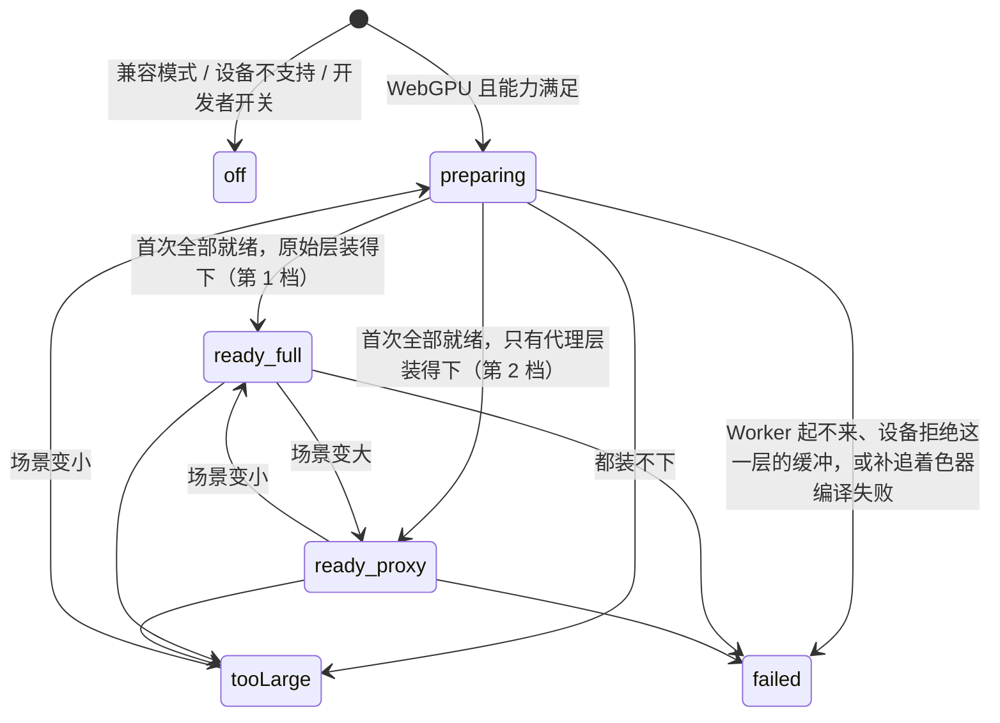

# Change 详细设计

## 继承的设计

- **Epic**：`scene-world-space-gi` 基线 v4，绑定全部设计条目。S1 落实以下各节中与底座和反射有关的部分：
  - 「领域模型与业务规则」：I1–I9；
  - 「架构设计」；
  - 「技术选型」和「`three-mesh-bvh/webgpu` 的使用要点」；
  - 「关键机制」：
    - 「屏幕外反射」「命中点着色」「场景同步」「一次性开销与缓存」「精度分档」「能力与容量」；
    - 「合成的接入点」只用到 `cover'` 一项；
    - 「收敛、帧推进与导出」只用到 I3、`nodeFrame` 和时限。
  - 「验证与交付」。
- **契约**：S1 不交付 Epic 的目标契约。`architecture: 场景模块`、`patterns: 场景着色写法` 和 `data: 场景文档` 都由 S2 交付（修订 v4：前两条的目标正文包括探针、漫反射和 S2 的重新标定）。
- **依据**：S0（`scene-trace-spike`）的 research，在 `features/2026-10-23-scene-trace-spike/discovery/research/`：
  - `integration.md`：包装函数、材质索引写进变换槽；
  - `throughput.md`：Worker 构建、缓存、增量打包、分档门槛；
  - `hit-shading.md`：宽度函数、命中点着色、阴影光线；
  - `reflections.md`：做法 A、`r_max`、GGX 的 NaN；
  - `proxy-quality.md`：代理的参数和实测误差。

  原型在同一目录的 `prototype/`，S1 以它为起点改写成产品代码，不直接搬运：原型里有实验开关、B 做法和测量代码。
- **S1 承担**：Epic 的 AC-1、AC-5、AC-9，AC-6 和 AC-7 的上限部分，AC-11（S2 复测），以及 AC-12 的反射部分。

## 领域模型与业务规则

S1 不触及业务领域。下面是渲染端新增的派生状态和它们的规则。

### 底座的状态



- **`off`**：带原因。
  - `compatibility`：WebGL2 后端；
  - `device`：WebGPU 设备不满足最低要求，包括 compatibility 功能级别的设备（Epic 术语：「兼容模式」只指 WebGL2）；
  - `disabled`：开发者开关。
- **`preparing`**：只用于首次就绪和设备重建，带进度（已就绪的几何数 / 总数）。
- **`ready`**：带档位 `full` 或 `proxy`，以及 `pending`（还在构建或待提交的几何数）。
  - 就绪后新加的几何只让 `pending` 增加，状态不退回 `preparing`，管线不重建。补追照常进行，那个几何回传并提交后的下一帧出现在反射里。
  - 管线的 key 只随档位变化，避免每加一个几何就关掉补追、重建管线（每次重建都要在主线程重新生成补追的着色器）。
- **`tooLarge`**、**`failed`**：
  - 都不画这一层；
  - `failed` 时丢掉两份精度的层。在下一次场景变化时重试一次，仍失败就保持到设备重建；重试后回到 `ready`，之后的失败照样重试一次。补追着色器在这台设备上编译不过（`SceneGPU.pipelineFailed`）不再重试（A13）。
- **单个几何构建失败**（出错，或超过时限被终止）不算整层失败：这个几何不进入反射，其余照常就绪；它离开场景后再出现时重新构建（A13）。

渲染选项卡的说明与状态一一对应（「降级与提示」）。

### 内部类型

| 类型 | 内容 | 规则 |
|---|---|---|
| `GeometryKey`（`geometry.userData.traceKey`） | 模型：`model:<内容修订>#<序号>`，序号是 `partsOf` 按槽位合并之后的顺序；内置基础体：`builtin:<id@版本>:<排好序的参数 JSON>` | 由创建几何的地方写入：模型在 `ModelCache.load` 里、拿到合并结果之后写（`partsOf` 拿不到内容修订）；`alias()` 让本机烘焙的部件改用正式修订时，标注随之改写；内置基础体在 `primitiveGeometry` 里写。没有标注的几何（本机还没保存的烘焙、e2e 的 `?nomerge=1`、其他来源）不进本机缓存，只在本会话里按 `geometry.uuid` 去重 |
| `CacheKey` | `<raw\|proxy@level>:<GeometryKey>:<构建器版本>:<参数>:<库版本>` | 参数包括 SAH、叶子大小、深度上限，代理另加 ε 级别。原始和代理分开存，改 ε 不重建原始。构建器版本也涵盖合并规则：`models/merge.ts` 的分组键改变时一起升级，旧缓存随之失效。库版本是 three、three-mesh-bvh、meshoptimizer 的版本号（`cache.ts` 的 `BUILT_WITH`），单测核对它与已装版本一致，升级依赖时键随之改变（A13）。按材质数组画的网格，`GeometryKey` 后加 `+groups` |
| `Segment` | 一个几何按 GPU 格式打好的区段，基址为 0：每个根的节点、索引、顶点（`vec4f`）、可选的顶点色，以及根数、每个根对应的分组、深度和源几何的面数 | 由 Worker 产出，可转移；也是缓存里存的内容。缓存命中时核对源几何的面数，不符就重新构建 |
| 材质行 | 8 个 `vec4`：表头（种类与预设编号、`side`、是否用顶点色），之后是参数 | 按「实例 + 槽位」一行，行号写进变换槽的对齐字段（word 33）。参数从槽位材质（`SlotMaterial`）取，与光栅的 uniform 同值 |
| 灯光行 | 4 个 `vec4`：类型、位置或方向、颜色 × 强度（已乘预曝光）、范围与衰减、聚光的内外锥、是否投影 | 每帧在 `applyExposure` 之后写 |

### 本次的不变量

- **L1 不构建时一切照旧**：底座不是 `ready` 时，实时 GI 用 three 原版的 `ssr`，不用 fork，管线与现在逐节点相同（AC-S1-3、AC-S1-6）。
- **L2 每层一个实例**：每个设备的每一层（原始、代理）只有一个 `BVHComputeData` 实例。库的求交函数用 `Math.random()` 起变量名，多一个实例就多编译一份着色器。
- **L3 出图的打包顺序确定**：
  - 离屏设备（导出、`render_view`）在就绪前一次打包完：区段按 `GeometryKey` 排序，顶层按物件 ID 和槽位排序。
  - 同一场景每次导出得到相同的布局，等距命中时的取舍也就相同（AC-S1-4）。
  - 视口可以按完成先后增量写入，因为视口不要求两次逐像素相同。
- **L4 不读场景文档**：底座只从已挂载的 three 场景图派生，不持久化任何场景数据。
- **L5 缓存只作加速**：
  - IndexedDB 打不开、读写失败、配额不够，都当作没有缓存，照常构建；
  - 缓存从不阻塞编辑，也从不作为事实来源。
- **L6 档位只看本机**：档位只取决于设备上限和场景大小，不改写场景（Epic I4）。

### 持有关系

- 底座每个渲染设备（`SceneGPU`）一份，经 `gpu.cache('trace', …)` 持有，随设备释放（修订 v4）。同一设备只画一个 three 场景：视口一个，每次导出各开一个离屏设备。
- **Worker 池和进行中的构建按页面一份**，视口和离屏设备共用：
  - 同一个 `CacheKey` 的请求合并成一次构建；
  - 离屏导出常常能直接拿到视口刚建好的结果。

## 模块职责与协作

| 模块 | 职责 | 不负责 |
|---|---|---|
| `render/trace/base.ts`：`TraceBase`、`traceBase(gpu, scene)` | 状态机；每帧 `sync`：收集、比对、调度构建、提交区段、更新两份表；`ready(deadline)`；给管线的 `TraceHandle` | 降噪、合成、帧推进 |
| `render/trace/collect.ts` | 收集规则（纯函数，单测）；逐帧比对在 `base.ts` 的 `sync` 里 | 打包 |
| `render/trace/pool.ts`、`render/trace/build.worker.ts` | Worker 池；Worker 内：读缓存 → 构建 SAH BVH 或简化代理 → 打包成 `Segment` → 回传 → 写缓存 | 主线程上的任何打包 |
| `render/trace/cache.ts` | IndexedDB 的读写、LRU 记账、配额检查（Worker 里运行） | 决定构建什么 |
| `render/trace/layer.ts`：`TraceLayer extends BVHComputeData` | 按容量预分配；把区段改基址后写进空闲区段；顶层重建；按区间上传；扩容 | 构建 BVH |
| `render/trace/capacity.ts` | 能力判定和分档（纯函数，单测） | — |
| `render/trace/tables.ts` | 材质行、灯光行的写入 | — |
| `render/trace/wgsl.ts` | 唯一的 WGSL：调用库求交的包装函数（`traceFirst`、`traceWithin`） | 任何着色逻辑 |
| `render/trace/hit.ts` | TSL：取命中点的位置、法线和光线微分，查材质表、调预设、算光照（含阴影光线），返回 `{color, dist}` | 选哪一层（由调用方传入） |
| `render/nodes/SSRTraceNode.js` | fork 自 three 0.186.1 的 `SSRNode.js`，在片元末尾补追 | — |

**主流程（视口的一帧）**：

```text
Viewport → SceneRenderer.render(frame)
  applyExposure(...)                         // 灯光强度先乘好预曝光
  base = traceBase(gpu, scene)               // 只在实时 GI、透视、lit 外观下取
  base.sync(camera)                          // ≤ 8 ms：比对 → 发构建 → 提交已回来的区段 → 写表
  look.trace = base.status 是 ready ? tier : 'off'
  key 变化 → 重建管线：realtimeGI(..., { trace: look.trace === 'off' ? null : base.handle(tier) })
  pipeline.render()
```

**导出和 `render_view`**：

```text
挂载材质光照外观（openShooter 以 lit 打开，或 setLook('lit')）→ compile
  若实时 GI 且能力满足：await base.ready(15 s)        // 与编译一起计入 lookBudgetMs
    就绪 → 照常 shoot，shotBudgetMs 按 world = true 计
    超时 → 抛出 TraceNotReady：这张图失败，提示「屏幕外的反射还在准备，请稍后重试」
```

默认导出先拍白模和线稿，再 `setLook('lit')`（`host/exportShots.ts`），所以等待挂在挂载外观这一步，而不只在 `openShooter`。

**依赖方向**：
- `realtimeGI` 和 `SSRTraceNode` 依赖 `trace/` 提供的 `TraceHandle`；
- `trace/` 依赖 `three-mesh-bvh/webgpu`、`meshoptimizer` 和 `materials/` 的预设函数；
- `trace/` 不依赖 `realtimeGI`。

## 关键机制

### 能力与设备上限

- **`gpu.ts`**：
  - 在适配器上限之内，再请求 `maxStorageBufferBindingSize`、`maxBufferSize` 和 `maxStorageBuffersPerShaderStage`。
  - `SceneGPU` 新增 `trace: { supported: boolean; reason?: 'compatibility' | 'device'; maxBinding: number }`，按设备的实际 limits 填写。
- **最低要求**：WebGPU 后端，且不是 compatibility 设备，且片元阶段至少 6 个存储缓冲。
  - 6 个是：BVH 的 4 个、顶点色 1 个、材质与灯光表 1 个。
  - 两份表合并成一个缓冲，比原型少用一个。
- **开发者开关**：本机 `localStorage['scene.trace'] = 'off'` 时状态为 `off/disabled`，不进界面（Epic「回退」）。

### 收集与比对

收集规则与光栅的不透明预通道相同：
- 网格可见（沿父级判断）；
- 在图层 0 上（辅助对象、天空、体积的线框都不在）；
- 槽位材质不透明，也不是透射（`isSeeThrough`）；
- 有几何。没有索引的几何在 Worker 里补一份顺序索引；
- 整体绘制：网格片的范围视图（`render/pieces.ts` 的 `pieceViews`，`drawRange` 只覆盖一段）不收集。现在只有半透明、透射槽位和幽灵模型画范围视图，本来就不收集；单测守住这一点，否则 BVH 会按整个合并几何去建。

模型几何在 `partsOf` 里已按槽位合并（`patterns`「场景渲染批次」）。底座按合并后的几何建 BVH，与光栅画的是同一份三角形：
- 顶层用各根 BVH 根节点的包围盒（由三角形算出），不读几何的 `boundingBox`，所以不需要像阴影级联那样逐网格片读包围体；
- 补追在 SSR 的片元里进行，不新增渲染 pass，每个物件每帧的 draw 数不变。

每帧比对按 Epic「场景同步」的表分类，S1 的落实：

| 比对出的变化 | 判据 | 动作 |
|---|---|---|
| 新几何 | `GeometryKey`（或 uuid）不在已提交的区段里 | 发构建，`pending` 加一；回来后在下一帧的预算内提交。期间已就绪的部分照常补追，没就绪的几何暂不出现在反射里 |
| 物件增删、可见性变化 | 实例集合变化 | 重建顶层，写变换槽和材质行 |
| 只有变换变化 | `matrixWorld` 逐元素比较 | 顶层 refit，按区间上传顶层节点和被移动物件的变换槽 |
| 槽位材质变化 | 材质实例变化（参数改变会换实例，`materials/instances.ts`） | 只重写材质行 |
| 灯光、曝光、天空 | — | 每帧重写灯光行；环境贴图由命中点着色直接读取 |
| 几何不再被引用 | 引用计数为 0 | 区段标为空闲；碎片超过 25% 时，在空闲帧整理一次 |

材质实例到 `SlotMaterial` 的映射由 `materials/instances.ts` 新增的 `slotOf(material)` 提供（`WeakMap`），底座不解析场景文档。

### 构建、缓存与提交

- **Worker 池**：
  - 大小为 `navigator.hardwareConcurrency − 1`，至少 1 个；
  - 按几何分配任务，不用 `ParallelMeshBVHWorker`（Epic 选型）；
  - 每个任务有时限（2 分钟，每百万面再加 1 分钟；大厅 2001 万面冷启动约 6 s 全部回来）。超时就终止那个 Worker，这个几何按构建失败处理（A13）。
- **一个任务**：

  ```text
  先读缓存（CacheKey）
    命中 → 回传区段
    未命中 → 构建 → 打包 → 回传（可转移）→ 写缓存
  ```

  - **构建**：原始 BVH 用 `new MeshBVH(geometry, { strategy: SAH })`，叶子大小和深度上限取库的缺省（10、40），都写进缓存键。
  - **分组**（A13）：只有网格按 group 用材质数组时，才把 group 交给 Worker，一个 group 一个根；单材质的网格整份几何一个根，例如基础体的方块有 6 个 group，但只占一片顶层叶子。库会按位置给 group 排序、切开重叠的、丢掉空的，所以 Worker 先把各 group 的三角形按 group 的顺序排成连续的几段再交给库，并回传每个根对应的 group 序号，底座按它查材质行。
  - **代理**：
    - 每个槽位分别调用 `MeshoptSimplifier.simplify`，目标面数 0，开 `ErrorAbsolute` 和 `LockBorder`，槽位之间的边界因此保留。现有来源的几何都只有一个槽位（`partsOf` 每个网格片取一个材质，合并又按槽位分组）；Epic 的多 group 路径照常实现，用构造的几何做单测（AC-S1-9）；
    - 误差上限 = ε_probe / 引用它的实例里最大的缩放，按 √2 倍一级取整成「ε 级别」；
    - 有实例放大到需要更细一级时，按新级别重建；
    - 简化不掉的部分保留原样，不放宽误差（I8）。
  - **打包**：用库的打包辅助函数，写成基址为 0 的区段。顶点是 `vec4f`：xyz 为位置，w 为法线（见下）。
  - **写缓存**：在回传之后进行，不占就绪时间。
- **法线编码**：
  - 八面体编码，两个分量各 11 位，拼成一个不超过 2²² 的整数，作为 f32 精确存储。
  - 不存 u32 的位模式：位模式可能是 NaN，加载时有被规范化的风险。
  - 着色时还原，角度误差约 0.1°。
- **缓存（`cache.ts`）**：
  - 一个库，两个存储：区段数据和记账（键、字节数、最后使用时间）。
  - 总量上限 2 GiB，超出时按最后使用时间淘汰。
  - 写入前用 `navigator.storage.estimate()` 检查剩余配额，不够就先淘汰，仍不够就不写。
  - 读取命中时批量更新最后使用时间。
- **提交（主线程）**：
  - 每帧最多花 8 ms，把回来的区段拷进层的缓冲：节点里的子节点偏移和索引里的顶点号都加上基址，再按区间上传。
  - 一次预留时，顶层的叶子数按各网格的根数算，不按网格数（A13）：否则铺顶层时还要再整份重排一次。
  - 旧缓冲的 GPU 副本：重排时立即释放（存储节点已换上新缓冲，之后的帧不再绑定旧的）；整份层被丢掉时（换档、repack、失败），到下一次 `sync` 才释放，因为丢掉它的那一帧可能还要画它（A13）。three r186 的 `BufferAttribute.dispose()` 对存储缓冲不起作用，释放经 `SceneGPU.release` 调渲染器的属性表。
  - 一个 30 万面的区段约 1 ms，压力场景冷启动要分几十帧提交完，满足「构建期间没有超过 100 ms 的任务」（AC-S1-8）。
- **离屏设备**：
  - `ready()` 等全部区段回来（`pending` 为 0），按 L3 的顺序一次写完，同样分批让出主线程；
  - 让出用 `host/ticker.ts` 的 `backgroundTicker()`，不用 `setTimeout` 或 rAF：助手的任务常在隐藏标签页里运行，那里的定时器会被节流到 1 s 以上；
  - 离屏设备上的场景在一次导出里不变，所以只打包一次，上传后释放 CPU 侧的数组，不保留镜像。

### 视口的重画

视口按需渲染（`Viewport.tsx` 的 `frameloop="demand"`），停止操作 `convergeFrames` 帧后就不再画。底座自己不会推进，所以：
- `TraceBase` 接收 `SceneRenderer` 已持有的 `redraw`；
- 有构建在进行、有区段待提交，或状态、档位变化时，持续请求下一帧；`LookView` 把收敛计数归零，接上后照常收敛、停止重画；
- 没有待办时不请求，不空转（Epic AC-4）。

### 分档

```text
能力不满足                              → off（compatibility | device）
estimateRaw = Σ 去重几何的面数 × 40 B × 1.25
estimateRaw > 1.5 × 预算                 → 不构建原始 BVH，直接按第 2 档构建代理
否则构建原始层，按实际字节判定：
  原始层 × 1.25 ≤ 预算 且 每个缓冲 ≤ maxBinding 且 遍历深度 ≤ 60  → ready/full
  否则构建代理层：代理层 ≤ maxBinding 且 遍历深度 ≤ 60          → ready/proxy
  否则                                                         → tooLarge
预算 = 1 GiB（gpuTestHooks.traceBudget 可覆盖，e2e 用它触发各档）
```

- 每面 40 B 来自 S0：压力场景原始层 894 MiB / 2011 万面，法线编码后约 36 B。
- 1.5 倍的门槛是为了不把明显装不下的场景白白构建一遍。估算和实际之间的场景照常构建，按实际判定。

### 命中点着色（`hit.ts`）

- **入口**：

  ```ts
  shadeHit(handle, origin, dir, coneWidth, coneSpread) → { color, dist }   // dist < 0：没命中
  ```

- **求交**：经 `wgsl.ts` 的包装函数调用库的 `raycastFirstHit`。
  - **命中单面材质的背面**（材质行的 `side` 为正面，而命中的是背面）：从命中点沿原方向再追一次；仍是背面就当作没命中。光栅剔除这些面，光线也就不该被它们挡住。
- **几何**：
  - 从变换槽取矩阵、逆矩阵和材质行号；
  - 由重心坐标插值解码后的顶点法线，变到世界空间，朝向光线的反方向；
  - 对象空间的位置按 `instances.ts` 的 `patPos` 换算（乘缩放，单位为米）。
- **宽度**：光线锥（`hitShade.ts` 的做法）。
  - 锥宽 = `coneWidth + coneSpread × t`，沿光线方向按 1/cosθ 拉长（cosθ 下限 0.2）；光线正对表面时，切线框架取由法线构造的任一正交基（Duff 等 2017），不会退化成 NaN（A13）；
  - 由此合成两个方向的光线微分，再按预设传给宽度函数的量取有限差分；
  - `footprint` 由同一组微分算出。
  - `coneWidth` 和 `coneSpread` 由 SSR 片元给出：像素角 × 视距，以及「像素角 + 2 × 粗糙度²」。
- **材质**：
  - 一个 `Switch` 按预设编号分支，14 个预设各一支，原理化材质和未知材质（灰）在 `Default`；
  - 所有输入都在 `Switch` 之前存成变量（S0：各分支共享的表达式会读到未赋值的值）；
  - 输出 albedo、粗糙度、金属度、自发光。命中点不做凹凸，原理化材质的清漆等其余参数在命中点忽略（Epic「命中点着色」）；
  - 带顶点色时，albedo 乘插值后的顶点色。
- **光照**：与 three 的 `PhysicalLightingModel` 同一组公式（ior 1.5、specular 1），直接调用 three 导出的 `BRDF_GGX`、`BRDF_Lambert`、`F_Schlick` 和 `DFGLUT`。
  - **直接光**：遍历灯光行，包括平行光（太阳、月光）、点光和聚光。
    - 收集时排除强度为 0 的灯和 W5 的替身灯（`userData.volumesCast`）。
    - 投影的灯朝它发阴影光线（`traceWithin`），距离截到灯光处；不投影的灯不发，与光栅一致。起点沿三角形自身的法线（朝光线来的一侧）偏 max(1 mm, 10⁻⁵ ×（命中距离 + 坐标长度）)，不沿插值法线（A13）。
  - **间接光**：
    - 环境贴图的辐照度和辐射度，用 PMREM 的 `textureCubeUV`，乘 `scene.environmentIntensity`，按 `scene.environmentRotation` 旋转；
    - `AmbientLight` 的颜色 × 强度之和（不含替身灯）；
    - 多次散射的能量补偿同光栅。
  - **自发光**：乘预曝光，同 `instances.ts` 的 `exposedEmission`。
  - **不计**：雾、空气透视和体积。它们由合成作用在屏幕表面上，SSR 采样的拆分光照 pass 里也没有，两者一致。
- **没命中**：返回 `dist < 0`，由 SSR fork 当作「两者都没命中」，`cover' = 0`，由材质的 `envSpec` 补上（Epic「屏幕外反射」）。

### 反射补追（`SSRTraceNode.js`）

fork 基于 three 0.186.1 的 `SSRNode.js`，文件头注明上游版本，每处改动标「fork:」（`patterns` 的 fork 规则）。只保留做法 A。

- **构造参数**：多一个 `trace: TraceHandle` 和 `rMax` uniform。
- **补追请求**：
  - SSR 没命中的采样，份额为 1；
  - 边缘淡出带里命中的采样，份额为 1 − 边缘因子。

  条件是粗糙度 < `rMax`，且方向的各分量有限。
- **步进只信屏幕上看得见的**（A12）：对满足上面条件、会被补追的采样，屏幕空间步进遇到下面两种情况就停下，按没命中处理，整条光线交给补追：
  - 光线走到深度缓冲后面，超出厚度；
  - 光线从背面碰到表面（光线方向与该处法线同向）。

  上游的随机采样在这两种情况下都继续往前走，然后把后面碰到的东西当作命中。这些东西可能是球后面的地板，也可能是球的正面，但屏幕上其实看不到光线真正撞到的东西，比如球的背面。不补追的采样（粗糙度 ≥ `rMax`）照上游处理。
- **片元末尾**：
  - 用这个像素的世界空间位置（由深度重建）沿法线偏移作起点，沿 SSR 自己的 GGX 采样方向调 `shadeHit`。偏移量 1 mm + 2 × 10⁻⁶ × 视距²，随深度缓冲的误差按距离平方增长（近裁剪面 5 cm 时，50 m 处误差约 3 mm）（A13）；
  - 把「份额 × 着色 × 同一个 GGX 权重」按原输出的亮度上限和强度加进去；
  - 没命中的像素，alpha 写补追的命中距离（同样乘镜面主导因子），所以下游的 `cover = reflect.a < MISSED` 自动成为 `cover'`。
- **管线失败**：补追的材质标了 `userData.watchPipeline`，`SceneGPU` 记下为它建的管线。画完一帧后发现管线被设备拒绝（three 只在控制台记一条；失败标记出来之前的那一帧整个命令缓冲无效，之后跳过它的绘制，反射就没了），底座进入 `failed`、不再重试，下一帧起画上游的 SSR（L1）（A13）。
- **GGX 采样**：换成修好的 `ggxReflectionSample`：先比较 `cross(up, N)` 的长度，再归一化。这一项只在构建这一层时生效，不构建时用的是原版 `ssr`（L1）。
- **`rMax`**：`quality === 'interactive'` 时 0.5，`'final'` 时 1.0（Epic U3）。
- **下游**：重投影、降噪和多次反弹回灌都不改。`realtimeGI.ts` 只在有 `trace` 时把 `ssr(...)` 换成 `ssrTrace(...)`。

### 接入、就绪与切换

- **管线**：`sceneRenderer.ts` 的 `Look` 多一项 `trace: 'off' | 'full' | 'proxy'`，并进 `keyOf`。档位变化（就绪、升降档）时重建管线，与现在显示方式变化时的处理相同。
- **视口**：
  - 状态由 `Viewport.tsx` 订阅，写进 `sceneStore` 的 `ui.trace`；渲染选项卡读取它；
  - 就绪那一帧切到带补追的管线，之后按 Epic AC-4 自然收敛；
  - 就绪前的帧与现在逐像素相同（L1）。
- **导出与 `render_view`**：
  - 挂载材质光照外观时（`openShooter` 以 `lit` 打开，或 `Shooter.setLook('lit')`），编译之后等 `ready`，最多 15 s，与编译一起计入 `lookBudgetMs`（60 s）；
  - 就绪后每张图从帧序号 0 开始（I3）。底座跨图复用，只有管线按图新建（Epic「场景同步」）；
  - 超时则抛 `TraceNotReady`，这张图失败。手动导出的提示：「屏幕外的反射还在准备，请稍后重试」；助手任务同样失败，并带上这句说明。
- **帧推进**：沿用 `gpu.ts` 的 `advanceFrame()`，每帧前显式推进 `nodeFrame`（S0 发现 5）。
- **设备丢失**：底座随设备释放，新设备重新收集。Worker 池和缓存还在，所以通常是热启动。

### 降级与提示

| 状态 | 渲染选项卡在「渲染后端」旁的说明 |
|---|---|
| `off/compatibility` | 兼容模式：未绘制屏幕外的反射 |
| `off/device` | 当前设备不支持屏幕外的反射 |
| `preparing` | 正在准备屏幕外的反射 |
| `ready/full` | （无） |
| `ready/proxy` | 场景较大：屏幕外的反射使用简化几何 |
| `tooLarge` | 场景过大：未绘制屏幕外的反射 |
| `failed` | 屏幕外的反射暂时不可用 |
| `off/disabled` | （无） |

- 只在渲染器是实时 GI 时显示。
- 渲染器说明里原来的「只计算画面里可见的表面……也不出现在反射里」，在 `ready` 时改为「画面外的物体也会出现在反射里；间接光只计算画面里可见的表面」。
- S2 把「反射」改为 Epic 的「光照与反射」。

### 时限

- **单张导出**：`engines.ts` 的 `frameNs`、`estimateMs` 和 `shotBudgetMs` 多一个参数 `world`。
  - 构建这一层时，按 S1 在参考设备上实测的每像素每帧耗时，加上余量；不构建时取现值（Epic I6）。
  - `host/exportShots.ts` 在每张图之前算时限，`world` 取 `Shooter` 报告的当前档位是否为 `ready`。
- **`render_view`**：`viewBudgetMs` 仍是常量（`host/executor.ts` 的 `renderTimeoutMs` 在出图前并不知道设备和档位），改为按「构建这一层」的上界计算：`world` 的帧耗时，加上 15 s 的就绪等待。
- **等待**：等底座的时间算在外观挂载里（`lookBudgetMs`），不占单张时限。

### 宽度函数（AC-S1-3）

- **`PatternInput`**：多一个 `width: (x) => node`。
- **`patterns.ts`**：原来直接调用 `fwidth` 的 6 处改为 `width(...)`：`aaStep`、`joint`、`stone@1`、`marble@1`、`wood@1`、`fabric@1`（与 S0 的副本相同）。`aaStep`、`joint` 和三平面投影 `planar` 把 `width` 往下传。
- **`instances.ts`**：传 `width: fwidth`，`footprint` 不变。
- **单独提交**：这一步单独提交。改动前先记下 14 个预设生成的 WGSL 的哈希，改动后比较，再导出参考场景集比较。

### 测试开关

`gpuTestHooks` 新增：
- `traceBudget`：覆盖 1 GiB 的预算，用来触发第 2 档和「场景过大」；
- `traceOff`：等价于开发者开关；
- `traceUnsupported`：把能力判为不满足，用来测「当前设备不支持」（本机没有这样的设备）；
- `traceDelayMs`：每个构建任务回传前多等这么久，用来测导出等待超时和就绪前的视口；
- `traceStats`：上传字节、提交耗时、当前档位、`pending`、层的字节数，以及反射内核绑定的是哪一层。

已有的 `forceWebGL` 对应 `off/compatibility`，`forceCompatibility` 对应 `off/device`。

只有 e2e 夹具页设置它们。

## 局部设计与偏差

| # | 决定 | 依据与取舍 |
|---|---|---|
| D1 | 底座每个 `SceneGPU` 一份（Epic 修订 v4） | 导出每张图新建 `SceneRenderer`，挂在它上面就不能跨图复用 |
| D2 | 缓存存打好包的区段，不存 `MeshBVH.serialize`；原始 BVH 不复用放置功能的 `boundsTree`（修订 v4） | 热启动只拷贝和改基址，打包不上主线程。放置功能的树是主线程上按 CENTER 策略建的，而且只有拖动过的网格才有 |
| D3 | S1 只在第 2 档构建代理 | 第 1 档用不上代理，冷启动省 5.8–7.0 s 的 Worker 累计耗时。S2 改为始终构建 |
| D4 | 法线以「两个 11 位分量拼成的整数」精确存进 f32 | 不存位模式，避免 NaN 位型被规范化。11 位的角度误差约 0.1°，对着色足够 |
| D5 | 顶点色另放一个缓冲，有带顶点色的几何时才按顶点数分配，没有时绑占位缓冲 | 塞进同一个 struct 会因对齐把每顶点从 16 B 撑回 32 B；单独一个缓冲，着色器也不随场景变化 |
| D6 | 材质表和灯光表合成一个存储缓冲 | 片元阶段的存储缓冲从 7 个降到 6 个，离默认上限 8 有余量 |
| D7 | 导出等底座超过 15 s 时这张图失败 | 改成「只画屏幕空间」会让同一场景的导出随设备快慢而不同（I9）。后台构建继续，重试时通常已就绪（新增决定，待 owner 确认） |
| D8 | 命中单面材质的背面时，再追一次，仍是背面就当作没命中 | 和光栅剔除背面一致；只多一条光线，而且只在少见的开口网格上发生 |
| D9 | 档位估算每面 40 B，超出预算 1.5 倍才跳过原始构建 | 明显装不下时不白建；边界附近按实际字节判定，不会误判 |

## 接口与数据契约

- **对外契约**：
  - **不变**：API、场景格式、客户端任务和指纹。
  - **不交付** Epic 的目标契约（修订 v4，都由 S2 交付）。S1 实现的规则先由静态检查和测试把关。
- **本 Change 的 `contracts.md`**：不写局部增量。本机 IndexedDB 缓存是派生数据，不是数据契约（Epic「数据所有权」）。
- **Living Spec**：见 `specs.md`。
  - `creative/scene` 新增「实时 GI 的屏幕外反射」；
  - 修改「渲染器与输出分辨率」：实时 GI 的说明、渲染选项卡的提示；
  - 修改「渲染设备不可用与丢失」：兼容模式下实时 GI 不画屏幕外的反射，两个后端的材质光照图不再一致。

## 挂载点

| 位置 | 动作 | 说明 |
|---|---|---|
| `frontend/src/creative-scene/render/trace/base.ts` | 新增 | `TraceBase`、`traceBase`、`TraceHandle`、状态机、`sync`、`ready` |
| `frontend/src/creative-scene/render/trace/collect.ts` | 新增 | 收集规则与比对 |
| `frontend/src/creative-scene/render/trace/pool.ts` | 新增 | Worker 池、请求合并 |
| `frontend/src/creative-scene/render/trace/build.worker.ts` | 新增 | 构建、简化、打包区段、读写缓存 |
| `frontend/src/creative-scene/render/trace/cache.ts` | 新增 | IndexedDB、LRU、配额 |
| `frontend/src/creative-scene/render/trace/layer.ts` | 新增 | `TraceLayer`：预分配、改基址提交、顶层、按区间上传、扩容 |
| `frontend/src/creative-scene/render/trace/capacity.ts` | 新增 | 能力判定与分档 |
| `frontend/src/creative-scene/render/trace/tables.ts` | 新增 | 材质行、灯光行 |
| `frontend/src/creative-scene/render/trace/normals.ts` | 新增 | 法线编码与解码（JS 和 TSL 两份，单测对照） |
| `frontend/src/creative-scene/render/trace/wgsl.ts` | 新增 | 唯一的 WGSL 包装模块 |
| `frontend/src/creative-scene/render/trace/hit.ts` | 新增 | `shadeHit` |
| `frontend/src/creative-scene/render/nodes/SSRTraceNode.js` | 新增 | fork 的 SSR |
| `frontend/src/creative-scene/render/nodes/SSRTraceNode.d.ts` | 新增 | 类型声明（同 `SSGINode.d.ts`） |
| `frontend/src/creative-scene/render/gpu.ts:make` | 修改 | 请求存储上限，填 `SceneGPU.trace`；`release`、`pipelineFailed`、`onError`（A13） |
| `frontend/src/creative-scene/render/gpu.ts:gpuTestHooks` | 修改 | `traceBudget`、`traceOff`、`traceStats` |
| `frontend/src/creative-scene/render/realtimeGI.ts:realtimeGI` | 修改 | `RealtimeGIOptions.trace`；有它时用 `ssrTrace` |
| `frontend/src/creative-scene/render/sceneRenderer.ts:SceneRenderer.render` | 修改 | 曝光之后 `sync`；`Look.trace` 并入 `keyOf`；画完查补追管线（A13）。构造时记下 `viewport` |
| `frontend/src/creative-scene/render/sceneRenderer.ts:SceneRenderer.build` | 修改 | 把底座交给 `realtimeGI` |
| `frontend/src/creative-scene/render/engines.ts` | 修改 | `frameNs`、`estimateMs`、`shotBudgetMs`、`viewBudgetMs` 加 `world` |
| `frontend/src/creative-scene/host/render.ts:openShooter` | 修改 | 以 `lit` 打开时等底座就绪；`TraceNotReady`；`Shooter` 报告当前档位 |
| `frontend/src/creative-scene/host/render.ts:Shooter.setLook` | 修改 | 切到 `lit` 时同样等底座就绪 |
| `frontend/src/creative-scene/host/executor.ts` | 修改 | `renderTimeoutMs` 随 `viewBudgetMs` 的新算法；`TraceNotReady` 的说明 |
| `frontend/src/creative-scene/host/exportShots.ts` | 修改 | 每张图按 `Shooter` 的档位传 `world`；`TraceNotReady` 的说明 |
| `frontend/src/creative-scene/Viewport.tsx` | 修改 | 订阅底座状态，写进 `ui.trace` |
| `frontend/src/creative-scene/Viewport.tsx:LookView` | 修改 | 底座有待办时请求帧，并把收敛计数归零 |
| `frontend/src/creative-scene/state/sceneStore.ts` | 修改 | `ui.trace` |
| `frontend/src/creative-scene/panels/RenderPanel.tsx` | 修改 | 状态说明，渲染器说明随状态变化 |
| `frontend/src/creative-scene/SceneEditor.tsx` | 修改 | 把 `ui.trace` 传给 `RenderPanel` |
| `frontend/src/creative-scene/materials/patterns.ts` | 修改 | `PatternInput.width`，6 处 `fwidth` |
| `frontend/src/creative-scene/materials/instances.ts` | 修改 | 传 `width: fwidth`；`slotOf(material)` |
| `frontend/src/creative-scene/models/cache.ts:ModelCache.load` | 修改 | 写 `geometry.userData.traceKey` |
| `frontend/src/creative-scene/models/cache.ts:ModelCache.alias` | 修改 | 部件改用正式修订时改写 `traceKey` |
| `frontend/src/creative-scene/builtins/geometry.ts:primitiveGeometry` | 修改 | 同上 |
| `frontend/package.json` | 修改 | `meshoptimizer` 直接依赖，锁定精确版本 |
| `frontend/package-lock.json` | 修改 | 同上 |
| `frontend/scripts/creative-scene-shading.test.ts` | 修改 | 禁 `wgslTagFn`；`wgslFn` 只对 `render/trace/wgsl.ts` 放行 |
| `frontend/scripts/creative-scene-trace.test.ts` | 新增 | 底座的单测 |
| `frontend/scripts/creative-scene-gi.test.ts` | 修改 | 时限的单测 |
| `frontend/scripts/creative-scene.e2e.mjs` | 修改 | S1 的 e2e 用例（见下） |
| `frontend/scripts/scene-stress.mjs` | 修改 | 加 S0 的大厅场景：几何沿用 `fixtures/scene-stress/generate.mjs`，按 P1 的做法写成模型 GLB，e2e 用 `stressSeed` 注入 |

## 验证与交付

| 验收 | 怎么验证 | 运行方式 |
|---|---|---|
| AC-S1-1 | `mirror-board` 的改动前后并排图（owner 判断）；俯仰序列测倒影处亮度，断言 ≤ 2% | e2e `SCENE_E2E_TRACE=<dir>`，本机 Metal |
| AC-S1-2 | `materials` 场景逐网格对照命中点着色与光栅（S0 组 3 的做法改成产品用例）：材质输出；两边都关掉阴影的受光颜色；去掉半影带后阴影明暗的一致比例 | 同上 |
| AC-S1-3 | 改动前后 14 个预设的 WGSL 哈希相同（独立测试页，每个预设单独构建，顺序固定）；`SCENE_E2E_WORKBENCH` 与 W1 的存档对照通过；实时 GI 在 `traceOff` 下的导出与改动前逐像素相同 | e2e，本机 Metal |
| AC-S1-4 | 隐藏标签页里连续两次导出多台摄像机，逐像素比较 | e2e `SCENE_E2E_TRACE` |
| AC-S1-5 | 拖动、增删、改材质之后，主光线命中距离与光栅深度逐像素对照；反射区域在下一帧随之变化 | 同上；这个对照在 `three-mesh-bvh` 升级时必跑 |
| AC-S1-6 | 兼容模式（`forceWebGL`）、`forceCompatibility` 和 `traceUnsupported` 下导出与改动前逐像素相同、提示正确；`traceBudget` 压低后依次出现两档提示；编辑与导出照常 | 默认 e2e（不需要 GPU 的部分）加 Metal |
| AC-S1-7 | 墙钟（提交到 GPU 完成），1536 × 1024，30 帧取中位数，重复 3 次；冷、热缓存分开；就绪前后 `gpuTestHooks.lastFrame` 的 draw 数相同 | e2e `SCENE_E2E_TRACE_PERF=<dir>` |
| AC-S1-8 | 压力场景经 `scene-stress.mjs` 写成模型 GLB、注入编辑器：长任务、冷热就绪、拖动上传与帧时间、增删的主线程耗时与上传量、导出等待与两次一致 | 同上 |
| AC-S1-9 | 第 1 档断言 `traceStats` 的反射层为原始层；压力场景加镜子，强制第 2 档出并排图和差异统计（owner 判断）；构造一个多槽位几何检查代理的槽位边界和材质查表 | e2e 加单测 |
| AC-S1-10 | `make check-frontend` | 日常门禁 |

- **单测**（`creative-scene-trace.test.ts`，纯函数和数据）：
  - 分档决策表、收集规则、比对分类；
  - 区段改基址、法线编码往返、材质行与灯光行的布局；
  - LRU 记账（内存里的假存储）、缓存键。
- **证据**：放在 S1 的 `discovery/research/evidence/`，沿用 30 MB 的规则。
- **门禁**：日常 `make check-frontend` 和定向 e2e，合回 develop 用 `make check-merge`（项目约定）。
- **回退**：开发者开关（`localStorage['scene.trace'] = 'off'`）让本机回到现状，不影响场景数据。

## 未决事项

| # | 问题 / 假设 | 影响 | 解决方式 | 最晚解决时点 |
|---|---|---|---|---|
| S1-U1 | SSR 的片元 pass 里，PMREM 采样读到的环境旋转是否正确：three 的 `materialEnvRotation` 按帧的材质和场景取值，而这一帧的材质是 SSR 自己的 | 命中点的环境光照方向 | 先写一个旋转过环境的场景对照命中点与光栅；不正确就在命中点着色里显式传入 `scene.environmentRotation`，必要时加限定范围的补丁（`patterns` 已允许） | 命中点着色任务开始时。**已解决**（A7）：不正确（全屏 quad 的材质没有环境旋转），改为显式传入 |
| S1-U2 | 就绪后切换管线的那一帧：主线程要生成带 14 个预设的补追着色器（S0 同量级约 0.1 s），GPU 还要首次编译（S0 冷 0.4–1.3 s）。停顿是否可察觉 | 视口观感；AC-S1-8 把这一次单独记录 | 测主线程任务和帧间隔，冷、热分开。主线程的着色器生成无法移走；GPU 编译的停顿明显时，在就绪前用一个 1 × 1 的离屏目标先画一次 | 接入任务完成时。**已记录，S1 不处理**（owner 2026-10-25）：`mirror-board` 约 220–280 ms；大厅第一个任务 540–945 ms，主要是新缓冲在第一次绑定时整份上传约 700 MiB，再加着色器生成。与 AC-S1-8 打开期间多出的长任务一起，记为 issue `scene-trace-ready-stall` |
| S1-U3 | 视口的增量打包在 CPU 侧保留各缓冲的镜像，压力场景约 700 MB JS 堆；视口开着时导出，两份底座并存，显存和内存的峰值约为单份的两倍。两个设备各自按 1 GiB 判档，互不知道对方 | 内存，低内存设备 | 实测视口与导出并存时的 JS 堆和显存峰值；视口的 JS 堆超过 1 GB 时，改为按区段直接写 GPU 缓冲，不保留镜像；峰值仍过高时交 owner 决定离屏是否降档 | 复杂场景任务完成时。**已决定**（owner 2026-10-25）：大厅只开视口时 1407 MiB（先做 GC 再读），超过了 1 GB；导出时峰值约 2.8 GiB。S1 只做 A5，导出画帧期间多占的内存从 700 MiB 以上降到约 160 MiB。视口的镜像和导出打包时的峰值改为直接写 GPU 缓冲，记为 issue `scene-trace-viewport-memory` |
| S1-U4 | 压力场景的补追耗时按 S0 吞吐估约 4–6 ms，在 AC-S1-7 的 6 ms 边上 | AC-S1-7 | 实测；超出时先查阴影光线（约占四成），可改为只对最亮的几盏灯发阴影光线，结论交 owner | 性能任务。**已解决**（owner 2026-10-25 接受）：大厅多 7.5 ms，其中阴影光线约 4.7 ms。大厅只有太阳一盏灯，「只对最亮的几盏灯」用不上；任意交点的阴影遍历要写 `wgslTagFn`，与 AC-S1-10 冲突，写进上游草稿。AC-S1-7 的压力场景阈值改为 8 ms。S2 在大厅里剩下的份额从 6 ms 降到约 4.5 ms（Epic AC-7 的 12 ms 不变） |
| S1-U5 | 压力场景在编辑器里连续两次导出，带这一层时不逐像素相同（最大差 8–45 级，最多 0.15% 的像素差超过 8 级，集中在镜子一带）；关掉这一层、或换成 `mirror-board`，都逐字节相同；离屏层的缓冲逐字节相同 | AC-S1-8 的最后一项 | 原因在 GPU 绘制一侧，尚未找到；已排除布局和库的随机变量名。交 owner 决定：S1 里继续排查，或另立排查任务、S1 先记为已知问题（R2 的「一级以内」也过不了：差超过 8 级的像素达 0.13–0.15%） | 8.2 收尾前。**已解决**（A11）：一度按 owner 2026-10-25 的决定记为已知问题（issue `scene-trace-export-repeat`）。随后 owner 要求先解决镜中斑点，查明两者同源：反射的空间降噪按 `frameId` 旋转取样。镜面不再做空间降噪之后，大厅两次导出逐字节相同，AC-S1-8 恢复判定 |

## 实施时的调整

| # | 调整 | 原因 |
|---|---|---|
| A1 | 按 P1「合并 part」校正四处：`GeometryKey` 的序号取合并后的顺序，缓存键的构建器版本涵盖合并规则，`?nomerge=1` 不写标注；收集排除网格片的范围视图；写明顶层包围体和 draw 数不变（AC-S1-7 加 draw 数断言）；压力场景改为在 `scene-stress.mjs` 里加，不另写 GLB 写出函数 | 设计写于 `scene-batch-merge` 合入 develop（fc750f1a）之前，批准后、实施前发现。决定、验收标准和风险都不变 |
| A2 | AC-S1-3 实时 GI 一项的证据：WGSL 逐字相同，加上改动前后的导出差异不超过同一份代码两次运行之间的差异（owner 2026-10-25 确认；AC-S1-3 的原文随之修订） | 任务 2.1 发现：实时 GI 的导出在不同页面、不同进程之间本来就不能逐像素复现（同一份代码两次运行最大差 5 级，没有差超过 8 级的像素，见 `evidence/ac-s1-3.md`），原文的「逐像素相同」跨运行无从验证。AC-S1-4（同一页里连续两次）在任务 6.1 先确认，不同就先找来源。6.1 已确认：同一页里连续两次逐像素相同，带不带这一层都是 |
| A3 | 挂载点之外多改了四处：①`models/merge.ts` 导出 `noMerge`，`?nomerge=1` 时不写 `traceKey`；②新增仅测试使用的 `render/trace/checks.ts`（主光线深度对照和 AC-S1-2 的命中点对照），由 `LookView` 在 e2e 测试页挂到 `gpuTestHooks.traceDepth` 和 `traceHits`，动态加载，不进主包；③e2e 测试页加 `?gpu=…`，在视口的设备创建之前打开 `gpuTestHooks` 的开关（`gpu.ts` 读 `__sceneGPUHooks`）；④`normals.ts` 只有 JS 一份，TSL 的解码放在唯一用它的 `hit.ts` | 任务 3.1 与 3.4 的完成判据要在视口自己的设备上测：主光线逐像素对照，以及兼容模式、设备不支持下的状态 |
| A4 | 底座的两点细化。①视口的重画由事件触发：区段回来、还有待提交的区段、状态变化时才请求一帧，只有 Worker 在构建时不请求。②换档时，旧精度一直服务到新精度全部就绪并判档：第 1 档的场景变大时，原始层继续画，直到代理层就绪；从第 2 档回到第 1 档，要等面数降到上次判为装不下时的 75% 以下、而且估算落在预算内，才重新构建原始层 | ①符合「没有待办时不请求」（Epic AC-4）；②换档期间反射不出现空窗，也不会在边界上反复构建 |
| A5 | 离屏底座「上传后释放 CPU 侧数组」先挪到任务 6.1，再挪到 8.2，与 S1-U3 一起：先实测视口与导出并存时的峰值，再按结果实现。**8.2 实现**：①导出的 `SceneRenderer` 画完一帧后调用 `TraceBase.drawn()`，离屏层 `dropArrays()`：节点缓冲只留顶层所在的开头一段，变换槽留着，索引、顶点和颜色换成 2 个元素的数组。不能换成空数组：three 在给后面的图建管线时，按数组长度判断存储缓冲是不是结构体数组（`isCustomStruct`）。②层的字节数改为分配时记下，颜色缓冲改为记录它覆盖了多少顶点，都不再读数组。③释放之后，重铺顶层、移动实例、改材质行照常；要放入区段、重新布局或压缩时抛 `ArraysDropped`，底座把这个精度整份重新打包（`repack`），下一张图像第一张一样等它就绪。④实测：导出画帧期间只多占约 160 MiB，A5 之前要多占 700 MiB 以上；峰值约 2.8 GiB 不变，因为打包之后、第一帧之前，CPU 上本来就要有一整份数组 | 离屏的打包顺序（L3）已经实现；释放要等导出的第一帧画完。到 6.1 时发现，层的字节数（判档用）和实例更新都读 CPU 侧数组，释放前要先改成不读它们，改动比原估计大；它省的是内存，放到量内存峰值的任务里一起验证 |
| A6 | 主光线对照的容差取 max(1 mm, 每米 0.1 mm) | 默认视角离场景十几米。按每米 1 mm 算，容差超过 1 cm，反向对照（追踪距离加 1 cm）就发现不了。实测最大偏差 1.7 mm（16 m 外） |
| A7 | 命中点着色的四处落实。①环境（S1-U1）：three 的材质按场景环境旋转的转置转向，并对 three 自己生成的 PMREM 翻转 y；SSR 的全屏 quad 没有这个旋转。所以表头存的不是旋转本身，而是命中点采样前要乘的矩阵 F·Rᵀ·F（F 为翻转，`tables.ts` 的 `environmentLookup`）。产品目前从不设置 `environmentRotation`，这个矩阵是单位阵，换算由 e2e 转动环境来验证。②辐射度和辐照度两次采样各自 `isolate`，与 three 的 `EnvironmentNode` 相同：同一个 PMREM 节点放在两个 context 里，否则只构建一次。③AC-S1-2 的对照用相邻像素光线与命中平面的交点作光线微分（与 S0 相同），反射光线用光线锥：光线锥沿光线方向和横向取两个微分，与屏幕的 x、y 方向不一致，`marble@1` 用光线锥时差 1.75 级。④对照的光栅每画一张推进一帧（`advanceFrame`）：阴影贴图每帧只画一次，同一帧里的几张不计阴影的图会沿用第一张的阴影 | ①②④是实现时发现的问题，不改变设计的决定；③是对照方法上的取舍：用光线锥做对照，测到的是宽度近似和光栅 `fwidth` 的差异，不是命中点着色本身 |
| A8 | GGX 采样的修法：不复制上游的 `ggxReflectionSample`（它依赖 `SpecularHelpers.js` 里三个没有导出的函数），而是在 `cross(up, N)` 退化（长度 < 1e-6）时把法线推开 1 毫弧度再交给它。效果与上游本意的后备分支等价：各向同性的 GGX 波瓣与切线框架绕法线的朝向无关。另外，「只补追方向有限的光线」的判断照常保留 | fork 只改 SSRNode.js 一个文件，升级 three 时比对的范围不变 |
| A9 | 填入与提交的节奏（「构建、缓存与提交」的细化）：①一种精度上岗之前（视口首次准备、换档，以及导出），等它的区段全部到齐，按总量一次预留（加 25% 余量）再分片提交，顶层也只铺一次；视口还要等收集到的网格 1 s 不变。上岗之后，编辑带来的区段照旧随到随交。②视口在帧与帧之间用后台节拍提交（每拍 8 ms，拍间让出），全部提交后再同步一次，不再每帧只提交一拍。③只在状态种类或档位变化时请求重画，进度数的变化只通知界面。④构建池在派给 Worker 时才拷贝几何；可缓存的任务先只问缓存，没命中才发几何。⑤这一层和材质、灯光表的存储缓冲带名字，设备报错时能认出来 | 任务 8.2 在大厅里实测（2001 万面，模型陆续载入约 10 s，视口一帧约 450 ms）。原来逐段按「已用 × 1.25」扩容，冷启动重排 23 次，每次整份复制，最长一次 `sync` 249 ms；缓存命中也重排 34 次，就绪并不更快；加一个 28.8 万面的模型时整层重传 666 MiB。按帧提交时，每帧 8 ms 的预算要几十帧、十几秒才能提交完。改后：重排 2 次，最长一次 `sync` 约 40 ms，加模型每面约 37 B。设计的决定和验收标准不变 |
| A10 | 收尾时的四处补充。①按 owner 2026-10-25 的决定修订验收口径（proposal 的 AC-S1-3、AC-S1-7、AC-S1-8，`lti revise` 留痕），用例随之改：大厅的补追阈值改为 8 ms；AC-S1-8 对大厅的两次导出只记录、不判定，但关掉这一层的对照导出仍要求逐字节相同。②`hiddenTab` 收集页面的控制台报错和异常，AC-S1-4 断言没有报错。③挂载点之外：`models/merge.ts` 的 `groupKey` 加了一行注释，提醒改分组规则时要同时升级 `BUILDER_VERSION`。④`gpuTestHooks.traceDropped` 记离屏层释放数组的次数，AC-S1-8 据此在释放之后先做 GC 再读 JS 堆 | ①owner 接受了超出的部分，或把它另立了 issue；②A5 第一版的 WGSL 编译失败只在页面控制台里，AC-S1-4 没有发现；③缓存键靠合并后的序号，改分组规则却不升级版本，本机缓存就会把旧的树套到新几何上（owner 2026-10-25 同意加提醒）；④峰值采样分不清导出画帧期间实际占着多少 |
| A11 | 画这一层时，镜面的反射不做空间降噪（`realtimeGI.ts` 的 `MIRROR_ROUGHNESS`）：预通道粗糙度不超过 0.06 的像素，直接用这一帧 SSR 和补追的反射；0.06 到 0.12 之间渐变到降噪结果；更粗糙的表面照旧。关掉这一层时不变（AC-S1-3、AC-S1-6 的逐像素相同不受影响）。另外留下了一个诊断用例「trace diag」：`gpuTestHooks.traceShade` 让反射按指定模式着色，命中点着色多了 `object`（按变换槽上色）和 `distance`（按命中距离显示灰度）两种模式 | owner 2026-10-25 指出，大厅镜中立柱上的颗粒斑点是严重的画质问题，要先解决。排查过程（证据在 `evidence/after/hall-mirror-fix.png`）：①关掉这一层，镜中什么都没有，说明斑点全部来自补追；②按距离、实例编号、是否穿过背面三种模式着色时，没有斑点或几乎没有，按光照、不带阴影、反照率着色时有；③临时给库的三角形求交加上重心坐标容差，没有任何变化，排除了光线从公共边漏过（issue 里写的假设 D 不成立）；④把反射降噪的半径设为 0，斑点消失。根因：three 的 `RecurrentDenoiseNode` 在 specular 模式下，取样半径 = 0.05 m × 光线长度系数 × 视深 × max(√粗糙度, 0.01) × 收敛系数。镜子的预通道粗糙度被 `getRoughness` 抬到 0.0525，补追得到的光线又长，8 个 Vogel 取样点从几个像素外取到别的物体的颜色；取样的旋转来自 `frameId`，所以每次导出斑点位置不同，这也是 S1-U5 的来源。镜面的反射波瓣没有随机噪声，空间降噪对它只有坏处 |
| A12 | 反射补追的步进只信屏幕上看得见的（「反射补追」一节）：对会被补追的采样，光线走到深度缓冲后面超出厚度，或从背面碰到表面，步进就停下，按没命中处理，整条光线交给补追。不补追的采样和关掉这一层时照上游处理。e2e 加了用例「a ball close to the mirror reflected whole」 | owner 2026-10-25 报告：球贴近镜子时，镜中的球被切掉一部分（镜子是缩放成薄片的方块）。复现后查明与缩放无关：镜子里应当映出球的背面，屏幕上看不到；上游的随机采样走到球的背后还继续往前，把后面碰到的地板当作命中，或者把从背面碰到的球的正面当作命中。按原来的设计，只有没命中的采样才补追，这些错误的命中就漏掉了。屏幕前面的空间都是空的，光线没进过深度缓冲后面，命中就可信；进过之后，屏幕给不出答案，交给世界空间的追踪 |
| A13 | 按代码审计（2026-10-25，owner 要求逐项核对后修）的十一处修改。①显存：重排换下的旧缓冲立即释放 GPU 副本；整份层被丢掉时延到下一次 `sync` 释放，因为 `render()` 先取 `handle()` 再 `sync()`，丢掉它的那一帧还要画它。释放经 `SceneGPU.release`（three 的 `_attributes.delete`）。②一次预留按根数算顶层叶子，不按网格数：多根的几何（材质数组，以及修复前每个单材质方块的 6 个 group）原来在铺顶层时还要再整份重排一次。大厅一个网格一个根，不受影响：A9 和 AC-S1-8 记的「2 layouts」数的是层字节数出现过几种值，含起始的空层，实际只重排一次。③缓存键加库版本（`BUILT_WITH`，单测核对已装版本），`BUILDER_VERSION` 升到 2；缓存命中时核对源几何的面数。④补追着色器编译失败：`SceneGPU` 包住后端的 `createRenderPipeline`，记下标了 `watchPipeline` 的材质的管线，画完一帧查它的 `error`，失败就 `fail(true)`，退回 L1、不重试；设备报这一层缓冲（名字以 `trace_` 开头）的错时 `fail()`；`failed` 时 `sync` 也更新 e2e 的统计。验证：往 `hit.ts` 临时注入一段编不过的 WGSL，视口里只坏一帧（管线和命令缓冲各报一次错），状态随即变成 `failed`，之后强制重画的 8 帧没有报错；导出里同一张图后面的帧画 L1，与关掉这一层的图相差 0.25% 的像素。也试过包住 `createShaderModule`、对补追的模块调 `getCompilationInfo` 提前发现，结果页面卡死或崩溃（three 自己报诊断时也要调它），不采用。⑤铺顶层超出设备上限（`CapacityError`）时，与提交区段一样标为 `blocked`，交给分档判断，不再抛出这一帧。⑥只有材质数组的网格才按 group 分根，Worker 回传每个根的 group 序号（「构建、缓存与提交」）。⑦单个几何构建失败（出错或超时）只把这个几何排除，整层失败只限 Worker 起不来、设备报错和着色器编译失败；回到 `ready` 后 `retried` 清零；构建池加时限。⑧命中点：切线框架改用 Duff 正交基；阴影光线起点改沿三角形自身法线、偏移随距离放大；补追起点的偏移随视距平方放大。⑨`sync` 之前 `scene.updateMatrixWorld()`，补追不再晚一帧（视口按需渲染，拖动结束后若没有下一帧，反射会停在上一个位置）。⑩命中点没有函数的预设，按光栅的做法当原理化材质画（颜色、粗糙度、金属度），不再误读参数。⑪清理：删掉没被使用的 `compare`、`layer.restyle`、`traversable`、`layer.slots`、`buildPool.pending`；统计只在 e2e 页面计算；视口只在面板显示的内容变化时把状态推给界面，不再随准备进度让整个编辑器重渲染；`SceneRenderer` 用 `viewport` 字段代替散落的 `overlays !== noOverlays`，`traceBase` 断言同一设备只服务一个场景；`realtimeGI.ts` 的注释写明镜面连时域累积一起跳过。单测加了 `TraceBase` 的编排用例（一次布局、换档、容量不够、几何失败与整层失败的重试、延迟释放与 repack），替换原来测死代码的 `compare` 用例 | owner 2026-10-25 转来一份代码审计（图形学、缺陷、架构三方面，只读源码），要求进入下一步之前逐项核对。核对结论：除「凹凸法线在掠射角下低于表面」待看图外，其余都属实，另外查到审计没提的第②项。这些都不改变设计的决定和验收标准 |
