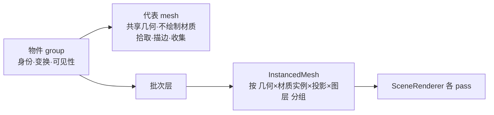

# Epic 技术方案

## 设计上下文

- 排查数据和方法见 `discovery/research/drawcall-diagnosis.md`。要点：
  - 帧时和每帧 draw 数成正比，每次约 3 µs CPU。
  - 每个 mesh 每帧画 2.2 次（白模）到 6.5 次（实时 GI）。
  - 代码模型的 part 不合并是根因。
  - 在 GLB 里按材质预先合并后，所有显示模式都回到刷新率上限。
- 大规模下的光栅瓶颈见 `scene-world-space-gi` S0 `throughput.md`「顺带发现」：2011 万面、2000 个实例时，光栅每帧 68–78 ms。
- 采用的方案分三层：
  1. **渲染批次**：渲染端按内容合并、共享、实例化，物件 group 不变。
  2. **渲染负载**：服务端为助手估算，编辑器叠加层显示实测值。
  3. **建模 Skill**：教助手做结构决策。

  大规模下的三角形吞吐由 P6 的光栅 LOD 处理，穿刺先行。
- **画质优先**（owner 2026-10-24）：性能不能以渲染效果为代价，至少要做到肉眼难以看出区别。批次层（P1、P4）和阴影缓存（P5）都要求画面与优化前相同；只有隔帧更新（P5，可选）和视口 LOD（P6）允许近似，由 owner 看图准入。出图一律用完整几何。
- **待验证假设**：AC-3 的阈值（U5）、估算误差与档位（U4）、实例化下程序化材质的坐标写法（U1）。
- **后续增强**：Alt+D 关联复制、合并为模型（roadmap「后续项」）。

## 领域模型与业务规则

沿用场景的既有模型：物件、模型实例、模型修订、材质槽位、内置基础体。新增的概念都属于渲染端的派生状态，不进入场景文档，也不进模型内容。

- **网格片**：`partsOf` 产出的绘制单位，即 GLB 里的每个 mesh。代码里叫 `ModelMeshPart`，下文和契约里的「part」都指它。它不是 manifest 里的命名部件 `part:<id>`，一个命名部件可以包含多个网格片。

- **渲染批次**：渲染端实际提交 draw 的单位。来源有三种：
  - 合并后的模型 part：同一模型修订内，槽位、hint、材质常量、顶点属性布局都相同的 part 合成一个；
  - 共享的基础体几何：内置基础体和参数都相同的物件，共用一份几何；
  - 实例化组：P4 起，相同几何、相同材质实例的多个物件合成一个 `InstancedMesh`。
- **代表 mesh**：P4 起，进了实例化组的物件在自己的 group 里仍保留每个 part 一个 mesh。它共享几何，材质设为不绘制，所以 three 不会把它放进渲染列表。拾取、吸附、选中描边、助手高亮、取景和光追收集都从它读取。它在 `userData` 里记着实际绘制用的材质实例。
- **渲染单元**：服务端估算负载用的计数，近似「每个渲染 pass 的 draw 数」。规则见 `api: 场景渲染负载`。
- **不变量**：
  - **I1 身份**：场景图里每个物件仍有一个以物件 ID 命名的 group，它是身份、变换、可见性和拾取的唯一来源。批次层只决定怎么画，从不成为任何物件的身份。
  - **I2 画面等价**：合并、共享、实例化和阴影缓存都不改变画面，包括半透明排序、幽灵模型、选中描边和线框边线，导出保持确定。只有 P5 的隔帧更新和 P6 的视口 LOD 允许近似，前提是 owner 确认肉眼看不出；出图不用它们。
  - **I3 数据不变**：GLB、manifest、场景文档、渲染指纹都不因批次层改变。部件（`part:`）、挂点（`anchor:`）和槽位的语义保持不变。
  - **I4 估算只读**：`render_load` 在读取时由快照和 manifest 算出，不存储，不影响任何写入的成败。
  - **I5 估算与渲染同版本**：估算规则（`rule_version`）和渲染端批次规则在同一次发布里一起变。

## 架构设计

在 `.lti/contracts/architecture.md`「场景模块」之上的增量，目标正文见 `architecture: 场景渲染负载`。

| 模块 | 职责 | 不职责 |
|---|---|---|
| `frontend/src/creative-scene/models/cache.ts` | 加载时合并 part（P1） | 不改 GLB 与 manifest |
| 基础体几何缓存（P1，与 `objects/` 相邻的新模块） | 按参数共享几何，引用计数，延迟释放，线框边线随几何释放 | — |
| 实例化（P4，`render/batch/`） | 分组、建 `InstancedMesh`、同步实例矩阵、维护代表 mesh；拖动中的物件临时退出批次 | 不处理拾取逻辑，拾取照旧读代表 mesh |
| `render/sceneRenderer.ts` | 每帧统计（draw 数、三角面、CPU 耗时）；阴影是否需要重画（P5） | — |
| 统计叠加层（P2，`panels/`） | 显示实测值，可开关，默认关闭 | 不估算 |
| `backend/internal/creativescene` | 渲染负载估算，是纯函数：输入快照和模型摘要，输出 `render_load` | 不渲染，不读 GLB 字节 |
| `backend/internal/creativeagent` | 把 `render_load` 放进 `read_scene`、`edit_scene`、`write_model` 的结果；工具说明里的一句成本模型 | 不拦截写入 |
| `deploy/creative-skills/scene-modeling.v1/` | 建模方法与自检流程（P3） | 不承担硬约束，硬约束留在工具说明和校验里 |

- **依赖方向**：
  - `creativeagent` → `creativescene`（估算）。
  - 前端的批次层属于渲染端，不依赖编辑器外壳：画布页按需加载渲染端时（离屏截图、导出）同样生效。
  - 统计叠加层依赖渲染端，不反向依赖。
- **关键链路**：
  - **视口**：快照 → R3F 挂载物件 group → 模型 part 从缓存取（已合并）→ P4 起批次层按组建实例 → `SceneRenderer` 画各 pass → 记录每帧统计。
  - **助手**：工具 → `creativescene` 读快照和模型摘要（同一事务，现有）→ 估算 → 结果。

## 技术选型

- **合并**：`three/addons/utils/BufferGeometryUtils.js` 的 `mergeGeometries(geoms, false)`，不生成 group。这样 GI 光追底座里「每个 group 一个根」的规则不会被意外触发。
- **实例化**：three 的 `InstancedMesh`。
  - 不选 `BatchedMesh`：它是为「不同几何共用一次绘制」设计的，依赖 multi-draw，而 WebGPU 核心规范没有 multi-draw-indirect，收益要另外实测。我们的重复主要是同一几何。
  - 程序化材质的对象空间坐标改用 TSL 的 `positionGeometry` / `normalGeometry`（实例变换之前的属性），再乘上从实例矩阵列长取出的缩放（U1）。
- **阴影缓存**：`LightShadow.autoUpdate = false`，在脏时设 `needsUpdate`。CSM 的每级 cascade 灯各有自己的 shadow，按同一规则处理。
- **大规模 LOD**（P6）：沿用 GI Epic 选定的 `meshoptimizer` 和派生几何管线。Nanite 式虚拟几何不做（owner 2026-10-20）。
- **不新增依赖**（P1–P5）。

## 关键机制

### 合并 part（P1）

- **时机**：`partsOf` 解析 GLB 之后，每个模型修订做一次。结果供所有实例、离屏截图、导出、资产缩略图和资产 3D 预览共用（它们都经 `ModelCache` 或 `partsOf`）。
- **分组键**：
  - 槽位、hint；
  - 材质常量全部字段（颜色、粗糙度、金属度、自发光、自发光强度、顶点色）；
  - 顶点属性签名（属性名、`itemSize`、`normalized`、数组类型）；
  - 是否有索引。

  键不同就不合并。所以代码自己创建的非槽位材质、带顶点色和不带顶点色的 part，都各自成组。
- **确定性**：组按场景树遍历中首次出现的顺序排列；组内按遍历顺序拼接。只有一个成员的组直接沿用原几何。合并后释放源几何。
- **网格片范围**：合并时为组内每个网格片记录它在合并几何里的索引区间（非索引几何记顶点区间），以及它自己的包围球。
- **按网格片绘制的情况**：以下几种情况不画合并几何，而是给每个网格片建一个「范围视图」几何。范围视图与合并几何共用同一组 attribute 和 index（同一份 GPU 缓冲，不多占显存），只设 `drawRange` 和它自己的 `boundingSphere`。three 按包围球中心给透明物体排序，所以排序和绘制顺序都与合并前相同。
  - 该槽位解析出的材质是半透明或透射（`isSeeThrough`）；
  - 幽灵模型（半透明、不写深度）；
  - 选中描边：外壳按每个网格片分别做 `toCreasedNormals` 后再拼接，接缝处的法线不会跨网格片平均；
  - 线框边线：按每个网格片分别算 `EdgesGeometry` 后再拼接，贴合的网格片之间的边线照常显示。

  这样，需要精确等价的地方都回到合并前的网格片粒度，其余情况一个槽位一次 draw。
- **消费方**：`ModelMeshPart` 仍是 `{geometry, slot, hint, constants}`，另加只读的网格片范围列表。`MaterialSlots` 按槽位取常量的逻辑不变。

### 共享基础体几何（P1）

- 键是 `builtin` 加上排序后的参数 JSON。缓存带引用计数，最后一个使用者卸载后延迟 1 秒释放（与材质实例相同，切换显示模式时不会反复重建），连同线框边线一起释放。
- 选中描边、线框边线都按几何缓存，随之共享。

### 自动实例化（P4，目标设计）

- **分组**：几何相同、材质实例相同（`materials/instances.ts` 的键），投影、接收阴影和图层相同。可见、不是幽灵或占位、不在拖动中，且组内至少 2 个物件，才进批次；其余照旧单独绘制。
- **同步**：实例矩阵取自代表 mesh 的 `matrixWorld`，只在物件变换的版本变化时重写，开销与实例数成正比；包围球随之更新，供视锥剔除。
- **拖动**：G/R/S 或 gizmo 拖动开始时，被拖动的物件退出批次、单独绘制，松开后回到批次。这样拖动期间不用每帧重写整组矩阵，实时 GI 的运动矢量也和现在一样逐物件正确。
- **材质坐标**：程序化预设读对象空间位置和法线（`patterns: 场景着色写法`）。实例化下改用实例变换之前的 `positionGeometry` / `normalGeometry`，并按实例矩阵的列长还原缩放，保证物件移动时纹理不滑动（U1）。
- **画面等价**：实例化前后的导出按 AC-2 对照，场景要包括缩放过、旋转过的程序化材质物件和选中描边。半透明材质的组不实例化：实例之间没法按距离排序，所以照旧按物件绘制。
- **预编译替身**：`SceneRenderer.compile` 的替身按 mesh 类型区分种类，`InstancedMesh` 是单独的一种，新出现的实例组也要先编译。

### 阴影缓存（P5）

| 阴影 | 需要重画的条件 |
|---|---|
| 聚光、点光 | 投影物变化（增删、变换、可见性、几何）或这盏灯变化 |
| 太阳级联、平行光级联 | 上面的条件，或相机变化（级联按视锥拟合） |
| 离屏截图、导出 | 总是重画 |

- **脏标记来源**：
  - 场景快照变化（`LookView` 现有的变化标记）；
  - 拖动中的物件变换（`Controller.run`、gizmo 的 `onObjectChange`）；
  - 灯光组件的属性变化；
  - 相机矩阵变化（`LookView` 已有的视图键）。
- **粒度**：一处变化就标记全部阴影，粗但正确。
- **隔帧更新**（U3）：远处两级 cascade 在镜头运动时隔帧更新。P5 实测收益，并录下运动中的画面，owner 确认肉眼看不出拖影才做；否则不做。

### 每帧统计（P1）

`SceneRenderer.render` 记录本帧 `renderer.info.render` 的增量（draw 数、三角面），以及 `render()` 调用本身的 CPU 毫秒，暴露为只读的 `lastFrame`。用途：
- e2e 的性能门禁；
- P2 统计叠加层的数据来源；
- P2 标定估算误差。

新增渲染 pass 时，在设计里写明它让每个物件每帧多画几次（`patterns: 场景渲染批次`）。

### 估算与档位（P2）

规则见 `api: 场景渲染负载`。v1 对应 P1 交付后的渲染端（合并 part，每个物件单独绘制）；P4 交付时升到 v2（实例化组只计一次）。档位初值 3000 / 8000 次每帧（最终渲染），由 P2 在压力场景上标定后，经 Epic 修订回填（U4）。

## 接口设计

- **契约**：`api: 场景渲染负载` 在本 Epic 的 `contracts.md` 定义，工具版本不变（owner 2026-10-24）。MCP 同名工具按 `creative-mcp-server` 的约定，结果与内置工具相同。
- **给其他模块的接口**：P4 起，「逐物件清单」就是代表 mesh。需要逐物件信息的模块遍历场景图，取物件 group 下的 mesh；材质从 `userData` 记录的绘制材质取，`material.visible === false` 不代表物件看不见。
  - 适用模块：GI 光追收集、`placement/raycast.ts`、`host/framing.ts`、选中描边。
  - 这条约定在 P4 开始前，经 Epic 修订写进 patterns（roadmap P4）。
- **工具说明**（P1）：`write_model` 和 `edit_scene` 各加一句成本模型。原文在 P1 定稿，要点是：「卡不卡取决于物件数和每个模型的材质槽数，与三角面关系不大；不必为性能降低分段数」。

## 数据与存储设计

无变化。`render_load` 是读时派生，不存储，也不进渲染指纹。估算读取的输入（快照、模型 manifest）沿用 `api: 读取场景` 在同一事务里批量读取的模型摘要，查询次数不随模型数增长。

## 已知限制

不影响画面的取舍：

1. **剔除粒度变粗**：合并后的 mesh 整体参与视锥剔除和级联剔除，多出来的只是 GPU 顶点工作量。按实测（1560 万面/帧还有 84 fps）可以接受。
2. **半透明槽位不省 draw**：为了排序等价，半透明槽位和幽灵模型仍按网格片绘制，这部分不享受合并的收益。玻璃这类材质在场景里通常不多。
3. **估算是近似**：代码自己创建的非槽位材质，估算按槽位数算；不可用的模型按 1 个单元、0 面算。

按部件点选（`patterns: 几何模块契约`「命名约定」）落地时，网格片范围已经在合并时记录，只需再把网格片映射到所属的命名部件。GLB 不变，不需要迁移。

## 验证与交付

- **压力场景**（P1）：在 Node 里用确定性生成器写 GLB，做法沿用本次排查的 `GLTFExporter` 加 `inspect()`；场景经 e2e 的场景服务提供。场景包括：
  - 多部件：4 × 1000 part；
  - 多基础体：1000 个；
  - 规模场景：AC-3。

  P6 另用 GI Epic 的压力场景生成器。
- **性能门禁**：沿用可选开启的 `SCENE_E2E_PERF`，需要真实 GPU，不进 `make check`。记录每个模式的帧时均值、p95 和每帧 draw 数，基线和改后结果都存进子项 evidence。
- **画面等价**（AC-2，每个子项）：
  - 用迁移等价阈值（`scene-webgpu-renderer` R1），由 e2e 对照优化前后的 `clay`、`line`、`lit` 导出（工作台和实时 GI），并给 owner 看并排图。
  - 对照场景要覆盖：同一槽位重叠的半透明面、幽灵模型、选中描边、线框模式，以及缩放和旋转过的程序化材质物件。
  - 视口的阴影缓存另用逐帧读回比较，确认与不缓存时逐像素一致。
- **确定性**：沿用现有的「同一场景两次导出逐像素相同」检查。
- **单测**：
  - `partsOf` 的分组键和顺序；
  - 共享几何的引用计数；
  - 估算规则（Go），其中基础体三角面公式要与前端生成的几何对拍。
- **发布与回滚**：都是读时或渲染端的改动，随发布生效；回滚就是回退代码，没有数据残留。估算规则版本与渲染端同一次发布（I5）。

## 未决事项

| # | 问题或假设 | 影响 | 解决方式 | 最晚解决时点 |
|---|---|---|---|---|
| U1 | 实例化下程序化材质能否用 `positionGeometry` 加实例缩放保持对象空间坐标；描边能否沿用代表 mesh | P4 | P4 设计时原型验证 | P4 方案批准前 |
| U2 | GI 光追收集与批次层的接口：采用「代表 mesh」方案 | P4、`scene-world-space-gi` S1 | 与 GI S1 协调，先合回的一方实现，另一方跟进 | P4 或 GI S1 实施前，取较早者 |
| U3 | 远处级联在镜头运动时隔帧更新 | P5 | P5 实测收益和画面，owner 决定 | P5 归档前 |
| U4 | 档位阈值（初值 3000 / 8000）与估算误差 | P2、P3 | P2 在压力场景上标定，经 Epic 修订回填 | P2 归档前 |
| U5 | AC-3 的阈值 | P4、P5 | P1 测基线后确认或经修订调整 | P4 开始前 |
| U6 | 大规模下的光栅方案与 AC-7 阈值；LOD 的误差上限（屏幕空间像素）和切换方式，要做到肉眼看不出 | P6 | P6 穿刺，owner 看并排图和运动录像确认 | P6 实施前 |
