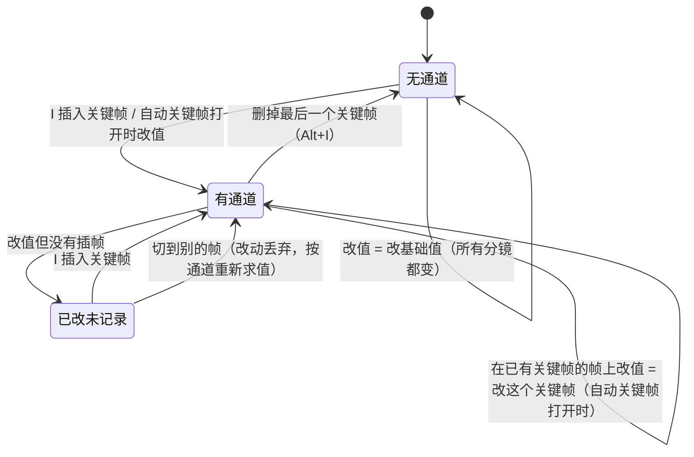
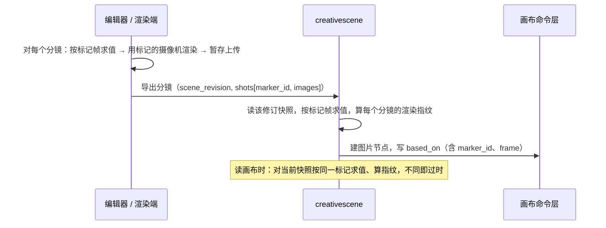
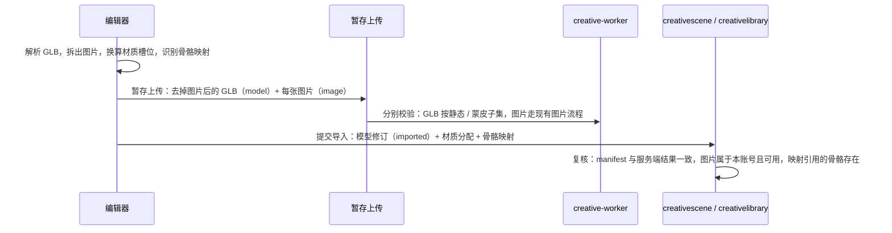

# Epic 技术方案

## 设计上下文

- 需求与边界见 `proposal.md`；讨论过程、事实依据和 Blender 调研见 `discovery/brainstorm.md`。
- 本 Epic 建在 `scene-editor-3d` 已交付的场景模块上，不复述它的架构：
  - 场景文档按单元做版本控制。
  - 物件几何是不可变的模型修订，GLB 是几何的事实源。
  - 渲染、烘焙和导出都在浏览器里完成，服务端经客户端任务派发工作。
  - 导出图记录来源，读取时按渲染指纹判断是否过时。
- 下文分三类：
  - **采用方案**：下面没有特别标注的部分。
  - **待验证假设**：标为「待验证」，由对应子项回答。
  - **后续增强**：标为「后续」，不在本 Epic。
- 交互默认与 Blender 一致（项目惯例）：时间线、关键帧、姿态模式和姿态库都照搬 Blender 的行为，偏离时写明理由。

## 领域模型与业务规则

### 概念

| 概念 | 定义 | 不是什么 | 代码与格式中的名字 |
|---|---|---|---|
| 基础值 | 物件和摄像机现有的字段值（`transform`、`visible`、`camera.*`）。属性没有通道时，它就是所有分镜的值；有通道时，它是这个属性的**默认状态**：首次创建通道时其他分镜取它，「新建分镜」取它 | 不是某一帧的值 | 现有字段 |
| 关键帧通道 | 一个物件的一个可动画属性在各帧上的关键帧，按帧号排序 | 不是物件的整份快照 | `objects[].animation.<path>` |
| 关键帧 | 通道上的一个点：帧号、值、到下一个关键帧的插值方式 | — | `{frame, value, interp}` |
| 求值 | 按帧算出每个属性的值：有通道的属性取通道在这一帧的值，没有通道的取基础值 | 不改写快照 | `patterns: 关键帧求值` |
| 分镜标记 | 时间线上的一个标记：固定 ID、名称、帧号、绑定的摄像机。一个分镜就是一个标记 | 不是策划文档里的「镜头」；策划镜头引用标记 | `scene.timeline.markers[]` |
| 标准人形骨骼 | 平台定义的一组人形骨骼名、骨骼链和标准空间约定，参照 VRM 1.0 humanoid，含手指 | 不是某个资产自带的骨架 | `patterns: 标准人形骨骼` |
| 姿态 | 一组骨骼相对静止姿势的旋转（加骨盆位移）。场景里，基础姿态记在模型实例上，随分镜变化的部分记在骨骼通道上；存进库里就是姿态资产 | 不是形态键，也不是网格烘焙结果 | 基础姿态 `objects[].pose`、骨骼通道 `pose.*`（子项 4）；内容类型 `pose`（子项 5） |
| 素体 | 平台内置的人形角色模型，一男一女，所有账号可见、只读 | 不是账号资产 | 内置模型 `body_female@1`、`body_male@1`（`data: 内置模型库`） |

### 不变量

- **P1 求值是唯一的。** 同一份快照在同一帧上，求值结果在服务端（Go）和编辑器（TS）完全相同，由共用测试向量保证。渲染、导出、渲染指纹和助手读取都以求值结果为准。
- **P2 没有通道的属性所有帧共用。** 改它就是改所有分镜，这是「布景天然一致」的来源。
- **P3 一个分镜占一帧，帧号不重复。** 同一瞬间的不同机位放在相邻两帧。因此按帧的可见性关键帧总能区分分镜（例如人片只在自己的分镜里可见）。
- **P4 结构不打关键帧。** 物件的存在、父级、顺序、模型引用、材质槽分配不进通道；物件出现或消失用 `visible` 的关键帧表达。
- **P5 关键帧不改变单元的归属。** 通道属于它的属性原来所在的单元：位置、旋转、缩放、可见性在摆放单元 `object:<id>`；摄像机参数和姿态（子项 4）在内容单元 `object:<id>:content`。改关键帧和改同一属性的基础值，按同一单元做并发控制。
- **P6 姿态按标准人形骨骼存储。** 套到别的角色时，按那个角色的静止姿势换算。非人形骨架的姿态只能在同一套骨骼上复用（子项 3、5）。
- **P7 平台内置资产只读。** 内置素体和内置姿态不属于任何账号，账号只能引用或复制，不能修改（子项 3、5）。
- **P8 分镜帧上的值总由关键帧给出。** 一个属性只要有通道，它在每个分镜的帧上都必须有关键帧，服务端在每批命令应用后检查，不满足就拒绝。因此分镜之间互不影响：常量外推和插值只作用于分镜之间的帧，永远不会决定某个分镜的画面。分镜之外的帧可以另有关键帧，留给以后的动画。

### 编辑语义

照搬 Blender，偏离两处：**首次创建通道时补齐其他分镜**（S1），以及**新建分镜与复制分镜分开**（S2a、S2b，Blender 没有分镜的概念）。

- 「已改未记录」只存在于编辑器里，不写入快照，界面上用 Blender 的配色区分「有关键帧」「本帧是关键帧」「已改未记录」。
- 自动关键帧开关默认关闭，与 Blender 相同（子项 1 试用后再定）。

为满足 P8，下面几种操作都由编辑器或助手的工具层在**同一批命令**里写全，服务端不隐式补帧，只按 P8 检查：

| # | 操作 | 同一批里写出的内容 |
|---|---|---|
| S1 | **首次创建通道**：属性还没有通道时，在任意一帧 f 插入关键帧（I、自动关键帧、助手指明分镜写入）；f 可以不是分镜帧 | 帧 f 写新值；**其他每个分镜的帧写修改前的值**；基础值保持（或改回）修改前的值，作为默认状态。「修改前的值」见下文「首次插帧的基线」。Blender 的第一个关键帧会让整条时间线都取这个值，那样「只改分镜 3」会改动所有分镜，违反验收 A2，所以这里偏离 Blender |
| S2a | 新建分镜 | 每条已有通道在新的一帧写**基础值**（默认状态）。只属于某个分镜的物件因此在新分镜里隐藏，主体回到默认状态 |
| S2b | 复制分镜 | 每条已有通道在新的一帧写**被复制分镜**的求值结果，新分镜与它完全相同，包括只属于它的物件 |
| S3 | 改分镜的帧号 | 每条通道在旧帧上的关键帧挪到新帧；新帧上原有的关键帧被覆盖 |
| S4 | 删除分镜 | 删掉每条通道在这一帧上的关键帧 |
| S5 | 清除一个属性的动画（Blender 的 Clear Keyframes） | 删掉整条通道，基础值写成当前帧的求值结果，画面不跳变。分镜帧上的单个关键帧不能单独删除（会违反 P8），Alt+I 在分镜帧上提示改用「清除动画」 |
| S6 | 添加「只属于当前分镜」的物件（`cg-composite` 的人片默认如此；编辑器的物件菜单也提供「只在当前分镜显示」，对已有物件同样可用） | 物件的基础值 `visible = false`，并带 `visible` 通道：当前分镜为 `true`，其他每个分镜为 `false`。之后「新建分镜」按 S2a 取基础值，它不会出现；「复制分镜」按 S2b 会带上它。普通的添加不带通道，物件出现在所有分镜里，属于布景。不另存「属于哪个分镜」的信息：「只属于某个分镜」就是默认隐藏、只在这一帧可见 |

**首次插帧的基线**（S1 的「修改前的值」）：

- 自动关键帧打开时，第一次修改就直接按 S1 写出，修改前的值就是当时的基础值。
- 自动关键帧关闭时，修改一个没有通道的属性会先改基础值（所有分镜都变，这是 Blender 的行为），之后再按 I。所以编辑器要记住修改前的值：
  - **记录**：场景有分镜时，第一次修改某个物件的某个白名单属性的基础值，记下修改前的值；同一属性之后的连续修改不覆盖它。
  - **使用**：按 I 时，其他分镜写这个值，基础值改回这个值，帧 f 写当前值。三者在同一批命令里。
  - **失效**：以下任一情况发生时丢弃：
    - 切换帧或分镜。
    - 按 I 用掉了它。
    - 这个属性因为别的原因有了通道。
    - 撤销使基础值回到了它。
    - 其他标签页或助手改了这个物件的同一单元。
  - **没有基线时按 I**：其他分镜写当前值，与 Blender 的第一个关键帧相同，并提示「其他分镜也采用了这个值」。
- 基线只存在于编辑器里，不进快照。助手的写入总是指明分镜，修改前的值就是当时的基础值，不需要基线。

### 助手写入规则

- 读：`read_scene` 返回分镜标记，以及每个物件有哪些通道；指定分镜时返回这一帧的求值结果。
- 写：`edit_scene` 每次写入要指明是哪个分镜（或哪一帧），写进这一帧的关键帧。不指明时改基础值。
- **不指明分镜去改一个有通道的属性时，工具直接报错**，提示指定分镜或先删掉动画，避免改动被通道覆盖。这条规则只在助手的工具层执行，命令接口本身不区分写入者。
- 回看和导出都按分镜：`render_view` 可以指定分镜标记，`export_shots` 按分镜标记列出（`data: 场景时间线`「客户端任务的分镜字段」）。
- 指明分镜写入一个还没有通道的属性时按 S1；新建分镜按 S2a，复制分镜按 S2b，挪动、删除分镜按 S3、S4；添加人片等只属于一个分镜的物件按 S6。规则与编辑器相同，由工具层写出。

## 架构设计

本节只写增量，沿用 `architecture: 场景模块` 的分层和依赖方向。

### 职责

| 位置 | 新增职责 | 不做 |
|---|---|---|
| `backend/internal/creativescene` | 时间线与通道的 schema 校验；`set_timeline` 操作和 `add_objects`、`update_objects` 的 `animation` 字段；按帧求值（供渲染指纹、助手读取、导出放置使用）；分镜导出的放置；助手工具的分镜语义 | 不渲染；不做蒙皮计算（指纹只看骨骼通道的值，不看形变后的顶点） |
| `backend/internal/creativescene` 的求值器 | `patterns: 关键帧求值` 的 Go 实现，无 I/O 的纯函数，与 TS 实现共用测试向量 | — |
| `backend/internal/creativecontent`、`creativemedia` | 子项 2：模型内容 `generator` 的两种形态（`three-module`、`imported`）；子项 3：蒙皮子集的 GLB 校验、蒙皮网格按静止姿势算包围盒、骨架摘要、`model.rig` 的校验（标准人形映射的层级嵌入、约束无环） | 不执行任何资产代码；不解析原文件（只校验换算后的 GLB 和图片）；不做姿态求值 |
| `creativelibrary` | 子项 2：导入模型进资产库（接口与「模型存入资产库」同在 `creativescene`，复用暂存上传、图片复核和持有关系，`creativelibrary` 只建资产）；子项 5：姿态资产 | — |
| 平台内置资产目录 | 子项 3：内置模型清单 `creativescene/models.json`，GLB 放在对象存储的 `scene-models/` 前缀下，`creativectl models import / check` 导入与检查，读取接口 `GET /creative/scene-models/{file}`；素体的贴图作为不上架的内置贴图材质进现有材质目录（`data: 内置贴图库`）。子项 5：内置姿态。都仿 `data: 内置贴图库`：清单随代码发布，不属于任何账号 | 不进账号配额、引用表和媒体 GC |
| 前端 `frontend/src/creative-scene/` | 时间线面板；求值器的 TS 实现；编辑语义（关键帧状态、自动关键帧）；按分镜导出；子项 2 的导入流程（解析 GLB、解压几何、拆图片、换算材质，见「导入的材质换算」）与自发光贴图、顶点色的渲染（视口、材质预览、最终渲染、实时 GI 追踪层）；子项 3 的蒙皮渲染与静态化；子项 4 的姿态模式；子项 5 的姿态架 | — |

### 关键链路

**按分镜导出（子项 1）：**

- 助手导出（`export_shots`）走同一个放置流程，图片清单随完成任务提交，与现在相同。
- 渲染指纹在服务端按求值结果计算。服务端因此必须有求值器，这是 P1 要求两端一致的原因。

**导入（子项 2、3，方向已定，细节在子项里写）：**

- 图片拆出来存成账号的图片内容，复用现有的图片校验、媒体票据和 `creative_content_revision_refs` 持有关系（模型库副本已经这样持有贴图）。GLB 本身仍然不带 `images` / `textures`，服务端的 GLB 校验只需加上蒙皮子集。
- 浏览器的解析结果不可信，服务端对 GLB 和每张图片分别复核；与几何模块的沙箱产物同一原则。
- 子项 2 的提交是 `api: 导入模型到资产库`（`POST /creative/assets/from-glb`）：一个事务里写模型修订、图片持有关系和资产，再消费全部暂存上传。导入只进资产库；放进场景沿用从资产库放入的方式。子项 3 再给这条链路加骨骼映射。
- 原文件不保存：存储的是换算后的 GLB 和拆出的图片。重新导入同一文件会得到另一份资产（导入不查重）。

**蒙皮渲染（子项 3、4）：**

- 视口加载蒙皮 GLB 时生成 three.js 的 `SkinnedMesh`。按当前帧的骨骼通道求值后写入骨骼，三个显示模式都直接画蒙皮网格。子项 3 还没有骨骼通道，按静止姿势显示；按给定姿态渲染的路径（求值 → 约束 → 蒙皮）在子项 3 实现并由测试驱动，子项 4 接上通道。
- 每帧的求值顺序固定为「姿态 → 节点约束（`model.rig.constraints`）→ 蒙皮」，视口、静态化几何和导出都相同（`patterns: 标准人形骨骼`）。
- 需要静态几何的地方，使用「求值后的静态化几何」：实时 GI 和以后的路径追踪的加速结构、包围盒与吸附、线稿。做法是在当前姿态下做一次 CPU 蒙皮，结果缓存，缓存键包含模型修订和姿态值的哈希。之后按现有方式构建加速结构的段。
- 「合并 part」（`models/merge.ts`）不合并蒙皮网格：蒙皮网格的每个 primitive 各自一次绘制。
- **拖动骨骼时分两件事看：几何正确和光照收敛。**
  - **几何正确，任何时刻都要满足。** 光栅部分（蒙皮网格、阴影贴图、屏幕空间的 GI、反射和 AO）每帧按当前姿态绘制，自然成立。屏幕外的追踪层（世界空间的间接光和反射）**不能使用旧姿态的几何**。按穿刺②（子项 3 `discovery/research/2026-11-09-trace-update-spike.md`）定为：
    - **蒙皮三角形不超过 6 万的角色（暂定，子项 4 在浏览器里用真实拖动复测）**：拖动的每一帧在主线程上依次做姿态求值、约束、CPU 蒙皮、refit 这个角色的 BVH 段、上传顶点和节点，再 refit 顶层，与当前姿态同帧。常见角色（2–5 万三角形）每帧 2–6 ms。
    - **超出的角色**：从这次拖动的第一帧起，用实例已有的 `visible` 字段把它从追踪层里剔除，松手后放回。拖动期间镜中背面消失、墙上的间接光变淡，这就是「宁可暂缺」。不做「异步 refit、晚一帧放回」：晚一帧就是旧姿态。
  - **光照收敛，拖动期间可以滞后。** 角色附近的探针和缓存失效后重新计算。
  - **松手后**：在 worker 里重建这个角色的 BVH 段（与现有的段构建相同，不沿用 refit 的结果：refit 后光线遍历多走 16–54% 的节点），更新静态化几何的缓存，GI 重新收敛。
  - **导出和 `render_view` 的等待条件**：这一帧的静态化几何就绪、加速结构重建完成，再按现有的收敛帧数累积，然后出图。
  - **子项 4 的验收场景**：角色贴近墙面（墙上的反弹光）、镜面反射（镜中的角色跟随）、肢体自遮挡（手臂贴近脸时的 AO 和阴影）。每个场景分别检查两项：几何正确（拖动中任何时刻都没有旧姿态的残影），光照收敛（松手后若干帧内与导出图一致）。剔除时的实际观感也在这里由 owner 判断（[[render-quality-over-performance]]）。

## 技术选型

| 问题 | 选择 | 理由与边界 |
|---|---|---|
| 关键帧求值 | 自写，Go 与 TS 各一份，共用测试向量（JSON 文件，`make generate` 时复制到前端） | 服务端要按求值结果算渲染指纹，必须有 Go 实现；规则很小（线性、四元数球面插值、阶跃），不值得为此在服务端引入 JS 运行时。与 `data: 模型内容` 的 manifest 算法在两端各实现一份是同样的做法 |
| 插值方式 | 本 Epic 只有 `linear` 与 `constant`；四元数用球面线性插值，取最短路径 | 静态分镜只在关键帧所在的帧上求值，插值只影响「没有关键帧的帧」。格式为每个关键帧记 `interp`，以后加 `bezier` 只是追加取值（后续） |
| 时间线 UI | 自写，放在编辑器底部，交互照搬 Blender 的 Timeline 和 Dope Sheet 的子集 | three.js 和 drei 都没有可用的时间线组件 |
| 蒙皮 | three r186 自带的 `SkinnedMesh`、`Skeleton`，`GLTFLoader` 原生支持 | 不新增依赖 |
| 标准人形骨骼 | 参照 VRM 1.0 humanoid 的骨骼名与层级，**不引入** `@pixiv/three-vrm` | 只要命名和静止姿势约定，不需要 VRM 运行时（表情、弹簧骨、视线）；本 Epic 只收 `.glb` |
| IK | 自写四肢两段式解析 IK，带极向量 | 结果确定、没有迭代抖动，满足四肢的需求；three 自带的 `CCDIKSolver` 是迭代求解，结果与初始姿态有关。脊柱等多段 IK 是后续 |
| 骨骼映射识别 | 有 VRM 扩展时读它的「标准骨骼 → 节点下标」映射（VRM 0.x 的拇指名按 1.0 改名）；否则按命名表识别：Mixamo（`mixamorig:` 等前缀）、UE 小白人（`pelvis`、`spine_01`、`upperarm_l`…，内置素体用的就是它）；都不行时手动指定。只在蒙皮关节里找名字。结果一律存成节点下标 | glTF 节点名可缺省、不唯一，不能当身份；VRM 的映射本来就按节点下标。穿刺①发现网格节点可能与骨骼同名，所以限定关节。Rigify 等命名可以之后追加命名表 |
| 导入时的 GLB 解析与重写（子项 2） | three 的 `GLTFLoader` 解析原文件，换算后用 `GLTFExporter` 写回 GLB，再用现有的 `sandbox/inspect.ts` 预检静态子集 | 与代码模型的烘焙同一条「three 对象 → GLB → 暂存上传 → worker 复核」链路，服务端和渲染端都不变；`GLTFLoader` 已经处理 glTF 的各种写法（稀疏访问器、量化、矩阵与 TRS），比按字节改写 GLB 省事。代价是节点名按 three 的规则清洗（去掉 `:` 等），对导入的模型无影响 |
| 压缩几何（子项 2，owner 2026-11-09） | 支持 Draco、meshopt 和 `KHR_mesh_quantization`：导入时用 three 自带的 `DRACOLoader`（解码器文件随前端发布、只在导入时加载）和 `meshoptimizer` 包的解码器解压；解析后**显式反量化**（见「导入的材质换算」），按未压缩存储。`GLTFExporter` 会原样写出整数访问器并重新声明 `KHR_mesh_quantization`（修订 v4 前的方案评审实测），所以不能依赖导出自动转换 | 网页素材和 Blender 勾选压缩的导出很常见；存储形态仍是未压缩的静态子集，渲染、GI 和校验都不变。KTX2 / Basis 贴图不支持：要先转成图片，拒绝并提示在 Blender 里换成 PNG 或 JPEG 再导出 |
| 平台内置资产 | 仿 `data: 内置贴图库`：清单随代码发布，文件放在对象存储的独立前缀下，用 `creativectl` 导入和检查。内置模型的 GLB 进 `scene-models/`；它的贴图做成不上架（`listed: false`）的内置贴图材质，放置时写进实例的 `material_slots` | 已有先例；内置资产不属于账号，ADR-001 的账号隔离不适用，读取仍要求登录。贴图走材质预设，渲染、`render_view`、导出和助手都沿用现有的内置贴图材质链路，不新增「模型自带贴图」的渲染路径；场景里换材质、恢复都按普通槽位处理 |
| 内置素体 | Quaternius「Universal Base Characters」免费版的男、女两个角色（CC0，约 1.4–1.5 万三角形，65 个关节，五指各 3 节，静止姿势即 T 姿势），经导入链路换算后入库；暂不带发型 | 子项 3 `discovery/research/2026-11-10-base-body-check.md`：52 根标准骨骼全部映射、层级无违规、4 组姿态的肢体方向误差 0°。owner 提供的另一套素体没有骨骼且要求署名，不采用。包里同时有发型和胡子（绑在头骨上），以后可作为内置配件 |

## 关键机制

### 关键帧求值

规则见 `patterns: 关键帧求值`，要点：

- 帧号是非负整数；通道里的关键帧按帧号严格递增。
- 在第一个关键帧之前取第一个关键帧的值，最后一个之后取最后一个的值（与 Blender 的常量外推相同）。
- 在两个关键帧之间，按左边那个关键帧的 `interp` 计算：`constant` 取左值；`linear` 对数值和数组逐分量线性插值，对四元数做最短路径的球面线性插值，结果归一化。
- 离散属性（布尔、枚举、字符串、画幅、`focus_object_id`）只允许 `constant`。
- 求值后的值仍要满足这个字段的约束。数值插值不会越过两端的范围，所以只要关键帧本身合法，结果就合法。

### 分镜与导出

- 导出按分镜进行。每个分镜对快照按标记帧求值，用标记绑定的摄像机渲染。
- 标记的摄像机为空，或者摄像机已被删除时，这个分镜不能导出。编辑器和助手都会提示，与对焦物件被删后的处理方式相同。
- 渲染指纹按求值后的快照计算，计入项与现行的指纹投影相同（`scene-editor-3d` design「渲染模式与导出」）。时间线和通道本身不计入，只有求值结果计入。因此：
  - 只改别的分镜的关键帧，这个分镜不过时。
  - 把分镜挪到另一帧（S3 会带着关键帧一起挪），求值结果相同，不过时。
  - **分镜换绑另一台摄像机算过时**，即使两台摄像机的参数和位置完全相同。现有指纹把摄像机 ID 计入哈希（`backend/internal/creativescene/fingerprint.go` 的 `camera_id`）。沿用这一点，旧图的指纹才能保持不变；要做「换成等价摄像机不过时」，就得改成语义指纹，并让所有旧图过时一次，不值得。
  - 没有任何通道和标记的场景，求值结果就是现在的快照，**指纹不变，不升版本**，已有导出图的过时状态不变（验收 A8）。
- 旧的导出图没有 `marker_id`，按第 0 帧求值后计算指纹。没有通道时第 0 帧的结果就是基础值，与现状一致。
- 没有指定帧的读取（`render_view` 的临时视点、预设视角和摄像机三种方式）也按第 0 帧求值；助手工具的说明里写明这一点。

### 快照大小与单元数

- 通道放在物件原来的单元里（P5），不新增每个物件的单元，只新增一个 `timeline` 单元。原因：单元总数上限是 4096，物件最多 2000 个，每个物件已经占两个单元。
- 快照上限仍是 512 KiB。估算：一个人形角色 55 根骨骼、20 个分镜，每个关键帧按 60 字节计，约 66 KB。子项 1 限制每个通道最多 1000 个关键帧。
- **骨骼通道不压缩格式**（修订 v9，子项 4 起草时定）：只靠存储规则控制体积，格式与其他通道相同。
  - 只有动过的骨骼才有条目和通道：等于静止姿势的基础姿态项存储时去掉；姿态模式的「插入关键帧」只给选中的骨骼打（与 Blender 相同），不给整个角色打。
  - 四元数归一化后保留 6 位小数（角度误差约 1e-4°），位移保留 5 位小数（0.01 mm）。一个骨骼关键帧约 55 字节。
  - 三个人形角色、十五个分镜、每根标准骨骼都打关键帧，约 2500 个关键帧、140 KB，仍在 512 KiB 和 20000 个关键帧以内。子项 4 验收时按这个规模实测。
  - 录制或导入密集动画时需要拆开存储，这是后续的事，与 C7 历史清理相关。

### 层级与通道

- `reparent_objects` 带 `transform` 时只改基础值，关键帧保持在局部空间里不变，与 Blender 相同。改挂有位置、旋转或缩放通道的物件后，各分镜里的画面可能跳变，编辑器会提示。
- 删除物件时，它的通道随物件一起删除。`restore_units` 恢复物件单元时，通道随所在单元一起恢复。

### 导入的材质换算（子项 2）

浏览器把原文件换算成存储形态，结果按项提示摄影师（导入对话框里列出被忽略或换算过的项），服务端只校验换算结果。owner 2026-11-09 定：自发光贴图和顶点色补成正式能力，其余换算或忽略；压缩几何解压后存；带骨骼的文件本子项拒绝。修订 v4（子项 2 方案评审）补：只收内嵌资源、显式反量化、采样器寻址方式的降级提示、超限图片按用途和透明度选编码。

| 原文件里 | 处理 |
|---|---|
| 每个 glTF 材质 | 一个槽位。`slot_id` 由材质名生成：不合 `^[A-Za-z0-9_-]{1,64}$` 的字符换成 `_`，空名为 `material_<n>`，重名加 `_2`、`_3`；没有材质的 primitive 归入槽位 `default`。超过 32 个槽位时拒绝，提示在 Blender 里合并材质 |
| `baseColorFactor` | RGB 换成 sRGB 的 `color`；A 写 `opacity` |
| `metallicFactor`、`roughnessFactor` | `metalness`、`roughness` |
| `baseColorTexture` | `maps.base_color` |
| `metallicRoughnessTexture` | `maps.roughness`（`g`）、`maps.metalness`（`b`），同一张图 |
| `occlusionTexture` | `maps.ao`（`r`）；与 `metallicRoughnessTexture` 是同一张图时只上传一次。`strength` 不是 1 时忽略强度并提示 |
| `normalTexture` | `maps.normal`，`scale` 写 `mapping.normal_strength`（限制在 0–4） |
| `emissiveFactor`、`emissiveTexture`、`KHR_materials_emissive_strength` | `emissive`、`maps.emissive`、`emissive_intensity`（限制在 0–100） |
| `alphaMode`、`alphaCutoff` | `alpha_mode`（OPAQUE / MASK / BLEND → `opaque` / `clip` / `blend`）、`alpha_cutoff` |
| `COLOR_0` | 用这个材质的 primitive 里有任何一个带 `COLOR_0` 时，`vertex_color = true` |
| `doubleSided` | 忽略：模型总是双面绘制 |
| `KHR_materials_transmission`、`ior`、`volume`（厚度）、`clearcoat`、`sheen`、`specular`、`iridescence`、`anisotropy` 的常数 | 写同名参数（`thickness` 等），超出范围的限制到范围内。这些扩展的贴图忽略并提示 |
| `KHR_materials_unlit` | 按普通材质显示（光照会影响它），提示 |
| `KHR_texture_transform` | 同一材质的贴图变换相同时，烘进存储 GLB 的 `TEXCOORD_0`（几何按需复制，不影响共用这份几何的其他材质），`mapping` 写 `uv`、`repeat [1,1]`；变换不同时按基础色贴图的变换烘焙，其余提示 |
| 引用 `texCoord: 1` 的贴图 | 忽略这张贴图并提示 |
| 采样器的寻址方式（`wrapS` / `wrapT`） | 渲染端固定按重复（`REPEAT`）采样。`REPEAT` 原样；`MIRRORED_REPEAT`、`CLAMP_TO_EDGE` 时，检查用这个材质的 primitive 在烘焙贴图变换之后的 UV：全部落在 [0, 1] 内时两者结果相同，不提示（只剩边缘一个像素的过滤差异，忽略）；有越界时按重复显示并逐项提示「这张贴图原本是镜像 / 钳制寻址，导入后按重复显示」（修订 v4）。`magFilter` / `minFilter` 忽略，渲染端用统一的过滤 |
| 有贴图的材质 | `mapping.kind = uv`；几何没有 `TEXCOORD_0` 时照常保存，按现有规则显示为三平面并提示 |
| 图片 | PNG、JPEG、WebP 原样上传。超过图片上传上限（25 MiB 或 8192²）时在浏览器里缩到上限内重新编码，编码按用途和透明度选（修订 v4）：用作法线、ORM、糙度、金属度、AO 的，或有任何不透明度小于 1 的像素的，编码为 PNG（无损，保留透明通道）；其余（不透明的基础色、自发光）编码为 JPEG（质量 0.92）。重新编码后仍超限时边长减半再试。同一张图被多处引用只上传一次，按最保守的用途编码。KTX2 / Basis 拒绝（见「技术选型」）。不同图片超过 64 张时拒绝 |
| 资源位置 | 只接受内嵌资源：图片取 `bufferView` 或 `data:` URL，缓冲只能是 GLB 的 BIN 块或 `data:` URL。任何外部 URI（相对路径、`http(s)` 等）在交给加载器之前拒绝，提示在 Blender 里重新导出为内嵌资源的 GLB（修订 v4） |
| Draco、meshopt、`KHR_mesh_quantization` | 解压后**反量化**：`POSITION`、`NORMAL`、`TANGENT`、`TEXCOORD_0/1` 不是 `FLOAT` 的，按访问器的 `normalized` 规则（glTF「Animation & Mesh Quantization」的换算公式）转成 `FLOAT`；交错属性先拆开；`COLOR_0` 一并转成 `FLOAT`。节点变换原样保留（量化常把缩放、平移放在节点上）。结果不再声明 `KHR_mesh_quantization`（修订 v4） |
| `skins`、`JOINTS_*`、`WEIGHTS_*` | 拒绝，提示蒙皮角色在后续版本支持（子项 3） |
| 形态键（`targets`） | 丢掉，按基础形状存，提示 |
| `animations`、`cameras`、`KHR_lights_punctual` | 丢掉，提示 |
| 多个 `scene` | 取 `scene` 指定的那个，没有指定时取第一个 |
| 原点 | 缺省保留原文件的原点（同 Blender 导入）；导入对话框可以勾选「原点移到底面中心」 |
| 超出静态子集的预算（三角形 200 万、节点、换算后 200 MiB 等，修订 v5） | 拒绝，说明超出哪一项 |

缩略图在浏览器里按换算后的材质渲染，与「存入资产库」的缩略图相同。

### 姿态的存储与换算（子项 3–5 共用）

依据：子项 3 的两项穿刺与素体核对（`features/2026-11-09-scene-skinned-humanoid/discovery/research/`）。算法与规则写进 `patterns: 标准人形骨骼`，Go 只实现其中的校验部分（层级嵌入、必需骨骼），求值与换算只在 TS 里。

- **骨骼的身份是「不可变模型修订 + 节点下标」，名称只用于显示和辅助识别。** glTF 的节点名可以缺省，也不保证唯一，不能拿来寻址。
  - 模型修订的 manifest 记一份骨架摘要（服务端从 GLB 算出）：关节的节点下标、最近的关节祖先、名称（只作显示），以及只看结构的指纹 `s1`。静止姿势不进摘要，渲染端和换算都从 GLB 读。
  - 模型修订的 `model.rig` 记浏览器识别、服务端校验的两项：标准人形映射（标准骨骼名 → 节点下标；非人形骨架没有）和节点约束（导入时从 `VRMC_node_constraint` 读出，扩展本身不进存储的 GLB）。约束的被约束节点和源都限定为关节（修订 v7），这样服务端只凭骨架摘要的父关节链就能判断依赖：aim 还依赖被约束节点父链上的约束，roll、rotation 只依赖源。
  - 场景里的姿态（子项 4 定版，修订 v9）：基础姿态 `objects[].pose` 与骨骼通道 `pose.*` 用同一套骨骼键，求值时有通道的骨骼取通道的值，其余取基础姿态，都没有的保持静止。
    - 人形角色用标准骨骼名，例如 `pose.leftUpperArm.rotation`（四元数，相对模型静止姿势的 p_b，套用时换成「换算」里的 q_b = r_b · p_b，修订 v12），以及 `pose.hips.position`（骨盆位移，标准空间的米）。它们经映射落到节点上，所以换模型修订、男女素体互换后照样成立；男女素体的 r_b 不同时，同一个 p_b 在两者上相对各自的静止姿势。
    - 相对静止姿势存储（修订 v12，子项 4 方案评审）：如果直接存 q_b，没写的骨骼会落到 T 姿势校正后的方向，只摆一根骨骼也会让四肢跳动；单位值、静止关键帧也无法与「没有姿态」等价，指纹会误报过时。相对静止姿势后，单位四元数就是静止，服务端不需要知道模型的静止骨架。
    - 非人形骨架用 `node:<节点下标>`，旋转乘在节点的静止局部旋转之后，只对这个实例当前的骨架有效。实例换到骨架指纹不同的模型时，这些键和通道失效：换模型的 `set_instance_model` 带 `drop_incompatible_pose` 时由这个操作去掉并在响应里列出，不带时返回 400；服务端不会在调用方没有要求时删除（修订 v11：底座不允许同一单元在一批里出现两次，原先「同一批另写清除」的做法写不出来）。
- **映射怎么识别**：
  - 源文件带 VRM 扩展（`VRMC_vrm` 或 VRM 0.x）时，直接读扩展里「标准骨骼 → 节点下标」的映射。
  - 否则按命名表识别（见「技术选型」），只在蒙皮关节里找；识别结果同样存成节点下标。
  - 都识别不了时，由创作者手动指定。
  - 浏览器给出的映射不可信。服务端校验：标准骨骼名在列表里、必需骨骼齐全、下标指向骨架摘要里的关节、同一个节点不映射两次，以及**层级嵌入**：每根映射骨骼最近的映射祖先，必须是它在标准骨骼链上的祖先。必需骨骼违反时整份映射不成立，导入对话框说明原因，角色仍可按非人形骨架导入；可选骨骼违反时由浏览器先从映射里去掉并提示。
- **非人形姿态资产**同时记录兼容的骨架身份（骨架指纹和来源模型），只能套到指纹相同的骨架上。
- **换算**（穿刺①定，参照 VRM 的规范化骨骼）：
  - **标准空间**：Y 轴向上，角色面朝 +Z，角色的左手边是 +X，静止姿势为 T 姿势。
  - **姿态**：每根标准骨骼一个旋转 q_b，表示在标准空间里相对 T 姿势的变化，沿标准骨骼链组合：G(b) = G(父骨骼) · q_b。角色缺少的骨骼，它的 q 照样传给子骨骼；手指等叶子骨骼缺失时直接忽略。
  - **角色的朝向 F** 从静止骨架算出：髋到头是上，右上臂到左上臂是 +X。不读文件里的朝向约定，VRM 0.x 面朝 −Z、Z 轴朝上导出的根旋转都能正确处理。
  - **T 姿势校正**：上臂、前臂、手、大腿、小腿按最短弧摆到标准方向；手再绕自身方向转到手背朝上（用食指根和小指根所在的平面，没有小指时用无名指）。脊柱、颈、头、肩、脚和各手指的静止弯曲保留角色自己的。校正量只用于换算，不改模型。
  - **套用**：被映射的骨骼，世界旋转 = F · G(b) · F⁻¹ · T(n)，T(n) 是节点 n 在校正后的 T 姿势里的世界旋转。映射骨骼之间的其他节点保持静止时的局部变换；有节点约束的，按约束在姿态之后求值。
  - **镜像**：左右骨骼互换，四元数取 (x, −y, −z, w)。
  - **骨架的几何条件**（修订 v7）：头髋重合、两肩方向与「上」平行、被校正的骨骼长度近于 0 时朝向无法确定，人形映射不成立；非均匀缩放照常成立但提示。骨架摘要不含位置，由浏览器判定，渲染端加载时兜底（`patterns: 标准人形骨骼`）。
  - 穿刺结果：A/T 姿势、局部轴、辅助骨、比例、朝向五类差异下，每根骨骼的完整旋转与基准相差 0.000°；四个真实角色和两个内置素体的肢体方向误差 0.00°。
  - 骨盆位移按腿长比例缩放（未验证，子项 4 打关键帧时验证）。
- **已知局限**：
  - 没有节点约束的辅助骨保持静止。靠扭转骨分担形变的非 VRM 模型，以及**没有扭转骨的内置素体**，手绕前臂大角度转动时手腕会捏成一点（转 90° 开始收窄，150° 明显）。owner 2026-11-09、2026-11-10 接受，记为后续优化（候选：限制界面里的滚转范围，或把手的滚转分一部分给前臂）。
  - 接触点（手扶腰、脚踩地）在体型不同时会有偏差，用 IK 修正，不做自动修正。
  - 手指静止弯曲各角色不同，同一手指姿态跨角色的观感在子项 5 由 owner 判断。

### 姿态模式（子项 4）

操作照搬 Blender 的姿态模式（[[audience-includes-pro-creators]]），只做 roadmap 列出的子集。下文只定共享的规则，界面细节由子项 4 设计。

- **进入与选择**：按 Tab 打开模式轮盘（owner 2026-11-12），在里面选物体模式、编辑模式（现在的面编辑）或姿态模式；以后的权重绘制、雕刻等模式也加在这里。活动物件不支持的模式不显示（修订 v10）：带骨骼的模型没有编辑模式（修订 v7），没有骨骼的物件没有姿态模式。视口顶栏也有同样的模式切换。姿态模式下视口画出骨骼，可以点选、Shift 加选。内置素体也可以摆姿态（P7 只保护素体本身，姿态记在实例上）。
  - **偏离 Blender**：Blender 用 Tab 直接切换编辑模式、Ctrl+Tab 打开模式轮盘。浏览器会拦截 Ctrl+Tab 用来切换标签页，网页收不到，所以轮盘放在 Tab 上。轮盘的操作照搬 Blender 的饼菜单（owner 2026-11-13，修订 v10）：按住 Tab 一小段时间，指针指向某一项再松开，进入那一项；没有指向任何一项就松开，关闭轮盘、不切换。轻按 Tab（很快按下又松开），轮盘常亮，此时用鼠标点选某一项才生效，再按 Tab 关闭。
- **FK**：R 旋转选中的骨骼，再按 X / Y / Z 锁定轴（Blender 的约定：按一次是全局轴，按两次是局部轴）。人形角色的旋转在标准空间里组合，写成 q_b；非人形骨架写成节点的局部旋转。
- **四肢 IK**：拖动手或脚，按「技术选型」里的两段式解析 IK 求出上臂与前臂（大腿与小腿）的旋转，极向量取拖动开始时肘（膝）所在的平面。结果写成这几根骨骼的旋转，与 FK 的写法相同。IK 目标和极向量不存储（相当于 Blender 的 Auto IK），所以姿态资产和跨角色换算只看旋转。脊柱等多段 IK 是后续。
- **复制与镜像粘贴**：Ctrl+C 复制选中骨骼的姿态，Ctrl+V 粘贴，Ctrl+Shift+V 镜像粘贴（`patterns: 标准人形骨骼` 的镜像规则）。剪贴板只在编辑器里，不进快照。非人形骨架没有左右对应，只能原样粘贴。
- **清除**：Alt+R 把选中骨骼的旋转清回静止姿势，Alt+G 清除骨盆位移。
- **写入**：骨骼的修改与其他属性同一套编辑语义（「编辑语义」S1–S6）。没有通道时改基础姿态 `objects[].pose`，所有分镜都变；I 给选中的骨骼插入关键帧，首次创建通道时按 S1 补齐其他分镜。新建、复制、挪动、删除分镜时，骨骼通道与其他通道一起按 S2–S4 写全。
- **求值**：每一帧先按 `patterns: 关键帧求值` 算出这一帧的姿态（有通道的骨骼取通道，其余取基础姿态），再按「蒙皮渲染」的顺序做换算、约束和蒙皮。视口、`render_view`、按分镜导出用同一个结果；子项 3 的测试姿态入口改为测试专用，不再是姿态的来源。
- **渲染指纹**：按求值后的 `pose` 计入（物件整体计入指纹，修订 v9）。只有改了分镜所在帧的姿态，这个分镜的导出图才会过时；没有姿态的场景指纹不变（A8）。
- **拖动时的追踪层**：按「蒙皮渲染」的规则：6 万三角形以内的角色每帧同步 refit，超出的在拖动期间从追踪层剔除，松手后在 worker 里重建。超出的角色拖动时也不做每帧的 CPU 蒙皮，取景和拾取沿用松手前的几何，松手后更新（子项 3 实测：190 万三角形的角色一次 CPU 蒙皮约 0.1 秒）。

## 接口设计

- 子项 1 的接口条目见 `contracts.md`：
  - `api: ADD 场景时间线命令`：在现有命令接口上增加 `set_timeline` 操作，并给 `add_objects`、`update_objects` 增加 `animation` 字段。改关键帧和改基础值写在 `update_objects` 的同一项里，满足「每个单元在一批里只出现一次」。
  - `api: MODIFY 导出分镜`：镜头改为可以按分镜标记列出。
  - 读取场景不改接口：快照里多出 `timeline` 和 `objects[].animation`，按数据契约返回。
- `data: 场景客户端任务` 的修改目前由 `creative-mcp-server` 的子项 `mcp-write-generate` 负责。本 Epic 不改那一节，`render_view` 和 `export_shots` 按分镜的请求字段在 `data: 场景时间线` 里定义（见 roadmap「跨 Epic 的依赖与协调」）。
- 子项 2（修订 v3）：`api: ADD 导入模型到资产库`，见 `contracts.md`。修订 v5 加 `patterns: MODIFY 几何模块契约`（上限同步放宽），由子项 2 交付。读取模型的接口不变，响应里的 `generator` 按 `language` 分两种结构，模型多出可选的 `import`。
- 子项 3（修订 v6）：
  - `api: MODIFY 导入模型到资产库`：请求加可选的 `rig`（标准人形映射、节点约束）；换算后的 GLB 可以带蒙皮子集。
  - `api: MODIFY 场景模型命令`：`commit_model` 拒绝带骨架的 GLB（代码模型不带骨骼）；`derive_model` 照抄来源修订的 `rig`。
  - `api: ADD 读取内置模型文件`：`GET /creative/scene-models/{file}`，与 `api: 读取内置贴图` 同形。
  - `api: MODIFY 读取内置贴图`：文件名放宽到 `.png`（素体的法线、带透明的眉毛）。
  - 放置内置素体沿用现有命令：`add_objects` 的 `model` 写 `{builtin: "<id>"}`（`data: 场景文档`），不新增接口。读取场景不改接口：内置模型不进响应里的模型摘要，编辑器用随代码发布的清单副本。
  - 助手：`search_assets` 的 `source: builtin` 加 `kind: "model"`，`read_asset` 的 `builtin_id` 接受内置模型；`edit_scene` 的说明加「放内置素体」（`data: 内置模型库`）。按角色描述选素体、摆姿态是子项 6。
- 子项 4（修订 v9）：
  - `api: MODIFY 场景时间线命令`：`add_objects`、`update_objects` 增加 `pose` 字段（`update_objects` 按骨骼合并，`null` 回到静止）；`animation` 接受骨骼路径；每批应用后检查姿态和骨骼通道与模型兼容。
  - `api: MODIFY 场景模型命令`（修订 v11）：`set_instance_model` 加 `drop_incompatible_pose`，响应加 `poses_cleared`。
  - 读取场景不改接口：快照里多出 `objects[].pose` 和骨骼通道，按数据契约返回。
  - 助手：`read_scene` 照常返回姿态和通道（通用的物件字段与通道读取）；`edit_scene` 写姿态的说明和工具形状留给子项 6。在此之前，助手的工具层对骨骼通道只支持「清除动画」，避免写出不符合编辑语义的姿态。
- 子项 5–6 的接口在各自起草前由 Epic 修订补全：姿态资产的存入与读取、助手工具的姿态说明。

## 数据与存储设计

- **子项 1**：`data: 场景时间线`。不新增表，时间线和通道都在场景快照里；新增单元 `timeline`；通道归物件现有的两个单元。不迁移：没有这两个字段就是没有标记、没有通道。
- **子项 2**（修订 v3）：`data: MODIFY 模型内容`、`data: MODIFY 模型资产`、`data: MODIFY 场景文档`。
  - 导入的模型是 `model` 内容，`generator = {language: "imported", mount}`，没有代码和参数；来源与授权说明记在 `model.import`（原文件名、授权说明、来源页面），导入时间取修订的 `created_at`。
  - 换算后的 GLB 仍在静态子集内。静态子集的预算（修订 v5）放宽到 GLB ≤ 200 MiB、三角形 ≤ 200 万，所有模型共用，几何模块契约的上限同步；贴图是账号的图片内容，由导入的模型的 `materials` 经 `creative_content_revision_refs` 持有，与库副本相同。导入的模型只属于资产库，放进场景后的修改总是分叉。
  - 材质槽补 `maps.emissive`，`principled@1` 补参数 `vertex_color`。不迁移。
- **子项 3**（修订 v6）：
  - `data: MODIFY 模型内容`：GLB 接受的子集加「蒙皮子集」（`skins` ≤ 32、每个 ≤ 256 个关节、关节合计 ≤ 512；只有 `JOINTS_0` / `WEIGHTS_0`，每顶点 4 个影响，权重为 `FLOAT` 且和为 1 ± 1e-3，多于 4 个影响或整数权重由浏览器导入时换算）。蒙皮网格的包围盒按静止姿势做 CPU 蒙皮后算出。manifest 加 `skeleton`（骨架摘要），模型加 `rig`（标准人形映射、节点约束）。不迁移：已有修订都没有骨架。
  - `patterns: ADD 标准人形骨骼`：骨骼列表（VRM 1.0 humanoid 的 55 根，含手指）、骨骼链、必需骨骼、标准空间、换算与镜像、层级嵌入规则、求值顺序。
  - `data: ADD 内置模型库`：清单 `backend/internal/creativescene/models.json`（`make generate` 复制到前端），条目带 manifest、`rig`、放置时写入的 `materials`、来源与授权；GLB 进对象存储 `scene-models/<sha256>.glb`，缩略图提交在仓库。不进数据库：内置模型不属于任何账号，ADR-001 的账号隔离不适用，读取要求登录。
  - `data: MODIFY 场景文档`：`objects[].model` 可以写 `{builtin: "<id>"}`，与 `{content_revision_id}` 二选一。内置模型不进引用表、不进 GC。内置模型的实例不能做面级材质分配（没有可派生的内容修订，P7）。
  - **带骨骼的模型暂不支持面级材质分配**（修订 v7，owner 2026-11-10 同意延期）：现有面分配按静态网格拆分、按烘焙后的几何拾取，不保留蒙皮；支持它要另定面身份、分片保留蒙皮属性、按当前姿态拾取回原三角形编号。`derive_model` 拒绝带骨架的来源。
  - `api: MODIFY 场景模型命令`（修订 v7）：`set_instance_model` 可带 `material_slots`，与模型引用同一操作写入同一内容单元；男、女素体互换时带上目标的材质，自定义材质一并重置，撤销恢复原模型和原材质。
  - `data: MODIFY 内置贴图库`：条目加 `listed`（缺省 true；素体贴图为 false，不出现在选材面板和 `search_assets`）、品类加 `character`、文件名放宽到 `.png`、`url` 可省（没有直链的来源用 `creativectl textures import --dir` 从本地目录导入）、来源站加 `quaternius`。
- **子项 4**（修订 v9）：
  - `data: MODIFY 场景文档`：模型实例加 `pose`（基础姿态），归内容单元 `object:<id>:content`。键为标准骨骼名或 `node:<下标>`，值为 `rotation`（和 `hips` 的 `position`）；四元数归一化并取 w ≥ 0（修订 v10）后保留 6 位小数，等于静止姿势的项不存储。
  - `data: MODIFY 场景时间线`：通道白名单加 `pose.<标准骨骼名>.rotation`、`pose.hips.position`、`pose.node:<下标>.rotation`，所在单元为 `object:<id>:content`。
  - `glossary: ADD 姿态`。
  - 不迁移，不新增表；渲染指纹只在有姿态时多出 `pose` 字段。
- **子项 5**：
  - 新内容类型 `pose`：标准骨骼的旋转、骨盆位移、收录了哪些骨骼、缩略图。
  - 资产库新类型 `pose`；内置姿态进平台内置资产目录。

## 验证与交付

- **共用测试向量**：求值器在 Go 和 TS 两端跑同一份 JSON 测试向量，覆盖外推、线性、四元数最短路径、阶跃和边界帧。指纹的 Go 测试覆盖 A2 和 A8 的场景。
- **人形映射的校验**（子项 3）：必需骨骼和层级嵌入在浏览器（导入对话框）和服务端各判定一次，两端跑同一份 JSON 测试向量；穿刺①的角色（含 RobotExpressive 的脚挂在 IK 控制骨下）作为用例。换算的正确性用穿刺①的数值检查（肢体方向、合成变体）做成前端单元测试。
- **定向测试**：按项目约定只跑受影响的包和单个 e2e 用例（[[targeted-verification-only]]）。
- **owner 判断的质量项**：子项 1 的编辑语义、子项 5 的跨体型观感、子项 6 的助手样例（每例至少跑两次）。
- **上线顺序**：
  - 每个子项前后端同一版本上线。旧编辑器不认识 `timeline` 和 `animation`，整体替换时会丢失它们，所以不能只升级一端。
  - 回滚到不认识这些字段的后端会读取失败，只做前向修复，与修订 v17 相同。

## 未决事项

| 问题 / 假设 | 影响 | 解决方式 | 最晚解决时点 |
|---|---|---|---|
| 自动关键帧开关的默认值（Blender 默认关闭） | 子项 1 的交互 | 子项 1 试用后由 owner 定 | 子项 1 验收 |
| ~~骨骼通道是否需要压缩；真实场景的快照大小~~ | 子项 4 | **已决定（修订 v9）**：不压缩格式，只记动过的骨骼、插入关键帧只给选中的骨骼、数值限定小数位，见「快照大小与单元数」；三个角色、十五个分镜的实测放在子项 4 验收 | — |
| ~~现有贴图字段覆盖不到的 glTF 用法：自发光贴图、`TEXCOORD_1`、单张贴图的 `KHR_texture_transform`、顶点色~~ | 子项 2 的范围；`data: 场景文档` 的材质贴图字段 | **已决定（owner 2026-11-09，修订 v3）**：自发光贴图、顶点色补字段；贴图变换烘进 UV；第二套 UV 的贴图忽略并提示。见「导入的材质换算」 | — |
| 单场景 64 张图片的上限对「带贴图角色 + 布景」是否够用 | 子项 2 | 用实际角色资产统计 | 子项 2 验收 |
| ~~标准骨骼是否带手指；骨骼数和影响数预算~~ | 子项 3、4、5 | **已决定（owner 2026-11-09 带手指，修订 v6）**：标准骨骼含 VRM 1.0 的 30 根手指骨；每个 skin ≤ 256 个关节、合计 ≤ 512，每顶点 4 个影响（见「数据与存储设计」） | — |
| ~~跨角色换算：标准坐标系、旋转组合规则、辅助骨与可选骨骼的处理、不支持的骨架边界~~ | 子项 3 的骨架数据、子项 5 的姿态资产 | **已决定（穿刺①，修订 v6）**：见「姿态的存储与换算」与 `patterns: 标准人形骨骼`；没有约束的辅助骨保持静止，owner 2026-11-09 接受，只支持 VRM 约束 | — |
| ~~拖动时追踪层的更新方式：refit 跟随还是暂时剔除~~ | 子项 3、4 | **已决定（穿刺②，修订 v6）**：6 万三角形以内每帧同步 refit，超出时拖动期间剔除，松手后 worker 重建，见「蒙皮渲染」 | — |
| 每帧同步 refit 的三角形预算（暂定 6 万）；剔除时的观感 | 子项 4 | 浏览器里用真实拖动复测；观感由 owner 在三个验收场景里判断（owner 2026-11-09 同意放到子项 4） | 子项 4 验收 |
| 手绕前臂大角度转动时手腕捏起（没有扭转骨的模型，包括内置素体） | 姿态的观感（子项 4–6） | owner 2026-11-10 接受为已知局限，后续再优化：候选做法是限制滚转范围，或把手的滚转分一部分给前臂 | 后续 |
| 半合成的原片背景按什么单位挂：一张原片对应一台独立的摄像机，还是按分镜选原片 | `cg-composite` CG-24、本 Epic 子项 1 的分镜与摄像机关系 | owner 决定 | `cg-composite` K2 起草 |
| ~~内置模型的引用方式（推荐直接引用 ID）~~ | 子项 3 的数据契约 | **已决定（修订 v6）**：实例直接写 `model.builtin`，不复制进账号，见 `data: 内置模型库` | — |
| ~~导入资产的来源和授权记录~~ | 子项 2 | **已决定（修订 v3）**：`model.import` 记原文件名、授权说明（用 `asset.copyright` 预填）、来源页面；服务端不核实 | — |
| ~~模型的大小预算~~ | 子项 2；`data: 模型内容`、几何模块契约 | **已决定（owner 2026-11-09，修订 v5）**：16 MiB / 30 万对外部模型和以后的生成式模型（如扩散模型生成）都太小。所有模型共用一套预算：GLB ≤ 200 MiB、三角形 ≤ 200 万；贴图本来就不在 GLB 里，不计入。代码模型仍受代码 64 KiB、编译 5 秒约束。路径追踪按场景大小自动分档，不另设场景合计上限；子项 2 合入前实测一个接近上限的模型在视口和路径追踪里的耗时 | — |
| 导入后的画面与 Blender 是否一致 | 子项 2 的换算规则 | 用几个真实素材（带 ORM、法线、自发光、透明、顶点色）在材质预览和最终渲染里与 Blender 对照，由 owner 判断 | 子项 2 验收 |
| 助手判断不出性别时「先问」的交互：用 `cg-composite` 的助手选项卡（CG-27），还是直接在对话里问 | 子项 6 | 看 CG-27 是否已交付 | 子项 6 起草 |
| 与 `mcp-write-generate` 修改客户端任务的先后 | 子项 1 的实现 | 按串行顺序合入，后开工的一方在先合入的代码上修改 | 子项 1 开工 |
