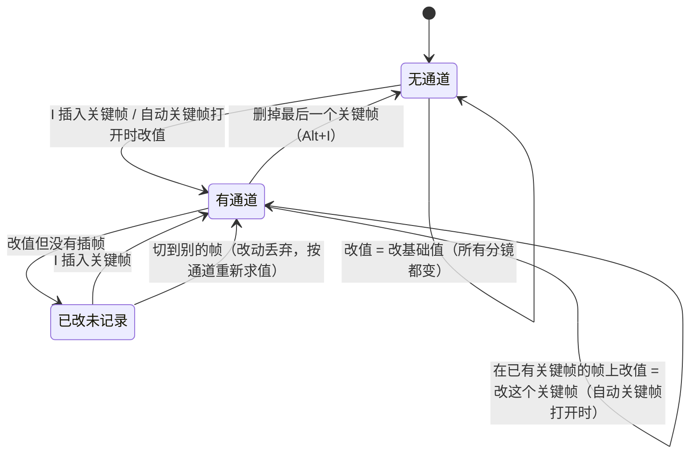
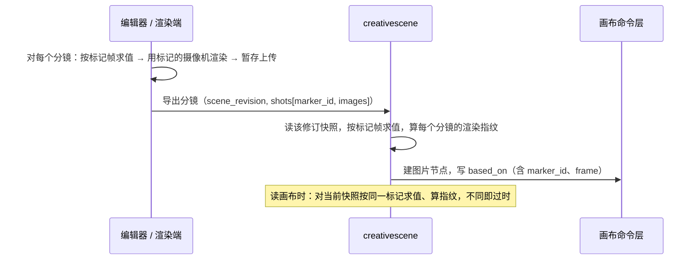
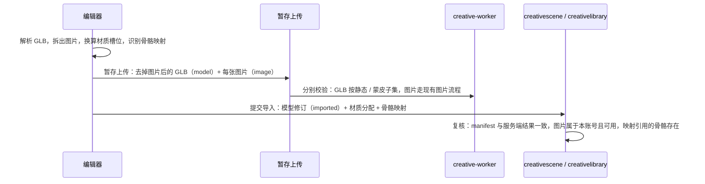

# Epic 技术方案

## 设计上下文

- 需求与边界见 `proposal.md`；讨论过程、事实依据和 Blender 调研见 `discovery/brainstorm.md`。
- 本 Epic 建在 `scene-editor-3d` 已交付的场景模块上，不复述它的架构：
  - 场景文档按单元做版本控制。
  - 物件几何是不可变的模型修订，GLB 是几何的事实源。
  - 渲染、烘焙和导出都在浏览器里完成，服务端经客户端任务派发工作。
  - 导出图记录来源，读取时按渲染指纹判断是否过时。
- 下文分三类：
  - **采用方案**：下面没有特别标注的部分。
  - **待验证假设**：标为「待验证」，由对应子项回答。
  - **后续增强**：标为「后续」，不在本 Epic。
- 交互默认与 Blender 一致（项目惯例）：时间线、关键帧、姿态模式和姿态库都照搬 Blender 的行为，偏离时写明理由。

## 领域模型与业务规则

### 概念

| 概念 | 定义 | 不是什么 | 代码与格式中的名字 |
|---|---|---|---|
| 基础值 | 物件和摄像机现有的字段值（`transform`、`visible`、`camera.*`）。属性没有通道时，它就是所有分镜的值；有通道时，它是这个属性的**默认状态**：首次创建通道时其他分镜取它，「新建分镜」取它 | 不是某一帧的值 | 现有字段 |
| 关键帧通道 | 一个物件的一个可动画属性在各帧上的关键帧，按帧号排序 | 不是物件的整份快照 | `objects[].animation.<path>` |
| 关键帧 | 通道上的一个点：帧号、值、到下一个关键帧的插值方式 | — | `{frame, value, interp}` |
| 求值 | 按帧算出每个属性的值：有通道的属性取通道在这一帧的值，没有通道的取基础值 | 不改写快照 | `patterns: 关键帧求值` |
| 分镜标记 | 时间线上的一个标记：固定 ID、名称、帧号、绑定的摄像机。一个分镜就是一个标记 | 不是策划文档里的「镜头」；策划镜头引用标记 | `scene.timeline.markers[]` |
| 标准人形骨骼 | 平台定义的一组人形骨骼名和静止姿势约定，参照 VRM 1.0 humanoid | 不是某个资产自带的骨架 | 子项 3 定版 |
| 姿态 | 一组骨骼相对静止姿势的旋转（加骨盆位移）。场景里记在骨骼通道上；存进库里就是姿态资产 | 不是形态键，也不是网格烘焙结果 | 骨骼通道 `pose.*`（子项 4）；内容类型 `pose`（子项 5） |
| 素体 | 平台内置的人形角色模型，一男一女，所有账号可见、只读 | 不是账号资产 | 子项 3 |

### 不变量

- **P1 求值是唯一的。** 同一份快照在同一帧上，求值结果在服务端（Go）和编辑器（TS）完全相同，由共用测试向量保证。渲染、导出、渲染指纹和助手读取都以求值结果为准。
- **P2 没有通道的属性所有帧共用。** 改它就是改所有分镜，这是「布景天然一致」的来源。
- **P3 一个分镜占一帧，帧号不重复。** 同一瞬间的不同机位放在相邻两帧。因此按帧的可见性关键帧总能区分分镜（例如人片只在自己的分镜里可见）。
- **P4 结构不打关键帧。** 物件的存在、父级、顺序、模型引用、材质槽分配不进通道；物件出现或消失用 `visible` 的关键帧表达。
- **P5 关键帧不改变单元的归属。** 通道属于它的属性原来所在的单元：位置、旋转、缩放、可见性在摆放单元 `object:<id>`；摄像机参数（以后加上骨骼）在内容单元 `object:<id>:content`。改关键帧和改同一属性的基础值，按同一单元做并发控制。
- **P6 姿态按标准人形骨骼存储。** 套到别的角色时，按那个角色的静止姿势换算。非人形骨架的姿态只能在同一套骨骼上复用（子项 3、5）。
- **P7 平台内置资产只读。** 内置素体和内置姿态不属于任何账号，账号只能引用或复制，不能修改（子项 3、5）。
- **P8 分镜帧上的值总由关键帧给出。** 一个属性只要有通道，它在每个分镜的帧上都必须有关键帧，服务端在每批命令应用后检查，不满足就拒绝。因此分镜之间互不影响：常量外推和插值只作用于分镜之间的帧，永远不会决定某个分镜的画面。分镜之外的帧可以另有关键帧，留给以后的动画。

### 编辑语义

照搬 Blender，偏离两处：**首次创建通道时补齐其他分镜**（S1），以及**新建分镜与复制分镜分开**（S2a、S2b，Blender 没有分镜的概念）。

- 「已改未记录」只存在于编辑器里，不写入快照，界面上用 Blender 的配色区分「有关键帧」「本帧是关键帧」「已改未记录」。
- 自动关键帧开关默认关闭，与 Blender 相同（子项 1 试用后再定）。

为满足 P8，下面几种操作都由编辑器或助手的工具层在**同一批命令**里写全，服务端不隐式补帧，只按 P8 检查：

| # | 操作 | 同一批里写出的内容 |
|---|---|---|
| S1 | **首次创建通道**：属性还没有通道时，在任意一帧 f 插入关键帧（I、自动关键帧、助手指明分镜写入）；f 可以不是分镜帧 | 帧 f 写新值；**其他每个分镜的帧写修改前的值**；基础值保持（或改回）修改前的值，作为默认状态。「修改前的值」见下文「首次插帧的基线」。Blender 的第一个关键帧会让整条时间线都取这个值，那样「只改分镜 3」会改动所有分镜，违反验收 A2，所以这里偏离 Blender |
| S2a | 新建分镜 | 每条已有通道在新的一帧写**基础值**（默认状态）。只属于某个分镜的物件因此在新分镜里隐藏，主体回到默认状态 |
| S2b | 复制分镜 | 每条已有通道在新的一帧写**被复制分镜**的求值结果，新分镜与它完全相同，包括只属于它的物件 |
| S3 | 改分镜的帧号 | 每条通道在旧帧上的关键帧挪到新帧；新帧上原有的关键帧被覆盖 |
| S4 | 删除分镜 | 删掉每条通道在这一帧上的关键帧 |
| S5 | 清除一个属性的动画（Blender 的 Clear Keyframes） | 删掉整条通道，基础值写成当前帧的求值结果，画面不跳变。分镜帧上的单个关键帧不能单独删除（会违反 P8），Alt+I 在分镜帧上提示改用「清除动画」 |
| S6 | 添加「只属于当前分镜」的物件（`cg-composite` 的人片默认如此；编辑器的物件菜单也提供「只在当前分镜显示」，对已有物件同样可用） | 物件的基础值 `visible = false`，并带 `visible` 通道：当前分镜为 `true`，其他每个分镜为 `false`。之后「新建分镜」按 S2a 取基础值，它不会出现；「复制分镜」按 S2b 会带上它。普通的添加不带通道，物件出现在所有分镜里，属于布景。不另存「属于哪个分镜」的信息：「只属于某个分镜」就是默认隐藏、只在这一帧可见 |

**首次插帧的基线**（S1 的「修改前的值」）：

- 自动关键帧打开时，第一次修改就直接按 S1 写出，修改前的值就是当时的基础值。
- 自动关键帧关闭时，修改一个没有通道的属性会先改基础值（所有分镜都变，这是 Blender 的行为），之后再按 I。所以编辑器要记住修改前的值：
  - **记录**：场景有分镜时，第一次修改某个物件的某个白名单属性的基础值，记下修改前的值；同一属性之后的连续修改不覆盖它。
  - **使用**：按 I 时，其他分镜写这个值，基础值改回这个值，帧 f 写当前值。三者在同一批命令里。
  - **失效**：以下任一情况发生时丢弃：
    - 切换帧或分镜。
    - 按 I 用掉了它。
    - 这个属性因为别的原因有了通道。
    - 撤销使基础值回到了它。
    - 其他标签页或助手改了这个物件的同一单元。
  - **没有基线时按 I**：其他分镜写当前值，与 Blender 的第一个关键帧相同，并提示「其他分镜也采用了这个值」。
- 基线只存在于编辑器里，不进快照。助手的写入总是指明分镜，修改前的值就是当时的基础值，不需要基线。

### 助手写入规则

- 读：`read_scene` 返回分镜标记，以及每个物件有哪些通道；指定分镜时返回这一帧的求值结果。
- 写：`edit_scene` 每次写入要指明是哪个分镜（或哪一帧），写进这一帧的关键帧。不指明时改基础值。
- **不指明分镜去改一个有通道的属性时，工具直接报错**，提示指定分镜或先删掉动画，避免改动被通道覆盖。这条规则只在助手的工具层执行，命令接口本身不区分写入者。
- 回看和导出都按分镜：`render_view` 可以指定分镜标记，`export_shots` 按分镜标记列出（`data: 场景时间线`「客户端任务的分镜字段」）。
- 指明分镜写入一个还没有通道的属性时按 S1；新建分镜按 S2a，复制分镜按 S2b，挪动、删除分镜按 S3、S4；添加人片等只属于一个分镜的物件按 S6。规则与编辑器相同，由工具层写出。

## 架构设计

本节只写增量，沿用 `architecture: 场景模块` 的分层和依赖方向。

### 职责

| 位置 | 新增职责 | 不做 |
|---|---|---|
| `backend/internal/creativescene` | 时间线与通道的 schema 校验；`set_timeline` 操作和 `add_objects`、`update_objects` 的 `animation` 字段；按帧求值（供渲染指纹、助手读取、导出放置使用）；分镜导出的放置；助手工具的分镜语义 | 不渲染；不做蒙皮计算（指纹只看骨骼通道的值，不看形变后的顶点） |
| `backend/internal/creativescene` 的求值器 | `patterns: 关键帧求值` 的 Go 实现，无 I/O 的纯函数，与 TS 实现共用测试向量 | — |
| `backend/internal/creativecontent`、`creativemedia` | 子项 2：模型内容的导入形态；子项 3：蒙皮子集的 GLB 校验 | 不执行任何资产代码 |
| `creativelibrary` | 子项 2：导入模型进资产库；子项 5：姿态资产 | — |
| 平台内置资产目录 | 子项 3、5：内置素体和内置姿态的清单与文件，仿 `data: 内置贴图库`：清单随代码发布，文件放在对象存储的独立前缀下，不属于任何账号 | 不进账号配额和媒体 GC |
| 前端 `frontend/src/creative-scene/` | 时间线面板；求值器的 TS 实现；编辑语义（关键帧状态、自动关键帧）；按分镜导出；子项 2 的导入流程（解析 GLB、拆图片、换算材质）；子项 3 的蒙皮渲染与静态化；子项 4 的姿态模式；子项 5 的姿态架 | — |

### 关键链路

**按分镜导出（子项 1）：**

- 助手导出（`export_shots`）走同一个放置流程，图片清单随完成任务提交，与现在相同。
- 渲染指纹在服务端按求值结果计算。服务端因此必须有求值器，这是 P1 要求两端一致的原因。

**导入（子项 2、3，方向已定，细节在子项里写）：**

- 图片拆出来存成账号的图片内容，复用现有的图片校验、媒体票据和 `creative_content_revision_refs` 持有关系（模型库副本已经这样持有贴图）。GLB 本身仍然不带 `images` / `textures`，服务端的 GLB 校验只需加上蒙皮子集。
- 浏览器的解析结果不可信，服务端对 GLB 和每张图片分别复核；与几何模块的沙箱产物同一原则。

**蒙皮渲染（子项 3、4）：**

- 视口加载蒙皮 GLB 时生成 three.js 的 `SkinnedMesh`。按当前帧的骨骼通道求值后写入骨骼，三个显示模式都直接画蒙皮网格。
- 需要静态几何的地方，使用「求值后的静态化几何」：实时 GI 和以后的路径追踪的加速结构、包围盒与吸附、线稿。做法是在当前姿态下做一次 CPU 蒙皮，结果缓存，缓存键包含模型修订和姿态值的哈希。
- 「合并 part」（`models/merge.ts`）不合并蒙皮网格：蒙皮网格的每个 primitive 各自一次绘制。
- **拖动骨骼时分两件事看：几何正确和光照收敛。**
  - **几何正确，任何时刻都要满足。** 光栅部分（蒙皮网格、阴影贴图、屏幕空间的 GI、反射和 AO）每帧按当前姿态绘制，自然成立。屏幕外的追踪层（世界空间的间接光和反射）**不能使用旧姿态的几何**：拖动期间，这个角色的追踪几何按当前姿态更新（CPU 蒙皮后对 BVH 做 refit，按帧节流）。一帧内更新不完时，就在追踪层里暂时剔除这个角色，让它对屏幕外间接光和反射的贡献暂时缺失，而不是保留旧姿态。原则是宁可暂缺，不可错位。
  - **光照收敛，拖动期间可以滞后。** 角色附近的探针和缓存失效后重新计算。
  - **松手后**：重建 BVH（不沿用 refit 的结果，质量优先），更新静态化几何的缓存，GI 重新收敛。
  - **导出和 `render_view` 的等待条件**：这一帧的静态化几何就绪、加速结构重建完成，再按现有的收敛帧数累积，然后出图。
  - **待验证（子项 3 穿刺）**：refit 的耗时、剔除时的观感。验收场景包括：角色贴近墙面（墙上的反弹光）、镜面反射（镜中的角色跟随）、肢体自遮挡（手臂贴近脸时的 AO 和阴影）。每个场景分别检查两项：几何正确（拖动中任何时刻都没有旧姿态的残影），光照收敛（松手后若干帧内与导出图一致）（[[render-quality-over-performance]]）。

## 技术选型

| 问题 | 选择 | 理由与边界 |
|---|---|---|
| 关键帧求值 | 自写，Go 与 TS 各一份，共用测试向量（JSON 文件，`make generate` 时复制到前端） | 服务端要按求值结果算渲染指纹，必须有 Go 实现；规则很小（线性、四元数球面插值、阶跃），不值得为此在服务端引入 JS 运行时。与 `data: 模型内容` 的 manifest 算法在两端各实现一份是同样的做法 |
| 插值方式 | 本 Epic 只有 `linear` 与 `constant`；四元数用球面线性插值，取最短路径 | 静态分镜只在关键帧所在的帧上求值，插值只影响「没有关键帧的帧」。格式为每个关键帧记 `interp`，以后加 `bezier` 只是追加取值（后续） |
| 时间线 UI | 自写，放在编辑器底部，交互照搬 Blender 的 Timeline 和 Dope Sheet 的子集 | three.js 和 drei 都没有可用的时间线组件 |
| 蒙皮 | three r186 自带的 `SkinnedMesh`、`Skeleton`，`GLTFLoader` 原生支持 | 不新增依赖 |
| 标准人形骨骼 | 参照 VRM 1.0 humanoid 的骨骼名与层级，**不引入** `@pixiv/three-vrm` | 只要命名和静止姿势约定，不需要 VRM 运行时（表情、弹簧骨、视线）；本 Epic 只收 `.glb` |
| IK | 自写四肢两段式解析 IK，带极向量 | 结果确定、没有迭代抖动，满足四肢的需求；three 自带的 `CCDIKSolver` 是迭代求解，结果与初始姿态有关。脊柱等多段 IK 是后续 |
| 骨骼映射识别 | 有 VRM 扩展时读它的「标准骨骼 → 节点下标」映射；否则按命名表（Mixamo 的 `mixamorig:` 前缀等）识别；都不行时手动指定。结果一律存成节点下标 | glTF 节点名可缺省、不唯一，不能当身份；VRM 的映射本来就按节点下标。Rigify 等命名可以之后追加命名表 |
| 平台内置资产 | 仿 `data: 内置贴图库`：清单随代码发布，文件放在对象存储的独立前缀下，用 `creativectl` 导入和检查 | 已有先例；内置资产不属于账号，ADR-001 的账号隔离不适用，读取仍要求登录 |

## 关键机制

### 关键帧求值

规则见 `patterns: 关键帧求值`，要点：

- 帧号是非负整数；通道里的关键帧按帧号严格递增。
- 在第一个关键帧之前取第一个关键帧的值，最后一个之后取最后一个的值（与 Blender 的常量外推相同）。
- 在两个关键帧之间，按左边那个关键帧的 `interp` 计算：`constant` 取左值；`linear` 对数值和数组逐分量线性插值，对四元数做最短路径的球面线性插值，结果归一化。
- 离散属性（布尔、枚举、字符串、画幅、`focus_object_id`）只允许 `constant`。
- 求值后的值仍要满足这个字段的约束。数值插值不会越过两端的范围，所以只要关键帧本身合法，结果就合法。

### 分镜与导出

- 导出按分镜进行。每个分镜对快照按标记帧求值，用标记绑定的摄像机渲染。
- 标记的摄像机为空，或者摄像机已被删除时，这个分镜不能导出。编辑器和助手都会提示，与对焦物件被删后的处理方式相同。
- 渲染指纹按求值后的快照计算，计入项与现行的指纹投影相同（`scene-editor-3d` design「渲染模式与导出」）。时间线和通道本身不计入，只有求值结果计入。因此：
  - 只改别的分镜的关键帧，这个分镜不过时。
  - 把分镜挪到另一帧（S3 会带着关键帧一起挪），求值结果相同，不过时。
  - **分镜换绑另一台摄像机算过时**，即使两台摄像机的参数和位置完全相同。现有指纹把摄像机 ID 计入哈希（`backend/internal/creativescene/fingerprint.go` 的 `camera_id`）。沿用这一点，旧图的指纹才能保持不变；要做「换成等价摄像机不过时」，就得改成语义指纹，并让所有旧图过时一次，不值得。
  - 没有任何通道和标记的场景，求值结果就是现在的快照，**指纹不变，不升版本**，已有导出图的过时状态不变（验收 A8）。
- 旧的导出图没有 `marker_id`，按第 0 帧求值后计算指纹。没有通道时第 0 帧的结果就是基础值，与现状一致。
- 没有指定帧的读取（`render_view` 的临时视点、预设视角和摄像机三种方式）也按第 0 帧求值；助手工具的说明里写明这一点。

### 快照大小与单元数

- 通道放在物件原来的单元里（P5），不新增每个物件的单元，只新增一个 `timeline` 单元。原因：单元总数上限是 4096，物件最多 2000 个，每个物件已经占两个单元。
- 快照上限仍是 512 KiB。估算：一个人形角色 55 根骨骼、20 个分镜，每个关键帧按 60 字节计，约 66 KB。子项 1 先限制每个通道最多 1000 个关键帧，并统计真实场景的大小；子项 4 再决定骨骼通道是否需要压缩，例如只记与静止姿势不同的骨骼、数值保留 5 位小数。**待验证（子项 1、4）**。录制或导入密集动画时需要拆开存储，这是后续的事，与 C7 历史清理相关。

### 层级与通道

- `reparent_objects` 带 `transform` 时只改基础值，关键帧保持在局部空间里不变，与 Blender 相同。改挂有位置、旋转或缩放通道的物件后，各分镜里的画面可能跳变，编辑器会提示。
- 删除物件时，它的通道随物件一起删除。`restore_units` 恢复物件单元时，通道随所在单元一起恢复。

### 姿态的存储与换算（子项 3–5 共用，细节在子项里写）

- **骨骼的身份是「不可变模型修订 + 节点下标」，名称只用于显示和辅助识别。** glTF 的节点名可以缺省，也不保证唯一，不能拿来寻址。
  - 模型修订（子项 3）记一份骨架摘要：关节的节点下标、父子链、静止姿势，名称只作显示用；还有一份标准人形映射：标准骨骼名 → 节点下标。
  - 骨骼通道路径：
    - 人形角色用标准骨骼名，例如 `pose.leftUpperArm.rotation`（四元数），以及 `pose.hips.position`（骨盆位移，米）。它们经映射落到节点上，所以换模型修订后照样成立。
    - 非人形骨架用 `pose.node:<节点下标>.rotation`，只对这个实例当前的模型修订有效。实例换模型修订时，骨架摘要的指纹相同才保留这些通道，否则删除并提示。
- **映射怎么识别**：
  - 源文件带 VRM 扩展（`VRMC_vrm` 或 VRM 0.x）时，直接读扩展里「标准骨骼 → 节点下标」的映射。浏览器解析时读取，扩展本身不进存储的 GLB。
  - 否则按命名表识别（Mixamo 等），识别结果同样存成节点下标。
  - 都识别不了时，由创作者手动指定。
  - 浏览器给出的映射不可信，服务端只校验两点：下标指向的是关节，同一个标准骨骼不重复映射。
- **非人形姿态资产**同时记录兼容的骨架身份（骨架摘要的指纹和来源模型），只能套到指纹相同的骨架上。
- **换算（待验证，子项 3 穿刺）**：参照 VRM 的「规范化骨骼」做法。标准坐标系为 Y 轴向上、角色面朝 +Z，静止姿势为 T 姿势；在这个空间里，每根标准骨骼的静止旋转都是单位四元数。姿态按规范化空间里的局部旋转存储，套到具体角色时，按它的静止姿势在世界空间的朝向换算到它自己的局部轴。
  - 标准骨骼之间的非标准节点（辅助骨、扭转骨）保持静止姿势，不接收姿态，换算时计入它们的静止变换。
  - 可选骨骼缺失时（例如没有 `upperChest`，或者没有手指），这根骨骼的旋转并入相邻的标准骨骼，或者直接忽略。具体规则由穿刺定。
  - 骨盆位移按腿长比例缩放。
- **穿刺要验证的是方向和关节运动是否正确**：用 A 姿势和 T 姿势不同、含辅助骨、比例不同、局部轴约定不同的资产，做抬臂、屈肘、回头和镜像。穿刺结束时要定下标准坐标系、旋转的组合规则，以及不支持的骨架边界。
- 接触点（手扶腰、脚踩地）在体型不同时会有偏差，用 IK 修正。这是已知局限，不做自动修正，但它不能代替上面的方向与关节运动验证。

## 接口设计

- 子项 1 的接口条目见 `contracts.md`：
  - `api: ADD 场景时间线命令`：在现有命令接口上增加 `set_timeline` 操作，并给 `add_objects`、`update_objects` 增加 `animation` 字段。改关键帧和改基础值写在 `update_objects` 的同一项里，满足「每个单元在一批里只出现一次」。
  - `api: MODIFY 导出分镜`：镜头改为可以按分镜标记列出。
  - 读取场景不改接口：快照里多出 `timeline` 和 `objects[].animation`，按数据契约返回。
- `data: 场景客户端任务` 的修改目前由 `creative-mcp-server` 的子项 `mcp-write-generate` 负责。本 Epic 不改那一节，`render_view` 和 `export_shots` 按分镜的请求字段在 `data: 场景时间线` 里定义（见 roadmap「跨 Epic 的依赖与协调」）。
- 子项 2–6 的接口在各自起草前由 Epic 修订补全：导入接口、内置模型引用、姿态资产的存入与读取、助手工具的姿态说明。

## 数据与存储设计

- **子项 1**：`data: 场景时间线`。不新增表，时间线和通道都在场景快照里；新增单元 `timeline`；通道归物件现有的两个单元。不迁移：没有这两个字段就是没有标记、没有通道。
- **子项 2**：导入的模型是 `model` 内容，`generator.language = "imported"`，没有 `code`（data 契约已经预留）。GLB 去掉图片后存储；贴图是账号的图片内容，由模型资产的 `model.materials` 经 `creative_content_revision_refs` 持有。导入来源（原文件名、导入时间）和授权说明记在模型内容上，字段在子项 2 定。
- **子项 3**：
  - 模型内容放宽到「静态子集 + 蒙皮子集」。蒙皮子集允许 `skins`、`JOINTS_0`、`WEIGHTS_0`；子项 3 定骨骼数、每顶点影响数（glTF 每组 4 个）和权重归一化的容差。
  - manifest 增加骨架摘要：骨骼列表、到标准骨骼的映射、静止姿势。
  - 平台内置模型的引用方式：**推荐**场景实例直接引用内置模型 ID，与内置贴图材质按 ID 引用相同，不复制进账号，不进引用表和 GC。子项 3 起草时定。
- **子项 5**：
  - 新内容类型 `pose`：标准骨骼的旋转、骨盆位移、收录了哪些骨骼、缩略图。
  - 资产库新类型 `pose`；内置姿态进平台内置资产目录。

## 验证与交付

- **共用测试向量**：求值器在 Go 和 TS 两端跑同一份 JSON 测试向量，覆盖外推、线性、四元数最短路径、阶跃和边界帧。指纹的 Go 测试覆盖 A2 和 A8 的场景。
- **定向测试**：按项目约定只跑受影响的包和单个 e2e 用例（[[targeted-verification-only]]）。
- **owner 判断的质量项**：子项 1 的编辑语义、子项 5 的跨体型观感、子项 6 的助手样例（每例至少跑两次）。
- **上线顺序**：
  - 每个子项前后端同一版本上线。旧编辑器不认识 `timeline` 和 `animation`，整体替换时会丢失它们，所以不能只升级一端。
  - 回滚到不认识这些字段的后端会读取失败，只做前向修复，与修订 v17 相同。

## 未决事项

| 问题 / 假设 | 影响 | 解决方式 | 最晚解决时点 |
|---|---|---|---|
| 自动关键帧开关的默认值（Blender 默认关闭） | 子项 1 的交互 | 子项 1 试用后由 owner 定 | 子项 1 验收 |
| 骨骼通道是否需要压缩；真实场景的快照大小 | 子项 4 | 子项 1 统计，子项 4 决定 | 子项 4 起草 |
| 现有贴图字段覆盖不到的 glTF 用法：自发光贴图、`TEXCOORD_1`、单张贴图的 `KHR_texture_transform`、顶点色 | 子项 2 的范围；`data: 场景文档` 的材质贴图字段 | 子项 2 起草时逐项定为补字段、换算或忽略 | 子项 2 起草 |
| 单场景 64 张图片的上限对「带贴图角色 + 布景」是否够用 | 子项 2 | 用实际角色资产统计 | 子项 2 验收 |
| 标准骨骼是否带手指；骨骼数和影响数预算 | 子项 3、4、5 | 子项 3 定版 | 子项 3 起草 |
| 跨角色换算：标准坐标系、旋转组合规则、辅助骨与可选骨骼的处理、不支持的骨架边界 | 子项 3 的骨架数据、子项 5 的姿态资产 | 子项 3 起草前做穿刺（见「姿态的存储与换算」），结论写进子项 3 的 `discovery/research/` | 子项 3 冻结骨架数据之前 |
| 拖动时追踪层的更新方式：refit 跟随还是暂时剔除 | 子项 3、4 | 子项 3 穿刺，验收场景见「蒙皮渲染」 | 子项 3 设计 |
| 半合成的原片背景按什么单位挂：一张原片对应一台独立的摄像机，还是按分镜选原片 | `cg-composite` CG-24、本 Epic 子项 1 的分镜与摄像机关系 | owner 决定 | `cg-composite` K2 起草 |
| 内置模型的引用方式（推荐直接引用 ID） | 子项 3 的数据契约 | 子项 3 起草时定 | 子项 3 起草 |
| 导入资产的来源和授权记录 | 子项 2 | 子项 2 定字段 | 子项 2 起草 |
| 助手判断不出性别时「先问」的交互：用 `cg-composite` 的助手选项卡（CG-27），还是直接在对话里问 | 子项 6 | 看 CG-27 是否已交付 | 子项 6 起草 |
| 与 `mcp-write-generate` 修改客户端任务的先后 | 子项 1 的实现 | 按串行顺序合入，后开工的一方在先合入的代码上修改 | 子项 1 开工 |
