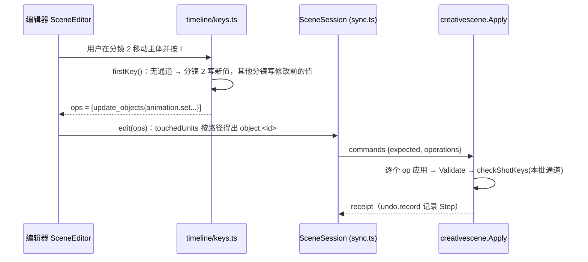

# Change 详细设计

## 继承的设计

- Epic `scene-pose-system` 基线 v1（`lti epic bind` 已绑定全部 design 条目）。本次承担：
  - 不变量 P1–P5、P8。
  - 「编辑语义」S1–S6。
  - 「助手写入规则」。
  - 「分镜与导出」「快照大小与单元数」「层级与通道」。
- 交付的契约见 Epic `contracts.md`，本次不复制正文：
  - `glossary: 分镜`、`glossary: 关键帧通道`
  - `patterns: 关键帧求值`
  - `data: 场景时间线`、`data: 导出图来源`
  - `api: 场景时间线命令`、`api: 导出分镜`
  - `architecture: 场景模块`
- 沿用 `scene-editor-3d` 的场景模块：快照、单元、乐观并发、只撤销自己的操作、客户端任务、导出放置与渲染指纹。

## 领域模型与业务规则

### 类型（Go，`backend/internal/creativescene`）

```go
// model.go
type Scene struct {
    Environment Environment `json:"environment"`
    Render      Render      `json:"render"`
    Timeline    *Timeline   `json:"timeline,omitempty"` // 读取时补 {24, []}，写入总是存
    Objects     []Object    `json:"objects"`
}
type Timeline struct {
    FPS     int      `json:"fps"`
    Markers []Marker `json:"markers"` // 按 frame 升序
}
type Marker struct {
    ID             string `json:"id"`
    Name           string `json:"name"`
    Frame          int    `json:"frame"`
    CameraObjectID string `json:"camera_object_id"`
}
// Object 新增
Animation map[string]Channel `json:"animation,omitempty"` // 键为通道路径
type Channel struct{ Keys []Key `json:"keys"` }
type Key struct {
    Frame  int             `json:"frame"`
    Value  json.RawMessage `json:"value"` // 按路径解码：float64 / []float64 / bool / string
    Interp string          `json:"interp"`
}
```

- **通道白名单**（新文件 `channels.go`）：一张表，每条路径给出所在单元、允许的 `kind`、值的类型（标量、向量 3、四元数、布尔、枚举或字符串）、连续或离散，以及校验函数。校验复用现有的 `Camera` 与 `Transform` 校验：把关键帧值写进一份基础值的副本，再走原有校验，范围规则因此只有一份。
- **求值**（新文件 `evaluate.go`）：`func EvaluateAt(s Scene, frame int) Scene`。
  - 返回的场景已把每条通道的值写回基础字段，并清掉 `Animation` 和 `Timeline`。
  - 求值后的场景与现有渲染指纹、`lensOf`、助手视图的输入外形完全相同，所以这些函数不用改，只改调用处。
  - 没有通道时，结果就是原场景去掉 `Timeline`。
- **分镜帧检查**（`channels.go`）：`checkShotKeys(s Scene, scope shotScope) error`。
  - `scope` 是本批写到的通道集合；本批改了分镜列表时，检查全部通道。
  - 缺口错误带 `missing[]`，最多 50 项。
  - `restore`、`restore_units` 不调用它。

### 类型（TS）

- 来自 OpenAPI 生成的 `schema.d.ts`：`CreativeSceneTimeline`、`CreativeSceneMarker`、`CreativeSceneChannel`、`CreativeSceneKey`。
- `api.ts` 新增导出：`Timeline`、`Marker`、`Channel`。

### 编辑器本地状态（不进快照）

- `sceneStore` 新增以下字段，都不写入文档：
  - `frame: number`：当前帧。打开场景时取第一个分镜的帧，没有分镜时为 0。
  - `unkeyed: Record<objectId, Record<path, value>>`：「已改未记录」的值。
  - `autoKey: boolean`：自动关键帧开关，记在 `localStorage`，缺省关闭。
  - `baseline: Record<objectId, Record<path, value>>`：首次插帧的基线，即修改前的值。生命周期按 Epic design「首次插帧的基线」。
- 当前帧不进文档。理由：它是每个标签页自己的视图状态，与视角相同；进文档会让切帧产生修订和冲突。

### 规则落点

| 规则 | 编辑器（TS） | 助手（Go） | 服务端检查 |
|---|---|---|---|
| S1 首次创建通道 | `timeline/keys.ts` `firstKey()` | `agent_shots.go` `keyedUpdates()` | P8 |
| S2a 新建分镜（取基础值） | `addShot()` | `add_shot`（不带 `copy_from`）展开 | P8 |
| S2b 复制分镜（取被复制分镜） | `duplicateShot()` | `add_shot{copy_from}` 展开 | P8 |
| S3 挪动分镜 | `moveShot()` | `update_shot{frame}` 展开 | P8 |
| S4 删除分镜 | `removeShot()` | `remove_shot` 展开 | P8 |
| S5 清除动画 | `clearChannel()` | `update_objects` 的 `animation.clear` 加基础值（助手直接写） | — |
| S6 只在当前分镜显示 | `onlyInShot()` | `add_objects[].only_in_shot` 展开 | P8 |

两端各写一份展开逻辑，由服务端的 P8 检查兜底：任何一端写漏都会被拒绝，不会悄悄改到别的分镜。

## 模块职责与协作

### 后端

- `creativescene` 负责以下几件事：
  - 快照校验、命令应用、单元恢复。
  - 求值。
  - P8 检查。
  - 指纹和导出放置。
  - 助手的读、写、回看与导出入口。
- `creativeagent/scene_tools.go` 只改工具的说明和参数解码，分镜语义都在 `creativescene` 里。
- `creativecanvas` 只是在导出来源里多存两个字段，过时判断照旧经端口问 `creativescene`。

主流程（编辑器写入）：



### 前端

| 模块 | 职责 |
|---|---|
| `timeline/evaluate.ts` | `evaluateAt(scene, frame)`：TS 版求值器，与 Go 版同一规则、同一测试向量 |
| `timeline/keys.ts` | 生成 S1–S6 的操作。输入当前视图和本地状态，输出 `SceneOperation[]`；纯函数，可单测 |
| `timeline/TimelinePanel.tsx` | 底部面板：帧标尺、分镜标记（拖动即挪动）、当前帧指针、选中物件的关键帧点、自动关键帧开关、新建、复制、删除分镜 |
| `SceneEditor.tsx` | 在 `shown` 之后、`withPreviews` 之前插入求值：`evaluateAt(shown, frame)`，再叠加 `unkeyed`。编辑入口 `edit()` 前加一层分流：属性有通道时，开着自动关键帧就写关键帧，没开就写进 `unkeyed`；没有通道时照旧写基础值 |
| `panels/Properties.tsx` | 显示求值后的值；字段旁的关键帧点用 Blender 配色：黄（本帧是关键帧）、绿（有通道、本帧不是关键帧）、橙（已改未记录）；右键菜单提供插入关键帧、清除动画 |
| `state/apply.ts`、`state/intents.ts` | `applyOp` 支持 `set_timeline` 和 `animation`；`touchedUnits` 按路径归单元；`updateKeys` 加入 `animation`；`mergeUpdate` 只合并「两边都只有 `set`」的 `animation`：同一 `(path, frame)` 后者覆盖前者，其余并集。只要任一边带 `clear` 或 `delete`，就不合并，作为独立的意图排队。原因是服务端按 `clear` → `delete` → `set` 的固定顺序执行，按类别拼接会改变跨类别的先后，例如「先 set、后 clear」会被执行成「先 clear、后 set」 |
| `state/undo.ts` | `patchFor` 支持 `timeline` 单元；物件单元的补丁带上属于这个单元的通道 |
| `panels/ExportDialog.tsx`、`host/exportShots.ts` | 有分镜时按分镜列出与出图；每个分镜对快照求值，交给出图场景 |
| `host/render.ts`、`host/executor.ts` | `render_view` 的 `marker_id` / `frame`；`export_shots` 的 `marker_ids` |

## 关键机制

### 求值放在哪里

- 编辑器只有一处求值：`SceneEditor.tsx` 里 `shown`（快照或历史预览）求值后得到 `drawn` 的输入。以下读取方因此自动看到当前帧：视口的 `SceneObjects`、`Lighting`、`CameraViewRig`、`Gizmo`、`CameraFrame`、模态变换，以及 Outliner 和 Properties。
- **两种读取要分开**：
  - **读文档结构与通道**：用 `s.view`（未求值）。场合包括：判断有没有通道、生成关键帧与基础值的写法、复制物件（带上通道）、物件存在性与层级。`byID` / `active`（`SceneEditor.tsx:262-264`）保留这个用途。
  - **依据当前画面计算编辑结果**：用求值后的场景，即当前帧的 `drawn`。场合包括父级世界矩阵、当前缩放、起点姿态。逐个入口如下：

    | 入口 | 现状 | 改为 |
    |---|---|---|
    | `cameraToView`（`SceneEditor.tsx:572`，经 `editing.ts:localPose`） | 用 `objects` 算父级逆矩阵，读 `active.transform.scale` | 用求值后的物件算父级矩阵和缩放；结果经「编辑分流」写成基础值或关键帧 |
    | `addCamera`（`SceneEditor.tsx:534`，`editing.ts:newCamera`） | 用 `objects` 算父级 | 用求值后的物件 |
    | 编组、取消编组、改挂（`grouping.ts` 中 `worldOf` 的三处：79、133、317 行） | 用 `objects` 的世界矩阵保持世界位置 | 用求值后的物件算世界矩阵；写出的 `transform` 只改基础值。物件有变换通道时，关键帧不改（Epic「层级与通道」），编辑器提示「各分镜的位置可能跳变」 |
    | 模态变换、gizmo、吸附（`Viewport.tsx`、`transform/modal.ts`） | 读 three 节点的 `matrixWorld`，以及 `latest.current.scene`（即 `props.scene`） | 已经是当前画面，不改；只把结果交给编辑分流 |
    | 复制物件（`editing.ts:duplicate`） | 用 `objects` | 不改：复制的是文档内容，连同通道一起复制 |
    | 对焦拾取、属性栏输入 | 显示用 `shown`，写入是字段值 | 显示改为求值后的值；写入经编辑分流 |

  - 助手侧同理：`edit_scene` 带 `shot` 时，`look_at`（`lookat.go`）和改挂保持世界位置，都按这一帧求值后的场景计算。
- 求值结果按 `(view 引用, frame)` 记忆化。拖动 gizmo 时，`view` 不变，变化的是 `unkeyed` 或预览，不会重复求值。
- 历史预览也先求值，所以看旧版本时同样按当前帧显示。

### 编辑分流

```
onEdit(objectId, field, value):              // value 已按当前画面算好
  path = channelPath(field)                  // 不在白名单 → 照旧写基础值
  if path 无通道:
     if autoKey: ops = firstKey(path, frame, value, before = 基础值)      // S1
     else:
        if 场景有分镜 && baseline 里没有 path: baseline[path] = 基础值   // 记下修改前的值
        ops = update_objects 基础值                                     // 所有分镜都变
  else:
     if autoKey: ops = update_objects{animation:{set:[{path, frame, value}]}}
     else: unkeyed[objectId][path] = value   // 已改未记录，不发命令

按 I（当前帧 f，任意帧）：
  有通道的属性：把 unkeyed 的值（没有就取当前值）写成帧 f 的关键帧
  无通道的属性：firstKey(path, f, 当前值, before = baseline[path] ?? 当前值)
     → 帧 f 写当前值；其他每个分镜帧写 before；基础值写 before
     → 没有 baseline 时，before = 当前值，提示「其他分镜也采用了这个值」
  清空用掉的 unkeyed 和 baseline

切帧、切分镜：清空 unkeyed 和 baseline
收到别的标签页或助手对某个物件单元的修改：清空该物件的 baseline
撤销使基础值回到 baseline：清空这一项
```

- **首次插帧在任意帧都补齐分镜帧**（Epic 修订 v2）：帧 f 不是分镜帧时也一样，否则新通道在分镜帧上没有关键帧，会被 P8 拒绝。
- **有未记录改动时导出**：导出前如果 `unkeyed` 不为空，弹出提示，列出这些物件和属性，提供三个选项：
  - 插入关键帧后导出：按 I 的规则写入，等保存完再导出。
  - 放弃这些改动后导出。
  - 取消。

  导出从服务端快照出图，`unkeyed` 不会自己进入导出，所以必须在这里明确处理。助手的导出不受影响，`unkeyed` 只存在于摄影师的编辑器里。
- 撤销：分流后产生的命令都走 `session.edit`，所以「只撤销自己的操作」照旧成立。`unkeyed` 不进撤销栈，与 Blender 相同。

### 单元归属与恢复

- 后端 `restore.go` 与前端 `undo.ts` 用同一条规则：物件单元的字段集合加上「这个单元的通道」。
  - `object:<id>` 带 `transform.*`、`visible` 的通道。
  - `object:<id>:content` 带 `camera.*` 的通道。
- 恢复一个单元时，只替换这个单元的通道，另一个单元的通道保持现状。
- `timeline` 单元整体替换 `scene.timeline`。
- 已有文档的 `unit_revs` 里没有 `timeline`：第一次 `set_timeline` 时，`expected.timeline = null`（底座规则：预期该单元不存在）。`Units()` 总是列出 `timeline`，所以整份恢复后它就存在了。

### 导出：每个分镜一套场景

- `renderShots`（`host/exportShots.ts`）现在只打开一个出图场景，换镜头时只移动摄像机。改成：
  1. 读文档，按分镜的帧求值，得到各分镜的场景。
  2. 求值结果按**出图场景键**分组。这个键单独定义，不用渲染指纹（指纹含摄像机 ID 和参数，而且 `clay` 的指纹不含灯光和体积物件）：
     - **计入**：求值后的 `environment`、`render`（不含输出分辨率），以及全部非摄像机物件的完整内容，包括变换、可见性、灯光、体积、材质、模型和层级。
     - **摄像机**：只计入有非摄像机后代的摄像机的变换，因为挂在摄像机下面的物件会跟着它动。其余摄像机的变换和参数都不计入。
     - 键相同的分镜共用一次打开、加载和 GI 加速结构，只换摄像机。例如同一瞬间的两个机位。
  3. 出图时，三类变化分开处理：

     | 变化 | 处理 |
     |---|---|
     | 出图场景键不同 | 调用 `setScene(scene)`：按物件 ID 增量更新出图场景，变化的几何重建 BVH，屏幕外 GI 的探针与缓存全部失效，等模型、贴图和加速结构就绪后，按现有收敛帧数重新累积 |
     | 键相同，摄像机或摄像机参数不同（焦距、画幅、景深、曝光） | 只换摄像机，时间累积清零后重新累积；加速结构和世界空间探针保留 |
     | 完全相同（同一分镜导出多种方式） | 沿用现有的按导出方式出图 |
- 指纹在服务端按同样的帧求值后计算，与前端出图用的是同一份求值规则（P1）。
- `render_view` 的 `marker_id` / `frame`：`renderView` 读到文档后先求值，再取景。

### 渲染指纹与过时

- `Fingerprint(scene, cameraID, pass)` 本身不改，调用方先求值：
  - 导出放置（`exports.go`）：`EvaluateAt(scene, frame)`。`frame` 是分镜的帧；按摄像机导出时为 0。
  - 过时判断（`Freshness`）：
    - 有 `marker_id` 时，在当前快照里找这个分镜：找不到、没绑定摄像机、或摄像机不存在，就判为 `stale`。找到后用它当前的帧和摄像机求值、算指纹。
    - 没有 `marker_id` 时，按第 0 帧和 `camera_id` 计算。
- **A8 的保证**：`EvaluateAt` 对没有通道的场景只去掉 `Timeline`。`Timeline` 不在指纹的投影里（投影只取 `Environment`、`Render`、`Objects`），`Object.Animation` 用 `omitempty`，求值后为 nil，所以投影的 JSON 逐字节不变。Go 测试用现有指纹样例逐个比对求值前后的结果。
- 读画布时，每个导出图节点都要求值一次。同一个场景、同一帧的结果在一次读取内缓存。

### 助手

- **`read_scene`**：
  - 新参数 `shot`（分镜 ID）。指明时，物件按这一帧的求值结果给出，并标明 `at_shot`。
  - 结果新增 `timeline`：分镜列表，每个分镜带名称、帧和摄像机名。
  - 每个物件的视图新增 `animated: [path]`，列出有通道的属性。
  - 结果新增 `shot_key_gaps`：P8 的缺口，最多 50 项。
- **`edit_scene`**：
  - 新参数 `shot`：
    - 指明时，`update_objects` 里白名单内的字段改写成这一帧的关键帧，没有通道的按 S1 补齐。
    - 不指明时，写到有通道的属性直接报错，列出物件和路径，提示指定 `shot` 或先清除动画。
  - 新增助手专用的三个操作，在 `agent_shots.go` 里展开成 `set_timeline` 和 `update_objects`：
    - `add_shot{id?, name, frame?, camera_object_id, copy_from?}`：`frame` 缺省为最后一个分镜的帧加 10。不带 `copy_from` 时按 S2a 取默认状态；带 `copy_from` 时按 S2b 复制那个分镜。
    - `update_shot{id, name?, frame?, camera_object_id?}`。
    - `remove_shot{id}`。
  - `add_objects` 的条目可以带 `only_in_shot`，按 S6 展开。
  - 展开发生在 `AgentEditInTx` 计算冲突基线之前，所以冲突检查覆盖展开后涉及的全部单元。
- **`render_view`**：新增 `shot`，以及给另外三种选择方式用的 `frame`。
- **`export_shots`**：新增 `shots`（分镜 ID 列表），缺省规则按 `data: 场景时间线`。
- 结果里的节点带 `marker_id`；导出来源 `export_source` 带 `marker_id` 和 `frame`。
- 字段名：工具层对助手统一叫 `shot`，与界面的「分镜」对应；命令和数据契约里叫 `marker`。理由：助手面对的是摄影语境，`shot` 更不容易被误解成别的标记；工具层负责翻译。

## 局部设计与偏差

- **助手的分镜操作是工具层的语法糖，不是新的命令操作**。理由：
  - S2–S4 和 S6 需要按当前快照展开出关键帧。服务端命令接口保持「调用方写全、服务端检查」，与编辑器同一模型。
  - 给助手的语法糖可以省掉大量重复的关键帧，降低出错率，与 C4 给助手 `look_at` 是同样的考虑。
- **新分镜的缺省帧间隔为 10**：给以后的动画留出中间帧，不影响静态分镜。
- **导出按出图场景键分组**：同一瞬间的多个机位只加载一次场景、建一次加速结构，导出时间与现在按摄像机导出相同。分组键与渲染指纹分开定义（见「导出：每个分镜一套场景」）。
- **待验证**：读画布时求值和计算指纹的开销。用 Go 基准测试测一个 2000 物件、200 分镜、20000 关键帧的场景，单次求值应小于 5 ms。超出就按场景修订缓存求值结果。

## 接口与数据契约

- 状态：**扩展**。全部定义在 Epic 的条目里，本次不在 Feature 的 `contracts.md` 里另加。
- OpenAPI（`api/openapi.yaml`）：
  - `CreativeScene` 增加 `timeline`，`CreativeSceneObject` 增加 `animation`。
  - `CreativeSceneOperation` 增加 `set_timeline`，`CreativeSceneObjectUpdate` 增加 `animation`。
  - `CreativeSceneExportPayload.shots[]` 增加 `marker_id`，`camera_object_id` 改为可选，二选一的规则在服务端校验。
  - 导出响应的节点增加 `marker_id`。
  - 改完运行 `make generate`，Go 与 TS 的生成物一起提交。
- 测试向量：`backend/internal/creativescene/testdata/keyframe_eval.json`，由 `make generate` 复制到 `frontend/src/creative-scene/timeline/keyframe_eval.gen.json`，`make generate-check` 比对。

## 挂载点

| 位置 | 动作 | 说明 |
|---|---|---|
| `backend/internal/creativescene/model.go:Scene`、`model.go:Object` | 修改 | 新增 `Timeline`、`Animation` 及类型；解码时补齐 `timeline` 缺省值、`interp` |
| `backend/internal/creativescene/model.go:Validate` | 修改 | 调用 `validateTimeline`、`validateAnimation` |
| `backend/internal/creativescene/channels.go` | 新增 | 通道白名单、单元归属、值校验、`checkShotKeys` |
| `backend/internal/creativescene/channels.json` | 新增 | 通道白名单的唯一来源（go:embed），`make generate` 复制为前端 `timeline/channels.gen.json`（实施时由「Go 表输出」改为与 `builtins.json` 同一模式） |
| `backend/internal/creativescene/evaluate.go` | 新增 | `EvaluateAt` |
| `backend/internal/creativescene/testdata/keyframe_eval.json` | 新增 | 两端共用的测试向量 |
| `backend/internal/creativescene/ops.go:decodeOp`、`ops.go:objectUpdate`、`ops.go:updateObjectsOp.apply`、`ops.go:addObjectsOp.apply`、`ops.go:changeSet` | 修改 | 新增 `setTimelineOp`；`objectUpdate.Animation`（`clear`、`delete`、`set`）；按路径计算单元；`changeSet` 记录本批写到的通道和分镜列表是否改动 |
| `backend/internal/creativescene/type.go:sceneType.Apply`、`type.go:sceneType.Units` | 修改 | 应用后调用 `checkShotKeys`；`Units` 列出 `timeline` |
| `backend/internal/creativescene/restore.go` | 修改 | `timeline` 单元；物件单元按路径恢复通道 |
| `backend/internal/creativescene/view.go:completedScene`、`view.go:unitView` | 修改 | 旧快照读取时补 `timeline`；按单元读取带出 `timeline` 单元和各单元的通道（实施时补充：编辑器靠它同步他人的关键帧改动） |
| `backend/internal/creativescene/fingerprint.go:Freshness` | 修改 | 按 `marker_id` / 第 0 帧求值后计算指纹 |
| `backend/internal/creativescene/exports.go:ExportShot`、`exports.go:validateShots`、`exports.go:placeExportsInTx` | 修改 | `MarkerID`；先求值再取摄像机、`lensOf`、指纹；标题用分镜名 |
| `backend/internal/creativecanvas`（`SceneExportBasedOn`、`based_on` 的读写） | 修改 | 新增 `MarkerID`、`Frame`；`export_source` 带出 |
| `backend/internal/creativeagent/context.go:exportSourceContext` | 修改 | `read_canvas` 的 `export_source` 带 `marker_id`、`frame`（实施时补充：`export_source` 在这里组装） |
| `backend/internal/platform/httpapi/creative_documents.go:creativeDocumentError` | 修改 | P8 拒绝映射为 400 `validation_failed`，`details.missing`（实施时补充） |
| `backend/internal/creativescene/jobs.go:RenderRequest`、`jobs.go:ExportRequest` 及建任务的校验 | 修改 | `MarkerID`、`Frame`、`MarkerIDs`；缺省分镜与未绑定摄像机的检查 |
| `backend/internal/creativescene/jobs_complete.go` | 修改 | 导出结果的节点带 `marker_id` |
| `backend/internal/creativescene/agent.go:ReadInput`、`agent.go:SceneRead`、`agent.go:ObjectView`、`agent.go:AgentReadInTx`、`agent.go:EditInput`、`agent.go:AgentEditInTx` | 修改 | `shot` 读写；`timeline`、`animated`、`shot_key_gaps`；有通道却不带分镜时报错 |
| `backend/internal/creativescene/agent_shots.go` | 新增 | `add_shot`、`update_shot`、`remove_shot`、`only_in_shot` 展开；`keyedUpdates()`（S1） |
| `backend/internal/creativeagent/scene_tools.go:sceneTool.Info`、`editScene`、`readScene`、`renderView`、`exportShots` | 修改 | 参数与说明 |
| `api/openapi.yaml` | 修改 | 见「接口与数据契约」 |
| `frontend/src/creative-scene/api.ts` | 修改 | 导出新类型 |
| `frontend/src/creative-scene/timeline/evaluate.ts`、`timeline/keys.ts`、`timeline/TimelinePanel.tsx`、`timeline/channels.ts` | 新增 | 求值、S1–S6、面板、路径表（与 Go 白名单同表，经 `make generate` 生成 `channels.gen.json`） |
| `frontend/src/creative-scene/state/sceneStore.ts` | 修改 | `frame`、`unkeyed`、`autoKey` |
| `frontend/src/creative-scene/state/apply.ts:applyOp`、`apply.ts:updateKeys`、`apply.ts:placementKeys`、`apply.ts:contentKeys` | 修改 | `set_timeline`、`animation` 的本地应用与归属 |
| `frontend/src/creative-scene/state/intents.ts:touchedUnits`、`intents.ts:mergeUpdate` | 修改 | 按路径归单元；`animation` 合并 |
| `frontend/src/creative-scene/state/undo.ts:patchFor` | 修改 | `timeline` 单元与按单元的通道 |
| `frontend/src/creative-scene/SceneEditor.tsx`（`shown` 处、`edit()`、`cameraToView`、`addCamera`、`startExport`、按键分发、布局） | 修改 | 求值；编辑分流与基线；I 键；按当前画面计算的入口改用求值后的物件；导出前处理未记录改动；时间线面板放在 Viewport 与 StatusBar 之间；切分镜时进入摄像机视图 |
| `frontend/src/creative-scene/editing.ts:localPose`、`editing.ts:newCamera`、`frontend/src/creative-scene/grouping.ts`（`worldOf` 的三处调用） | 修改 | 接收求值后的物件 |
| `frontend/src/creative-scene/state/sync.ts`（收到他人修订时） | 修改 | 清空对应物件的 `baseline` |
| `frontend/src/creative-scene/input/keymap.ts` | 修改 | `I` 插入关键帧、`Alt+I` 在分镜帧上提示清除动画 |
| `frontend/src/creative-scene/panels/Properties.tsx` | 修改 | 关键帧点与配色、右键菜单 |
| `frontend/src/creative-scene/panels/ExportDialog.tsx`、`host/exportShots.ts:ExportPlan`、`exportShots.ts:renderShots`、`exportShots.ts:shotsOf`、`exportShots.ts:submitExport` | 修改 | 按分镜列出、求值、分组共用出图场景 |
| `frontend/src/creative-scene/host/render.ts:openShooter`、`render.ts:renderView`、`host/ShotScene.tsx` | 修改 | `setScene` 与出图场景键；`render_view` 按分镜或帧求值 |
| `backend/internal/creativescene/lookat.go`、`reparent.go` | 修改 | 带 `shot` 时按这一帧求值后的场景计算世界矩阵 |
| `frontend/src/creative-scene/host/executor.ts:exportPlan` | 修改 | `marker_ids` |
| `Makefile`（`generate`、`generate-check`） | 修改 | 复制测试向量和通道表 |
| `.lti/specs/creative/scene/spec.md` | 合入 | 本 Feature `specs.md` 的增量（结案时） |

## 验证与交付

- **求值一致（AC-17）**：Go `evaluate_test.go` 和 TS `evaluate.test.ts` 跑同一份 `keyframe_eval.json`。用例覆盖：首前外推、尾后外推、线性、四元数最短路径、近似相同四元数退化、阶跃、离散属性、空通道。
- **P8 与 S1–S6（AC-2～AC-6、AC-16）**：
  - Go 测试覆盖命令拒绝、恢复不受限，以及助手展开后满足 P8。
  - TS 单测覆盖 `keys.ts` 生成的操作应用后满足 P8（复用 TS 求值器和一份 TS 版检查）。
- **指纹（AC-11、AC-12）**：
  - Go 测试：现有指纹样例在求值前后逐字节相同。
  - 按分镜的四种情况：只改别的分镜、改布景、挪分镜、换绑摄像机。
  - 删除分镜。
- **编辑分流（AC-2、AC-2b、AC-7、AC-8b）**：TS 单测覆盖以下情况：
  - 基线的记录、使用和五种失效。
  - 没有基线时按 I。
  - 非分镜帧首次插帧补齐分镜帧。
  - 导出前三个选项的结果。
- **意图合并**：TS 单测覆盖：只有 `set` 时合并；带 `clear` 或 `delete` 时不合并；「先 set 后 clear」保存后通道被清除。
- **按当前画面计算的入口**：TS 单测覆盖父级有动画时的 `cameraToView`、编组保持世界位置；Go 测试覆盖带 `shot` 的 `look_at`。
- **出图场景键**：TS 单测覆盖：同一瞬间不同机位同键；只动灯光或体积物件时不同键；摄像机下挂物件时，摄像机移动则不同键。
- **撤销与并发（AC-9）**：Go 测试 `restore_units` 按单元恢复通道；TS 单测 `undo.ts` 的补丁；沿用现有的并发测试模式，覆盖「改关键帧和改基础值冲突」。
- **助手（AC-13～AC-15）**：Go 工具测试覆盖 `shot` 读写、报错、`add_shot` 展开、`render_view` / `export_shots` 的分镜参数。AC-13 另由 owner 用真实模型试一次。
- **端到端**：
  - 按项目约定一次只跑一个用例，用 `ONLY` 过滤并换端口（[[targeted-verification-only]]）。
  - 新增一个用例：建 3 个分镜 → 分镜 2 移动并插帧 → 按分镜导出 → 改分镜 2 → 只有分镜 2 过时。
- **门禁**：日常用 `make check-go PKG=./internal/creativescene/...`、`make check-frontend`；合回 develop 时用 `make check-merge`。
- **上线**：前后端同一版本上线；不迁移；回滚只做前向修复（Epic「验证与交付」）。
- **owner 试用**：编辑语义与自动关键帧默认值。

## 未决事项

| 问题 | 影响 | 解决方式 | 最晚解决时点 |
|---|---|---|---|
| `mcp-write-generate` 是否已开工、改到 `render_view` / `export_shots` 的哪些代码 | 本次 jobs 相关任务的合入顺序 | apply 前查它的状态；它先合入时，本次在它的代码上修改 | 本次 apply 前 |
| 自动关键帧开关的默认值 | 交互 | owner 试用后决定（现为关闭） | 本次验收 |
| ~~读画布时求值的开销是否需要按修订缓存~~ | 性能 | **已解决（任务 1.4，2026-11-08）**：`BenchmarkEvaluateAtLimits`（2000 物件、200 分镜、20000 关键帧，在两个分镜之间求值，每条通道都插值）单次约 0.23 ms、约 0.5 MB 分配，远低于 5 ms。`Freshness.Check` 已按（场景，帧）复用求值结果，不再加按修订的缓存 | — |
