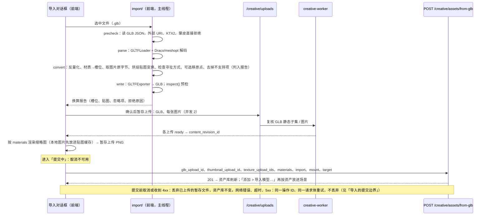
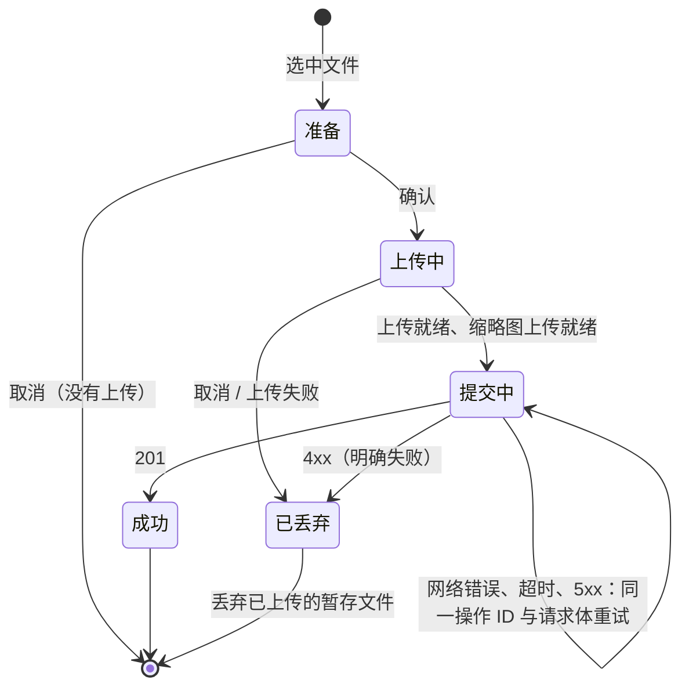

# Change 详细设计

## 继承的设计

- Epic `scene-pose-system` 批准基线 v3：
  - 「架构设计」的职责表与导入链路。
  - 「技术选型」：GLB 解析与重写、压缩几何。
  - 「关键机制 / 导入的材质换算」：换算规则的权威表，本文不复制。
  - 「数据与存储设计」子项 2、「验证与交付」，以及「未决事项」中 64 张图片上限、与 Blender 一致这两项。
- 交付的目标契约（`epic bind --deliver`），正文在 Epic `contracts.md`：
  - `data: MODIFY 场景文档`：`maps.emissive`、`vertex_color`。
  - `data: MODIFY 模型内容`：`imported` 生成器、`model.import`。
  - `data: MODIFY 模型资产`：导入的模型资产、库副本规则按 `materials` 判断。
  - `api: ADD 导入模型到资产库`。
- 沿用的现有设计：
  - 暂存上传与 worker 复核：`creativemedia`、`creativestaging`。
  - 静态子集校验：`creativeglb.Inspect`，以及前端的同一算法 `sandbox/inspect.ts`。
  - 「模型存入资产库」的写法：`creativescene/library.go:SaveModelToLibrary`、`writeLibraryCopy`。
  - 图片复核与持有：`creativescene/images.go:verifyImages`、`creativecontent.HoldTextures`。

## 领域模型与业务规则

- **导入的模型**是一条普通的 `model` 内容修订（完整形态），载荷为：
  - `generator = {language: "imported", mount}`
  - `manifest`：服务端从暂存 GLB 算出
  - `name_hint`
  - `import`
  - `materials`
  
  它没有 `source_revision_id`，GLB 与缩略图对象复用暂存 blob。资产引用它；它的贴图图片由 `creative_content_revision_refs`（`role = texture`）持有。
- **不变量**：
  1. 只有导入接口能写 `language = imported` 的修订，或从这样的修订派生（`derive_model`，照抄 `generator` 与 `import`）。`commit_model` 的 `generator` 仍只接受 `three-module`（`models.go:checkGenerator` 不变）。
  2. **只属于资产库**：载荷带 `materials` 的模型内容（库副本、导入的模型）只属于资产库。任何以它为 `base_content_id` 的 `commit_model` / `derive_model` 都新建内容。判断从「有 `source_revision_id`」改为「有 `materials`」，对已有库副本结果相同（库副本两者都有），对修订 v12 之前直接引用场景修订的资产也不变（两者都没有）。
  3. 导入的模型没有代码。所有读 `generator.code`、`params`、`params_schema` 的路径，遇到 `imported` 都必须走「没有参数」的分支，不能把空值当代码执行。
  4. 一次导入要么完整写入（模型修订、图片持有、资产、消费全部暂存上传），要么什么都不写。
- **Go 类型**（`creativescene/models.go`）：
  - `Generator` 保持一个结构体，字段标签不变（不加 `omitempty`）。新增 `Generator.MarshalJSON`：`imported` 时只输出 `language`、`mount`；其余情况按原样输出全部字段，所以无参数的代码模型仍写出 `params_schema: {}`、`params: {}`（`checkParamsSchema` 本来就允许空参数）。解码不需要改：`imported` 的载荷缺的字段解成零值，只有 `imported` 分支会读到。
  - `ModelPayload` 加 `Import *ModelImport`。
  - `Generator.Imported()` 判断形态，供各读取方分支。
- **TS 类型**：`api/schema.d.ts` 由 OpenAPI 生成。`CreativeModelGenerator` 为 `oneOf` 两种结构，用 `language` 收窄；前端加 `models/generator.ts:isImported`。

## 模块职责与协作

| 位置 | 职责 | 不做 |
|---|---|---|
| `frontend/src/creative-scene/import/parse.ts` | 读文件；**先扫 GLB JSON**：`buffers[].uri`、`images[].uri` 只能是 `data:` URL（或缓冲为 BIN 块），否则拒绝；KTX2 / Basis、`skins` 同样在加载前拒绝。再用 `GLTFLoader` 解析（注册 `DRACOLoader`、`MeshoptDecoder`；URL 修饰器只放行 `data:` 与 `blob:`，作为第二道保险）。读取每张图片的原字节与 MIME（`bufferView` 经 `parser.getDependency('bufferView', …)`，`data:` URL 直接解码 base64），不取解码后的位图 | 不改几何 |
| `import/convert.ts` | 纯函数：几何反量化；glTF 材质 JSON → `materials` 与槽位命名；贴图变换烘进 UV；寻址方式检查；原点移动；剥掉贴图、扩展、动画、形态键、相机、灯光；产出换算报告 | 不做 I/O |
| `import/write.ts` | `GLTFExporter` 写 GLB；`inspect()` 预检；超出 16 MiB 时报告 | — |
| `import/images.ts` | 图片超出上传上限时缩小并重新编码，编码按 Epic 换算表「图片」行（法线 / ORM / 糙度 / 金属度 / AO，或有半透明像素的 → PNG；其余 → JPEG 0.92；仍超限时边长减半）；透明度通过读像素判断（任何 alpha < 255）；按内容哈希去重 | — |
| `import/run.ts` | 上传、等就绪、缩略图、提交、按「导入的提交边界」重试或丢弃；进度与阶段回调 | 不碰场景会话 |
| `import/ImportModelDialog.tsx` | 选文件、显示报告与进度、标题、授权说明、来源页面、原点选项、贴附方式 | — |
| `backend/internal/creativescene/import.go`（新） | `ImportModelToLibrary`：校验、锁暂存上传、复核图片、写修订（`WriteModelAndRetain`）、`HoldTextures`、`CreateFromRevisionInTx`、消费上传 | 不解析原文件 |
| `backend/internal/platform/httpapi` | 路由 `POST /creative/assets/from-glb`、错误映射 | — |

依赖方向沿用现有分层：handler → `creativescene` 用例 → `creativecontent` / `creativelibrary` / `creativestaging`，不新增依赖。

## 关键机制

### 导入接口的校验与写入顺序

`ImportModelToLibrary` 在一个账号事务内按下面的顺序执行。任何一步失败都整体回滚，上传保持未消费：

1. `creativelibrary.ValidateImportTargetInTx(target)`：分组或标签不存在时返回 404。
2. 校验 `mount`、`import`：文件名 1–255 码点，`attribution` ≤ 2000，`source_url` 只能是 http/https 且 ≤ 2048。失败返回 400 `validation_failed`。
3. 锁 GLB 上传：用 `lockStaged(kind=model)`。不可用时返回 409 `creative_upload_unavailable`，`details.upload_id` 指出哪个上传。读暂存载荷得到服务端 manifest。
4. 锁缩略图上传：`lockStaged(kind=image)`，原图必须是 PNG。
5. 锁 `texture_upload_ids` 里的每一项（`kind=image`）：有重复时返回 400，超过 64 项时返回 413。得到修订 ID 集合 T。
6. 解码 `materials`，校验：
   - 键必须是 manifest 的槽位，否则 400。
   - 每个槽位走场景命令的同一套规则（`model.go:validateSlots` 的单槽部分，含新的 `emissive` 键）。
   - 引用的不同图片超过 64 张时返回 413。
   - T 里每一项都必须被引用，否则 400。
7. `verifyImages(slotTextures(materials, -1, "materials"))`：被引用的图片必须属于本账号、是 `image` 且可展示，否则 400 `creative_image_unavailable`。T 里的修订是待消费的暂存候选，已经能通过这项检查。
8. 写修订：`WriteModelAndRetain`。对象为 `original`（GLB blob）和 `thumbnail`（PNG blob），声明沿用 GLB 上传的声明。在 retain 回调里依次执行：
   - `HoldTextures(rev, images)`
   - `CreateFromRevisionInTx`（资产，`kind = model`）
9. 消费上传：
   - 缩略图和 T 用 `ConsumeForAsset(upload, assetID)`。
   - GLB 用 `Consume`：它的 blob 已绑定到新修订，候选不必指向资产。

幂等由外层 `creativeops` 的回执重放保证，与 `from-scene-model` 相同。

### 导入的提交边界

- `run.ts` 在进入「提交中」前生成一次 `operation_id`，并冻结请求体（`client_created_at` 也固定）。之后每次重试都发同一份请求。
  - 服务端按 `creativeops` 的幂等回执重放（保留 90 天，长于暂存上传的 7 天有效期），所以首次已经提交的请求不会再建出第二份资产。
  - 重试按 1、2、4、8 秒退避，持续 2 分钟。仍拿不到结果时，对话框显示「保存结果未知」，提供「重试」和「关闭」：重试仍用同一份请求；关闭不丢弃上传。
- 「提交中」时取消按钮不可用。提交中关闭或刷新页面时，用 `beforeunload` 先让浏览器询问（资产库页面和编辑器都适用，提交结束后撤掉）。
- 只有「准备」「上传中」两个阶段的取消，以及「提交中」收到 4xx 时，才丢弃暂存上传。丢弃走现有的 `discardUpload`，失败也不影响结果：没被消费的暂存上传 7 天后过期回收。
- 可测性：`run.ts` 的网络操作通过参数注入（与 `host/exportShots.ts:runManualExport` 相同的写法）。单测里让第一次提交「服务端已处理但响应失败」，断言第二次带同一操作 ID、资产只建一份、没有调用丢弃（AC-12b）。

### 读取方遇到导入的模型

| 路径 | 现状 | 改为 |
|---|---|---|
| `creativescene/ops_model.go:isLibraryCopy` | 按 `source_revision_id` 判断 | 按 `payload->'model' ? 'materials'` 判断，改名 `isLibraryOwned` |
| `creativescene/ops_model.go:(*deriveModelOp).apply` | 照抄 `Generator` | 另外照抄 `Import`。导入的模型也能派生面分配 |
| `creativescene/jobs.go:CreateBakeJobInTx` | 以 base 的代码烘焙 | base 是 `imported` 时返回 400：「导入的模型没有代码，只能换材质或摆放」 |
| `creativescene/agent.go` 的 `write_model` 与 `include_code` | 假定有代码 | `write_model` 同上拒绝；`include_code` 对导入的模型不返回 `code`，附 `imported: true` |
| `creativecontent/model_facts.go:ModelFactsOf` | 要求有 `params_schema` | `imported` 时参数为空，返回 `Imported`、`Import` |
| `creativeagent/context.go`（`read_asset`、`search_assets` 要点） | 参数名、参数定义 | 导入的模型附 `imported: true`；`read_asset` 附 `import` |
| `creativescene/library.go:SaveModelToLibrary` | 来源取 `source_revision_id` 或自身 | 不变。导入的模型放进场景后，修改或派生出的场景修订再存入资产库时，`source` 是该场景修订，照常查重 |
| 前端 `panels/ModelParams.tsx`、`modelEdits.ts`、`SceneEditor.tsx`（存入、改参数入口）、`creative-canvas/viewer/modelInfo.ts`、`host/executor.ts` | 读 `generator.params` / `code` | 先用 `isImported` 收窄：参数区替换为「导入的模型」信息块（原文件名、授权说明、来源页面链接），「编辑代码」不显示 |

### 自发光贴图与顶点色的着色

- **贴图种类**：`materials/maps.ts:MapKind` 加 `emissive`，sRGB，与 `color` 同格式。
  - 光栅：`materials/instances.ts` 的 `slotTextures` / `applyTextures` 在有 `maps.emissive` 时设 `emissiveNode = emissive × sample('emissive').rgb × emissive_intensity`（乘 `preExposure`，与常数自发光同一处）。
  - 追踪层：`render/trace/maps.ts` 的纹理数组按 `MapKind` 建，加一类 `emissive`；`render/trace/hit.ts` 的命中着色用同一公式。
- **顶点色**：
  - 光栅：`materials/principled.ts:principledProps` 读 `vertex_color`，`materials/instances.ts:build` 在槽位材质上设 `vertexColors`。几何没有 `color` 属性时 three 按白色处理，结果不变。
  - 追踪层：`render/trace/tables.ts` 的行参数加 `vertex_color`（0/1）。`render/trace/pool.ts` 已经读入 `color` 属性，命中着色按开关相乘。
- **不变性**：没配 `emissive` 贴图、`vertex_color` 为 `false` 的槽位，生成的着色节点与修改前相同（材质缓存键不变），保证旧场景逐像素不变（AC-13）。

### 换算的实现要点

规则见 Epic「导入的材质换算」；这里只写实现上的决定：

- **图片原字节**：从 glTF JSON 的 `images[i].bufferView` 取字节，或解码 `data:` URL；按 `mimeType`（`data:` URL 取其媒体类型）判断格式，再用文件头核对一次。PNG、JPEG、WebP 原样上传；`image/ktx2` 或 `KHR_texture_basisu` 直接拒绝。不经 three 解码再编码，避免画质和色彩空间损失。
- **贴图变换烘焙**：先在 glTF JSON 层面算出每个材质的 `KHR_texture_transform`（以基础色贴图为准，其他贴图不同时记入报告），再在 three 对象上处理用这个材质的 mesh：复制 `geometry.attributes.uv`，按 glTF 的定义 `uv' = T · R · S · uv` 变换。三个变换同时为平移 0、旋转 0、缩放 1 时跳过。
- **反量化**（Epic 换算表「Draco、meshopt、`KHR_mesh_quantization`」行）：遍历每个 mesh 的 `POSITION`、`NORMAL`、`TANGENT`、`uv`、`uv1`、`color` 属性，不是 `Float32Array` 或是 `InterleavedBufferAttribute` 的，换成新的 `Float32BufferAttribute`。逐元素用 `attribute.getComponent(i, c)` 取值，three 在 `normalized` 时按 glTF 公式换算（有符号：`max(c / (2^(n-1) − 1), −1)`；无符号：`c / (2^n − 1)`）。新属性的 `normalized` 为 `false`。节点上的缩放、平移不动，世界坐标因此不变。完成后断言没有非浮点属性留下，`GLTFExporter` 就不会再声明 `KHR_mesh_quantization`。
- **寻址方式**：在烘焙贴图变换之后进行。对每个带非 `REPEAT` 寻址贴图的材质，扫描用它的 primitive 的 UV。任一分量越出 [0, 1]（容差 1e-6）时，把这张贴图记入报告：「原本是镜像 / 钳制寻址，导入后按重复显示」。
- **槽位命名**：把 three 材质的 `name` 改成 `slot:<id>`，导出后成为 GLB 的槽位。`GLTFExporter` 只会看到去掉贴图后的 `MeshStandardMaterial`，因此导出的 GLB 里没有 `images` / `textures`。
- **常数**：glTF 的颜色因子是线性的，`principled@1` 的 `color` / `emissive` 是 sRGB hex，用 three 的 `Color.getHexString(SRGBColorSpace)` 换算。
- **线程**：首版在主线程执行，对话框显示进度，每个阶段之间让出事件循环。实测发现一般大小的文件（≤ 50 MB）卡顿超过 1 秒时，再把 parse、convert、write 搬进 worker（未决事项）。
- **Draco 解码器**：`three/examples/jsm/libs/draco/gltf/` 下的文件用 Vite 的 `new URL(…, import.meta.url)` 打包，只在导入时加载。meshopt 用已有依赖 `meshoptimizer` 的 `MeshoptDecoder`。

## 局部设计与偏差

- **偏差**：Epic「导入」时序图里，提交步骤写的是「模型修订（imported）+ 材质分配 + 骨骼映射」；骨骼映射在子项 3 才加上，本次不带。不属于共享设计变化。
- **导入的 `name_hint`**：取 `target.title` 的前 80 个码点，与契约一致。
- **缩略图里的贴图**：图片上传就绪后，先把本地已解码的位图按修订 ID 放进 `materials/images.ts` 的缓存，再调用 `library/thumbnail.ts:renderMaterialThumbnail`，避免把刚上传的图片再下载一遍。
- **入口**：`creative-canvas/editor/fileImport.ts:importPlan` 遇到 `.glb` 时不再报「暂不支持」，而是交给导入对话框；画布本身仍不接受模型（拖到画布上的 `.glb` 提示「模型只能导入到资产库」）。

## 接口与数据契约

- **契约状态**：扩展，含一处破坏。
  - 新接口：`api: ADD 导入模型到资产库`。
  - 扩展：`maps.emissive`、`vertex_color` 参数、`model.import`。
  - 破坏：OpenAPI 的 `CreativeModelGenerator` 改为按 `language` 区分的 `oneOf`，对读取生成器的消费者是破坏性变更。消费者只有本项目前端，同一版本上线。
- **只在实现层面的改动**：
  - `CreativeModelGeneratorInput`（`commit_model`）不变。
  - `CreativeSceneTextureMaps` 加 `emissive`。
  - `materials.json` 的 `principled@1` 加 `vertex_color`（布尔，缺省 `false`，标签「顶点色」），`make generate` 后两端同步。
  - 本 Change 没有局部 `contracts.md`。

## 挂载点

| 位置 | 动作 | 说明 |
|---|---|---|
| `api/openapi.yaml` | 修改 | 新路径 `/creative/assets/from-glb` 与 `CreativeAssetFromGLBPayload`；`CreativeModelGenerator` 拆成 `oneOf`；`CreativeModelImport`；`CreativeModelPayload`、`CreativeModelPreviewPayload` 加 `import`；`CreativeSceneTextureMaps` 加 `emissive`。运行 `make generate` 并提交生成物 |
| `backend/internal/creativescene/import.go` | 新增 | `ImportModelToLibrary` 与输入类型 |
| `backend/internal/creativescene/models.go:Generator` | 修改 | `MarshalJSON` 按形态输出、`Imported()`；`ModelPayload` 加 `Import` |
| `backend/internal/creativescene/ops_model.go:isLibraryCopy` | 修改 | 改为按 `materials` 判断（`isLibraryOwned`） |
| `backend/internal/creativescene/ops_model.go:(*deriveModelOp).apply` | 修改 | 照抄 `Import` |
| `backend/internal/creativescene/jobs.go:CreateBakeJobInTx` | 修改 | 导入的 base 拒绝 |
| `backend/internal/creativescene/agent.go` | 修改 | `write_model` 拒绝导入的模型；`include_code` 与模型视图带 `imported` |
| `backend/internal/creativescene/model.go:TextureMaps` | 修改 | 加 `Emissive`；`validateSlots` 接受并检查它（不允许 `channel`） |
| `backend/internal/creativescene/images.go:textureUses` | 修改 | 计入 `emissive` |
| `backend/internal/creativescene/materials.json` | 修改 | `principled@1` 加 `vertex_color` |
| `backend/internal/creativecontent/model_facts.go:ModelFactsOf` | 修改 | 导入的模型没有参数，返回来源信息 |
| `backend/internal/creativeagent/context.go` | 修改 | `search_assets` 要点、`read_asset` 附 `imported` 与 `import` |
| `backend/internal/creativeagent/scene_tools.go` | 修改 | `write_model`、`edit_scene` 的说明：导入的模型不能改代码；材质说明里加自发光贴图和顶点色 |
| `backend/internal/platform/httpapi/creative_media.go` | 修改 | 路由与 handler |
| `backend/internal/platform/httpapi/creative_documents.go` | 修改 | `creative_upload_unavailable` 带 `details.upload_id` |
| `frontend/src/creative-scene/import/parse.ts`、`convert.ts`、`write.ts`、`images.ts`、`run.ts`、`ImportModelDialog.tsx` | 新增 | 见「模块职责与协作」 |
| `frontend/src/creative-scene/models/generator.ts` | 新增 | `isImported` |
| `frontend/src/creative-scene/materials/maps.ts:MapKind` | 修改 | 加 `emissive` |
| `frontend/src/creative-scene/materials/images.ts` | 修改 | `emissive` 的纹理键与色彩空间；按修订 ID 预置本地位图 |
| `frontend/src/creative-scene/materials/instances.ts` | 修改 | 自发光贴图节点；`vertexColors` |
| `frontend/src/creative-scene/materials/principled.ts:principledProps` | 修改 | 读 `vertex_color` |
| `frontend/src/creative-scene/materials/slotEdits.ts:mapInputs` | 修改 | 加 `emissive` |
| `frontend/src/creative-scene/panels/TextureFields.tsx` | 修改 | 自发光贴图行 |
| `frontend/src/creative-scene/render/trace/maps.ts`、`render/trace/hit.ts`、`render/trace/tables.ts` | 修改 | 追踪层的自发光贴图与顶点色 |
| `frontend/src/creative-scene/panels/ModelParams.tsx` | 修改 | 导入的模型显示来源信息块，代替参数 |
| `frontend/src/creative-scene/modelEdits.ts` | 修改 | 导入的模型不进改参数和改代码的路径 |
| `frontend/src/creative-scene/SceneEditor.tsx` | 修改 | 「添加 > 导入模型…」，导入后按资产放入；挂载导入对话框 |
| `frontend/src/creative-scene/panels/AssetPanel.tsx` | 修改 | 「导入模型」按钮；空状态文案 |
| `frontend/src/creative-scene/host/executor.ts` | 修改 | 读生成器时按 `language` 收窄 |
| `frontend/src/creative-canvas/viewer/modelInfo.ts` | 修改 | 查看浮窗显示导入来源 |
| `frontend/src/creative-canvas/assets/AssetImport.tsx`、`frontend/src/creative-canvas/editor/fileImport.ts:importPlan` | 修改 | `.glb` 交给导入对话框 |
| `frontend/src/creative-canvas/editor/media.ts` | 修改 | `uploadGenerated` 的类型放宽到 `image/webp` |

## 验证与交付

- **Go 测试**（`make check-go PKG=./internal/creativescene/... ./internal/creativeagent/... ./internal/creativecontent/...`）：
  - 导入接口：成功（资产、修订载荷、持有关系、上传已消费）；每个失败分支各一例（AC-12）；幂等重放不建第二份，也不再消费上传（AC-12b 的服务端一侧）；413 两种情况。
  - 生成器序列化回归：无参数的代码模型经 `commit_model` 写入、场景读取、`derive_model` 派生、存入资产库后，载荷里仍有 `params_schema: {}`、`params: {}`；导入的模型只输出 `language`、`mount`。
  - `imported` 生成器的解码与往返；派生面分配后仍是 `imported`、带 `import`，并且是新内容（AC-10）。
  - `isLibraryOwned` 三种载荷（库副本、导入的模型、场景修订）。
  - `write_model` 与烘焙任务以导入的模型为基础时都拒绝（AC-11）；`search_assets` / `read_asset` 的输出。
  - `maps.emissive` 校验（允许、`channel` 被拒、计入 64 张上限）；`vertex_color` 原样保存。
- **TS 单测**：
  - `convert.ts` 按 Epic 换算表逐行一例，用 JSON 写成的 glTF 夹具，覆盖槽位命名、颜色换算、ORM 共图、法线强度限制、自发光强度、透明方式、顶点色、unlit 提示、`texCoord: 1` 忽略、贴图变换一致与不一致、各种拒绝（AC-2、AC-4、AC-5）。
  - `write.ts`：导出的 GLB 通过 `inspect()`，带贴图的原文件导出后没有 `images` / `textures`。
  - 反量化：整数位置（节点上带缩放）、归一化 `UNSIGNED_SHORT` UV、交错属性三种夹具，换算后通过 `inspect()`，没有 `KHR_mesh_quantization`，世界坐标包围盒与反量化前相同（AC-3）。
  - 寻址方式：镜像、钳制两种贴图，UV 在 [0, 1] 内的不提示，跨界的提示（AC-5b）。
  - 资源位置：外部图片 URI、外部缓冲 URI 被拒绝，并且是在调用加载器之前；`data:` URL 图片正常取出原字节（AC-4）。
  - 图片编码：超限的透明 WebP 编码为 PNG 并保留透明通道，超限的法线贴图编码为 PNG，超限的不透明基础色编码为 JPEG（AC-12d）。
  - 提交边界：`run.ts` 在注入的网络操作下覆盖响应丢失后重试、4xx 后丢弃、提交中不能取消、上传中取消后丢弃（AC-12、AC-12b、AC-12c）。
  - 原点移动：包围盒底面中心到原点（AC-8）。
  - 着色键：没配新字段的槽位，材质缓存键与修改前相同（AC-13）。
- **夹具**：测试用的 GLB 由脚本在测试里生成（three 对象 + 小图片 → `GLTFExporter`）。Draco / meshopt 各一个很小的样例文件提交进 `frontend/scripts/fixtures/`，来源写在旁边的 README 里（AC-3）。
- **e2e**：新增一条，按一次只跑一个、`ONLY` 过滤、换端口的约定（[[targeted-verification-only]]）。流程：
  1. 在资产库页面导入夹具 GLB，资产出现、缩略图非空。
  2. 打开场景，从资产面板拖入。
  3. 分别检查三处：材质预览截图、最终渲染（实时 GI）里一面镜子中的反射、`lit` 导出图。每处自发光区域的亮度都高于周围，透明裁切处露出背景。
  4. 撤销。

  这条只证明各入口都接上了自发光贴图和挖空，外观是否正确由 owner 对照 Blender 判断。
- **owner 验收**：
  - AC-1、AC-5、AC-6：用几个真实素材与 Blender 对照，条件按 AC-1 固定（同一相机、太阳加均匀环境光、手动曝光、AgX）。本项目侧分别截视口材质预览、最终渲染（含反射与间接光）和 `lit` 导出三处。我准备 3–4 个公开授权的素材和一份 `.blend` 对照场景，导入步骤和截图放进 `discovery/research/`。
  - AC-14：统计一个角色加一套布景用到的不同图片张数。
  - 两项结论写回 Epic 未决事项。
- **旧画面不变**（AC-13）：跑现有的材质贴图 e2e 与材质预览截图对照。
- **上线**：前后端同一版本上线（OpenAPI 的 `generator` 是破坏性变更），不迁移，回滚只做前向修复。worker 不需要改动。

## 未决事项

| 问题 | 影响 | 解决方式 | 最晚解决时点 |
|---|---|---|---|
| ~~主线程换算对大文件的卡顿是否可接受~~ | 是否要把换算搬进 worker | **已决定（任务 5.1，2026-11-09）：不搬。** 用合成素材实测：25 万三角形网格，加上难以压缩的噪声 PNG 贴图（结果见下表）。最长的一次卡顿是超限图片的解码与重新编码，0.43 秒，低于 1 秒的门槛。Draco / meshopt 在 three 的 worker 里解压，不占主线程。缩略图渲染走 WebGPU，不在计量范围内 | — |
| 真实素材的来源（用于与 Blender 对照） | AC-1、AC-5、AC-6 的验收 | 选 CC0 / CC-BY 素材（Poly Haven、Sketchfab 可下载的），不提交进仓库，只记录链接 | owner 验收前 |

任务 5.1 实测：Apple Silicon、无头 Chromium，Vite 开发服务器。每个阶段给出总耗时，括号里是其中最长的一次主线程卡顿（`longtask`，不到 50 ms 记为 0）。

| 文件 | 内容 | 读取 | 解析 | 换算 | 写出 + 预检 | 图片 | 结果 |
|---|---|---|---|---|---|---|---|
| 9.7 MiB | 1 张 1024² PNG | 34 ms | 12 ms（0） | 1 ms | 39 ms（0） | 13 ms（0） | 原样上传 |
| 42.7 MiB | 3 张 2048² PNG，每张 12 MiB | 40 ms | 12 ms（0） | 1 ms | 33 ms（0） | 115 ms（115 ms） | 原样上传 |
| 129.7 MiB | 2 张 4096² 和 1 张 3072² PNG，每张 27–48 MiB | 192 ms | 49 ms（0） | 1 ms | 35 ms（0） | 1.6 s（432 ms） | 基础色只是字节超限，重新编码为 JPEG，尺寸不变；法线和 ORM 缩为 2048² 和 1536² 的 PNG |
