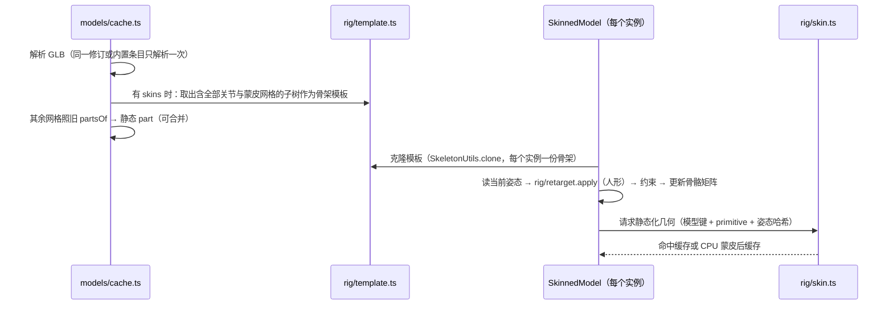

# Change 详细设计

## 继承的设计

- Epic `scene-pose-system` 批准基线 v7（v7 来自本子项的方案评审）：
  - 「领域模型与业务规则」：标准人形骨骼、素体、P6、P7。
  - 「架构设计」：职责表与导入链路、「蒙皮渲染」。
  - 「技术选型」：蒙皮、标准人形骨骼、骨骼映射识别、平台内置资产、内置素体。
  - 「关键机制 / 姿态的存储与换算」：换算规则，算法本身在 `patterns: 标准人形骨骼`，本文不复制。
  - 「数据与存储设计」子项 3，以及「验证与交付」中的人形映射校验。
- 交付的目标契约（`epic bind --deliver`），正文在 Epic `contracts.md`：
  - `patterns: 标准人形骨骼`、`glossary: 素体`、`glossary: 标准人形骨骼`。
  - `data: 内置模型库`、`api: 读取内置模型文件`。
  - `data: 模型内容`：蒙皮子集、`skeleton`、`rig`。
  - `data: 场景文档`：`model.builtin`。
  - `data: 模型资产`：库副本照抄 `rig`，内置模型不能存入。
  - `api: 导入模型到资产库`：`rig`。
  - `api: 场景模型命令`：拒绝带骨架的代码模型；`set_instance_model` 可写 `builtin`。
  - `data: 内置贴图库`、`api: 读取内置贴图`：`.png`、`listed`、`character`、`--dir`。
- 依据（`discovery/research/`）：
  - 穿刺①：`2026-11-09-retarget-spike.md`，原型 `retarget-spike/retarget.ts` 是本次 `rig/retarget.ts` 的起点。
  - 穿刺②：`2026-11-09-trace-update-spike.md`。
  - 素体核对：`2026-11-10-base-body-check.md`，UE 命名表 `base-body/ue.ts`。
- 沿用的现有设计：
  - 子项 2 的导入链路：`import/parse.ts`、`convert.ts`、`write.ts`、`run.ts`、`ImportModelDialog.tsx`，以及 `creativescene/import.go:ImportModelToLibrary`。
  - 内置贴图库的整套做法：`creativescene/builtin_textures.go`、`materials/catalog.ts`、`creativectl textures`、`render-texture-thumbnails.mjs`。
  - 静态子集的两份同算法校验：`creativeglb.Inspect` 与 `sandbox/inspect.ts`。

## 领域模型与业务规则

本次不新增领域对象，只在现有的模型修订和场景物件上增加三样东西。

| 对象 | 身份 | 谁写 | 不变量 |
|---|---|---|---|
| 骨架摘要 `manifest.skeleton` | 随模型修订不可变 | worker 从 GLB 算出 | 关节集合等于所有 skin 的 `joints` 的并集；`parent` 是最近的关节祖先；指纹只看结构 |
| `model.rig` | 随模型修订不可变 | 导入接口（浏览器给出，服务端复核）；`derive_model` 和库副本照抄 | 只在有 `skeleton` 时存在；`humanoid` 满足必需骨骼与层级嵌入；约束依赖无环 |
| 内置模型引用 `objects[].model.builtin` | 清单条目 ID（带版本） | 场景命令 | 与 `content_revision_id` 二选一；条目必须在清单里；内置模型的实例不产生模型修订，因此不能派生、烘焙、做面分配、存入资产库 |

**姿态在本次的状态**：骨骼通道在子项 4 才有，本次的「当前姿态」只有两个来源：

- 静止姿势：缺省。
- 编辑器内存里的测试姿态：经 `__sceneTest.setPose(objectId, pose)` 写入，按物件 ID 存放，不进快照、不进撤销。子项 4 把来源换成骨骼通道的求值结果，渲染路径不变。

所有渲染入口都从同一个「当前姿态」读，保证视口、追踪层、包围盒和导出一致。

**前端的模型键**：现有代码以 `content_revision_id` 为键查模型摘要和缓存。本次引入 `modelKey(ref)`：`content_revision_id` 原样作为键，内置模型为 `builtin:<id>`。内置模型的摘要（manifest、`rig`、名称）由清单副本生成，与修订的摘要放进同一张表，查表的地方都改用键。

## 模块职责与协作

```mermaid
flowchart LR
  subgraph 浏览器
    IMP[import/ 解析·换算·识别映射·写出] --> UP[暂存上传]
    CAT[builtinModels.gen.json] --> KEY[modelKey 摘要表]
    LOAD[models/cache.ts 加载 GLB] --> PARTS[静态 part]
    LOAD --> RIG[rig/ 骨架模板]
    RIG --> INST[每个实例：克隆骨架·求值·约束]
    INST --> SKIN[SkinnedMesh 光栅]
    INST --> STAT[rig/skin.ts 静态化几何（按姿态缓存）]
    STAT --> TRACE[render/trace 追踪层]
    STAT --> PICK[拾取·包围盒·轮廓]
  end
  subgraph 服务端
    UP --> W[worker: creativeglb 蒙皮子集·骨架摘要·蒙皮包围盒]
    IMP -->|from-glb + rig| API[creativescene/import.go + rig.go 复核]
    SCN[场景命令] -->|model.builtin| BM[builtin_models.go 清单]
    BM --> HTTP[GET /creative/scene-models/{file}]
  end
```

| 模块 | 本次职责 | 不做 |
|---|---|---|
| `backend/internal/creativeglb` | 蒙皮子集校验、蒙皮网格按静止姿势的包围盒、`Skeleton` 与指纹、`Matches` 比对骨架 | 不解释映射与约束 |
| `backend/internal/creativescene/rig.go`（新增） | `Rig` 类型；按 `patterns: 标准人形骨骼` 校验人形映射（必需骨骼、关节下标、重复、层级嵌入），校验约束（外形、关节、无环）；跑共用测试向量 | 不做姿态求值 |
| `backend/internal/creativescene/builtin_models.go`（新增） | 嵌入并加载 `models.json` 与缩略图；对象存储 `scene-models/`；`Open`、`Missing`、`Import`；供场景校验和助手查条目 | — |
| `creativescene` 的命令与导入 | `ModelRef.Builtin` 的校验；`commit_model` 拒绝带骨架的 GLB；`derive_model` 和库副本照抄 `rig`；对内置模型拒绝派生、烘焙、面分配和存入资产库；导入接口收 `rig` | — |
| `creativeagent` | 内置来源加 `kind: model`；`read_asset` 读内置模型；`edit_scene` 说明与补材质 | 不选素体、不摆姿态（子项 6） |
| 前端 `rig/`（新增） | 标准骨骼表、映射识别（VRM、命名表）、嵌入校验、换算（`prepare` / `apply` / `mirror`）、VRM 约束求值、CPU 蒙皮与静态化几何缓存、当前姿态的存放 | 不提供姿态编辑界面 |
| 前端 `models/` | 加载时分出骨架模板与静态 part；内置模型的 GLB 走新接口；合并 part 跳过蒙皮网格 | — |
| 前端 `objects/` | `SkinnedModel` 组件：每个实例克隆骨架，按当前姿态求值后画 `SkinnedMesh`；轮廓用静态化几何 | — |
| 前端 `render/trace/` | 蒙皮网格取静态化几何，缓存键含姿态哈希 | 不做 refit 与剔除（子项 4） |
| 前端 `import/` | 保留骨骼与蒙皮属性、权重换算、映射识别与手动映射、约束读取、节点下标回写 | — |
| 工具 | `frontend/scripts/builtin-models/convert.mjs` 把来源包换算成素体 GLB、贴图和清单片段；缩略图脚本加模型 | — |

## 关键机制

### 带骨骼的模型怎样加载和绘制



- 骨架模板保留节点树，不烘焙世界矩阵（`partsOf` 的做法对它不适用）。蒙皮网格的材质槽来自材质名，与静态 part 相同，所以 `materials/resolve.ts` 的套用照旧。
- **坐标空间**（评审第 2 项）：glTF 规定蒙皮不计入承载网格的节点自身的变换。加载后，每个 `SkinnedMesh` 重新绑定：绑定矩阵为单位矩阵，`attached` 模式。此时 three 的光栅结果为
  `世界位置 = Σ wᵢ · (关节ᵢ的世界矩阵 · 逆绑定矩阵ᵢ) · v`，
  与网格节点自身的变换无关。关节的世界矩阵 = 模型根（场景物件）的世界矩阵 M · 关节在模型内的矩阵 Jᵢ，所以：
  - 静态化几何定义在**模型根空间**：v' = Σ wᵢ · (Jᵢ · 逆绑定矩阵ᵢ) · v。它与实例的位置、旋转、缩放无关，同一模型键和姿态的实例可以共用。
  - 追踪层、拾取和包围盒拿到的是二元组（静态化几何, M），M 是模型根的世界矩阵，**不是**网格节点的 `matrixWorld`。`render/trace/collect.ts` 的输入因此显式带实例矩阵，`TraceBase.instances` 不再对这类网格乘网格节点的矩阵。
  - 对照测试：根节点带旋转（Michelle 式 Z 轴朝上导出）；网格节点自身带平移、旋转；同一模型放两个实例，位置、旋转和缩放不同。逐顶点比对光栅结果（读回 three 的 `getVertexPosition` 再乘 M）与追踪层的输入，误差 < 1e-5 m。
- **部件身份**（评审第 5 项）：glTF 的 primitive 下标只在各自网格内有效，同一个网格还可以被不同节点、不同 skin 引用。所以蒙皮网格的部件 ID 取 `n<节点下标>p<primitive 下标>`，节点下标是存储 GLB 里承载这个网格的节点（节点唯一决定它用哪个 skin）。缓存测试：两个网格各有 primitive 0；同一网格被两个节点以不同 skin 引用。
- 一个 GLB 里不带 `skin` 的网格（例如挂在骨骼上的饰品）：挂在关节下面的，归进骨架模板，随骨骼移动；不在关节下面的，照旧作为静态 part。
- 人形的 `prepare`（朝向 F、T 姿势校正 T(n)）每个模型键算一次并缓存，克隆的实例共用。
- **姿态哈希**：对按标准骨骼名排序的四元数（保留 6 位小数）算哈希；静止姿势固定为 `rest`。姿态不变时，缓存在实例之间共享。
- **静态化几何**：按 `patterns: 标准人形骨骼` 的顺序求值后，在模型根空间做上面的蒙皮公式，法线用同一组矩阵的逆转置并归一化，输出 `BufferGeometry`，带 `traceKey = <模型键>#n<节点>p<primitive>#<姿态哈希>`。
- **缓存预算**（评审建议）：全局按字节计。CPU 侧的位置、法线、索引，加上拾取用的 BVH，合计不超过 256 MiB。
  - 当前帧在用的条目（场景里有实例正用这个模型键和姿态）钉住，不淘汰；其余按最近使用淘汰，淘汰时释放几何和 BVH。
  - 钉住的条目本身超过预算时不再缓存新条目，用完即释放，并在控制台记一条警告。
  - 追踪层的 GPU 段归 `render/trace` 现有的缓存管，不计入这里。

### 当前姿态与各渲染入口的一致性

| 入口 | 取什么 | 依据 |
|---|---|---|
| 视口三种显示、材质预览、最终渲染的光栅 | `SkinnedMesh`，骨骼按当前姿态 | three 的 GPU 蒙皮 |
| 实时 GI 追踪层 | 二元组（静态化几何, 模型根的世界矩阵 M）。`render/trace/collect.ts` 遇到蒙皮网格时取这一对和带姿态的 `traceKey`，`TraceBase.instances` 对它用 M，不用网格节点的矩阵 | 「不可错位」：几何与姿态同源，坐标空间见上 |
| 拾取、选中轮廓、贴地吸附、取景 | 同一个二元组的包围盒和 BVH；静止姿势时与 manifest 的包围盒一致 | 与看到的一致 |
| `render_view`、导出 | 同视口，等静态化几何就绪、加速结构段重建完成后再按现有规则累积 | Epic「蒙皮渲染」的等待条件 |

改变测试姿态时：

1. 更新这个实例的骨骼。
2. 请求新的静态化几何。
3. 追踪层发现 `traceKey` 变了，在 worker 里重建这个段（现有的段构建），其他段不动。
4. 构建期间沿用 Epic 的规则：导出等待构建完成；视口在这一帧把这个角色从追踪层剔除，不使用旧姿态的段。拖动时同步 refit 的路径在子项 4 实现。

### 导入时保留骨骼并回写节点下标

在子项 2 的链路上增加这些步骤（`import/`）：

1. **预检**（`parse.ts:precheck`）：不再拒绝 `skins`。关节合计超过 512 个，或单个 skin 超过 256 个关节时拒绝。读出 `extensions.VRMC_vrm` / `VRM` 的人形表和 `VRMC_node_constraint`，按原文件的节点下标暂存。被约束节点或源不是关节的约束去掉并提示（契约限定为关节，Epic 修订 v7）。
2. **加载后对应到对象**：用 `parser.associations` 把原节点下标对应到 Object3D，得到「标准骨骼 → 对象」和「约束 → 对象」。没有 VRM 时，用 `rig/detect.ts` 的命名表（Mixamo、UE 小白人）在关节里识别。
3. **换算**（`convert.ts`）：
   - 关节和挂在关节下的对象不当作「多余节点」删除。
   - `dequantize` 的保留表加 `skinIndex`、`skinWeight`。
   - **影响的裁剪必须用原始数据**（评审第 1 项）：three 的 GLTFLoader 只读 `JOINTS_0` / `WEIGHTS_0`，并且对 `WEIGHTS_0` 单独归一化。所以有 `JOINTS_1` 及以后的 primitive 先由预检从原文件的访问器读出全部影响（按访问器的 `normalized` 规则换成浮点），合并所有组后每个顶点取最大的 4 个，再统一归一化。加载后，按 `parser.associations` 找到对应的几何体，用这份结果覆盖 `skinIndex`、`skinWeight`。
     - 只有一组影响时，加载器的归一化结果就是正确的，照常使用。
     - 有多组影响、又经 Draco 或 meshopt 压缩的 primitive，无法读到原始数据，拒绝并提示「在 Blender 里取消压缩后导出」。
     - 全为 0 的顶点绑到第一个关节，权重为 1。
     - 改动过的顶点数进换算报告。
     - 验收经完整的解析链路：夹具为两组影响的最小模型，原权重 [0.1×4, 0.15×4]，换算后必须保留第 4–7 根骨骼，各 0.25。
   - 「原点移到底面中心」对带骨骼的模型改为平移最上层的公共祖先节点，不改顶点，绑定关系保持不变。
   - 形态键、动画照旧丢掉并提示。
4. **映射校验**（`rig/humanoid.ts`，与服务端共用测试向量；几何条件只在浏览器判定，见 `patterns: 标准人形骨骼`「骨架的几何条件」）：
   - 必需骨骼缺失或嵌入不成立：对话框显示原因（例如「左脚的上级是 hips，应为 leftLowerLeg」），并提供「手动指定」和「按非人形骨架导入」。
   - 可选骨骼违反嵌入：去掉并提示。
5. **手动指定**：对话框里一张按身体部位分组的表，每根标准骨骼一个下拉框，可选项是关节名（带层级缩进）。改动后即时重新校验，只有成立的映射才能提交。
6. **写出的正确性**（评审第 7 项）：关节矩阵相同不能说明蒙皮被保留，`JOINTS` 下标、权重和逆绑定矩阵任一出错，顶点都会走样。导入任务的第一个单测：对原文件和导出后重新解析的结果，在静止姿势和一个非平凡姿态下各做一次 CPU 蒙皮，逐顶点比较位置、法线和包围盒（误差 < 1e-5 m）。
   - 覆盖：根节点带旋转、勾选「原点移到底面中心」、多个 skin、两组影响。
   - 用随仓库提交的合成夹具，不依赖外部下载。外部角色样例另作补充，下载失败时只跳过它们。
7. **写出与回写下标**（`write.ts`）：
   - 导出前给每个被映射或被约束引用的对象写入 `userData.ltiNode = k`。GLTFExporter 会把它写进节点的 `extras`。
   - 导出后读 GLB 的 JSON 块，得到 k → 新节点下标，再删掉这些 `extras` 并重写 JSON 块（4 字节对齐）。
   - 然后跑 `inspect`，把 `rig` 换成新下标随 `from-glb` 提交。

### 服务端的骨架与 `rig` 校验顺序

```text
worker（上传 model）：
  creativeglb.Inspect
    → 静态子集各项（原有）
    → 蒙皮子集：skins 外形、joints 有效且在场景树里、逆绑定矩阵、带 skin 的节点必有 mesh、
                JOINTS_0 / WEIGHTS_0 的格式和数值（逐顶点：下标 < 关节数，权重 ∈ [0,1]，和 ∈ 1±1e-3）
    → manifest：蒙皮网格的包围盒按静止姿势 CPU 蒙皮；Skeleton（并集、父关节、名称、s1 指纹）
  任何一项不合 → media_unsupported

导入接口 ImportModelToLibrary（在 checkImport 里，写事务之前）：
  staged.Manifest.Skeleton == nil 且 payload.rig != nil → 400 validation_failed（rig）
  rig != nil → rig.Validate(staged.Manifest.Skeleton)：
     humanoid：骨骼名合法 → 必需骨骼齐全 → 下标是关节 → 不重复 → 层级嵌入
     constraints：外形 → node 是关节且唯一 → source ≠ node → 依赖无环
  失败 → 400 validation_failed，details {field, reason}
```

- 蒙皮包围盒的数值在 Go 与 `sandbox/inspect.ts` 里按同一公式算。导入接口不比对客户端的 manifest，只有 `commit_model` 比对，而它本来就拒绝骨架，所以两端只要求各自正确，不要求逐位相同。`inspect.ts` 的蒙皮部分只用作浏览器端预检。
- `rig` 的 Go 实现不读 GLB，只依赖 `Skeleton`（关节集合与父关节），层级嵌入按 `parent` 链判断。

### 内置模型

- **后端加载**（`builtin_models.go`，仿 `builtin_textures.go`）：
  - `go:embed models.json`、`builtin_thumbnails/models/*.webp`。
  - 加载时校验：外形；`materials` 的键在 manifest 的槽位里，预设在材质目录里；`rig` 用 `rig.Validate(manifest.skeleton)`；每个条目都有缩略图。不合法时启动失败。
  - 对象存储前缀 `scene-models/`，配置 `SCENE_MODEL_LOCAL_ROOT`（缺省为 `AVATAR_LOCAL_ROOT` 的同级目录 `scene-models`），OSS 与贴图库共用 bucket。
- **`creativectl models import --dir`**：
  - 对每个条目：对象已存在就跳过；否则读 `<dir>/<sha256>.glb`，核对大小和 sha256，然后 `creativeglb.Inspect`，`Matches` 比对清单里的 manifest（含骨架），全部一致才 `PutImmutable`。
  - `check` 只检查对象是否存在。
  - `textures import` 加 `--dir`，对没有 `url` 的文件生效。
- **场景**：
  - `validateModelRef` 接受 `Builtin`（与 `content_revision_id` 恰好一个，条目存在）。
  - `modelRefs` 跳过内置模型（它不进引用表，也不计入 `maxSceneModels`）。
  - `opEnv.resolve` 与 `setInstanceModelOp.targets` 认得 `builtin`。
  - 材质槽的有效槽位从清单 manifest 取。
- **带骨骼的模型不做面级材质分配**（评审第 4 项，Epic 修订 v7）：编辑器对 manifest 有 `skeleton` 的模型（导入的角色和素体）不提供面分配入口；服务端 `derive_model` 拒绝这样的来源。现有面分配按静态网格拆分（`models/faces.ts:ownedMeshes` 把网格矩阵烘进顶点），套到蒙皮网格上会让拾取位置不符、蒙皮失效，以后另行设计。
- **排除**：以下各处遇到内置模型时，返回现有的错误码并给出明确提示：
  - `derive_model`：来源只能是内容修订。
  - 面分配：`faces.go`。
  - 烘焙任务：`jobs.go`。
  - 存入资产库：`library.go`。
  - 助手的 `write_model`。
- **前端**：
  - `make generate` 复制 `models.json` → `builtinModels.gen.json`，复制缩略图。
  - `models/catalog.ts` 生成内置模型的摘要，放进模型键表。
  - `downloadGLB` 遇到 `builtin:` 键时，经 `authorizedFetch` 读 `/creative/scene-models/<file>`。
  - 503 时按「模型加载失败」处理：视口占位并提示，导出失败。
- **放置**：
  - 「添加 > 素体」和资产面板「素体」两个入口，都按条目写 `model: {builtin}` 和 `material_slots = materials`，经现有 `newModelInstance`（改为接收模型引用）。
  - 属性栏的模型区：内置模型显示名称、来源与授权，另有「换成男素体 / 女素体」。它发一个 `set_instance_model`，带上目标条目的 `materials` 作为 `material_slots`（评审第 6 项）：摄影师自定义过的材质一并重置；撤销按内容单元恢复原模型和原材质。助手换内置模型而没写材质时，工具层同样补上。

### 素体的生成

`frontend/scripts/builtin-models/convert.mjs`（Vite + Playwright，与缩略图脚本同一种运行方式）读手工下载的来源包目录：

1. 读 `Base Characters/Godot - UE/Superhero_<Male|Female>_FullBody.gltf`，修正包里错误的贴图引用（去掉 `_png` 后缀）。
2. 材质名改为槽位：身体 `body`、眼睛 `eyes`、眉毛 `brows`。
3. 走导入的同一套换算和写出（UE 命名表识别映射）。得到 GLB、`rig`、拆出的贴图，以及每个槽位的贴图用途。
4. 贴图原样保留为 PNG（来源本来就是 PNG，法线与粗糙度不做有损压缩），按内容的 sha256 命名，写进 `out/textures/`。
5. 输出清单片段：两条 `models.json` 条目，manifest 由同一脚本调 `inspect` 得出，导入时再由 Go 复核；`materials.json` 里 `listed: false`、`category: character` 的贴图材质条目，没有 `url`。
6. 缩略图：`render-texture-thumbnails.mjs` 加模型模式，按清单渲染 256 × 256 WebP。

产物的导入：`creativectl textures import --dir out/textures` 与 `creativectl models import --dir out/models`，导入一次共享对象存储（[[shared-oss-scene-textures]]）。

### 助手

- `library_tools.go:builtinSearch`：
  - `kind: model` 时查内置模型清单，按名称、品类和标签（女、男、人形、素体）匹配。
  - 每项给 `builtin_id`、名称、品类、`mount`、尺寸（来自 manifest 包围盒）、`humanoid: true`。
  - `kind: material` 时过滤掉 `listed: false` 的条目。
- `builtin_assets.go:readBuiltinAsset`：认得内置模型的 ID，返回要点、槽位、`materials` 和缩略图。
- `scene_tools.go` 的 `edit_scene` 说明：`model` 可写 `{builtin_id}`，即命令里的 `{builtin}`；对内置模型不必写 `material_slots`。
- `editScene` 的处理：助手没写时，由工具层补上条目的 `materials`。
- `read_scene` 的模型视图带 `builtin`。

## 局部设计与偏差

- **没有骨骼通道时的「当前姿态」**：用编辑器内存里的测试姿态驱动求值路径，不提前定义骨骼通道。骨骼通道属于子项 4 的 Epic 修订，提前写会抢占它的契约。
- **构建期间剔除，而不是 refit**：本次只有「换一次姿态」，没有连续拖动。按 Epic「宁可暂缺」在追踪层剔除，等 worker 重建。同步 refit 是子项 4 的拖动路径。
- **静态化几何只在 CPU 上做**：穿刺②测得 1.5 万三角形的素体每次 1–2 ms。GPU 计算着色器回读要另写 WebGPU 与 WebGL 两份，不值得。
- **素体贴图保留 PNG**：每个素体约 10 MB，换来法线与粗糙度不失真（[[render-quality-over-performance]]）。只在首次使用时下载，之后浏览器长期缓存。
- **退化骨架**：头髋重合、两肩方向退化、被校正的骨骼长度近于 0 时，人形映射不成立；非均匀缩放照常导入但提示。数值夹具覆盖这四种情况（评审建议，规则见 `patterns: 标准人形骨骼`）。
- **手动映射只在导入时提供**：导入后不能改映射，要改就重新导入（proposal「不做」）。
- **`inspect.ts` 的蒙皮部分只是预检**：见「服务端的骨架与 `rig` 校验顺序」。偏离了「两端同一算法逐位一致」的旧约定，原因是导入链路不比对客户端的 manifest。

## 接口与数据契约

- **契约状态**：扩展，含一处破坏。
  - 新接口：`api: ADD 读取内置模型文件`。
  - 扩展：manifest 的 `skeleton`、模型的 `rig`、导入接口的 `rig`、`set_instance_model` 的 `builtin`、内置贴图的 `.png` 与 `listed`。
  - 破坏：场景的模型引用变为二选一（`CreativeSceneModelRef` 改为 `oneOf`）。消费者只有本项目前端，同一版本上线。
- **OpenAPI**（`api/openapi.yaml`，`make generate` 后提交两份生成物）：
  - `CreativeModelManifest` 加 `skeleton`。
  - `CreativeModelPayload`、`CreativeModelPreviewPayload`、`CreativeSceneModel` 加 `rig`。
  - `CreativeSceneModelRef` 与 `CreativeSceneSetInstanceModel.model` 加 `builtin`。
  - `CreativeAssetFromGLBPayload` 加 `rig`。
  - 新路径 `/creative/scene-models/{file}`。
  - `/creative/scene-textures/{file}` 的 pattern 与媒体类型。
- **共用测试向量**：`backend/internal/creativescene/testdata/humanoid_rig.json`（`make generate` 复制到 `frontend/src/creative-scene/rig/humanoid_rig.gen.json`）。每例给骨架（关节与父关节）、映射和预期结果（成立 / 不成立及第一条原因的骨骼名）。用例取自穿刺①的五个角色、两个素体，以及缺必需骨骼、重复映射、脚挂在控制骨下、可选骨骼越级等构造例。
- 本 Change 没有局部 `contracts.md`。

## 挂载点

| 位置 | 动作 | 说明 |
|---|---|---|
| `api/openapi.yaml` | 修改 | 见「接口与数据契约」；运行 `make generate` 并提交生成物 |
| `Makefile` | 修改 | `generate` 与 `generate-check` 加 `models.json`、模型缩略图、`humanoid_rig.json` 的复制与比对 |
| `backend/internal/creativeglb/glb.go:Limits` | 修改 | 加 `MaxSkins`、`MaxJointsPerSkin`、`MaxJoints` |
| `backend/internal/creativeglb/glb.go:Manifest` | 修改 | 加 `Skeleton *Skeleton`；`Matches` 比对骨架 |
| `backend/internal/creativeglb/glb.go:topUnsupported`、`nodeUnsupported` | 修改 | 放行 `skins`、节点 `skin` |
| `backend/internal/creativeglb/glb.go:attributeFormats`、`parsePrimitive` | 修改 | 允许 `JOINTS_0`、`WEIGHTS_0` 并校验数值 |
| `backend/internal/creativeglb/skin.go` | 新增 | skin 解析、蒙皮子集校验、蒙皮包围盒、`Skeleton` 与指纹 |
| `backend/internal/creativeglb/glb.go:document.manifest` | 修改 | 蒙皮网格改用 `skin.go` 的包围盒；填 `Skeleton` |
| `backend/internal/creativescene/rig.go` | 新增 | `Rig`、`Constraint`、`(*Rig).Validate(*creativeglb.Skeleton)`、标准骨骼表 |
| `backend/internal/creativescene/testdata/humanoid_rig.json` | 新增 | 共用测试向量 |
| `backend/internal/creativescene/models.go:ModelRef` | 修改 | 加 `Builtin` |
| `backend/internal/creativescene/models.go:validateModelRef`、`modelRefs`、`readModels` | 修改 | 认得内置模型；不进引用表 |
| `backend/internal/creativescene/models.go:ModelPayload` | 修改 | 加 `Rig` |
| `backend/internal/creativescene/ops_model.go:opEnv.resolve`、`setInstanceModelOp.targets` | 修改 | 认得 `builtin` |
| `backend/internal/creativescene/ops_model.go:commitModelOp` | 修改 | 暂存 manifest 带 `Skeleton` 时 400 |
| `backend/internal/creativescene/ops_model.go:deriveModelOp` | 修改 | 照抄 `Rig`；来源带骨架时拒绝 |
| `backend/internal/creativescene/ops_model.go:setInstanceModelOp` | 修改 | 可带 `material_slots`，整体替换 |
| `backend/internal/creativescene/library.go` | 修改 | 库副本照抄 `Rig`；内置模型拒绝存入 |
| `backend/internal/creativescene/jobs.go`、`faces.go`、`agent.go` | 修改 | 遇到内置模型拒绝烘焙、面分配、`write_model`；`ModelView` 带 `builtin` |
| `backend/internal/creativescene/materials.go` | 修改 | 有效槽位取内置模型清单的 manifest |
| `backend/internal/creativescene/import.go:checkImport`、`writeImport` | 修改 | 收 `rig`，按「校验顺序」复核并写入 |
| `backend/internal/creativescene/builtin_textures.go:builtinFileName`、`builtinSites`、`completeTextured`、`importFile` | 修改 | `.png`、`quaternius`、`listed`、`character`，没有 `url` 时从目录读 |
| `backend/internal/creativescene/materials.json` | 修改 | 素体的贴图材质条目（脚本生成） |
| `backend/internal/creativescene/builtin_models.go` | 新增 | 清单加载、校验、对象存储、`Import`、`Missing`、`Open`、`BuiltinModels`、`BuiltinModelByID`、缩略图 |
| `backend/internal/creativescene/models.json`、`builtin_thumbnails/models/` | 新增 | 两个素体（脚本生成） |
| `backend/internal/platform/config/config.go` | 修改 | `SCENE_MODEL_LOCAL_ROOT` |
| `backend/internal/platform/httpapi/creative_scene_models.go` | 新增 | `GET`/`HEAD /creative/scene-models/{file}`，503 `creative_model_file_unavailable` |
| `backend/internal/platform/httpapi/creative_canvas.go`、`router.go` | 修改 | 注册路由、依赖 |
| `backend/cmd/server/main.go` | 修改 | 组装内置模型存储，后台检查缺失 |
| `backend/cmd/creativectl/main.go`、`models.go`（新增）、`textures.go` | 修改 | `models import/check`；`textures import --dir` |
| `backend/internal/creativeagent/library_tools.go:builtinSearch` | 修改 | `kind: model`；过滤 `listed: false` |
| `backend/internal/creativeagent/builtin_assets.go:readBuiltinAsset` | 修改 | 内置模型 |
| `backend/internal/creativeagent/asset_tool_info.go`、`context.go`、`scene_tools.go:editScene` | 修改 | 说明与 schema；补材质 |
| `frontend/src/creative-scene/rig/bones.ts` | 新增 | 标准骨骼表、骨骼链、必需骨骼 |
| `frontend/src/creative-scene/rig/humanoid.ts` | 新增 | 嵌入校验（跑共用向量） |
| `frontend/src/creative-scene/rig/detect.ts` | 新增 | VRM 1.0 / 0.x 读取、Mixamo 与 UE 命名表 |
| `frontend/src/creative-scene/rig/retarget.ts` | 新增 | `prepare`、`apply`、`mirror`（由穿刺原型整理） |
| `frontend/src/creative-scene/rig/constraints.ts` | 新增 | VRM 节点约束 roll / aim / rotation；按契约的依赖（aim 含被约束节点父链）拓扑排序，与 `rig.go` 的成环判定共用测试向量 |
| `frontend/src/creative-scene/rig/template.ts` | 新增 | 从解析结果分出骨架模板，克隆实例 |
| `frontend/src/creative-scene/rig/skin.ts` | 新增 | CPU 蒙皮、静态化几何、姿态哈希、缓存 |
| `frontend/src/creative-scene/rig/pose.ts` | 新增 | 当前姿态的存放（测试姿态），`__sceneTest.setPose` |
| `frontend/src/creative-scene/models/cache.ts:ModelCache.load`、`downloadGLB`、`partsOf` | 修改 | 分出骨架模板；`builtin:` 键走新接口；合并时跳过蒙皮网格 |
| `frontend/src/creative-scene/models/catalog.ts` | 新增 | 内置模型清单副本与摘要 |
| `frontend/src/creative-scene/models/key.ts` | 新增 | `modelKey(ref)` |
| `frontend/src/creative-scene/objects/SceneObjects.tsx` | 修改 | 按模型键分发；有骨架时渲染 `SkinnedModel` |
| `frontend/src/creative-scene/objects/SkinnedModel.tsx` | 新增 | 每个实例的骨架、求值、`SkinnedMesh`，向追踪层与拾取提供静态化几何 |
| `frontend/src/creative-scene/objects/Outline.tsx` | 修改 | 蒙皮网格的轮廓用静态化几何 |
| `frontend/src/creative-scene/render/trace/collect.ts:collectMeshes` | 修改 | 蒙皮网格取（静态化几何, 模型根矩阵）与带姿态的 `traceKey` |
| `frontend/src/creative-scene/render/trace/base.ts:TraceBase.instances` | 修改 | 显式的实例矩阵优先于网格节点的 `matrixWorld` |
| `frontend/src/creative-scene/faceEdit/` 入口、`panels/MaterialSlots.tsx` | 修改 | 带骨骼的模型不显示面分配 |
| `frontend/src/creative-scene/placement/raycast.ts`、`placement/snap.ts`、`host/framing.ts:sceneBounds` | 修改 | 按模型键取摘要；带骨骼的用静态化几何的包围盒和 BVH |
| `frontend/src/creative-scene/host/render.ts`、`host/pageExecutor.ts` | 修改 | 按模型键加载；导出等待静态化几何与段重建 |
| `frontend/src/creative-scene/preview/cache.ts`、`preview/ModelPreview.tsx`、`library/thumbnail.ts` | 修改 | 带骨骼的模型按静止姿势显示与出缩略图 |
| `frontend/src/creative-scene/sandbox/inspect.ts` | 修改 | 蒙皮子集预检与骨架摘要 |
| `frontend/src/creative-scene/sandbox/host.ts` | 修改 | 代码模型的产物带 `skins` 时报错（与服务端一致） |
| `frontend/src/creative-scene/import/parse.ts:precheck`、`parseImport` | 修改 | 放行蒙皮；关节上限；读 VRM 扩展与约束 |
| `frontend/src/creative-scene/import/convert.ts:convert`、`dequantize`、`toBottomCenter` | 修改 | 保留关节；保留并换算权重；带骨骼时平移祖先节点 |
| `frontend/src/creative-scene/import/write.ts:writeGLB` | 修改 | 节点下标回写、删去标记 |
| `frontend/src/creative-scene/import/run.ts` | 修改 | 提交带 `rig` |
| `frontend/src/creative-scene/import/ImportModelDialog.tsx`、`import/RigMapping.tsx`（新增） | 修改 | 映射结果、原因、手动指定、按非人形导入 |
| `frontend/src/creative-scene/SceneEditor.tsx`、`editing.ts:newModelInstance` | 修改 | 「添加 > 素体」；放置改为接收模型引用；查表改用模型键 |
| `frontend/src/creative-scene/panels/AssetPanel.tsx` | 修改 | 「素体」分区 |
| `frontend/src/creative-scene/panels/ModelParams.tsx`、`panels/MaterialSlots.tsx` | 修改 | 内置模型的信息块与换男女；按模型键取槽位 |
| `frontend/src/creative-scene/modelEdits.ts`、`saveModel.ts`、`faceEdit/state.ts`、`faceEdit/assign.ts`、`faceEdit/useFaceMeshes.ts`、`state/sync.ts`、`state/intents.ts` | 修改 | 按模型键查表；对内置模型关闭面分配、存入资产库、改参数 |
| `frontend/src/creative-scene/materials/catalog.ts:texturedEntries`、`panels/LibraryPicker.tsx`、`creative-canvas/assets/builtin.ts` | 修改 | 过滤 `listed: false` |
| `frontend/src/creative-scene/materials/images.ts` | 修改 | `tex:` 文件可为 `.png` |
| `frontend/scripts/builtin-models/convert.mjs` | 新增 | 素体生成 |
| `frontend/scripts/render-texture-thumbnails.mjs` | 修改 | 模型缩略图模式 |
| `docs/dev/scene-texture-library.md`、`docs/dev/builtin-models.md`（新增） | 修改 | 导入与新增条目的做法 |

## 验证与交付

| 验收 | 验证方式 |
|---|---|
| AC-1 内置素体 | e2e（单条）：添加女素体 → 三处截图（材质预览、实时 GI 镜中、`lit` 导出）非空、贴图像素符合预期区域；换材质与撤销；属性栏没有面分配和存入资产库；换成男素体后带男素体的材质，撤销后回到女素体和原材质。owner 看图 |
| AC-2 / AC-3 导入 VRM、Mixamo | 前端单测：五个角色的识别结果（映射数、手指、约束数），素材作为夹具（授权允许再分发的提交进仓库，其余在测试里下载并跳过）。e2e（单条）：导入 VRM 1.0 样例到放进场景、贴地 |
| AC-4 映射不成立 | 共用测试向量（Go 与 TS）；单测：RobotExpressive 手动修改后仍不成立、可按非人形骨架导入，Xbot 错映射一根骨骼后手动改回成立；Go 测试：导入接口收到不成立的映射时 400 |
| AC-5 换算与拒绝 | 单测：8 影响、归一化整数权重、全零权重夹具的换算结果与报告；Go 测试：蒙皮子集每条规则各一个反例（下标越界、权重和、缺逆绑定矩阵、混用网格、关节超限） |
| AC-6 按姿态渲染 | 前端单测：把穿刺①的数值检查（肢体方向、合成变体、握拳、约束）改写成测试，在素体和夹具上跑。e2e（单条）：`__sceneTest.setPose` 后，视口、镜中、导出三处的肢体位置一致（按屏幕上手部的像素位置比对），包围盒更新 |
| AC-7 合并与缓存 | 单测：合并时跳过蒙皮网格；`traceKey` 只对改了姿态的实例变化；部件身份（两个网格各有 primitive 0、同一网格不同 skin）；字节预算的淘汰与钉住。e2e：`__sceneNoMerge` 开关两种画面一致（现有做法） |
| 坐标空间 | 单测：根节点旋转、网格节点自身变换、同模型两个不同位置与缩放的实例，光栅与追踪层输入逐顶点一致 |
| 约束顺序 | 共用向量：父级受约束的 aim、非关节源被拒、越界源、成环；单测：父级受约束时 aim 的方向与 three-vrm 参考结果一致 |
| AC-8 重新收敛耗时 | 测量脚本记录各阶段耗时，结果写回本节，给 owner 看 |
| AC-9 助手 | Go 测试：`search_assets` 内置模型、`read_asset`、`edit_scene` 补材质 |
| AC-10 代码模型不带骨骼 | Go 测试：`commit_model` 带骨架时 400；沙箱单测 |
| AC-11 旧数据不变 | Go 测试：现有指纹测试全部通过，没有内置模型的场景指纹不变；现有 e2e 与材质截图用例照常 |
| AC-12 文件缺失 | Go 测试：handler 503、启动检查日志；e2e 中把 GLB 请求改成 503，检查占位与导出失败 |

- 测试按项目约定只跑受影响的 Go 包和单条 e2e（[[targeted-verification-only]]）。
- **上线顺序**：
  1. 先升级 worker（认识蒙皮子集）。
  2. 跑 `creativectl textures import --dir` 与 `models import --dir`，用 `check` 确认文件齐全。
  3. 再前后端同一版本上线。
  - 回滚只做前向修复：旧后端读到 `model.builtin` 的场景会失败。
- **观测**：沿用内置贴图的启动检查日志。导入接口的 `rig` 校验失败按现有的 400 日志记录。

## 未决事项

| 问题 / 假设 | 影响 | 解决方式 | 最晚解决时点 |
|---|---|---|---|
| 导出的线稿从哪里取几何：屏幕空间的边缘检测会自动随光栅，用几何的路径要改为静态化几何 | 挂载点是否要加线稿模块 | 实现蒙皮渲染时先读线稿通道的代码确认 | 蒙皮渲染任务开始 |
| 夹具素材里哪些能提交进仓库（Xbot、Michelle 来自 three 示例；RobotExpressive 是 CC0；VRM 样例按 VRM Public License） | 单测的夹具位置 | 逐个核对许可；不能再分发的在测试里下载，下载失败时跳过并标注 | 导入任务开始 |
