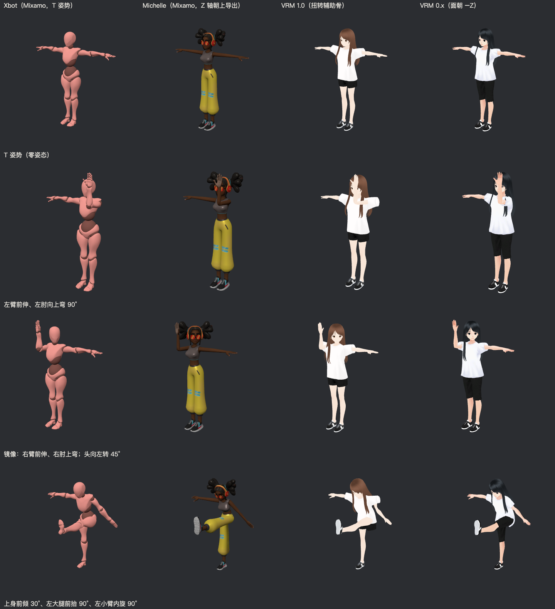
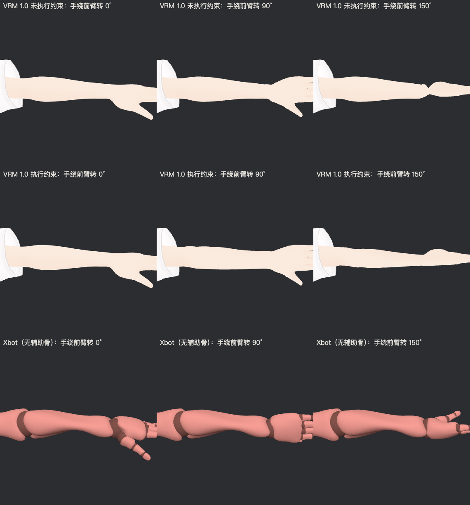

# 穿刺①：跨角色换算（2026-11-09）

Epic `scene-pose-system` 要求子项 3 冻结骨架数据之前先做这项穿刺（design「姿态的存储与换算」、未决事项「跨角色换算」）。本文记录做法、结果和由此定下的规则；原型代码在 `retarget-spike/`，素材不进仓库，链接见文末。

## 要回答的问题

1. 同一份姿态套到不同角色上，方向和关节运动是否正确。角色之间的差异包括：A 姿势与 T 姿势、辅助骨、比例、局部轴约定、朝向。
2. 标准坐标系和旋转的组合规则。
3. 不支持的骨架边界。

## 做法

**换算**参照 VRM 的规范化骨骼（`retarget-spike/retarget.ts`）：

- **标准空间**：Y 轴向上，角色面朝 +Z，角色的左手边是 +X，静止姿势为 T 姿势。
- **姿态**：每根标准骨骼一个旋转 q_b，表示在标准空间里相对 T 姿势的变化。沿标准骨骼链组合：G(b) = G(父骨骼) · q_b。角色缺少的骨骼，它的 q 照样传给子骨骼。
- **角色的朝向 F**：从静止骨架算出。髋到头的方向是上，右上臂到左上臂的方向是 +X，再由这两个方向推出正面。
- **角色的 T 姿势**：把静止姿势按最短弧摆到标准方向。要摆正的骨骼是上臂、前臂、手、大腿和小腿。手还要绕自身方向转一下，让手背朝上：用食指根和小指根（没有小指时用无名指）所在的平面判断。
- **套用**：被映射的骨骼，世界旋转 = F · G(b) · F⁻¹ · T(n)。映射骨骼之间的其他节点（辅助骨等）保持静止时的局部变换，有 `VRMC_node_constraint` 的除外，见下文。

**验证**分两部分：

- **真实角色**（`numeric.ts`，结果见 `numeric-output.txt`）：
  - 每个角色摆 6 个姿态：T 姿势、左臂前伸、屈肘上弯、头向左转 45°、上面姿态的镜像、上身前倾加大腿前抬。
  - 量肢体在标准空间里的方向误差、转头角度和 T 姿势下的掌面朝向。
- **合成变体**：在 Xbot 上每次只改一处，比较每根骨骼的完整旋转（含滚转），与原角色对比。比较方法是在每根骨骼上固定一个探针点。

## 结果

真实角色：

| 角色 | 差异点 | 肢体方向误差 | 转头 45° | T 姿势掌面（摆正前 → 后） |
|---|---|---|---|---|
| Xbot | Mixamo 命名，T 姿势 | 0.00° | 45.0° | 偏 4° → 0° |
| Michelle | Mixamo，根节点绕 X 轴转 90°（Z 轴朝上导出） | 0.00° | 无眼睛骨骼 | 偏 9° → 0° |
| VRM 1.0 扭转样例 | 扭转辅助骨、次级骨、节点约束 | 0.00° | 45.0° | 偏 6° → 0° |
| VRM 0.x 女孩 | 面朝 −Z | 0.00° | 45.0° | 偏 3° → 0° |
| RobotExpressive | 手动映射；静止时手臂下垂约 65°；腿不在髋下面，脚挂在 IK 控制骨下 | 脚映射后小腿偏 5–12° | 无眼睛骨骼 | 偏 39°；摆正后只剩手部造型造成的沿手轴分量 |

合成变体（相对 Xbot，每根骨骼的完整旋转之差）：

| 变体 | 最大差 |
|---|---|
| 静止姿势改为 A 姿势（上臂下垂 45°） | 0.000° |
| 每个关节的局部轴随机旋转 | 0.000° |
| 两臂各插一根随机朝向的扭转辅助骨 | 0.000° |
| 四肢加长 30% | 0.000° |
| 面朝 −Z，外加 Z 轴朝上导出的根旋转 | 0.000° |
| 没有 `upperChest`：它的 30° 旋转仍传到手臂 | 手臂 30.0°（应为 30°） |

图（`retarget-spike/poses.png`）：4 个角色 × 4 个姿态，方向和关节运动一致。

**辅助骨与约束**（`retarget-spike/twist.png`）：VRM 1.0 样例的扭转骨由 `VRMC_node_constraint` 驱动，手转动时前臂中段跟着转一半。不执行约束时，手绕前臂转到 150° 时手腕被捏成一点（糖纸效果）；执行约束后正常。Xbot 由刚性分段组成，没有这个问题。

## 定下的规则（子项 3 的设计依据）

1. **标准空间与组合规则**：如「做法」所述。姿态是标准空间里相对 T 姿势的旋转，沿标准骨骼链组合。存储与求值都只依赖标准骨骼名，与具体角色的局部轴、辅助骨、比例无关；合成变体证明这些差异对结果没有影响。
2. **朝向从静止骨架自动算出**，不读文件里的约定。VRM 0.x 面朝 −Z、Z 轴朝上导出的根旋转都能正确处理。
3. **T 姿势校正**：
   - 上臂、前臂、手、大腿、小腿按最短弧摆到标准方向。
   - 手再绕自身方向转到手背朝上。不做这一步时，正常角色的手偏 3–9°，静止时手臂下垂的角色偏 39°。
   - 脊柱、颈、头、肩、脚不校正，保留角色自己的静止姿态。
   - 校正量只用于换算，不改模型。
4. **缺失的可选骨骼**：它的旋转沿链传给子骨骼，效果近似于并入下一根存在的骨骼（绕的支点略有不同）。手指等叶子骨骼缺失时直接忽略。
5. **辅助骨**：
   - 有 `VRMC_node_constraint` 的（roll、aim、rotation），导入时读进骨架摘要。约束不进存储的 GLB，因为静态子集不允许扩展。
   - 求值顺序为「姿态 → 约束 → 蒙皮」，视口、CPU 蒙皮的静态化几何和导出都按这个顺序。
   - 没有约束的辅助骨保持静止。这是已知局限：靠扭转骨分担形变的非 VRM 模型，大角度扭转时手腕会捏起。
6. **不支持的骨架边界**：每根映射骨骼最近的映射祖先，必须是它在标准链上的祖先（层级要能嵌进标准链）。
   - 必需骨骼违反时（VRM 1.0 的必需骨骼：髋、脊柱、头、上下臂、手、大小腿、脚），这份人形映射不成立，导入对话框要说明原因。这样的角色仍可按非人形骨架导入，用节点通道摆姿态。
   - 可选骨骼违反时，从映射里去掉并提示。
   - 例子：RobotExpressive 的脚挂在 IK 控制骨下面，按人形映射不成立；它的腿挂在 `Body` 下面，把 `Body` 指定为髋可以解决。
7. **名字识别只在蒙皮关节里找**。RobotExpressive 的网格节点和骨骼同名；原型最初没有限定，脚被网格节点顶替后又被筛掉，结果悄悄漏掉了。
8. **镜像**：左右骨骼互换，四元数取 (x, −y, −z, w)，即对 YZ 平面反射。

## 未覆盖

- **骨盆位移按腿长缩放**：这次没有验证，按 Epic 的写法实现，在子项 4 打关键帧时验证。
- **手指的方向**：只校正了整只手的朝向，各手指的静止弯曲保留角色自己的。手指姿态跨角色的观感，在子项 5 由 owner 判断。
- **接触点**（手扶腰、脚踩地）在体型不同时的偏差：Epic 已列为已知局限，由 IK 修正。

## 素材（不进仓库）

- Xbot、Michelle、RobotExpressive：three.js r170 `examples/models/gltf/`（Mixamo 角色；RobotExpressive 作者 Tomás Laulhé，CC0）
- `VRM1_Constraint_Twist_Sample.vrm`：pixiv three-vrm `packages/three-vrm/examples/models/`（VRM Public License 1.0，允许任何人使用）
- `three-vrm-girl.vrm`：pixiv three-vrm v0.6.11 `packages/three-vrm/examples/models/`（VRoid Hub 条款，允许再分发与修改）
