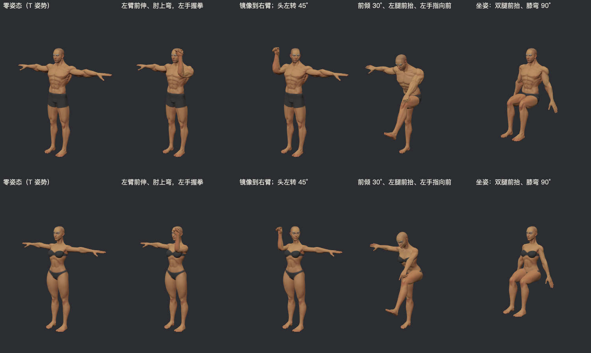
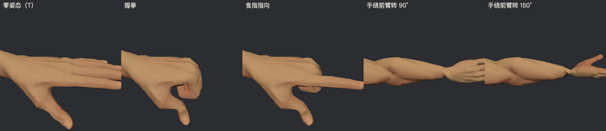

# 内置素体核对（2026-11-10）

子项 3 要提供平台内置的人形素体，owner 要求带手指。本文记录候选素体的核对结果；原型代码与图在 `base-body/`，换算部分沿用穿刺①的 `retarget-spike/retarget.ts`。

## 候选一：PolyOne Studio「humanoid mannequins」（不采用）

owner 提供的 Sketchfab 素体包（男、女各约 1.25 万三角形）：

- 不采用：GLB、FBX、.blend 都没有骨骼、蒙皮或顶点组，本机也没有 Blender 来装骨骼。
- 授权是 CC-BY 4.0，作为内置素体需要长期署名。

## 候选二：Quaternius「Universal Base Characters」免费版（采用）

- **授权**：包内 `License_Standard.txt` 写明 CC0 1.0，不需要署名。来源：https://quaternius.itch.io/universal-base-characters ，下载于 2026-11-10。
- **内容**：男、女各一个，glTF 格式（`Base Characters/Godot - UE/`）。
  - 每个角色有 3 个网格（身体、眼睛、眉毛），全部蒙皮到同一个骨架，没有 morph target。
  - 三角形：男约 1.43 万，女约 1.51 万。
  - 贴图为 2048² 的 PNG，包括基础色、法线和粗糙度。
  - 另有 5 种发型和胡子，有绑在头骨上的蒙皮版本。
- **骨架**：65 个关节，UE 小白人命名，挂在 `root` 下，`root` 带 Z 轴朝上导出的根旋转。
  - 五指齐全，每指 3 节外加一个 leaf 骨。
  - 脊柱 3 节，脚有 `ball`（脚趾）骨。
  - 没有扭转辅助骨，没有眼睛和下巴骨骼。
- **包装缺陷**：glTF 引用的 `T_Hair_1_Normal_png.png`、`T_Eye_Normal_png.png` 在包里不存在，同目录有不带 `_png` 后缀的同名文件。入库时要改正引用。

### 换算核对（`base-body/ubc-numeric.ts`，输出见 `numeric-output.txt`）

| 检查项 | 男 | 女 |
|---|---|---|
| 标准骨骼映射（UE 命名表，只在蒙皮关节里找） | 52 / 52 | 52 / 52 |
| 层级嵌入违规 | 无 | 无 |
| 朝向 | +Z | +Z |
| 静止姿势的 T 校正（左侧） | 上臂 1.7°、前臂 3.5°、手 6.1°、大腿 2.2°、小腿 6.4°，手掌滚转 2.6° | 1.1°–8.2°，手掌滚转 4.0° |
| 4 组姿态的肢体方向误差 | 0.00° | 0.00° |
| 握拳：远节相对指根 | 朝掌心（−Y），并向手腕方向回卷 | 同左 |

映射到 52 根骨骼，包括全部手指（拇指 3 节记为 Metacarpal、Proximal、Distal）。缺少的是眼睛和下巴，这两根是可选骨骼。静止姿势本身就接近 T 姿势。

### 出图（`base-body/ubcpage.ts`）

两个素体的 5 个姿态方向都正确，左右镜像也正确：T 姿势、前伸屈肘握拳、镜像加转头、前倾抬腿指向、坐姿。

- 握拳和食指指向都能摆出来。图中拇指的位置是原型随手给的角度，不代表换算有问题。
- **前臂扭转会捏成糖纸**：手绕前臂转 90° 时手腕开始收窄，转到 150° 时明显捏成一点。原因是这个素体没有扭转辅助骨，前臂的蒙皮权重只在 `lowerarm` 和 `hand` 之间过渡。这正是穿刺①规则 5 记下的已知局限，在内置素体上同样存在。

## 结论

- 采用 Quaternius Universal Base Characters 免费版的男、女两个角色作为内置素体。需要发型时从同一个包里取。
- 映射使用 UE 小白人命名表（`base-body/ue.ts`）。这张表也可以作为导入时的内置识别表之一。
- 待子项 3 设计决定：
  - 内置素体的入库方式：贴图压缩、尺寸，以及存储位置（仓库还是共享 OSS，参照内置贴图库的做法）。
  - 是否处理前臂扭转。可选做法：限制界面里手腕的滚转范围，或者在姿态求值时把手的滚转分一部分给前臂。后者会让肘部也跟着扭，同样有代价。
