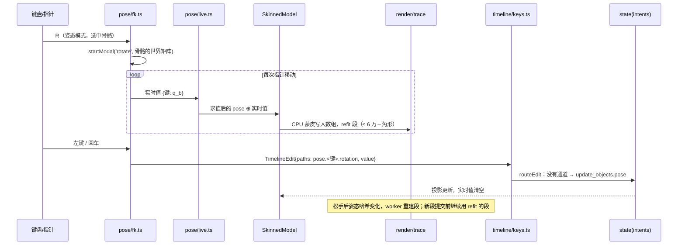
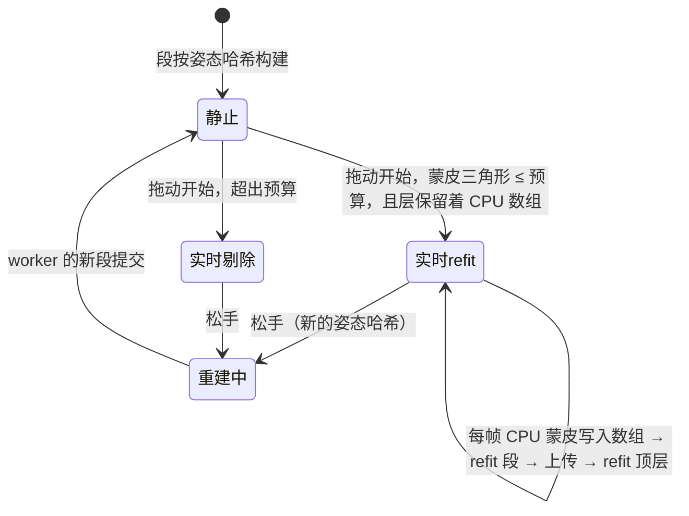

# Change 详细设计

## 继承的设计

- **Epic `scene-pose-system` 批准版本 v9**（`epic bind` 已绑定，全部条目适用）：
  - `design.md`：
    - 「领域模型与业务规则」：概念「姿态」「基础值」，不变量 P1、P5、P8，「编辑语义」S1–S6。
    - 「关键机制」：「姿态的存储与换算」「姿态模式（子项 4）」「快照大小与单元数」「蒙皮渲染」里拖动骨骼的规则。
  - 本子项交付的契约：`data: 场景时间线`、`api: 场景时间线命令`、`data: 场景文档`、`glossary: 姿态`（v9 的 MODIFY / ADD 正文）。
- **项目已有、直接沿用的**：
  - `patterns: 关键帧求值`、`patterns: 标准人形骨骼`；
  - 子项 1 的时间线编辑实现（`timeline/keys.ts`）；
  - 子项 3 的蒙皮链路（`rig/`、`objects/SkinnedModel.tsx`、追踪层按姿态哈希取段）。
- **测量依据**：
  - 子项 3 的穿刺②：`features/2026-11-09-scene-skinned-humanoid/discovery/research/2026-11-09-trace-update-spike.md`；
  - 子项 3 的浏览器实测：同目录 `2026-11-12-skinned-measurements.md`。
- **本次承担的边界**：
  - 姿态模式的交互：模式轮盘、选择、FK、四肢 IK、剪贴板、清除；
  - 姿态写进场景：基础姿态和骨骼通道；
  - 前后端求值、渲染指纹、拖动时的追踪层；
  - 服务端校验与兼容检查；
  - 助手读取姿态。
- **不在本次**：姿态库和跨角色套用（子项 5）、助手写姿态（子项 6）。

## 领域模型与业务规则

沿用 Epic 的「姿态」概念，不新增领域对象。本次只把它落到两端的类型上，并写清编辑器自己的状态。

### 存储形态（两端同构）

| 层 | 类型 | 说明 |
|---|---|---|
| OpenAPI | `CreativeScenePose`：`additionalProperties: CreativeSceneBonePose` | 键是标准骨骼名或 `node:<下标>`；生成到 `schema.d.ts` 与 Go 的 `api` 包 |
| OpenAPI | `CreativeSceneBonePose`：`{rotation?: number[4], position?: number[3]}` | `minProperties: 1` |
| OpenAPI | `CreativeSceneObject.pose`、`CreativeSceneObjectUpdate.pose` | update 的值允许 `null`（`CreativeSceneBonePose \| null`），表示这根骨骼回到静止姿势 |
| Go | `creativescene.Pose map[string]BonePose`；`BonePose{Rotation *[4]float64; Position *[3]float64}` | `Object.Pose` 带 `omitempty`；更新用 `map[string]*BonePose`，`nil` 即重置 |
| TS | `SceneObject['pose']`（生成类型） | 不手写 DTO |

### 规范化（写入时，两端相同）

服务端在命令应用时规范化，编辑器的投影（`state/apply.ts`）用同一套规则，所以本地投影与服务端快照逐字节一致：

1. 四元数：长度与 1 的差超过 1e-3 时拒绝；否则归一化，再取 w ≥ 0 的那一半（q 与 −q 是同一旋转，统一符号后比较和哈希才稳定），保留 6 位小数。
2. 位移：每轴不超过 ±100 m，保留 5 位小数。
3. 等于静止姿势的字段去掉：单位四元数、零位移。一项没有字段了，这一项就去掉；`pose` 为空就去掉这个字段。

**来源**：w ≥ 0 这一步是本次起草时补的，owner 批准时决定写进契约（Epic 修订 v10）。这一步不改变求值结果，只让同一个旋转只有一种存法。骨骼通道的关键帧不做这一步，因为 slerp 要靠相邻关键帧的符号走最短弧，现有的 `normalizedQuaternion` 照旧。

### 业务规则

- **R1 键与模型的兼容**：完全按 Epic 契约（`api: 场景时间线命令`「姿态与模型的兼容」）。服务端在每批命令应用后检查，见「关键机制 · 服务端兼容检查」。
- **R2 求值**：
  - 骨骼 b 在第 f 帧的值：有通道的字段取通道在 f 的值，否则取 `pose[b]` 里的同名字段，都没有就是静止值。
  - 旋转通道和位移通道互相独立：`hips` 可以只给位移打关键帧。
- **R3 编辑语义**：每根骨骼的每个字段是一个独立的属性路径，`pose.<键>.rotation` 或 `pose.hips.position`，与 `transform.position` 同等对待。S1–S6 不需要为姿态改写，`timeline/keys.ts` 只需要认识这些动态路径。

### 编辑器状态（不进快照）

| 状态 | 所在 | 生命周期 |
|---|---|---|
| 当前模式 `mode: 'object' \| 'edit' \| 'pose'` 与姿态模式的物件 ID | `state/sceneStore.ts` 的 `EditorState` | 换活动物件、物件被删、模型换成不带骨架的时退回物体模式并提示 |
| 选中的骨骼（键的列表，最后一个为活动骨骼） | 同上，`poseMode.selected` | 退出姿态模式时清空 |
| 姿态剪贴板（键 → 字段值，以及来源是否为人形） | `pose/clipboard.ts` 模块内 | 页面内有效，跨物件可用 |
| 实时姿态（R / G 进行中，以及 IK 拖动中的骨骼值） | `pose/live.ts` 的 store | 确认后写命令，取消后丢弃 |

面编辑现有的 `faceEdit` 状态保留，只改由 `mode: 'edit'` 进入。

## 模块职责与协作

| 模块 | 职责 | 不负责 |
|---|---|---|
| `modes/`（新增） | 模式轮盘与视口顶栏的模式切换；判断活动物件支持哪些模式；切换时调用面编辑或姿态模式的进入、退出 | 各模式内部的交互 |
| `pose/`（新增） | 姿态模式的选择、FK、IK、剪贴板、清除；骨骼的显示与拾取；把一次编辑变成 `TimelineEdit` | 求值、写命令、蒙皮 |
| `timeline/` | 认识骨骼路径：通道清单、基础值读写、`routeEdit`、`insertKeys`、`written`、分镜操作 | 姿态换算 |
| `rig/` | 场景姿态与 three 骨骼之间的换算（正向：姿态 → 节点；反向：节点的世界旋转 → q_b 或节点旋转）；拖动时把 CPU 蒙皮写进已有数组 | 编辑语义 |
| `objects/SkinnedModel.tsx` | 按求值后的 `pose` 加实时姿态摆骨骼；拖动期间按预算决定 refit 还是剔除 | 追踪层内部 |
| `render/trace/` | 段的原地 refit（原始精度和代理）；拖动期间剔除；松手后重建 | 姿态 |
| `state/` | `pose` 字段的投影、合并、撤销补丁 | — |
| Go `creativescene` | `pose` 与骨骼通道的校验、规范化、合并；兼容检查；求值；指纹；恢复 | 换算（只在 TS） |
| Go `creativeagent` / `creativescene/agent.go` | `read_scene` 返回姿态；助手换模型时由工具层写出清除 | 助手写姿态（子项 6） |

### 主流程：一次 FK 旋转（没有通道的骨骼）



有通道的骨骼走同一条链，只是在 `routeEdit` 处分流：分镜帧上打开了自动关键帧，就写 `animation.set`；否则记为「已改未记录」，按 I 再写。

## 关键机制

### 模式轮盘

- **可用的模式**（`modes/modes.ts:modesFor(object, model)`）：

  | 活动物件 | 物体 | 编辑（面编辑） | 姿态 |
  |---|---|---|---|
  | 基础体、不带骨架的模型实例 | ✓ | ✓ | — |
  | 带骨架的模型实例（含素体） | ✓ | — | ✓ |
  | 灯光、摄像机、分组、体积，以及锁定的物件 | ✓ | — | — |
  | 没有活动物件 | ✓ | — | — |

  「—」的项不显示（owner 2026-11-13）。显示的项仍在各自的固定方向上，空出的方向留空，不挪位，保持肌肉记忆。只剩物体模式时轮盘照常打开。权重绘制、雕刻这次不放进轮盘，等实现时再加，不显示占位。

- **手势**（`modes/ModeWheel.tsx`，按 owner 2026-11-13 定的饼菜单交互，Epic 修订 v10）：

  ```mermaid
  stateDiagram-v2
    [*] --> 关闭
    关闭 --> 按下: Tab 按下（以指针位置为中心画出轮盘）
    按下 --> 常亮: 250 ms 内松开（轻按）
    按下 --> 按住: 按住超过 250 ms
    按住 --> 关闭: 松开时指向某一项 → 进入该模式；没有指向任何一项 → 不切换
    常亮 --> 关闭: 点击某一项 → 进入该模式 / 再按 Tab / Esc → 不切换
  ```

  - 「指向」：指针离中心至少 24 px，且落在一个显示中的扇区里，该项高亮。离中心不到 24 px 或落在空出的方向上，都算没有指向。
  - 按下和按住时，指针移动也会高亮扇区，但只在松开时生效；常亮时高亮只是悬停反馈，点击才生效。
  - 扇区按固定方向排列：左是物体，右是编辑，上是姿态。
  - 轮盘打开期间吞掉其他快捷键（Tab、Esc 除外）。按住期间窗口失焦，按松开处理并不切换。

- **快捷键**：`input/keymap.ts` 的 Tab 绑定改为 `mode-wheel` 动作，上下文为 `idle`、`faceedit` 和新增的 `pose`。原来的 `face-edit` 动作删除，面编辑的进入与退出改由模式切换调用（`SceneEditor.tsx` 现有的 Tab 分支改为打开轮盘）。
- **视口顶栏**：在 `Viewport.tsx` 顶栏放一个下拉，显示当前模式，只列活动物件支持的模式，与轮盘相同。

### 姿态模式：骨骼的显示与拾取

- **显示**（`pose/BoneOverlay.tsx`）：
  - 从骨架的节点画骨骼，Blender 的八面体样式，只画线框以免挡住角色。
  - 人形角色只画映射到的骨骼。手指缩小显示。
  - 非人形骨架画 `manifest.skeleton` 里的全部关节。
  - 颜色：未选为灰，选中为浅蓝，活动骨骼为白。有关键帧的骨骼描绿边，本帧是关键帧的描黄边，与属性栏的配色一致。
  - 骨骼总在最前，不受深度遮挡。
- **长度**：骨骼从节点画到它在映射链上的子骨骼，没有子骨骼时取父骨骼长度的一半。
- **拾取**：屏幕空间里指针到每根骨骼线段的距离，12 px 以内取最近的一根；点空白处取消选择。
  - 只在姿态模式下拾取骨骼，其他物件不可选，与面编辑的规则相同。
  - Shift + 单击加选，或把已选中的去掉。A 全选，Alt+A 全不选。
- **列表**：属性栏在姿态模式下列出选中的骨骼。每根骨骼显示中文名（标准骨骼名到中文名的表在 `pose/names.ts`）和旋转（欧拉角，度，只读显示），关键帧状态用现有配色。

### FK

- **复用 `transform/modal.ts`**：
  - 每根选中的骨骼是一个 `Target`：`world` 取骨骼节点的世界矩阵，`parentWorld` 取父节点的世界矩阵。
  - `startModal('rotate', targets, …)` 原样使用。X / Y / Z 锁轴、两次切到局部轴、数字输入、Shift 精调、右键或 Esc 取消，都沿用物件变换。
  - 局部轴就是骨骼节点的世界轴，与 Blender 姿态模式的局部轴一致。
  - 只允许 R。按 S 提示「骨骼不能缩放」。G 见 IK。
- **反向换算**（`rig/poseEdit.ts`）：把模态给出的新世界旋转 W′ 换回存储值。
  - **人形骨骼**：由 `patterns: 标准人形骨骼` 的套用公式 W = F · G(b) · F⁻¹ · T(n) 解出：
    - G′(b) = F⁻¹ · W′ · T(n)⁻¹ · F
    - q_b′ = G(parent)⁻¹ · G′(b)
    - G(parent) 取标准骨骼链上父骨骼的累积旋转。缺失的骨骼照常累积，与正向换算一致。
  - **`node:` 键**：rotation′ = 静止局部旋转⁻¹ · (父节点世界旋转⁻¹ · W′)。
  - **多选时**按父子顺序依次换算：先写父骨骼，再按更新后的父骨骼求子骨骼的 G(parent)。这样父子同选同转时，子骨骼相对父骨骼不动，与 Blender 的结果相同。
- **约束**：VRM 约束驱动的辅助骨不可选，它们由约束求值。
- **验证**：正向和反向换算互逆。单元测试用随机姿态在素体、Mixamo、VRM 三类骨架上往返，误差 < 1e-5。

### 四肢 IK

- **触发**：
  - 在姿态模式里，对手（`leftHand` / `rightHand`）或脚（`leftFoot` / `rightFoot`）按 G，或用左键直接拖动已选中的手、脚，就进入 IK 拖动。这相当于 Blender 的 Auto IK，链长固定为 2。
  - 对 `hips` 按 G 是骨盆位移，见下。
  - 其他骨骼按 G 时提示「这根骨骼只能旋转（R）；拖动手或脚用 IK」。
  - 非人形骨架没有 IK，G 一律提示。
- **目标**：
  - 腕（踝）关节的目标位置沿用 `modal.ts` 的 `grab` 求值。默认在与屏幕平行的平面内移动，X / Y / Z 锁轴、数字输入照常可用。
  - 一次只拖一个末端；选了多个时，只对活动骨骼做 IK。
- **两段式解析解**（`pose/ik.ts:solveTwoBone`），在世界空间里求：
  - **输入**：肩（髋）位置 S、肘（膝）位置 E₀、腕（踝）位置 W₀，都取拖动开始时的值；目标 T。
  - 上臂长 a = |E₀ − S|，前臂长 b = |W₀ − E₀|。
  - **弯曲平面法向** n = (E₀ − S) × (W₀ − E₀)，在拖动开始时算好，整个拖动期间不变。肢体伸直（|n| < 1e-6）时改用上臂节点的局部 X 轴。
  - **距离**：d = |T − S|，夹在 [|a − b| + 1e-4, a + b − 1e-4] 内。够不着时肢体伸直、指向目标，不会因数值误差抖动。
  - **肘的位置**：由余弦定理得到肘角，肘落在 S、T 和 n 所确定的平面内，并且在原来弯曲的一侧。
  - **写回**：上臂、前臂各求一次从旧朝向到新朝向的旋转（同时对齐骨骼方向和弯曲平面，不额外扭转），乘到它们的世界旋转上，再经 FK 的反向换算写成 q_b。
  - 手（脚）的局部旋转不变，随前臂转，与 Blender 的 Auto IK 相同。
- **记录**：结果只有这两根骨骼的旋转，与 FK 写法相同。IK 目标和极向量不存储。
- **骨盆位移**：
  - G 拖动 `hips` 时，世界位移 Δ 换成标准空间：p = F⁻¹ · R_root⁻¹ · Δ / s，其中 R_root 是实例根的世界旋转，s 是实例的缩放。
  - 写到 `pose.hips.position`。

### 复制、镜像粘贴与清除

- **Ctrl+C**：复制选中骨骼求值后的值（含实时值）。键、旋转、位移原样复制，并记下来源是否为人形。
- **Ctrl+V**：按键粘贴到同一个键上，只对当前选中且剪贴板里有的骨骼生效。
  - 人形与 `node:` 之间不互贴，提示「剪贴板的骨骼与这个角色对不上」。
  - `node:` 键只在骨架指纹相同时粘贴。
- **Ctrl+Shift+V**（只限人形）：
  - 左右骨骼名互换。旋转取 `patterns: 标准人形骨骼` 的镜像 (x, −y, −z, w)，骨盆位移取 (−x, y, z)。
  - 写到镜像后对应的骨骼上，这些骨骼不必是选中的。这与 Blender 的「镜像粘贴到对侧」一致：选中左臂复制，再选中右臂镜像粘贴，结果相同。
- **Alt+R**：选中骨骼的旋转清回静止。
  - 没有通道的骨骼写 `pose: {键: null}`；如果它还有 `position`，只去掉 `rotation`。
  - 有通道的骨骼按编辑语义处理：写这一帧的值为单位四元数，或记为「已改未记录」。
- **Alt+G**：清除 `hips` 的位移，规则同上。
- **一次操作**：粘贴和清除都是一次编辑，一个撤销步骤。

### 写入：骨骼路径接进时间线

- **通道清单**（`channels.json`，同时生成到 `channels.gen.json`）加三行路径模板，并加一列 `rig`（`humanoid` / `skeleton` / 空）：

  ```json
  { "path": "pose.<bone>.rotation", "unit": "content", "camera_only": false, "rig": "humanoid", "sample": "quaternion" },
  { "path": "pose.hips.position", "unit": "content", "camera_only": false, "rig": "humanoid", "sample": "vector" },
  { "path": "pose.node:<index>.rotation", "unit": "content", "camera_only": false, "rig": "skeleton", "sample": "quaternion" }
  ```

  - 两端都用同一个函数解析具体路径：`<bone>` 必须在标准骨骼列表里（Go `rig.go` 的列表、TS `humanoid_rig.gen.json`），`<index>` 是不带前导零的非负整数。
  - 模板行不进「全部静态路径」的枚举。
- **TS `timeline/channels.ts`**：
  - `channelOf(path, kind)` 先查静态路径，再按模板解析。
  - `channelPaths(kind)` 保持只返回静态路径。新增 `objectPaths(o)`，返回静态路径，加上 `o.animation` 里已有的骨骼路径，再加 `o.pose` 里有值的骨骼路径。
  - `baseValue` / `withBaseValue` 增加 `pose` 分支：读写 `o.pose?.[键]?.rotation ?? [0,0,0,1]`，`position` 缺省为 `[0,0,0]`；写回时套用上面的规范化规则。
- **`timeline/keys.ts`**：
  - `written(shown, u)` 改为遍历 `objectPaths`，并加入 `u.pose` 的键。
  - `withBase` 和 `routeEdit` 不改结构，靠 `channels.ts` 识别骨骼路径。
  - **基础值的更新**：`routeEdit` 生成的 `update_objects.pose` 只含这次改到的骨骼（按骨骼合并），不发整份 `pose`。
- **I / Alt+I**：
  - 姿态模式下，I 调用 `insertKeys(paths)`。路径为选中骨骼的 `pose.<键>.rotation`；选中 `hips` 时再加 `pose.hips.position`。没有选中骨骼时提示「先选中骨骼」。
  - 首次建通道时按 S1 补齐其他分镜（`firstKey`）。
  - Alt+I 同理，作用于选中骨骼。
  - 物体模式下的 I 维持现在的 `transformPaths`。
- **分镜操作**：
  - `addShot`、`duplicateShot`、`moveShot`、`removeShot`、`clearChannel`、`onlyInShot` 都遍历对象已有的通道，骨骼通道自然包含在内。
  - 要改的只有 `addShot`：S2a 用默认状态补关键帧，骨骼的默认状态取 `baseValue`，也就是 `pose` 里的值或静止值。这一点由 `baseValue` 的 `pose` 分支保证。
- **投影与撤销**（`state/`）：
  - `apply.ts:updateObject` 按骨骼合并 `u.pose`（`null` 去掉这一项），再规范化。
  - `updateKeys` 与 `changedPart` 加入 `pose`，只比较写到的骨骼。
  - `contentKeys` 加入 `pose`，撤销补丁（`undo.ts:patchFor`）自然恢复整个 `pose`。
  - `intents.ts:mergeUpdate` 合并两次 `pose` 时按骨骼合并，后写的覆盖。
- **换模型**（`modelEdits.ts` 与属性栏的换模型入口）：
  - 发出 `set_instance_model` 前，用新模型的 `rig` 和骨架指纹算出不兼容的键，算法与服务端相同（`pose/compat.ts`）。
  - 同一批里写 `update_objects.pose: {键: null}`，以及 `animation.clear`（不兼容的骨骼路径）。
  - 提示「换成 X 后去掉了 N 根骨骼的姿态和 M 条骨骼通道，撤销可以找回」。
  - 男、女素体互换时都有人形映射，什么也不清。

### 求值与渲染

- **求值**（`timeline/evaluate.ts:evaluateObject`）：
  - 按 `channelOf` 认出骨骼通道，用 `withBaseValue` 写回求值后的 `pose`。
  - 结果对象的 `pose` 包含所有有值的骨骼，渲染端只读它。
  - Go `evaluate.go:EvaluateAt` 同理：先克隆 `o.Pose`（与克隆 `Camera` 一样，不改输入），再按通道写入。
  - 共用测试向量 `testdata/keyframe_eval.json` 加三组骨骼通道用例：旋转通道 slerp、`hips` 只有位移通道、基础姿态与通道混合。由 `keyframe_eval_gen.py` 生成，两端都跑。
- **渲染**：
  - `objects/SkinnedModel.tsx` 的姿态来源改为 props 里求值后物件的 `pose`，再叠加 `pose/live.ts` 的实时值。
  - `rig/pose.ts` 新增 `poseFromScene(pose)`，把场景姿态换成换算层的输入：人形骨骼的四元数、`hips` 的位移、`node:` 的旋转。
  - `rig/pose.ts:pose()` 扩展为同时处理骨盆位移（`standardOffset` 已有标准空间的换算）和 `node:` 旋转。
  - `testPoses` / `__scenePose` 保留，只在 `__sceneTest` 下作为最上层的覆盖，生产路径不再读它。
  - 姿态哈希 `rig/skin.ts:poseHash` 改为对上面合成后的完整输入取哈希，追踪层和静态几何缓存的键随之变化。
- **导出与 `render_view`**：
  - `host/render.ts` 和 `exportShots.ts` 已经按分镜求值再渲染。姿态进入求值结果后自动生效，不另改流程。
  - 等待条件沿用子项 3：这一帧的静态几何就绪、段构建完成。
- **渲染指纹**：
  - Go `fingerprint.go` 对求值后的物件整体序列化，`Pose` 带 `omitempty`，没有姿态的场景指纹不变（AC-12）。
  - TS 端不算指纹。按分镜导出的过时判断由服务端给出，只有改了帧上姿态的分镜过时（AC-6）。

### 拖动时的追踪层

依据 Epic「蒙皮渲染」与穿刺②。R 或 G 进行中的那个角色进入「实时」状态，松手后退出。



- **预算**：
  - `REFIT_TRIANGLES = 60_000`，比较的是这个角色所有蒙皮网格的三角形之和。暂定值，AC-8 实测后确定。
  - 在 `render/trace/capacity.ts` 定义，`SkinnedModel` 与追踪层共用。
- **实时 refit**：
  1. **CPU 蒙皮写入已有数组**。`SkinnedModel` 每帧调用 `rig/skin.ts:skinInto(part, root, geometry)`，把结果写进同一个 `BufferGeometry` 的 position 和 normal（不新建几何），并递增 `userData.posed.version`。法线沿用 `staticGeometry` 的余子式算法。
  2. **段的键冻结**。`render/trace/collect.ts` 遇到 `posed.live` 时，`Traced.key` 保持拖动开始时的键，另带 `liveVersion`。
  3. **base 发起 refit**。`render/trace/base.ts:sync` 发现某个已提交键的 `liveVersion` 变了，就对两份精度调用 `TraceLayer.refitSegment(key, positions, normals)`。
  4. **`layer.ts:refitSegment` 的步骤**：
     - 在层的 CPU 数组里改写这个段的顶点：xyz 和编码后的法线。
     - 自底向上重算这个段各个根的节点包围盒。拓扑和三角形顺序不变，只改包围盒。
     - 上传这个段的顶点区间和节点区间。
     - 调用 `top.refit()`，上传顶层节点。
     - 递增 `geometryVersion`，让探针重新收集。
  5. **代理精度**：段带一个 `sources: Uint32Array`，记录每个代理顶点在原几何里的下标（`simplify` 的 `compactMesh` 重映射取逆），refit 时按它取顶点。原始精度的顶点顺序与几何相同，不需要这个表。
     - 加了这个字段后，旧缓存里的段不再适用，`cache.ts:BUILDER_VERSION` 升到 5。
     - 简化后的拓扑来自静止姿势，大幅弯曲时代理会粗一些，只影响探针收集的间接光，拖动期间可以接受，松手后重建。
- **实时剔除**：
  - 超出预算的角色从拖动的第一帧起，在两份精度里都把实例的 `visible` 字写 0，并且不做每帧的 CPU 蒙皮。
  - 取景框、拾取和贴地都沿用拖动前的几何。
  - 视口光栅照常按当前姿态绘制蒙皮网格。
- **松手**：
  - 实时状态退出，姿态哈希变成新值，走现有的按键请求段：worker 构建，缓存未命中。
  - **refit 过的角色**：新段提交前，继续用 refit 过的旧键段。它的几何就是最终姿态，所以画面没有空档。
  - **剔除的角色**：沿用子项 3 的规则，构建期间剔除。
- **层没有 CPU 数组时**：只有导出会丢数组，导出不拖动，这种情况走剔除路径兜底。
- **测量**：
  - `gpuTestHooks` 增加 `poseDrag: {frames, skinMs, refitMs, uploadMs}`，e2e 读它来记录 AC-8 的每帧耗时。
  - 开发构建在控制台每 60 帧打印一次。

### 服务端：校验、合并、兼容检查

- **无状态校验**：
  - 位置：`model.go:validateObject` 调新增的 `pose.go:validatePose`；`channels.go:validateAnimation` 通过 `channelOf` 认出骨骼路径。
  - `pose` 只能在 `kind=model_instance` 上。
  - 键必须是标准骨骼名或 `node:<下标>`；`position` 只在 `hips` 上；每项至少一个字段；不超过 512 个键。
  - 四元数长度的偏差、位移范围按上面的规范化规则检查。
  - 错误的 `details.field` 指到 `objects[i].pose.<键>` 或 `updates[j].pose.<键>`。
- **合并**（`ops.go`）：
  - `objectUpdate` 加 `Pose map[string]*BonePose`。`apply` 时按骨骼合并：`nil` 删除这一项，其余按字段覆盖。
  - 合并后规范化，存储形态只有一种。
  - 写到 `pose` 的更新把内容单元记为改动。`touched` 已经按字段归单元，`pose` 归内容单元。
- **兼容检查**（`pose.go:checkPoses`）：
  - **时机**：在 `type.go:sceneType.Apply` 里，放在 `Validate` 之后、`checkShotKeys` 之前。
  - **检查哪些实例**：本批内容单元有改动、且有 `pose` 或骨骼通道的模型实例，或者本批换了模型的实例。
  - **读模型**：
    - 对新旧模型修订各调一次 `readModels`，在同一事务里，能读到本批 `derive_model` 写的修订。
    - 内置模型查 `builtinModels.byID`。
    - 从中取 `Rig.Humanoid` 是否非空、`Manifest.Skeleton` 的关节集合和指纹。
  - **判定**（键 k 来自 `pose` 和骨骼通道的路径）：

    | 条件 | 结果 |
    |---|---|
    | 新模型没有 `skeleton`，而实例有任何 `pose` 键或骨骼路径 | 不兼容 |
    | k 是标准骨骼名，新模型没有人形映射 | 不兼容 |
    | k 是 `node:i`，i 不在新骨架的关节里 | 不兼容 |
    | k 是 `node:i`，本批换了模型，且新旧骨架指纹不同 | 不兼容 |
    | 其他 | 兼容 |

  - **结果**：有不兼容时返回 400 `validation_failed`。`details.incompatible` 列出 `[{object_id, key}]`，最多 50 项；`details.field` 指向第一处。服务端不删除任何内容。
  - **读取量**：每批两次批量读，与模型个数无关。
- **恢复**：`restore.go` 复制内容单元字段时加上 `Pose`。
- **大小**：沿用 512 KiB 快照上限和 20000 个关键帧的总数上限，骨骼通道不另设上限（Epic v9）。AC-10 实测。

### 助手

- **`read_scene`**：
  - `agent.go:ObjectView` 加 `Pose Pose \`json:"pose,omitempty"\``，取自 `objectView` 所读的场景。
  - 指定分镜时这个场景是求值后的结果（`sceneAtShot`），所以姿态就是这一帧的值。
  - `Animated` 已经列出通道路径，骨骼通道自然包含在内。
  - 姿态计入 `fit` 的预算：一个角色最多约 60 个键，约 3 KB；超出预算时按现有的收窄规则省略。
- **写入**：
  - 工具层 schema（`creativeagent/scene_tool_schema.go`）不加 `pose`。
  - `animation.clear` 照旧是路径数组，可以写骨骼路径，由服务端白名单校验。
  - 工具说明（`scene_tools.go`）补一句：「骨骼通道只能清除，摆姿态还不支持」。
- **助手换模型**：
  - `AgentEditInTx` 在 `resolveSlots` 之后新增 `clearIncompatiblePoses`。它遇到 `set_instance_model` 时，按上面的判定算出不兼容的键，在同一批里追加一个 `update_objects`（`pose: {键: null}` 加上 `animation.clear`）。
  - 结果新增 `PosesCleared []string`（物件 ID）。工具把它告诉助手，助手再转告摄影师。

## 局部设计与偏差

- **D1 四元数存储取 w ≥ 0**：理由与范围见「规范化」。只作用于 `objects[].pose`，不作用于通道关键帧。求值结果不变，只多了一条存储约定。owner 批准时决定写进契约，已由 Epic 修订 v10 合入 `data: 场景文档`「姿态」和 `data: 场景时间线`「骨骼通道」。
- **D2 G 的分工**：手、脚做 IK，`hips` 做位移，其他骨骼提示只能旋转。
  - Blender 对连接的骨骼按 G 不做任何事，没有 Auto IK 时会脱开骨骼。我们不允许脱开骨骼，因为位移只存在于 `hips`。
  - 选这种分工，是让 G 在姿态模式里总有一个确定的含义。
- **D3 实时值只在编辑器**：R、G 进行中不发命令，确认后一次写入，与物件变换相同。中途切到别的标签页不会留下半截的姿态。
- **D4 原地 refit 自己实现**：
  - three-mesh-bvh 的 `MeshBVH.refit()` 作用在它自己的几何对象上，而层里存的是打包、重定位过的段，没有对应的 `MeshBVH`。
  - 所以在层的打包格式上直接自底向上重算包围盒。逻辑只有「叶子取三角形包围盒、内节点取两个子节点的并集」，单元测试与 three-mesh-bvh 的 refit 结果逐节点比对。
- **D5 路径模板进通道清单**：骨骼路径不在 TS 或 Go 里各写一份特判，而是放进共用的 `channels.json`。`loadChannels` 的一致性检查同样覆盖它们。
- **D6 兼容检查只看改到的实例**：每批只读涉及的模型，不扫描全场景。没被这批改到的实例，在它们上一次写入时已经检查过。
  - 例外：模型修订被回收不会改变它的骨架，所以不会出现「没写入却变得不兼容」的情况。
- **D7 测试入口保留为覆盖层**：子项 3 的 e2e 依赖 `__scenePose`。保留这个入口，用于不需要服务端的渲染测试；新的 e2e 走真实命令。
- **没有偏离 Epic v9 的地方**；D1 是补充。

## 接口与数据契约

- **契约状态**：扩展。全部来自 Epic v9 绑定的四个条目，本子项完整交付，没有局部契约（不写本 Feature 的 `contracts.md`）。
  - `data: 场景时间线`：骨骼通道的白名单、规则、大小。
  - `api: 场景时间线命令`：`add_objects` 和 `update_objects` 的 `pose` 字段、兼容规则、400 的条件。
  - `data: 场景文档`：`objects[].pose`；内容单元包含 `pose`；指纹。
  - `glossary: 姿态`。
- **OpenAPI**（`api/openapi.yaml`，改完运行生成器，Go 和 TS 的生成物一起提交）：
  - 新增 `CreativeScenePose`、`CreativeSceneBonePose`；
  - `CreativeSceneObject` 加 `pose`；
  - `CreativeSceneObjectUpdate` 加 `pose`，值可以为 `null`；
  - 400 的 `details` 加 `incompatible` 的说明。
- **助手工具**：`read_scene` 的物件多了 `pose`；`edit_scene` 的结果多了 `poses_cleared`。这些是工具协议的内部扩展，不在公开契约里。
- **兼容**：
  - 旧场景没有 `pose`，画面和指纹都不变。
  - 前后端同一版本上线，回滚只做前向修复（Epic v9 已写明）。

## 挂载点

| 位置 | 动作 | 说明 |
|---|---|---|
| `api/openapi.yaml` | 修改 | `CreativeScenePose`、`CreativeSceneBonePose`；对象与更新的 `pose` |
| `frontend/src/api/schema.d.ts` | 生成 | 随 OpenAPI 再生成 |
| `backend/internal/platform/httpapi/api.gen.go` | 生成 | 随 OpenAPI 再生成（worktree 里直接跑 `oapi-codegen` 与 `npm run generate`，不跑 `make generate`） |
| `backend/internal/creativescene/channels.json` | 修改 | 三行骨骼路径模板，`rig` 列 |
| `frontend/src/creative-scene/timeline/channels.gen.json` | 生成 | 由 `channels.json` 复制 |
| `backend/internal/creativescene/channels.go:channelOf` | 修改 | 按模板解析骨骼路径，`channelSpec` 加 `rig` |
| `backend/internal/creativescene/channels.go:loadChannels` | 修改 | 模板行与 `channelFields` 的一致性 |
| `backend/internal/creativescene/channels.go:validateAnimation` | 修改 | 骨骼路径校验，`kind` 只能是 `model_instance` |
| `backend/internal/creativescene/model.go:Object` | 修改 | `Pose` 字段 |
| `backend/internal/creativescene/model.go:validateObject` | 修改 | 调 `validatePose` |
| `backend/internal/creativescene/pose.go` | 新增 | `Pose`、`BonePose`、`validatePose`、`normalizePose`、`mergePose`、`checkPoses`、`incompatibleKeys` |
| `backend/internal/creativescene/ops.go:objectUpdate` | 修改 | `Pose` 字段与合并 |
| `backend/internal/creativescene/type.go:sceneType.Apply` | 修改 | 调 `checkPoses` |
| `backend/internal/creativescene/evaluate.go:EvaluateAt` | 修改 | 克隆 `Pose`，写入骨骼通道 |
| `backend/internal/creativescene/fingerprint.go` | 修改 | 求值后的 `Pose` 计入（核对克隆与 omitempty） |
| `backend/internal/creativescene/restore.go` | 修改 | 内容单元带 `Pose` |
| `backend/internal/creativescene/testdata/keyframe_eval_gen.py` | 修改 | 骨骼通道用例 |
| `backend/internal/creativescene/testdata/keyframe_eval.json` | 生成 | 共用测试向量 |
| `backend/internal/creativescene/agent.go:ObjectView` | 修改 | `Pose` |
| `backend/internal/creativescene/agent.go:objectView` | 修改 | 填 `Pose` |
| `backend/internal/creativescene/agent.go:AgentEditInTx` | 修改 | `clearIncompatiblePoses` |
| `backend/internal/creativescene/agent.go:EditResult` | 修改 | `PosesCleared` |
| `backend/internal/creativeagent/scene_tools.go` | 修改 | 工具说明：骨骼通道只能清除；`poses_cleared` |
| `frontend/src/creative-scene/modes/modes.ts` | 新增 | `modesFor`、模式切换 |
| `frontend/src/creative-scene/modes/ModeWheel.tsx` | 新增 | 轮盘与手势状态机 |
| `frontend/src/creative-scene/input/keymap.ts:bindings` | 修改 | Tab → `mode-wheel`；`pose` 上下文；姿态模式的 R、G、I、Alt+I、Alt+R、Alt+G、Ctrl+C、Ctrl+V、Ctrl+Shift+V、A、Alt+A |
| `frontend/src/creative-scene/state/sceneStore.ts:EditorState` | 修改 | `mode`、`poseMode` |
| `frontend/src/creative-scene/SceneEditor.tsx` | 修改 | Tab 分支改为轮盘；姿态模式的动作分派；换模型时写出清除 |
| `frontend/src/creative-scene/Viewport.tsx` | 修改 | 顶栏模式下拉；姿态模式的指针拾取与拖动 |
| `frontend/src/creative-scene/pose/state.ts` | 新增 | 选择、进入与退出 |
| `frontend/src/creative-scene/pose/BoneOverlay.tsx` | 新增 | 骨骼显示 |
| `frontend/src/creative-scene/pose/pick.ts` | 新增 | 屏幕空间拾取 |
| `frontend/src/creative-scene/pose/fk.ts` | 新增 | 骨骼的 `Target`、模态结果 → 存储值 |
| `frontend/src/creative-scene/pose/ik.ts` | 新增 | `solveTwoBone`、骨盆位移 |
| `frontend/src/creative-scene/pose/clipboard.ts` | 新增 | 复制、粘贴、镜像粘贴 |
| `frontend/src/creative-scene/pose/clear.ts` | 新增 | Alt+R、Alt+G |
| `frontend/src/creative-scene/pose/live.ts` | 新增 | 实时值 store |
| `frontend/src/creative-scene/pose/compat.ts` | 新增 | 不兼容键的判定（与 Go 同表） |
| `frontend/src/creative-scene/pose/names.ts` | 新增 | 骨骼中文名 |
| `frontend/src/creative-scene/pose/PosePanel.tsx` | 新增 | 属性栏的骨骼列表 |
| `frontend/src/creative-scene/rig/poseEdit.ts` | 新增 | 反向换算（世界旋转 → q_b / 节点旋转） |
| `frontend/src/creative-scene/rig/pose.ts:pose` | 修改 | 骨盆位移、`node:` 旋转 |
| `frontend/src/creative-scene/rig/pose.ts:poseFromScene` | 新增 | 场景姿态 → 换算输入 |
| `frontend/src/creative-scene/rig/pose.ts:testPoses` | 修改 | 只在测试下作为覆盖层 |
| `frontend/src/creative-scene/rig/skin.ts:skinInto` | 新增 | 写入已有数组的 CPU 蒙皮 |
| `frontend/src/creative-scene/rig/skin.ts:poseHash` | 修改 | 对合成后的完整输入取哈希 |
| `frontend/src/creative-scene/objects/SkinnedModel.tsx` | 修改 | 姿态来源；实时状态；按预算 refit 或剔除 |
| `frontend/src/creative-scene/timeline/channels.ts` | 修改 | 模板解析、`objectPaths`、`baseValue` / `withBaseValue` 的 `pose` 分支、骨骼路径的中文标签 |
| `frontend/src/creative-scene/timeline/keys.ts:written` | 修改 | 遍历 `objectPaths` |
| `frontend/src/creative-scene/timeline/keys.ts:routeEdit` | 修改 | 基础值的更新按骨骼合并 |
| `frontend/src/creative-scene/timeline/evaluate.ts:evaluateObject` | 修改 | 骨骼通道 |
| `frontend/src/creative-scene/state/apply.ts:updateObject` | 修改 | `pose` 合并与规范化 |
| `frontend/src/creative-scene/state/apply.ts:contentKeys` | 修改 | 加 `pose` |
| `frontend/src/creative-scene/state/apply.ts:changedPart` | 修改 | `pose` |
| `frontend/src/creative-scene/state/intents.ts:mergeUpdate` | 修改 | `pose` 按骨骼合并 |
| `frontend/src/creative-scene/modelEdits.ts` | 修改 | 换模型时附带清除 |
| `frontend/src/creative-scene/render/trace/capacity.ts` | 修改 | `REFIT_TRIANGLES` |
| `frontend/src/creative-scene/render/trace/collect.ts` | 修改 | 实时状态的键冻结、`liveVersion`、剔除 |
| `frontend/src/creative-scene/render/trace/base.ts:sync` | 修改 | 发起 refit；松手后的切换 |
| `frontend/src/creative-scene/render/trace/layer.ts:TraceLayer` | 修改 | `refitSegment` |
| `frontend/src/creative-scene/render/trace/build.worker.ts:buildSegment` | 修改 | 代理段带 `sources` |
| `frontend/src/creative-scene/render/trace/build.worker.ts:Segment` | 修改 | `sources` 字段 |
| `frontend/src/creative-scene/render/trace/cache.ts:BUILDER_VERSION` | 修改 | 升到 5 |
| `frontend/src/creative-scene/render/gpu.ts:gpuTestHooks` | 修改 | `poseDrag` 计时 |
| `frontend/src/creative-scene/faceEdit/state.ts` | 修改 | 进入、退出改由模式切换调用 |
| `frontend/scripts/creative-scene.e2e.mjs` | 修改 | 面编辑用例改为从轮盘进入；新增姿态模式用例 |

## 验证与交付

| 验收 | 验证方式 |
|---|---|
| AC-1 模式轮盘 | 单元测试覆盖 `modesFor` 的决策表与手势状态机（按住指向松开、按住不指向松开、轻按常亮后点选或再按 Tab、失焦）；e2e 用例 `pose-mode-wheel`：素体按住指向进姿态、按住不指向松开不切换、轻按常亮后点选、方块进编辑、不支持的项不显示 |
| AC-2 FK | 单元测试：`rig/poseEdit.ts` 正反换算往返（素体、Mixamo、VRM），父子同选；e2e `pose-fk`：选左前臂 R Z Z 90 回车后，读手的世界位置与预期一致；右键取消；Cmd+Z 一步 |
| AC-3 IK | 单元测试 `solveTwoBone`：可达、不可达伸直、弯曲平面保持、目标在肩上的退化情况；e2e `pose-ik`：拖右手，检查肩位置不变、肘在原平面内，刷新后不变 |
| AC-4 镜像 | 单元测试：镜像粘贴在素体（男、女）和 Mixamo 夹具上，左右对称骨骼的世界方向互为镜像；e2e 在女素体上走一遍 |
| AC-5 清除 | 单元测试：Alt+R 和 Alt+G 生成的编辑（有通道与没有通道两种）；e2e 合进 `pose-fk` |
| AC-6 分镜与关键帧 | `timeline` 单元测试：骨骼路径的 S1–S4、新建与复制分镜、已改未记录；e2e `pose-shots`：三分镜、按分镜导出，检查只有分镜 2 过时（读导出状态） |
| AC-7 基础姿态 | e2e `pose-base`：摆姿态、刷新、第二个页面同步、Cmd+Z |
| AC-8 拖动与收敛 | e2e `pose-drag-trace`（一次一个场景：贴墙、镜面、自遮挡），读 `gpuTestHooks.poseDrag` 记录每帧耗时；拖动中截图比对视口与镜中、墙面区域，松手后与导出图比对；用 30 万三角形的夹具检查剔除路径；截图交 owner 判断观感（[[render-quality-over-performance]]）。单元测试：`refitSegment` 与 three-mesh-bvh refit 逐节点比对，代理的 `sources` 映射 |
| AC-9 换模型 | Go 测试 `checkPoses` 的决策表（人形→人形、人形→非人形、`node:` 指纹相同和不同、不带骨架）；TS `pose/compat.ts` 用同一组用例；e2e：女素体换男素体保留姿态，换 RobotExpressive 后清除并提示，Cmd+Z 恢复 |
| AC-10 快照大小 | Go 测试：构造 3 个人形 × 15 个分镜 × 全部标准骨骼的通道，应用成功，记录快照字节数，写进验收记录 |
| AC-11 非人形 | e2e `pose-node`：RobotExpressive 进姿态模式，R 旋转一根骨骼，检查存成 `node:` 键；G 和 Ctrl+Shift+V 提示不可用 |
| AC-12 旧场景不变 | Go 测试：没有 `pose` 的快照在本次前后的指纹相同（固定夹具）；共用测试向量的旧用例不变；e2e 打开子项 3 的夹具场景，导出状态不变 |
| AC-13 助手读取 | Go 测试 `AgentReadInTx`：带姿态和骨骼通道的场景，不指定分镜返回基础姿态，指定分镜返回求值结果；`Animated` 含骨骼路径 |

- **共用不变量**：P1 由共用测试向量保证，两端都跑。P8 由现有的 `checkShotKeys` 覆盖骨骼路径，补一条测试。
- **回归面**：
  - 面编辑的全部 e2e 改为从轮盘进入后重跑；
  - 子项 1 的时间线 e2e 与单元测试；
  - 子项 3 的蒙皮 e2e（`__scenePose` 覆盖层）；
  - 追踪层缓存升版后的首次构建。
- **门禁**：
  - 日常：`make check-frontend`、`make check-go PKG=./internal/creativescene/...` 和 `./internal/creativeagent/...`。
  - 合回 develop 前在主检出跑 `make check-merge`。
  - e2e 一次一个用例（`SCENE_E2E_ONLY`），Vite 用 5199 端口。
- **上线与回滚**：
  - 不迁移。前后端同一版本上线。
  - 追踪层缓存升版后，旧键自然淘汰。
  - 回滚只做前向修复：旧编辑器读到 `pose` 会按静止姿势显示，不会报错。

## 未决事项

| 问题 / 假设 | 影响 | 解决方式 | 最晚解决时点 |
|---|---|---|---|
| 每帧同步 refit 的预算 6 万三角形在浏览器真实拖动中是否成立 | 拖动时的追踪层、AC-8 | 用 2 万、5 万、8 万三角形的角色测 `poseDrag`，主线程每帧总耗时在 8 ms 以内的最大值作为预算；结果写进 design 的「AC-8 实测」 | AC-8 验收前 |
| 剔除时的观感 | AC-8 | 三个场景截图给 owner 判断；如果不可接受，回 Epic 讨论（例如提高预算或降低代理精度），不在子项里改规则 | AC-8 验收时 |
| 骨盆位移是否要按腿长比例缩放 | 子项 5 的跨角色套用；本次不受影响 | 本次只在同一角色上使用，位移按标准空间的米存储；比例缩放在子项 5 套用时验证（Epic 已注明） | 子项 5 起草前 |
