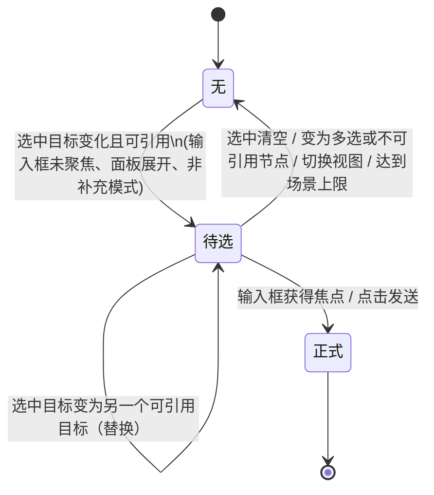
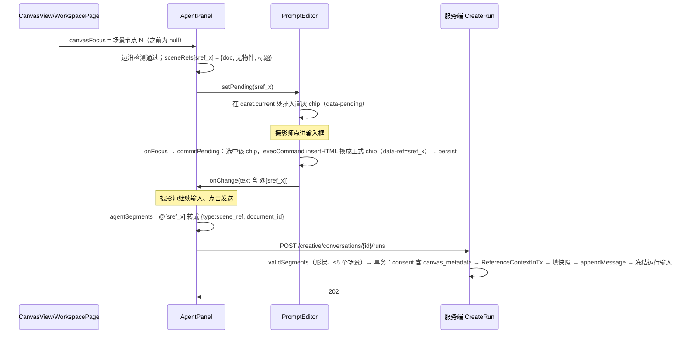

# Design：助手引用画布节点与 3D 场景物件

## 设计上下文与关键决策

需求见 `proposal.md`，规格变更见 `specs.md`。本 change 没有 brainstorm 或 research；现状依据是 2026-11-09 对前后端代码的核对，引用位置写在下面各节。

| # | 决定 | 理由 / 备选 |
|---|---|---|
| D1 | 新增指令片段 `scene_ref {document_id, object_ids?}`，和 `content_ref` 一样按出现位置嵌在 `instruction_segments` 里 | 「语序」只能靠片段在正文中的位置来表达。备选是扩展 `scene_context` 为数组，但它表达不了位置，已否决 |
| D2 | 前端在正文里用**本机键** `@[sref_<随机>]` 表示场景引用；键对应的 `{document_id, object_ids, 标题, 名称}` 存在面板状态和草稿里。引用表在一次编辑过程中只增不删，每一项一经写入就不再修改；保存草稿时只写入正文里实际用到的项 | 现有 token 的正则是 `[\w-]+`（`promptReferences.ts:20`、`promptDOM.ts:77`、`agentReferences.ts:70/82/102`），装不下「文档 + 物件列表」。同一个场景可以被引用多次、每次带不同的物件，所以要每次插入生成一个键。粘贴图片已经用本机键（`uploadReferences`），这里沿用同样的做法 |
| D3 | 待选引用是 DOM 里带 `data-pending` 的 chip，**不带 `data-ref`**，所以 `readPromptDOM` 读不到它，不会进 `draft`。转正时在输入框获得焦点后，用 `execCommand('insertHTML')` 把它原地替换成正式 chip | 待选引用不保存、不发送，这一点由 DOM 结构保证，不需要额外的过滤状态。转正走原生编辑命令，可以进入浏览器的撤销栈（`PromptEditor.tsx:151` 的约定） |
| D4 | 待选引用只由「选中目标变化」触发：画布上是「唯一选中节点」的 id 变化，编辑器里是「选中集合」变化。切换视图时只更新基线，不触发 | 这是 owner 定的规则（2026-11-09）。用「上一次的值」做边沿检测，聚焦输入框再切出去时值没有变，自然不会触发 |
| D5 | 服务端在**创建运行的事务里**读取引用场景，冻结标题和物件名：消息块写快照，运行输入写一行引用说明 | 和 `scene_context` 的做法一致（`sceneInputsInTx`），快照与运行输入出自同一读快照；运行输入冻结后重试的请求哈希不变（`execute.go` 的 `prepareModelStep`）。`ResolveInstruction` 在事务外执行，只做形状校验 |
| D6 | 二级菜单的物件列表复用 `GET /creative/documents/{id}`（`creative-scene/api.ts` 的 `readScene`），不新增接口；列表不做虚拟滚动 | 在交付前测量大场景的响应体积（见未决事项 U1），超出阈值时再加只返回物件的轻量接口，现在不预先做 |
| D7 | 物件列表写成新的轻量组件，复用纯函数 `listClick`（`creative-scene/input/selection.ts`），并把 `Outliner` 里展开层级的 `rows()` 抽成纯函数共用；不直接复用 `Outliner` | `Outliner` 依赖 `grouping.ts`，后者 import 了 `three`；而且它强制要求显隐、锁定、拖放三个回调，助手面板用不上 |
| D8 | `scene_context.selected_object_ids` 标为 deprecated，服务端照常接受；新前端固定传 `[]` | 发布后仍开着的旧页面不会因为这个字段报错。等旧页面自然淘汰后，另开 change 删除这个字段 |
| D9 | 片段格式错误返回 **400** `validation_failed`（`creativeops.ErrValidation`）；超过 5 个场景返回 **413**（`ErrLimit`）；场景不可用返回 **404**；consent 不含 `canvas_metadata` 时返回 **403**（`ErrEgressRequired`） | 沿用项目现有的错误映射（`creative_canvas.go:creativeError`、`creative_agent.go:creativeAgentError`）。proposal 起草时写的 422 与项目约定不一致，已改为 400。`scene_context` 在没有 `canvas_metadata` 时被静默跳过，但显式引用如果也静默丢弃，会改变指令的意思，所以改为明确拒绝 |

本次不做：二级菜单里的 3D 视口框选、悬停 chip 时在视口高亮对应物件、引用视频/音频/链接/分组节点（见 proposal「范围与非目标」）。

## 领域模型与业务规则

**场景引用（scene reference）**是一个值对象：`{document_id, object_ids?}`。不带 `object_ids` 表示引用整个场景，带了就表示引用这些物件，数量为 1…50 个，不重复。它没有独立身份；同一个场景在同一条消息里可以出现多次，每次是一个独立的引用。

**快照（snapshot）**是服务端在创建运行时冻结下来的 `{document_id, title, revision, objects[{id, name, missing}]}`。之后场景改名、物件改名或删除，这份快照都不变。`missing = true` 表示发送时这个物件已经不在场景里了。

不变量：

1. 引用只能指向本账号、`type_key = scene`、不在回收站里的文档。不满足时整个提交返回 404，不创建运行（ADR-001：账号范围由 store 基座强制，`ReadHeadInTx` 负责核对类型）。
2. 一条消息里不同的 `document_id` 不超过 5 个；`scene_context.document_id` 不计入这个上限。
3. 物件在发送前已被删除时**不报错，也不丢弃**：快照里标 `missing`，运行输入里明确写出来，交给助手先向创作者确认。服务端只读取当前场景，拿不到已删物件的原名，所以只给出物件 ID，`name` 为空（评审第 1 项）。这和 `EditorContextInTx` 对选中物件静默丢弃的做法不同，因为显式引用的物件被删了，丢掉它会改变指令的意思（proposal「发送与助手理解」第 5 条）。
4. 引用场景属于画布元数据，外发需要 consent 含 `canvas_metadata`。前端发起的 consent 一直带这一项（`agentState.ts:messageSteps`）。

**待选引用（pending reference）**只存在于前端输入框，生命周期如下：



「选中目标」的定义：

| 视图 | 选中目标的值 | 可引用的条件 |
|---|---|---|
| 画布 | `selection.length === 1 ? selection[0] : null` | 节点是 `core.text` / `core.image`，且有 `content_revision_id`；或者是 `core.scene`，且有 `document_id`、未进回收站 |
| 3D 编辑器 | `sceneContext.selected` 按选中顺序连接成的键；空选中为 `null` | 选中 1…50 个物件 |

边沿检测：只有当新值不为 `null`、不等于上一次的值，并且可以引用时，才产生待选引用或替换已有的待选引用。新值为 `null`、不可引用，或者变成多选时，移除待选引用。进入或离开 3D 编辑器时，把两个视图的「上一次的值」都改成当前值，并移除待选引用，这样切换视图本身不会触发。

## 模块职责与协作

| 模块 | 职责 | 不负责 | 位置 |
|---|---|---|---|
| `WorkspacePage` | 把「画布唯一选中节点」和「是否打开了 3D 编辑器」传给助手面板 | 判断节点能不能引用 | `frontend/src/creative-canvas/editor/WorkspacePage.tsx` |
| `AgentPanel` / `AgentConversation` | 持有场景引用表 `sceneRefs`；做边沿检测、判断能否引用、检查场景上限，然后调用编辑器句柄的 `setPending` / `commitPending`；发送时生成 `scene_ref` 片段 | DOM 操作 | `AgentPanel.tsx` |
| `PromptEditor` | 渲染、插入、替换、转正待选 chip；菜单搜索与分组；场景项展开二级菜单；点击场景 chip 重新编辑 | 场景引用表的内容、发送逻辑 | `PromptEditor.tsx`、`promptDOM.ts` |
| `ScenePicker`（新增） | 读取场景、按层级列出物件、点选/修饰键/拖动多选、搜索、确认 | 插入正文 | `frontend/src/creative-canvas/editor/ScenePicker.tsx`、`scenePickerModel.ts` |
| `agentReferences` / `agentState` / `agentOutgoing` | 本机键 ↔ 片段的转换、草稿序列化、历史消息块的显示 | — | 同目录 |
| `creativeagent` | 校验片段形状、在事务内解析场景、冻结快照和运行输入、写出给模型的说明、重新渲染历史 | 场景内容的读取细节 | `backend/internal/creativeagent/` |
| `creativescene` | `ReferenceContextInTx`：按账号范围读取当前场景，返回标题、版本号和物件的名称/存在性 | 措辞 | `backend/internal/creativescene/agent.go` |

依赖方向不变：`creativeagent → creativescene → creativedocument`；前端 `creative-canvas/editor` 只依赖 `creative-scene` 里不含 three 的模块，包括 `api.ts`、`context.ts`、`input/selection.ts` 和新抽出的 `outlineRows.ts`。

**主流程（画布视图，点选后发送）**：



## 关键机制

### 前端：待选 chip 的插入、替换与转正

`PromptEditorHandle` 新增两个方法：

```ts
setPending(id: string | null): void   // null 表示移除
commitPending(): string               // 转正并返回 persist 后的文本；没有待选时返回当前文本
```

- **插入位置**：如果 `caret.current` 还在编辑器里，就用这个 Range（`rememberCaret` 在 `onSelect` 和 `onBlur` 时都会记录）；否则插到末尾。插入使用直接的 DOM 操作（`range.insertNode`），因为输入框没有焦点，用不了 `execCommand`，否则会抢走焦点。
- **替换**：找到 `[data-pending]` 元素后，用 `replaceWith` 换成新的 chip。同一时间最多只有一个待选 chip。
- **转正**：编辑器的 `onFocus` 里，如果有待选 chip，先把选区设成这个 chip，再执行 `execCommand('insertHTML', promptChip(ref) + ' ')`，然后 `persist()`，最后把光标放到 chip 后面。之后按撤销键，会先撤掉这个 chip。
- **发送资格**：`AgentPanel` 知道当前有没有待选项，因为待选项就是它通过 `setPending` 放进去的，记为 `pendingKey`。`sendable`（`AgentPanel.tsx:1031-1037`）的「正文非空或有上传」条件改为「正文非空、有上传，或者有待选项」，这样「正文为空、只有待选项」时也能直接发送（评审第 6 项）。
- **发送**：点击发送时，如果有待选项，先调用 `commitPending()`。commit 时编辑器没有焦点，所以用直接 DOM 替换后再 `persist()`，触发 `onChange` 更新 `draft`。然后设置 `sendQueued = true`，**由下一次渲染后的 effect 调用 `sendDraft()`**。这样 `references`、`referenceLimit`、`unsupportedImage` 等派生值都是根据转正后的正文重新算出来的，不满足限制时走现有的拦截提示，草稿保留。没有待选项时，直接调用 `sendDraft()`，行为和现在一样。
- **序列化边界**：`readPromptDOM`（`promptDOM.ts:8-23`）只读 `[data-ref]`。新增一条规则：遇到 `[data-pending]` 时跳过，连它的文本也不读。`renderPromptDOM` 根据 `text` 整体重绘时，会丢掉待选 chip；这种情况只会在外部替换文本时发生（恢复草稿、发送后清空），本来就应该丢弃待选。
- **不打扰正在输入**：编辑器有焦点时（`document.activeElement === editor`），`setPending` 不做任何事，等摄影师先离开输入框。`composing` 期间也不会有待选，因为这时编辑器一定有焦点。
- **补充模式**：`waiting` 时输入框是 `<textarea>`（`AgentPanel.tsx:1295-1314`），补充接口只收纯文本，所以不产生待选引用。proposal 原来写的「补充内容同样适用」已经改掉。
- **面板收起**：`AgentConversation` 会被卸载（`AgentPanel.tsx:202-210`），自然没有待选引用；重新展开时用当前值作为基线，不补发。

### 前端：场景引用表与草稿

```ts
type SceneRefDraft = { documentID: string; title: string; objectIDs: string[]; names: string[] }
// AgentConversation 状态
sceneRefs: Record<string /* sref_xxx */, SceneRefDraft>
```

- `references`（传给 `PromptEditor`）= 现有素材 + 上传项 + `sceneRefs` 映射出来的 `PromptReference`：`kind: 'scene'`、`label: '场景'`、`sourceID: key`、`revisionID: null`、`scene: SceneRefDraft`。第一级菜单里的场景项另外由画布上的 `core.scene` 节点生成，它们的 `sourceID` 用 `scene:<document_id>` 作菜单键。选中某一项时才生成 `sref_` 键并写入 `sceneRefs`。
- `PromptReference` 新增可选字段 `scene?: SceneRefDraft`。`promptChip` 遇到 `kind === 'scene'` 时显示场景图标；标题按「标题 · 名称1、名称2 +N」拼接，`title` 属性放完整的名称列表。
- `agentSegments`：遇到 `sceneRefs` 里的键就输出 `{type: 'scene_ref', document_id, object_ids?}`；`objectIDs` 为空时不带 `object_ids`。
- `revisionText` 不改写 `sref_` 键。`AgentDraft` 新增 `scenes?: Record<string, SceneRefDraft>`；`readDraft` 校验形状，`restoreDraft` 恢复。**引用表的生命周期**（评审第 4 项）：
  - `sceneRefs` 在一个 `AgentConversation` 实例里只增不删，每一项写入后不再修改。正文里删掉了某个引用，它在表里的那一项也不清理。
  - `PromptEditor` 的 `ids`（`cleanMentions` 的白名单）因此包含本次编辑里出现过的所有 `sref_` 键。剪切后再粘贴、删除后撤销、撤销后重做，恢复出来的 `@[sref_x]` 都还能在表里找到，不会被 `cleanMentions` 当成未知键删掉。
  - 序列化时只取正文里实际用到的键：`AgentDraft.scenes` 只写入在 `draft` 里出现的键，`agentSegments` 也只输出出现的键。
  - 发送成功后，`showOutgoing` 清空正文，同时清空 `sceneRefs`，因为它们已经不在任何可以撤销回来的正文里了。
  - 面板卸载时，`sceneRefs` 随组件一起释放。
  - 引用表的大小以一次编辑里插入过的引用数为上限，每项不超过 50 个物件，不需要再加上限。
- 场景上限：数一下正文里所有 `sref_` 键对应的不同 `documentID`。达到 5 个时，第一级菜单里还没引用过的场景项置灰，并且不再为新场景产生待选引用。
- 点击正式的场景 chip：`PromptEditor` 在 `[data-ref]` 上委托 `onClick`，如果它是 `kind === 'scene'`，就打开 `ScenePicker` 并预填选中项。确认后**生成一个新键** `sref_y` 写入引用表，再选中旧 chip，用 `execCommand('insertHTML')` 把它换成新 chip。旧键 `sref_x` 仍留在表里，所以撤销会把正文恢复成 `@[sref_x]`，引用回到修改前的物件；重做则回到 `sref_y`。引用表项不可修改，这就是「编辑引用」的撤销语义。

### 前端：@ 菜单搜索与分组

- 菜单顶部是一个 `<input type="search">`，它的值和 `query` 同步。在正文里输入 `@xx` 时，`mentionQuery` 照常更新 `query`，搜索框只做显示，焦点留在正文里。用按钮 `openPicker()` 打开菜单时，焦点直接进搜索框，在搜索框里输入同样更新 `query`。两处的键盘逻辑共用一个 `onPickerKey`：↑↓ 移动、回车插入、Esc 关闭并把焦点还给正文、→ 展开场景。插入时用 `queryRange.current ?? caret.current`，和现在一样。
- 匹配规则：`title`、`label`，以及文本节点内容的前 200 个字（`content` 里的文本），不区分大小写，按包含判断。
- 分组：按 `kind` 依次为「场景 / 图片 / 文本 / 其他」；`highlighted: Set<sourceID>`（画布上当前选中的节点）排在组内最前，并标注「已选中」。每组显示命中数量。列表最大高度 320px，超出后滚动。
- `NodeGenerationPanel` 共用这些改动。它的 `references` 里没有场景，所以不会出现场景组；它不传 `highlighted`。

### 前端：物件列表（ScenePicker）

- **数据**：展开时调用 `readScene(documentID)`，只取 `scene.objects` 里的 `{id, name, kind, parent_id, order}`，结果按 `documentID` 缓存，直到菜单关闭。读取期间显示加载中；失败时显示错误信息和「重试」，不插入任何东西。
- **行**：`outlineRows(objects)` 是从 `creative-scene/panels/Outliner.tsx:rows` 抽出来的纯函数，按 `parent_id` 展开、按 `order` 排序，返回 `{object, depth}[]`。`Outliner` 改为引用它，行为不变。第一行固定是「整个场景」。
- **选择**：复用 `listClick(selection, id, order, {mod, shift})`（`input/selection.ts:51-71`）。拖选的规则：`pointerdown` 时记下锚点行，并调用 `setPointerCapture`；`pointermove` 时用 `elementFromPoint` 找到当前行，把选区设为锚点到当前行之间的区间。指针离列表上下边缘不到 24px 时，用 `requestAnimationFrame` 自动滚动，每帧滚 8px。按住修饰键拖动时，在原有选中的基础上并入这个区间。
- **搜索**：按名称包含关系过滤。命中行的所有上级也保留，但置灰、不能选择；被过滤掉的行如果已经选中，仍然保持选中。
- **确认**：回车或点「插入」。选中超过 50 个时按钮不可用；选中 0 个，或者选的是「整个场景」，就插入整场景引用。

### 前端：选中目标的来源

- **画布**：`WorkspacePage` 已经有 `selection: string[]`（`WorkspacePage.tsx:188`）和 `maximized`。新增两个 props 传给 `AgentPanel`：`canvasFocus={maximized ? null : selection.length === 1 ? selection[0] : null}` 和 `editingScene={maximized?.typeKey === 'core.scene'}`。`AgentPanel` 根据 `canvas.nodes` 判断节点能不能引用。
- **编辑器**：`sceneContext`（`creative-scene/context.ts`）照常由 `SceneEditor.tsx:343-353` 发布，`setSceneContext` 自带去重，拖动物件时不会触发更新。`AgentPanel` 订阅它，用 `selected.join(',')` 做边沿检测，生成的引用标题使用场景节点的标题，物件名取自 `names`。
- **去掉浮层**：删除 `AgentPanel.tsx:1278-1291` 中的 `SceneSelectionTag`。`SceneSelectionTag` 只保留给历史消息使用（`UserMessage` 里的 `kind: 'scene'`）。

### 后端：形状校验（事务外）

`InstructionSegment` 新增两个字段：`DocumentID string json:"document_id,omitempty"` 和 `ObjectIDs []string json:"object_ids,omitempty"`。`validSegments` 的规则：

| 条件 | 结果 |
|---|---|
| `scene_ref` 缺少 `document_id`，或带了 `text`、`skill_*`、`content_revision_id`、`command` | 400 |
| `object_ids` 是空数组（非 nil 且长度为 0）、含空串、有重复、超过 50 个 | 400 |
| 非 `scene_ref` 的片段带了 `document_id` 或 `object_ids` | 400 |
| 不同 `document_id` 超过 `maxSceneRefs = 5` 个 | 413 `ErrLimit` |

`ResolveInstruction` 的 `scene_ref` 分支只追加占位块 `Block{Type: "scene_ref", Scene: &BlockScene{DocumentID, Objects: [{ID}...]}}`，不读数据库。`ResolvedInstruction` 不新增字段，场景引用就在 `Body.Blocks` 里。

`maxSceneRefs` 是常量，和 `maxSceneSelection` 同类，不放进 `Limits`，因此不需要提升 `limitsVersion`：它约束的是提交的形状，不是可配置的预算。

### 后端：事务内解析与冻结

在 `CreateRun.Apply` 中，紧接着 consent 和内容引用的复核之后（`runs.go:311-340` 之后）执行：

```go
refs := sceneRefBlocks(resolved.Body)            // 指向 Body.Blocks 中 scene_ref 块的指针
if len(refs) > 0 && !consentHas(consent, "canvas_metadata") { return ErrEgressRequired }
seen := map[string]creativescene.ReferenceContext{}
for _, b := range refs {
    rc, ok := seen[b.Scene.DocumentID]
    if !ok {
        rc, err = creativescene.ReferenceContextInTx(ctx, tx, b.Scene.DocumentID)
        // creativedocument.ErrNotFound（不存在 / 别的账号 / 非场景 / 在回收站）→ ErrNotFound
        seen[b.Scene.DocumentID] = rc
    }
    b.Scene.Title, b.Scene.Revision = rc.Title, rc.Revision
    for i := range b.Scene.Objects { name, ok := rc.Names[id]; 填 Name；!ok → Missing = true }
}
```

- `ReferenceContextInTx(ctx, tx, documentID) (ReferenceContext{DocumentID, Title, Revision, Names map[string]string}, error)`：调用 `ReadCurrentInTx(..., TypeKey)`，`TrashedAt != nil` 时返回 `creativedocument.ErrNotFound`；然后 `decodeScene`，建出 id 到名称的表。每个场景只读一次，最多 5 次。
- 快照填好以后，走现有的 `appendMessageInTx`，在其中执行 `validBody`。
- `sceneInputsInTx` 把被引用的场景也加进「变化摘要」的候选：`docs = editor + 被引用的场景 + 最近写过的场景`，上限 `maxRecentScenes + len(docs)`，沿用现有的去重。
- **冻结**：`freezeRequestInputsInTx` 新增 `case "scene_ref"`，插入一行 `("instruction", "metadata_only", body = referenceLine(block, editingDoc), snapshot = {"kind":"scene_ref","document_id","revision","object_ids"})`。它和前后的 `text` 行按块的顺序排列，模型看到的位置就是正文里的位置。`assemble`（`execute.go:625-633`）对带 body 的 instruction 行直接渲染成 `UserMessage`，不需要改。`retry.go:158` 用 `body.Blocks` 重新冻结时走同一个分支，结果和第一次一致，因为快照已经在块里。

### 后端：给模型的措辞

`referenceLine` 在本次运行里使用，`historyLine` 的扩展在历史消息里使用，两者共用一个格式化函数 `sceneRefWording(scene, editingDoc)`：

| 情形 | 措辞 |
|---|---|
| 整个场景 | `[引用场景「客厅」(cwdoc_x，第 12 版)]` |
| 物件 | `[引用场景「客厅」(cwdoc_x，第 12 版)中的物件：「台灯」(sobj_1)、sobj_2]`（没有名称的物件只写 ID） |
| 含已删除物件 | 在上面的基础上追加 `；sobj_3 发送时已不在场景里，不要猜替代对象，先向创作者确认` |
| 引用的场景就是正在编辑的场景 | `[引用当前编辑的场景中的物件：…]`，不重复写标题和 ID，满足 proposal「客厅只出现一次」 |

- `EditorContextInTx` 在没有选中时改为只说 `创作者正在编辑场景「%s」(%s，第 %d 版)。`，去掉「没有选中物件」，因为物件现在通过引用指定。有选中时（旧页面）保持原来的措辞。
- 每次运行只要有任意一个 `scene_ref`，就在第一个引用行前加一句：`消息里的 [引用…] 指明了场景和物件；说「这个」「它们」时指的是引用的物件。`
- 历史消息：`bodyMessage`（`inputs.go:734-754`）按块的顺序拼接，`scene_ref` 块渲染成同样的措辞，但不带「先向创作者确认」那句提示，因为那是当时的情况。`scene_ref` 的成本统一由 `bodyBytes` 计算（见下一节），`sceneLineBytes` 仍然只管 `scene_selection`，两者不会重复计算。

### 后端：引用的成本计入本轮预算

（评审第 5 项）现在本轮成本 `planned.Bytes` 等于 `resolved.Bytes`（事务外算出，`bodyBytes` 不统计 `Scene`）加上 `sceneInputBytes`（`runs.go:360-361`）。补齐名称、展开措辞后的 `scene_ref` 不在里面。改法：

1. `bodyBytes`（`conversations.go:323-336`）对 `scene_ref` 块按实际措辞计费：`len(sceneRefWording(block.Scene, "")) + perMessageOverhead`。每个 `scene_ref` 冻结后都是一条独立的 user 消息，所以要算上每条消息的开销。如果本条消息有任意 `scene_ref`，再加一次引导句的长度。措辞用「不知道正在编辑哪个场景」的完整形式来算，它比「当前编辑场景」的简写长，所以算出来是上界。
2. 事务外 `ResolveInstruction` 里的占位块还没有名称，这时 `resolved.Bytes` 只是下界，只用来做事务外的提前拒绝。
3. 事务内补齐快照之后，重新计算 `planned.Bytes = bodyBytes(补齐后的 Body) + skill 的部分不变 + sceneInputBytes(scenes)`，再交给 `planHistoryInTx`。这样压缩判断和历史裁剪用的都是真实成本。
4. `appendMessageInTx` 里的 `validBody` 也用同一个 `bodyBytes`。补齐后超过 `MessageBodyBytes`（32 KiB）时返回 `ErrLimit`（413），事务回滚。这也给整条消息的物件总数设了一个上限：5 个场景 × 多个引用 × 50 个物件，最终受 32 KiB 约束。
5. 历史投影里，`itemBytes` 本来就包含 `bodyBytes`，所以历史中的 `scene_ref` 也按同一标准计费。

### 后端：块的校验

- `validBody` 允许 `Scene != nil` 出现在 `scene_selection` 和 `scene_ref` 两种块上。
- `scene_ref` 的校验：`DocumentID` 不为空；`Title` 不超过 200 个字；`Objects` 数量在 0 到 50 之间；每个物件的 `ID` 不为空，`Name` 不超过 80 个字；`Missing` 可以出现。
- `scene_selection` 仍然要求至少 1 个物件。
- `BlockScene` 新增 `Revision int64 json:"revision,omitempty"`；`BlockSceneObject` 新增 `Missing bool json:"missing,omitempty"`。

### 失败与结果

| 场景 | 结果 | 副作用 |
|---|---|---|
| 片段形状不合法 | 400 | 不写任何东西（在 `Validate` 阶段拒绝） |
| 不同场景超过 5 个 | 413 | 同上 |
| 场景不存在、属于别的账号、不是场景类型或在回收站 | 404 | 事务回滚：不建运行，不扣槽位，不写消息 |
| consent 不含 `canvas_metadata` | 403 | 同上 |
| 物件已被删除 | 202 | 运行照常；快照和措辞里标出这个物件（只有 ID） |
| 补齐后整条消息超过 32 KiB | 413 | 事务回滚，不建运行 |
| 同一个 operation 重放 | 返回原来的回执 | 沿用 `creativeWrite` 的幂等机制 |

前端处理：404 时提示「引用的场景已不可用，请重新选择」，保留草稿（沿用 `restoreDraft(outcome.chain.draft)`）；403 时走现有的外发授权提示。

## 接口与数据契约

- 契约状态：**扩展**。
- 详细字段表、示例和兼容安排见本 Feature 的 `contracts.md` delta：`api: ADD 助手指令中的场景引用`。
- OpenAPI 改动：
  - `CreativeAgentInstructionSegment.type` 增加 `scene_ref`，新增属性 `document_id`、`object_ids`。
  - `CreativeAgentMessageBlock.type` 增加 `scene_ref`。
  - `CreativeAgentMessageScene` 新增 `revision`；`objects[].missing` 设为可选；`objects.minItems` 放宽为 0，并说明 `scene_selection` 仍至少 1 个。
  - `scene_context.selected_object_ids` 标记 `deprecated: true`，并更新描述。
- 改完运行 `make generate`，重新生成 `api.gen.go` 和 `schema.d.ts`。
- 数据：不增加表或列。`creative_agent_messages.body` 的 JSON 里多了一种块；`creative_run_inputs` 多了 `instruction` + `metadata_only` + snapshot 这种行组合，`read_level` 的 CHECK 约束本来就允许（`0046_creative_agent_runs.up.sql:92`）。不需要迁移，也不需要回填。
- 兼容：
  - 旧前端拿到 `scene_ref` 块时，会走 `messageParts` 的默认分支，显示成一个「引用素材」chip，不会崩溃（`agentOutgoing.ts:59-78`）。
  - 旧前端提交非空的 `selected_object_ids` 时，服务端仍按原规则生成 `scene_selection` 块。
  - 前后端同一版本上线。

## 挂载点

| 位置 | 动作 | 说明 |
|---|---|---|
| `api/openapi.yaml` | 修改 | 片段与消息块枚举、`CreativeAgentMessageScene`、`scene_context` 标记 deprecated |
| `backend/internal/platform/httpapi/api.gen.go` | 修改 | `make generate` 生成 |
| `frontend/src/api/schema.d.ts` | 修改 | `make generate` 生成 |
| `backend/internal/creativeagent/instruction.go:InstructionSegment` | 修改 | 新增 `DocumentID`、`ObjectIDs` |
| `backend/internal/creativeagent/instruction.go:validSegments` | 修改 | `scene_ref` 形状校验、跨类型字段检查、`maxSceneRefs` |
| `backend/internal/creativeagent/instruction.go:ResolveInstruction` | 修改 | `scene_ref` 占位块 |
| `backend/internal/creativeagent/conversations.go:BlockScene` | 修改 | 新增 `Revision`；`BlockSceneObject` 新增 `Missing` |
| `backend/internal/creativeagent/conversations.go:validBody` | 修改 | 接受 `scene_ref` 块 |
| `backend/internal/creativeagent/conversations.go:historyLine` | 修改 | 抽出 `sceneRefWording`，`scene_ref` 共用 |
| `backend/internal/creativeagent/runs.go:CreateRun` | 修改 | 事务内检查 consent、解析引用场景、填快照 |
| `backend/internal/creativeagent/inputs.go:sceneInputsInTx` | 修改 | 被引用的场景加入变化摘要的候选 |
| `backend/internal/creativeagent/inputs.go:freezeRequestInputsInTx` | 修改 | `scene_ref` 冻结为 instruction 行 |
| `backend/internal/creativeagent/inputs.go:bodyMessage` | 修改 | 历史中按顺序渲染 `scene_ref` |
| `backend/internal/creativeagent/conversations.go:bodyBytes` | 修改 | `scene_ref` 按实际措辞和每条消息的开销计费 |
| `backend/internal/creativescene/agent.go:ReferenceContextInTx` | 新增 | 账号范围内读取场景标题、版本和物件名 |
| `backend/internal/creativescene/agent.go:EditorContextInTx` | 修改 | 没有选中时改用新措辞 |
| `backend/internal/creativeagent/instruction_test.go` | 修改 | 形状与上限测试 |
| `backend/internal/creativeagent/scene_context_test.go` | 修改 | 解析、404/403、快照、missing、冻结与重试、去重措辞，以及临界预算与 413 测试 |
| `backend/internal/creativeagent/scene_ref_live_test.go` | 新增 | 模型行为验收，用 `CREATIVE_AGENT_LIVE=1` 门控，写法同 `live_test.go` |
| `frontend/src/creative-canvas/editor/promptReferences.ts:PromptReference` | 修改 | 新增 `scene?` |
| `frontend/src/creative-canvas/editor/promptDOM.ts` | 修改 | `promptChip` 支持场景 chip；新增 `pendingChip`；`readPromptDOM` 跳过 `[data-pending]` |
| `frontend/src/creative-canvas/editor/PromptEditor.tsx` | 修改 | `setPending` / `commitPending`、搜索框、分组、`highlighted`、场景展开与 chip 点击 |
| `frontend/src/creative-canvas/editor/ScenePicker.tsx` | 新增 | 物件列表二级菜单 |
| `frontend/src/creative-canvas/editor/scenePickerModel.ts` | 新增 | 拖选区间、搜索过滤、上级保留等纯逻辑 |
| `frontend/src/creative-scene/outlineRows.ts` | 新增 | 从 `Outliner` 抽出的层级展开纯函数 |
| `frontend/src/creative-scene/panels/Outliner.tsx` | 修改 | 改用 `outlineRows` |
| `frontend/src/creative-canvas/editor/agentReferences.ts` | 修改 | 场景引用、`agentSegments` 输出 `scene_ref` |
| `frontend/src/creative-canvas/editor/agentState.ts` | 修改 | `AgentDraft.scenes`、`readDraft`；`messageSteps` 的 `selected_object_ids` 固定为 `[]` |
| `frontend/src/creative-canvas/editor/agentOutgoing.ts` | 修改 | `outgoingParts` / `messageParts` 显示场景引用 chip（含「已删除」） |
| `frontend/src/creative-canvas/editor/AgentPanel.tsx` | 修改 | `sceneRefs`、边沿检测、待选调度、发送前 commit、删除浮层标签 |
| `frontend/src/creative-canvas/editor/WorkspacePage.tsx` | 修改 | 传 `canvasFocus`、`editingScene` |
| `frontend/src/creative-canvas/editor/generation.css` | 修改 | 搜索框、分组、待选 chip、ScenePicker 样式 |
| `frontend/scripts/creative-agent.test.ts` | 修改 | 片段、草稿、场景上限单测 |
| `frontend/scripts/agent-outgoing.test.ts` | 修改 | `scene_ref` 显示 |
| `frontend/scripts/scene-picker.test.ts` | 新增 | `scenePickerModel`、`outlineRows` 单测 |
| `frontend/scripts/creative-scene-agent.e2e.mjs` | 修改 | 去掉浮层标签的断言，改为断言待选 chip → 正式 chip → `scene_ref` |
| `frontend/scripts/agent-scene-mention.e2e.mjs` | 新增 | 画布待选、空正文只有待选时发送、搜索、二级菜单多选和拖选、剪切粘贴、撤销与重做 |

## 验证与交付

| 验收（proposal 分组） | 方法 | 完成判据 |
|---|---|---|
| 形状 / 上限 / 404 / 403 / missing / 快照不随改名变化 | Go 测试（真实 PG，沿用 `scene_context_test.go` 的 fixture） | 400/413/404/403 时 `runs` 表数量不变；快照 title/name 冻结；missing 的物件出现在 `sentText` 里 |
| 语序与措辞 | Go 测试：`f.vendor.sentText(i)` 断言多个引用行与文本行的顺序；正在编辑的场景只出现一次 | 断言字符串出现的顺序和次数 |
| 重试一致 | 沿用 `TestSceneInputsAreFrozenWithTheRun` 的写法，冻结后改名再重试 | 请求哈希不变 |
| 旧页面兼容 | Go 测试：非空 `selected_object_ids` 仍生成 `scene_selection` | 原有测试不改也能通过 |
| 本机键 ↔ 片段、草稿恢复、场景上限 | `node --test` 单测 | `creative-agent.test.ts` 新用例 |
| 拖选区间、修饰键、搜索保留上级 | `scene-picker.test.ts` | 纯函数单测 |
| 待选插入/替换/转正、光标位置、不进草稿、发送前转正、切换视图移除 | 新 e2e，按 `creative-agent.e2e.mjs` 的写法挂假画布 | 一次只跑一个用例（memory：只跑定向测试） |
| 搜索 200 个节点 100 ms | e2e 中用 `performance.now()` 测量输入到列表更新的耗时 | 小于 100 ms |
| 编辑器选中 → 待选 → 分批语序 | 修改 `creative-scene-agent.e2e.mjs` | 断言 `instruction_segments` 的顺序 |
| 正文为空、只有待选时直接发送；转正后重新检查限制 | 新 e2e | 按钮可用，发出的片段只有 `scene_ref`；图片能力不支持时出现现有提示，草稿保留 |
| 剪切→粘贴、删除→撤销、插入→撤销→重做、编辑→撤销 | 新 e2e（`execCommand` 的撤销栈只能在真浏览器里验证） | 每一步之后，正文的 `@[sref_*]` 和 `agentSegments` 的输出都符合预期 |
| 同一场景两个引用各 40 个物件 | Go 测试，加前端单测 | 202；`validSegments` 不报错 |
| 本轮预算计入补齐后的措辞 | Go 测试：构造长名称、多个引用，让补齐前低于压缩线、补齐后超过；再构造一个补齐后超过 32 KiB 的情况 | 前一种触发压缩规划，后一种返回 413，`runs` 表数量不变 |
| 模型行为：同名物件跨场景、同场景分批、已删除物件先询问 | `scene_ref_live_test.go`（真实模型，手动执行，不进 CI） | 检查工具参数里的 `document_id` 和物件 ID，以及场景前后的差异；第三条要求本轮没有写入场景的工具调用 |

门禁：日常用 `make check-frontend` 和 `make check-go PKG=./internal/creativeagent/... ./internal/creativescene/...`；合回 develop 时用 `make check-merge`。

交付顺序：

1. OpenAPI 和生成物。
2. 后端：校验 → 解析与快照 → 冻结与措辞，附测试。
3. 前端：数据层，包括 `agentReferences`、`agentState`、`agentOutgoing`，附单测。
4. 前端：`ScenePicker` 和菜单搜索。
5. 前端：待选引用。
6. e2e。

前后端同一版本上线，不需要灰度；回滚就是回滚整个版本。回滚后，已经存下来的 `scene_ref` 块在旧前端上显示为「引用素材」chip。旧后端读历史时不会重新校验已经存储的消息，因为 `validBody` 只在 `appendMessageInTx` 和 `ResolveInstruction` 写入时执行（`conversations.go:342`、`instruction.go:122`）。`bodyMessage` 只认 `text`、`content_ref`、`scene_selection` 三种块，其余跳过（`inputs.go:734-754`，2026-11-09 核对），所以历史里的引用措辞会丢失，但运行不会失败。

## 未决事项

| # | 问题 / 假设 | 影响 | 解决方式 | 最晚时点 |
|---|---|---|---|---|
| U1 | 假设 `readScene` 对开发库最大的场景，响应在 1 MB 以内，展开的读取时间不超过 500 ms | D6：是否需要新增只返回物件的接口 | 实施第 4 步开始前，测开发库里物件最多的场景的响应体积和耗时；超出就回来修订 design | 任务 4 开始前 |
| U2 | 假设物件少于 1000 个时，ScenePicker 的普通 DOM 列表滚动和拖选不卡 | 是否要做虚拟滚动 | 用 e2e fixture 造 500 个物件测帧耗时 | 任务 4 完成时 |
