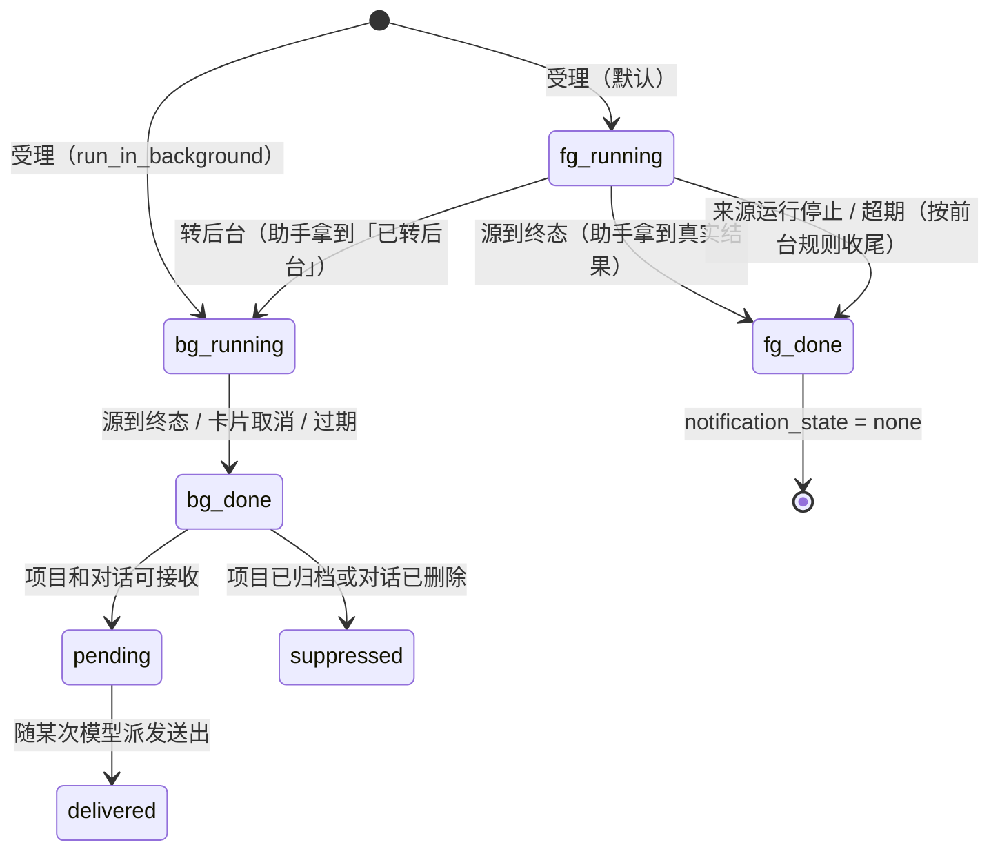

# 耗时工具后台运行设计

## 设计上下文

档位 S1：同一套 PostgreSQL 和 creative-worker，不引入新服务。一次耗时工具受理多一条任务行，每次源状态变化多一次短事务收尾，后台完成多一条对话消息。

已核对的代码基线（以当前工作区为准，`egress-consent-account-level` 尚未合入 develop，合入时以这份代码为准）：

- **场景任务停靠**：`waiting.go:parkOnClient` 停靠时释放会话槽位。场景任务完成时，`scene_waiter.go:Admit` 在完成事务里按「项目 → 槽 → 网关组 → 运行 → Skill → 同意」加锁，再调 `resumeClientWait` 抢槽续跑，没有延迟。
- **生成与压缩的等待**：`creativegeneration/agent.go:GenerateNode` 在工具调用里每 2 秒轮询，上限 150 秒。`creativeimageedit` 的 Agent 压缩同样轮询，上限 90 秒；`image-editing-backend.md` §5.3 规定「取消 / 进程崩溃后没有后台自动采用者」。
- **摄影师取消生成**：`creativecanvas.CancelPhotographerExecution` 拒绝取消生成类执行（owner 2026-10-09：供应商受理后照样扣费，取消省不了钱）。内部的 `CancelNodeExecution` 可以取消。
- **运行的读取范围**：`context.go:directlyReadableInTx` 允许读取三类内容：当前画布节点的内容；本对话里序号在触发消息之前，或 `run_id` 是本运行的完整消息所引用的内容；素材库开着时未删除资产的当前修订。外发同意已是账号级（`creative_egress_consent_states`），没有逐条清单。
- **消息排队**：插队和补充在模型调用边界装配，在派发事务里标记送达。完成通知复用这个边界。
- **事务内入队与提交后通知**：`TxAccountScope.Jobs` 支持 River 事务内入队。`store/realtime_events.go` 已有专用 LISTEN 连接，它是给浏览器订阅用的。

## 关键决策

| 决策 | 采用 | 理由与备选 |
|---|---|---|
| 任务的权威记录 | 新表 `creative_agent_tool_tasks`，一个工具步骤一行 | 执行状态和效果仍由生成执行、压缩候选、场景任务各自持有。任务行只管前后台归属、结果发布和通知送达。备选是在三张源表各加字段，否决：前后台和通知逻辑会散成三份。 |
| 源状态变化怎么传到任务 | 源表触发器标记任务行待收尾，同时 `pg_notify` 唤醒 worker；worker 定时扫描兜底 | 三个源领域不需要 import `creativeagent`。备选是源代码里调端口，否决：要改三个领域的所有终态路径，容易漏掉过期、删除节点这类旁路。 |
| 前台场景任务 | 保留现有同事务续跑（`scene_waiter.Admit`），在同一事务里写任务行 | 不让现有场景工具变慢（评审 C6）。生成和压缩没有现成的同事务续跑，走收尾器。 |
| 送达的权威记录 | 任务行的 `notification_state` 和 `delivery_model_step_id` | 模型步骤里的 `background_notification_ids` 只是冻结的请求输入，用于重放，不作送达依据（评审 C5）。 |
| 自动唤醒的规则 | 照 Claude Code：空闲时自动开轮，可以连锁，连续 5 轮没有摄影师消息就停；发起那一轮被停止或失败时不唤醒 | owner 2026-11-15 拍板。 |
| 交付 | 不拆期，四组任务在一个 Feature 里交付 | owner 2026-11-15 拍板。 |

## 领域模型

### 任务

- 一个工具步骤至多一个任务，稳定键 `(account_id, tool_step_id)`。句柄 `cctask_<uuid>` 从步骤身份派生。来源运行、对话、画布、源任务身份在受理时固定，之后不变。
- `mode`：`foreground` 或 `background`，只能从前者转为后者。
- `state`：`running` → `succeeded` / `failed` / `cancelled` / `expired`，终态不可逆。终态保存这个工具前台会得到的同一份结果 JSON。
- 结果语义：
  - 生成：要等 `apply_state` 有结论才算终态。采用失败时报告生成状态、采用状态和已登记的作品。被取消时前后台都报 `state: cancelled`（现在前台把取消报成 `failed`，本次统一，评审 R6）。
  - 压缩：保留 `applied`、`not_reduced`、`not_applied`、`failed`、`unconfirmed`。`unconfirmed` 先按采用回执和候选核实，核实不了才报结果未知。
  - 场景：沿用 `sceneToolResult` 的三个分支。
- 时限：任务按自身时限执行（场景 30 分钟；压缩按候选编码截止和采用期限；生成按执行期限）。前台续跑还受来源运行的 6 小时上限约束。后台任务不受来源运行的租约、期限和停止影响。

### 状态图

`notification_state` 只对后台终态有意义：前台和进行中的任务都是 `none`。

### 唤醒

- 配置组：来源模型 key + 来源运行选定的主 Skill 版本（无 Skill 单独一组）。
- 一组通知的唤醒时间 `wake_after = min(最后一条完成时间 + 2 秒, 第一条完成时间 + 10 秒)`，组里每多一条通知就重算一次（评审 R7）。
- 唤醒前判定「不自动开轮」，命中任一条时写 `wake_skip_reason`，通知留到摄影师下次发消息：

| 条件 | `wake_skip_reason` | 判定时机 |
|---|---|---|
| 来源运行以 `cancelled` 结束（含摄影师停止） | `source_stopped` | 发布通知时；来源运行还在跑的，随它结束再判 |
| 来源运行以 `failed` 结束（含超期） | `source_failed` | 同上 |
| 对话里最近一次非自动运行之后，已连续有 5 轮 `trigger_kind=background_tool` 的运行 | `chain_limit` | 建运行事务内，持会话槽锁时计数 |
| 账号没有有效外发同意（未同意、已撤回、说明版本已变） | `egress` | 建运行事务内，走现有门禁 |
| 积分不足以预留 | `credits` | 同上 |
| 模型或 Skill 已不可用 | `unavailable` | 同上 |
| 对话有 `waiting_input` / `waiting_apply` / `waiting_client` 的未结束运行 | 不写，只是暂不开轮 | 每次到期复查；摄影师补充时随补充送达 |

  `succeeded` 和 `partial` 是正常结束，可以唤醒。来源运行还在执行时，通知直接送进这一轮，不涉及唤醒。
- 计数规则：摄影师发消息、插队或补充所开的运行都不是自动运行，计数归零。不需要新列，在建运行事务里按对话查最近一次非自动运行之后的自动运行数。

## 核心流程

### 1. 受理

1. 工具定义：`generate_node`、`compress_image`、`write_model`、`export_shots` 声明可选布尔 `run_in_background`，缺省 `false`。`render_view` 不声明（评审 R9），但前台等待同样停靠。其他工具带这个字段时，在任何副作用前按参数错误拒绝；null 或非布尔值同样拒绝。
2. 工具定义变了，检查点的注册表摘要会变。保留旧定义的兼容入口，用真实旧检查点验证原模型步骤哈希和旧停靠标识可以回放。
3. 同一事务里：复核运行执行权 → 创建或重放源任务 → 插入任务行 → 把 `next_check_at` 置为现在（防止源状态在登记前已经变化）。
   - 生成沿用步骤派生的 operation 和执行身份。
   - 压缩拆成「候选受理」和「采用」两步，固定源修订，派生创建、采用、丢弃三个 operation ID。
   - 场景沿用 `(run_id, tool_call_id)`。同步拒绝或不需要建任务的直接结果（如 `write_model` 复用已有烘焙产物）照旧走工具结果，不建任务行。
4. 后台受理立即返回 `{task_handle, state:"running"}`，运行不停靠，直接进入下一次模型调用。前台受理沿用 `errParked` 停靠，`wait_reason` 新增 `tool_task`。

### 2. 源状态 → 任务收尾

**触发器约定**（评审 C4）：

- 安装在 `creative_node_executions`（`state`、`apply_state`）、`creative_image_edit_renders`（`state`）、`creative_scene_jobs`（`state`）三张表上，`AFTER UPDATE`，带 `WHEN (OLD.x IS DISTINCT FROM NEW.x)`。
- 只做两件事：
  1. `UPDATE creative_agent_tool_tasks SET next_check_at = now() WHERE account_id = NEW.account_id AND tool_key IN (…) AND source_id = NEW.id AND state = 'running'`；
  2. 命中行时 `pg_notify('creative_agent_tool_tasks', '')`。
- 禁止：读写运行、会话、消息；判断业务结论；抛异常。没有任务行（旧路径或摄影师自己的生成）时什么都不做。
- 锁方向固定为「源行 → 任务行」，与收尾器、控制命令一致（见「锁顺序」）。

**收尾器**（creative-worker，评审 C3）：

- 专用 LISTEN 连接收 `creative_agent_tool_tasks` 通知，收到就跑一轮扫描；另外每 5 秒兜底扫一次，覆盖断线和漏通知。LISTEN 重连后立即扫一次。
- 扫描走全局部分索引 `(next_check_at, id) WHERE next_check_at IS NOT NULL`，按批取 `FOR UPDATE SKIP LOCKED`。每项按行上的 `account_id` 建 AccountScope 处理，失败按项有界退避（推后 `next_check_at`）。
- 每项一个短事务：读源事实 → 推进采用（压缩）→ 写任务终态 → 按模式发布。
  - 前台：写工具日志和卡片，再按现有规则抢槽续跑（`resumeClientWait` 的同一路径）。来源运行已停止或已超期时不续跑。
  - 后台：写完成通知（见 4）。
- 压缩候选 ready 时，用原采用命令、固定源修订和同一 operation 推进；沿用源变更拒绝、非内容版本冲突的有界重试和回执核实。采用 pending 时不算终态，继续等。
- 前台场景任务不经收尾器：`scene_waiter.Admit` 已在完成事务里持有运行锁，在同一事务写任务终态并续跑（评审 C6）。后台场景任务的完成事务不锁运行，只由触发器标记，交给收尾器。

### 3. 转后台、停止、取消

| 先提交的事实 | 结果 |
|---|---|
| 源已到工具终态 | 转后台读到终态，按前台收尾，响应 `mode=foreground` + 真实结果，不发通知。 |
| 转后台先提交 | 同事务改 `mode=background`，把「已转后台，句柄 X」作为工具结果写进日志，能续跑的运行重新入队。之后终态只产生一条完成通知。重复请求返回同一结果。 |
| 运行停止先提交 | 拒绝之后的转后台（409 `creative_run_state_conflict`）。已在后台的任务继续。前台生成：未派发的撤回，已派发的照常采用并计费。前台场景任务随运行取消。前台压缩丢弃未采用的候选。 |
| 运行超期 | 运行以 `creative_run_deadline_exceeded` 结束。前台生成照常收尾；前台压缩和场景任务按运行终止收尾。后台任务不受影响。 |
| 卡片取消先提交 | 生成：调内部 `CancelNodeExecution`，未派发的不计费，已派发的照常扣费、结果丢弃（`apply_state=discarded`）。场景：置 `cancelled`、清空租约。压缩：丢弃未采用的候选。任务进入 `cancelled`，照常发通知。 |
| 源终态先于取消 | 返回已有终态，已提交的效果保留。 |

- 转后台和取消都按句柄定位，先过账号写屏障，再按「锁顺序」取锁，最后锁任务行决定归属。
- 卡片取消生成是 2026-10-09「摄影师不能取消生成」的局部例外：只对助手发起、已在后台的生成开放；画布上的 `cancel_execution` 对摄影师照旧拒绝。卡片上写明「已发出的生成仍会扣费」。见 contracts「后台任务取消画布生成」（评审 C2）。
- 停止和转后台的竞争由运行行锁串行：停止事务锁住运行后冻结前后台归属，转后台事务锁住运行后发现已停止就拒绝。

### 4. 完成通知与送达

- **发布**：一个事务里写任务终态、`result`、对话 `role=system` 完成消息、`creative_message_content_refs`，并设 `notification_state=pending`、按唤醒规则计算 `wake_after` 或 `wake_skip_reason`。项目已归档或对话已删除时设 `suppressed`、不写消息；之后恢复归档也不补发。系统消息按 `(来源步骤, role)` 唯一去重。
- **读取范围**（评审 C1）：账号级规则下，完成通知不在原有的「触发消息之前，或属于本运行」范围内：运行中途到达的通知序号在触发消息之后；自动运行的触发消息本身也不满足「序号在之前」。本次在读取范围的对话分支里加一条：**本对话中的完成通知消息所引用的内容**（`role=system` 且关联后台任务）。逐项校验不变：属于本账号、当前可用、数据类别在同意范围内、图片要求模型能看图、派发前复核。这是对 `data: 运行中附带内容的外发授权` 的修订。
- **装配**：通知以对话为单位待送达。`BeforeModelRewriteState` 装配输入时，按对话序号把待送达通知排在已有工具应答之后、和摄影师输入一起送入。模型请求用网关的 `user` 数据消息承载：固定的系统来源前缀 + 序列化结果，标明是工具数据。服务端不从结果 JSON 解读角色、工具调用或授权声明。
- **预算**：先给本次选中的通知预留上下文预算，再裁剪可裁剪的历史。超出预算的通知留到下一次请求，按序分批。截图类结果按可读规则作为可选媒体展开；发不了媒体时送达文字结果和省略说明。
- **送达记录**（评审 C5）：
  - 模型步骤持久化本次实际装配的通知句柄（`background_notification_ids`）和请求内容，重放用同一份快照。
  - 在网关提交 dispatch intent 的同一事务里，把这些任务设为 `delivered`、写 `delivery_model_step_id`。这是唯一的送达依据。
  - 运行在派发前结束的，通知仍是 `pending`，下一轮可领取。门禁拒绝、预算不足不会写送达。
- **运行进行中**：通知只追加，下一次新模型请求装配时读取。终局模型步骤在运行锁下记录 `background_notification_through_ordinal`，续跑判断用这个水位读取入账前待送达的通知，之后的留给下一轮。
- **历史**：来源步骤的工具结果和系统通知各有自己的历史表示。历史冻结和压缩摘要只收已送达的通知，按任务句柄去重，避免和新输入重复装配。

### 5. 空闲唤醒

1. 唤醒 worker 和收尾器同进程，走全局部分索引 `(wake_after, id) WHERE wake_after IS NOT NULL` 扫到期组，同样被 `pg_notify` 唤醒、5 秒兜底。
2. 到期后按建运行顺序（项目 → 槽 → 预算 → 会话）和摄影师发消息竞争：
   - 槽被占、或对话有未结束的等待态运行：不开轮，保持 `wake_after`，等下次到期或被那一轮直接领取。
   - 摄影师或排队消息先拿到槽：它的运行从同一入口读取全部待送达通知（可以跨配置组）。
   - 自动运行先拿到槽：前端拿到现有 busy 回执，保留队首，等下次可发送。
3. 抽出 `CreateRun` 的公共事务路径。自动运行：`trigger_kind=background_tool`，`trigger_message_id` 是组里第一条系统消息；继承组的模型和 Skill 版本；预算、限额、外发门禁、历史冻结、登记和入队都走正常路径；模型按实际用量计费。
4. 确定性拒绝（`chain_limit`、`egress`、`credits`、`unavailable`）：该组写 `wake_skip_reason`、清空 `wake_after`，只随摄影师下次输入送达，不反复尝试。锁冲突和数据库抖动可重试。自动运行已建但派发前失败的，同组转为随摄影师输入送达，避免同一结果反复开计费运行。
5. 自动运行只领取本组通知；运行开始后到达的同组通知可以在下一次模型请求前并入。配置不同的组按最老通知顺序依次开轮（评审 R5）。

### 6. 卡片与实时更新

- 任务投影到原工具块（块 ID 不变），块 payload 加可选 `task`。卡片显示「后台运行中」、终态，以及取消生成的扣费提示。`write_model`、`export_shots` 在后台状态显示「需要保持创意空间页面打开」（评审 R8）。
- 控制请求用 creativeops 信封和稳定幂等键。点「转后台」同一帧切到后台样式；明确失败恢复前台并提示；响应未知时重读快照，用同一 operation 确认。终态快照优先于迟到的本地乐观更新。前台等待的卡片显示「转后台」，进行中的后台卡片显示「取消」。
- 运行未结束时用 run SSE 的 `block.updated` 推卡片，另发 `background_tool.completed` 提示重读对话。完成、自动运行创建、后台卡片更新都走已有的画布失效通道，`AgentPanel` 合并刷新最新消息、运行列表和还有未结任务的历史卡片。系统提示只渲染一次，自动运行的回复排在它后面。

## 锁顺序

所有新路径都遵守下表，从上到下取锁，只取需要的那几层（评审 C7）：

| 序 | 锁 | 取锁的路径 |
|---|---|---|
| 1 | 账号写屏障、creativeops operation 锁 | 转后台、取消、压缩采用 |
| 2 | 项目（`LockProjectForWorkInTx`） | 受理、续跑、转后台、取消、建运行、发布通知 |
| 3 | 会话槽 | 续跑、建运行、唤醒 |
| 4 | 网关组 | 派发、前台生成撤回 |
| 5 | 运行 | 受理、停止、转后台、续跑、终局入账 |
| 6 | Skill、外发同意状态行（`FOR SHARE`） | 建运行、派发 |
| 7 | 对话消息序号 | 发布通知、终局水位 |
| 8 | 源行：画布 → 生成执行 / 压缩候选 / 场景任务（各按本领域既有顺序） | 收尾、取消、源领域自己的写入 |
| 9 | 任务行 | 最后取，决定归属和终态 |

- 触发器在源行更新时取任务行锁，方向是 8 → 9，与表一致。
- 源领域自己的事务（生成发布、场景完成、压缩编码）只到第 8、9 层，绝不回头取运行或会话锁。需要运行锁的发布一律在收尾器的新事务里从第 2 层开始取。
- 网关、压缩 operation 的清理需要另取锁时，先登记意图，由现有幂等入口执行、worker 补扫。
- 首轮实现用真实 PostgreSQL 强制各提交顺序做测试。

## 场景写入的执行权

- 前台场景完成沿用现有运行准入（`scene_waiter.Admit`）。
- 后台场景完成由已受理的账号、对话、画布、目标限定。完成时复核账号的创意能力、任务期限、令牌和租约、目标版本，以来源运行作变更溯源；不要求来源运行还持有租约、槽位或可用 Skill。写回画布或场景不是外发，不复核外发同意；外发在送达时由派发门禁把关。
- 压缩采用在写入前复核任务归属和源条件。
- 项目归档后，采用和场景写入按现有归档写保护处理：被拒时任务结果为失败，保留可保留的产物（评审 R4）。

## 接口与数据契约

见 [contracts.md](contracts.md)。概要：

- 新增：任务表与完成通知；耗时工具的后台参数与结果；转后台与取消接口；快照与事件扩展；压缩的无人值守采用；后台任务取消画布生成。
- 修订：场景客户端任务；完成场景客户端任务；运行中附带内容的外发授权（读取范围加完成通知）。
- 工具结果语义变化：生成被取消时前台由 `failed` 改为 `cancelled`。消费者只有助手模型和本仓库前端卡片，同版本上线。
- 迁移只加表、列、索引、触发器，不回填。上线顺序：迁移 → 同版本 API 和 worker → 开放前端动作和后台参数。回滚：先关后台参数和自动唤醒，已受理任务由兼容 worker 排空；有任务或通知记录时反向迁移拒绝破坏性删除，只做前向修复。

## 挂载点

| 位置 | 动作 | 说明 |
|---|---|---|
| `backend/internal/creativeagent/tool_tasks.go`、`backend/internal/creativeagent/tool_task_finisher.go`、`backend/internal/creativeagent/tool_task_notifications.go`、`backend/internal/creativeagent/tool_task_wake.go` | 新增 | 任务登记与控制、收尾器与 LISTEN、通知发布与送达、空闲唤醒 |
| `backend/internal/creativeagent/tool_registry.go`、`backend/internal/creativeagent/canvas_tools.go`、`backend/internal/creativeagent/image_tools.go`、`backend/internal/creativeagent/scene_tools.go`、`backend/internal/creativeagent/runtime.go` | 修改 | 工具参数、受理、工具步骤回放 |
| `backend/internal/creativeagent/waiting.go`、`backend/internal/creativeagent/scene_waiter.go`、`backend/internal/creativeagent/control.go`、`backend/internal/creativeagent/checkpoint.go`、`backend/internal/creativeagent/service.go` | 修改 | 停靠、前台场景同事务写任务、停止、检查点恢复、worker 注册 |
| `backend/internal/creativeagent/runs.go`、`backend/internal/creativeagent/execution.go`、`backend/internal/creativeagent/execute.go`、`backend/internal/creativeagent/inputs.go`、`backend/internal/creativeagent/compaction.go`、`backend/internal/creativeagent/conversations.go` | 修改 | 公共建运行路径、模型输入装配与派发、送达记录、历史 |
| `backend/internal/creativeagent/context.go` | 修改 | 读取范围加完成通知分支 |
| `backend/internal/creativeagent/blocks.go`、`backend/internal/creativeagent/run_read.go` | 修改 | 卡片和运行读投影 |
| `backend/internal/creativegeneration/agent.go`、`backend/internal/creativegeneration/service.go`、`backend/internal/creativecanvas/execution.go` | 修改 | 生成拆成受理与结果读取，去掉 150 秒轮询；按句柄取消；取消结果统一 `cancelled` |
| `backend/internal/creativeimageedit/agent.go`、`backend/internal/creativeimageedit/service.go`、`backend/internal/creativeimageedit/apply.go` | 修改 | 压缩拆成候选受理与采用，去掉 90 秒轮询，收尾器无人值守采用 |
| `backend/internal/creativescene/jobs.go`、`backend/internal/creativescene/jobs_complete.go`、`backend/internal/creativescene/jobs_sweep.go` | 修改 | 区分前后台的完成准入、取消和过期 |
| `backend/internal/platform/store/migrations/*_creative_agent_tool_tasks.up.sql`、`backend/internal/platform/store/migrations/*_creative_agent_tool_tasks.down.sql` | 新增 | 任务表、部分索引、源表触发器、运行和模型步骤新列；序号在开发工作区分配 |
| `backend/cmd/creative-worker/main.go`、`backend/cmd/server/main.go` | 修改 | 收尾器、唤醒 worker 和领域端口接线 |
| `api/openapi.yaml`、`backend/internal/platform/httpapi/api.gen.go`、`frontend/src/api/schema.d.ts`、`backend/internal/platform/httpapi/creative_agent.go` | 修改 | 契约、生成物、两条控制路由 |
| `frontend/src/creative-canvas/editor/AgentPanel.tsx`、`frontend/src/creative-canvas/editor/AgentBlocks.tsx`、`frontend/src/creative-canvas/editor/agentBlocks.ts`、`frontend/src/creative-canvas/editor/agentRuns.ts`、`frontend/src/creative-canvas/editor/agentState.ts`、`frontend/src/creative-canvas/editor/agentQueue.ts`、`frontend/src/creative-canvas/editor/agent.css` | 修改 | 卡片操作、系统提示、刷新恢复、和排队消息抢槽 |
| `docs/product/creative-canvas-system/modules/harness.md`、`docs/product/creative-canvas-system/modules/image-editing-backend.md`、`docs/product/creative-canvas-system/data-model.md`、`docs/dev/creative-agent.md` | 修改 | 运行状态、压缩 §5.3、外发读取范围、任务与通知 |

## 验证与交付

交付顺序（不拆期，同一 Feature）：持久任务与前台停靠 → 后台模式与任务控制 → 送达与自动唤醒 → 契约、面板与联合验收。

- PostgreSQL 集成：迁移与反向迁移保护、旧记录兼容、唯一约束、跨账号访问、并行停靠、崩溃重放；转后台 / 完成 / 停止 / 取消的各种提交顺序；派发前后撤回；一个终态只发一条通知；积分预留。
- 可控时钟：5 分钟生成、6 小时运行上限、2 秒静默与 10 秒上限的合并边界、连续 5 轮上限与计数归零、停止和失败后不唤醒。
- 延迟：后台受理 1 秒内返回；生成和压缩前台续跑由 NOTIFY 触发，实测完成到续跑的延迟；前台场景续跑不比现在慢（同事务路径的回归）。
- 两端：工具参数、HTTP 路由实调、回执重放、事件序号与重连。浏览器：首帧反馈、失败回退、旧卡片更新、系统提示顺序、等待补充、手动消息或队首与自动运行抢槽。
- 观测：待收尾数与最老年龄、NOTIFY 唤醒与兜底扫描各自处理的条数、待送达通知数、按 `wake_skip_reason` 分类的不唤醒计数、收尾用时。日志只记任务 ID、运行 ID 和状态码，不记结果正文、模型输入和媒体地址。
- 门禁：后端跨包和迁移 `make check-go`，契约 `make generate` + `make generate-check`，前端 `make check-frontend`，合回 develop 用 `make check-merge`。

## 待验证假设

- 5 秒兜底扫描 + NOTIFY 足以让生成、压缩的前台续跑延迟不高于现在的 2 秒轮询。实现后实测；不达标再把收尾改为源事务内 River 入队。
- 一个对话通常只有几条待送达通知，全局部分索引扫描的成本可以忽略。观测待收尾数后再定批大小。

## 相对上一版的修订

| 来源 | 修订 | 位置 |
|---|---|---|
| R1 | 自动运行可以连锁，连续 5 轮没有摄影师消息就停；`source_failed` 也不唤醒 | 领域模型「唤醒」 |
| R2 | 来源运行被停止后不唤醒 | 同上 |
| R3 | 外发同意改用账号级门禁；任务不再冻结 `source_consent_id` | 场景写入的执行权、contracts |
| R4 | 归档后按写保护处理，可能失败 | 场景写入的执行权 |
| R5 | 只合并同配置，不同配置依次开轮 | 空闲唤醒 |
| R6 | 取消统一 `cancelled` | 领域模型「任务」 |
| R7 | 2 秒静默、最多 10 秒，替换固定 10 秒窗口 | 领域模型「唤醒」 |
| R8 | 场景任务卡片提示保持页面打开 | 卡片 |
| R9 | `render_view` 不支持后台 | 受理 |
| C1 | 读取范围加「本对话的完成通知」，否则运行中途到达的通知和自动运行的触发通知读不到产物 | 完成通知与送达 |
| C2 | 补两处契约：压缩的无人值守采用（改 `image-editing-backend.md` §5.3）、后台任务取消生成（2026-10-09 规则的局部例外） | 转后台、停止、取消；contracts |
| C3 | 扫描改全局部分索引；加 NOTIFY 唤醒，兜底扫描放宽到 5 秒 | 源状态 → 任务收尾 |
| C4 | 写明触发器约定：只标记和通知，不读写运行与会话，锁方向源 → 任务 | 同上 |
| C5 | 任务行是唯一送达依据，模型步骤快照只用于重放 | 完成通知与送达 |
| C6 | 前台场景任务保留同事务续跑，不经收尾器 | 关键决策、收尾器 |
| C7 | 锁顺序表和状态图 | 锁顺序、状态图 |
| C8 | 清理：工具从五种改为四种可后台；去掉已解决的「待评审决定」；原 tasks 3.3 移出；挂载点补 `context.go`、`inputs.go` 和压缩设计文档 | 全文 |
