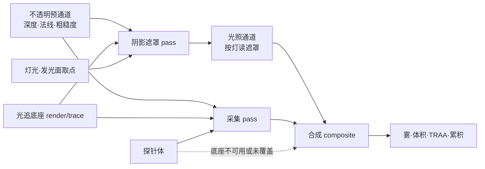

# Epic 技术方案

> 实时 GI 在世界空间追踪层之上加一层逐像素追踪：
> - **光追阴影**：每个像素朝每盏投射阴影的灯的发光面取点，发一条阴影光线，得到按灯的可见性遮罩；光照通道读它代替这盏灯的阴影贴图滤波。
> - **逐像素采集**：每个像素朝半球发光线，命中点用底座现有的命中点着色（直接光加探针的辐照度），得到像素的间接漫反射辐照度；合成里代替「像素直接查探针」那一份。
> - **出图不留跨帧状态**：每帧独立估计，由出图的多帧累积取平均。
> - **视口**：运动中保持现在的画法，停下后按出图画质收敛。
>
> 这一层只在光追底座可用时运行，其余情况画面与现在一致。不新增场景字段。

## 设计上下文

- 需求与验收见 proposal，诊断与 owner 决定见 `discovery/brainstorm.md` 和 `docs/research/scene-render-and-modeling-diagnosis.md`。
- 本文建立在 `scene-world-space-gi` 的批准设计（v7）之上，下文称「前序设计」。它的术语（光追底座、探针体、追踪代理、精度档、兼容模式）和不变量 I1–I9 继续有效，这里只写增量。
- **采用的方案**：从不透明预通道的深度和法线出发，逐像素向光追底座发光线。阴影和采集是两个 pass，共用光线起点和采样序列。
- **待验证的假设**（S0 验证，结论经 Epic 修订回填）：
  - **预算**：2K 出图约 280 万像素。按 `scene-trace-spike` 的吞吐推算（M4 Pro，只算求交）：
    - 采集每像素每帧 1 条：参考场景每帧约 8 ms，压力场景约 40 ms；
    - 阴影每像素每灯每帧 1 条：参考场景每帧约 1.6 ms，压力场景约 12 ms。

    命中点着色的时间、低端设备上的时间都没有测过。
  - **噪点**：采集每像素 64 帧 × K 条光线，加上现有的空间滤波，平坦区域能收敛到可接受的程度。阳光只照亮一小块的房间是最不利的情况。
  - **遮罩的接法**：光照通道里每盏灯的阴影滤波节点可以改读屏幕空间的遮罩。
  - **视口切换**：运动与停下之间可以只切 uniform，不重建管线。
- **后续增强，不在本 Epic**：
  - 路径追踪渲染器（复用底座和本 Epic 的发光面取点）；
  - 出图时放开表面阴影上限；
  - 半透明表面和体积的光追阴影；
  - 高光的逐像素遮挡；
  - 按探针引导的重要性采样。

## 领域模型与业务规则

本 Epic 不触及业务领域，只增加渲染端的派生状态。新增术语：

| 术语 | 含义 | 不是什么 |
|---|---|---|
| 逐像素追踪层 | 实时 GI 里从每个像素的表面点向光追底座发光线的一层：光追阴影加逐像素采集 | 不是新的渲染器，不是路径追踪，也不是渲染设置 |
| 阴影遮罩 | 每盏投射阴影的灯一个通道的屏幕空间纹理：这个像素这一帧看不看得见灯的取样点 | 不是阴影贴图，不存储，不跨导出图保留 |
| 逐像素采集 | 每个像素朝半球发光线、取命中点的出射光，估计这个像素的间接漫反射辐照度 | 不是 Lumen 的屏幕探针（不做稀疏探针和插值），不是 SSGI |
| 发光面取点 | 按灯的形状在它的发光面上均匀取一个点：太阳的圆面、球形灯的球、聚光灯的圆盘、面光源的矩形或椭圆 | 不是阴影贴图的滤波核 |
| 出图画质 | `quality: 'final'`：导出和 `render_view` 用的那一档 | 不是分辨率 |

**不变量**（J 编号，与前序设计的 I 编号并列）：

- **J1 探针仍是多次反弹和远处光的来源**：采集光线只算一次反弹。命中点的间接光取探针；采集的结果不写回探针，也不作为别的像素的输入。
- **J2 一份材质定义**（承接 I2）：采集的命中点着色就是底座的命中点着色，和探针光线、反射补追用同一个函数；不另写一份。
- **J3 结果确定，出图不留跨帧状态**（承接 I3）：
  - 采样序列只取帧序号和像素坐标；
  - 出图时遮罩和采集都没有历史，每帧独立估计，由出图的累积取平均。直接光对可见性是线性的，间接光对采集是线性的，所以平均是无偏的。
- **J4 场景不变、作用范围不变**（承接 I4、I5）：不新增场景字段；只作用于最终渲染、`lit` 导出和 `render_view` 的 `lit`。
- **J5 标定只随这一层**（承接 I6）：为这一层重新标定的常数只在这一层构建时生效。底座不可用时，合成和阴影都走现在的路径，画面与本 Epic 之前一致（AC-8）。
- **J6 阴影只计一次**：一盏灯在一个像素上，要么读遮罩，要么读阴影贴图，不相乘。主光被追踪时，屏幕空间的接触阴影不再叠加。
- **J7 取样的形状与灯的光照模型一致**：发光面取点用的尺寸和形状，就是直接光模型算高光和照度用的那一组（`render/lightModel/lights.ts`）。阴影的半影和灯的高光因此对得上。
- **J8 投阴影的灯是同一组**：哪些灯投阴影仍由表面阴影上限决定（`objects/shadowBudget.ts`），视口、出图和 `read_scene` 说的一致。
- **J9 画质优先**（承接 I8）：出图的采样数不随设备变化。慢的设备多花时间，时限按设备放宽；视口可以降低这一层的分辨率。

**数据所有权**：

- 遮罩和采集的结果都是渲染端的 GPU 派生状态，属于每条管线，来源是预通道和光追底座，不是场景文档。
- 出图时它们每帧重画，不保留；视口停下后的累积由视口的 `SceneRenderer` 持有，视图或场景一变就清空。
- 底座、探针的所有权不变（前序设计「数据所有权」）。

## 架构设计



**职责与非职责**：

- **逐像素追踪层**（`frontend/src/creative-scene/render/` 下新建一个目录，名字由 S1 定）：
  - **光线起点**：从预通道的深度和法线重建世界空间的位置和法线，按规则偏移。
  - **采样序列**：按帧序号和像素坐标给出每帧不同、可重复的随机数。
  - **发光面取点**：每种灯一个函数（J7）。
  - **阴影遮罩 pass**：见「光追阴影」。
  - **采集 pass**：见「逐像素采集」。
  - 不负责：BVH、材质表、命中点着色（底座的）；探针的更新（探针体的）；降噪链和合成的其余部分（`realtimeGI` 的）。
- **`realtimeGI` 管线**：
  - 排好先后：预通道 → 阴影遮罩 → 光照通道 → 采集 → 合成；
  - 合成的改动见「合成的接入点」；
  - 按 J5 设置这一层专用的标定值。
- **光照通道与灯光**（`giSplit.ts`、`render/lightModel/`）：每盏灯的阴影滤波在这一层构建时改读遮罩（J6）。阴影贴图照常绘制，供半透明表面和体积使用。
- **光追底座**：职责不变。本 Epic 只调用它已有的函数：阴影光线，以及探针光线用的命中点辐射函数（`trace/hit.ts` 的 `radiance`）。
- **视口**（S3）：停下后把管线切到出图画质并累积，见「视口停下后收敛」。
- **渲染选项卡**：沿用底座的能力与容量状态。底座不可用时现有的提示已经说明「屏幕外光照」未绘制，本 Epic 把这句话的范围扩到阴影和近处的间接光，文字由 S3 定。

**依赖方向**：`realtimeGI` → 逐像素追踪层 → `render/trace`、`render/probes`、`render/lightModel`。底座和探针体不依赖这一层。

**失败与恢复**：

- 这一层的 pass 编译失败或运行中出错：本机不画这一层，记日志，渲染选项卡给出一般性提示（沿用「部署错误不暴露给摄影师」），阴影和合成退回现在的路径（J5）。
- 设备丢失：沿用现有恢复流程，随管线重建。

## 技术选型

| 项 | 选择 | 理由与边界 |
|---|---|---|
| 求交与命中点着色 | 复用光追底座：`three-mesh-bvh/webgpu` 的求交、材质表、`hitShading` | 前序 Epic 已验证，J2 要求同一份。不引入新的依赖 |
| 采集的估计 | 每像素每帧 K 条余弦分布的光线，命中点取 `radiance`（直接光带阴影光线、自发光、探针的辐照度），没命中取环境贴图；K 由 S0 定 | 就是前序 Epic 的「逐像素参考」少追几次反弹的版本，偏差的来源只有探针那一项。不做屏幕探针和插值：出图有多帧累积，不需要为省光线牺牲细节 |
| 阴影的估计 | 每像素每灯每帧 1 条阴影光线，朝发光面上的取样点；没有尺寸的灯朝它的位置 | 阴影光线比不相干光线快 2.5–4 倍（前序 S0）。64 帧累积相当于 64 次取样的面光源阴影，不受贴图分辨率和偏移限制 |
| 在哪里追 | 倾向屏幕空间的片元 pass（前序 Epic 的反射补追就是在片元里求交）；与 compute 的比较由 S0 做（U5） | 片元 pass 与预通道同分辨率，直接写进渲染目标，不需要另配存储纹理 |
| 遮罩交给光照通道 | 倾向经每盏灯的阴影滤波节点读屏幕空间遮罩（现在的 PCSS 就挂在这个位置）；备选是在材质片元里直接求交（U5、U6） | 遮罩 pass 只有一个着色器。在每个材质的片元里求交，会让每个材质的着色器都带上 BVH 遍历，编译时间按材质数放大 |
| 采样序列 | 沿用项目现有的按帧旋转的做法（IGN 加黄金比步进），只取帧序号和像素坐标 | J3。不用 `Math.random` |
| 降噪 | 出图：不做时域降噪，靠累积；采集可加现有的空间滤波（`DenoiseNode`，带固定噪声），加不加由 S0 定（U3）。视口停下后同出图 | 出图不留跨帧状态（J3）。前序 Epic 在出图里对 SSGI 也是「只做空间滤波，再逐帧平均」 |
| 不采用 | 屏幕探针与辐射缓存、分页虚拟阴影贴图、给探针光乘 AO、`three-gpu-pathtracer`、three 自带的 VXGI | 理由见 `discovery/brainstorm.md`「考虑过、没有采用的做法」 |

## 关键机制

### 光线起点

- 位置由预通道的深度重建，法线取预通道的法线（带凹凸）用于采样方向，几何法线用于偏移。预通道现在不输出几何法线；从深度的屏幕导数求，还是加一个输出，由 S1 定（光照通道的四个输出已占满每像素 32 字节，预通道还有余量）。
- 起点沿几何法线抬起一段，避免打到自己。抬多少由 S0 定（U1）：追原始几何时按视距放大的一个小量；追代理时至少是代理误差 ε。
- 只对预通道里有表面的像素发光线。半透明表面不在预通道里，不发。

### 光追阴影

**遮罩**：

- 每盏投射阴影的灯占一个通道。表面阴影上限是 8 张阴影贴图，太阳占 4 张，所以最多 8 盏灯；遮罩按两张四通道纹理准备。
- 每个像素、每盏灯、每帧：在发光面上取一个点，从像素的起点朝它发阴影光线，距离截到取样点。被挡记 0，没被挡记 1。
- 背对灯的像素（几何法线与方向的点积不大于 0）不发光线，直接记 0。
- 聚光灯锥外、灯的作用距离之外不发光线。

**发光面取点**（J7）：

| 灯 | 取点 |
|---|---|
| 太阳（有角直径） | 以太阳方向为轴、角直径为张角的圆锥里均匀取方向 |
| 球形灯 | 朝像素一侧可见的球冠上取点 |
| 聚光灯（有尺寸） | 垂直于光轴的圆盘上均匀取点 |
| 面光源 | 矩形或椭圆面上均匀取点 |
| 没有尺寸的灯 | 灯的位置；太阳取它的方向 |

**交给光照通道**：

- 这一层构建时，光照通道里每盏被追踪的灯，阴影项读遮罩在这个像素的值，不再读阴影贴图（J6）。
- 遮罩在光照通道之前画好。先后由 `realtimeGI` 保证：预通道 → 遮罩 → 光照通道。
- 光照通道画的半透明表面不在预通道里，遮罩在那里的值属于它背后的不透明表面。半透明表面因此仍读阴影贴图；怎样在同一个着色器里区分，由 S1 定（U7）。
- 体积（W5）读阴影贴图，不变。阴影贴图在这一层构建时照常绘制。
- 屏幕空间的接触阴影（`SSSNode`）：主光被追踪时权重为 0。

**透明裁切**：底座的阴影光线已经处理 `clip` 材质（被裁掉就继续往前追，次数用完算被遮挡），直接沿用。

**出图与视口**：

- 出图：每帧一次独立的估计，由出图的累积取平均（J3）。帧数沿用现在的 64 帧（`render_view` 16 帧）；够不够由 S0 的噪点测量决定。
- 视口运动中：不画遮罩，阴影走现在的阴影贴图。
- 视口停下后：见「视口停下后收敛」。

### 逐像素采集

**估计**：

```text
E_gather(p) = π / K · Σ L(p', ω_i)          // ω_i：绕像素法线的余弦分布方向，K 条
L(p', ω)    = 命中正面  → 命中点的漫反射出射光：kd · c / π · (E_direct + E_probe + 环境光 × fill) + 自发光
              命中背面  → 0
              没命中    → 环境贴图沿 ω 的值
```

- `L` 就是底座给探针光线用的 `radiance`：直接光带阴影光线，命中点的间接光取探针（J1、J2）。
- 命中点的探针取上一帧的值，与探针自己更新时相同。
- 没命中时环境贴图取哪一级由 S0 定（U3）。探针光线取的是糙度 0.5 的一级。
- 命中背面记 0，与探针光线相同：起点在物体里面的像素不该被照亮。

**追哪份几何、追多远**（U1、U2，S0 定）：

- 倾向追原始几何、全程追。接触处的细节要原始几何；全程追没有远近的接缝，偏差的来源只有探针那一项。
- 一个着色器只绑一层几何（前序设计「一个内核只绑一层」），所以采集 pass 要么绑原始层，要么绑代理层，不能近处追原始、远处追代理。
- 压力场景里全程追原始几何每帧约 40 ms（推算）。如果出图时间不能接受，备选是限距加远处取探针，或者追代理。
- 第 2 档（只有代理，前序设计「能力与容量」）时怎么办由 S0 定（U11）：追代理，或者不画采集、退回探针。

**分辨率**：

- 出图：与预通道同分辨率。
- 视口停下后：同出图。是否先用半分辨率出一个粗的结果再精化，由 S3 定。

### 合成的接入点

现行合成（前序设计「合成的接入点」，`world` 表示世界空间追踪层已构建）：

```text
shaded = direct · contact'
       + (world ? mix(A_env · ao, kd · c_E · E_probe / π, coverage) : A_env · ao) + A_light · fill · ao
       + envSpec · ao · (1 − cover') + reflection · split
       + kd · gi                                  // world 时增益为 0
```

目标合成（`traced` 表示逐像素追踪层已构建；`traced` 只在 `world` 时成立）：

```text
shaded = direct'                                  // 光照通道已按遮罩算过阴影；contact' 在主光被追踪时为 1
       + (traced ? mix(A_env · ao, kd · c_E · E_gather / π, covered) : <现行>) + A_light · fill · ao
       + envSpec · ao · (1 − cover') + reflection · split
```

- **`E_gather` 代替 `E_probe`**：只换像素处的那一份。`c_E`、`A_light`、`A_env` 的取得方式不变（前序设计修订 v5）。
- **`covered`**：采集 pass 画到的像素为 1（预通道里有表面，且材质被光照通道拆开）。其余像素走现行的写法。
- **采集不乘 `ao`**：采集已经包含近处的遮挡，再乘会扣两次。理由与前序设计「探针不乘 `ao`」相同。
- **`A_light · fill · ao` 和 `envSpec · ao` 里的 `ao`**：首版保留 SSGI 的 AO。是否改用采集光线的命中距离算可见性、从而省掉 SSGI 这个 pass，由 S0 对照后定（U4）。
- **反射里看到的画面**（`realtimeGI.ts` 的 `seen`）：SSR 命中的屏幕像素取合成后的画面，随合成一起变成带采集的。
- **重新标定**（J5）：`AMBIENT_FILL_GI` 在 `traced` 时按需重新标定；出图时限按实测更新。底座不可用时全部保持现值。
- **S2-U7**（探针光要不要乘短半径 AO）：这一层构建时不再有这个问题。底座可用但这一层不画的情况（视口运动中）保持现状。

### 视口停下后收敛

- **现状**：视口的实时 GI 用 `quality: 'interactive'`，按 CSS 像素渲染（`Viewport.tsx`），停下后画 12 帧收敛再停止重绘。`'interactive'` 和 `'final'` 是两条管线，切换要重建。
- **目标**：
  - 运动中：不变。
  - 停下后：按出图画质画，逐帧累积到收敛后停止重绘；按设备像素比画，除非时间超出上限（上限由 S3 按 S0 的实测定）。
  - 任何视图或场景的变化都清空累积，回到运动中的画法。
- **约束**：
  - 切换不重建管线、不重新编译（S0 验证能否只切 uniform）。做不到时，S3 的设计要给出替代做法，并说明切换时的停顿。
  - 停下瞬间画面会从「探针加阴影贴图」变到「采集加光追阴影」。跳变是否可以接受由 owner 在 S3 判断；S0 试过渡的做法。
  - 探针在切换时不清空。
- 运动中要不要也画低分辨率的采集（半分辨率，接现有的重投影和循环降噪），由 S3 的设计决定（U10）。它能缩小跳变，代价是运动中的帧时间。

### 能力与容量

- 沿用前序设计的判定：逐像素追踪层只在光追底座就绪、且世界空间追踪层构建时才画。
- 兼容模式、设备不支持、场景超出容量（不画世界空间追踪层的那一档）：不画这一层，画面与本 Epic 之前一致（J5，AC-8）。
- 第 2 档（只有代理）：由 S0 定（U11）。
- 底座就绪前：视口照常；导出和 `render_view` 等底座就绪后才开始计帧（前序设计 I9），本 Epic 不改。

### 时限

- 出图的时限由 `engines.ts` 的估计式给出。本 Epic 给它加两项：阴影（按投阴影的灯数）和采集，系数由 S1、S2 按参考设备的实测填。
- 慢设备沿用现有的放宽倍数（8 倍）。低端参考设备上够不够，由 S0 的实测决定；不够时放宽倍数，不降采样数（J9）。

## 接口设计

没有新的 API。目标契约：

- `architecture: MODIFY 场景模块`：在 `contracts.md` 里，由 S3 交付。
- `data: MODIFY 场景文档`：`render.engine` 一行，世界空间追踪的版本号升到 2，由 S2 交付。这一条现由 `scene-pose-system` 负责，暂不列入 `contracts.md`，见 U13。

## 验证与交付

- **与参考对照**：
  - 采集对照逐像素参考（前序 Epic 的 `checks.ts` 已有每像素多次反弹的参考），按区域比辐照度；新参考场景的区域加进 `gi-regions.json`。
  - 阴影对照每像素每灯 1024 条阴影光线的参考。
- **确定性**：沿用前序 Epic 的两次导出逐像素相同的 e2e。
- **降级**：底座不可用时的画面与本 Epic 之前的基线图对照。S0 先记录基线。
- **性能**：两台参考设备上测出图时间和视口帧时间。按项目的验证范式只跑定向的用例，e2e 一次一个。
- **回滚**：这一层由 `realtimeGI` 的一个选项控制是否构建。出问题时关掉它，画面回到本 Epic 之前；版本号已经升过的导出图会再提示一次过时，可以接受。
- **灰度**：不需要。场景文档不变，旧的前端读新的场景没有差别。

## 未决事项

| # | 问题或假设 | 影响 | 解决方式 | 最晚解决时点 |
|---|---|---|---|---|
| U1 | 采集光线追原始几何还是代理；起点抬多少 | S2 的画质和时间 | S0 对照图和计时。倾向原始几何 | S0 结束 |
| U2 | 采集光线全程追，还是限距加远处取探针 | S2 的时间和远近接缝 | S0 对照。倾向全程 | S0 结束 |
| U3 | 每像素每帧几条光线；加不加空间滤波；没命中取环境贴图的哪一级；出图帧数够不够 | S1、S2 的噪点和时间 | S0 的噪点测量 | S0 结束 |
| U4 | `ao` 的来源：保留 SSGI，还是用采集光线的可见性 | S2 的合成和时间 | S0 对照 | S2 设计 |
| U5 | 在片元 pass 里追还是在 compute 里追；阴影在遮罩 pass 里追还是在材质片元里追 | S1、S2 的结构 | S0 各做一个原型。倾向片元 pass 加遮罩 | S0 结束 |
| U6 | 遮罩怎样被光照通道读到：阴影滤波节点的接法、pass 的先后、每阶段 16 张纹理的上限 | S1 能否成立 | S0 原型 | S0 结束 |
| U7 | 半透明表面在光照通道里怎样改回读阴影贴图 | S1 | S1 设计 | S1 设计 |
| U8 | 低端参考设备选哪台 | S0 的测量、AC-9 | owner 指定一台手边的设备 | S0 开始前 |
| U9 | 导出过时提示几次：S1 和 S2 各一次，还是只在 S2 一次 | `data: 场景文档`、AC-12 | **已决（2026-11-15，批准基线时按建议）**：只在 S2 提示一次，沿用前序 Epic「避免提示两次」的做法；代价是 S1 上线后到 S2 之前，旧的导出图阴影已经过时却不提示 | — |
| U10 | 视口运动中画不画低分辨率的采集 | S3 的跳变和帧时间 | S0 的跳变观察，S3 设计 | S3 设计 |
| U11 | 第 2 档（只有代理）时阴影和采集怎么办 | S1、S2 的降级 | S0 看追代理的自阴影和漏光 | S0 结束 |
| U13 | `data: 场景文档` 由 `scene-pose-system` 负责、尚未交付，本 Epic 暂不列入 | S2 的交付契约、AC-12 | 对方交付后，经本 Epic 修订以当时的项目契约为底加入这一条（`render.engine` 一行） | S2 实施前 |
| U12 | `perf/scene-gi-stalls` 与本 Epic 的先后 | S1 的合并冲突 | **已决（2026-11-15，批准基线时按建议）**：它先合入 develop，S1 再进入实施 | — |
