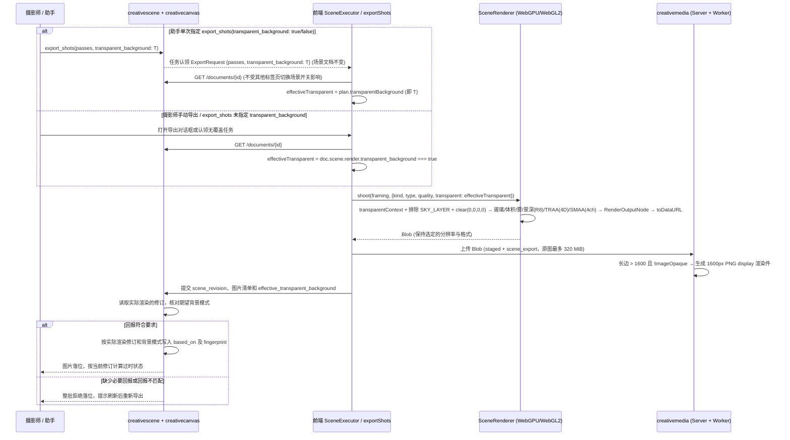

# Design：3D 场景透明背景导出

## 设计上下文与关键决策

需求见 `proposal.md`，契约变更见 `contracts.md`，规格变更见 `specs.md`。本变更没有独立 research 目录；现状依据是 2026-11-17 对前后端代码、Three.js r186（`0.186.1`）着色与后处理内部实现、以及架构与图形学评审意见的逐行核对。

| # | 决定 | 理由 / 备选 |
|---|---|---|
| D1 | 场景文档新增渲染设置 `scene.render.transparent_background: boolean`（缺省 `false`），放在「渲染」选项卡输出分辨率旁；**同时**助手工具 `export_shots` 新增可选参数 `transparent_background?: boolean`，支持单次导出独立指定是否透明，不受场景开关或跨标签页切换影响 | Owner 已拍板。场景级开关服务编辑器常规工作流（`set_render` 静默保存、`Cmd+Z` `restore_units`、多标签页同步、视口棋盘格预览，以及摄影师让助手修改场景设置时记入「本轮改动」的「渲染设置」）；`export_shots(transparent_background)` 让助手在被要求导出透明/不透明成图时直接按当次参数渲染，无需先改写场景文档，也彻底消除另一标签页并发拨动开关导致悄悄导出不透明图的竞态。导出节点的 `based_on` 记录显式覆盖值，使过时判断忽略场景开关，继续比较机位、几何等依赖 |
| D2 | 线稿（`line`）导出保持白底黑线，不受场景 `transparent_background` 和 `export_shots(transparent_background)` 影响 | Owner 已拍板。`LineRenderer`（`render/lineArt.ts`）是独立管线，固定输出 `vec4(vec3(1 - edge), 1)` 的白底 `image/png` 作为重绘控制图；渲染指纹仅在 `pass != "line"`（`clay` 与 `lit`）时计入有效透明背景状态，切换场景开关不会让线稿误报「场景已更新」 |
| D3 | 透明背景下的白模与材质光照在 1K 至 8K 都以选定分辨率编码为无损 PNG。手动与助手导出共用场景专用的 320 MiB 单图预算 | Owner 于 2026-11-18 确认。8K 方形 RGBA8 的像素数据约 256 MiB，320 MiB 给浏览器 PNG 容器与压缩开销留余量。普通上传仍按 25 MiB 校验。 |
| D4 | 视口仅在「最终渲染」（`rendered`）模式且场景开启透明背景时显示中性暗色 CSS 棋盘格；白模（`solid`，`#8a8f98` 中性灰底）、材质预览（`preview`，`#5b5d61` 室内中性灰底）、线框（`wireframe`，`#17181b` 深色底）保持原有背景不变 | Owner 已拍板。与 Blender `Film › Transparent` 一致：最终渲染所见即所得；白模与材质预览在既有规格中本就不显示场景天空而用固定中性灰底看结构与材质（但白模**导出** `clay` 在透明背景生效时仍去底变为透明） |
| D5 | 渲染管线内部 `RGBA16F`（`HalfFloatType`）目标统一承载**预乘线性 HDR** `(a · L, a)`；色调映射复用 Three.js r186 `RenderOutputNode` 的 `unpremultiplyAlpha → AgX → sRGB → premultiplyAlpha`，经 `alpha: true` 画布由浏览器编码输出直通（straight alpha）文件 | 在线性 HDR 阶段保持预乘可使硬件 MSAA、标准 `NormalBlending`、景深聚集、TRAA 与多帧累积全部满足线性可加；色调映射前先反预乘恢复完整物体辐射度 `L`，避免 `0 < a < 1` 过渡像素曝光变暗；直通 PNG/WebP 叠到 `#ffffff` 或 `#000000` 底上均无天空色或黑边 |
| D6 | 直接相机画面通过排除 `SKY_LAYER = 29`、临时置 `scene.background = null` 并以 `(0x000000, 0)` 清屏来去除背景，而保留 `scene.environment` PMREM、0 号图层光源、SSR `envSpec` 回退与 `ProbeVolume` 不变 | 视觉天空（程序化天空与太阳盘、物理天空与太阳盘/月盘/银河/夜天光、夜空星表 `stars`）均在 `SKY_LAYER = 29`，纯色与工作室底色在 `scene.background`；环境贴图 PMREM 由独立离屏场景烘焙，光源在 0 号图层，反射未命中几何时回退采样 `scene.environment`。隐藏背景层即可保持不透明物体照明、阴影和金属/镜面反射不变 |
| D7 | 透射玻璃与彩色体积明确采用**场景内物理透射/反射 + 外部背景 W3C `source-over` 标量覆盖率近似**（v1 边界）：在 `transparentTransmission.ts` 包装 `PhysicalLightingModel` 补入 `(1 - F)` 表面菲涅尔与 `finish()` 中的镜面高光 alpha 下界，并分开处理材质不透明度与光学覆盖率 | 单通道 RGBA 的 W3C `source-over`（$C_{\text{out}} = C_{\text{fg}} + (1 - \alpha)C_{\text{bg}}$）无法折射或模糊未知的外部二维底图，也无法做三通道彩色吸收。v1 严格保留场景内部灯光、反射与玻璃后方物体的折射/粗糙度模糊，并为外部合成输出近似标量 `alpha`：修补上游 `PhysicalLightingModel.js:180-182` 漏乘 `(1 - F)` 导致清玻璃 `alpha = 0` 消失的缺陷，在 `finish()` 中为 `!builder.material.transparent` 补高光覆盖率下界防止强高光被压暗；粗糙玻璃跨越后方物体与空背景边界时，因 `viewportOpaqueMipTexture` mip 链混合 `(L_obj, 1)` 与 `(0, 0, 0, 0)` 得到 `0 < B_a < 1`，自然输出 `0 < alpha < 255` 无天空色过渡 |
| D8 | 透射玻璃与片元雾钩子严格按**活跃透明 Pass 上下文（`transparentContext`）显式启用**，连同 `asItsPass` 异步预编译一起隔离着色器缓存键 | 复用 `RenderObject.js:951` 将 `renderer.contextNode.id` 与 `version` 哈希进 `getDynamicCacheKey()` / `nodeBuilderCache` 的机制：仅在 Workbench `TransparentScenePass` 与 RealtimeGI `GILightingPass` 的 `transparentBackground = true` 分支（及 `sceneRenderer.ts:284` `asItsPass` 预编译包装）中挂载 WeakMap 记忆化的 `transparentContext`，钩子内严格判 `builder.context.transparentBackground === true`。关闭透明背景、`solid`/`preview` 视口与 `render_view` 编译和执行 100% 原始 Three.js 着色器，同一材质实例切换 `off → on → off` 零串味、零泄漏 |
| D9 | 补齐景深（半分辨率 `RGBA16F` + `R8Unorm` 双附件）、体积、雾与空气透视、视口辅助层，以及**透明模式下 Alpha 感知的 SMAA 边缘检测与 TRAA 四维历史钳制** | ① `dof.ts` 在 `transparent = false` 时保持单附件零增量，在 `transparent = true` 时第 2 附件改用 `RedFormat + UnsignedByteType`（`R8Unorm` / `gl.R8`，8K 方形仅 `16 MiB`，较 `RGBA16F` 省 `112 MiB`）；② 透明模式下通过包装 `smaaNode.setup` 把边缘检测扩展为四通道 `max(r, g, b, a)`（阈值 `0.1`，解决 `< 0.1` 暗部剪影漏检锯齿），由透明模式专用的 TRAA 子类在构建 resolve 时使用四维历史裁剪（解决运动前景露出空背景时残留历史 `alpha = 1` 拖影），移除原 `U2` 妥协 |
| D10 | `creativemedia/verify.go` 按像素不透明度（`!imageOpaque`）为 `> 1600 px` 透明原图生成 `1600 px` 无损 `image/png` `display` 渲染件；场景落库快照对 `false` 采用 `persistedRender` `omitempty`，开启过 `true` 的快照采用明确的前向修复（Forward-Fix）发布策略 | Owner 已拍板方案 1A。内存 `Render` 结构体不带 `omitempty`（保证所有 HTTP 读取、`unitView`、`read_scene` 与冲突详情始终输出布尔值满足 `CreativeSceneRender.required`），仅在唯一落库入口 `encodeScene` 内用私有 `persistedRender` 对 `false` 省略键（且 `completedScene` 改为直接序列化 `Scene`）。兼容性按修订判断。省略该键的快照可由旧后端解码，已写入 `true` 的历史修订继续适用前向修复策略 |

本次不做：Blender 的独立「透明玻璃」开关、阴影捕捉（shadow catcher）、多通道（AOV）导出、外部二维底图的折射变形或逐通道彩色透射；`render_view` 助手截图始终保持带背景的 JPEG（见 `proposal.md`「范围与非目标」）。

## 领域模型与业务规则

### 场景渲染设置、存储与校验规则

`Scene.Render` 新增布尔字段 `TransparentBackground`（JSON `transparent_background`，缺省 `false`），归属 `unitRender`（`"render"`）并发与恢复单元，不进入时间线关键帧通道（`channels.json`）。

- **API 读取与内存表达 vs 数据库快照持久化分离**：
  - `creativescene.Render` 的 JSON 标签为 `json:"transparent_background"`（**不带 `omitempty`**），保证 `GET /api/v1/creative/documents/{id}`（`view.go:completedScene`）、`GET /api/v1/creative/documents/{id}/revisions/{rev}?units=render`（`view.go:unitView`）、`read_scene`（`agent.go:AgentReadInTx`）和编辑冲突回执（`agent.go:describeConflict`）始终输出显式的 `"transparent_background": false|true`，严格满足 OpenAPI `CreativeSceneRender.required`。
  - 唯一数据库快照编码入口 `encodeScene(s Scene)`（`model.go:501-513`）内部将 `s.Render` 映射为私有 `persistedRender`（`TransparentBackground bool` 带 `json:"transparent_background,omitempty"`）：当值为 `false`（新建场景、未开启透明背景的任意编辑、或从 `true` 切回 `false`）时，写入 `creative_content_revisions.payload` 的 JSON **省略 `"transparent_background"` 键**；仅当值为 `true` 时写入 `"transparent_background": true`。
  - 已有字段齐全的快照只补齐响应里的 `render.transparent_background: false`，引用查询直接复用已解码物件。旧快照缺其他字段时继续完成整份场景。

| 输入情形 | 服务端行为 | HTTP 状态与错误码 |
|---|---|---|
| 新建场景 / 读取省略了该键的快照 | 读取接口与 `read_scene` 补齐返回 `render.transparent_background = false` | 200 |
| `set_render` 写入 `{"transparent_background": true}` 或 `false` | 更新 `s.Render.TransparentBackground`（`false` 落库省略键，`true` 落库写 `true`），推进 `render` 单元修订号 | 200 |
| `set_render` 写入非布尔值（如 `"yes"`、`1`、`{}`、`[]`） | `decodeInput` → `shapeError` 拒绝，文档与修订不变 | **400** `validation_failed` |
| `set_render` 写入 `{"transparent_background": null}` | `requireFields` 拒绝（带 `omitempty` 的补丁指针不允许显式 `null`），文档不变 | **400** `validation_failed` |
| `set_render` 的 `render` 为空对象 `{}`（所有补丁字段均为 `nil`） | `decodeOp` 空补丁守卫拒绝 | **400** `validation_failed` |

### 助手 `export_shots` 独立透明参数与 `based_on` 过时判定规则

1. **双入口语义划分**：
   - **修改场景设置**：摄影师请助手「把场景的透明背景打开/关掉」时，助手调用 `edit_scene` 的 `set_render` 修改 `scene.render.transparent_background`，该修改写入场景修订并出现在「本轮改动」清单的「渲染设置」项中，可单独恢复或整轮撤销。
   - **单次导出覆盖**：助手工具 `export_shots` 新增可选布尔参数 `transparent_background?: boolean`：
     - **显式传入 `true` 或 `false`**（例如摄影师请助手「导出透明背景的材质光照图」时传 `transparent_background: true`）：创建 `export_shots` 任务时把 `transparent_background` 写入 `ExportRequest`（`json:"transparent_background,omitempty"`），**不修改场景文档**；浏览器执行该任务时对 `clay`/`lit` 直接按该布尔值决定渲染透明与编码格式（`line` 仍为白底 PNG），完全不受 `scene.render.transparent_background` 当前值或其他标签页并发切换场景开关的影响。
     - **省略（`nil` / `undefined`）**：与摄影师在导出对话框手动导出一致，按渲染读取快照时的 `scene.render.transparent_background` 决定。
2. **节点来源 `based_on` 与渲染指纹一致性**：
   - 画布导出图节点的 `config.based_on`（`creativecanvas.SceneExportBasedOn`）新增可选字段 `transparent_background?: boolean`（Go `*bool`，`json:"transparent_background,omitempty"`）：
     - 手动导出及未显式传 `transparent_background` 的 `export_shots`：**省略** `based_on.transparent_background`（`nil`）。落位以提交的 `scene_revision` 对应快照计算 `based_on.fingerprint`。读取画布时，`Freshness.Check` 以当前快照重算，两边都取各自快照的场景开关。因此切换场景「透明背景」开关会使这组 `clay`/`lit` 图变为 `stale`（「场景已更新」），`line` 不受影响，切回原值后恢复 `current`。
     - 显式传了 `transparent_background` 的 `export_shots`：将该布尔值写入 `based_on.transparent_background`。`placeExportsInTx` 落位与 `Freshness.Check` 重算指纹前，均先令 `shown.Render.TransparentBackground = *basedOn.TransparentBackground` 再调用 `Fingerprint(shown, cameraID, pass)`（且 `Freshness.Check` 的内存缓存键纳入有效 `transparent` 布尔值，防止同画布并存透明与不透明导出节点时互相覆盖）。写入的指纹使用实际渲染的修订，读取时仍用当前修订。只有影响这张图的其他输入一致时才显示 `current`。几何、材质、灯光、环境或机位等输入在渲染后发生变化时，即使图片刚落位也显示「场景已更新」。
   - **存量指纹零漂移**：`fingerprintRender` 的 `TransparentBackground bool` 带 `json:"transparent_background,omitempty"`，且仅在 `pass != PassLine` 时赋值；有效值为 `false` 时序列化字节与上线前 `v1:` SHA-256 哈希 100% 相同。

### 落位前校验实际采用的背景模式

`renderShots` 从出图用的快照和任务覆盖值计算一次实际背景模式，同时驱动编码与拍摄。手动提交在 `payload.effective_transparent_background` 携带该布尔值，助手任务完成在 `payload.export.effective_transparent_background` 携带同一字段。仅线稿时实际值为 `false`。全不透明取景也可能按透明模式渲染，因此用该字段核对协议兼容性和渲染设置。

两个入口都在 `placeExportsInTx` 读取提交的 `scene_revision` 后、消费暂存图或写入画布前执行同一校验。助手覆盖值从服务端的任务请求取，手动导出只按该修订的场景开关计算。

| 导出内容 | 期望有效值 | 何时必须回报 |
|---|---|---|
| 仅线稿 | `false` | 可省略 |
| 含白模或材质光照，任务显式指定背景模式 | 任务中的 `true` 或 `false` | 必传 |
| 含白模或材质光照，跟随场景设置 | 实际渲染修订中的场景开关 | 为 `true` 时必传 |

已回报的值必须匹配期望。显式 `null` 和其他非布尔输入按外形非法处理。缺少必传回报或回报不符时，手动接口返回 `400 validation_failed`，助手完成接口返回 HTTP 200 且任务终态为 `failed`（`invalid_result`），均提示「导出背景设置不一致，请刷新页面后重新导出」。拒绝时整批无节点，暂存图未被消费。收到明确失败回执的新前端丢弃这批暂存图，旧页面遗留暂存项沿用现有过期清理。助手任务沿用既有失败收尾，刷新后重新发起导出。请求重放沿用既有幂等规则。

### 渲染管线 Alpha 数学不变量与 W3C `source-over` 边界

记线性工作空间（Rec.709 linear，已乘预曝光系数）下的像素值为四维向量 $P = (P_{\text{rgb}}, \alpha)$，始终满足**预乘不变量** $P_{\text{rgb}} = \alpha \cdot L$（$\alpha \in [0, 1]$）：

1. **场景主 Pass 清屏、图层裁剪与上下文隔离**：
   - 当帧请求 `transparent = true`（仅在导出有效 `transparent = true` 的 `clay`/`lit` 及视口 `display === 'rendered' && scene.render.transparent_background === true` 时为真）时：
     - 相机图层掩码排除 `SKY_LAYER = 29`（Workbench `beauty` 为 `layers(0, ASIDE_LAYER)`，RealtimeGI `lit` 为 `layers(0)`）；
     - Pass 执行期间临时置 `scene.background = null`，将渲染器 clearColor / clearAlpha 设为 `(0x000000, 0)`，并把 `renderer.contextNode` 切换为经 `WeakMap` 记忆化的 `transparentContext(...)`（携带 `transparentBackground: true` 标记，结束后在 `finally` 完整恢复）；`SceneRenderer.compile()` 的替身预编译包装 `asItsPass`（`sceneRenderer.ts:284`）同步对透明 Pass 注入同一 `transparentContext`，保证预编译与正式绘制命中同一 `RenderObject` / `nodeBuilderCache` 键。
   - 不透明网格写入 $(L, 1)$；空背景严格为 $(0, 0, 0, 0)$；硬件 4× MSAA 解析与 `NormalBlending` 天然输出预乘线性 HDR $(\alpha L, \alpha)$。
2. **透射玻璃（`transmission > 0`）与彩色体积的物理范围及 W3C `source-over` 近似**：
   - **v1 光学边界声明**：导出文件是单张四通道 RGBA 图像，下游画布或海报合成遵循 W3C Porter-Duff `source-over`（$C_{\text{comp}} = C_{\text{fg,premult}} + (1 - \alpha) C_{\text{ext}}$），只有一个标量透射权重 $1 - \alpha$ 且无法访问外部底图 $C_{\text{ext}}$ 的空间坐标。因此 v1 **完整保留场景内部的物理照明、表面反射，以及玻璃对场景内后方物体的折射偏移与粗糙度模糊**；对外部新背景则输出**标量覆盖率近似 $\alpha$**（不对外部二维底图产生折射变形或磨砂模糊，有色玻璃/有色吸收介质对外部底图按通道均值标量衰减而非逐通道染色；彩色体积自身的内散射光 $L_{\text{vol}}$ 与大气光 $S(d_v)$ 则完整保留彩色 RGB）。
   - **透射玻璃公式（仅当 `builder.context.transparentBackground === true && this.transmission === true` 时启用）**：
     - `ViewportTextureNode` 将已完成的不透明缓冲（含 `(0, 0, 0, 0)` 空背景）拷入 `RGBA16F` `viewportOpaqueMipTexture` 并生成完整四通道预乘 mip 链，按折射坐标与粗糙度 `lod` 采样得到 $B = (B_{\text{rgb}}, B_a)$。
     - **具体接入点**：`render/transparentTransmission.ts` 按 Three `0.186.1` 的 `PhysicalLightingModel.js:500–593` 局部移植 `start` 及私有透射采样依赖（同文件 `getIBLVolumeRefraction` / `getTransmissionSample`）。仅在透明 pass 的透射材质上选用本地 `start`，保留原清漆、sheen、虹彩与多次散射初始化，再调用父类 `LightingModel.start` 按原顺序执行 direct/indirect，让现有灯光与 GI 钩子继续生效。
     - 从同一次折射采样取得原始 `transmittedLight.a`（色散时沿用三次采样的 alpha 均值）及各通道吸收值。保留上游正反面纹理选择、折射坐标和粗糙度 LOD。在合成 `context.backdrop` 前把 `B_a` 存入当前材质光照的 builder context，RGB 沿用上游计算，alpha 按下式组装。由 `finish` 从同一 context 读取 `B_a`，把高光覆盖率与已算出的材质 alpha 取最大值。
     - 设电介质表面菲涅尔与多次散射反射率为 $F$（启用 `clearcoat` 时乘清漆透射因子 $1 - c_{\text{cc}} F_{\text{cc}}$），介质吸收与基础色透射率为 $T_{\text{slab}}$，单层有效标量透射率为：
       $$T_{\text{eff}} = \frac{1}{3}\mathbf{1}\cdot\big((1 - F)(1 - c_{\text{cc}} F_{\text{cc}}) \odot T_{\text{slab}}\big)$$
       $$\alpha_{\text{backdrop}} = \text{mix}(1,\; B_a,\; T_{\text{eff}}), \qquad \alpha_0 = \alpha_{\text{material}} \cdot \text{mix}(1,\; \alpha_{\text{backdrop}},\; \text{transmission})$$
     - 在 `PhysicalLightingModel.finish(builder)`（`direct`、`indirect`、`clearcoat`、`sheen` 全部累加完毕处），以总镜面反射 $S_{\text{spec}}$ 计算高光覆盖率下界：
       $$c_{\text{spec}} = \text{clamp}\!\left(\frac{\max(S_{\text{spec},r}, S_{\text{spec},g}, S_{\text{spec},b})}{1 + \max(S_{\text{spec},r}, S_{\text{spec},g}, S_{\text{spec},b})},\; 0,\; 1\right), \qquad \alpha = \max\big(\alpha_0,\; \alpha_{\text{material}}\cdot (1 - B_a)\cdot \text{transmission} \cdot c_{\text{spec}}\big)$$
     - 性质：在折射+粗糙度模糊采样足迹完全落在后方不透明物体内部的核区（$B_a = 1$），材质不透明度为 1 时 $\alpha \equiv 1$，画面与不透明导出一致；粗糙玻璃（`roughness > 0`）跨越后方物体与空背景轮廓的模糊带满足 $0 < B_a < 1$，输出平滑过渡的 $0 < \alpha < 1$ 且剔除天空底色；纯白清玻璃（`#ffffff, ior = 1.5, transmission = 1`）对空背景（$B_a = 0$）法向 $\alpha_0 \approx 0.04$（约 `10/255`），掠射边缘与强高光处平滑抬升。混合材质输出给硬件的 RGB 按材质不透明度除以最终 alpha 预补偿，硬件混合后反射光只受材质不透明度影响。
3. **雾、空气透视与体积介质**：
   - 空背景像素（`prepass` 深度 $d = 1$）：线性雾与 `aerialBehind` 的 `opaque` 掩码均为 `0`，透明背景处不残留任何雾色。
   - Workbench 片元雾（`gpu.ts` 包装 `NodeMaterial.prototype.setupFog`）：仅当 `builder.context.transparentBackground === true && !this.transparent && (this.transmission ?? 0) > 0` 时，执行安全反预乘（`a > 1e-6 ? rgb / a : 0`）→ 原生 `setupFog` → 再乘回 `a`，等价于 $((1 - f)P_{\text{rgb}} + f \cdot \alpha C_{\text{fog}}, \alpha)$，消除清玻璃对空背景被 `unpremultiplyAlpha` 放大约 `25×` 的雾墙，同时保留 4× MSAA 子采样雾化与正交相机支持；非透明 Pass 不触发该包装，生成字节级原始着色器。
   - RealtimeGI 屏幕空间线性雾与 `aerialBehind`：$C_{\text{fogged}} = \text{mix}(P_{\text{rgb}}, \alpha C_{\text{fog}}, f_{\text{fog}} \cdot \text{on} \cdot \text{opaque})$，$C_{\text{aerial}} = P_{\text{rgb}} T_{\text{ap}} + \alpha S_{\text{ap}} k_{\text{rel}}$。
   - 体积物件（`volumes/composite.ts`）：在 `covered > 0.5` 处，$P'_{\text{rgb}} = S(d_v)(1 - T_{\text{vol}}) + T(d_v)L_{\text{vol}} + T_{\text{vol}} P_{\text{rgb}}$，$\alpha' = \text{mix}(1, \alpha, \frac{1}{3}(T_{\text{vol},r}+T_{\text{vol},g}+T_{\text{vol},b}))$。
4. **景深（`dof.ts`）、Alpha 感知抗锯齿（SMAA / TRAA）、累积与叠加层**：
   - **景深（`dof.ts`）**：传入 `transparent: boolean`。`transparent = false` 时保持原有单附件 `RGBA16F` `vec4(sum.rgb / total, mixAmount)`（**零显存增量**）；`transparent = true` 时半分辨率 Vogel 盘（128 tap）使用双附件 MRT：附件 0 为 `RGBA16F` 预乘均值 $\sum w_i P_i / \sum w_i$，附件 1 为 **`RedFormat + UnsignedByteType`（`R8Unorm` / `gl.R8`，`LinearFilter`）** 输出 `vec4(mixAmount, 0, 0, 1)`，全分辨率合成 $\text{mix}(P_{\text{sharp}}, P_{\text{blur}}, \text{mixAmount})$。
   - **SMAA（Workbench 兼容模式 `msaa === 0 && !gi`）**：仅当 `look.transparent === true` 时包装 `smaaNode.setup(builder)`（对照 `three 0.186.1 SMAANode.js:284-351`），在 `origSetup` 之后将 `_materialEdges.fragmentNode` 替换为采样完整 `vec4` 并按四通道最大差 `max(|Δr|, |Δg|, |Δb|, |Δa|)` 与 `SMAA_THRESHOLD = 0.1` 比较的 TSL 节点。任意暗部或纯黑物体（RGB `< 0.1`，但 $|\Delta \alpha| = 1.0 \ge 0.1$）对空背景的斜边均能被完整检出并由 `SMAABlend` 线性混合 `vec4`。
   - **TRAA（RealtimeGI 时域抗锯齿）**：仅当 `options.transparent === true` 时创建本地 `render/nodes/TransparentTRAANode.js` 的子类实例。子类继承上游 `TRAANode` 的抖动、历史纹理、更新及释放，只覆写 `setup(builder)`（按 Three `0.186.1` 移植该方法，复用 `TAAUtils.js` 的深度、重投影、亮度权重函数）。在本地 `varianceClipping` 建图时调用四维 `clipAABB`，关闭 `_resolveMaterial.fog = false` 并将本地构建的 `resolve()` 装入 `_resolveMaterial.fragmentNode`（绕开 `NodeMaterial.setupDiffuseColor` 对不透明材质强制写 `diffuseColor.a = 1` 的分支，完整保留四通道 RGBA）。四维方盒以 `pClip = 0.5 * (maxColor + minColor)` 为中心，`eClip = 0.5 * (maxColor - minColor) + 1e-7` 为各维半径，按 `maxUnit = max(|vUnit.x|, |vUnit.y|, |vUnit.z|, |vUnit.w|)` 缩放越界的历史向量。静止轮廓边缘在 3×3 邻域 `[0, 1]` 内正常做亚像素抖动收敛；运动前景移开露出 `(0, 0, 0, 0)` 空背景时（邻域 `minColor.a = maxColor.a = 0`），钳制直接返回 `vec4(0)`，避免除数保护项留下非零 alpha，消除透明区暗影拖尾。
   - **视口辅助层与手柄合成**：`realtimeGI.ts` 叠加 `aside` 网格/图标与 `sceneRenderer.ts` `pipeline.outputNode` 叠加 `overlay` 手柄时均按 Porter-Duff `over` 更新 alpha `mix(dst.a, 1, src.a)`；离屏导出 `pipeline.outputNode = output` 直接保留 `output.a`。
5. **色调映射、画布输出与 TSL 守卫**：
   - `RenderOutputNode` 执行 `clamp(a,0,1) → unpremultiplyAlpha → AgXToneMapping → sRGB → premultiplyAlpha` 写入 `alpha: true` 画布，浏览器反预乘编码为直通 PNG。
   - 遵守 `patterns.md`「场景着色写法」：纯 TSL 实现，分叉前先 `.toVar()`，分叉内不放隐式导数纹理采样；所有针对 `three 0.186.1` 内部结构（`PhysicalLightingModel`、`NodeMaterial.setupFog`、`SMAANode`、`TRAANode`/`TAAUtils`、`RenderObject.getDynamicCacheKey`）的扩展点均注明精确行号并纳入单测源码断言守卫。

### 导出编码、8K 显存预算与失败处理规则

| 用途 / 通道 | 有效 `transparent = false` | 有效 `transparent = true` | 备注 |
|---|---|---|---|
| `clay` / `lit` 导出，`1k` / `2k` | `image/png`（`alpha = 255`） | `image/png`（保留透明像素） | 2K 材质光照约 `3–9 MiB < 25 MiB` |
| `clay` / `lit` 导出，`4k` / `8k` | `image/jpeg`（`quality: 0.95`） | 无损 `image/png`（保留透明像素） | 高分辨率 PNG 直接编码为 Blob |
| `line` 线稿导出，`1k`–`8k` | `image/png`（白底黑线） | `image/png`（白底黑线，不变） | `LineRenderer` 独立绘制 |
| `render_view` 助手回看 | `image/jpeg`（`quality: 0.85`，长边 `1024`） | `image/jpeg`（`quality: 0.85`，仍带背景） | `use: 'view'` 强制 `transparent = false` |

- **8K 方形（`8192 × 8192` = 67.1 MP）显存与编码内存核算**：
  - 既有基线显存（含景深 + 透射玻璃 + 累积）：Workbench 约 `7.8 GiB`（其中 4× MSAA `beauty` 占 `3.5 GiB`、`AccumulateNode` `1.0 GiB`、`prepass` `768 MiB`、`viewportOpaqueMipTexture` `683 MiB`、`dof` 原有 `642 MiB`、AO 与降噪 `576 MiB`、画布双缓冲 `512 MiB`）；RealtimeGI 约 `11.5–12.5 GiB`。
  - 本次透明模式新增显存：仅 `dof.ts` 半分辨率（`4096 × 4096`）`R8Unorm` 附件 1 的 **`+16 MiB`**（约 `+0.2%`），不透明模式新增 **`0 B`**。
  - 4K 和 8K PNG 直接通过 `canvas.toBlob` 编码，避免大型 Base64 字符串和额外的字节拷贝。
- **编码与大小异常兜底（不静默去透明、不静默降分辨率）**：
  - 浏览器 PNG 编码失败时中止导出并显示具体错误。
  - 后端拒绝单张超过 320 MiB 的分镜原图时，释放同批已上传的暂存项并报告超限。Agent 保留用户选择的分辨率。

### 画布节点、大图预览与导出对话框规则

- **画布展示图（`creativemedia/verify.go`）**：原图长边 `> 1600 px` 时，以 `out.Mime != "image/jpeg" && !imageOpaque(decoded)` 判定是否存在 `alpha < 0xffff` 的透明像素：存在透明像素则 `png.Encode` 输出 `1600 px` `image/png` `display` 渲染件；全不透明四通道 PNG 与全部 JPEG 仍走 `Quality: 86` 的 `image/jpeg` `display` 渲染件。
- **画布与大图底色**：画布舞台 `.cc-stage` 为 `--bg: #0b0b0c`；图片节点卡片 `.cc-node` / `.cc-node-media .cc-media` 为中性深灰 `--s1: #151516`（与透明 3D 模型缩略图一致，非纯黑 `#000000` 或纯白 `#ffffff`）；大图预览 `.cc-media-preview` 遮罩为 `#0c0c0ced`、内部 `.cc-media` 与 `img` 背景透明。
- **导出对话框文案（`ExportDialog.tsx`）**：仅当 `transparentBackground && kinds.some((k) => k === 'clay' || k === 'lit')` 为真时，在状态行长边信息旁附加「`· 白模、材质光照使用透明背景`」；当摄影师只勾选「线稿」一项时隐藏该说明，避免误导线稿也会变透明。
- **手动导出回执**：服务端确认落位后，场景编辑器把新批次的首个节点 ID 交给当前画布。画布主动读取最新快照，摄影师点「还原节点」后用已有的节点定位逻辑显示新图。画布实时同步中断时也走这条路径。失败原因保留在导出对话框里，可修改设置或重新发起。
- **分组内落位**：手动和助手导出在同一个画布事务内读取已有节点版本，并把它们纳入落位命令的读取集合。分组扩张可以校验祖先分组和组内已有子节点，整批图片在同一次画布变更中落位。

### 模块职责与协作

| 模块 | 职责 | 不负责 | 位置 |
|---|---|---|---|
| `creativescene` | `Render.TransparentBackground` 内存模型与 `encodeScene` `omitempty` 持久化、`completedScene` 读取补齐、`set_render` 校验、`ExportRequest` 透明覆盖参数、`based_on.transparent_background` 写入与 `Freshness.Check` 指纹判定 | 像素渲染与图片缩放 | `backend/internal/creativescene/` |
| `creativecanvas` | 在 `SceneExportBasedOn` 与 `ExportSource` 中承载并透传可选 `transparent_background` | 指纹哈希计算 | `backend/internal/creativecanvas/scene_exports.go` |
| `creativemedia` | 按实际像素透明度为 `> 1600 px` 透明 PNG/WebP 原图生成 `1600 px` `image/png` `display` 渲染件 | 场景业务语义 | `backend/internal/creativemedia/verify.go` |
| `creativeagent` | 暴露 `export_shots(transparent_background)` 与 `edit_scene(set_render)` 参数和简洁工具/系统说明 | 命令与任务底层存储 | `backend/internal/creativeagent/` |
| `creative-scene/render` | `transparentContext` 隔离、预乘 HDR alpha 管线、玻璃 `(1-F)`+高光下界、片元雾预乘、`dof` `RGBA16F+R8` MRT、体积/大气/辅助层 alpha、Alpha 感知 SMAA/TRAA、`engines` 编码与时限 | 上传与任务协议 | `frontend/src/creative-scene/render/` |
| `creative-scene/host` | `executor` 解析任务 `transparent_background`、`exportShots` 合并覆盖值与场景设置并处理 MIME/大小/编码错误、`render.ts` 区分 `export` 与 `render_view` 并按用途选用编码 | 着色器实现 | `frontend/src/creative-scene/host/` |
| `creative-scene/panels` & `Viewport` | 「渲染」面板开关、`ExportDialog` 按勾选通道显示透明提示、视口 `rendered` 模式棋盘格 | 指纹计算 | `frontend/src/creative-scene/` |

## 核心流程与关键机制

**助手单次覆盖导出与编辑器常规导出流程**：

### 1. 场景开关保存、撤销与多标签页同步

- `RenderPanel.tsx` 在「输出分辨率」旁新增「透明背景」复选框，调用 `onRender({ transparent_background: checked }, checked ? '开启透明背景' : '关闭透明背景')`。
- 前端 `state/apply.ts`、`state/intents.ts`、`state/undo.ts` 与 `exportShots.ts:shotSceneKey` 均按整块 `scene.render` 工作，直接支持 `Cmd+Z`（`restore_units: ['render']`）与多标签页 SSE 失效重读。

### 2. Pass 级 `transparentContext` 隔离与视口棋盘格

- `giSplit.ts` 定义 `transparentMark = 'transparentBackground'` 与 `WeakMap` 记忆化的 `transparentContext(base)`：
  - Workbench 在 `look.transparent && !look.wireframe` 时使用 `TransparentScenePass`（继承 `BackgroundlessPass`，同时保存/恢复 `clearColor + clearAlpha` 与 `renderer.contextNode = transparentContext(base)`）；
  - RealtimeGI 的 `GILightingPass` 用独立只读字段 `transparentBackground` 控制去底、清屏与是否套用 `transparentContext(splitContext(base))`，缺省关闭。继承的 `PassNode.transparent = true` 控制 Three 的半透明绘制队列，两个背景模式都保留该队列及 `alpha_mode: blend` 物件。
  - `sceneRenderer.ts:284` 的 `asItsPass` 复用正式绘制的上下文派生逻辑，对 GI 同样读取 `pass.node.transparentBackground`，确保异步 `compileAsync` 预编译产物与实际渲染完全一致。
- `Viewport.tsx` 开启 `alpha: true`；仅在 `display === 'rendered' && scene.render.transparent_background === true` 时传 `transparent: true` 并为容器挂 `.cc-scene-viewport.is-transparent`（`scene.css` 设 `16px` 暗灰棋盘格），`solid`、`preview`、`wireframe` 传 `false` 保持各自原有中性灰/深色底。

### 3. 离屏导出覆盖、编码分支与错误兜底

- `executor.ts:exportPlan` 校验并提取可选布尔值 `request.transparent_background` 为 `ExportPlan.transparentBackground`。`renderShots` 先计算 `requested = plan.transparentBackground ?? (doc.scene.render.transparent_background === true)`，再取 `effective = requested && plan.passes.some(pass => pass !== 'line')`。同一个 `effective` 驱动时限预算、编码与拍摄，并随成功结果交给手动和任务提交入口。
- `host/render.ts` 在 `g.capture` 处改为 `options.type === 'image/png' ? undefined : (options.quality ?? jpegQuality)`，JPEG 保留原有质量参数；`renderView` 传入 `use: 'view'` 强制 `transparent = false`，始终输出带天空背景的 `0.85` JPEG。
- `uploadShots` 保留原始 MIME。手动和任务上传都传场景的 `canvas_id` 和 `scene_node_id`。服务端创建会话时校验目标，沿用分片协议与账号配额。媒体工作器从临时文件解码，不将整份压缩图再读入堆。只有对应场景导出事务可以消费有绑定的暂存项，通用暂存图仍支持旧客户端的落位。

### 4. 服务端透明展示图与助手上下文预算

- `creativemedia/verify.go` 通过 `imageOpaque` 检查像素透明度，只对含透明像素且长边 `> 1600 px` 的原图用 `png.Encode` 输出 `image/png` `Display` 渲染件，不透明图与 JPEG 零变化。
- `creativeagent/scene_tools.go` 与 `instructions/base.md` 新增文案控制在 `300 B` 以内，通过 `compaction_regression_test.go` 守卫上下文窗口预算。

## 接口与数据契约

- 契约状态：**扩展**。
- 完整契约 delta 见 `contracts.md`：`data: MODIFY 场景文档`、`data: MODIFY 场景客户端任务`、`data: MODIFY 导出图来源`、`api: MODIFY 读取场景`、`api: MODIFY 助手场景工具的输入与写入结果`、`api: MODIFY 导出分镜`、`api: MODIFY 完成场景客户端任务`、`patterns: MODIFY 场景着色写法`。
- OpenAPI（`api/openapi.yaml`）改动：
  - `CreativeSceneRender`：新增必填 `transparent_background: boolean`；
  - `CreativeSceneRenderPatch` 与 `CreativeSceneSetRender`：新增可选 `transparent_background: boolean`；
  - `CreativeSceneExportPayload` 与 `CreativeSceneJobCompletePayload.export` 增加可选布尔 `effective_transparent_background`，条件必传及失败语义记入接口描述。
  - `CreativeSceneJob.request` 已为开放对象（`additionalProperties: true`，引用 `data: 场景客户端任务`），更新描述或关联契约说明 `export_shots` 的可选 `transparent_background: boolean`；媒体与上传的 `mime` 已为 `string`。
- 运行 `make generate` 更新 `backend/internal/platform/httpapi/api.gen.go` 与 `frontend/src/api/schema.d.ts`。
- 数据库与发布回滚策略（方案 1A）：
  - 无 SQL 迁移、无数据回填。
  - 因 `encodeScene` 在 `transparent_background == false` 时省略该键，该修订可由旧后端解码。开启后再关闭只影响新写入的修订，历史读取和恢复仍可能引用含 `true` 的修订。
  - 对显式保存为 `transparent_background == true` 的场景快照（含历史修订），因旧版后端 `Render.UnmarshalJSON` 启用了 `DisallowUnknownFields()`，发布策略明确采用**前向修复（Forward-Fix）**：前后端与 `creative-worker` 同版上线，上线后若遇问题以修复补丁推进，不将后端单独回退到不识别该字段的旧版本。

## 挂载点

| 位置 | 动作 | 说明 |
|---|---|---|
| `api/openapi.yaml` | 修改 | `CreativeSceneRender`、`CreativeSceneRenderPatch`、`CreativeSceneSetRender` 新增 `transparent_background` |
| `backend/internal/platform/httpapi/api.gen.go` | 修改 | `make generate` 重新生成 |
| `frontend/src/api/schema.d.ts` | 修改 | `make generate` 重新生成 |
| `backend/internal/creativescene/model.go` | 修改 | `Render` 新增无 `omitempty` 的 `TransparentBackground bool`；`encodeScene` 经私有 `persistedRender` 对 `false` 省略键；`renderPatch` 新增 `TransparentBackground *bool` |
| `backend/internal/creativescene/view.go` | 修改 | 对其他字段齐全的场景只补齐 render。供引用查询复用已解码物件。 |
| `backend/internal/creativescene/ops.go` | 修改 | `decodeOp("set_render")` 空补丁守卫与 `setRenderOp` 的 `apply` 合并 `TransparentBackground` |
| `backend/internal/creativescene/jobs.go` | 修改 | `ExportJobInput` 与 `ExportRequest` 新增可选 `TransparentBackground *bool`（`omitempty`） |
| `backend/internal/creativescene/jobs_complete.go` | 修改 | `ExportOutput` 接收有效背景模式，`completeExport` 将任务覆盖和回报传入 `ExportInput` |
| `backend/internal/creativescene/exports.go` | 修改 | `ExportInput` 接收任务覆盖值和背景模式回报，`placeExportsInTx` 校验实际渲染修订与回报，通过后才消费暂存项并写入来源 |
| `backend/internal/creativescene/fingerprint.go` | 修改 | `fingerprintRender` 新增 `TransparentBackground bool`（`omitempty`，`pass != PassLine`）；`Freshness` 的 `Check` 优先采用 `src.TransparentBackground` 并纳入缓存键 |
| `backend/internal/creativecanvas/scene_exports.go` | 修改 | `SceneExportBasedOn`、`ExportSource` 与 `exportSource` 新增可选 `TransparentBackground *bool`（`omitempty`），落位命令从锁内快照取得已有画布节点的读取版本 |
| `backend/internal/creativescene/scene_test.go` | 修改 | 覆盖旧快照与 `false` 新快照落库省略键但读取返回 `false`、`true` 落库与切回 `false` 省略键、非布尔/`null`/空补丁返回 400、撤销恢复 |
| `backend/internal/creativescene/camera_dof_test.go` | 修改 | 将既有 `TestOldRenderIsCompletedOnRead` 预期响应补齐 `transparent_background: false` |
| `backend/internal/creativescene/fingerprint_internal_test.go` | 修改 | 覆盖透明开启时 `clay`/`lit` 指纹变化、`line` 不变、关闭时与既有固定 `v1:` 哈希完全一致 |
| `backend/internal/creativescene/exports_shots_test.go` | 修改 | 覆盖常规导出随场景开关切换 `stale`/`current`（线稿保持 `current`），以及显式 `based_on.transparent_background` 导出不受场景开关拨动影响、场景内容改动仍变 `stale` |
| `backend/internal/creativescene/jobs_export_test.go` | 修改 | 覆盖 `CreateExportJobInTx` 与 `completeExport` 透传 `transparent_background` 覆盖值及落位 `based_on_state = "current"` |
| `backend/internal/platform/httpapi/creative_scene_exports_test.go` | 修改 | 覆盖手动导出接口的 `effective_transparent_background` 回报外形、旧页面缺字段、回报不匹配和整批拒绝语义 |
| `backend/internal/platform/httpapi/creative_scene_jobs_test.go` | 修改 | 覆盖客户端任务完成接口的 `effective_transparent_background` 回报校验、失败终态与重试幂等 |
| `backend/internal/creativemedia/verify.go` | 修改 | 新增 `imageOpaque`；长边 `> 1600 px` 且含透明像素的 PNG/WebP 原图生成 PNG `Display` 渲染件；`verifyImage` 与 `probeImage` 改为文件流式解码 |
| `backend/internal/creativemedia/generation.go` | 修改 | `workFactsProbe` 对图片探测采用 `max(ImageMaxBytes, SceneExportMaxBytes)`，兼容 320 MiB 分镜原图 |
| `backend/internal/creativemedia/service_test.go` | 修改 | 覆盖 `> 1600 px` 透明 PNG、透明 WebP、全不透明四通道 PNG 与 JPEG 的 `display` 渲染件行为 |
| `backend/internal/creativemedia/config.go` | 修改 | 分镜原图默认单张 320 MiB |
| `backend/internal/creativemedia/model.go` | 修改 | 暂存目标可绑定场景节点 |
| `backend/internal/creativemedia/service.go` | 修改 | 建会话时检查场景目标和限额 |
| `backend/internal/creativemedia/worker.go` | 修改 | 使用已保存的目标决定媒体校验限额，复用分片与配额 |
| `backend/internal/creativemedia/candidates.go` | 修改 | 按原始暂存目标拒绝将分镜原图改绑为普通资产或节点。 |
| `backend/internal/creativestaging/staging.go`、`backend/internal/creativecanvas/graph_commands.go` | 修改 | 限制绑定场景的暂存项并复用落位事务已锁住的图片 |
| `frontend/src/creative-scene/host/pageExecutor.ts` | 修改 | 助手分镜上传使用任务中确认的场景节点 |
| `backend/internal/creativeagent/scene_tools.go` | 修改 | `export_shots` 新增可选 `transparent_background: boolean` 参数与说明；精简更新 `set_render` 与 `render_view` 说明 |
| `backend/internal/creativeagent/instructions/base.md` | 修改 | 「搭建场景」补充：单次导出透明底图用 `export_shots(transparent_background: true)`，修改场景设置用 `set_render` |
| `backend/internal/creativeagent/scene_export_tools_test.go` | 修改 | 覆盖助手 `export_shots(transparent_background: true)` 独立于场景开关导出、以及 `edit_scene(set_render)` 记入 `RunChanges`「渲染设置」（连带验证上下文压缩预算回归） |
| `frontend/src/creative-scene/render/engines.ts` | 修改 | `imageTypeOf`、`extensionOf`、`encodeNs`、`estimateMs`、`shotBudgetMs` 支持高分辨率 PNG 导出 |
| `frontend/src/creative-scene/render/gpu.ts` | 修改 | 支持 `alpha: true`；按 `transparentBackground` 上下文守卫包装 `NodeMaterial.prototype.setupFog`；高分辨率 PNG 使用 Blob 编码 |
| `frontend/src/creative-scene/render/giSplit.ts` | 修改 | 新增 `transparentContext`，以独立的 `GILightingPass.transparentBackground` 控制去底和上下文 |
| `frontend/src/creative-scene/render/transparentTransmission.ts` | 新增 | 透明 pass 透射材质的本地 `start`、单次折射采样与 `finish` 高光覆盖率 |
| `frontend/src/creative-scene/render/passContext.ts` | 新增 | 缓存透明渲染上下文。同一个 pass 为预编译和正式绘制派生相同的上下文。 |
| `frontend/src/creative-scene/render/nodes/TransparentTRAANode.js` | 新增 | 继承上游时域节点，局部移植 `setup` 并替换 resolve 的四维历史裁剪 |
| `frontend/src/creative-scene/render/nodes/TransparentTRAANode.d.ts` | 新增 | `TransparentTRAANode` 的 TypeScript 类型声明 |
| `frontend/src/creative-scene/render/sceneRenderer.ts` | 修改 | `Frame`/`Look`/`keyOf`/`shapeOf` 新增 `transparent`；`TransparentScenePass` 与 `asItsPass` 同步注入 `transparentContext`；排除 `SKY_LAYER`；串联 `aerialBehind`/`applyVolumes`/`dof` 的 `vec4` alpha；透明模式包装 `smaa` 四通道边缘检测；修复 `pipeline.outputNode` 的 `output` 的 alpha 保留 |
| `frontend/src/creative-scene/render/realtimeGI.ts` | 修改 | 传入 `GILightingPass` 透明开关；线性雾与空气透视按 `output` 的 alpha 预乘；接入体积 alpha；修复 `aside` 辅助层 alpha；透明模式使用本地四维历史裁剪的 TRAA 子类 |
| `frontend/src/creative-scene/render/dof.ts` | 修改 | `transparent = false` 保持单附件零增量；`transparent = true` 半分辨率改为 `RGBA16F` + `RedFormat` 与 `UnsignedByteType`（`R8`）双附件 MRT 混合完整 `vec4` |
| `frontend/src/creative-scene/render/volumes/composite.ts` | 修改 | `applyVolumes` 按体积透射率均值更新覆盖像素的 alpha `mix(1, picture.a, avg(through))` |
| `frontend/src/creative-scene/world/atmosphere/aerial.ts` | 修改 | `applyAerial` / `aerialBehind` 将大气内散射项乘以像素 alpha |
| `frontend/src/creative-scene/host/render.ts` | 修改 | 离屏渲染器开启 `alpha: true`；`ShotOptions` 新增 `transparent?: boolean` 并扩 `type` 为 `ImageType`；`shoot` 在 `use !== 'view' && kind !== 'line'` 下应用覆盖或场景设置，并向 `capture` 传递目标格式 |
| `frontend/src/creative-scene/host/executor.ts` | 修改 | `exportPlan` 校验并透传任务覆盖值，完成请求回报实际背景模式，收到失败回执时清理暂存项 |
| `frontend/src/creative-scene/host/exportShots.ts` | 修改 | `ExportPlan` 新增 `transparentBackground?: boolean`；`renderShots` 返回实际采用的背景模式供手动和任务提交；`uploadShots` 透传原图格式并处理超限 |
| `frontend/src/creative-scene/panels/RenderPanel.tsx` | 修改 | 输出分辨率旁新增「透明背景」开关与说明文案 |
| `frontend/src/creative-scene/panels/ExportDialog.tsx` | 修改 | 勾选了 `clay` 或 `lit` 且开启透明背景时显示背景提示，失败原因保留在对话框 |
| `frontend/src/creative-scene/SceneEditor.tsx` | 修改 | 向导出对话框传递背景模式和错误，成功时把回执里的首个图片节点交给画布 |
| `frontend/src/creative-canvas/editor/WorkspacePage.tsx` | 修改 | 导出成功后主动读取快照，返回画布时复用节点定位 |
| `frontend/src/creative-canvas/editor/useCanvasSnapshot.ts` | 修改 | 暂存隐藏或离线期间的刷新请求，恢复可见或联网后重读画布。 |
| `frontend/src/creative-scene/Viewport.tsx` | 修改 | 视口渲染器开启 `alpha: true`；仅 `display === 'rendered'` 时联动 `transparent` 重绘并切换 `.is-transparent` |
| `frontend/src/creative-scene/scene.css` | 修改 | 新增 `.cc-scene-viewport.is-transparent` 棋盘格背景样式 |
| `frontend/scripts/creative-scene-camera.test.ts` | 修改 | 单测 `imageTypeOf` / `extensionOf` / `estimateMs`、`plan.transparentBackground` 独立覆盖场景开关、PNG 编码、MIME 透传和服务端超限错误 |
| `frontend/scripts/creative-scene-agent.test.ts` | 修改 | 单测 `SceneExecutor` 解析与校验 `export_shots` 任务的 `transparent_background` 字段 |
| `frontend/scripts/creative-scene-gi.test.ts` | 修改 | 单测 `PhysicalLightingModel` 上游结构守卫、以及同一材质实例 `off → on → off` 切换 `transparentContext` 时关闭态生成的 WGSL 与原始着色器逐字节相等 |
| `frontend/scripts/creative-scene-gpu.test.ts` | 修改 | 单测 `NodeMaterial.prototype.setupFog` 上下文守卫、`SMAANode` / `TRAANode` / `TAAUtils` 上游结构守卫与 `canvasBlob` 编码失败和格式验证 |
| `frontend/scripts/creative-scene.test.ts` | 修改 | 单测 `set_render` 的 `transparent_background` 投影、去重与 `undo` 恢复补丁 |
| `frontend/scripts/creative-scene.e2e.mjs` | 修改 | 浏览器 GPU e2e：2K 院子场景对照、暗部 `< 0.1` 斜边 SMAA 与运动前景 TRAA 无拖影、AA 与景深叠白/黑底无描边、清玻璃与粗糙玻璃跨轮廓及彩色体积、夜空星月透明与月光保留、4K 和 8K 透明 PNG 导出、对话框仅线稿隐藏提示、开关/Cmd+Z/多标签页/视口棋盘格与白模材质预览灰底不变 |
| `frontend/scripts/creative-scene-agent.e2e.mjs` | 修改 | 浏览器 e2e：`render_view` 与关闭透明背景像素一致且为带背景 JPEG；场景开关关闭或跨标签页拨动时助手 `export_shots(transparent_background: true)` 仍稳定导出透明图；`set_render` 出现在「本轮改动」 |
| `frontend/scripts/creative-media.e2e.mjs` | 修改 | 全栈浏览器 e2e：切断实时通知后，透明与不透明导出都免刷新显示并在返回画布时定位；2K 和 4K 透明 PNG 的展示图保留 alpha |
| `docs/dev/creative-scene-agent.md` | 修改 | 更新展示图编码说明（不透明原图为 JPEG，带透明像素原图为缩放无损 PNG） |

## 验证与交付

| 验收项（`proposal.md` / `specs.md`） | 验证方法 | 定量完成判据 |
|---|---|---|
| 设置：旧场景默认关闭、`false` 落库省略键、开关保存、`Cmd+Z` 撤销、多标签页同步、非布尔返回 400 | `creativescene/scene_test.go` + `creative-scene.test.ts` + `creative-scene.e2e.mjs` | 库内 `false` 快照不含 `"transparent_background"` 键但 `GET` 返回 `false`；非布尔/`null`/空补丁返回 **400** 且库内修订不变；`Cmd+Z` 与多标签页同步生效 |
| 助手导出与设置：助手传 `export_shots(transparent_background: true)` 不受场景开关或跨标签页切换影响；改场景设置记入本轮改动 | `creativescene/jobs_export_test.go` + `creativeagent/scene_export_tools_test.go` + `creative-scene-agent.e2e.mjs` + `compaction_regression_test.go` | 场景开关为 `false`（或在任务认领前后由另一标签页改为 `false`），且其余影响画面的输入未变时，`export_shots(transparent_background: true)` 仍产出透明图且落位 `based_on_state = "current"`，场景文档 `render.transparent_background` 仍为 `false`；调用 `edit_scene(set_render)` 时 `run-changes` 出现「渲染设置」；上下文压缩回归全绿 |
| 导出画面：物理天空院子（地面 + 白立方体 + 金属球）2K 白模与材质光照透明，物体照明与金属球天空反射一致；线稿不变 | `creative-scene.e2e.mjs` | 白模与材质光照均为 `image/png`，天空采样区 `alpha == 0`，不透明物体内缩 3 px 核区 `alpha == 255`：Workbench 与关闭时逐像素 `maxAbsDiff <= 1`（`/255`）、`meanAbsDiff < 0.2`（`/255`）；RealtimeGI 64 帧累积 `meanAbsDiff < 1.0`（`/255`）、`p99AbsDiff <= 4`（`/255`）；线稿 `maxAbsDiff == 0`（白底） |
| 抗锯齿、景深与时域稳定性：常规边缘、暗部 `< 0.1` 斜边（含 WebGL2/无 MSAA）、景深虚化边缘、运动前景露出空背景 | `creative-scene.e2e.mjs` | 过渡带含 `0 < alpha < 255` 像素，直通合成到 `#ffffff` 与 `#000000` 底上亮度单调、无天空蓝边或低于 `min(L_内, L_底) - 2/255` 的黑边；`forceWebGL` / 无 MSAA 下 sRGB `< 0.1` 暗色斜边叠白底存在阶梯平滑过渡像素；RealtimeGI 前景移开后的空背景区 `alpha == 0` 无残影 |
| 透射玻璃与彩色体积：清玻璃、粗糙玻璃跨越后方物体/天空边界、彩色体积（W3C `source-over` 近似） | `creative-scene.e2e.mjs` + `creative-scene-gi.test.ts` | 空背景前清玻璃 `0 < alpha < 255`（法向 `alpha >= 8`）；平滑玻璃后方物体核区（`B_a = 1`）`alpha == 255` 且与关闭时 `meanAbsDiff < 1.0`（`/255`）；粗糙玻璃（`roughness > 0`）跨越后方物体与天空边界处 `0 < alpha < 255` 平滑过渡且无天空色残留；彩色体积在空背景前 `0 < alpha < 255` 且保留散射色；同一材质 `off → on → off` 关闭态 WGSL 与基线逐字符一致，源码守卫之外，验证开启态实际编译的 WGSL 使用采样的 `B_a` 和四维裁剪，关闭态 GI 仍绘制 `alpha_mode: blend` 物件 |
| 夜晚物理天空：隐藏星星和月亮，保留月光照明 | `creative-scene.e2e.mjs` | 天空、星点与月盘区 `alpha == 0`；地面与立方体受月光面亮度显著大于 `0` 且与关闭时 `meanAbsDiff < 1.0`（`/255`） |
| 4K／8K 透明 PNG 与独立上传预算 | `creativemedia/service_test.go`、`creative-scene.e2e.mjs`、`creative-media.e2e.mjs` | 解码保留长边与透明像素，超过 25 MiB 的原图经分片上传后原样落位，同一个文件通过普通暂存被拒。画布使用长边 1600 px 的 PNG 展示件。 |
| 过时提示与存量兼容 | `fingerprint_internal_test.go` + `exports_shots_test.go` | 存量固定 `v1:` 哈希测试不改全绿；常规导出随场景开关可逆切换 `stale`/`current`（线稿恒 `current`）；显式覆盖导出仅忽略场景开关，落位前发生机位或几何变更时首次读取即为 `stale` |
| 旧页面回报兼容 | `jobs_export_test.go` + `exports_shots_test.go` + HTTP 和浏览器执行器测试 | 透明背景的手动导出、显式覆盖（含 `false`）的助手任务缺少回报时整批拒绝，回报不符时同样拒绝。暂存图未被消费，刷新重新导出只落位一组。省略回报的传统不透明导出及仅线稿导出仍成功 |
| 视口、导出对话框与 `render_view` 隔离 | `creative-scene.e2e.mjs` + `creative-scene-agent.e2e.mjs` | `rendered` 显示棋盘格；`solid`（`#8a8f98`）与 `preview`（`#5b5d61`）保持中性灰底不变；导出对话框仅勾选线稿时隐藏透明背景提示；`render_view` 仍为带天空的 JPEG |

分层门禁（遵守 `AGENTS.md` 与 `.lti/memory/attention.md` 串行定向原则）：

- 日常开发按包串行执行：`cd backend && go test ./internal/creativescene/ -count=1`、`go test ./internal/creativemedia/ -count=1`、`go test ./internal/creativeagent/ -run 'TestSceneExport|TestCompaction' -count=1`；前端定向 `node --test` 单测、`make generate-check`，以及浏览器单场景 `SCENE_E2E_ONLY=<关键词> node scripts/creative-scene.e2e.mjs`（一次只跑一个场景，监控 CPU 与内存水位）。
- 前端收口跑 `make check-frontend`；合回 `develop` 时在主检出跑 `make check-merge`。

交付顺序：

1. OpenAPI 契约与 `make generate` 生成物。
2. 后端：`creativescene` + `creativecanvas`（字段、`encodeScene` `omitempty`、任务 `transparent_background` 透传、`based_on` 与指纹）→ `creativemedia`（透明 `display` PNG）→ `creativeagent`（`export_shots` 参数与提示词，核对压缩预算测试）。
3. 前端数据与导出层：`engines.ts`、`gpu.ts`（`alpha: true` 与 `canvasBlob`）、`host/executor.ts`、`host/render.ts`、`host/exportShots.ts` 及单测。
4. 前端 3D 渲染管线与 8K 早期验证：`giSplit.ts`（`transparentContext` 与玻璃 alpha）、`gpu.ts`（`setupFog`）、`dof.ts`（`RGBA16F + R8`）、`volumes/composite.ts`、`aerial.ts`、`realtimeGI.ts`（含四维 `clipAABB` TRAA）、`sceneRenderer.ts`（含 `asItsPass` 与四通道 SMAA），紧接跑 8K 方形+景深显存与编码耗时早期实测。
5. 前端界面与视口：`RenderPanel.tsx`、`ExportDialog.tsx`、`SceneEditor.tsx`、`Viewport.tsx`、`scene.css`。
6. 浏览器端到端逐项验收（含全栈 4K PNG 上传落位）与开发文档同步。

## 未决事项

| # | 问题 / 假设 | 影响 | 解决方式 | 最晚时点 |
|---|---|---|---|---|
| U1 | 历史记录（D3 调整前）。假设参考设备上 Chromium `canvas.toDataURL('image/webp', 0.95)` 的单像素编码耗时不超过 `encodeNs['image/webp'] = 120`，且 8K 方形（`8192 × 8192`）开启景深在 `dof` 附件 1 缩减为 `R8Unorm`（`+16 MiB`）后可在预算内完成或按 `DeviceLostError` 清晰给出降档提示 | `engines.ts` 中 `encodeNs['image/webp']` 是否需上调，以及 8K 方形+景深在目标浏览器上的真实内存表现 | 已在任务 `4.4` 于本机 Metal WebGPU（`arm64` darwin）实测 1:1 方形+景深出图：4K WebP 纯编码 `79.21 ns/px`（`clay`、`0.18 MiB`）与 `76.41 ns/px`（`lit`、`0.15 MiB`），8K WebP 纯编码 `77.73 ns/px`（`clay`、`0.59 MiB`）与 **`115.82 ns/px`**（`lit`、`0.53 MiB`）；所有 4K/8K 透明出图均零错误完成，解码天空 `alpha = 0`、物体核区 `alpha = 255`、景深边缘含半透明过渡且无 `DeviceLostError`。因 `8k lit` 超过 `100 ns/px`，已按 `1.5×` 规则将 `encodeNs['image/webp']` 校准为 **`180`** | 已解决（任务 4.4） |

2026-11-18 复测使用本机 Chromium／Metal 的 Workbench。8K 正方形、景深开启（f/1.4、对焦距离 2 m）的白模和材质光照共两张 PNG，从提交页面导出到模拟上传并收到放置回执用时 6.886 秒。按约 0.2 秒间隔采样 30 次，Chromium 进程合计物理内存峰值约 9.75 GiB，GPU 进程约 8.78 GiB。两项均为 macOS 进程物理内存采样。
