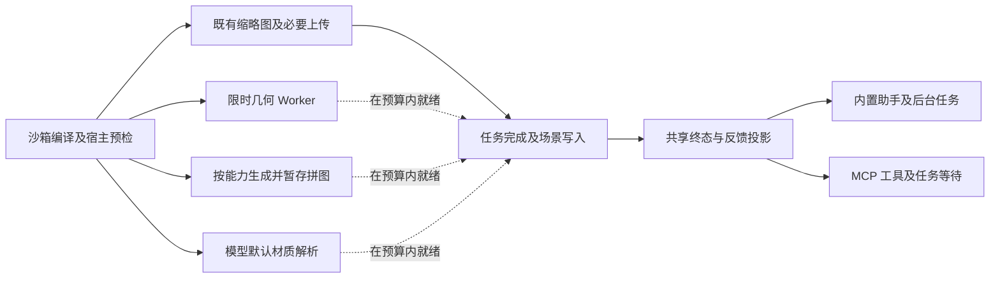

# Epic 技术方案

本方案依托已交付的场景文档、几何模块、代码沙箱和客户端任务。项目架构见 `.lti/contracts/architecture.md` 的「场景模块」「外部助手接入」。需求与验收见 [proposal.md](proposal.md)，接口目标见 [contracts.md](contracts.md)，批次与依赖见 [roadmap.md](roadmap.md)。

## 领域模型与业务规则

| 概念 | 身份与所有权 |
|---|---|
| 模型内容修订 | 不可变的几何事实，由 `creativescene` 在场景命令中提交 GLB、生成器元数据和面分配 |
| 几何检查报告 | 渲染端根据本次 GLB 和 `mount` 派生的诊断。随客户端任务结果保留，可丢弃、重算。完整且全量的检查以 GLB 字节、`mount`、检查版本为重现输入 |
| 模型默认材质回执 | 模型 GLB 槽位在无实例覆盖、无面重分配时的解析结果，另受材质目录版本影响。独立于几何报告 |
| 多视角拼图 | 渲染端对单个模型生成的素模图，按任务暂存并过期。生成和发送分别受调用能力、授权与预算控制 |
| 摆放解 | 针对一个场景修订与帧求值所得的候选变换。应用后只保存普通变换 |
| 部件变化回执 | 针对明确的基线与新内容修订的比较结果。几何变化和面分配保留分别解释 |
| 评测证据 | 仓库内固定任务与判分规则，加 M0 和后续子项留存的运行记录、产物引用和标注 |

**不变量**

- **K1 写入条件**：模型写入沿用既有编译、GLB 预检、资源上限、授权、租约和修订检查。可选反馈独立降级，模型写入只产生一次领域副作用。
- **K2 诊断输入**：检查读取通过预检的 GLB。只向助手发送约定的数据、有限数值和必要的机器标识。图面标注限于数字、单位、轴名和平台生成的视图名。
- **K3 诊断身份**：报告针对实际提交的烘焙产物。部分完成、未运行、无法取得报告与输出截断可区分；部分结果可能受运行预算影响。
- **K4 可信边界**：渲染端结果属于不可信观测，服务端验证形状、归属和引用。报告内容可以影响助手判断，因此不能把校验过的 ID、数值或图片当成可信指令、鉴权依据或场景写入基线。
- **K5 建模库版本**：同一版本的既有模型可重开和改参重烘焙。已发布版本的行为冻结；`lib@1` 在固定工具链、宿主与参数的参照组里保留字节基线。
- **K6 沙箱**：`lib@2` 与 `lib@1` 使用同一沙箱边界。平台代码按版本注入。任何 CSP 或执行权限变动均作为独立设计决定处理。
- **K7 范围**：新增诊断和拼图只由助手任务请求。模型编辑器的手动粘贴和改参沿用既有路径。
- **K8 摆放应用**：几何摆放结果与场景快照绑定，写入时按既有权限和原子命令规则应用。
- **K9 图片**：新增拼图只对具备能力和授权的调用按预算生成和交付。数值报告独立于图片能力，现有 `render_view` 的内置与 MCP 准入及图片交付各自沿用原契约。

## 架构设计

### M1 从烘焙结果到助手反馈

- **渲染端执行器**为助手任务启用可选阶段。编译和预检结束后，必要缩略图与上传沿原路径推进。CPU 检查在可终止的 Worker 内执行；可选阶段使用有界的只读几何数据，M1 明确传输所有权和峰值内存，避免无预算复制整个 GLB。拼图可复用素模着色与缩略图绘制逻辑，必要缩略图先取得所需 GPU 资源。拼图队列、GPU 读回和上传均受可选阶段预算约束。
- **完成顺序**：任务启动时从剩余租约、任务期限和运行预算中划出诊断窗口，给必要上传、完成请求和持久化预留时间。必要产物可提交且可选阶段已完成或窗口到期时提交一次；失去租约、取消或窗口结束停止相应工作，清理未引用上传，丢弃迟到的可选结果。GPU 路径若无法及时取消，释放任务等待并限制挂起工作数量。具体预算由 M0 测量、M1 确定。
- **`creativescene`** 仍拥有任务与事务。完成请求保持现有外层大小、格式和租约门槛；在合法请求内，将有界可选反馈与必需结果分开解码和校验。单个附件的未知版本、字段错误或失效引用只降级该附件。几何报告按服务端预检的 manifest 校验引用。拼图按同账号、任务及本次认领核对类别、状态和大小；不能验证画面的诊断真假。可选附件不可用时，不能走必需上传缺失的重传分支，也不能增加不可控的事务 I/O。
- **结果交付**：成功时把内容修订、写入修订和有效反馈关联到同一任务终态。冲突时可随既有可重试产物暂存，同一 GLB 的重试可复用几何报告与仍有效的拼图，重试成功后用实际写入修订构造回执。附件丢失、过期或当前调用无图像权限时，退回剩余合法结果。旧宿主只交必需产物；能理解新参数的宿主才执行裁切、独显等改变请求语义的回看，避免把普通截图当作已应用的请求。
- **共享投影**：`creativeagent` 将同一领域数值回执投影为前台工具结果、后台终态结果和外部任务读取结果。`creativemcp` 只转换协议外形。图片引用保留在任务范围内；随内置模型请求发送时按现行外发同意和内容可用性规则复查，外部读取按当前连接与任务归属复查。后台通知可读取任务结果不代表图片可再次发送。能力未知按数值反馈处理。
- **观测**：在现有阶段计时上记录检查、拼图、上传和提交时间、可选阶段缺失原因、输入规模、报告字节、图像尺寸与模型侧 token。记录可关联任务及 attempt 的标识，避免记录生成文本或图片内容。

### 兼容与失败分支

| 场景 | 写入或回看 | 反馈 |
|---|---|---|
| 检查超时或 Worker 被终止 | 依既有写入条件提交 | 有合法部分结果则标为部分完成，否则标为不可用 |
| 拼图渲染、读回、上传失败或已过期 | 依既有写入条件提交 | 数值结果照常；缺图不声明附件 |
| 报告、材质回执或图片引用不合规 | 丢弃对应附件，继续合法写入 | 其他附件独立验证与交付 |
| 认领失效、取消或必要产物失败 | 沿用既有终态、重试和拒绝规则 | 迟到的反馈不能改变终态 |
| 替换发生场景冲突 | 冲突回执和烘焙产物沿现行方式重试 | 同一产物和当前授权下可重用反馈 |
| 新服务端配旧宿主 | 普通写入与普通回看保持可用 | 新回看参数要求声明能力的宿主。缺少能力时反馈可处理的不可用状态 |
| 关闭反馈开关 | 新任务恢复既有请求外形 | 既有终态按其版本读取 |

## 技术选型

| 机制 | 选型与理由 |
|---|---|
| 几何分析 | 浏览器 Worker 消费模型坐标的只读三角数据，按需用 BVH 缩小查询范围。与渲染网格的索引、面分配、GPU 生命周期分离 |
| 多视角拼图 | 单张有尺寸标注的素模图。沿用素模着色，按现有图像链路和可选预算生成 |
| 建模库 | 平台打包并按持久化版本注入。首批用有限输入域的算子，逐项验证几何和资源预算 |
| 稳健布尔与通用网格处理 | 优先沿用现有布尔。任意网格倒角、通用抽壳、高风险清理和 WASM 需先证明收益、输入域与沙箱兼容性，再经修订纳入 |
| 建模指导 | `deploy/creative-skills/` 下的版本化内置 Skill，涵盖米制尺寸、原点、分件、挂点、可见倒角和诊断后的修订步骤 |
| 关系式摆放 | 共享领域工具先做只读求解，简单关系用已知坐标，有表面依赖时在渲染端求值。服务端在原子批次提交时核对快照和变换 |
| 补丁 | 服务端在不可变基线上精确应用文本替换，同一烘焙流程比较新旧 GLB，避免引入第二个代码写入口 |

## 关键机制

### 几何诊断的范围

先按 GLB 场景树、节点变换和 primitive 顺序建立只读几何视图。度量使用模型坐标与米。负行列式变换首选显式修正绕序语义，再分析相邻面和体积。拓扑分析的顶点焊接仅用于诊断，留存原顶点、索引、材质和分配。部件归属按最近的 `part:<id>` 祖先。重名部件无法唯一定位时按 primitive 定位，汇总标为歧义。没有命名归属时也用 primitive 定位。

| 检查 | 首版口径 |
|---|---|
| `origin_offset` | 模型包围盒的惯例参考点相对模块原点的偏移，按 `mount` 定义。输出米制向量及长度 |
| `winding_conflict` | 分析邻接的可定向区域中共享边绕序冲突。边界边或非流形边本身不给翻面结论 |
| `inverted_shell` | 仅对闭合、绕序一致并通过适用性判断的壳体检查有符号体积。自相交、无法可靠定向及内外壳语义不明的区域按规则标为不可判，不以体积符号单独下结论 |
| `coplanar_overlap` | 法线接近平行、间距在容差内且投影重叠面积过门槛。排除同一表面的正常邻接与仅边界接触。返回间距、确认重叠面积及计数 |
| 可选提示 | `separated_part` 只报最短间距，`surface_intersection` 只报确认的表面相交。闭壳包含需单独证明，不能由表面查询推导；开口、退化及薄片候选须经 M0 的误报与预算验证 |

容差按测量所用的局部尺度设相对值和米制上下限。不同量测可使用不同阈值，角度、面积和距离分别定义。M0 确定代码集、支持域、严重度和排序（例如近共面优先列重叠面积大的）。无法完成或跳过的范围随报告显式表达。字节、条数和时间预算独立；在完整扫描后裁掉输出条目与扫描本身不完整是两种状态。

### 拼图和回看

- 拼图基线方案为正面、侧面、顶面正交视图加一个斜视图，统一取景尺度，标注模型三轴尺寸。视图数量、分辨率、是否默认附带由 M0 对照实验确定。若默认附图收益不足，保留有能力且明确请求时的路径。
- `render_view` 的局部区域用原画幅内归一化矩形。先固定场景快照与帧，从完整场景求出原机位及投影，再做投影视窗裁切和独显。项目若用自动取景预设，也先按原可见场景取景。独显只过滤指定物件或部件的几何，保留照明环境；多个效果组合时约定输出画幅、裁切坐标、缺失目标错误和受支持模式。结果带实际修订与帧。基于前一截图坐标请求局部图时，快照变化须明确告知调用者，不能静默用新画面裁切。
- 可选长边上限暂定 2048；输出像素、耗时和图像输入 token 均纳入预算。M1 契约明确默认值、越界错误和宿主能力要求。

### 建模库版本的发布

- `contract_version` 记录模块形状，`lib_version` 记录选用库版本。声明缺省继续解析为 1；需要使用新函数时显式声明 2。任务入队记录预期版本；沙箱执行与宿主回执核对同一版本，服务端校验允许列表和一致性，持久化经核对的版本。冲突产物复用、已有修订重烘焙和参数编辑均沿用原版本。
- 版本变化覆盖宿主、沙箱注入、任务路由、模型内容、模型命令与 OpenAPI 生成类型。先部署能读写两版并能重烘焙的服务端和宿主，再允许进入 2 的新建任务。旧宿主只能认领自己可执行的任务，旧入口面对版本 2 提示升级。回滚通过关闭版本 2 的新增入口完成，已发布版本的读取与重烘焙继续支持。停止发布同时排查未完成任务对版本的依赖。
- `lib@2` 保持 1 的调用兼容。首批为圆角基础体、二维轮廓倒角、受限扫掠与位置挂点拼装。每个已选算子明确坐标、输入域、退化输入行为、最大输出和材质分组。扫掠先覆盖可定义稳定截面框架的路径，尖点、退化截面、超预算输入返回明确错误。按角度倒角、放样、细分、抽壳、进一步法线处理及布尔清理按已验证需求分批选入。
- 函数样例验证 AABB、坐标、面数、绕序、有效法线与材质分组，另设退化和上限样例。现行编译 5 秒、200 万三角形与 GLB 上限继续有效。发布后用 `lib@1` 的固定参照产物守住字节基线，用版本 2 的真实写入和再次打开验证持久化兼容。

### 关系式摆放与场景检查

1. **请求**：给定目标物件及期望朝向、水平落点或挂点。首版关系为地面、指定支撑区域、位置挂点。支撑区域通过指定支撑物和它的局部区域或落点选取。朝向来自目标变换或调用输入；定向挂接需另定义挂点坐标框架。
2. **求解**：按明确的场景修订和帧求值。对指定支撑区域用朝向、面方向以及底部多个采样点求出候选高度，再检查有效接触、间隙与穿入。选不到指定隔板、支撑超出坡度或接触范围、目标或父级变换无法可靠求逆时返回结构化原因。模型几何、参考点与实例变换各自按其契约处理；结果将世界变换换算到目标父级局部坐标。
3. **应用**：只读结果关联账号、场景、修订、帧、目标与支撑依赖。应用时服务端用场景命令的既有授权和校验，首版严格检查所求解的场景修订与帧。批次内若会改变求解依赖，要求先完成相关编辑再求解。过期或不匹配返回冲突，批次整体保持原子性。几何计算的客户端输出按坐标提议处理，继续验证有限值、范围和目标权限。
4. **场景检查**：按实际求值的修订和帧消耗同一空间量测，回执带物件 ID 与支持域。首版覆盖地面和选定的支撑，另报告探测到的明确物件相交。允许悬挂、刻意交叠的物件保留提示级结论。纯文本助手也能取数值结果，具体入口与截图联动由 M3 定稿。

### 源码补丁与部件变化

- 通过 `read_scene.include_code` 读取可编辑模型的源码及版本信息。补丁来源为基线内容修订、代码哈希和有界的文本替换列表。替换原文非空，在同一基线文本上须各自唯一匹配，匹配区间互不重叠，按原文区间一次性应用。匹配错误指向补丁条目。
- 复用模型读取授权、替换目标基线和写入方冲突规则。校验基线代码哈希、当前使用的库版本以及最终 UTF-8 代码上限，默认复用基线参数。变更库版本或大范围代码重写走既有整段写入路径。任务重试复用已应用补丁的烘焙产物。
- 从基线内容修订读取旧 GLB，与新 GLB 比较，不依赖旧任务报告。按可唯一匹配的命名部件计算有版本的几何指纹，输入包括模型坐标下的顶点位置、绕序和连接关系、primitive 组合与节点变换。规范记录浮点与顺序语义。若几何等价但重编码顺序不同，可保守报数据改变。只有完整、可比较且指纹一致才能报未变；重名、未命名、产物不可用或比较未完成，标明无法比较或覆盖不足。位置和尺寸差附上两次测量范围。
- 现有面分配按路径和拓扑指纹处理，保留或作废在独立回执里解释。文本小改可以影响多个部件，AC-8 验证变化可见性。

## 接口设计

- M1 目标基线为 `data: 模型检查报告` 与 `api: 助手场景工具的输入与写入结果`。先完成客户端任务归属协调，再补任务请求与终态、完成接口和回看输入。完整目标条目按交付子项绑定，后续子项对同一条目的新增内容在临近实施时基于已交付契约修订。
- M2 的版本协议同时触及 `patterns: 几何模块契约`、`data: 模型内容`、`api: 场景模型命令`、任务和 OpenAPI。M3 与 M4 根据客户端任务和模型命令的交付状态补齐纵向契约。
- 所有新增任务输出按已知版本严格解释。未知版本或未知代码不原样转发。旧产物和旧调用继续用原先的默认值。

## 评测与验证

- **最终建模质量**：按固定任务、条件和盲评规则比较基线与复测。对每个模型报告每任务配对变化、总体统计和失败率。缺陷由统一人工标注和任务量测确认。出图使用固定相机、尺度、渲染设置及展示顺序随机化。
- **检查器质量**：独立 GLB 真值集，包括可判正例、反例和本应标为未知的样例；记录每项检查的误报、漏报、覆盖率及耗尽预算比例。留出样例检验调整后的容差。部分扫描的结果不能被计为完整阴性。
- **过程与开销**：现状、数值反馈、数值加拼图按相同任务及修订预算对照。最终质量比较从头完成任务；验证反馈能否帮助手改对时，各组从同一首写产物和上下文出发，按同一修订上限继续。现状组保留该模型原有的回看能力。记录首写与最终写、总耗时、模型调用、输入输出 token、结果字节、额外内存与主线程耗时。纯文本模型对照前两组。对常见任务、压力模型和边缘几何重复测量。
- **故障与兼容**：写入阶段注入 Worker 中止、GPU 丢失、可选上传失败、租约切换、冲突与重试。核对账号与任务归属、一次写入、降级、前后台与 MCP 终态一致。回看验证新旧宿主、裁切与独显组合和过期快照。版本测试覆盖混合部署和关闭入口后的重烘焙。
- **后续变更**：M3 复测有、无有效支撑与场景期变化；M4 复测同摘要的实际变形、重复身份、匹配冲突和新旧产物不可比较。发版证据余量与阈值见 roadmap。

## 未决事项

| # | 要决定的内容 | 证据与最晚时点 |
|---|---|---|
| U1 | 检查支持域、代码表、容差、排序、检查质量与成本阈值 | M0 的真值集和压力原型，M1 实施前回填 |
| U2 | 拼图默认策略、视图安排、投入阈值，回看分辨率与时限 | M0 对照证明收益，M1 实施前定稿 |
| U3 | `lib@2` 按任务选择的算子表和预算 | M0 原型只试最大不确定项，M2 实施前定稿 |
| U4 | 通用网格处理、稳健布尔及 WASM 的收益和边界 | 有代表样例和沙箱证据才提出修订；现草案沿用现有边界 |
| U5 | M3 指定支撑区域表示、采样与可判范围、场景数值回执入口 | M0 验证隔板和斜面风险，M3 实施前定稿 |
| U6 | 固定评测模型、执行预算、任务与盲评规则 | M0 生成基线前冻结；阈值在基线后、交付组复测前冻结 |
| U7 | 是否增加推理强度 | 独立对照收益和预算，避免混入功能效果。最晚 M2 实施前决定是否纳入 |
| U8 | 客户端任务契约、完成接口、旧宿主反馈与 MCP 能力来源 | 协调 `creative-mcp-server`，M1 实施前补齐 |
| U9 | 参考点功能、姿态与帧对 M3 的基准 | M3 实施前核对已交付基线并补契约 |
| U10 | 补丁所在基线、指纹规范、无法比较的展示 | M4 实施前定稿，按已交付几何及面分配契约兼容 |
